# AutoReel — Arquitectura

> Estado: rama `main` al 2026-11-06. Están en el código las **fases 1 a 5**, los **proveedores de Google** (ADR 0017), la **fase 7 (Facturación)**, adelantada a la 6, y la **revisión del flujo del negocio** (entradas del mismo nombre en `CHANGELOG.md`). *Actualización del 2026-11-12:* también describe "Reintentar" (PR #12) y la **mejora de la calidad del video** de la rama `mejora-calidad-video` (ADR 0021):
> - guion publicitario y cierre escrito por la IA;
> - sin guion de respaldo, con reintentos automáticos;
> - movimientos de cámara 3D con el prompt en el paquete de nicho;
> - fundidos entre planos;
> - migración `V9`.
> La **fase 6 (Instagram) está en pausa** y las fases 8 y 9 están pendientes (`docs/plan-de-desarrollo.md`, sección 9). Este documento describe lo que existe hoy en el código y marca como **(futuro, fase N)** lo que todavía no está implementado. Se actualiza al cerrar cada fase (especificación, sección 23).
>
> Documentos relacionados: `docs/especificacion.md` (secciones 7, 8, 11, 12 y 19), `docs/contexto-vision.md`, `docs/plan-de-desarrollo.md` (secciones 9 y 10), `docs/api.md`, `docs/modelo-de-datos.md`, `docs/plan-fase-2.md`, `docs/plan-fase-3.md`, `docs/plan-fase-4.md`, `docs/plan-fase-5.md`, `docs/guias/nuevo-nicho.md`, `docs/guias/nuevo-proveedor-ia.md` y los ADR de `docs/decisiones/` (en especial 0017 a 0021).

---

## 1. Contexto

AutoReel convierte las fotos de los productos de un negocio pequeño (en el MVP, pastelerías) en un Reel de 15 segundos generado con IA y lo publica en Instagram. Hay dos actores con acceso al sistema: el **administrador** de AutoReel, que crea y gestiona los negocios, y el **usuario del negocio**, que completa su perfil, registra su catálogo, desde la fase 3 cuenta en el chat qué video quiere hoy y, desde la fase 4, revisa y ajusta la propuesta del video (el storyboard) que arma el sistema con un guion escrito por IA. Desde la fase 5 aprueba el storyboard ("Crear mi video"), el sistema genera los clips con IA y compone el MP4 de 15 segundos, y el usuario lo revisa, regenera un plano, lo aprueba y lo descarga. Los clips **no tienen respaldo sin IA** (revisión del flujo, 2026-11-06): si el modelo de video no está disponible, "Crear mi video" se desactiva, y si un clip no se consigue, el video pasa a `ERROR` y se devuelve el video del día (sección 5.6). Desde el 2026-11-12 **el guion tampoco** (ADR 0021): si el modelo de texto falla, se reintenta solo durante 5 minutos y luego el video pasa a `ERROR`, y "Reintentar" lo vuelve a escribir sin gastar el video del día (sección 5.4). Desde la fase 7 el administrador además registra pagos, recibe notificaciones, gestiona planes, beneficios temporales, modelos de IA y sus claves, consulta los costos y puede **entrar como un negocio** para darle soporte.

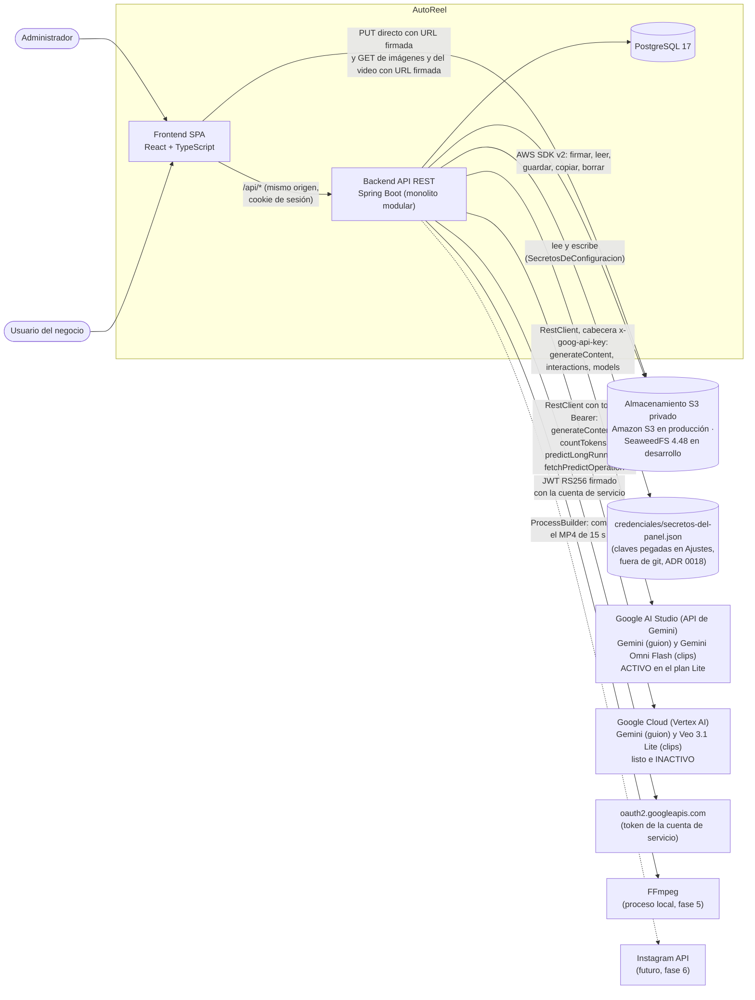

Desde la fase 2 existe la integración con el almacenamiento de archivos: el navegador sube las fotos y el logo **directamente** al bucket con una URL firmada por el backend, y las muestra con URLs firmadas de lectura. Desde la fase 4 el guion lo escribe un modelo de texto y desde la fase 5 los clips los anima un modelo de video; la composición del MP4 la hace **FFmpeg**, que corre como proceso en el mismo servidor (sección 6).

Los modelos de IA llegan por **dos caminos de Google**, y cuál se usa es un dato de la base de datos (RN-56, ADR 0017):

- **Google AI Studio (activo):** una sola clave de API (`GEMINI_API_KEY`, secreto `autoreel/gemini`) sirve para el guion con Gemini (adaptador `GEMINI`) y para los clips con **Gemini Omni Flash** (adaptador `GEMINI_OMNI`). Es lo que usa el plan Lite.
- **Google Cloud / Vertex AI (listo e inactivo):** una cuenta de servicio (`GOOGLE_CLOUD_CREDENCIAL_ARCHIVO`, secreto `autoreel/google-cloud`) sirve para el guion con Gemini en Vertex AI (adaptador `GEMINI_CLOUD`) y para los clips con **Veo 3.1 Lite** (adaptador `VEO`). Pasar a este camino es activar sus modelos y cambiarlos en el plan, sin programar.

Desde la fase 7 el administrador puede **pegar las claves en Ajustes**: se guardan en un JSON fuera del repositorio que tiene prioridad sobre el `.env` (ADR 0018, sección 5.8). Sin credencial de texto no hay storyboard: desde el 2026-11-12 no hay guion de respaldo y el video pasa a `ERROR` tras 5 minutos de reintentos (ADR 0021, sección 5.4). Sin modelo de video disponible no se puede crear el video (sección 5.6). Instagram (línea punteada) llega en la fase 6.

**Decisión de base (sec. 12.1, ADR 0001):** backend API REST en Spring Boot y frontend React servido como archivos estáticos. La misma API servirá más adelante a una app móvil.

### 1.1 Tecnologías

| Capa | Tecnología |
|---|---|
| Backend | Java 21, **Spring Boot 4.1.2** (Spring Security 7.1, Jackson 3, Flyway 12), Maven wrapper (`mvnw`) |
| Persistencia | Spring Data JPA, PostgreSQL 17, Flyway con `ddl-auto=validate`; columnas `jsonb` mapeadas con `@JdbcTypeCode(SqlTypes.JSON)` |
| Seguridad | Spring Security con JWT HS256 (`spring-security-oauth2-jose`, solo el codificador y decodificador Nimbus), BCrypt |
| Archivos (fase 2) | **AWS SDK for Java v2** (BOM `2.46.7`, artefacto `s3`: `S3Client` y `S3Presigner`); **TwelveMonkeys ImageIO 3.12.0** (`imageio-webp` para leer WebP e `imageio-jpeg`, que trae `imageio-metadata` para leer la orientación EXIF) |
| IA (fase 4 y proveedores de Google) | `RestClient` de spring-web (sin el starter de restclient) con `JdkClientHttpRequestFactory` para los tiempos de espera. Texto: API `generateContent` de Gemini con `responseJsonSchema`, en Google AI Studio (`GeminiGuionista`) o en Vertex AI (`GeminiCloudGuionista`), con la lectura común de `RespuestaGemini` |
| Video con IA (fase 5 y proveedores de Google) | Google AI Studio: API de interacciones (`POST /v1beta/interactions`) de Gemini Omni Flash, síncrona por defecto (`OmniGeneradorDeClips`). Google Cloud: `predictLongRunning` y `fetchPredictOperation` de Veo (`VeoGeneradorDeClips`), con el token de acceso de Google pedido con un JWT RS256 firmado con **Nimbus** (`nimbus-jose-jwt`, ya incluido por `spring-security-oauth2-jose`) y la clave de la cuenta de servicio (`GoogleCloud` y `TokenDeGoogle`) |
| Composición (fase 5) | **FFmpeg** como proceso externo (`ProcessBuilder`), con `drawtext`, `zoompan`, `concat`, `libx264` y `aac`. En la PC de desarrollo, FFmpeg 9 instalado con winget; en el CI, el paquete de Ubuntu 24.04 (`apt-get install ffmpeg`); en producción irá en la imagen Docker **(futuro, fase 8)**. Fotos y degradado del cierre preparados en Java (`ImageIO` con TwelveMonkeys, `Graphics2D`); tamaño de los textos medido con `FontMetrics` del mismo TTF |
| Tareas programadas (fases 4, 5 y 7) | `@EnableScheduling` en `ConfiguracionTareas` y `@Scheduled` en `ProcesadorDeGuiones`, desde la fase 5 en `ProcesadorDeVideos` (dos tareas) y desde la fase 7 en `TareaDiariaDePagos` (cron `0 10 0 * * *` en `America/Lima`, y también al arrancar); pool de 3 hilos (`spring.task.scheduling.pool.size`), sin colas externas (ADR 0004) |
| Documentación de la API | springdoc-openapi 3.2.0 (solo en el perfil `dev`) |
| Pruebas | JUnit, MockMvc, Testcontainers 2 (`postgres:17-alpine` y `chrislusf/seaweedfs:4.48`); desde la fase 5, FFmpeg y `ffprobe` reales en `FfmpegComponedorTest`; servidores simulados para cada proveedor de IA (`ServidorGeminiSimulado`, `ServidorOmniSimulado`, `ServidorVeoSimulado`) |
| Frontend | React 19, TypeScript, Vite 8, Tailwind CSS 4, TanStack Query 5, React Router, lint con oxlint |
| Entorno local | Docker Compose con `postgres:17-alpine` y `chrislusf/seaweedfs:4.48` (S3 compatible), publicados solo en `127.0.0.1`; FFmpeg instalado en la PC (fase 5) |
| CI | GitHub Actions: en el backend (`ubuntu-24.04` desde la fase 5) instala FFmpeg con apt y ejecuta `./mvnw -B verify`; en el frontend, `npm ci`, `npm run lint` y `npm run build` |

Se usa Spring Boot 4 y no 3 porque la rama 3.x salió del soporte libre y ya no se ofrece en Spring Initializr (ADR 0006).

---

## 2. Backend: monolito modular

Un solo servicio Spring Boot (`com.autoreel.AutoReelApplication`, con `@ConfigurationPropertiesScan`), organizado **por módulos de negocio** (ADR 0002). Cada módulo agrupa sus capas internas, y solo se crean las capas que el módulo necesita en cada fase (regla 8: sin abstracciones que no se usen).

### 2.1 Capas

| Capa | Contenido | Ejemplos reales |
|---|---|---|
| `api` | Controladores REST y DTO (siempre `record`) | `AuthController`, `AdminNegocioController`, `PlanController`, `NichoController`, `PerfilController`, `ProductoController`, `ArchivosController`, `ChatController`, `VideoController` y, desde la fase 7, `SuscripcionController`, `NotificacionController`, `AdminIntegracionesController`, `CostoController`; `Sesion`, `Perfil`, `ProductoVista`, `SolicitudProducto`, `ConversacionVista`, `SolicitudMensaje`, `VideoVista`, `VideoResumen`, `SolicitudPlano`, `PlanResumen`, `SolicitudPlan`, `SuscripcionDtos`, `IntegracionDtos` |
| `aplicacion` | Servicios con los casos de uso y las transacciones | `ServicioAutenticacion`, `ServicioGestionNegocios`, `ServicioPerfil`, `ServicioCatalogo`, `ServicioDeArchivos`, `VerificadorDeImagenes`, `ServicioChat`, `ServicioGuion`, `ServicioVideos`, `CreadorDeVideos`, `ProcesadorDeGuiones`, `FabricaDeProveedores`, `ResolutorDePlanEfectivo`, `ServicioCostos`; desde la fase 5, `ServicioConsumo`, `ServicioGeneracion`, `ServicioComposicion`, `ProcesadorDeVideos`, `BibliotecaMusical`; desde la fase 7, `ServicioSuscripciones`, `ServicioNotificaciones`, `TareaDiariaDePagos`, `ServicioPlanes`, `ServicioIntegraciones` |
| `dominio` | Entidades JPA, enumeraciones, puertos y reglas puras | `Usuario`, `Negocio`, `PerfilNegocio`, `Producto`, `FotoProducto`, `Plan`, `ModeloIA`, `AlmacenDeArchivos`, `PropositoArchivo`, `PaqueteNicho`, `GuionChat`, `PlantillaVideo`, `Temporada`, `ValidadorDeRespuestas`, `CalculadoraEstadoPago`, `Conversacion`, `MensajeChat`, `AgrupadorDeMensajes`, `EvaluadorDeRespuesta`, `Video`, `Plano`, `ValidadorDeGuion`, `Guionista`, `ProveedorDeSecretos`, `AvisoDeIntegracion`, `RegistroCosto`; desde la fase 5, `GeneradorDeClips`, `ComponedorDeVideo`, `ConsumoDiario`, `PistaMusical`, `EstadoPlano`, `MotivoRespaldoPlano`, `PistaDelNicho`; desde la fase 7, `AlmacenDeSecretos`, `Pago`, `MedioPago`, `BeneficioTemporal`, `NotificacionAdmin`, `TipoNotificacion`, `CalculadoraFechaPago` |
| `infraestructura` | Repositorios Spring Data y adaptadores externos | `UsuarioRepositorio`, `NegocioRepositorio`, `PerfilNegocioRepositorio`, `ProductoRepositorio`, `ConversacionRepositorio`, `VideoRepositorio`, `RegistroCostoRepositorio`, `S3Almacen`, `ConfiguracionAlmacenamiento`, `PropiedadesAlmacenamiento`, `InicializadorAdministrador`, `GeminiGuionista`, `SecretosDeConfiguracion`; desde la fase 5, `VeoGeneradorDeClips`, `TokenDeGoogle`, `FfmpegComponedor`, `DisenoDeTextos`, `PreparadorDeFotos`, `ConsumoDiarioRepositorio`, `PistaMusicalRepositorio`; con los proveedores de Google, `GeminiCloudGuionista`, `OmniGeneradorDeClips`, `GoogleCloud`, `RespuestaGemini`; desde la fase 7, `AvisoDeIntegracionEnPanel`, `PagoRepositorio`, `BeneficioRepositorio`, `NotificacionRepositorio` |

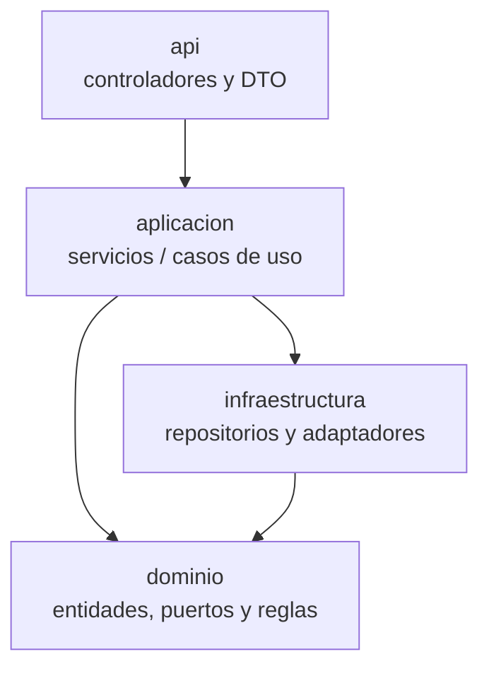

Observaciones sobre el código actual:

- `NichoController` usa `RegistroDeNichos` y `NegocioRepositorio` directamente, sin servicio de aplicación, porque no tiene lógica. `PlanController` lo hacía así hasta la fase 5; desde la fase 7 crea y edita planes, así que usa `ServicioPlanes`.
- Los servicios construyen y devuelven los DTO de su módulo `api`: `ServicioGestionNegocios` (`NegocioResumen`, `NegocioDetalle`, `ContrasenaTemporal`), `ServicioPerfil` (`Perfil`), `ServicioCatalogo` (`ProductoVista`), `ServicioChat` (`ConversacionVista`), `ServicioPlanes` (`PlanResumen`), `ServicioSuscripciones` (`SuscripcionDtos`) y `ServicioIntegraciones` (`IntegracionDtos`).
- Un puerto puede implementarse en otro módulo: `AvisoDeIntegracion` es un puerto de `ia.dominio` y su implementación, `AvisoDeIntegracionEnPanel`, vive en `facturacion.infraestructura`, porque las notificaciones son de ese módulo. Así `ia` no depende de nadie y `video` avisa sin conocer el panel.
- Las reglas puras del chat (`AgrupadorDeMensajes`, `EvaluadorDeRespuesta`) y del guion (`ValidadorDeGuion`, fase 4; `GuionDeRespaldo` existió hasta el 2026-11-12) son clases `final` con métodos estáticos, sin Spring ni base de datos: se prueban con pruebas unitarias simples.
- `ServicioGuion` (fase 4) no usa `@Transactional`: abre transacciones cortas con `TransactionTemplate`, porque las llamadas al modelo de IA deben ir fuera de toda transacción (sección 5.4). `ServicioGeneracion` y `ServicioComposicion` (fase 5) siguen el mismo patrón: ni las llamadas al modelo de video (Gemini Omni Flash o Veo) ni FFmpeg corren dentro de una transacción (sección 5.5). La excepción es "Probar conexión" de `ServicioIntegraciones` (fase 7), que hace su llamada corta, sin generar contenido, dentro de la transacción que guarda el resultado (sección 5.8).
- El paquete de nicho tiene su propio subpaquete por rubro: `nicho/pasteleria` (`PaquetePasteleria`), fuera de las cuatro capas, porque es contenido del nicho y no un módulo de negocio.

### 2.2 Módulos existentes

Paquete base: `backend/src/main/java/com/autoreel/`.

| Módulo | Capas presentes | Contenido real |
|---|---|---|
| `compartido` | `config`, `datos`, `error`, `seguridad` | `ConfiguracionReloj` (`Clock` en `America/Lima`), `ConfiguracionOpenApi`, `PropiedadesAplicacion` (`autoreel.url-aplicacion`), **`ConfiguracionTareas`** (fase 4: `@EnableScheduling`, condicionada a `autoreel.tareas.activas`, `true` por defecto); **`DatosDeEjemplo`** (solo perfil `dev`, fase 2); `ErrorApi`, `ExcepcionDeNegocio`, `ManejadorGlobalDeErrores`; `ConfiguracionSeguridad`, `FiltroJwtCookie`, `FiltroCookieCsrf`, `ServicioJwt`, `CookieDeSesion`, `RespuestasDeSeguridad`, `PropiedadesSeguridad`, `UsuarioAutenticado`. Desde la fase 7 (ADR 0019): `ServicioJwt.emitirComoNegocio` (claim `neg`), `FiltroJwtCookie` con `NegocioRepositorio` para aceptar ese claim y `UsuarioAutenticado.comoAdministrador` (sección 9.6) |
| `auth` | `api`, `aplicacion`, `dominio`, `infraestructura` | `AuthController` (login, logout, cambiar contraseña, `yo` y, desde la fase 7, `volver-al-panel`); `Sesion` (desde la fase 2 incluye `onboardingCompleto`; desde la fase 7, `administrador` y `Sesion.comoNegocio`); `ServicioAutenticacion` (desde la fase 7, `entrarComoNegocio` y `usuarioDelNegocio`); `Usuario`, `Rol`, `ReglasDeContrasena`, `GeneradorDeContrasenaTemporal`; `UsuarioRepositorio`, `InicializadorAdministrador` |
| `admin` | `api`, `aplicacion` | `AdminNegocioController` (listar, crear, detalle, reiniciar contraseña, suspender, reactivar, nichos; desde la fase 2, `GET /negocios/{id}/productos`; desde la fase 7, `POST /negocios/{id}/entrar`); `ServicioGestionNegocios` (al crear un negocio también crea su perfil vacío; el detalle incluye el perfil). Desde la fase 5: `NegocioResumen.videosDelMes` (RF-02) y `NegocioDetalle.videos` (`Videos(delMes, recientes)` con `VideoDelNegocio`, RF-05), con `ServicioConsumo.delMes` y `VideoRepositorio.listarDeNegocio`. Desde la fase 7: `NegocioResumen` con el `plan` y el `modeloVideo` que rigen hoy y `conBeneficio`; `NegocioDetalle` con `planEfectivo` (`PlanEfectivo`, de `ResolutorDePlanEfectivo.resolver`), `costoDelMes` (`ServicioCostos.deNegocio`) y `Suscripcion.diaPago`; `VideoDelNegocio` con su `modeloVideo` y su `costoEstimado`. **`ServicioIntegraciones`** y **`AdminIntegracionesController`** (`IntegracionDtos`): modelos de IA, "Probar conexión" y credenciales; orquesta `ia` y `facturacion` (sección 5.8) |
| `negocio` | `api`, `aplicacion`, `dominio`, `infraestructura` | `PerfilController`, `Perfil`; `ServicioPerfil` (con `PerfilParaAdmin` y `RespuestaLegible`); `Negocio` (con `cambiarNombre` y `completarOnboarding`), `EstadoNegocio`, **`PerfilNegocio`**; `NegocioRepositorio` (desde la fase 3 con `bloquear(id)`, `PESSIMISTIC_WRITE`), **`PerfilNegocioRepositorio`** |
| `catalogo` (fase 2) | `api`, `aplicacion`, `dominio`, `infraestructura` | `ProductoController`, `ProductoVista`, `SolicitudProducto` (desde la revisión del flujo, `temporadas` es opcional); `ServicioCatalogo` (desde la fase 3 también `carrusel`, `paraVideo`, `elegidoParaVideo`, `crearDesdeChat`, `urlDeFoto` y el record `Carrusel`); `Producto` (desde la fase 3 con `enCatalogo`, `dejarFueraDelCatalogo` y `disponibleParaVideo`), `FotoProducto`, `TipoFoto` (`ENTERO`, `DETALLE`, `PORCION`), `EstadoProducto` (`ACTIVO`, `ARCHIVADO`); `ProductoRepositorio` (desde la fase 3 con `listarParaCarrusel` y `buscarParaVideo`) |
| `chat` (fase 3) | `api`, `aplicacion`, `dominio`, `infraestructura` | `ChatController` (`SolicitudConversacion`), `ConversacionVista` (`Paso`, desde la revisión del flujo con `ejemplo` y `admiteTexto`; `Mensaje`, `ProductoCarrusel`, `Resumen`), `SolicitudMensaje` (`ProductoNuevo`); `ServicioChat` (desde la revisión del flujo, `escribirEnBotones`, sección 5.3); `Conversacion`, `MensajeChat`, `EstadoConversacion` (`EN_CURSO`, `COMPLETA`, `ABANDONADA`), `AutorMensaje` (`SISTEMA`, `USUARIO`), `AgrupadorDeMensajes` (`Resultado`), `EvaluadorDeRespuesta` (`Evaluacion`, `Aceptada`, `Rechazada`); `ConversacionRepositorio`. Desde la fase 4: el evento **`ConversacionCompletada(conversacionId, negocioId, respuestas)`** y el campo `videoId` de `ConversacionVista`. Ver sección 5.3 |
| `almacenamiento` (fase 2) | `api`, `aplicacion`, `dominio`, `infraestructura` | `ArchivosController` (`SolicitudSubida`); `ServicioDeArchivos` (`SubidaFirmada`, `ImagenGuardada`), `VerificadorDeImagenes`, `ImagenVerificada`; puerto **`AlmacenDeArchivos`** (desde la fase 5 con `urlDeDescargaComoAdjunto`, RF-25), `ArchivoAlmacenado`, `PropositoArchivo` (`LOGO`, `FOTO_PRODUCTO`, `FOTO_LOCAL`); `S3Almacen`, `ConfiguracionAlmacenamiento`, `PropiedadesAlmacenamiento` |
| `nicho` | `api`, `dominio`, `pasteleria` | `NichoController` (`ConfiguracionNicho`, `TemporadaVisible`); `Nicho`, `Opcion`, **`PaqueteNicho`**, `Pregunta` (`TipoPregunta`, `Condicion`; desde la revisión del flujo, `maxOtro` y `admiteOtro`), `RegistroDeNichos`, `Temporada` (`Clase`, `TipoRegla`, `Regla`), `ValidadorDeRespuestas` (desde la revisión del flujo admite "Otros"), **`GuionChat`** (fase 3: `PasoChat`, `TipoPaso`, `Condicion`, `Mensajes`, `Sugerencia`; desde la revisión del flujo, `PasoChat.ejemplo`, `opcionLibre`, `claveLibre` y `admiteTexto`) y, desde la fase 4, **`PlantillaVideo`** (`PlanoPlantilla`; `FuenteDeRespaldo` se quitó el 2026-11-12), **`Movimientos`** (`Movimiento`; desde el 2026-11-12, con `plantillaDeToma`, `prohibiciones`, `negativos`, `minimoPlanosCamara3d`, `camara3d` y `promptDeToma`), **`Vocabulario`** y **`Texto`** (normalización, frases y conteo de palabras); desde la fase 5, **`PistaDelNicho`**; `PaquetePasteleria` + `resources/nichos/pasteleria/onboarding.json`, `temporadas.json`, desde la fase 3 `chat.json`, desde la fase 4 `plantilla.json`, `movimientos.json`, `vocabulario.json` y `guion.md`, y desde la fase 5 `musica.json` (con la carpeta `musica/`) y la carpeta `fuentes/`. Ver sección 3.2 |
| `facturacion` | `api`, `aplicacion`, `dominio`, `infraestructura` | `Plan`, `Suscripcion`, `EstadoPago`, `CalculadoraEstadoPago`; `PlanRepositorio`, `SuscripcionRepositorio` (desde la fase 4 con `buscarConPlanYModelos`); **`ResolutorDePlanEfectivo`** (fase 4; desde la fase 7 con beneficios). Desde la fase 7: `PlanController` (`GET`, `POST`, `PUT /api/admin/planes`), `SuscripcionController` (pagos, cambio de plan y beneficios), `NotificacionController`; **`ServicioSuscripciones`**, **`ServicioNotificaciones`**, **`TareaDiariaDePagos`**, **`ServicioPlanes`**; `Pago`, `MedioPago`, `BeneficioTemporal`, `NotificacionAdmin`, `TipoNotificacion`, **`CalculadoraFechaPago`**; `PagoRepositorio`, `BeneficioRepositorio`, `NotificacionRepositorio` y **`AvisoDeIntegracionEnPanel`** (implementa el puerto `ia.dominio.AvisoDeIntegracion`). Ver sección 5.7 |
| `ia` | `aplicacion`, `dominio`, `infraestructura` | `ModeloIA` (desde la fase 7 con `registrarPrueba`), `TipoModelo`, `EstadoModelo`, `UnidadCosto`; `ModeloIARepositorio`. Desde la fase 4: **`FabricaDeProveedores`**; puertos **`Guionista`** (`RespuestaDelModelo`), **`ProveedorDeSecretos`** y **`AvisoDeIntegracion`**; `ErrorDeProveedor` (`Tipo`: `CREDENCIAL_INVALIDA`, `CONFIGURACION_INVALIDA`, `NO_DISPONIBLE`); adaptadores **`GeminiGuionista`** (`GEMINI`, `PropiedadesGemini`) y **`SecretosDeConfiguracion`** (`PropiedadesSecretos`). Desde la fase 5: puerto **`GeneradorDeClips`** (`SolicitudDeClip`, `EstadoDeClip`: `EnCurso`, `Listo`, `Fallido`), adaptador **`VeoGeneradorDeClips`** (`VEO`) con **`TokenDeGoogle`** (`CuentaDeServicio`), `FabricaDeProveedores.generadorDeClips` y `videoDisponible`, y secretos en archivo (`autoreel.secretos-en-archivo`). Con los proveedores de Google (ADR 0017): **`GeminiCloudGuionista`** (`GEMINI_CLOUD`), **`OmniGeneradorDeClips`** (`GEMINI_OMNI`, `PropiedadesOmni`) y los componentes compartidos **`GoogleCloud`** (`PropiedadesGoogleCloud`) y **`RespuestaGemini`**. Desde la fase 7: puerto **`AlmacenDeSecretos`** (`Origen`), implementado por `SecretosDeConfiguracion`; `probar` en `Guionista` y `GeneradorDeClips`; `FabricaDeProveedores.probar` y `adaptadores`. No depende de ningún otro módulo. Ver secciones 6 y 7 |
| `video` (fases 4 y 5) | `api`, `aplicacion`, `dominio`, `infraestructura` | `VideoController`, `VideoVista`, `VideoResumen`, `SolicitudPlano`; `CreadorDeVideos`, `ProcesadorDeGuiones`, `ServicioGuion`, `ServicioVideos`, `LectorDeDatosDelVideo`, `InstruccionesDelGuion`, `RespuestasDelChat`, `CamposDelPerfil`; `Video`, `Plano`, `EstadoVideo`, `DatosDelGuion`, `GuionPropuesto` (desde el 2026-11-12 con `CierrePropuesto`), `ValidadorDeGuion`; `VideoRepositorio`. `MotivoRespaldo` y `GuionDeRespaldo` se borraron el 2026-11-12 (ADR 0021). Ver sección 5.4. Desde la fase 5: `VideoVista.GeneracionVista` y `ConsumoVista`, `VideoController.Descarga`; `ServicioConsumo`, `ServicioGeneracion`, `ServicioComposicion`, `ProcesadorDeVideos`, `BibliotecaMusical`; puerto **`ComponedorDeVideo`** (`Composicion`, `PlanoAComponer`, `CierreAComponer`, `ErrorDeComposicion`), `ConsumoDiario`, `PistaMusical`, `EstadoPlano`, `MotivoRespaldoPlano`; adaptador **`FfmpegComponedor`** (`PropiedadesFfmpeg`), `DisenoDeTextos`, `PreparadorDeFotos`, desde el 2026-11-12 `GraficosDelVideo`, `ConsumoDiarioRepositorio`, `PistaMusicalRepositorio`. Ver sección 5.5. Desde la revisión del flujo, sin respaldo sin IA para los clips: `ServicioGeneracion.sinClip`, `Plano.conservarClipAnterior` y `Video.regeneracionFallida` (sección 5.6) |
| `costos` (fase 4) | `api`, `aplicacion`, `dominio`, `infraestructura` | `ServicioCostos` (`registrar`, `registrarSolicitud` y, desde la fase 7, `delMes`, `deNegocio` y `mesActual`, con los records `Costo`, `CostoDeNegocio` y `CostosDelMes`); `RegistroCosto`, `ConceptoCosto` (`GUION`, `CLIP`, `PRUEBA`); `RegistroCostoRepositorio`, `SumaDeCosto`. Desde la fase 7, **`CostoController`** (`GET /api/admin/costos?mes=AAAA-MM`). Registra el costo de cada llamada a un proveedor de IA (RN-32): desde la fase 5 también los clips (`CLIP`, por segundo). `PRUEBA` existe pero no se usa: "Probar conexión" usa llamadas sin costo (ADR 0018) |

En la fase 2, `Nicho` y `RegistroDeNichos` se movieron del paquete plano `nicho` a `nicho.dominio`.

### 2.3 Módulos futuros

Según la sección 12.2 de la especificación y la hoja de ruta del plan:

| Módulo | Responsabilidad | Fase |
|---|---|---|
| `chat` y `catalogo` (ampliación) | Fechas especiales y temporadas en el chat (botón "Fecha especial", carrusel ordenado por temporada, saludo de temporada; caso V13) junto con el calendario de fechas especiales (RF-31), y volver a pedir las temporadas en el catálogo. **Fuera del MVP por decisión del usuario** (ver 5.3 y `docs/plan-de-desarrollo.md`, sección 10) | Trabajo futuro, sin fase asignada |
| `ia` (ampliación) | `ProveedorDeSecretos` y `AlmacenDeSecretos` con AWS Secrets Manager (leer y escribir con `PutSecretValue`, ADR 0018); debe existir antes de desplegar | (futuro, fase 8) |
| `video` (ampliación) | Publicar el video aprobado y los estados `PROGRAMADO` y `PUBLICADO` | (futuro, fase 6) |
| `publicacion` | Instagram y programación | (futuro, fase 6) |
| `nicho` (ampliación) | Música con licencia comercial en lugar de las pistas de relleno (pendiente P-02) y pistas cargadas por el administrador; más estilos de video y "aprender de Otros" (plan, sección 10.1) | Sin fase asignada (depende de P-02) |

La fase 7 (pagos, notificaciones, planes, beneficios, integraciones, claves, costos y entrar como el negocio) ya no figura aquí: está en el código (secciones 5.7, 5.8 y 9.6).

### 2.4 Diagrama de módulos

Las flechas indican "usa a". Los módulos con borde punteado son futuros. Las dependencias entre módulos existentes son las reales del código.

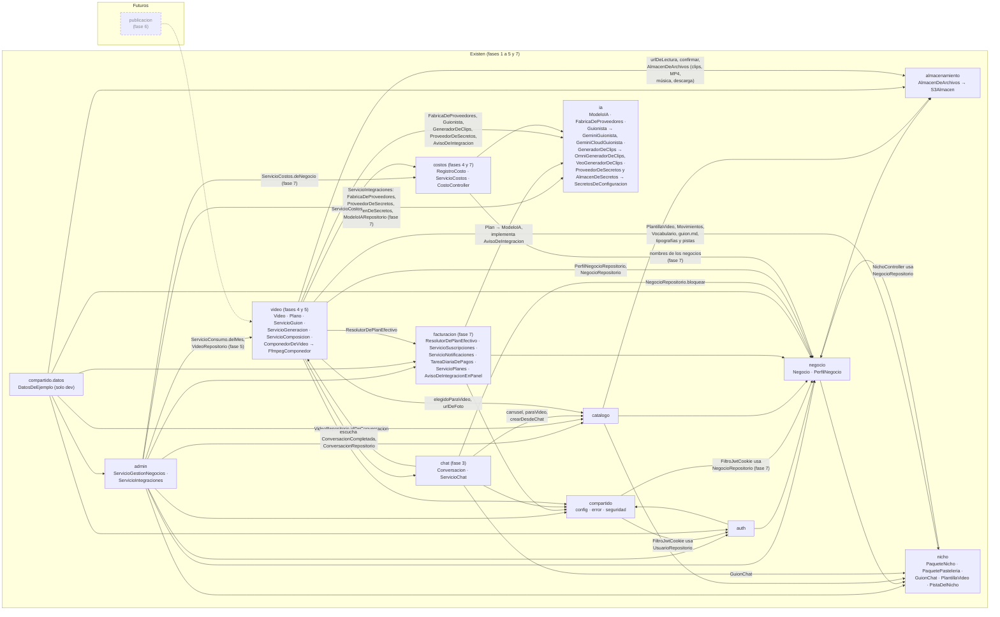

Notas:

- `compartido.seguridad` depende de `auth` (`ConfiguracionSeguridad` y `FiltroJwtCookie` usan `UsuarioRepositorio`; `FiltroJwtCookie` y `ServicioJwt` usan `Usuario`; `UsuarioAutenticado` usa `Rol`), y `auth.api` usa `ServicioJwt`, `CookieDeSesion` y `UsuarioAutenticado` de `compartido`. Es una dependencia en ambos sentidos entre esos dos paquetes. Desde la fase 7, `ConfiguracionSeguridad` y `FiltroJwtCookie` también usan `NegocioRepositorio`, para comprobar que existe el negocio del claim `neg` (sección 9.6); `AdminNegocioController` usa `ServicioJwt` y `CookieDeSesion` para emitir esa cookie.
- `negocio ↔ nicho`: `ServicioPerfil` usa `RegistroDeNichos`, `PaqueteNicho` y `ValidadorDeRespuestas`; `NichoController` usa `NegocioRepositorio` para saber el nicho del negocio de la sesión.
- `admin → catalogo` y `admin → negocio`: `AdminNegocioController` usa `ServicioCatalogo` para el catálogo del negocio, y `ServicioGestionNegocios` usa `ServicioPerfil` (crear el perfil vacío y el perfil del detalle).
- `catalogo` y `negocio` usan `almacenamiento` solo a través de `ServicioDeArchivos` (confirmar una subida y obtener URLs de lectura); nunca ven el puerto ni el SDK.
- `facturacion → ia`: `Plan` referencia dos `ModeloIA` (`modeloTexto` y `modeloVideo`) y `ServicioPlanes` usa `ModeloIARepositorio` para validarlos (RN-47). Desde la fase 7, `AvisoDeIntegracionEnPanel` implementa el puerto `ia.dominio.AvisoDeIntegracion`: `ServicioGuion` y `ServicioGeneracion` avisan por el puerto y Spring les entrega esa implementación, así que ni `ia` ni `video` dependen de `facturacion` para avisar.
- `admin → ia` y `admin → facturacion` (fase 7): `ServicioIntegraciones` **orquesta** los dos módulos: lee y cambia los `ModeloIA`, prueba la conexión con `FabricaDeProveedores.probar`, guarda las claves con `AlmacenDeSecretos` y consulta `PlanRepositorio` y `SuscripcionRepositorio` para mostrar qué planes usan cada modelo y para no desactivar uno en uso (RN-48). `ServicioGestionNegocios` usa `ResolutorDePlanEfectivo.resolver`, `BeneficioRepositorio` y `SuscripcionRepositorio` para el plan que rige hoy.
- `admin → costos` (fase 7): `ServicioGestionNegocios` usa `ServicioCostos.deNegocio` para el costo del mes del detalle. `costos → negocio`: `ServicioCostos.delMes` lee los nombres de los negocios con `NegocioRepositorio`.
- `compartido.datos.DatosDeEjemplo` solo existe en el perfil `dev` y usa los servicios de aplicación de los demás módulos, para que el negocio de ejemplo pase por las mismas validaciones.
- `chat → catalogo`: `ServicioChat` usa solo `ServicioCatalogo` (`carrusel`, `paraVideo`, `elegidoParaVideo`, `crearDesdeChat`, `urlDeFoto`) y la entidad `Producto`; nunca `ProductoRepositorio` ni el almacenamiento. `chat → nicho`: lee el guion con `RegistroDeNichos.de(nicho).guionDelChat()`. `chat → negocio`: `NegocioRepositorio.bloquear` (RN-09 y serializar el inicio de conversaciones) y la entidad `Negocio`.
- `chat ↔ video` (fase 4): `ServicioChat` publica `ConversacionCompletada` (un record de `chat.dominio`) y no conoce a quien lo escucha; `CreadorDeVideos` (`video.aplicacion`) lo recibe con un `@EventListener` síncrono. Además, `ServicioChat.vista` usa `VideoRepositorio.idDeConversacion` para devolver el `videoId`, y `LectorDeDatosDelVideo` lee la conversación con `ConversacionRepositorio` (sus `respuestas` son la entrada del guion). Es una dependencia en ambos sentidos entre esos dos paquetes.
- `video → ia`: `ServicioGuion` usa la fábrica, los tres puertos y `ErrorDeProveedor`; nunca ve `GeminiGuionista`, `GeminiCloudGuionista` ni la API de Google. Desde la fase 5, `ServicioGeneracion` usa igual `GeneradorDeClips` y nunca ve `OmniGeneradorDeClips`, `VeoGeneradorDeClips`, Vertex AI ni la cuenta de servicio; `ServicioVideos` usa `FabricaDeProveedores.videoDisponible` para saber si se puede crear el video, regenerar o cambiar una foto en la revisión. `Video` referencia dos `ModeloIA` (`modeloTextoUsado`, `modeloVideoUsado`) y un `Plan` (`planAplicado`, RN-54).
- `video → catalogo` y `video → almacenamiento`: igual que el chat, el video lee el producto con `ServicioCatalogo.elegidoParaVideo` (sin filtro de catálogo) y firma las imágenes con `ServicioDeArchivos.urlDeLectura`; una foto nueva subida en el storyboard pasa por `ServicioDeArchivos.confirmar`. Desde la fase 5, `ServicioGeneracion`, `ServicioComposicion`, `BibliotecaMusical` y `ServicioVideos` (descarga) usan además el puerto `AlmacenDeArchivos` directamente para leer fotos y pistas, guardar clips y el MP4 final, borrar los anteriores y firmar la descarga como adjunto. Son archivos que genera el backend, no subidas del navegador, así que no pasan por la verificación de `ServicioDeArchivos`.
- `admin → video` (fase 5): `ServicioGestionNegocios` usa `ServicioConsumo.delMes` (videos del mes, RF-02) y `VideoRepositorio.listarDeNegocio` (últimos 20 videos del detalle, RF-05).
- `video → nicho` (fase 5): la composición lee la tipografía del estilo (`PaqueteNicho.tipografia`) y `BibliotecaMusical` lee las pistas del paquete (`pistas`, `leerPista`).
- `costos → ia`: `ServicioCostos` calcula el costo con `ModeloIA.costoReferencial` y `unidadCosto`. `RegistroCosto` guarda identificadores (`negocioId`, `videoId`), no relaciones JPA.
- Las dependencias de los módulos futuros son las previstas por la especificación, no código.

### 2.5 Datos configurables

Regla 4 de la especificación: los planes y los modelos de IA no se escriben en el código. La migración `V2__modelos_ia_planes_y_suscripciones.sql` crea las tablas `modelo_ia`, `plan` y `suscripcion` y siembra:

- **Gemini**: `TEXTO`, adaptador `GEMINI`, identificador `gemini-3.8-flash`, `POR_SOLICITUD`, secreto `autoreel/gemini`.
- **Veo 3.1 Lite**: `VIDEO`, adaptador `VEO`, identificador `veo-3.1-lite-generate-001`, 0,05 USD `POR_SEGUNDO`. V2 lo sembró con `parametros {"resolucion":"720p","duracionClipSegundos":4,"relacionAspecto":"9:16"}` y el secreto `autoreel/gemini`; la migración V6 (fase 5) le da su propio secreto y sus parámetros de Google Cloud (ver más abajo).
- **Plan Lite**: 1 video por día, 3 regeneraciones, los dos modelos anteriores y las opciones de producción fijas. Desde V7 su modelo de video es Gemini Omni Flash (ver más abajo).

La base de datos solo guarda el **nombre del secreto**, nunca la credencial (RN-55). `V1__usuarios_y_negocios.sql` crea `negocio` y `usuario`.

**Fase 2:** `V3__perfil_y_catalogo.sql` crea `perfil_negocio` (con un perfil vacío para cada negocio que ya existía), `producto` y `foto_producto`. Los archivos se guardan como **claves del almacén** (`logo_clave`, `foto_local_clave`, `clave_s3`), no como URLs: las URLs se firman al leer. El detalle de las tablas está en `docs/modelo-de-datos.md`.

**Fase 3:** `V4__chat.sql` crea `conversacion` (con `respuestas jsonb`, `paso_actual` y el índice único parcial `conversacion_en_curso_uk` sobre `negocio_id` donde `estado = 'EN_CURSO'`, RN-19) y `mensaje_chat` (con `procesado`, RN-17), y agrega `producto.en_catalogo boolean not null default true` (RN-14).

**Fase 4:** `V5__videos_y_costos.sql` crea `video` (con `conversacion_id` único: la relación conversación-video se guarda en el video, no en la conversación; `plan_aplicado_id`, `modelo_texto_usado_id` y `modelo_video_usado_id` por RN-54; `guion_reclamado_hasta` para el procesador; `version` para `@Version`), `plano` (único por `video_id` y `orden`, orden de 1 a 4) y `registro_costo` (RN-32). No siembra datos. El detalle está en `docs/modelo-de-datos.md`. La temperatura del guion sale de `modelo_ia.parametros.temperatura` (0,7 en la semilla de V2): cambiarla no requiere programar.

**Fase 5:** `V6__generacion.sql` crea `pista_musical` (biblioteca de música por nicho y estilo) y `consumo_diario` (videos aprobados por negocio y día de Lima, único por `negocio_id` y `fecha`, RN-26); agrega a `video` las columnas del consumo, las regeneraciones, la composición, el reclamo del procesador (`trabajo_reclamado_hasta`), el MP4 final (`clave_final`) y la pista, con el índice parcial `video_en_proceso_idx`; y agrega a `plano` el estado del clip, sus intentos, el respaldo, la tarea en el proveedor y la clave del clip. Además cambia el modelo Veo: `nombre_secreto = 'autoreel/veo'` (credencial propia: la cuenta de servicio de Google Cloud) y `parametros` = `{"region": "us-central1", "duracionClipSegundos": 4, "relacionAspecto": "9:16", "resolucion": "720p", "generarAudio": false, "ajuste": "crop"}`. El identificador `veo-3.1-lite-generate-001` se conserva: Google cerró los Veo 3.1 *preview* de la API de Gemini el 22/10/2026, y en Google Cloud Veo 3.1 Lite está en vista previa (Veo 3.1 y Veo 3.1 Fast son GA). La duración del clip, la región, la resolución y el ajuste de la foto salen de `parametros`. El detalle está en `docs/modelo-de-datos.md`.

**Proveedores de Google (ADR 0017):** `V7__proveedores_google.sql` deja la elección del camino de Google en los datos:

| Modelo | Tipo | Adaptador | Identificador | Costo | Secreto | Estado |
|---|---|---|---|---|---|---|
| Gemini | `TEXTO` | `GEMINI` | `gemini-3.8-flash` | `POR_SOLICITUD` | `autoreel/gemini` | `ACTIVO` (plan Lite) |
| Gemini Omni Flash (nuevo) | `VIDEO` | `GEMINI_OMNI` | `gemini-omni-1.2-flash`, `parametros` = `relacionAspecto` 9:16, `resolucion` 720p, `duracionClipSegundos` 4, `tokensPorSegundo` 5792, `segundoPlano` false | 0,07 USD `POR_SEGUNDO` | `autoreel/gemini` | `ACTIVO` (plan Lite) |
| Gemini (Google Cloud) (nuevo) | `TEXTO` | `GEMINI_CLOUD` | `gemini-3.8-flash`, `parametros` = `ubicacion` global, `temperatura` 0,7 | 0,01 USD `POR_SOLICITUD` | `autoreel/google-cloud` | `INACTIVO` |
| Veo 3.1 Lite | `VIDEO` | `VEO` | `veo-3.1-lite-generate-001` | 0,05 USD `POR_SEGUNDO` | `autoreel/google-cloud` (antes `autoreel/veo`) | `INACTIVO` |

V7 cambia el modelo de video del plan Lite a Gemini Omni Flash. Los videos ya creados conservan el modelo con el que nacieron (RN-54). Pasar a Google Cloud es activar `GEMINI_CLOUD` y `VEO`, cambiarlos en el plan e inactivar los de AI Studio: sin programar, desde Ajustes (sección 5.8).

**Fase 7:** `V8__facturacion.sql` agrega `suscripcion.dia_pago` (1 a 31, RN-42) y crea `pago` (único por `suscripcion_id` y `periodo_cubierto`: dos clics seguidos no pagan dos veces la misma fecha), `beneficio_temporal` (con la restricción de 30 días como máximo, RN-51) y `notificacion_admin` (única con `unique nulls not distinct` sobre `tipo`, `negocio_id`, `modelo_ia_id` y `periodo`: ningún aviso se repite). Agrega a `modelo_ia` el resultado de la última prueba de conexión (`ultima_prueba_exitosa`, `ultima_prueba_mensaje`). Los planes se crean y editan desde el panel (RF-10) y los modelos de IA también, siempre que su adaptador exista en el código (RN-56). El detalle está en `docs/modelo-de-datos.md`.

**Calidad del video (2026-11-12, ADR 0021):** `V9__frase_del_cierre.sql` agrega `plano.frase` (la frase del cierre que escribe la IA), `video.guion_iniciado_en` (inicio del plazo de 5 minutos de los reintentos automáticos del guion) y `video.error_definitivo` (un error que no se ofrece reintentar). Las columnas `video.guion_de_respaldo` y `video.motivo_respaldo` quedan en la tabla, pero la entidad ya no las mapea. El detalle está en `docs/modelo-de-datos.md`.

Regla 5: el contenido del nicho (preguntas del onboarding, estilos, temporadas, desde la fase 3 el guion del chat, desde la fase 4 la plantilla del video, los movimientos, el vocabulario y las instrucciones del guion, y desde la fase 5 las tipografías por estilo y las pistas de música) no está en el código Java, sino en archivos del paquete de nicho (sección 3). Las pistas se copian al almacenamiento y a la tabla `pista_musical` al arrancar (`BibliotecaMusical`), para que el video guarde la suya. También son del paquete los ejemplos de respuesta del chat, la opción libre del paso de botones y el largo de "Otros" en el onboarding (revisión del flujo).

### 2.6 Reloj único de Lima

`ConfiguracionReloj` publica un `Clock` en `America/Lima` que se inyecta en los servicios en lugar de usar `now()`. Con él se calculan los vencimientos (contraseña temporal de 48 h, bloqueo de 15 min, sesión de 8 h), la `fechaInicio` de la suscripción (fecha de creación en Lima), el estado de pago (`CalculadoraEstadoPago`, RN-43), las **temporadas vigentes** de `GET /api/nicho/configuracion` (`LocalDate.now(reloj)`), la `fecha_creacion` de los productos, la `fecha_actualizacion` del perfil, el vencimiento de las URLs de lectura que `ServicioDeArchivos` guarda en memoria y, desde la fase 3, la **agrupación de mensajes del chat** (`fecha_hora` de cada mensaje, cierre del grupo a los 4 s y `procesarEnMs`) y el "día de hoy" con el que `GET /api/chat/conversaciones/actual` decide si muestra la última conversación `COMPLETA`. Desde la fase 4 también el reclamo del procesador de guiones (`guion_reclamado_hasta`, 3 minutos), el plazo total de 60 s del guion, la fecha de cada `registro_costo` y las fechas del video. Desde la fase 5, el **día de Lima del consumo** (`consumo_diario.fecha`, RN-26; la devolución de RN-27 se hace en el día del error), los videos del mes del panel del administrador (`YearMonth.now(reloj)`), el reclamo del procesador de videos (`trabajo_reclamado_hasta`, 5 minutos), la espera de 10 minutos por clip (`plano.enviado_en`), el plazo total de 20 minutos (desde los proveedores de Google cuenta desde el último envío de cada plano, `plano.enviado_en`, y no desde `video.generacion_iniciada_en`) y la vigencia del token de Google. Desde la fase 7, el **día de Lima de la tarea de pagos** (estado de pago de cada suscripción y `periodo` de las notificaciones), la fecha de pago que no puede ser futura y su avance (`CalculadoraFechaPago`), la vigencia de los beneficios temporales (`ResolutorDePlanEfectivo`, `reloj.instant()`), el mes de Lima de los costos (`ServicioCostos.mesActual`), el día de las notificaciones `INTEGRACION_CON_ERROR` (una por modelo y por día) y la fecha de la última prueba de conexión. Las pruebas lo reemplazan por un reloj ajustable (`RelojAjustable`). Hibernate guarda los instantes en UTC (`hibernate.jdbc.time_zone=UTC`).

### 2.7 Manejo de errores

Toda respuesta de error tiene la forma `ErrorApi(codigo, mensaje)`, con el mensaje en español listo para mostrar:

- Las reglas de negocio lanzan `ExcepcionDeNegocio(estado, codigo, mensaje)`; sin estado explícito, responde 400.
- `ManejadorGlobalDeErrores` (`@RestControllerAdvice` que extiende `ResponseEntityExceptionHandler`) la traduce. También cubre:
  - validación (`DATOS_INVALIDOS`);
  - conflictos de integridad (`CONFLICTO`); en el log solo queda el nombre de la restricción, sin datos personales;
  - todos los errores estándar de Spring MVC, que conservan el estado HTTP que calcula Spring: `NO_ENCONTRADO` (404), `METODO_NO_PERMITIDO` (405), `FORMATO_NO_ADMITIDO` (406/415) y `SOLICITUD_INVALIDA` (otros 4xx; por ejemplo, `?estado=` desconocido en `/api/productos` o un tipo de foto inexistente en el cuerpo);
  - el respaldo `ERROR_INTERNO`.
- Los errores de seguridad, que ocurren antes de llegar a los controladores, los responde `RespuestasDeSeguridad` con la misma forma (`NO_AUTENTICADO`, `ACCESO_DENEGADO`, `CSRF_INVALIDO`).

La fase 2 agrega los códigos de archivos (`ServicioDeArchivos`, `VerificadorDeImagenes`), de perfil (`ServicioPerfil`, `ValidadorDeRespuestas`) y de catálogo (`ServicioCatalogo`). La fase 3 agrega los del chat (`ServicioChat`: `ONBOARDING_INCOMPLETO`, `CONVERSACION_CERRADA`, `PASO_CAMBIADO`, `PASO_NO_ADMITE_RESPUESTA`, `OPCION_INVALIDA`, `PRODUCTO_NO_DISPONIBLE`, `RESPUESTA_MUY_LARGA`) y `PRODUCTO_INCOMPLETO` (`ServicioCatalogo.crearDesdeChat`). La fase 4 agrega los del storyboard (`ServicioVideos`: `TEXTO_VACIO`, `TEXTO_MUY_LARGO`, `PALABRA_PROHIBIDA`, `CARACTER_NO_PERMITIDO`, `PRECIO_MUY_LARGO`, `SOLICITUD_INVALIDA`, `FOTO_NO_DISPONIBLE`, 409 `VIDEO_NO_EDITABLE` y 404 `NO_ENCONTRADO`) y 409 `SIN_SUSCRIPCION` (`ResolutorDePlanEfectivo`, si el negocio no tiene suscripción al crear el video). La fase 5 agrega los de la generación y la revisión (`ServicioConsumo` y `ServicioVideos`): 409 `VIDEOS_DEL_DIA_AGOTADOS` (RN-26, V22), 409 `SIN_REGENERACIONES` (RN-28, V26), 409 `IA_NO_DISPONIBLE` (sin modelo de video utilizable; desde la revisión del flujo también al aprobar el storyboard y al cambiar una foto en la revisión), 409 `VIDEO_NO_DISPONIBLE` (descargar antes de que exista el MP4) y 409 `VIDEO_NO_EDITABLE` para aprobar, regenerar o editar en un estado que no corresponde. La revisión del flujo quita `PRODUCTO_SIN_TEMPORADA` (las temporadas son opcionales) y agrega a `RESPUESTA_INVALIDA` los casos de "Otros" (sección 5.1). "Reintentar" (PR #12) agrega 409 `VIDEO_NO_REINTENTABLE`, y la mejora de la calidad del video (2026-11-12) agrega `FRASE_MUY_LARGA` (la frase del cierre).

La fase 7 agrega:

- **Pagos, plan y beneficios** (`ServicioSuscripciones`): `PAGO_FECHA_FUTURA`, `PLAN_INVALIDO`, `BENEFICIO_FECHAS_INVALIDAS`, `BENEFICIO_MUY_LARGO`, `BENEFICIO_MISMO_PLAN` y 409 `BENEFICIO_CRUZADO`.
- **Planes** (`ServicioPlanes`): `MODELO_INVALIDO`, `MODELO_INACTIVO` y 409 `PLAN_YA_EXISTE`.
- **Integraciones** (`ServicioIntegraciones`): `TIPO_REQUERIDO`, `ADAPTADOR_INEXISTENTE`, 409 `MODELO_YA_EXISTE`, 409 `SIN_CREDENCIAL` (activar sin clave), 409 `MODELO_EN_USO` (RN-48), `CREDENCIAL_INVALIDA` (un JSON mal pegado) y 404 `NO_ENCONTRADO` (credencial que ningún modelo usa).
- **Costos** (`CostoController`): `MES_INVALIDO`.
- **Entrar como el negocio** (`AuthController`): 403 `ACCION_NO_PERMITIDA_COMO_ADMINISTRADOR` (cambiar la contraseña del negocio) y 403 `ACCESO_DENEGADO` (volver al panel sin haber entrado como un negocio).

Los errores del proveedor de IA y de FFmpeg **no** llegan al usuario como error de la API: terminan en reintentos automáticos del guion y, si siguen, en `ERROR` con "Reintentar" (sección 5.4; hasta el 2026-11-12, en el guion de respaldo), en el estado del video (`ERROR` con el video del día devuelto, o `LISTO` con un aviso de revisión; secciones 5.5 y 5.6) y en una notificación del administrador (RN-57, sección 5.7). La lista completa está en `docs/api.md`.

---

## 3. Paquete de nicho (`nicho`)

Regla 5: todo lo propio del rubro vive en su paquete (sección 7). `PaqueteNicho` expone **solo lo que usan el onboarding, el catálogo, desde la fase 3 el chat** (`guionDelChat()`) **desde la fase 4 el guion y el storyboard** (`plantillaVideo()`, `movimientos()`, `vocabulario()`, `instruccionesGuion()`) **y desde la fase 5 la composición** (`tipografia(estilo)`, `pistas()`, `leerPista(pista)`).

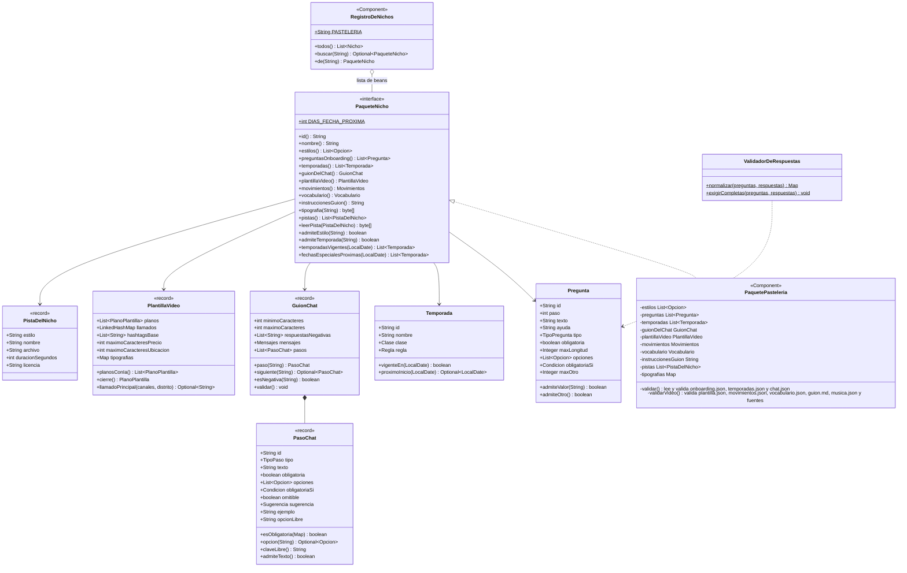

- **Registro por lista de beans:** `RegistroDeNichos` recibe `List<PaqueteNicho>`; cada paquete anotado con `@Component` se agrega solo. `todos()` alimenta el selector del panel de administración (`Nicho(id, nombre)`), `buscar(id)` se usa al crear un negocio (`NICHO_INVALIDO` si no existe) y `de(id)` al atender a un negocio existente (si faltara su paquete, responde 500 `NICHO_DESCONOCIDO`).
- **Contenido en JSON:** `PaquetePasteleria` lee al arrancar `resources/nichos/pasteleria/onboarding.json` (`estilos` y `preguntas`), `temporadas.json` y, desde la fase 3, `chat.json`, con el `ObjectMapper` de Jackson 3, y valida su forma (preguntas sin repetir, `paso` 2 o 3, selecciones con opciones, condiciones que apuntan a preguntas existentes, temporadas sin repetir, al menos un estilo; el guion con `GuionChat.validar()`, ver 3.1). Desde la fase 3 la lectura usa `FAIL_ON_UNKNOWN_PROPERTIES` (un campo mal escrito hace fallar el arranque en lugar de ignorarse) y desactiva `FAIL_ON_NULL_FOR_PRIMITIVES` (un sí/no que no se escribe, como `omitible`, vale `false`). Si algo falla, la aplicación no arranca.
- **Estilos:** `CASERO`, `ELEGANTE`, `DIVERTIDO`.
- **Preguntas de Pastelería:** paso 2: `especialidad` y `publico` (selección múltiple), `ciudad` y `distrito` (texto, 60), `canales` ("¿Cómo te piden?": `WHATSAPP`, `DELIVERY`, `TIENDA`; obligatoria, por lo tanto al menos una), `whatsapp` (`TELEFONO`, obligatoria si `canales` contiene `WHATSAPP`), `horario` (texto, 120, obligatoria); paso 3, opcionales: `distintivo` ("¿Qué te diferencia?", 80) y `palabrasProhibidas` (300). Desde la revisión del flujo, `especialidad`, `publico` y `canales` tienen `maxOtro: 40`: admiten una opción "Otros" escrita por el negocio (sección 5.1).
- **Temporadas** (`temporadas.json`): `TODO_EL_ANIO` (`SIEMPRE`), `VERANO` (`RANGO` 12-21 a 03-20, cruza el año), `INVIERNO` (`RANGO` 06-21 a 09-22), `SAN_VALENTIN` (`FECHAS` 02-14), `DIA_DE_LA_MADRE` (`N_ESIMO_DOMINGO` mayo, 2), `DIA_DEL_PADRE` (`N_ESIMO_DOMINGO` junio, 3), `FIESTAS_PATRIAS` (`FECHAS` 07-28 y 07-29), `HALLOWEEN_CANCION_CRIOLLA` (`FECHAS` 10-31) y `NAVIDAD` (`MES` 12). Las seis últimas (de `SAN_VALENTIN` a `NAVIDAD`) son de clase `FECHA_ESPECIAL`; verano e invierno, `TEMPORADA`.
- **Cálculo de temporadas:** `temporadasVigentes(hoy)` excluye `SIEMPRE` (así "todo el año" no empata con la temporada en curso); `fechasEspecialesProximas(hoy)` devuelve las `FECHA_ESPECIAL` no vigentes cuyo próximo inicio cae en los 15 días siguientes, ordenadas por cercanía. `GET /api/nicho/configuracion` entrega `temporadasVigentes`. **El chat no usa ninguno de los dos** (decisión del usuario: sin fechas especiales ni temporadas en el MVP) y, desde la revisión del flujo, **el catálogo tampoco pide ni muestra temporadas**; `temporadas.json` y estos cálculos quedan para el trabajo futuro de fechas especiales (RF-31, V13).
- **`ValidadorDeRespuestas`:** `normalizar` revisa el formato de cada respuesta y la limpia (textos sin espacios a los lados y dentro de `maxLongitud`, selecciones sin repetidos y con opciones válidas, teléfonos `^(?:\+?51)?(9\d{8})$` sin espacios ni guiones guardados como `+519XXXXXXXX`; las vacías se quitan) y responde `RESPUESTA_INVALIDA` si algo no cuadra. En una selección que admite "Otros" (`Pregunta.admiteOtro()`), acepta además **un** texto libre de hasta `maxOtro` caracteres (sección 5.1). `exigirCompletas` exige las obligatorias, incluidas las condicionales (`PERFIL_INCOMPLETO`).

La guía para agregar un rubro está en `docs/guias/nuevo-nicho.md`.

### 3.1 Guion del chat (`GuionChat`, fase 3)

RN-16: las preguntas del chat, su orden y su tipo los define el paquete. `GuionChat` (record en `nicho.dominio`) es el contenido de `resources/nichos/pasteleria/chat.json`; el motor del chat (`ServicioChat`, `EvaluadorDeRespuesta`) lo recorre de forma genérica, sin conocer los ids de los pasos de Pastelería.

| Elemento | Contenido en Pastelería |
|---|---|
| `minimoCaracteres` / `maximoCaracteres` | `3` / `500` |
| `respuestasNegativas` | `no`, `nop`, `ninguno`, `ninguna`, `nada`, `no hay`, `sin precio`, `no gracias`, `-`. `esNegativa` compara en minúsculas y sin tildes, espacios ni puntuación (deja letras, números y `-`) |
| `mensajes` (`GuionChat.Mensajes`) | `pregunta` (RN-18), `muyCorta`, `muyLarga`, `precioObligatorio` (RN-20), `productoNoDisponible`, `catalogoVacio`, `cierre` ("¡Listo! Estoy preparando tu propuesta…") y `aviso` (se muestra en el botón "?" del chat) |
| `pasos` (`PasoChat`) | `tipoVideo` (`BOTONES`: `PRODUCTO_ESTRELLA`, `PROMOCION`, `TORTAS_POR_ENCARGO`, `RECIEN_HORNEADO`; `opcionLibre: PRODUCTO_ESTRELLA`) → `producto` (`PRODUCTO`) → `especial` (`TEXTO`, obligatoria, `sugerencia: DESCRIPCION_PRODUCTO`) → `precio` (`TEXTO`, `omitible`, `obligatoriaSi: {paso: tipoVideo, valor: PROMOCION}`) → `extra` (`TEXTO`, `omitible`). Desde la revisión del flujo, `tipoVideo`, `especial`, `precio` y `extra` traen un `ejemplo` (por ejemplo, `Ej.: "S/ 65" o "2x1 hasta el domingo".`) |

- `TipoPaso`: `BOTONES` (respuesta con un botón, no se agrupa), `PRODUCTO` (carrusel del catálogo o producto nuevo) y `TEXTO` (respuesta libre: se agrupa, RN-17, y se revisa, RN-18).
- `PasoChat.esObligatoria(respuestas)`: `obligatoria`, o `obligatoriaSi` cumplida con las respuestas ya dadas (así se expresa RN-20 sin código propio de Pastelería). `omitible` permite "No, gracias" cuando el paso no es obligatorio en ese momento. `Sugerencia.DESCRIPCION_PRODUCTO` ofrece la descripción del producto elegido.
- **Revisión del flujo (2026-11-06):** `ejemplo` es un ejemplo corto de respuesta que el frontend muestra bajo la caja de texto. `opcionLibre`, solo en un paso `BOTONES`, es la opción que se usa si el negocio **escribe** en lugar de tocar un botón: su texto se guarda aparte, en la clave `claveLibre()` (`<id>Libre`, en Pastelería `tipoVideoLibre`). `admiteTexto()` es verdadero en los pasos `TEXTO` y en los `BOTONES` con `opcionLibre`. El flujo está en la sección 5.3.
- `siguiente(id)` da el paso que sigue; después del último, la conversación se cierra con el mensaje `cierre`.
- `validar()` (al arrancar): hay pasos; `0 < minimoCaracteres < maximoCaracteres`; los ocho mensajes presentes y no vacíos; exactamente un paso `PRODUCTO`; ids únicos y textos no vacíos; `BOTONES` con opciones y sin valores repetidos; `sugerencia` y `omitible` solo en pasos `TEXTO`; `opcionLibre` solo en pasos `BOTONES` y que sea una de sus opciones; `obligatoriaSi` apunta a un paso **anterior** y a un valor que existe entre sus opciones. Un error lanza `IllegalStateException("Guion del chat inválido: …")` y la aplicación no arranca.
- **Sin fechas especiales ni temporadas** (decisión del usuario, 2026-11-04): no hay botón "Fecha especial", ni paso para elegir la fecha, ni saludo de temporada. El dato `producto.temporadas` se conserva (un producto nuevo queda como `TODO_EL_ANIO`), pero ni el chat ni, desde la revisión del flujo, el catálogo lo usan.

### 3.2 Contenido del video (fases 4 y 5)

Secciones 7.4 a 7.6 de la especificación. `PaquetePasteleria` lee estos archivos al arrancar, con las mismas reglas de lectura de la sección 3, y los valida en `validarVideo()`; si algo falla, la aplicación no arranca.

| Archivo | Expuesto como | Contenido en Pastelería |
|---|---|---|
| `plantilla.json` | `plantillaVideo()` (`PlantillaVideo`) | Los 4 planos de 15 s: 1 Gancho (`DETALLE`, 6 palabras, 3 s), 2 Producto (`ENTERO`, 5, 4 s), 3 Relleno (`PORCION`, 7, 4 s) y 4 Cierre (4 s, `conIa: false`: **sin clip de IA**; desde el 2026-11-12 su `maxPalabras` = 6 es el de la frase que escribe la IA). Cada plano con IA trae su `movimientoDeRespaldo`, que desde el 2026-11-12 es el **movimiento sugerido** al modelo (`MACRO_DETALLE`, `ORBITA_FRONTAL`, `PARALAJE_LATERAL`). Además: `llamados` por canal del onboarding en orden de prioridad (`WHATSAPP`, `DELIVERY`, `TIENDA`, con `{distrito}`), `hashtagsBase` (5, se le sugieren al modelo), `maximoCaracteresPrecio` (40: precio y frase del cierre), `maximoCaracteresUbicacion` (40, desde el 2026-11-12) y, desde la fase 5, `tipografias` (archivo de `fuentes/` por estilo, P-05). El 2026-11-12 se quitaron los textos del guion de respaldo (`respaldoDesde`, `textoDeRespaldo`, `ganchosDeRespaldo`, `descripcionDeRespaldo`, `descripcionFijaDeRespaldo` y `avisoDeRespaldo`) |
| `movimientos.json` | `movimientos()` (`Movimientos`) | Desde el 2026-11-12 (ADR 0021), **13 movimientos** de 7.5: los 7 anteriores con sus ids (reescritos como movimientos reales de cámara, no zoom; los efectos suman un arco de unos 30°) y 6 nuevos (`ORBITA_FRONTAL`, `ARCO_HEROICO`, `MACRO_DETALLE`, `GRUA_REVELADO`, `PARALAJE_LATERAL`, `DIAGONAL_ENFOQUE`). Cada uno con `descripcion` en palabras simples (la muestran el storyboard y el prompt del guion), `instruccion` en inglés y, si rodea, sube o cruza el producto, `camara3d: true` (10 de 13). `VAPOR_SUAVE` solo para `RECIEN_HORNEADO` (`soloTiposVideo`). En la raíz: `plantillaDeToma` (envoltorio en inglés con `{instruccion}`), `prohibiciones` (en frases, al final del prompt), `negativos` (sustantivos para el prompt negativo) y `minimoPlanosCamara3d` (2). `Movimientos.promptDeToma(movimiento)` arma el prompt completo del clip (sección 5.5) |
| `vocabulario.json` | `vocabulario()` (`Vocabulario`) | `tonos` por estilo (7.6), `prohibidasSalvoQueLasDeclareElProducto` (salud y nutrición), `prohibidas` (superlativos absolutos, promesas de entrega o tiempos) y `palabrasDePromocion` (RN-22) |
| `guion.md` | `instruccionesGuion()` | Instrucciones base para el modelo de texto, con marcadores `{así}` que `InstruccionesDelGuion` reemplaza con el perfil, el producto, las respuestas del chat, la plantilla, los movimientos permitidos y el vocabulario. Desde el 2026-11-12: copywriter publicitario, las respuestas del negocio como indicaciones (no se copian; las órdenes no se muestran), el papel de cada plano, la regla de cámara 3D, el objeto `cierre` y ejemplos buenos y malos. Marcadores nuevos: `{minimoPlanosCamara3d}`, `{maxPalabrasFrase}`, `{maximoCaracteresCierre}`, `{maximoCaracteresUbicacion}` y `{hashtagsBase}` |
| `fuentes/` (fase 5) | `tipografia(estilo)` | Una tipografía TTF por estilo, de Google Fonts con licencia OFL (P-05), cada una con su archivo `OFL-*.txt`: `Nunito-ExtraBold.ttf` (`CASERO`), `PlayfairDisplay-Bold.ttf` (`ELEGANTE`) y `Fredoka-SemiBold.ttf` (`DIVERTIDO`). Se leen una sola vez al arrancar y se entregan como bytes: FFmpeg las necesita como archivo y dentro del JAR no hay ruta de archivo |
| `musica.json` y `musica/` (fase 5) | `pistas()` (`PistaDelNicho`) y `leerPista(pista)` | Una pista por estilo (`casero.m4a`, `elegante.m4a`, `divertido.m4a`, 20 s cada una): **pistas de relleno generadas por AutoReel**, con su licencia anotada y a reemplazar por música con licencia comercial (pendiente P-02) |

- `validarVideo()` comprueba, entre otras cosas, que los llamados correspondan a los canales del onboarding y cumplan el propio vocabulario del nicho, y que cada movimiento sugerido exista. Desde la fase 5 también exige una tipografía y al menos una pista por estilo, que cada pista exista en `musica/` y que dure 15 s o más. Desde el 2026-11-12 (`validarMovimientos`): que `plantillaDeToma` contenga `{instruccion}`, que `prohibiciones`, `negativos` y la lista no estén vacíos, ids sin repetir, descripción e instrucción en cada movimiento, `minimoPlanosCamara3d` no mayor que los planos con IA y al menos un movimiento de cámara 3D que sirva para todos los tipos de video.
- `Texto` (`nicho.dominio`) es la normalización única que comparten el validador y la edición del storyboard (y, hasta el 2026-11-12, el guion de respaldo): minúsculas, sin tildes ni diéresis (conserva la "ñ"), frases prohibidas como secuencia de palabras completas, conteo de palabras en pantalla y detección de caracteres que no se pueden dibujar. Desde la fase 5, `tieneCaracteresNoDibujables` es una **lista blanca** (U+0020 a U+007E, U+00A0 a U+00FF, que incluye á, ñ, ¿ y ¡, y la puntuación tipográfica ‘ ’ “ ” – — … €): todo lo demás (emojis, saltos de línea, otros alfabetos) se rechaza con `CARACTER_NO_PERMITIDO`. `soloDibujable` limpia, en lugar de rechazar, los datos del perfil o del catálogo que se dibujan en el video.
- El código del video conoce solo los **ids de pasos del chat** (`RespuestasDelChat`: `tipoVideo`, `producto`, `especial`, `precio`, `extra`) y los **ids de preguntas del onboarding** que usa el guion (`CamposDelPerfil`). Son el contrato entre `chat.json`, `onboarding.json` y `guion.md` que todo paquete de nicho debe respetar (`docs/guias/nuevo-nicho.md`).

---

## 4. Almacenamiento de archivos (`almacenamiento`)

### 4.1 Puerto, adaptador y propósitos

| Pieza | Responsabilidad |
|---|---|
| `AlmacenDeArchivos` (puerto, `dominio`) | `urlDeSubida(clave, tipoContenido, tamano, vigencia)`, `urlDeDescarga(clave, vigencia)`, `leer(clave, bytesMaximos)` → `Optional<ArchivoAlmacenado>`, `copiarSiNoCambio(origen, destino, etiqueta)` → `boolean`, `guardar(clave, contenido, tipoContenido)` y `eliminar(clave)` |
| `ArchivoAlmacenado` | `record(contenido, tipoContenido, tamano, etiqueta)`. `contenido` es `null` si el archivo supera `bytesMaximos` (no se descarga); `etiqueta` es el ETag de S3 |
| `PropositoArchivo` | `LOGO` (carpeta `logo`, solo `image/png`, 5 MB, RN-10); `FOTO_PRODUCTO` (`foto_producto`) y `FOTO_LOCAL` (`foto_local`): `image/jpeg`, `image/png` o `image/webp`, 10 MB (RN-11). Extensiones: `png`, `jpg`, `webp` |
| `S3Almacen` (adaptador, `infraestructura`) | Implementa el puerto con `S3Client` y `S3Presigner` del AWS SDK v2 sobre un bucket privado. Ver 4.4 |
| `ConfiguracionAlmacenamiento` | Crea el bean `AlmacenDeArchivos` = `S3Almacen` con `@ConditionalOnProperty(name = "autoreel.almacenamiento.tipo", havingValue = "s3", matchIfMissing = true)` |
| `PropiedadesAlmacenamiento` | `autoreel.almacenamiento.*`: `tipo`, `bucket`, `region`, `endpoint`, `endpointPublico`, `claveAcceso`, `claveSecreta`, `crearBucket` |
| `ServicioDeArchivos` (`aplicacion`) | Firma subidas, confirma (verifica y copia) archivos subidos y entrega URLs de lectura. Es la única puerta de `negocio` y `catalogo` hacia el almacenamiento |
| `VerificadorDeImagenes` (`aplicacion`) | Revisa el contenido real de la imagen. Ver 4.3 |
| `ArchivosController` (`api`) | `POST /api/archivos/url-subida` |

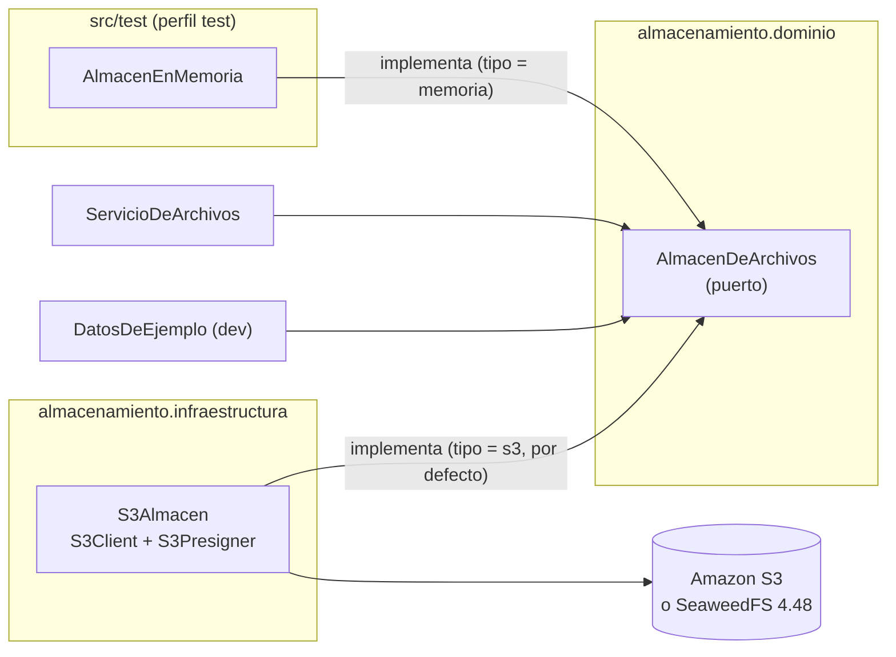

### 4.2 Subida en dos tiempos

El navegador sube el archivo **directamente** al almacenamiento (sección 11.4), sin pasar los bytes por el backend. Para que nadie pueda reemplazar un archivo ya revisado, la subida usa dos claves:

| Clave | Forma | Quién escribe |
|---|---|---|
| Temporal | `subidas/negocios/{negocioId}/{carpeta}/{uuid}.{ext}` | El navegador, con la URL PUT firmada (10 minutos) |
| Definitiva | `negocios/{negocioId}/{carpeta}/{uuid}.{ext}` | Solo el backend, copiando la temporal ya verificada. Nunca se firma una URL de escritura para ella. Es la única que se guarda en la base de datos |

El `negocioId` siempre sale de la sesión, nunca del cliente (RNF-05). `confirmar` compara la clave completa con una expresión regular anclada armada con el negocio de la sesión y el propósito del campo: `^subidas/negocios/{id}/{carpeta}/[0-9a-f]{8}-…-[0-9a-f]{12}\.(png|jpg|webp)$`, así que una clave de otro negocio, de otro propósito o con `..` o `%2e%2e` se rechaza.

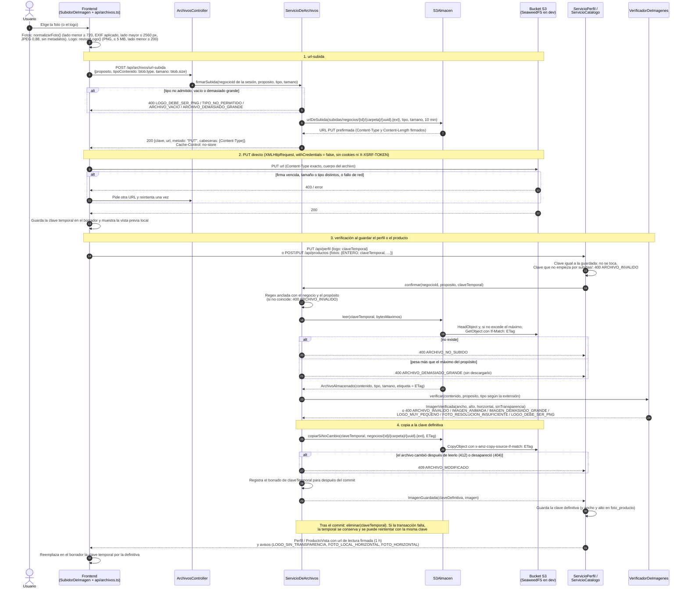

Notas:

- La clave temporal se borra **solo después del commit** (`TransactionSynchronization.afterCommit` en `ServicioDeArchivos.eliminarAlConfirmar`; sin transacción activa, se borra en el acto). Si el guardado del perfil o del producto falla después de confirmar (por ejemplo, otra validación o `PERFIL_INCOMPLETO`), el usuario puede reintentar con la misma clave. Un fallo al borrarla solo se registra en el log.
- `ServicioPerfil.actualizar` valida primero los campos que no son archivos (nombre, colores, estilo, respuestas) y después confirma el logo y la foto del local, para no copiar archivos si algo es inválido.
- Las subidas que nunca se usan quedan en `subidas/`. En el MVP se toleran; en AWS se eliminan con una regla de expiración de un día sobre el prefijo `subidas/` (fase 8, `docs/despliegue-aws.md`).
- `DatosDeEjemplo` usa el mismo camino: firma una subida con `firmarSubida`, deja el archivo en la clave temporal con `AlmacenDeArchivos.guardar` (en lugar del PUT del navegador) y lo confirma al guardar el perfil y los productos.

### 4.3 Verificación de imágenes (`VerificadorDeImagenes`)

Revisa el **contenido real** de la imagen, no su extensión ni el tipo que declaró el navegador, y lee las medidas sin decodificar la imagen entera (`ImageReader.getWidth/getHeight`):

1. Al construirse llama a `ImageIO.setUseCache(false)` y `ImageIO.scanForPlugins()`; si no hay lector `image/webp` (TwelveMonkeys), la aplicación no arranca.
2. El formato del lector (`png`, `jpeg`, `webp`) debe coincidir con el tipo que indica la extensión de la clave y estar admitido por el propósito. Si no: `ARCHIVO_INVALIDO` (o `LOGO_DEBE_SER_PNG` para el logo).
3. Rechaza WebP animado (bandera de animación del bloque `VP8X`) y PNG animado (bloque `acTL` antes del primer `IDAT`, recorriendo los bloques del PNG por su longitud, no buscando el texto en los bytes): `IMAGEN_ANIMADA`.
4. Límites contra imágenes que pesan poco pero ocupan mucha memoria al abrirse: lado mayor ≤ 8000 px y total ≤ 40 MP; en el logo, lado mayor ≤ 4000 px (`IMAGEN_DEMASIADO_GRANDE`).
5. Logo: lado menor ≥ 200 px (`LOGO_MUY_PEQUENO`). Fotos de producto: lado menor ≥ `LADO_MENOR_FOTO` = **720 px**; foto del local: ≥ `LADO_MENOR_FOTO_LOCAL` = **480 px** (desde el 2026-11-12, porque solo es el fondo del cierre) (`FOTO_RESOLUCION_INSUFICIENTE`, con las medidas reales en el mensaje; RN-11, V12). Hasta la revisión del flujo eran 1080 px; se bajó a 720 porque es lo que pide el clip de IA en 720p.
6. JPEG con orientación EXIF 5 a 8 (leída con `JPEGSegmentUtil` y `TIFFReader`): intercambia ancho y alto, así las medidas guardadas son las de la foto tal como se ve. `horizontal = ancho > alto`.
7. Logo sin transparencia: solo se decodifica si el modelo de color tiene alfa, y se marca transparente si algún píxel tiene alfa < 255 (en los PNG de paleta, sin canal alfa separado, se mira el alfa de cada píxel con `getRGB`). Un PNG opaco se **acepta** con el aviso `LOGO_SIN_TRANSPARENCIA` (decisión del usuario).

### 4.4 Adaptador `S3Almacen`

- Bucket privado; todo acceso desde el navegador es con URL firmada.
- **Credenciales:** si hay `endpoint` (desarrollo) y `claveAcceso`, usa `StaticCredentialsProvider` con `AWS_ACCESS_KEY_ID` y `AWS_SECRET_ACCESS_KEY` leídas como propiedades (el SDK no ve el `.env` que importa Spring). Sin `endpoint` (AWS), usa `DefaultCredentialsProvider` (rol de la instancia, sin perder `AWS_SESSION_TOKEN`).
- **Endpoint:** con `S3_ENDPOINT`, el cliente usa `endpointOverride` y `forcePathStyle(true)`; el firmador usa `endpointPublico` (`S3_ENDPOINT_PUBLICO`, por defecto el mismo `endpoint`) y `S3Configuration.pathStyleAccessEnabled(true)`. Separar los dos permite que un celular de la red local suba fotos (RNF-03).
- `urlDeSubida`: `presignPutObject` con `contentType` y `contentLength` exactos. `urlDeDescarga`: `presignGetObject`.
- `leer`: `HeadObject`; si el tamaño supera `bytesMaximos`, devuelve solo el tamaño; si no, `GetObject` con `ifMatch(eTag)`. 404, 403 o 412 → vacío.
- `copiarSiNoCambio`: `CopyObject` con `copySourceIfMatch(etiqueta)`; 412, 404 o 403 → `false`.
- Un 403 se trata como "no existe" (`noExiste`) porque, sin el permiso `s3:ListBucket`, AWS responde 403 y no 404 para una clave inexistente; las claves ya se validaron contra el negocio de la sesión. Se registra un aviso en el log por si fuera un permiso mal configurado.
- `crearBucket` (`autoreel.almacenamiento.crear-bucket`, solo `true` en `dev`): crea el bucket al arrancar si no existe.

### 4.5 URLs de lectura

`ServicioDeArchivos.urlDeLectura(clave)` firma URLs GET de **1 hora** y las guarda en memoria por clave (`ConcurrentHashMap`, hasta 5000), reutilizándolas mientras les queden más de 15 minutos. Así una misma imagen mantiene la misma URL entre respuestas y el navegador la tiene en caché. En el frontend:

- El componente `ImagenRemota` invalida una vez la consulta que trajo la URL si la imagen no carga (URL vencida). Hoy lo usan las tarjetas de los catálogos (`PaginaCatalogo` y la sección Catálogo de `PaginaDetalleNegocio`) y, desde las fases 4 y 5, las fotos de `PaginaStoryboard` y `PaginaMisVideos`. Las demás imágenes firmadas (la vista previa de `SubidorDeImagen` en el asistente, Ajustes y `PaginaProducto`, y el logo de la tarjeta Perfil del administrador) usan un `` simple y no se renuevan solas: hay que recargar la página.
- La consulta del perfil en `PaginaAjustes` y la lista de `PaginaCatalogo` usan `staleTime` de 30 minutos y `refetchOnWindowFocus: true` (la lista del catálogo además `refetchInterval` de 45 minutos). Las demás consultas (asistente, detalle del producto, panel del administrador) usan los valores por defecto del `QueryClient`.

---

## 5. Perfil, onboarding, catálogo, chat, video y administración

Las secciones 5.1 a 5.6 son el flujo del negocio; las 5.7 y 5.8, lo que agregó la fase 7 al panel del administrador.

### 5.1 Perfil y onboarding (`negocio`)

- **`PerfilNegocio`** (tabla `perfil_negocio`, uno por negocio): `logoClave`, `logoSinTransparencia`, `colorPrimario` y `colorSecundario` (`#rrggbb` en minúsculas), `estilo`, `fotoLocalClave`, `respuestas` (`jsonb`) y `fechaActualizacion`. El nombre comercial sigue en `Negocio.nombre` y el negocio puede corregirlo (`Negocio.cambiarNombre`).
- Se crea vacío junto con el negocio (`ServicioGestionNegocios.crear` → `ServicioPerfil.crearVacio`); `V3` crea los de los negocios que ya existían.
- **`ServicioPerfil.actualizar`** (`PUT /api/perfil`) aplica cambios parciales: un campo ausente no cambia; uno en `null` se borra; un campo desconocido es `SOLICITUD_INVALIDA`. `respuestas` se fusiona por id de pregunta (`null` borra esa respuesta) y pasa por `ValidadorDeRespuestas.normalizar`. El logo y la foto del local nuevos pasan por `ServicioDeArchivos.confirmar` (sección 4.2). **Si el onboarding ya está completo, el perfil resultante debe seguir completo** (RF-17), o responde `PERFIL_INCOMPLETO`.
- **`ServicioPerfil.completarOnboarding`** (`POST /api/perfil/completar-onboarding`) exige logo, los dos colores, estilo y las respuestas obligatorias (`ValidadorDeRespuestas.exigirCompletas`) y marca `Negocio.onboardingCompleto = true` (RN-09).
- `ServicioPerfil.paraAdmin` arma `PerfilParaAdmin(perfil, respuestas)`, con cada respuesta como `RespuestaLegible(pregunta, respuesta)`: el texto de la pregunta y de las opciones resuelto desde el paquete. Lo incluye `NegocioDetalle.perfil` (RF-05).
- `Sesion.onboardingCompleto` (siempre `true` para el administrador en su panel; cuando entra como un negocio, el del negocio) le dice al frontend si debe llevar al negocio al asistente. **El backend no bloquea el catálogo ni los ajustes antes del onboarding**: la regla RN-09 se aplica al crear videos, en `ServicioChat.iniciar` (409 `ONBOARDING_INCOMPLETO`, V10; sección 5.3).

#### Onboarding con "Otros" (revisión del flujo, 2026-11-06)

Las preguntas de selección múltiple pueden admitir una opción escrita por el negocio cuando ninguna de las del paquete le sirve. Todo sale del paquete de nicho (regla 5): una pregunta la admite si trae `maxOtro` en `onboarding.json` (en Pastelería, `especialidad`, `publico` y `canales`, con 40 caracteres: una característica, no una oración).

```mermaid
sequenceDiagram
    autonumber
    actor U as Usuario
    participant F as CampoPregunta →<br/>SeleccionConOtros
    participant P as ServicioPerfil
    participant V as ValidadorDeRespuestas
    participant BD as perfil_negocio.respuestas

    U->>F: Toca el chip "Otros" y escribe "Postres veganos"
    F->>F: Campo corto con el máximo de pregunta.maxOtro (40)
    F->>P: PUT /api/perfil {respuestas: {especialidad: ["TORTAS_PERSONALIZADAS", "Postres veganos"]}}
    P->>V: normalizar(preguntas, respuestas)
    loop cada valor de la lista
        alt es una opción del paquete (admiteValor)
            V->>V: se guarda el valor
        else no es una opción
            alt la pregunta no admite "Otros"
                V-->>F: 400 RESPUESTA_INVALIDA ("Elegiste una opción que no existe…")
            else ya había otro texto libre
                V-->>F: 400 RESPUESTA_INVALIDA ("puedes escribir una sola opción en Otros")
            else más de maxOtro caracteres
                V-->>F: 400 RESPUESTA_INVALIDA ("escribe una característica, no una oración")
            else
                V->>V: espacios unidos y recortados; se guarda tal cual entre los valores
            end
        end
    end
    P->>BD: respuestas normalizadas (jsonb)
```

- El texto libre se guarda **entre los valores elegidos**, sin un campo aparte, así no hace falta migrar nada. Llega al guion como cualquier otra respuesta (`LectorDeDatosDelVideo` cambia cada valor conocido por el texto de su opción y deja el resto tal cual) y el administrador lo lee en el detalle del negocio (`ServicioPerfil.paraAdmin`).
- Un "Otros" en `canales` no tiene llamado en la plantilla: el cierre usa el llamado del canal conocido de mayor prioridad (sección 5.4).
- Revisar qué escriben los negocios para volver opciones las más repetidas es trabajo futuro ("Aprender de Otros", plan, sección 10.1).

### 5.2 Catálogo (`catalogo`)

- **`Producto`** (tabla `producto`): `negocio`, `nombre` (1 a 50, recortado), `descripcion` (1 a 200, recortada; la única fuente de detalles que la IA podrá usar), `temporadas` (`jsonb` con ids del paquete; desde la revisión del flujo el catálogo no las pide y, si no vienen, queda `TODO_EL_ANIO`), `estado` (`ACTIVO` o `ARCHIVADO`), `fechaCreacion` y sus `fotos` (`@OneToMany`, `cascade = ALL`, `orphanRemoval`).
- **`FotoProducto`** (tabla `foto_producto`): `tipo` (`ENTERO`, `DETALLE`, `PORCION`), `claveS3`, `ancho` y `alto` ya orientados. Única por (`producto_id`, `tipo`). Reemplazar una foto actualiza la misma fila (`FotoProducto.reemplazar`), porque borrar e insertar violaría la restricción única (Hibernate hace el INSERT antes del DELETE).
- **`Producto.estaCompleto()`**: tiene las tres fotos (RN-12). Un producto puede guardarse con menos fotos; queda con `completo = false` (V11, parcial) y no podrá usarse en un video.
- **`ServicioCatalogo`**: `listar`, `obtener`, `crear`, `actualizar`, `archivar`, `reactivar`. En `crear` y `actualizar`, cada tipo de foto se trata así: clave igual a la guardada → se conserva sin volver a verificar; clave nueva → debe ser una subida (`subidas/…`) y pasa por `ServicioDeArchivos.confirmar` con `FOTO_PRODUCTO`; ausente, `null` o vacía → se quita. Las temporadas son **opcionales** (revisión del flujo, ADR 0013): sin temporadas, el producto queda como `TODO_EL_ANIO` (`TEMPORADA_POR_DEFECTO`); las que vengan se validan contra el paquete del nicho. El frontend ya no las pide ni las muestra, y al editar reenvía las que el producto ya tenía, así el dato se conserva para retomarlas sin migrar.
- **Aislamiento (RNF-05, V08):** `ProductoRepositorio.listarDeNegocio(negocioId, estado)` y `buscarDeNegocio(id, negocioId)` siempre filtran por el negocio de la sesión; un producto de otro negocio responde `404 NO_ENCONTRADO` (no 403, para no revelar que existe).
- **Archivado (RN-13):** archivar no borra; un producto archivado puede reactivarse.
- **Admin:** `GET /api/admin/negocios/{id}/productos` llama a `ServicioCatalogo.listar(id, null)`: todo el catálogo, incluidos los archivados, con su estado.
- **Fuera del catálogo (fase 3, RN-14, V14):** `Producto.enCatalogo` (columna `en_catalogo`, `true` por defecto). Un producto subido desde el chat sin aceptar guardarlo queda con `false` (`dejarFueraDelCatalogo`): existe para su video, pero `listarDeNegocio` y `buscarDeNegocio` lo filtran (`en_catalogo = true`), así que no aparece en el catálogo del negocio ni en el del administrador, y `GET/PUT /api/productos/{id}` responde 404. En el MVP esos productos se conservan aunque su conversación se abandone.
- **Para el chat (fase 3):**
  - `carrusel(negocioId)` → `Carrusel(productos, incompletos)`: `listarParaCarrusel` trae los `ACTIVO` y en catálogo, del más reciente al más antiguo; se quedan los que `estaCompleto()` (V11) y se cuenta cuántos quedaron fuera por faltarles fotos. **Sin orden por temporada** (decisión del usuario; V13 fuera del MVP).
  - `paraVideo(negocioId, productoId)`: `buscarParaVideo` (sin filtro de catálogo) más `Producto.disponibleParaVideo()` (`ACTIVO` y completo, RN-12 y RN-13).
  - `elegidoParaVideo(negocioId, productoId)`: `buscarParaVideo` sin más filtros. Lo usa el chat para mostrar en el `resumen` y en la `sugerencia` el producto ya elegido, aunque después se haya archivado o haya perdido una foto.
  - `crearDesdeChat(negocioId, nombre, descripcion, fotos, guardarEnCatalogo)`: exige las tres fotos (`PRODUCTO_INCOMPLETO`), reutiliza las validaciones de nombre, descripción y fotos (`ServicioDeArchivos.confirmar`), pone la temporada `TODO_EL_ANIO` (`TEMPORADA_POR_DEFECTO`) y, si `guardarEnCatalogo` es `false`, lo deja fuera del catálogo.
  - `urlDeFoto(foto)`: URL de lectura firmada de la foto `ENTERO` que muestra el carrusel.

### 5.3 Chat del video del día (`chat`, fase 3)

RF-19 y RF-20, sección 7.3: la pantalla principal del negocio es un chat de **preguntas fijas, sin IA**, que reúne la información del video del día. El backend lleva el estado, el guion y el reloj de la agrupación; el frontend solo dibuja lo que recibe en `ConversacionVista`.

| Capa | Clase | Responsabilidad |
|---|---|---|
| `api` | `ChatController` | `POST /api/chat/conversaciones` (`SolicitudConversacion(empezarDeNuevo)`, cuerpo opcional), `GET /actual` (204 si no hay), `POST /{id}/mensajes`, `POST /{id}/procesar`. Toma el `negocioId` de `UsuarioAutenticado` |
| `api` | `SolicitudMensaje` | `paso` + exactamente una de `texto`, `opcion`, `productoId`, `productoNuevo` (`ProductoNuevo(nombre, descripcion, fotos, guardarEnCatalogo)`) u `omitir`. `formasDeRespuesta()` las cuenta |
| `api` | `ConversacionVista` | Todo lo que la pantalla necesita en una respuesta: `id`, `estado`, `paso` (`Paso`: `id`, `tipo`, `texto`, `opciones`, `obligatoria`, `omitible`, `sugerencia` y, desde la revisión del flujo, `ejemplo` y `admiteTexto`), `mensajes` (`Mensaje` con `pendiente`), `procesarEnMs`, `respuestas`, `aviso`, `maximoCaracteres`, `productos` (`ProductoCarrusel`), `productosIncompletos`, `resumen` (`Resumen(pregunta, respuesta)`) y, desde la fase 4, `videoId` (el video que nació al completarse; `null` mientras está en curso) |
| `aplicacion` | `ServicioChat` | `iniciar`, `actual`, `responder`, `procesar`. Aplica RN-09, RN-14, RN-17 a RN-20 con el guion del paquete y `ServicioCatalogo`. Desde la revisión del flujo, `escribirEnBotones` (texto libre en un paso de botones) |
| `dominio` | `Conversacion` | Entidad (`conversacion`): `negocio`, `estado`, `pasoActual`, `respuestas` (`jsonb`), `fechaInicio`, `fechaActualizacion`, `mensajes` (`@OneToMany`, `cascade = ALL`, `@OrderBy("fechaHora, id")`). Métodos: `decirSistema`, `decirUsuario` (botón o producto, ya procesado), `escribirUsuario` (texto, pendiente), `pendientes`, `marcarProcesados`, `responder`, `irAPaso`, `completar` |
| `dominio` | `MensajeChat` | Entidad (`mensaje_chat`): `autor`, `texto`, `fechaHora`, `procesado` |
| `dominio` | `EstadoConversacion`, `AutorMensaje` | `EN_CURSO`, `COMPLETA` (entrada del guion de la fase 4), `ABANDONADA`; `SISTEMA`, `USUARIO` |
| `dominio` | `AgrupadorDeMensajes` | RN-17, función pura: `agrupar(mensajes, fecha, ahora)` → `Resultado(cerrados, abiertos, cierreEn)`. Corta donde dos mensajes seguidos están separados por 4 s o más (`ESPERA`); el último grupo se cierra si ya pasaron 4 s desde su último mensaje |
| `dominio` | `EvaluadorDeRespuesta` | `evaluar(guion, paso, respuestas, texto)` y `omitir(...)` → `Aceptada(valor)` o `Rechazada(mensaje)` |
| `infraestructura` | `ConversacionRepositorio` | `bloquearDeNegocio(id, negocioId)` (`PESSIMISTIC_WRITE`), `buscarEnCurso`, `findFirstByNegocioIdAndEstadoOrderByFechaActualizacionDesc`, `abandonarEnCurso` (`UPDATE` masivo) |

#### Flujo de la conversación

1. **Iniciar** (`ServicioChat.iniciar`): bloquea la fila del negocio (`NegocioRepositorio.bloquear`, `PESSIMISTIC_WRITE`) para que dos inicios simultáneos no choquen; sin onboarding completo, 409 `ONBOARDING_INCOMPLETO` (RN-09, V10). Sin `empezarDeNuevo` es **idempotente**: si hay una `EN_CURSO`, la devuelve. Con `empezarDeNuevo`, `abandonarEnCurso` la pasa a `ABANDONADA` con un `UPDATE` masivo **antes** de insertar la nueva: el índice único parcial de RN-19 no admite el orden INSERT → UPDATE que haría Hibernate al vaciar la sesión. La nueva empieza en el primer paso con su pregunta como mensaje del sistema.
2. **Botones y producto** se procesan al instante: el mensaje del usuario se guarda con la etiqueta visible (texto de la opción o nombre del producto) y `procesado = true`, y `respuestas` guarda el valor (`PROMOCION`, o el id del producto). Un producto del catálogo pasa por `paraVideo` y además debe estar en el catálogo (`PRODUCTO_NO_DISPONIBLE`); uno nuevo, por `crearDesdeChat` (RN-14, V14).
3. **Texto** se guarda al instante como pendiente y se agrupa (diagrama siguiente). Un mensaje suelto de más de 500 caracteres se rechaza con 400 `RESPUESTA_MUY_LARGA`. Desde la revisión del flujo, un texto en un paso `BOTONES` con `opcionLibre` no se agrupa: se evalúa en el acto (ver "Texto libre en el paso de botones").
4. **"No, gracias"** (`omitir`): solo en pasos `omitible`; descarta los textos pendientes (los marca procesados) y evalúa con `EvaluadorDeRespuesta.omitir`.
5. **Aceptar** guarda `respuestas[paso.id]` y pregunta el siguiente paso (`irAPaso` + `decirSistema`). Al entrar al paso `PRODUCTO` con el carrusel vacío, agrega el mensaje `catalogoVacio`. Tras el último paso **revalida el producto** (`paraVideo`: puede haberse archivado o perdido una foto): si ya no sirve, dice `productoNoDisponible` y vuelve al paso `producto`; si sirve, `completar` y el mensaje `cierre`. Desde la fase 4, justo después publica `ConversacionCompletada` y el video nace **en esa misma transacción** (sección 5.4).
6. **Rechazar** agrega el mensaje fijo y repite el texto de la misma pregunta; el paso no cambia.

**Contrato de `respuestas`** (entrada de la fase 4): `{"tipoVideo": "PROMOCION", "producto": 12, "especial": "...", "precio": "S/ 65" | null, "extra": "..." | null}`. Cada clave es el id del paso; una respuesta negativa u omitida se guarda como `null`, nunca como "no". Desde la revisión del flujo puede venir además `"tipoVideoLibre": "..."` (la clave `claveLibre()` del paso): lo que el negocio escribió en lugar de tocar un botón, con `tipoVideo` en la `opcionLibre` (`PRODUCTO_ESTRELLA`).

#### Texto libre en el paso de botones y ejemplos (revisión del flujo, 2026-11-06)

El negocio puede **escribir** en la primera pregunta en lugar de tocar un botón (por ejemplo, "Video para el Día de la Madre con nuestras tortas de fresa"). Cada pregunta muestra además un **ejemplo** corto de respuesta (`PasoChat.ejemplo`). Los dos salen de `chat.json`: el motor no conoce los ids de Pastelería.

```mermaid
sequenceDiagram
    autonumber
    actor U as Usuario
    participant F as PaginaChat
    participant S as ServicioChat
    participant E as EvaluadorDeRespuesta
    participant C as Conversacion
    participant L as LectorDeDatosDelVideo<br/>(fase 4, al escribir el guion)

    F->>F: paso.admiteTexto = true (BOTONES con opcionLibre):<br/>botones, caja de texto y paso.ejemplo debajo
    U->>F: Escribe en lugar de tocar un botón
    F->>S: POST /{id}/mensajes {paso: "tipoVideo", texto}
    S->>S: escribir: texto vacío → 400 SOLICITUD_INVALIDA;<br/>paso BOTONES con opcionLibre → escribirEnBotones
    S->>C: decirUsuario(texto) (procesado, no se agrupa)
    S->>E: evaluar(guion, paso, respuestas, texto)
    alt Rechazada (pregunta, muy larga…) o Aceptada sin texto (respuesta negativa)
        S->>C: decirSistema(mensaje) + decirSistema(misma pregunta)
    else Aceptada(texto)
        S->>C: responder("tipoVideoLibre", texto)
        S->>S: aceptar(opcionLibre = PRODUCTO_ESTRELLA): sigue al paso producto
    end
    S-->>F: 200 ConversacionVista
    Note over L: El guion recibe "Producto estrella. Lo que pidió el negocio: …" como contexto,<br/>y el resumen del chat muestra el texto del negocio en lugar del botón
```

- El texto pasa por las mismas reglas que un paso `TEXTO` (RN-18: sin preguntas, hasta 500 caracteres), pero es una sola respuesta: no espera los 4 s de la agrupación.
- El video se trata como el tipo de la `opcionLibre` (movimientos permitidos y, hasta el 2026-11-12, el gancho del guion de respaldo), y el texto libre solo agrega contexto al guion.
- `ConversacionVista.Paso.admiteTexto` le dice al frontend si muestra la caja de texto; `ejemplo` va debajo de ella (sección 10.4).

#### Evaluación de una respuesta de texto (`EvaluadorDeRespuesta.evaluar`)

En este orden, sobre el texto agrupado sin espacios a los lados:

1. Contiene `?` o `¿` → `Rechazada(pregunta)` (RN-18, V16).
2. Más de `maximoCaracteres` (500) → `Rechazada(muyLarga)`.
3. Es una respuesta negativa (`GuionChat.esNegativa`): si el paso no es obligatorio en ese momento → `Aceptada(null)`; si lo es → `Rechazada(muyCorta)` cuando el paso es siempre obligatorio, o `Rechazada(precioObligatorio)` cuando lo es por `obligatoriaSi` (RN-20, V17).
4. Obligatoria y con menos de `minimoCaracteres` (3) → `Rechazada(muyCorta)`.
5. Si no → `Aceptada(texto)`.

`omitir` acepta `null` si el paso no es obligatorio en ese momento y, si lo es, rechaza con los mismos mensajes del punto 3.

#### Agrupación de mensajes (RN-17, V15)

El reloj lo lleva el backend (`Clock` de Lima), así la regla no depende del navegador y se prueba con `RelojAjustable`. El frontend solo programa un temporizador con `procesarEnMs` y llama a `procesar`; puede llamarlo de más sin efecto, porque el backend vuelve a calcular con su reloj.

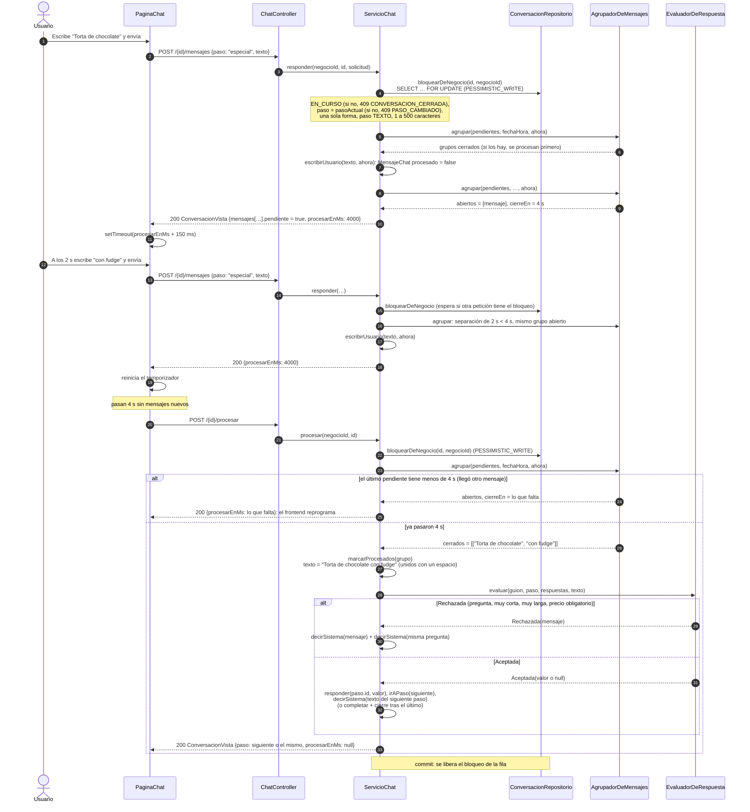

- Si llega un texto cuando el grupo anterior ya se cerró (el último pendiente tiene 4 s o más, por ejemplo porque el `procesar` del navegador no llegó), `responder` procesa **primero** ese grupo y después guarda el nuevo texto como el inicio de otra respuesta. Si al procesarlo la conversación se completa, responde 409 `CONVERSACION_CERRADA` y la transacción se revierte entera; el frontend recarga, recibe `procesarEnMs: 0` y llama a `procesar`, que cierra ese grupo.
- `procesar` se puede llamar varias veces: sin pendientes, o con el grupo todavía abierto, solo devuelve la vista. No exige `paso`. Con la conversación fuera de `EN_CURSO` (completa o abandonada) responde 409 `CONVERSACION_CERRADA`, igual que `responder`, y el frontend recarga.
- `responder` y `procesar` hacen `flush` antes de armar la vista, así los mensajes nuevos llegan con su `id`.
- `procesarEnMs` lo calcula `vista()` con el reloj del servidor: `null` si no hay pendientes; si no, lo que falta para los 4 s (o `0` si ya se cumplieron).
- Si al cerrar un grupo el paso actual ya no es `TEXTO` (por ejemplo, porque una respuesta anterior volvió al paso `producto`), el grupo solo se marca procesado y no se evalúa.

#### Concurrencia

- **Fila de la conversación:** `responder` y `procesar` cargan la conversación con `ConversacionRepositorio.bloquearDeNegocio` (`@Lock(PESSIMISTIC_WRITE)`, `SELECT … FOR UPDATE`) filtrando también por el negocio de la sesión. Dos respuestas, o una respuesta y un `procesar`, se atienden de a una: no se duplican mensajes ni se saltan pasos.
- **Fila del negocio:** `iniciar` bloquea el `Negocio` (`NegocioRepositorio.bloquear`), así dos "empezar" a la vez no violan el índice único de RN-19; si aun así ocurriera, el manejador general responde 409 `CONFLICTO`.
- **Campo `paso`:** cada `POST /mensajes` dice a qué paso responde. Si no coincide con `pasoActual` (doble toque, otra pestaña, reintento tras un corte), responde 409 `PASO_CAMBIADO` y no se guarda nada; el frontend recarga la conversación sin mostrar error. Así una respuesta pensada para una pregunta nunca se guarda en otra.
- **Fuera de `EN_CURSO`:** `responder` y `procesar` responden 409 `CONVERSACION_CERRADA` (el frontend también recarga).
- **Aislamiento (RNF-05):** una conversación de otro negocio responde 404 `NO_ENCONTRADO`, igual que una inexistente.

#### Lectura (`actual`)

`GET /api/chat/conversaciones/actual` es de solo lectura (`@Transactional(readOnly = true)`, no procesa pendientes): devuelve la `EN_CURSO` o, si no hay, la última `COMPLETA` cuya `fechaActualizacion` cae en el día de hoy en Lima; si no, 204. Si hay pendientes vencidos, `procesarEnMs` llega en `0` y el frontend llama a `procesar` enseguida.

#### Fuera de la fase 3

- **Fechas especiales y temporadas (trabajo futuro, fuera del MVP):** botón "Fecha especial" y paso para elegir la fecha, carrusel ordenado por temporada vigente (V13) y saludo de temporada. Se retomarán junto con el calendario de fechas especiales (RF-31). `PaqueteNicho.temporadasVigentes` y `fechasEspecialesProximas` ya existen y servirán de base.
- **Guion y storyboard:** llegaron en la fase 4 (sección 5.4). La conversación `COMPLETA` es su entrada. La relación se guarda en `video.conversacion_id` (único), no en una columna `video_id` de `conversacion` como dice la sección 9.1 de la especificación.
- **RN-26 (un video por día según el plan):** desde la fase 5 se aplica al aprobar el storyboard (sección 5.5), no al empezar el chat.

### 5.4 Guion y storyboard (`video`, fase 4)

Secciones 8.1 y 19 de la especificación, RF-21, RF-22, RN-21 a RN-25, RN-32 y RN-54; diseño en `docs/plan-fase-4.md` (con su anexo y las decisiones del usuario). Al terminar el chat nace un `Video`; una tarea programada le escribe el guion con IA y lo deja en `STORYBOARD`, donde el usuario revisa y ajusta los textos, las fotos y el precio y la frase del cierre. *Desde el 2026-11-12 (ADR 0021)* no hay guion de respaldo: si el proveedor falla, el guion se reintenta solo durante 5 minutos y luego el video pasa a `ERROR`, que el usuario puede reintentar sin gastar su video del día.

| Capa | Clase | Responsabilidad |
|---|---|---|
| `api` | `VideoController` | `GET /api/videos` ("Mis videos", hasta 50, los más recientes primero), `GET /api/videos/{id}`, `PUT /api/videos/{id}/planos/{orden}`, `POST /api/videos/{id}/descartar` y, desde la fase 5, los de la sección 5.5. Toma el `negocioId` de `UsuarioAutenticado` |
| `api` | `VideoVista`, `VideoResumen`, `SolicitudPlano` | La vista del storyboard (planos 1 a 3 con foto firmada, movimiento en palabras simples, texto y su máximo; cierre con precio, frase y `maxPalabrasFrase` (desde el 2026-11-12), llamado, ubicación, WhatsApp si el canal está activo, logo, colores y foto del local; descripción, hashtags, plan aplicado, las fotos del producto e `inicioDelGuion`; el `avisoDeRespaldo` se quitó el 2026-11-12); el resumen de la lista; el cambio de un plano (`texto`, `foto` con `tipo` o `clave`, o `precio` y `frase`) |
| `aplicacion` | `CreadorDeVideos` | `@EventListener` de `ConversacionCompletada`: crea el `Video` en `GUION_PENDIENTE` con el plan efectivo (`ResolutorDePlanEfectivo`) |
| `aplicacion` | `ProcesadorDeGuiones` | `@Scheduled(fixedDelayString = "${autoreel.tareas.guiones-cada:3s}")`: toma hasta 5 videos pendientes y llama a `ServicioGuion.procesar` en cada uno; un error de un video se registra y no detiene a los demás |
| `aplicacion` | `ServicioGuion` | Reclama el video, arma las instrucciones, llama al modelo (hasta 3 intentos), registra el costo, valida y crea los planos con el cierre de la IA. Si el proveedor falla, programa el siguiente intento (45 s) o, vencidos los 5 minutos, deja el video en `ERROR` (desde el 2026-11-12; antes usaba el respaldo) |
| `aplicacion` | `ServicioVideos` | Lista, vista, edición de un plano y descarte. Aplica las reglas de la edición (V21). Desde el PR #12, `reintentar`; desde el 2026-11-12 también para un video que falló al escribir su guion (sin consumir) |
| `aplicacion` | `LectorDeDatosDelVideo`, `InstruccionesDelGuion` | Reúne el perfil, el producto y las respuestas del chat en `DatosDelGuion` (dentro de una transacción, `Propagation.MANDATORY`); arma el mensaje para el modelo desde `guion.md` y el esquema JSON de la respuesta, y lee lo que devuelve |
| `dominio` | `Video`, `Plano` | Entidades (`video`, `plano`). `Video`: `registrarIntentoDeGuion`, `agregarPlano`, `agregarCierre(orden, precio, frase, llamado, ubicacion)`, `mostrarStoryboard`, `marcarError`, `descartar`; `@Version`. Desde el 2026-11-12: `inicioDelGuion`, `esperarSiguienteIntentoDeGuion`, `marcarErrorDefinitivo`, `falloEnElGuion`, `reintentarGuion`. `Plano`: `cambiarTexto`, `cambiarFoto`, `cambiarPrecio` y, desde el 2026-11-12, `cambiarFrase` y `textoPrincipalDelCierre` |
| `dominio` | `EstadoVideo` | Los 10 estados de 9.2 (en la fase 4 se usan `GUION_PENDIENTE`, `STORYBOARD`, `ERROR` y `DESCARTADO`). `MotivoRespaldo` (por qué se usó el guion de respaldo) se borró el 2026-11-12 |
| `dominio` | `DatosDelGuion`, `GuionPropuesto` | Entrada del guion (incluye las fuentes permitidas de números y precios, RN-22); lo que escribe el modelo: planos 1 a 3, desde el 2026-11-12 el cierre (`CierrePropuesto(precio, frase, ubicacion)`), descripción y hashtags |
| `dominio` | `ValidadorDeGuion` | Reglas puras: RN-21 a RN-24 (devuelve los problemas en español, que se le envían al modelo en el siguiente intento). `GuionDeRespaldo` (RN-25 anterior) se borró el 2026-11-12 |
| `infraestructura` | `VideoRepositorio` | `idDeConversacion`, `buscarDeNegocio`, `bloquearDeNegocio` y `bloquear` (`PESSIMISTIC_WRITE`), `buscarConModeloDeTexto`, `listarDeNegocio`, `pendientesDeGuion` y `reclamar` (`UPDATE` condicional; `reclamadoHasta` se quitó el 2026-11-12) |

#### Flujo: chat → video → procesador → storyboard

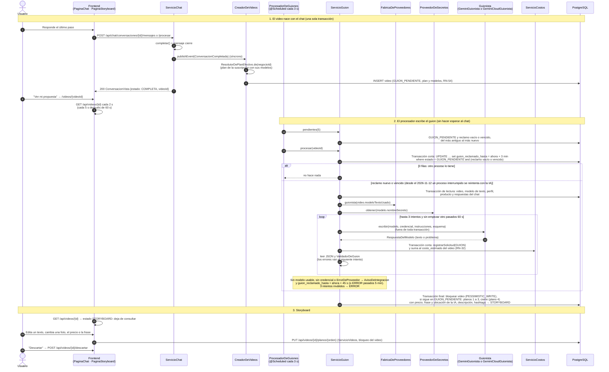

#### Escribir el guion (`ServicioGuion`)

- **Sin transacción larga:** `procesar` no lleva `@Transactional`. Usa transacciones cortas con `TransactionTemplate`: reclamar; leer los datos (solo lectura); registrar el costo de cada respuesta; y finalizar con el video bloqueado. Las llamadas HTTP al modelo van fuera de toda transacción.
- **Reclamo (3 minutos):** `VideoRepositorio.reclamar` es un `UPDATE` condicional sobre `guion_reclamado_hasta` y solo sigue si afectó 1 fila; así dos ejecuciones nunca toman el mismo video. Si el video ya tenía un reclamo (vencido), un proceso anterior se cortó (por ejemplo, un reinicio). Hasta el 2026-11-12 se usaba directamente el guion de respaldo con `PROCESO_INTERRUMPIDO`; desde entonces (ADR 0021) se vuelve a llamar a la IA, porque ya no hay respaldo. El mismo `guion_reclamado_hasta` sirve para la espera entre reintentos (ver abajo).
- **Modelo del video, no del plan actual (RN-49, RN-54):** el plan efectivo se resuelve **una sola vez**, al crear el video; `ServicioGuion` usa `video.modeloTextoUsado`.
- **Intentos (RN-25):** hasta 3 (1 + 2 reintentos). No se empieza otro intento si ya pasaron 60 s desde el primero. Cada intento manda las instrucciones con los problemas del anterior (respuesta sin texto, JSON con otra forma o errores del validador).
- **Costo (RN-32):** se registra por cada respuesta del proveedor, aunque el guion no sirva (el proveedor la cobra): un `registro_costo` con `concepto = GUION` y `cantidad = 1`, y la suma en `video.costo_estimado` e `intentos_guion`, en la misma transacción corta. No se registra costo cuando falta la credencial ni cuando el proveedor lanza `ErrorDeProveedor`.
- **Finalizar:** bloquea el video (`PESSIMISTIC_WRITE`); si ya no está en `GUION_PENDIENTE`, no hace nada. Crea los planos 1 a 3 con la foto que pide la plantilla (si el producto ya no la tiene, la primera que tenga), el movimiento y el texto del guion; arma el cierre (plano 4) con el **cierre que escribió la IA** (desde el 2026-11-12; antes, el precio tal como lo escribió el usuario): `precio` y `frase` de `CierrePropuesto`, la `ubicacion` de la IA o, si no la dio, el distrito, y el llamado del canal de mayor prioridad que tenga el negocio. Guarda la descripción, los hashtags y la última respuesta legible del modelo en `video.guion` (solo auditoría: las filas de `plano` son la fuente de verdad), y pasa a `STORYBOARD`. Si el producto ya no tiene fotos, `ERROR` definitivo.
- **Antes de llamar al modelo** (desde el 2026-11-12), la lectura comprueba que el producto exista y tenga fotos. Si no, el video pasa a `ERROR` **definitivo** (`marcarErrorDefinitivo`, `MOTIVO_SIN_FOTOS`) sin llamar ni cobrar, y no se ofrece "Reintentar".

#### Sin guion de respaldo: reintentos y error (desde el 2026-11-12, ADR 0021)

Hasta el 2026-11-12, en estos casos se usaba el guion de respaldo (`GuionDeRespaldo`, con su `MotivoRespaldo` en `video.motivo_respaldo` y el `avisoDeRespaldo` del paquete). Copiaba los textos del negocio y se quitó. Hoy `ServicioGuion.procesar` decide así:

| Situación | Resultado | Aviso RN-57 (`INTEGRACION_CON_ERROR`, sección 5.7) | ¿Costo? |
|---|---|---|---|
| La fábrica no entrega guionista: el modelo no es `TEXTO`, no está `ACTIVO`, no cobra `POR_SOLICITUD` o su adaptador no existe (RN-56) | **Sigue en `GUION_PENDIENTE`**: `Video.esperarSiguienteIntentoDeGuion` pone `guion_reclamado_hasta` = ahora + 45 s (`ESPERA_ENTRE_INTENTOS`), así `pendientesDeGuion` no lo toma antes. Si ese siguiente intento ya cae después de `inicioDelGuion()` + 5 min (`PLAZO_DE_REINTENTOS`), pasa a `ERROR` con `MOTIVO_SIN_IA`: "No pudimos escribir tu guion con IA. Inténtalo de nuevo en un rato." | `CONFIGURACION_INVALIDA` | No |
| `ProveedorDeSecretos` no tiene valor para `nombre_secreto` (ni pegado en Ajustes ni en el `.env`) | Igual: espera 45 s, y `ERROR` pasados 5 minutos | `CREDENCIAL_INVALIDA` | No |
| El adaptador lanzó `ErrorDeProveedor` o una falla inesperada (tratada como `NO_DISPONIBLE`) | Igual: espera 45 s, y `ERROR` pasados 5 minutos | El tipo del error | Solo las respuestas anteriores |
| Los intentos (3, o los que cupieron en 60 s) devolvieron respuestas vacías, bloqueadas, mal formadas o que no pasan el validador | `ERROR` con `MOTIVO_GUION_INVALIDO`: "No logramos escribir un guion que cumpla las reglas. Inténtalo de nuevo." | — | Sí, una por respuesta |
| El producto ya no existe o no tiene fotos (al leer o al finalizar) | `ERROR` **definitivo** (`video.error_definitivo`) con `MOTIVO_SIN_FOTOS`, sin llamar al modelo | — | No |
| Cualquier otra excepción nuestra (no del proveedor) | `ERROR` con `MOTIVO_FALLA_INTERNA`: "Tuvimos un problema al preparar tu guion. Inténtalo de nuevo." No se reintenta solo, para no pagar el guion en un ciclo | — | Solo las respuestas anteriores |

- `inicioDelGuion()` es `video.guion_iniciado_en` (V9): la creación o el último "Reintentar". En los videos anteriores a V9 es `fecha_creacion`.
- En ningún caso se consumió el video del día: se consume al aprobar el storyboard (RN-26).
- **"Reintentar"** (`POST /api/videos/{id}/reintentar`, `ServicioVideos.reintentar`): si `Video.falloEnElGuion()` (en `ERROR`, sin `consumo_fecha`, sin planos y sin `error_definitivo`), `Video.reintentarGuion` lo devuelve a `GUION_PENDIENTE`. Limpia `motivo_error`, `intentos_guion` y el reclamo, y pone `guion_iniciado_en` = ahora (un plazo nuevo de 5 minutos). No consume el video del día ni exige la IA disponible: el procesador lo toma en el siguiente ciclo. La vista trae `generacion.reintentoUsaVideoDelDia = false`. Un video que falló al generarse se reintenta como en el PR #12 (sección 5.5).

#### Validador

- **`ValidadorDeGuion`** (RN-21 a RN-24): los planos que escribe la IA (1 a 3), sin repetir ni sobrar; movimiento de la lista y admitido para el tipo de video; desde el 2026-11-12, **variedad** (`erroresDeVariedad`: los tres no repiten el mismo movimiento y al menos `minimoPlanosCamara3d` usan uno de cámara 3D); texto no vacío, dentro de su máximo de palabras, sin emojis ni saltos de línea y sin precios (los precios solo van en el cierre); en los textos, la descripción y los hashtags, ningún número, precio, porcentaje o palabra de promoción que no esté en los datos del negocio (RN-22) y ninguna frase prohibida del nicho o del negocio (RN-23; las de salud valen si la descripción del producto las declara); descripción con hashtags de hasta 600 caracteres, entre 5 y 8 hashtags distintos con forma `#palabra` y al menos uno del distrito (RN-24). Los ingredientes y sabores inventados no se pueden detectar: los controlan las instrucciones de `guion.md`.
- **El cierre** (`erroresDelCierre`, desde el 2026-11-12):
  - **`precio`:**
    - Si el negocio escribió un precio real (`exigePrecio`: con un dígito, con forma de precio en pantalla como `S/`, `$`, `%`, `NxN` o "N soles", y sin la palabra "no"), no puede ir `null`.
    - Si lo que escribió no trae números (`escribioUnPrecio`), debe ir `null`.
    - Si va, lleva un número, tiene hasta 40 caracteres y sus números, moneda y palabras de promoción salen **solo de la respuesta del precio** (`problemasDeContenido` con `List.of(datos.precio())`), no de la descripción del producto.
  - **`frase`:** obligatoria, con hasta `maxPalabras` del cierre (6) y 40 caracteres, dibujable, sin precio, sin promociones inventadas y sin frases prohibidas.
  - **`ubicacion`:** opcional, de hasta `maximoCaracteresUbicacion` (40). Cada palabra de 3 o más letras, y cada número, debe aparecer en los datos del negocio.
- El guion de respaldo (`GuionDeRespaldo`, RN-25 anterior) armaba un guion sin IA con los textos del negocio. Se borró el 2026-11-12 (ADR 0021).

#### Storyboard (`ServicioVideos`)

- **Aislamiento (RNF-05):** todas las consultas llevan el negocio de la sesión; un video de otro negocio responde 404 `NO_ENCONTRADO`.
- **Edición** (`PUT /api/videos/{id}/planos/{orden}`): bloquea el video (`bloquearDeNegocio`, `PESSIMISTIC_WRITE`) y exige `STORYBOARD` (si no, 409 `VIDEO_NO_EDITABLE`). En los planos 1 a 3: `texto` y/o `foto`. El texto se recorta y no puede quedar vacío (`TEXTO_VACIO`), pasar del máximo de palabras (`TEXTO_MUY_LARGO`, V21), tener emojis o saltos de línea (`CARACTER_NO_PERMITIDO`) ni frases prohibidas (`PALABRA_PROHIBIDA`, que nombra la frase). No se le aplica la RN-22: el usuario escribe sus propios textos. La foto es otra del producto (`{tipo}`; si ya no la tiene, `FOTO_NO_DISPONIBLE`) o una nueva (`{clave}`), que pasa por `ServicioDeArchivos.confirmar` como `FOTO_PRODUCTO` y queda solo en ese plano, sin tocar el producto ni el catálogo. En el cierre se cambian el `precio` (hasta 40 caracteres, `PRECIO_MUY_LARGO`; vacío lo quita) y, desde el 2026-11-12, la `frase` (hasta 6 palabras y 40 caracteres, `FRASE_MUY_LARGA`; vacía la quita), juntos o por separado, con las mismas reglas de caracteres y frases prohibidas. Otra combinación responde `SOLICITUD_INVALIDA`.
- **Descartar:** `STORYBOARD` → `DESCARTADO` (desde la fase 5, también desde `LISTO`; ver 5.5).
- **"Crear mi video"** (aprobar el storyboard): desde la fase 5, ver 5.5.
- Desde la fase 5 la misma edición también se acepta en `LISTO` (revisión), con otras consecuencias: ver 5.5.

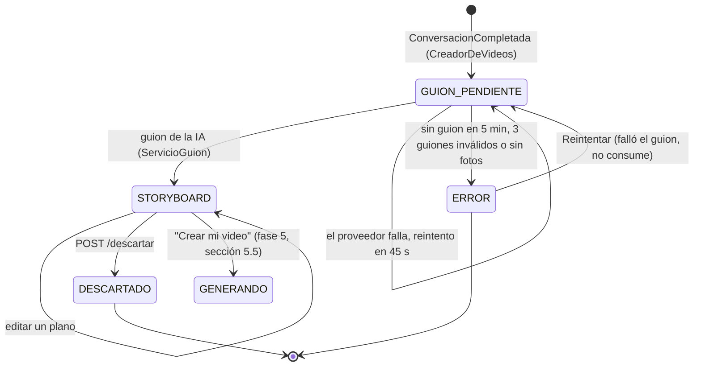

La fase 5 usa `movimientos.json` (desde el 2026-11-12, el prompt de `Movimientos.promptDeToma` y los `negativos`) y las filas de `plano`, que son la fuente de verdad del guion, para pedir los clips (sección 5.5).

### 5.5 Generación y revisión (`video`, fase 5)

Secciones 7.4, 8.2 a 8.4, 9.2 y 19 de la especificación; RF-22 a RF-26, RN-26 a RN-32, RN-54 a RN-57; casos V22 a V27 (y V08 y V39). Diseño en `docs/plan-fase-5.md` (con su anexo de revisión y las decisiones del usuario), actualizado por los ADR 0017 (proveedores de Google) y 0020 (sin respaldo sin IA: la sección 8.5 de la especificación ya no se aplica a los clips, sección 5.6). El usuario aprueba el storyboard, dos tareas programadas generan los clips y componen el MP4, y el usuario lo revisa en `LISTO`: regenera un plano, cambia un texto, el precio o una foto, lo aprueba y lo descarga.

| Capa | Clase | Responsabilidad |
|---|---|---|
| `api` | `VideoController` | `POST /api/videos/{id}/aprobar-storyboard` (RF-22), `POST /api/videos/{id}/planos/{orden}/regenerar` (RF-24), `POST /api/videos/{id}/aprobar`, `GET /api/videos/{id}/descarga` (`Descarga(url)`, RF-25); `PUT /planos/{orden}` y `POST /descartar` también en `LISTO` |
| `api` | `VideoVista` | Desde la fase 5: `PlanoVista.estado` y `usoRespaldo` (este último solo puede venir en videos anteriores a la revisión del flujo); `PlanDelVideo.regeneracionesPorVideo`; `generacion` (`GeneracionVista`: `videosHoy` = `ConsumoVista(usados, porDia, puedeAprobar)`, `urlVideo` firmada, `regeneracionesUsadas`, `iaDisponible`, `avisoRevision`, `motivoError`, desde el PR #12 `puedeReintentar` y desde el 2026-11-12 `reintentoUsaVideoDelDia`) |
| `aplicacion` | `ServicioVideos` | Aprobar el storyboard, regenerar, editar en la revisión, aprobar, descargar, la vista y, desde el PR #12, reintentar un video en `ERROR`. Desde la revisión del flujo exige el modelo de video disponible para aprobar el storyboard, regenerar y cambiar una foto en la revisión (409 `IA_NO_DISPONIBLE`) |
| `aplicacion` | `ServicioConsumo` | RN-26 y RN-27: `consumir` (fila del día bloqueada), `devolver` (en el día del error), `deHoy` (para la vista) y `delMes` (panel del administrador) |
| `aplicacion` | `ProcesadorDeVideos` | Dos `@Scheduled`: `generarClips` (cada `autoreel.tareas.clips-cada`, 10 s) y `componerVideos` (cada `autoreel.tareas.composicion-cada`, 10 s), hasta 5 videos por pasada; un error de un video se registra y no detiene a los demás |
| `aplicacion` | `ServicioGeneracion` | Una pasada por los planos de un video en `GENERANDO`: envía, consulta y guarda el clip (8.2, RN-30); registra el costo de cada clip (RN-32); con todos los clips, pasa a `COMPONIENDO`. Un plano que no consigue su clip va a `sinClip` (sección 5.6): no hay respaldo sin IA |
| `aplicacion` | `ServicioComposicion` | Arma la `Composicion` (clips, cierre, pista, tipografía), llama a `ComponedorDeVideo`, guarda el MP4 y pasa a `LISTO`; maneja las fallas (RN-27) |
| `aplicacion` | `BibliotecaMusical` | `ApplicationRunner`: sube las pistas de los paquetes de nicho al almacenamiento y registra las que falten en `pista_musical`; `elegir(nicho, estilo, videoId)` |
| `dominio` | `Video` | Desde la fase 5: `aprobarStoryboard`, `regenerarPlano` (única puerta para regenerar), `clipsTerminados`, `pasarAComponer`, `recomponer`, `contarIntentoDeComposicion`, `composicionLista`, `recomposicionFallida`, `devolverConsumo`, `liberarTrabajo`, `aprobar`. Desde la revisión del flujo, `regeneracionFallida(aviso)` (antes `devolverRegeneracion`), y `marcarError` (fase 4) también lo usa la generación |
| `dominio` | `Plano` | Desde la fase 5: `prepararEnvio`, `enviado`, `reintentar`, `clipListo`, `terminado`. Desde la revisión del flujo, `conservarClipAnterior`; ya no existen `usarRespaldo` ni `usarFotoSinIa` |
| `dominio` | `EstadoPlano`, `MotivoRespaldoPlano` | Estado del clip (`PENDIENTE`, `GENERANDO`, `LISTO` y `RESPALDO`, que el código ya no asigna y solo queda en videos anteriores a la revisión del flujo); por qué un plano se quedó sin clip (`SIN_CREDENCIAL`, `CREDENCIAL_INVALIDA`, `CONFIGURACION_INVALIDA`, `PROVEEDOR_NO_DISPONIBLE`, `CLIP_FALLIDO`, `TIEMPO_AGOTADO`, `MODELO_INACTIVO`), que hoy solo va al log |
| `dominio` | `ConsumoDiario`, `PistaMusical` | Entidades (`consumo_diario`, `pista_musical`) |
| `dominio` | `ComponedorDeVideo` | Puerto de la composición (sección 6.5) |
| `infraestructura` | `FfmpegComponedor`, `DisenoDeTextos`, `PreparadorDeFotos`, `GraficosDelVideo` | Composición con FFmpeg; reparto de los textos en líneas medido con la tipografía; fotos verticales; desde el 2026-11-12, los gráficos del video en Java2D (franja degradada, insignia del logo y píldora del llamado) en lugar del degradado del cierre (sección 6.5) |
| `infraestructura` | `VideoRepositorio` | Desde la fase 5: `buscarConModeloDeVideo`, `enProceso(estado, ahora, límite)` y `reclamarTrabajo` (`UPDATE` condicional sobre `trabajo_reclamado_hasta`) |
| `infraestructura` | `ConsumoDiarioRepositorio`, `PistaMusicalRepositorio` | `crearSiFalta` (`insert ... on conflict do nothing`), `bloquear` (`PESSIMISTIC_WRITE`), `findByNegocioIdAndFecha`, `sumar` (mes); `existsByClave`, `findByNichoAndEstiloAndActivaTrueOrderById` |

#### Flujo: aprobar → generar → componer → revisar

```mermaid
sequenceDiagram
    autonumber
    actor U as Usuario
    participant F as Frontend<br/>(PaginaStoryboard)
    participant SV as ServicioVideos
    participant CO as ServicioConsumo
    participant PV as ProcesadorDeVideos<br/>(@Scheduled cada 10 s)
    participant G as ServicioGeneracion
    participant GC as GeneradorDeClips<br/>(OmniGeneradorDeClips o VeoGeneradorDeClips)
    participant C as ServicioComposicion
    participant FF as ComponedorDeVideo<br/>(FfmpegComponedor)
    participant A as AlmacenDeArchivos
    participant BD as PostgreSQL

    Note over U,BD: 1. Aprobar el storyboard (una transacción)
    U->>F: "Crear mi video" (desactivado si iaDisponible = false)
    F->>SV: POST /api/videos/{id}/aprobar-storyboard
    SV->>BD: bloquearDeNegocio(video) (PESSIMISTIC_WRITE), exige STORYBOARD
    alt FabricaDeProveedores.videoDisponible(modeloVideoUsado) = false
        SV-->>F: 409 IA_NO_DISPONIBLE (no se consume nada)
    end
    SV->>CO: consumir(negocioId, plan.videosPorDia)
    CO->>BD: insert consumo_diario ... on conflict do nothing<br/>y SELECT ... FOR UPDATE de la fila del día de Lima
    alt videos_generados >= videosPorDia
        CO-->>F: 409 VIDEOS_DEL_DIA_AGOTADOS (V22)
    end
    CO->>BD: videos_generados + 1
    SV->>SV: BibliotecaMusical.elegir(nicho, estilo, videoId)
    SV->>BD: video: consumo_fecha, pista_musical_id, generacion_iniciada_en,<br/>planos 1 a 3 en PENDIENTE → GENERANDO
    SV-->>F: 200 VideoVista (GENERANDO)
    F->>F: PantallaGenerando: GET /api/videos/{id} cada 5 s

    Note over PV,BD: 2. Clips (sin transacción larga, cada cambio de un plano en su propia transacción)
    PV->>G: pendientes(5) y procesar(videoId)
    G->>BD: reclamarTrabajo: UPDATE trabajo_reclamado_hasta = ahora + 5 min<br/>where estado = GENERANDO and (reclamo vacío o vencido)
    G->>G: FabricaDeProveedores.generadorDeClips(modeloVideoUsado)<br/>y ProveedorDeSecretos.obtener(modelo.nombreSecreto)
    loop cada plano sin clip, mientras el video siga en GENERANDO
        alt sin generador o sin credencial (la IA se cayó después de aprobar)
            G->>G: AvisoDeIntegracion y sinClip (MODELO_INACTIVO o SIN_CREDENCIAL)
        else plano PENDIENTE
            G->>A: leer la foto y PreparadorDeFotos.vertical (9:16, EXIF)
            G->>BD: prepararEnvio: intentos + 1 y enviado_en (antes de llamar)
            G->>GC: iniciar(modelo, credencial, SolicitudDeClip)
            GC-->>G: idTarea (interacción de Omni u operación de Vertex AI)
            G->>BD: id_tarea_proveedor y plano en GENERANDO
        else plano GENERANDO
            G->>GC: consultar(modelo, credencial, idTarea)
            alt Listo
                G->>A: guardar clip-{orden}-{uuid}.mp4
                G->>BD: registro_costo CLIP (segundos generados o pedidos × costo)<br/>y clave_clip → LISTO
            else Fallido
                G->>BD: vuelve a PENDIENTE; con 2 intentos → sinClip (CLIP_FALLIDO)
            else EnCurso y pasaron 10 min desde enviado_en
                G->>G: sinClip (TIEMPO_AGOTADO), con su registro_costo CLIP
            end
        end
    end
    Note over G,BD: sinClip: regeneración → conserva el clip anterior y avisoRevision;<br/>video nuevo → ERROR y devuelve el video del día (sección 5.6)
    G->>BD: si sigue en GENERANDO y todos los planos tienen clip → COMPONIENDO<br/>(intentos_composicion = 0); libera el reclamo

    Note over PV,BD: 3. Composición
    PV->>C: pendientes(5) y procesar(videoId)
    C->>BD: reclamarTrabajo (5 min) e intentos_composicion + 1<br/>(con 2 intentos ya hechos: falla)
    C->>A: leer clips, foto del local, logo y pista
    C->>FF: componer(Composicion) (fuera de toda transacción, hasta 2 min)
    FF-->>C: MP4 de 15 s, 1080×1920, 30 fps, H.264 + AAC
    C->>A: guardar final-{uuid}.mp4
    C->>BD: clave_final → LISTO, tras el commit, borra el MP4 anterior
    alt la composición falla
        C->>BD: con menos de 2 intentos, solo libera el reclamo (se reintenta)
        C->>BD: con 2 intentos: primera composición → ERROR y devolver consumo (RN-27),<br/>recomposición → LISTO con el MP4 anterior y aviso_revision
    end

    Note over U,BD: 4. Revisión (LISTO)
    F->>F: GET /api/videos/{id} → LISTO: Reproductor con urlVideo
    U->>F: "Regenerar este plano" (solo si iaDisponible)
    F->>SV: POST /planos/{orden}/regenerar
    SV->>SV: IA_NO_DISPONIBLE si no hay modelo de video utilizable,<br/>SIN_REGENERACIONES si se agotaron (RN-28, V26)
    SV->>BD: regeneraciones_usadas + 1, plano en PENDIENTE (conserva el clip anterior) → GENERANDO
    U->>F: Cambia un texto o el precio
    F->>SV: PUT /planos/{orden}
    SV->>BD: solo recompone → COMPONIENDO (RN-29, V25)
    U->>F: "Aprobar mi video" / "Descargar"
    F->>SV: POST /aprobar → APROBADO · GET /descarga → {url}
```

#### Aprobar el storyboard y consumo diario (RN-26, RN-27, V22, V27)

- **Una transacción:** `ServicioVideos.aprobarStoryboard` bloquea el video (`bloquearDeNegocio`) y exige `STORYBOARD` (si no, 409 `VIDEO_NO_EDITABLE`). Desde la revisión del flujo exige además que el modelo de video del video esté disponible (`FabricaDeProveedores.videoDisponible`; si no, 409 `IA_NO_DISPONIBLE`, antes de consumir nada), porque no hay respaldo sin IA. `ServicioConsumo.consumir` (`Propagation.MANDATORY`) crea la fila del día si falta (`insert ... on conflict do nothing`: dos aprobaciones a la vez no chocan) y la lee con `PESSIMISTIC_WRITE`, así dos aprobaciones simultáneas nunca pasan el límite.
- **Límite del plan aplicado al video** (`plan.videos_por_dia`, RN-54), por **día de Lima** (`LocalDate.now(reloj)`); los videos no usados no se acumulan. Sin cupo: 409 `VIDEOS_DEL_DIA_AGOTADOS` ("Ya usaste tu video de hoy. Mañana tienes uno nuevo."). Desde la fase 7, un beneficio temporal vigente al crear el video le da su plan (`ResolutorDePlanEfectivo`, RN-50), y con él sus videos por día, sus regeneraciones y sus modelos.
- `Video.aprobarStoryboard` guarda `consumo_fecha`, la pista elegida (`pista_musical_id`) y `generacion_iniciada_en`, pone los planos 1 a 3 en `PENDIENTE` (intentos en 0) y pasa a `GENERANDO`.
- **Pista:** `BibliotecaMusical.elegir` toma, entre las pistas activas del nicho y el estilo del negocio, la de posición `videoId % cantidad`; así no todos escuchan siempre la misma y una recomposición usa la misma. Sin pistas, el video sale con audio en silencio.
- **RN-27:** si la **primera** composición falla dos veces, el video pasa a `ERROR` con un `motivo_error` simple ("No pudimos armar el video. Te devolvimos el video del día.") y `ServicioConsumo.devolver` resta 1 al consumo **del día en que ocurre el error** (decisión del usuario), una sola vez (`video.consumo_devuelto`). Desde la revisión del flujo, lo mismo ocurre si un video nuevo se queda sin un clip (sección 5.6). Descartar un video en revisión (`LISTO`) no devuelve el consumo.
- La vista trae `generacion.videosHoy` (`usados`, `porDia`, `puedeAprobar`) para el botón "Crear mi video".

#### Generación de los clips (`ServicioGeneracion`, 8.2, RN-30, RN-32, V24)

- **Reclamo de 5 minutos** con `VideoRepositorio.reclamarTrabajo` (`UPDATE` condicional sobre `video.trabajo_reclamado_hasta`, estado `GENERANDO`): dos pasadas nunca toman el mismo video. Al terminar la pasada (también si falla) se libera el reclamo y, si el video sigue en `GENERANDO` y todos los planos con IA tienen su clip, pasa a `COMPONIENDO` (`clipsTerminados`; el cierre no cuenta).
- **Sin transacción larga:** la lectura es de solo lectura; cada cambio de un plano va en su propia transacción corta, con el video bloqueado y solo si sigue en `GENERANDO`; las llamadas al proveedor van fuera de toda transacción.
- **Sin pedir de más:** antes de cada plano se vuelve a leer el estado del video; si otro plano ya lo dejó en `ERROR`, la pasada termina y no se piden más clips (costarían sin servir).
- **Sin doble envío:** antes de `iniciar` se suma `intentos` y se fija `enviado_en` (`Plano.prepararEnvio`) en su transacción; después se guarda `id_tarea_proveedor` (`Plano.enviado`). Si algo se corta entre medio, el plano no se reenvía sin límite.
- **Foto:** se lee del almacenamiento y se normaliza en Java (`PreparadorDeFotos.vertical`: orientación EXIF aplicada, recorte central a 9:16 y JPEG de 1080×1920 sin metadatos).
- **Solicitud:** `SolicitudDeClip(foto, "image/jpeg", prompt, negativos, segundos)`. Desde el 2026-11-12 (ADR 0021), `prompt` = `Movimientos.promptDeToma(movimiento)`: la `plantillaDeToma` del paquete con la `instruccion` del movimiento en `{instruccion}`, seguida de las `prohibiciones`. `negativos` = los `negativos` del paquete. Los segundos salen de `modelo.parametros.duracionClipSegundos` (4 si falta). Veo recibe los negativos como `negativePrompt`; Omni, que no lo admite, al final del prompt (sección 6.4). Antes, la solicitud llevaba solo la `instruccion` y las `prohibiciones`.
- **Proveedor síncrono:** con Gemini Omni Flash en modo síncrono, `iniciar` ya trae el clip y `consultar` lo entrega en la pasada siguiente sin volver a pedirlo (sección 6.4).
- **Reglas por plano** (consultar siempre primero; un clip listo se usa y se cobra aunque hayan pasado los 10 minutos). "Sin clip" es `ServicioGeneracion.sinClip`, descrito en la sección 5.6:

| Situación | Resultado | ¿Se cobra? |
|---|---|---|
| Clip listo | Se guarda en `negocios/{negocioId}/videos/{videoId}/clip-{orden}-{uuid}.mp4` → `LISTO` | Sí: `registro_costo` `CLIP` con `cantidad` = los segundos que informa el proveedor (`Listo.segundosGenerados`, en Omni calculados con los tokens de video) o, si no los informa, los pedidos (`duracionClipSegundos`), y `costo_usd` = segundos × `costo_referencial` (RN-32, V39), sumado a `video.costo_estimado` |
| El proveedor terminó sin clip (`Fallido`, por ejemplo su filtro de contenido) | Vuelve a `PENDIENTE`; con 2 intentos, sin clip (`CLIP_FALLIDO`) | No |
| `ErrorDeProveedor` `NO_DISPONIBLE` al iniciar | Cuenta como intento y avisa; con 2, sin clip (`PROVEEDOR_NO_DISPONIBLE`) | No |
| `NO_DISPONIBLE` al consultar | Se sigue consultando hasta los 10 minutos | — |
| Sigue en curso a los 10 minutos de `enviado_en` | Sin clip (`TIEMPO_AGOTADO`) | Sí: la tarea ya se envió y el proveedor la cobra |
| `CREDENCIAL_INVALIDA` o `CONFIGURACION_INVALIDA` | Sin clip directo y aviso (RN-57) | Solo si la tarea ya estaba enviada |
| Sin credencial o modelo no utilizable (la IA dejó de estar disponible después de aprobar) | Sin clip directo (`SIN_CREDENCIAL` o `MODELO_INACTIVO`), un aviso por pasada, sin llamar al proveedor | Solo si la tarea ya estaba enviada |
| Cualquier otra excepción (por ejemplo, falta la foto) | Cuenta como intento; con 2, sin clip (`CLIP_FALLIDO`) | No |
| Pasaron **20 minutos** desde el último envío del plano (`enviado_en`, red de seguridad para un plano que quedó en `PENDIENTE` tras un envío) | Sin clip (`TIEMPO_AGOTADO`) | No |

- **Plazo total desde el último envío** (proveedores de Google): no cuenta la espera en la cola. Con un proveedor síncrono, un video puede esperar a que terminen otros sin perder sus clips por el plazo.
- **No hay respaldo sin IA** (revisión del flujo, ADR 0020; antes, el acercamiento de FFmpeg de la sección 8.5 de la especificación): un video nuevo sin todos sus clips pasa a `ERROR` y devuelve el video del día; una regeneración que falla conserva el clip anterior. Ver sección 5.6.

#### Composición (`ServicioComposicion`, 8.3, RN-31, V23)

- **Reclamo** con el mismo `reclamarTrabajo` (estado `COMPONIENDO`, 5 minutos; FFmpeg tiene un tope de 2). En la misma transacción se suma `intentos_composicion` **antes** de componer: un corte a mitad también cuenta. Si ya había 2 intentos, falla sin volver a componer.
- **Entrada** (`Composicion`): por plano, el clip (`LISTO`), sus segundos (de la plantilla) y su texto (solo un plano en `RESPALDO` de un video anterior a la revisión del flujo se compone todavía con su foto preparada y el acercamiento, sección 6.5); el cierre con la foto del local preparada (o `null`: desde el 2026-11-12 ya no hay degradado de los colores de marca y el fondo sale del último plano), el logo, el texto principal (`Plano.textoPrincipalDelCierre()`: el precio o, si no hay, la frase), el llamado, la ubicación, el WhatsApp si el canal está activo y el color primario de la marca; la pista del video y la tipografía del estilo del negocio.
- **Salida:** el MP4 se guarda con una clave nueva (`negocios/{negocioId}/videos/{videoId}/final-{uuid}.mp4`); al confirmar, `clave_final` apunta al nuevo, el video pasa a `LISTO` y el anterior se borra **después del commit**. Si el video ya no está en `COMPONIENDO`, el MP4 nuevo se borra.
- **Fallas:** con menos de 2 intentos, solo se libera el reclamo y la siguiente pasada reintenta. Con 2: si es la **primera composición** (no hay `clave_final`), `ERROR` y RN-27; si es una **recomposición**, el video vuelve a `LISTO` con su MP4 anterior y `aviso_revision` ("No pudimos aplicar tu último cambio; tu video anterior sigue disponible. Inténtalo de nuevo.").

#### Revisión (RF-24, RF-25, RN-28, RN-29, V25, V26)

- **Regenerar** (`POST /planos/{orden}/regenerar`, solo `LISTO`, planos 1 a 3): con el video bloqueado, responde 409 `IA_NO_DISPONIBLE` si el modelo de video no se puede usar ahora (`FabricaDeProveedores.videoDisponible`: adaptador existente, `VIDEO`, `ACTIVO`, `POR_SEGUNDO` y con credencial) y 409 `SIN_REGENERACIONES` si `regeneraciones_usadas` llegó a `plan.regeneraciones_por_video` (3 en Lite). Si no, `Video.regenerarPlano` suma la regeneración, deja el plano en `PENDIENTE` conservando su clip anterior hasta que llegue el nuevo, reinicia `generacion_iniciada_en`, borra el `aviso_revision` y pasa a `GENERANDO`. Si el clip nuevo no llega, el plano se queda con el anterior y la regeneración no se descuenta (sección 5.6).
- **Editar en `LISTO`** (`PUT /planos/{orden}`, mismas validaciones del storyboard):
  - Texto, precio o frase: solo recompone (`Video.recomponer` → `COMPONIENDO`), sin gastar regeneraciones ni videos del día (RN-29, V25).
  - Foto nueva: necesita un clip nuevo de IA, porque no hay respaldo sin IA. Sin el modelo de video disponible responde 409 `IA_NO_DISPONIBLE`; sin regeneraciones, 409 `SIN_REGENERACIONES`. Si no, regenera ese plano con `regenerarPlano` (cuenta como regeneración) **conservando el clip anterior** hasta que llegue el nuevo: si el nuevo falla, el video sigue armado con el clip de antes. Con texto y foto en la misma solicitud, cuenta una sola regeneración.
- **Aprobar** (`POST /aprobar`): `LISTO` → `APROBADO`. Publicar llega en la **(futuro, fase 6)**.
- **Descargar** (`GET /descarga`, RF-25): en `LISTO`, `APROBADO`, `PROGRAMADO` o `PUBLICADO` con `clave_final`; si no, 409 `VIDEO_NO_DISPONIBLE`. Devuelve `{url}` firmada por 15 minutos con `Content-Disposition: attachment` y el nombre `autoreel-{producto}-{id}.mp4` (`AlmacenDeArchivos.urlDeDescargaComoAdjunto`).
- **Descartar:** también desde `LISTO`; el video del día no se devuelve.
- **Reintentar** (`POST /reintentar`, PR #12): un video en `ERROR` que falló **al generarse** (`Video.reintentable`: con `consumo_fecha`, con planos y sin `error_definitivo`) vuelve a `GENERANDO`. Antes exige la IA de video disponible (409 `IA_NO_DISPONIBLE`) y el cupo del día, porque **vuelve a consumir el video del día** que RN-27 había devuelto. Solo pide los clips que faltan: los que ya llegaron se conservan y no se vuelven a pagar. Un video que falló al escribir su guion se reintenta sin consumir (sección 5.4). Fuera de `ERROR` responde 409 `VIDEO_NO_EDITABLE`; en un `ERROR` que no se puede reintentar (por ejemplo, con `error_definitivo`), 409 `VIDEO_NO_REINTENTABLE`.
- **Historial (RF-26):** "Mis videos" (`GET /api/videos`) lista todos los videos del negocio con su estado; desde cada uno se abre su vista.
- **Aislamiento (RNF-05, V08):** todas las operaciones buscan el video con el negocio de la sesión; uno de otro negocio responde 404 `NO_ENCONTRADO`.

#### Estados del video (fases 4 y 5)

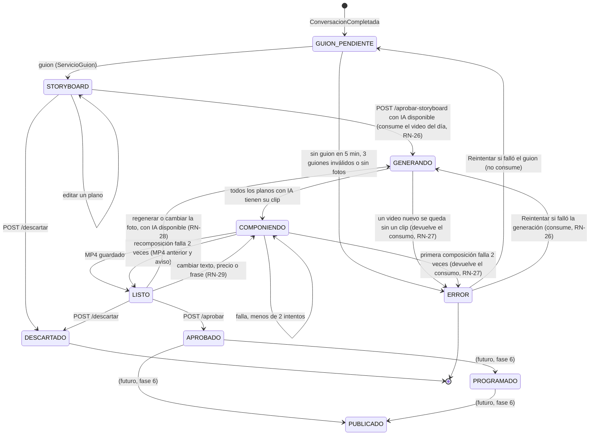

#### Estados del plano (clip, fase 5 y revisión del flujo)

`plano.estado` es nulo en el storyboard y siempre en el cierre (orden 4), que no pasa por la IA. Desde la revisión del flujo ningún plano pasa a `RESPALDO`: el valor sigue en `EstadoPlano` solo por los videos que ya lo tenían.

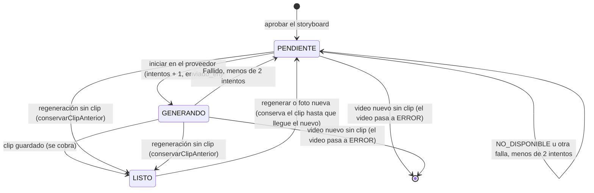

"Sin clip" es cualquiera de los casos de la tabla de reglas por plano: 2 intentos fallidos, 10 minutos sin clip, 20 minutos desde el último envío, credencial o configuración inválida, sin credencial o modelo inactivo.

### 5.6 Generación sin respaldo sin IA (revisión del flujo, ADR 0020)

Hasta la revisión del flujo, un plano que no conseguía su clip usaba el acercamiento de FFmpeg sobre la foto (`Plano.usarRespaldo`) y, sin IA disponible, una foto nueva en la revisión también (`Plano.usarFotoSinIa`). El usuario decidió que un video **sin clips de IA no se entrega** (**ADR 0020**, que modifica la sección 8.5 de la especificación, RN-30, V24 y el uso del acercamiento del ADR 0016): esos métodos ya no existen y el respaldo ya no se aplica a los clips. Un video entregado siempre tiene sus tres clips de IA. El guion siguió teniendo su respaldo hasta el 2026-11-12, cuando el ADR 0021 también lo quitó (sección 5.4).

Tres puntos lo garantizan:

| Dónde | Qué hace |
|---|---|
| Antes de generar (`ServicioVideos`) | `aprobarStoryboard`, `regenerar` y el cambio de foto en `LISTO` exigen `FabricaDeProveedores.videoDisponible` (adaptador existente, `VIDEO`, `ACTIVO`, `POR_SEGUNDO` y con credencial); si no, 409 `IA_NO_DISPONIBLE`. El frontend desactiva "Crear mi video" y oculta "Regenerar este plano" y "Cambiar foto" con `generacion.iaDisponible = false` |
| Durante la generación (`ServicioGeneracion.sinClip`) | Decide qué pasa cuando un plano se queda sin clip (diagrama siguiente) |
| Al terminar la pasada | Si el video sigue en `GENERANDO` y todos los planos tienen clip, pasa a `COMPONIENDO`; si quedó en `ERROR`, no se compone |

#### Flujo de fallo de un plano

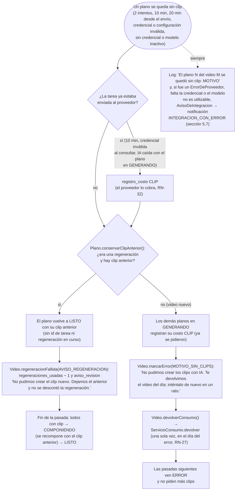

- `MotivoRespaldoPlano` sigue nombrando por qué un plano se quedó sin clip, pero ya no se guarda en el plano: va al log. Para el administrador queda el `motivo_error` del video, su costo y la notificación de integración.
- El caso V24 ("un clip que falla dos veces") ahora termina en `ERROR` con el video del día devuelto (`GeneracionIntegracionTest.v24UnClipQueFallaDosVecesDejaElVideoEnErrorYDevuelveElVideoDelDia`).
- **Datos viejos (ADR 0020):** `EstadoPlano.RESPALDO`, las columnas `plano.uso_respaldo` y `plano.motivo_respaldo` (y con ellas `VideoVista.PlanoVista.usoRespaldo`) y la composición con la foto (`PlanoAComponer.foto`, `zoompan` en `FfmpegComponedor`) quedan solo para los videos creados antes del 2026-11-06 que tienen planos en `RESPALDO`. Se pueden quitar cuando ya no haya videos así. El detalle del negocio del panel ya no muestra planos con respaldo (`VideoDelNegocio` no tiene ese dato).

### 5.7 Facturación y notificaciones (`facturacion` y `costos`, fase 7)

RF-07 a RF-10 y RF-12, RN-42 a RN-45, RN-47, RN-49 a RN-53 y RN-57; casos V32 a V36, V40 y V41. Se adelantó a la fase 6 (`docs/plan-de-desarrollo.md`, sección 9.2). Todo es del panel del administrador (`/api/admin/**`).

| Capa | Clase | Responsabilidad |
|---|---|---|
| `api` | `SuscripcionController` | `/api/admin/negocios/{negocioId}`: `GET` y `POST /pagos`, `PUT /plan`, `GET` y `POST /beneficios`, `DELETE /beneficios/{beneficioId}` (`SuscripcionDtos`) |
| `api` | `PlanController` | `GET`, `POST` y `PUT /api/admin/planes/{id}` (`PlanResumen`, `SolicitudPlan`) |
| `api` | `NotificacionController` | `GET /api/admin/notificaciones` (`BandejaVista(sinLeer, notificaciones)`), `POST /{id}/leida`, `POST /leidas` |
| `api` | `CostoController` (`costos`) | `GET /api/admin/costos?mes=AAAA-MM` (sin `mes`, el mes de Lima en curso; mal escrito, `MES_INVALIDO`) |
| `aplicacion` | `ServicioSuscripciones` | Registrar pagos (RF-08, RN-42), cambiar de plan (RN-49), otorgar y terminar beneficios (RF-12, RN-50 a RN-53). Cada operación bloquea la suscripción |
| `aplicacion` | `ServicioNotificaciones` | `generarDePagos` (RN-44, RN-45), `integracionConError` (RN-57), `bandeja`, `marcarLeida`, `marcarTodasLeidas`, `pagoRegistrado` |
| `aplicacion` | `TareaDiariaDePagos` | `@Scheduled(cron = "0 10 0 * * *", zone = "America/Lima")` y `@EventListener(ApplicationReadyEvent)`: llama a `generarDePagos` |
| `aplicacion` | `ServicioPlanes` | RF-10 y RN-47: listar, crear y editar planes; sus modelos deben existir, ser del tipo correcto y estar activos |
| `aplicacion` | `ResolutorDePlanEfectivo` | `resolver(negocioId)` → `PlanEfectivo(plan, beneficio)`: el plan del beneficio vigente o el de la suscripción (RN-50); `de(negocioId)` devuelve solo el plan |
| `aplicacion` | `ServicioCostos` (`costos`) | `delMes(mes)` → `CostosDelMes(mes, total, negocios)`, del negocio más caro al más barato; `deNegocio(negocioId, mes)` → `Costo(guion, clips, total, videos)` |
| `dominio` | `Pago`, `MedioPago`, `BeneficioTemporal`, `NotificacionAdmin`, `TipoNotificacion` | Entidades (`pago`, `beneficio_temporal`, `notificacion_admin`) y enumeraciones (`TRANSFERENCIA`, `YAPE`, `PLIN`, `EFECTIVO`, `OTRO`; `PAGO_POR_VENCER`, `PAGO_HOY`, `PAGO_VENCIDO`, `SUGERENCIA_SUSPENSION`, `INTEGRACION_CON_ERROR`) |
| `dominio` | `CalculadoraFechaPago`, `CalculadoraEstadoPago` | Reglas puras: `siguiente(fechaPago, diaPago)` (RN-42) y `calcular(proximaFechaPago, diasAviso, hoy)` (RN-43) |
| `infraestructura` | `NotificacionRepositorio`, `PagoRepositorio`, `BeneficioRepositorio` | `crearSiNoExiste` (`insert ... on conflict do nothing`), `recientes`, `marcarLeidasDePago`; `vigente`, `existeCruce`, `listarDeNegocio` |
| `infraestructura` | `AvisoDeIntegracionEnPanel` | Implementa el puerto `ia.dominio.AvisoDeIntegracion` (RN-57) |

#### Pagos, plan y beneficios

- **Registrar un pago** (RF-08, V35): con la suscripción bloqueada, rechaza una fecha futura (`PAGO_FECHA_FUTURA`); `Suscripcion.avanzarFechaPago` devuelve la fecha cubierta y mueve `proxima_fecha_pago` con `CalculadoraFechaPago.siguiente`: el mismo `dia_pago` del mes siguiente o, si el mes no lo tiene, su último día (el 31 pasa al 28 o 29 de febrero y vuelve al 31 en marzo). El `Pago` guarda `periodo_cubierto` (único por suscripción) y `registrado_por`. En la misma transacción, `ServicioNotificaciones.pagoRegistrado` marca como leídos los avisos de pago de esa fecha.
- **Cambiar de plan** (RN-49): `Suscripcion.cambiarPlan(plan, montoMensual)`; rige para los videos que se creen desde ahora, porque cada video guarda su plan y sus modelos al nacer (RN-54).
- **Beneficio temporal** (RF-12, RN-50 a RN-53, V40, V41): otro plan activo entre `desde` y `hasta`, con motivo, de hasta 30 días (`BeneficioTemporal.DURACION_MAXIMA`), que no termine en el pasado, distinto del plan de la suscripción y sin cruzarse con otro beneficio del negocio (`existeCruce`, 409 `BENEFICIO_CRUZADO`). `ResolutorDePlanEfectivo` lo aplica mientras está vigente y, al vencer, el negocio vuelve solo a su plan (RN-52). "Terminar" lo corta ahora si está vigente o lo borra si todavía no empezaba.

#### Notificaciones y tarea diaria

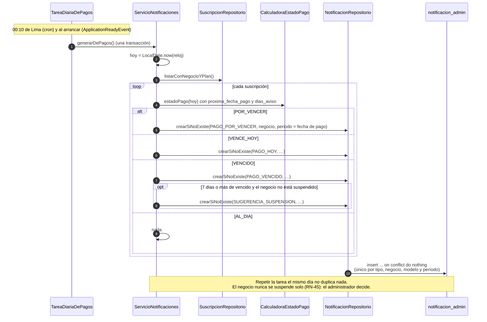

- **Una sola vez por período:** el `periodo` es la fecha de pago en las notificaciones de pago y el día en las de integración. `unique nulls not distinct` hace que dos notificaciones con `negocio_id` o `modelo_ia_id` nulos también choquen, y el `INSERT ... on conflict do nothing` las ignora sin error. Así la tarea puede correr al arrancar y a las 00:10 sin repetir avisos.
- **Al arrancar:** si el servidor estuvo apagado a las 00:10, el día no se pierde. La tarea se registra solo si `autoreel.tareas.activas` es `true` (`@ConditionalOnBooleanProperty`); las pruebas la apagan y llaman a `generarDePagos` directamente.
- **Integraciones (RN-57):** `AvisoDeIntegracionEnPanel.avisar` escribe la línea ERROR en el log y llama a `ServicioNotificaciones.integracionConError` (`Propagation.REQUIRES_NEW`): una notificación `INTEGRACION_CON_ERROR` por modelo y por día, con un motivo simple ("la credencial no funciona", "el modelo está mal configurado", "el proveedor no está disponible"). Si no se puede guardar, solo se registra un aviso: el proceso que avisó (guion o clips) sigue igual.
- **Bandeja:** las 50 más recientes, primero las no leídas, y el contador `sinLeer`. Los mensajes se cortan en 300 caracteres.

#### Costos (RF-07, V32)

`ServicioCostos` suma `registro_costo` por concepto (`GUION`, `CLIP`) entre el primer día del mes de Lima y el del mes siguiente (`RegistroCostoRepositorio.sumar` y `sumarDeNegocio`, `SumaDeCosto`). `delMes` alimenta la página Costos; `deNegocio`, el costo del mes del detalle del negocio, que además muestra el modelo y el costo de cada video (`VideoDelNegocio.costoEstimado`). Son costos **estimados**: salen del `costo_referencial` de cada modelo.

### 5.8 Integraciones y secretos (`admin` e `ia`, fase 7)

RF-11, RN-48, RN-55 (modificada por el ADR 0018), RN-56 y RN-57; casos V37 y V38. Ajustes → Integraciones muestra los modelos de IA con su estado, costo, clave y los planes que los usan; permite agregar y editar modelos de adaptadores existentes, activarlos y desactivarlos, probar la conexión y pegar las claves.

| Pieza | Responsabilidad |
|---|---|
| `AdminIntegracionesController` | `GET /api/admin/integraciones`; `POST /modelos-ia`, `PUT /modelos-ia/{id}`, `POST /modelos-ia/{id}/probar`, `/activar` y `/desactivar`; `PUT /credenciales` (con `Cache-Control: no-store`) y `DELETE /credenciales?nombre=` |
| `ServicioIntegraciones` (`admin.aplicacion`) | Orquesta `ia` (modelos, fábrica, secretos) y `facturacion` (planes y suscripciones que usan cada modelo). Devuelve `IntegracionDtos`: `Integraciones(modelos, credenciales, adaptadores)`, `ModeloVista` (con `credencialConfigurada`, `adaptadorDisponible`, los `planes` que lo usan y la última prueba), `CredencialVista(nombre, origen, descripcion, modelos)` y `ResultadoPrueba(exitosa, mensaje, fecha)` |
| `FabricaDeProveedores` (`ia.aplicacion`) | `adaptadores(tipo)` (RN-56: los que existen en el código) y `probar(modelo, credencial)`, que llama al adaptador del modelo esté activo o no |
| `Guionista.probar` y `GeneradorDeClips.probar` | Verifican la credencial y el modelo **sin generar contenido** (sección 6) |
| `AlmacenDeSecretos` (puerto, `ia.dominio`) | `guardar`, `borrar` y `origen` (`PANEL`, `CONFIGURACION`, `NINGUNO`) |
| `SecretosDeConfiguracion` (`ia.infraestructura`) | Implementa `ProveedorDeSecretos` y `AlmacenDeSecretos` (sección 6.2) |

Reglas de los modelos:

- **Crear y editar** (RN-56): solo con un adaptador que exista en el código (`ADAPTADOR_INEXISTENTE`; un proveedor nuevo requiere programar su adaptador) y sin repetir adaptador e identificador (409 `MODELO_YA_EXISTE`). Un modelo nuevo nace `INACTIVO`.
- **Activar:** exige el adaptador y la credencial configurada (409 `SIN_CREDENCIAL`).
- **Desactivar** (RN-48, V38): no si lo usa un plan activo o un plan con negocios (409 `MODELO_EN_USO`, que nombra los planes).
- **Probar conexión** (RF-11, V37): sin adaptador o sin credencial responde el motivo sin llamar al proveedor; si no, llama a `probar` del adaptador y traduce el `ErrorDeProveedor` a un mensaje ("La credencial no funciona.", "El modelo está mal configurado.", "El proveedor no está disponible."). El resultado se guarda en el modelo (`ModeloIA.registrarPrueba`: `ultima_prueba`, `ultima_prueba_exitosa`, `ultima_prueba_mensaje`). No genera contenido ni registra costo: el concepto `PRUEBA` de `registro_costo` no se usa.

#### Probar conexión

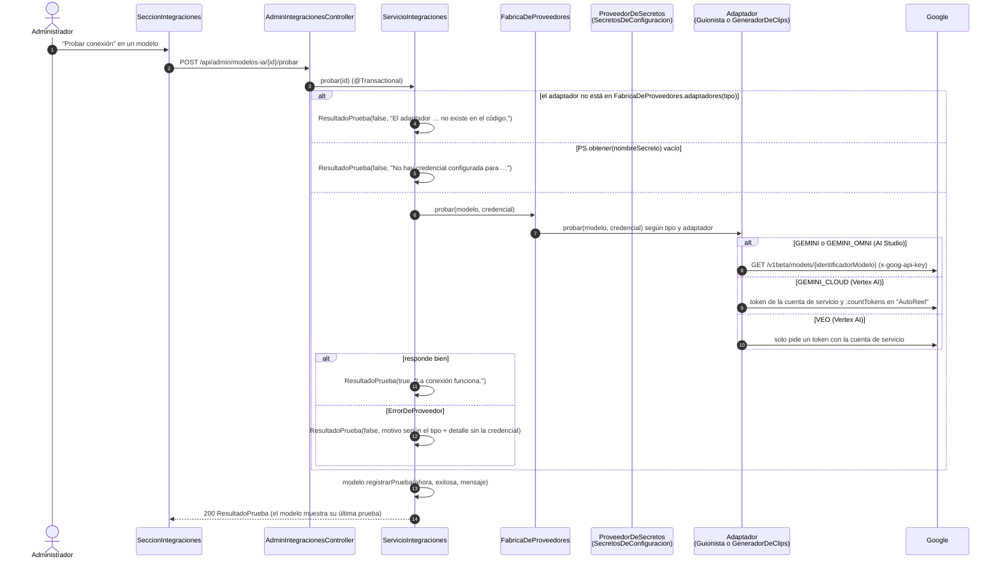

La llamada de prueba va dentro de la transacción que guarda el resultado; es corta (una consulta sin generar contenido) y no bloquea filas de otros procesos.

#### Guardar una clave (ADR 0018)

```mermaid
sequenceDiagram
    autonumber
    actor A as Administrador
    participant F as SeccionIntegraciones
    participant C as AdminIntegracionesController
    participant S as ServicioIntegraciones
    participant AL as AlmacenDeSecretos<br/>(SecretosDeConfiguracion)
    participant J as credenciales/secretos-del-panel.json

    A->>F: Pega la clave de AI Studio o el JSON de la cuenta de servicio
    F->>C: PUT /api/admin/credenciales {nombre: "autoreel/gemini", valor}
    C->>S: guardarCredencial(solicitud)
    S->>S: algún modelo usa ese nombre de secreto (si no, 404 NO_ENCONTRADO)
    opt el valor empieza con "{"
        S->>S: debe ser un JSON válido (si no, 400 CREDENCIAL_INVALIDA)
    end
    S->>AL: guardar(nombre, valor)
    AL->>J: escribe secretos-del-panel.json.tmp y lo mueve (ATOMIC_MOVE)
    AL->>AL: actualiza el mapa en memoria; log: solo el nombre del secreto
    S->>AL: origen(nombre) → PANEL
    S-->>F: 200 CredencialVista {nombre, origen: PANEL, descripcion: "Termina en …abcd"<br/>o "Cuenta de servicio correo@…", modelos}<br/>Cache-Control: no-store
    Note over F,J: El valor nunca vuelve al navegador. Desde ahora lo usan el guion, los clips<br/>y "Probar conexión", sin reiniciar el backend. DELETE /credenciales lo quita<br/>y vuelve a regir el del .env (origen CONFIGURACION) o ninguno
```

- **Prioridad:** la clave del panel gana sobre la del `.env` (`autoreel.secretos` o `autoreel.secretos-en-archivo`); si se borra, vuelve a regir la del `.env`.
- **Nunca en la base de datos ni en el código** (RN-55): los modelos siguen guardando solo el nombre del secreto, y solo se aceptan nombres que use algún modelo.
- **En AWS (fase 8)** el disco no debe guardar claves: `AlmacenDeSecretos` y `ProveedorDeSecretos` se implementarán con Secrets Manager (`PutSecretValue`) antes de desplegar.

---

## 6. Puertos y adaptadores

Regla 3 de la especificación: cada proveedor externo se usa a través de una interfaz del dominio, con su implementación en `infraestructura`, para poder cambiarlo sin tocar el resto. **Desde la fase 2 existe el primero, `AlmacenDeArchivos`; la fase 4 agrega `Guionista`, `ProveedorDeSecretos` y `AvisoDeIntegracion`, la fase 5, `GeneradorDeClips` y `ComponedorDeVideo`, y la fase 7, `AlmacenDeSecretos`**; `PublicadorSocial` llega en la fase 6.

| Puerto (interfaz) | Adaptador | Proveedor | Módulo | Estado |
|---|---|---|---|---|
| `AlmacenDeArchivos` | `S3Almacen` (pruebas: `AlmacenEnMemoria`) | Amazon S3; SeaweedFS 4.48 en desarrollo | `almacenamiento` | **Existe (fase 2)** |
| `Guionista` | `GeminiGuionista` (adaptador `GEMINI`) | Gemini en Google AI Studio, API `generateContent` con clave de API | `ia` | **Existe (fase 4)**; **activo** en el plan Lite. Se prueba contra `ServidorGeminiSimulado` |
| `Guionista` | `GeminiCloudGuionista` (adaptador `GEMINI_CLOUD`) | Gemini en Google Cloud (Vertex AI, ubicación `global`), `generateContent` con la cuenta de servicio | `ia` | **Existe (proveedores de Google)**; listo e inactivo |
| `GeneradorDeClips` | `OmniGeneradorDeClips` (adaptador `GEMINI_OMNI`) | Gemini Omni Flash en Google AI Studio, API de interacciones, con la misma clave que el guion | `ia` | **Existe (proveedores de Google)**; **activo** en el plan Lite. Se prueba contra `ServidorOmniSimulado` |
| `GeneradorDeClips` | `VeoGeneradorDeClips` (adaptador `VEO`; otros proveedores de video, como Runway, tendrían su propio adaptador) | Veo en Google Cloud (Vertex AI): `predictLongRunning` y `fetchPredictOperation` | `ia` | **Existe (fase 5)**; listo e inactivo desde V7. Se prueba contra `ServidorVeoSimulado` |
| `ProveedorDeSecretos` y `AlmacenDeSecretos` | `SecretosDeConfiguracion` (claves pegadas en el panel, variables de entorno vía `autoreel.secretos` y archivos vía `autoreel.secretos-en-archivo`) | — | `ia` | **Existen (fases 4 y 7)**; el adaptador de AWS Secrets Manager es (futuro, fase 8) |
| `AvisoDeIntegracion` | `AvisoDeIntegracionEnPanel` (log nivel ERROR y notificación `INTEGRACION_CON_ERROR` del panel) | — | puerto en `ia`, adaptador en `facturacion` | **Existe (fase 4; en el panel desde la fase 7)** |
| `ComponedorDeVideo` | `FfmpegComponedor` (pruebas de integración: un componedor de prueba) | FFmpeg, proceso local | `video` | **Existe (fase 5)**; probado con FFmpeg real (V23) |
| `PublicadorSocial` | `InstagramPublicador` | API de Instagram con inicio de sesión de Instagram | `publicacion` | (futuro, fase 6) |

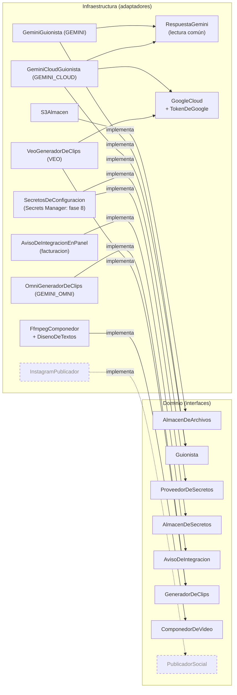

El almacén se elige por configuración, sin tocar el código: `autoreel.almacenamiento.tipo=s3` (por defecto) crea `S3Almacen`; el perfil `test` usa `tipo: memoria` y `PruebaDeIntegracion` registra `AlmacenEnMemoria`. El mismo `S3Almacen` sirve para SeaweedFS y Amazon S3 porque solo cambian el endpoint y las credenciales.

Agregar un **modelo nuevo** de un proveedor ya integrado (por ejemplo, otro modelo Gemini, Omni o Veo) es crear un registro en `modelo_ia` con el mismo `adaptador` y otro `identificador_modelo`, desde Ajustes → Integraciones (sección 5.8) sin programar; un **proveedor nuevo** requiere programar su adaptador (RN-56). La guía está en `docs/guias/nuevo-proveedor-ia.md`.

### 6.1 `Guionista`: `GeminiGuionista` y `GeminiCloudGuionista` (fase 4 y proveedores de Google)

- **Puerto:** `adaptador()` (igual al campo `adaptador` de `ModeloIA`, por ejemplo `GEMINI`), `escribir(modelo, credencial, instrucciones, esquemaJson)` → `RespuestaDelModelo(texto, problema)` y, desde la fase 7, `probar(modelo, credencial)` (RF-11: verifica la credencial y el modelo sin costo; lanza `ErrorDeProveedor` si no funciona). Una respuesta sin texto utilizable vuelve con `texto` vacío y el `problema`: cuenta como un intento (y se cobra). Las fallas que no se resuelven reintentando lanzan `ErrorDeProveedor`.
- **`GeminiGuionista`:** `POST {url}/v1beta/models/{identificadorModelo}:generateContent` con la cabecera `x-goog-api-key` y `generationConfig` = `responseMimeType: application/json`, `responseJsonSchema` (el esquema que arma `InstruccionesDelGuion`: planos con IA, con `orden` y `movimiento` como enumeraciones; descripción y hashtags) y `temperature` (de `modelo.parametros.temperatura`; 0,7 si falta). El identificador del modelo sale de `modelo_ia`: un modelo nuevo de Gemini no requiere programar.
- **Configuración** (`PropiedadesGemini`, `autoreel.ia.gemini`): `url` (`GEMINI_URL`, por defecto `https://generativelanguage.googleapis.com`), `tiempo-conexion` (5 s) y `tiempo-lectura` (30 s). En las pruebas, la URL apunta al servidor simulado y los tiempos son de 500 ms.
- **Lectura de la respuesta** (`RespuestaGemini`, compartida por los dos adaptadores de Gemini, porque `generateContent` responde igual en AI Studio y en Vertex AI): une el texto de `candidates[0].content.parts`, sin las partes de pensamiento (`thought: true`). Vuelven **sin texto** (intento inválido): `promptFeedback.blockReason`, sin candidatos, `finishReason` distinto de `STOP` o partes sin texto.
- **Errores (`ErrorDeProveedor.Tipo`):** 401 o 403 → `CREDENCIAL_INVALIDA`; 400 o 404 → `CONFIGURACION_INVALIDA`; 429, 5xx, falla de red o tiempo de espera → `NO_DISPONIBLE`. El adaptador no reintenta: `ServicioGuion` avisa con `AvisoDeIntegracion` y, desde el 2026-11-12, vuelve a intentar el guion a los 45 s, durante 5 minutos, y luego deja el video en `ERROR` (antes usaba el guion de respaldo; sección 5.4). El mensaje nunca incluye la credencial.
- **Probar conexión:** `GET /v1beta/models/{identificadorModelo}` con la clave: la ficha del modelo, sin generar nada ni costo.
- **`GeminiCloudGuionista`** (adaptador `GEMINI_CLOUD`): el mismo cuerpo de `generateContent` (esquema JSON y `temperature`), enviado a Vertex AI con `GoogleCloud.llamar` en la ubicación `modelo.parametros.ubicacion` (`global` por defecto, la que Google recomienda para los Gemini actuales). La credencial es el JSON de la cuenta de servicio (secreto `autoreel/google-cloud`), la misma que usa Veo: una sola credencial de Google Cloud sirve para el guion y los clips. "Probar conexión" usa `countTokens` sobre un texto corto, que verifica la cuenta y el modelo sin costo. Sus errores los clasifica `GoogleCloud` (sección 6.4).

### 6.2 `ProveedorDeSecretos` y `AlmacenDeSecretos` (RN-55, ADR 0018)

- **`ProveedorDeSecretos.obtener(nombreSecreto)`** → `Optional<String>`, vacío si no está configurado o está en blanco. El modelo de IA solo guarda el **nombre** del secreto (`autoreel/gemini`, `autoreel/google-cloud`); la credencial nunca está en el código ni en la base de datos.
- **`AlmacenDeSecretos`** (fase 7): `guardar(nombre, valor)`, `borrar(nombre)` y `origen(nombre)` → `PANEL`, `CONFIGURACION` o `NINGUNO`. Lo usa solo `ServicioIntegraciones` (sección 5.8).
- **`SecretosDeConfiguracion`** implementa los dos puertos y busca el valor en este orden:
  1. **Panel** (fase 7): el JSON `autoreel.archivo-secretos-panel` (`SECRETOS_PANEL_ARCHIVO`, por defecto `../credenciales/secretos-del-panel.json`, es decir, `credenciales/` en la raíz del repositorio), que se lee al arrancar y se mantiene en memoria. `guardar` y `borrar` escriben un `.tmp` y lo mueven con `ATOMIC_MOVE`, así nunca queda a medio escribir; los métodos son `synchronized`. Si el archivo no se puede leer, se ignora con un aviso en el log.
  2. **Variable de entorno:** el mapa `autoreel.secretos` (`PropiedadesSecretos`). En `application.yml`: `"[autoreel/gemini]": ${GEMINI_API_KEY:}` (entre comillas y corchetes para conservar la `/`).
  3. **Archivo** (fase 5): una ruta en `autoreel.secretos-en-archivo`, cuyo contenido (UTF-8) es el secreto. En `application.yml`: `"[autoreel/google-cloud]": ${GOOGLE_CLOUD_CREDENCIAL_ARCHIVO:${VEO_CREDENCIAL_ARCHIVO:}}`, la ruta al JSON de la cuenta de servicio de Google Cloud, que tiene saltos de línea y no cabe bien en el `.env` (`VEO_CREDENCIAL_ARCHIVO` sigue funcionando como respaldo). Si el archivo no existe o no se puede leer, devuelve vacío y deja un aviso en el log **solo con la ruta**.
- **Nunca un valor en el log:** solo el nombre del secreto o la ruta del archivo. El archivo del panel y la cuenta de servicio van fuera del repositorio: `.gitignore` excluye `/credenciales/` y `*service-account*.json`.
- En `application-test.yml` los secretos están vacíos y el archivo del panel es `target/secretos-del-panel-prueba.json`; las pruebas que necesitan una clave la ponen con `@DynamicPropertySource`, una implementación de prueba o el panel.
- **Sin credencial de texto:** no se llama al proveedor ni se registra costo; desde el 2026-11-12 el guion se reintenta durante 5 minutos y el video pasa a `ERROR` (antes usaba el respaldo, `SIN_CREDENCIAL`). **Sin credencial de video:** `videoDisponible` es falso, así que no se puede crear el video ni regenerar (`IA_NO_DISPONIBLE`, sección 5.6).
- En producción se reemplaza por un adaptador de AWS Secrets Manager que lea y escriba (`PutSecretValue`) **(futuro, fase 8)**, sin tocar el resto (ADR 0005 y 0018).

### 6.3 `AvisoDeIntegracion` (RN-57)

`avisar(modelo, tipo, detalle)`. Lo llama `ServicioGuion` cuando falta la credencial, cuando el modelo no se puede usar y cuando el adaptador lanza `ErrorDeProveedor`; desde la fase 5 también `ServicioGeneracion` (sin credencial o modelo de video no utilizable, una vez por pasada, con el tipo `CONFIGURACION_INVALIDA`; y cada `ErrorDeProveedor` del generador de clips con su tipo, salvo un `NO_DISPONIBLE` al consultar, que se reintenta en silencio). Desde la fase 7 lo implementa **`AvisoDeIntegracionEnPanel`** (`facturacion.infraestructura`): escribe la línea ERROR en el log ("Integración con error: modelo …") y crea la notificación `INTEGRACION_CON_ERROR` del panel, una por modelo y por día, en su propia transacción (sección 5.7). Hasta la fase 5 lo implementaba `AvisoDeIntegracionEnRegistro`, que solo escribía en el log; ya no existe.

### 6.4 `GeneradorDeClips`: `OmniGeneradorDeClips` y `VeoGeneradorDeClips` (fase 5 y proveedores de Google)

Secciones 8.2 y 11.1 de la especificación, actualizadas por el ADR 0017. Para el resto del sistema la generación de video es asíncrona: se inicia una tarea y se consulta hasta que termina, aunque el proveedor responda de una vez.

- **Puerto** (`ia.dominio`): `adaptador()` (igual al campo `adaptador` de `ModeloIA`: `GEMINI_OMNI` o `VEO`), `iniciar(modelo, credencial, SolicitudDeClip)` → id de la tarea en el proveedor, `consultar(modelo, credencial, idTarea)` → `EstadoDeClip`: `EnCurso`, `Listo(video, tipoContenido, segundosGenerados)` o `Fallido(motivo)` (el proveedor terminó sin clip), y, desde la fase 7, `probar(modelo, credencial)` (RF-11: verifica sin generar un clip, que costaría). `segundosGenerados` es lo que cobra el proveedor si lo informa; vacío si se cobra la duración pedida. `SolicitudDeClip(foto, tipoFoto, prompt, negativos, segundos)` (desde el 2026-11-12; antes `instruccion` y `prohibiciones`): la foto ya normalizada (JPEG vertical 9:16 sin metadatos), el **prompt completo** en inglés armado con el paquete de nicho (`Movimientos.promptDeToma`, sección 5.5), que el adaptador envía tal cual, lo que nunca debe aparecer como lista de sustantivos (`negativos`) y la duración. Las fallas que no son "terminó sin clip" lanzan `ErrorDeProveedor` (el mismo de la fase 4).
- **`OmniGeneradorDeClips`** (`ia.infraestructura`, adaptador `GEMINI_OMNI`, **activo en el plan Lite**): Gemini Omni Flash en Google AI Studio, imagen a video, con la misma clave y la misma URL base que el guion (`PropiedadesGemini`).
  - Iniciar: `POST {url}/v1beta/interactions` con la cabecera `x-goog-api-key`, `model` (`identificadorModelo`), `input` = la imagen en base64 y un texto, `response_format` = `type: video`, `aspect_ratio` (`relacionAspecto`, 9:16), `resolution` (`resolucion`, 720p) y `duration` (los segundos pedidos, como `"4s"`), `store: true` y `background` (`segundoPlano`, `false` por defecto). Con `tarea` en los parámetros agrega `generation_config.video_config.task`. Omni no admite prompt negativo: desde el 2026-11-12 el texto es el `prompt` de la solicitud más "Avoid: {negativos}." (solo el prompt si no hay negativos). Antes, el adaptador escribía su propio envoltorio ("Animate this exact photo as the first frame." y "Never show: …"); ya no tiene texto propio. Siempre genera audio, que la composición descarta. Sin `id` en la respuesta, `NO_DISPONIBLE`.
  - **Modo síncrono** (por defecto, el que documenta Google para Omni): la creación ya trae el video; el adaptador lo guarda en memoria (hasta 30) y `consultar` lo entrega sin volver a pedirlo. Si el proceso se reinicia, `consultar` lo pide con `GET /v1beta/interactions/{id}`. Con `segundoPlano: true` se consulta así hasta que termina.
  - Lectura: `status` `completed` con un contenido `video` en base64 → `Listo`; `failed`, `cancelled` o `incomplete`, o sin video (por ejemplo, su filtro de contenido) → `Fallido`; otro estado → `EnCurso`. Los segundos cobrados salen de `usage.output_tokens_by_modality` (tokens de video ÷ `tokensPorSegundo`, 5792 a 720p).
  - Probar conexión: `GET /v1beta/models/{identificadorModelo}`. Errores: 401 o 403 → `CREDENCIAL_INVALIDA`; 400 o 404 → `CONFIGURACION_INVALIDA`; otro código, red o tiempo de espera → `NO_DISPONIBLE`.
  - **Configuración** (`PropiedadesOmni`, `autoreel.ia.omni`): `tiempo-lectura` (5 min, porque la generación síncrona tarda minutos); la conexión y la URL son las de Gemini.
- **`VeoGeneradorDeClips`** (`ia.infraestructura`, adaptador `VEO`, **listo e inactivo**): Veo en Google Cloud (Vertex AI), imagen a video. Las llamadas, el token y la clasificación de errores son de **`GoogleCloud`**, que comparte con `GeminiCloudGuionista`.
  - Iniciar: `POST {url}/v1/projects/{proyecto}/locations/{region}/publishers/google/models/{identificadorModelo}:predictLongRunning` con `instances[{prompt, image{bytesBase64Encoded, mimeType}}]` (desde el 2026-11-12, `prompt` es el prompt completo de la solicitud, igual al de Omni; antes, solo la frase del movimiento) y `parameters` = `aspectRatio` (`relacionAspecto`, 9:16), `durationSeconds`, `sampleCount: 1`, `negativePrompt` (los `negativos`; se omite si están vacíos), `personGeneration: "dont_allow"`, `generateAudio` (`generarAudio`, `false`: el audio de los clips se descarta), `resolution` (`resolucion`, 720p) y `resizeMode` (`ajuste`, `crop`). Devuelve el `name` de la operación; sin él, `NO_DISPONIBLE`.
  - Consultar: `POST ...:fetchPredictOperation` con `{operationName}`. Sin `done`: `EnCurso`. Con `error`: `Fallido`. Listo: el clip viene en `response.videos[0].bytesBase64Encoded` (sin `storageUri`, Vertex lo devuelve en la respuesta); sin video, `Fallido` (con `raiMediaFilteredCount > 0`, "el filtro de contenido de Veo descartó el clip").
  - El proyecto sale del JSON de la cuenta de servicio (`project_id`); la región, de `modelo.parametros.region` (`us-central1` por defecto, la región donde se ofrece Veo); el identificador del modelo, de `modelo_ia`. Un modelo nuevo de Veo (por ejemplo, Veo 3.1 o Veo 3.1 Fast, que son GA) es un registro nuevo, sin programar.
  - Probar conexión: solo pide un token con la cuenta de servicio (`GoogleCloud.verificarCredencial`), sin crear un clip.
- **`GoogleCloud`** (`@Component`, proveedores de Google): `llamar(modelo, credencial, ubicacion, metodo, cuerpo, nombreProveedor)` arma `POST {base}/v1/projects/{proyecto}/locations/{ubicacion}/publishers/google/models/{identificadorModelo}:{metodo}` con el token Bearer. La base es la regional (`url`, con `{region}`) o, con la ubicación `global`, `url-global`.
  - **Errores (`ErrorDeProveedor.Tipo`):** 401 o 403 → `CREDENCIAL_INVALIDA` (y se olvida el token guardado); 400 o 404 → `CONFIGURACION_INVALIDA`; otro código, falla de red o tiempo de espera → `NO_DISPONIBLE`. El mensaje nunca incluye la credencial. Cómo se usan en la generación: sección 5.5.
  - **Configuración** (`PropiedadesGoogleCloud`, `autoreel.ia.google-cloud`; antes `PropiedadesVeo`): `url` (`https://{region}-aiplatform.googleapis.com`), `url-global` (`https://aiplatform.googleapis.com`), `url-token` (`https://oauth2.googleapis.com/token`), `tiempo-conexion` (5 s) y `tiempo-lectura` (60 s, porque el clip de Veo vuelve en base64). En las pruebas, las tres URLs apuntan al servidor simulado.
- **`TokenDeGoogle`** (flujo JWT bearer de Google, creado por `GoogleCloud`): Vertex AI no acepta una clave de API para Veo, por eso la credencial de Google Cloud (secreto `autoreel/google-cloud`, antes `autoreel/veo`) es el **JSON de una cuenta de servicio**. `cuenta(credencial)` lee `project_id`, `client_email`, `private_key` y `private_key_id`; si falta alguno o la clave no es RSA válida, `CREDENCIAL_INVALIDA`. `token(cuenta)` firma un JWT RS256 con la clave privada (Nimbus: `iss` = correo de la cuenta, `aud` = URL de tokens, `scope` = `https://www.googleapis.com/auth/cloud-platform`, una hora) y lo cambia por un token de acceso en `oauth2.googleapis.com/token`. Guarda un token por cuenta y `private_key_id` (`ConcurrentHashMap`) hasta un minuto antes de vencer. Cualquier error del endpoint de tokens es `CREDENCIAL_INVALIDA`.
- **Estado de los proveedores:** el plan Lite usa **Gemini Omni Flash** (`gemini-omni-1.2-flash`, unos 0,07 USD por segundo a 720p, sin plan gratuito: el proyecto de la clave necesita facturación activa). Veo queda como alternativa por si la calidad de Omni sin prompt negativo no alcanza (ADR 0017). Google cerró los Veo 3.1 *preview* de la API de Gemini el 22/10/2026; en Google Cloud, `veo-3.1-lite-generate-001` está en vista previa y `veo-3.1-generate-001` y `veo-3.1-fast-generate-001` son GA. Los precios por segundo se cargan desde `modelo_ia` y se ajustan sin programar.
- **Pruebas:** `OmniGeneradorDeClipsTest` usa el adaptador real contra `ServidorOmniSimulado` (la foto, el texto exacto "prompt + Avoid: negativos." y el formato vertical; en modo síncrono el video de la creación se entrega en la consulta sin volver a pedirlo; en segundo plano se consulta hasta que termina; interacción fallida o sin video; clasificación de errores sin mostrar la clave). `VeoGeneradorDeClipsTest` usa el adaptador real contra `ServidorVeoSimulado` (forma de la petición y parámetros del modelo, token pedido una vez y reutilizado, en curso / listo / fallido, clasificación de errores y una credencial que no es una cuenta de servicio). `GeminiCloudGuionistaTest` prueba `generateContent` en la ubicación `global` con el token, la falta de permisos y una clave de API usada como cuenta de servicio.

### 6.5 `ComponedorDeVideo` y `FfmpegComponedor` (fase 5)

Secciones 7.4 y 8.3 de la especificación, RN-31, V23.

- **Puerto** (`video.dominio`): `componer(Composicion)` → bytes del MP4, o `ErrorDeComposicion`. `Composicion(planos, cierre, musica, tipografia)`, con todo ya leído del almacenamiento: `PlanoAComponer(orden, segundos, clip, foto, texto)` (el clip de IA; la foto vertical solo llega para un plano en `RESPALDO` de un video anterior al 2026-11-06, ADR 0020), `CierreAComponer(segundos, fotoDelLocal, logo, textoPrincipal, llamado, ubicacion, whatsapp, colorDeMarca)` (desde el 2026-11-12; antes `fondo`, `fondoEsFoto` y `precio`): la foto del local puede faltar, y `textoPrincipal` es el precio o la frase. Además, la pista (puede faltar) y el TTF del estilo.
- **`PreparadorDeFotos`** (`video.infraestructura`): `vertical(foto)` aplica la orientación EXIF, recorta al centro en 9:16 y devuelve un JPEG de 1080×1920 sin metadatos (lee submuestreado si el lado mayor pasa de 4320 px); Así el resultado no depende de cómo cada versión de FFmpeg trate el EXIF. El `degradado` de los colores de marca se quitó el 2026-11-12: ya nadie lo usaba.
- **`GraficosDelVideo`** (desde el 2026-11-12): piezas dibujadas en Java2D como PNG:
  - la franja inferior degradada (1080×860, de transparente a negro al 62 %);
  - la insignia redonda del logo con sombra suave (un logo cuadrado, opaco y de color llena el círculo; los demás entran al 76 %);
  - la píldora redondeada del llamado en el color de marca, con texto oscuro o blanco según su luminancia.
- **`DisenoDeTextos`:** reparte cada texto en líneas que caben en el ancho útil midiendo con `FontMetrics` del mismo TTF que usa FFmpeg (`drawtext` no ajusta ni recorta), y baja el tamaño hasta que entra en el máximo de líneas; si ni el menor alcanza, lo que sobra se une a la última línea.
- **`FfmpegComponedor`:**
  - **Carpeta temporal propia** por composición (`Files.createTempDirectory`), borrada al terminar. Escribe ahí las entradas (`clip{n}.mp4`, `foto{n}.jpg`, `cierre.jpg`, `logo.png`, `musica.m4a`, `fuente.ttf`) y cada línea de texto en su archivo UTF-8 sin salto final, y ejecuta FFmpeg con esa carpeta como directorio de trabajo (rutas relativas: sin problemas de unidades ni caracteres en Windows).
  - **Textos** con `drawtext=fontfile=fuente.ttf:textfile=...:expansion=none`: un precio con `%`, `\`, `:` o comillas no rompe el filtro. Antes se limpian con `Texto.soloDibujable`.
  - **Zona segura:** de x = 90 a x = 900 (los botones de Reels ocupan el borde derecho), textos centrados en x = 495.
  - **Textos de los planos 1 a 3** (desde el 2026-11-12, ADR 0021):
    - En el **tercio inferior**: el bloque crece hacia arriba desde y = 1470 (`BASE_TEXTO_PLANO`), hasta 3 líneas, en 96, 88, 80, 72 o 64 px, con contorno de 5 px al 60 % y la franja oscura al 80 % (desde el 2026-11-14, para que se lea sobre fondos claros).
    - Blancos, con borde y sombra suaves, sobre la **franja degradada** de `GraficosDelVideo` (en y = 1060), sin caja negra.
    - **Entrada animada:** cada línea aparece con un fundido y una subida de 40 px en 0,35 s (`alpha` e `y` con expresiones de `drawtext`). Empiezan a los 0,3 s, escalonadas 0,1 s por línea.
    - Se desvanecen en 0,3 s antes del fundido siguiente.
    - Antes iban desde y = 1100, sobre una caja negra semitransparente y sin animación.
  - **Cierre** (desde el 2026-11-12):
    - **Fondo:** la foto del local con un zoom suave del 5 % y oscurecida (`colorchannelmixer` al 0,55). Sin foto del local, el último cuadro del plano 3 (`-sseof -0.3`), con `gblur`, oscurecido y con `vignette`: se calcula una vez y se clona.
    - **Logo:** la insignia redonda (300 px), que entra con un fundido y una escala de 0,8 a 1.
    - **Texto principal:** el precio o la frase, en 112, 100, 88 o 76 px y hasta 2 líneas.
    - **Llamado:** en la píldora del color de marca.
    - **Ubicación** (si el llamado no la dice ya) **y WhatsApp:** en 50 o 44 px.
    - Todo entra escalonado, en un bloque centrado en y = 900.
    - Antes: logo arriba en y = 470 y textos desde y = 760, sobre la foto del local o el degradado.
  - **Segmentos:**
    - **Plano con clip:** el clip se escala para cubrir 1080×1920 (`flags=lanczos`, desde el 2026-11-12), se recorta, se le aplica un `unsharp` suave (desde el 2026-11-12), `fps=30`, se alarga congelando el último cuadro si es corto (`tpad`) y se recorta a los segundos del plano.
    - **Plano de respaldo** (solo videos anteriores al 2026-11-06, ADR 0020): la foto escalada a 2160×3840 y `zoompan` de 1,00 a 1,12 (acercamiento lento), con `d` y `s=1080x1920:fps=30` explícitos.
    - **Cierre:** dura sus segundos más las transiciones (4 + 3 × 0,3 = 4,9 s), porque absorbe los fundidos.
    - Todos terminan en `format=yuv420p`.
  - **Unión** (desde el 2026-11-12):
    - `xfade=transition=fade:duration=0.30` entre cada par de segmentos. El offset de cada fundido es el acumulado de los planos anteriores menos las transiciones: 2,70, 6,40 y 10,10 s con planos de 3, 4 y 4 s.
    - Los planos con clip duran exactamente sus segundos, así que el clip no se congela durante el fundido. El total sigue siendo 15 s y 450 cuadros (RN-31).
    - Antes: `concat` con corte directo entre 1, 2 y 3, y un fundido a negro de 0,4 s hacia el cierre.
  - **Música:** la pista del video (o silencio con `anullsrc` si no hay), recortada a la duración total con `afade` de salida de 1,5 s. El audio de los clips se descarta.
  - **Salida:** H.264 (`libx264`, `-preset veryfast`, `-crf 20` desde el 2026-11-12, antes 23, `yuv420p`, 30 fps), AAC 128 kb/s a 44,1 kHz, `+faststart`, `-t` igual a la suma de los planos (15 s en Pastelería) y `-threads` limitado (`hilos`, 2) para no quitarle toda la CPU al backend.
  - **Proceso:** `-nostdin -hide_banner -nostats -loglevel error -y`, salida a `ffmpeg.log` dentro de la carpeta. Si pasa el tiempo máximo, `destroyForcibly` y espera a que termine antes de borrar la carpeta. Un código de salida distinto de 0 lanza `ErrorDeComposicion` con las últimas 3 líneas del log (van al log de la aplicación; el usuario ve un mensaje simple).
  - **Al arrancar** (`ApplicationRunner`) registra la versión de FFmpeg; si no lo encuentra, solo deja un aviso (los videos no se podrán componer y terminarán en `ERROR` con su devolución).
  - **Configuración** (`PropiedadesFfmpeg`, `autoreel.ffmpeg`): `ruta` (`FFMPEG_PATH`, por defecto `ffmpeg` del PATH), `tiempo-maximo` (2 min) e `hilos` (2).
- **Pruebas:** `FfmpegComponedorTest` usa FFmpeg real con entradas sintéticas y comprueba con `ffprobe` (`FFPROBE_PATH` o el del PATH) 15 s, 1080×1920, 30 fps, H.264 y AAC (V23): con clips, un plano con foto, logo y música; todo con fotos, sin música, sin logo y sin foto del local (la composición con foto se sigue probando mientras existan videos viejos con planos en `RESPALDO`); un FFmpeg inexistente es `ErrorDeComposicion`; y una foto girada por la cámara queda derecha. Desde el 2026-11-12, `losFundidosEntrePlanosMantienenLosQuinceSegundos` (15,0 s y 450 cuadros con `-count_frames`, frase con tildes y ñ; con la variable `AUTOREEL_MUESTRA` guarda el MP4 para revisarlo a ojo) y `losFundidosNoAlarganLosPlanosConClip`.

---

## 7. Fábrica de proveedores (`FabricaDeProveedores`, fases 4, 5 y 7)

Sección 11.5. La fábrica (`ia.aplicacion`) recibe todas las implementaciones de `Guionista` (hoy `GeminiGuionista` y `GeminiCloudGuionista`) y, desde la fase 5, de `GeneradorDeClips` (hoy `OmniGeneradorDeClips` y `VeoGeneradorDeClips`) como listas de beans, y las indexa por `adaptador()`; si dos del mismo tipo dicen el mismo adaptador, la aplicación no arranca. Desde la fase 7 también expone `adaptadores(tipo)` (RN-56: los adaptadores que existen en el código, para el panel) y `probar(modelo, credencial)` (RF-11, sección 5.8).

El plan efectivo se resuelve **al crear el video**, no al generar (RN-49, RN-54):

1. `CreadorDeVideos` pide el plan a `ResolutorDePlanEfectivo.de(negocioId)` (`facturacion.aplicacion`): si el negocio tiene un **beneficio temporal vigente**, el plan del beneficio (desde la fase 7, RN-50); si no, el de su suscripción, cargado con sus dos modelos (`SuscripcionRepositorio.buscarConPlanYModelos`, con `join fetch`). Quien lo usa no cambió. Sin suscripción: 409 `SIN_SUSCRIPCION`.
2. El `Video` guarda `planAplicado`, `modeloTextoUsado`, `modeloVideoUsado` y una copia de `opcionesProduccionPermitidas` (RN-54). Un cambio de plan posterior no afecta a ese video.
3. Al escribir el guion, `ServicioGuion` llama a `FabricaDeProveedores.guionista(video.modeloTextoUsado)`, que devuelve el `Guionista` solo si el modelo es `TEXTO`, está `ACTIVO`, cobra `POR_SOLICITUD` y su `adaptador` existe en el código (RN-56). Si no, vacío: el proceso avisa y, desde el 2026-11-12, reintenta durante 5 minutos y deja el video en `ERROR` (antes usaba el respaldo, `MODELO_INACTIVO`).
4. `ServicioGuion` obtiene la credencial con `ProveedorDeSecretos.obtener(modelo.nombreSecreto)` y entrega al adaptador el `ModeloIA` (con `identificadorModelo` y `parametros`) y la credencial.
5. **Fase 5:** al generar los clips, `ServicioGeneracion` llama a `FabricaDeProveedores.generadorDeClips(video.modeloVideoUsado)`, que devuelve el `GeneradorDeClips` solo si el modelo es `VIDEO`, está `ACTIVO`, cobra `POR_SEGUNDO` y su `adaptador` existe (hoy `GEMINI_OMNI` o `VEO`). Si no, vacío: el plano se queda sin clip (`MODELO_INACTIVO`, sección 5.6) y se avisa. La credencial sale igual de `ProveedorDeSecretos` (`modelo.nombreSecreto`: `autoreel/gemini` para Omni, `autoreel/google-cloud` para Veo).
6. `videoDisponible(modelo)` = hay generador **y** credencial. Lo usa `ServicioVideos` para `iaDisponible` de la vista y, desde la revisión del flujo, para permitir aprobar el storyboard, regenerar y cambiar una foto en la revisión (si no, 409 `IA_NO_DISPONIBLE`). Así, en la práctica, el caso "vacío" del punto 5 solo ocurre si la IA deja de estar disponible después de aprobar.

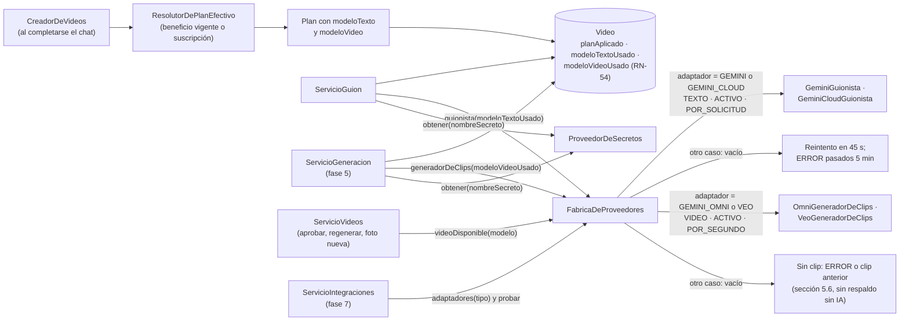

El resto del proceso no sabe qué proveedor se está usando (RNF-07).

---

## 8. Procesador de tareas en segundo plano (fases 4, 5 y 7; ampliación en la fase 6)

Decisión de la sección 12.2 (ADR 0004): **tareas en PostgreSQL y un procesador `@Scheduled`**, en lugar de una cola externa. Es simple, sobrevive a reinicios y, si el volumen lo exige, puede reemplazarse por Amazon SQS sin cambiar el dominio. Tampoco la fase 5 necesitó una tabla de tareas aparte: **la tarea es el propio video** en su estado, y el reclamo vive en una columna del video.

| Tarea programada | Método | Frecuencia (espera fija entre pasadas) | Toma | Reclamo |
|---|---|---|---|---|
| Guiones (fase 4) | `ProcesadorDeGuiones` | `autoreel.tareas.guiones-cada` (3 s) | Hasta 5 videos en `GUION_PENDIENTE` (índice parcial `video_guion_pendiente_idx`) | `video.guion_reclamado_hasta`, 3 min (sección 5.4) |
| Clips (fase 5) | `ProcesadorDeVideos.generarClips` → `ServicioGeneracion` | `autoreel.tareas.clips-cada` (10 s) | Hasta 5 videos en `GENERANDO` sin reclamo vigente, del menos recientemente actualizado (`VideoRepositorio.enProceso`, índice parcial `video_en_proceso_idx`) | `video.trabajo_reclamado_hasta`, 5 min (`reclamarTrabajo`, condicionado también al estado) |
| Composición (fase 5) | `ProcesadorDeVideos.componerVideos` → `ServicioComposicion` | `autoreel.tareas.composicion-cada` (10 s) | Hasta 5 videos en `COMPONIENDO` sin reclamo vigente | `video.trabajo_reclamado_hasta`, 5 min |
| Pagos y notificaciones (fase 7) | `TareaDiariaDePagos` → `ServicioNotificaciones.generarDePagos` | Cron `0 10 0 * * *` en `America/Lima` (00:10) y una vez al arrancar (`ApplicationReadyEvent`) | Todas las suscripciones con su negocio y su plan | No hace falta: es idempotente (`insert ... on conflict do nothing`, sección 5.7) |

- **Clips y composición van en métodos programados distintos**, para que una composición larga (FFmpeg, hasta 2 minutos por video) no frene las llamadas al modelo de video. Comparten la columna de reclamo porque un video nunca está en los dos estados a la vez, y `reclamarTrabajo` exige el estado esperado.
- **Pool de 3 hilos** (`spring.task.scheduling.pool.size: 3` en `application.yml`): guiones, clips y composición pueden correr al mismo tiempo, cada uno en su hilo. Spring no superpone dos pasadas del mismo método (`fixedDelay`). La tarea diaria comparte el pool; dura poco y corre a las 00:10, así que no necesita un hilo propio.
- Un error en un video se registra en el log y la pasada sigue con los demás. Un reclamo vencido (por ejemplo, tras un reinicio) deja que la siguiente pasada retome el video: los intentos ya contados en `plano.intentos` e `intentos_composicion` evitan reenvíos y composiciones sin límite, y el plazo de 20 minutos desde el último envío de cada plano asegura que ningún video quede atascado en `GENERANDO` (sección 5.5).
- `ConfiguracionTareas` activa `@EnableScheduling` solo si `autoreel.tareas.activas` es `true` (por defecto), y `TareaDiariaDePagos` solo existe con esa misma propiedad. El perfil `test` la pone en `false` y las pruebas llaman a `ServicioGuion`, `ServicioGeneracion`, `ServicioComposicion` y `ServicioNotificaciones.generarDePagos` directamente.
- **Tarea diaria de pagos (fase 7):** calcula el estado de pago de cada suscripción con `CalculadoraEstadoPago` según el día de Lima y crea las notificaciones del administrador sin repetirlas (RN-44, RN-45). También corre al arrancar, para no perder un día si el servidor estuvo apagado a las 00:10.
- **Publicación programada (futuro, fase 6):** publicar los videos `PROGRAMADO` a su hora con `PublicadorSocial`; seguirá el mismo patrón de reclamo.

```mermaid
flowchart TB
    classDef futuro stroke-dasharray: 5 5,color:#888

    pool["Pool de tareas programadas<br/>(3 hilos)"]
    pool --> guiones["ProcesadorDeGuiones<br/>cada 3 s (fase 4)"]
    pool --> clips["ProcesadorDeVideos.generarClips<br/>cada 10 s (fase 5)"]
    pool --> composicion["ProcesadorDeVideos.componerVideos<br/>cada 10 s (fase 5)"]

    guiones --> pendientes["Videos en GUION_PENDIENTE<br/>sin reclamo vigente (hasta 5)"]
    pendientes --> reclamo["Reclamar 3 min<br/>(UPDATE condicional)"]
    reclamo --> escribir["ServicioGuion: Guionista"]
    escribir --> storyboard["Planos y STORYBOARD"]
    escribir --> reintento["Si el proveedor falla: reintento en 45 s<br/>o ERROR pasados 5 min"]

    clips --> generando["Videos en GENERANDO<br/>sin reclamo vigente (hasta 5)"]
    generando --> reclamo5["Reclamar 5 min<br/>(trabajo_reclamado_hasta)"]
    reclamo5 --> planos["Por plano: enviar, consultar,<br/>guardar el clip o sinClip"]
    planos --> listos{"¿Sigue en GENERANDO<br/>y todos tienen clip?"}
    listos -- "sí" --> acomponer["COMPONIENDO"]
    listos -- "no" --> liberar["Liberar el reclamo; sigue en la<br/>próxima pasada (o quedó en ERROR)"]

    composicion --> componiendo["Videos en COMPONIENDO<br/>sin reclamo vigente (hasta 5)"]
    componiendo --> reclamoc["Reclamar 5 min e<br/>intentos_composicion + 1"]
    reclamoc --> ffmpeg["ComponedorDeVideo (FFmpeg)"]
    ffmpeg --> final["MP4 guardado → LISTO<br/>(o reintento, ERROR o LISTO anterior)"]

    pool --> diaria["TareaDiariaDePagos<br/>00:10 de Lima y al arrancar (fase 7)"]
    diaria --> estados["ServicioNotificaciones.generarDePagos:<br/>CalculadoraEstadoPago por suscripción"]
    estados --> notif["NotificacionAdmin<br/>(insert ... on conflict do nothing)"]

    publicar["Publicación programada<br/>(fase 6)"]:::futuro
```

---

## 9. Seguridad

Decisión (ADR 0007): **sesión sin estado en el servidor con un JWT HS256 dentro de una cookie HttpOnly**, leída por un filtro propio, con **protección CSRF para SPA**, y con los **permisos leídos de la base de datos en cada petición**.

### 9.1 Piezas

| Pieza | Responsabilidad |
|---|---|
| `ConfiguracionSeguridad` | Cadena de filtros: `STATELESS`; `httpBasic`, `formLogin`, `logout` y `requestCache` desactivados; `csrf(c -> c.spa())`; reglas de acceso; `BCryptPasswordEncoder` |
| `ServicioJwt` | Emite y lee el token con `NimbusJwtEncoder` / `NimbusJwtDecoder` y HS256. Claims: `iss=autoreel`, `sub` (id del usuario), `iat`, `exp` (8 h, `SESION_HORAS`), `ver` (versión de sesión) y, desde la fase 7, `neg` (el negocio en el que entró el administrador, solo en `emitirComoNegocio`). La clave `JWT_SECRET` debe estar en base64 con al menos 32 bytes; si no, la aplicación no arranca |
| `CookieDeSesion` | Escribe, lee y borra la cookie `autoreel_sesion`: `HttpOnly`, `Secure` (desactivado solo en los perfiles `dev` y `test`), `SameSite=Lax`, `Path=/`, `Max-Age` 8 h, sin `Domain`. El logout la reemplaza con `Max-Age=0` |
| `FiltroCookieCsrf` | Fuerza la carga del token CSRF diferido en cada petición para que la cookie `XSRF-TOKEN` llegue al navegador. Va después de `CsrfFilter` |
| `FiltroJwtCookie` | `OncePerRequestFilter` ubicado antes de `AuthorizationFilter`. Autentica la petición a partir de la cookie (ver 9.4); desde la fase 7 también la sesión del administrador dentro de un negocio (ver 9.6) |
| `RespuestasDeSeguridad` | `AuthenticationEntryPoint` (401 `NO_AUTENTICADO`) y `AccessDeniedHandler` (403 `ACCESO_DENEGADO` o `CSRF_INVALIDO`) con la forma `{codigo, mensaje}` |
| `UsuarioAutenticado` | Principal de la petición: `id`, `correo`, `rol`, `negocioId`, `debeCambiarContrasena` y, desde la fase 7, `comoAdministrador`. Se obtiene con `@AuthenticationPrincipal`. Los controladores del negocio toman de aquí el `negocioId` y lo pasan a los servicios: el cliente nunca lo envía |

**Por qué un filtro propio y no `oauth2ResourceServer()`:** el soporte de servidor de recursos registra su `BearerTokenRequestMatcher` como excepción de CSRF, de modo que las peticiones autenticadas con la cookie quedarían sin protección CSRF. Por eso solo se usan el codificador y el decodificador Nimbus de `spring-security-oauth2-jose`.

**Por qué los permisos salen de la base de datos:** el token solo lleva el id y la versión de sesión. En cada petición se carga el usuario con su negocio; así, reiniciar la contraseña, cambiarla o suspender el negocio corta al instante las sesiones abiertas (RN-05, RN-07), porque incrementan `version_sesion` o cambian el estado del negocio.

### 9.2 Reglas de acceso (en orden)

1. Despachos `ERROR` y `FORWARD`: permitidos.
2. `/api/auth/login`, `/api/auth/logout`, `/actuator/health`: públicos.
3. `/v3/api-docs/**`, `/swagger-ui/**`, `/swagger-ui.html`: públicos. Springdoc solo está activo en el perfil `dev`; en los demás perfiles esas rutas no existen.
4. `/api/auth/yo`, `/api/auth/cambiar-contrasena`: cualquier usuario autenticado, incluido el que tiene una contraseña temporal (RN-03).
5. `/api/auth/volver-al-panel` (fase 7): rol `NEGOCIO`; además el controlador exige `comoAdministrador` (si no, 403 `ACCESO_DENEGADO`).
6. `/api/admin/**`: rol `ADMIN`. Desde la fase 7 incluye pagos, plan y beneficios de cada negocio, planes, notificaciones, costos, integraciones, credenciales y `POST /negocios/{id}/entrar`.
7. `/api/**`: rol `NEGOCIO`. Aquí caen los endpoints de la fase 2 (`/api/nicho/configuracion`, `/api/perfil/**`, `/api/productos/**` y `/api/archivos/url-subida`) los del chat de la fase 3 (`/api/chat/conversaciones/**`) y los del storyboard de la fase 4 y la generación y revisión de la fase 5 (`/api/videos/**`).
8. Todo lo demás: denegado.

Quien tiene `debeCambiarContrasena=true` recibe solo la autoridad `CAMBIO_PENDIENTE` (no `ROLE_ADMIN` ni `ROLE_NEGOCIO`), por lo que únicamente puede usar las rutas del punto 4.

La protección CSRF aplica a todos los métodos que modifican datos, incluidos `login` y `logout`: el navegador debe enviar la cabecera `X-XSRF-TOKEN` con el valor de la cookie `XSRF-TOKEN`. El `PUT` directo al bucket **no** lleva cookies ni esa cabecera: va a otro origen y lo autoriza la firma de la URL.

### 9.3 Inicio de sesión

```mermaid
sequenceDiagram
    autonumber
    actor U as Usuario
    participant F as Frontend (SPA)
    participant C as CsrfFilter + FiltroCookieCsrf
    participant J as FiltroJwtCookie
    participant Z as AuthorizationFilter
    participant A as AuthController
    participant S as ServicioAutenticacion
    participant R as UsuarioRepositorio
    participant W as ServicioJwt + CookieDeSesion

    U->>F: Abre la aplicación
    F->>C: GET /api/auth/yo (sin cookie de sesión)
    C-->>F: Set-Cookie: XSRF-TOKEN
    C->>J: continúa
    J->>Z: sin cookie: petición anónima
    Z-->>F: 401 {codigo: NO_AUTENTICADO}
    F-->>U: Pantalla /login

    U->>F: Correo y contraseña
    F->>C: POST /api/auth/login<br/>Cookie XSRF-TOKEN + cabecera X-XSRF-TOKEN
    alt token CSRF ausente o distinto
        C-->>F: 403 {codigo: CSRF_INVALIDO}
        Note over F: cliente.ts renueva el token con GET /api/auth/yo y reintenta una vez
    end
    C->>J: CSRF válido
    J->>Z: anónima (ruta pública)
    Z->>A: permitAll
    A->>S: iniciarSesion(correo, contrasena)
    S->>R: bloquearPorCorreo(correo en minúsculas) — SELECT ... FOR UPDATE
    Note over S,R: la fila queda bloqueada hasta el fin de la transacción:<br/>los intentos simultáneos se cuentan de a uno
    alt correo inexistente
        S->>S: BCrypt contra un hash ficticio (mismo tiempo de respuesta)
        S->>S: IntentosDeCorreosDesconocidos (en memoria): al 5.º fallo, 423 durante 15 min<br/>igual que una cuenta real, para no revelar qué correos existen
        S-->>F: 401 CREDENCIALES_INVALIDAS (o 423 CUENTA_BLOQUEADA)
    else cuenta bloqueada (bloqueado_hasta > ahora)
        S->>S: BCrypt contra un hash ficticio
        S-->>F: 423 CUENTA_BLOQUEADA
    else contraseña incorrecta
        S->>S: usuario.registrarIntentoFallido(ahora): al 5.º intento bloquea 15 min
        S-->>F: 401 CREDENCIALES_INVALIDAS
    else negocio SUSPENDIDO
        S-->>F: 403 NEGOCIO_SUSPENDIDO
    else contraseña temporal vencida (48 h)
        S-->>F: 401 CONTRASENA_TEMPORAL_VENCIDA
    else credenciales correctas
        S->>S: registrarAccesoExitoso (reinicia intentos, ultimo_acceso)
        S-->>A: Usuario
        A->>W: emitir(usuario): sub, ver, iat, exp = 8 h
        W-->>F: 200 Sesion {id, correo, rol, negocioId, nombreNegocio,<br/>debeCambiarContrasena, onboardingCompleto}<br/>Set-Cookie: autoreel_sesion (HttpOnly, Secure, SameSite=Lax, 8 h)
        F->>F: Guarda la Sesion en TanStack Query y navega con rutaInicio()
        Note over F: debeCambiarContrasena → /crear-contrasena<br/>ADMIN → /admin · NEGOCIO → / (RutaOnboarding lleva a /bienvenida<br/>si onboardingCompleto = false)
    end
```

El servicio usa `@Transactional(noRollbackFor = ExcepcionDeNegocio.class)` para que el intento fallido quede registrado aunque se responda con error.

Con una contraseña temporal el usuario llega a `/crear-contrasena`, que llama a `POST /api/auth/cambiar-contrasena`. Ese endpoint valida RN-04, guarda el hash nuevo, apaga `debeCambiarContrasena`, incrementa `version_sesion` (la cookie anterior deja de servir) y emite una cookie nueva.

### 9.4 Petición autenticada

Ejemplo: el administrador suspende un negocio.

```mermaid
sequenceDiagram
    autonumber
    participant F as Frontend (SPA)
    participant C as CsrfFilter + FiltroCookieCsrf
    participant J as FiltroJwtCookie
    participant W as ServicioJwt
    participant R as UsuarioRepositorio
    participant Z as AuthorizationFilter
    participant K as AdminNegocioController
    participant G as ServicioGestionNegocios

    F->>C: POST /api/admin/negocios/{id}/suspender<br/>Cookie autoreel_sesion + XSRF-TOKEN, cabecera X-XSRF-TOKEN
    alt CSRF inválido
        C-->>F: 403 CSRF_INVALIDO
    end
    C->>J: continúa
    J->>W: leer(token): firma HS256 y exp
    alt token inválido, mal firmado o vencido
        J->>Z: sigue como anónima
        Z-->>F: 401 NO_AUTENTICADO
    end
    J->>R: buscarConNegocio(sub)
    R-->>J: Usuario + Negocio
    alt ver ≠ version_sesion, usuario inactivo o negocio SUSPENDIDO
        J->>Z: sigue como anónima
        Z-->>F: 401 NO_AUTENTICADO
    end
    J->>J: autoridades desde la BD:<br/>ROLE_ADMIN / ROLE_NEGOCIO, o solo CAMBIO_PENDIENTE
    J->>Z: SecurityContext con UsuarioAutenticado
    alt sin el rol requerido (/api/admin/** exige ADMIN)
        Z-->>F: 403 ACCESO_DENEGADO
    end
    Z->>K: autorizado
    K->>G: suspender(id)
    G->>G: negocio.suspender() y usuario.invalidarSesiones()<br/>(version_sesion + 1)
    K-->>F: 204 No Content
    Note over F,G: La siguiente petición del negocio suspendido responde 401 (RN-07)
```

### 9.5 Otras medidas

- **Contraseñas:** BCrypt. Contraseña temporal de 12 caracteres con `SecureRandom`, sin caracteres ambiguos, vigente 48 h, mostrada una sola vez y entregada con `Cache-Control: no-store` (RN-02). Contraseña propia de 8 a 64 caracteres, con letra y número (RN-04; el máximo evita el límite de 72 bytes de BCrypt).
- **Bloqueo:** 5 intentos fallidos bloquean la cuenta 15 minutos (RN-08). Reiniciar la contraseña desbloquea la cuenta.
- **Administrador inicial:** `InicializadorAdministrador` (`ApplicationRunner`) lo crea desde `ADMIN_EMAIL` y `ADMIN_PASSWORD` solo si no existe ningún `ADMIN`. Fuera del perfil `dev`, si faltan las variables, la aplicación no arranca.
- **Exposición mínima:** Actuator solo publica `health` sin detalles; `server.error.include-*` en `never`; `open-in-view=false`; ningún DTO expone hashes (RN-39).
- **Sin CORS en la API:** el frontend y la API comparten origen (proxy de Vite en local; CloudFront en producción). El bucket sí necesita CORS para el `PUT` y el `GET` desde el origen de la aplicación (configuración del bucket en AWS, fase 8).
- **Claves de IA (fase 7, ADR 0018):** se pegan en el panel pero nunca vuelven a mostrarse (solo "Termina en …abcd" o el correo de la cuenta de servicio), la respuesta del guardado lleva `Cache-Control: no-store`, el log registra solo el nombre del secreto y el archivo queda fuera de git (sección 5.8).
- **Archivos (fase 2):** aislamiento por negocio en las claves (regex anclada con el negocio de la sesión), clave definitiva que nunca recibe una URL de escritura, copia condicionada al ETag, verificación del contenido real, límites de medidas contra imágenes que agotan la memoria, rechazo de imágenes animadas, `Cache-Control: no-store` en la respuesta de `url-subida`. En el navegador, las fotos se redibujan antes de subirse, lo que elimina los metadatos EXIF (incluida la ubicación GPS).

### 9.6 Sesión del administrador dentro de un negocio (fase 7, ADR 0019)

El administrador puede **ver AutoReel tal como lo ve un negocio** para darle soporte, sin conocer ni usar la contraseña del negocio (RN-58). No es una suplantación del usuario del negocio: el token sigue siendo **el del administrador**, con un claim más.

```mermaid
sequenceDiagram
    autonumber
    actor A as Administrador
    participant F as Frontend<br/>(PaginaDetalleNegocio · BarraComoAdministrador)
    participant K as AdminNegocioController
    participant S as ServicioAutenticacion
    participant W as ServicioJwt + CookieDeSesion
    participant J as FiltroJwtCookie
    participant N as Rutas del negocio<br/>(/api/**)
    participant C as AuthController

    A->>F: "Entrar como el negocio"
    F->>K: POST /api/admin/negocios/{id}/entrar (rol ADMIN)
    K->>S: entrarComoNegocio(admin.id, negocioId)
    S->>S: log: "El administrador X entró como el negocio Y (nombre)"
    K->>W: emitirComoNegocio(administrador, negocioId):<br/>sub y ver del administrador + claim neg = negocioId
    W-->>F: Set-Cookie autoreel_sesion (nueva) y<br/>Sesion.comoNegocio {rol NEGOCIO, negocioId, nombreNegocio,<br/>correo del negocio, administrador = correo del admin}
    F->>F: Limpia la caché y navega a / con la franja fija

    F->>J: Cualquier petición con la cookie nueva
    J->>J: firma, exp y ver = version_sesion del administrador
    alt claim neg presente
        J->>J: exige rol ADMIN, sin cambio de contraseña pendiente<br/>y que el negocio exista (NegocioRepositorio.existsById)
        J->>N: UsuarioAutenticado(id del admin, correo del admin, NEGOCIO,<br/>negocioId = neg, comoAdministrador = true), solo ROLE_NEGOCIO
        Note over N: Hace todo lo que hace el negocio (incluso crear videos,<br/>que gastan su consumo); /api/admin/** responde 403
    end

    A->>F: Cambiar contraseña en Ajustes
    F->>C: POST /api/auth/cambiar-contrasena
    C-->>F: 403 ACCION_NO_PERMITIDA_COMO_ADMINISTRADOR

    A->>F: "Volver al panel"
    F->>C: POST /api/auth/volver-al-panel (rol NEGOCIO y comoAdministrador)
    C->>W: emitir(administrador): cookie normal, sin neg
    C-->>F: Sesion.de(administrador)
    F->>F: Limpia la caché y vuelve a /admin/negocios/{id}
```

- **`GET /api/auth/yo`** con `comoAdministrador` devuelve `Sesion.comoNegocio`: el frontend sabe que es una sesión de soporte por `Sesion.administrador` (vacío en una sesión normal).
- **Seguridad:** el claim `neg` solo vale con un usuario `ADMIN` activo, con su `version_sesion` vigente y sin contraseña temporal; con cualquier otro usuario la petición sigue como anónima (401). Si el administrador cambia su contraseña, también se cierran sus sesiones dentro de un negocio, porque comparten la versión de sesión. Suspender el negocio no corta la sesión de soporte: el filtro revisa el estado del administrador, no el del negocio.
- **Registro:** el log anota cada entrada (id del administrador y del negocio); el último acceso del negocio no cambia. En los datos, lo que el administrador hace dentro del negocio no se distingue de lo que hace el negocio.

---

## 10. Frontend

SPA en React 19 con TypeScript, Vite 8, Tailwind CSS 4, TanStack Query (datos del servidor) y React Router. Diseño móvil primero. Lint con oxlint (`npm run lint` falla con cualquier aviso).

### 10.1 Estructura actual

```text
frontend/src/
├── main.tsx              enrutador y QueryClient
├── index.css             Tailwind
├── api/
│   ├── cliente.ts        pedir(): fetch con credentials:'include', CSRF y ErrorApi
│   ├── auth.ts           obtenerSesion, iniciarSesion, cerrarSesion, cambiarContrasena (Sesion con onboardingCompleto);
│   │                     volverAlPanel y Sesion.administrador                                           (fase 7)
│   ├── admin.ts          negocios (detalle con perfil), listarProductosDeNegocio, planes y nichos; desde la fase 7,
│   │                     crearPlan, actualizarPlan, cambiarPlanDeNegocio, pagos, beneficios, entrarComoNegocio,
│   │                     notificaciones, obtenerCostos, integraciones, modelos (probar, activar, desactivar)
│   │                     y credenciales (guardarCredencial, borrarCredencial)
│   ├── archivos.ts       subirArchivo(): url-subida + PUT directo con XMLHttpRequest y un reintento     (fase 2)
│   ├── negocio.ts        obtenerConfiguracion, obtenerPerfil, actualizarPerfil, completarOnboarding,
│   │                     esObligatoria, estaRespondida (fase 2); Pregunta.maxOtro (revisión del flujo)
│   ├── catalogo.ts       listar, obtener, crear, actualizar, archivar y reactivar productos            (fase 2)
│   ├── chat.ts           obtenerConversacion, iniciarConversacion, responder, procesar; tipos
│   │                     Conversacion (con videoId desde la fase 4), PasoChat (con ejemplo y admiteTexto
│   │                     desde la revisión del flujo), MensajeChat, ProductoCarrusel, Respuesta; CLAVE_CHAT (fase 3)
│   └── videos.ts         listarVideos, obtenerVideo, editarPlano, descartarVideo, contarPalabras; tipos
│                         Video, PlanoVista, CierreVista, VideoResumen, CambioDePlano                    (fase 4)
│                         aprobarStoryboard, regenerarPlano, aprobarVideo, enlaceDeDescarga; EstadoPlano,
│                         EN_PROCESO y el bloque generacion de Video                                     (fase 5)
├── auth/
│   ├── PaginaLogin.tsx
│   ├── PaginaCrearContrasena.tsx
│   ├── RutaProtegida.tsx por rol y por cambio de contraseña pendiente; desde la fase 7, con
│   │                     Sesion.administrador muestra BarraComoAdministrador
│   ├── BarraComoAdministrador.tsx franja fija "Estás viendo AutoReel como …" y "Volver al panel"      (fase 7)
│   ├── RutaOnboarding.tsx sin onboarding completo, redirige a /bienvenida                              (fase 2)
│   ├── ErrorDeSesion.tsx aviso con "Reintentar" si falla la consulta de la sesión
│   └── useSesion.ts      useSesion, rutaInicio, useCerrarSesion, reaccionarAErrorDeApi
├── admin/
│   ├── LayoutAdmin.tsx           navegación Negocios / Costos / Ajustes y CampanaNotificaciones (fase 7)
│   ├── PaginaNegocios.tsx        tabla, búsqueda, filtro y color por estado de pago; desde la fase 7, plan y modelo
│   │                             de video que rigen hoy (con beneficio)
│   ├── ModalCrearNegocio.tsx
│   ├── ModalContrasenaTemporal.tsx
│   ├── PaginaDetalleNegocio.tsx  datos, suscripción, perfil, videos (fase 5), catálogo (con archivados), reiniciar,
│   │                             suspender y reactivar; desde la fase 7, plan efectivo con sus modelos, pagos,
│   │                             beneficios, "Videos y costos" y "Entrar como el negocio"
│   ├── ModalesSuscripcion.tsx    ModalRegistrarPago, ModalCambiarPlan, ModalOtorgarBeneficio                (fase 7)
│   ├── medios.ts                 MEDIOS y TEXTO_MEDIO de los pagos                                          (fase 7)
│   ├── CampanaNotificaciones.tsx campana con contador; las de pago llevan a "Registrar pago"               (fase 7)
│   ├── PaginaCostos.tsx          costo estimado de IA por negocio y por mes (/admin/costos)                 (fase 7)
│   ├── PaginaAjustesAdmin.tsx    Ajustes del panel (/admin/ajustes) con las dos secciones siguientes      (fase 7)
│   ├── SeccionIntegraciones.tsx  modelos de IA, "Probar conexión", activar, desactivar, crear, editar y
│   │                             claves (pegar o quitar, con su origen y su pista)                          (fase 7)
│   └── SeccionPlanes.tsx         crear y editar planes                                                      (fase 7)
├── onboarding/                                                                                        (fase 2)
│   ├── AsistenteOnboarding.tsx   tres pasos ("Tu marca", "Tu negocio", "Tu toque") y pantalla final
│   ├── SeccionesPerfil.tsx       SeccionMarca, SeccionPreguntas, SeccionFotoLocal (compartidas con Ajustes)
│   └── formularioPerfil.ts       BorradorPerfil, borradorDesde, cambiosDeMarca, cambiosDeRespuestas, faltanteDeMarca, faltanteDePreguntas
├── catalogo/                                                                                          (fase 2)
│   ├── PaginaCatalogo.tsx        lista con filtro activos/archivados y aviso de incompleto (sin temporadas
│   │                             desde la revisión del flujo)
│   ├── PaginaProducto.tsx        crear (/catalogo/nuevo) o editar (/catalogo/:id), archivar y reactivar
│   └── GuiaDeFoto.tsx            ejemplo e indicaciones de cada tipo de foto
├── chat/                                                                                              (fase 3)
│   ├── PaginaChat.tsx            pantalla principal (/): conversación, burbujas, respuestas, temporizador
│   │                             de la agrupación, "¿Continuamos donde quedamos?" y tarjeta "Tus respuestas";
│   │                             desde la revisión del flujo, centrado, caja de texto en el paso de botones,
│   │                             ejemplo bajo la caja y AyudaDelChat (botón "?" con el aviso)
│   ├── SelectorDeProducto.tsx    carrusel de productos completos, aviso de incompletos y "Subir uno nuevo hoy"
│   └── HojaProductoNuevo.tsx     modal con nombre, descripción, tres fotos y "¿Lo guardo en tu catálogo?"
├── videos/                                                                                            (fase 4)
│   ├── PaginaStoryboard.tsx      el video en todas sus etapas (/videos/:id): espera del guion, planos, cierre,
│   │                             publicación, cambiar foto, editar textos y precio, descartar; desde la fase 5,
│   │                             "Crear mi video", generando, revisión, regenerar, aprobar y descargar
│   ├── PaginaMisVideos.tsx       lista de videos del negocio (/videos)
│   ├── Generacion.tsx            PantallaGenerando y Reproductor                                          (fase 5)
│   ├── AvisoVideoListo.tsx       aviso "Tu video está listo" en cualquier pantalla del negocio            (fase 5)
│   └── avisos.ts                 revisar(): qué videos en proceso ya terminaron (sessionStorage)          (fase 5)
├── ajustes/
│   └── PaginaAjustes.tsx         perfil, contraseña (RF-15), Instagram (marcador, fase 6) y cerrar sesión (fase 2)
├── negocio/
│   └── LayoutNegocio.tsx         navegación Inicio / Mis videos (fase 4) / Catálogo / Ajustes (barra inferior fuera de la cabecera);
│                                 desde la fase 5 muestra AvisoVideoListo
└── componentes/          Aviso, Boton, Campo, Cargando, EtiquetaEstadoPago, Marca, Modal, formato.ts; en la fase 2:
                          CampoPregunta, Chips, ImagenRemota, SubidorDeImagen, imagenes.ts; desde la revisión del
                          flujo, SeleccionConOtros (selección múltiple con el chip "Otros")
```

### 10.2 Rutas

| Ruta | Acceso | Pantalla |
|---|---|---|
| `/login` | Pública (si ya hay sesión, redirige con `rutaInicio`) | `PaginaLogin` |
| `/crear-contrasena` | Sesión con `debeCambiarContrasena` | `PaginaCrearContrasena` |
| `/admin` | `RutaProtegida rol="ADMIN"` | `LayoutAdmin` → `PaginaNegocios` |
| `/admin/negocios/:id` | `RutaProtegida rol="ADMIN"` | `PaginaDetalleNegocio` |
| `/admin/costos` | `RutaProtegida rol="ADMIN"` | `PaginaCostos` (fase 7) |
| `/admin/ajustes` | `RutaProtegida rol="ADMIN"` | `PaginaAjustesAdmin` (`SeccionIntegraciones`, `SeccionPlanes`; fase 7) |
| `/bienvenida` | `RutaProtegida rol="NEGOCIO"` (pantalla completa, sin `LayoutNegocio`) | `AsistenteOnboarding`; si el onboarding ya estaba completo al entrar, redirige a `/` |
| `/` | `RutaProtegida rol="NEGOCIO"` → `RutaOnboarding` → `LayoutNegocio` | `PaginaChat` (fase 3; reemplaza a `PaginaInicioNegocio`, que se eliminó) |
| `/catalogo` | Igual que `/` | `PaginaCatalogo` |
| `/catalogo/nuevo`, `/catalogo/:id` | Igual que `/` | `PaginaProducto` |
| `/videos` | Igual que `/` | `PaginaMisVideos` (fase 4) |
| `/videos/:id` | Igual que `/` | `PaginaStoryboard` (fase 4; desde la fase 5 también la generación, la revisión y el video aprobado) |
| `/ajustes` | Igual que `/` | `PaginaAjustes` |
| `*` | — | Redirige a `/` |

```mermaid
flowchart TB
    admin["/admin · RutaProtegida rol=ADMIN"]
    admin --> layoutAdmin["LayoutAdmin<br/>Negocios · Costos · Ajustes · CampanaNotificaciones"]
    layoutAdmin --> negocios["index · PaginaNegocios"]
    layoutAdmin --> detalle["negocios/:id · PaginaDetalleNegocio<br/>ModalesSuscripcion · Entrar como el negocio"]
    layoutAdmin --> costos["costos · PaginaCostos"]
    layoutAdmin --> ajustesAdmin["ajustes · PaginaAjustesAdmin<br/>SeccionIntegraciones · SeccionPlanes"]

    raiz["/ · RutaProtegida rol=NEGOCIO<br/>(cambio de contraseña pendiente → /crear-contrasena;<br/>Sesion.administrador → BarraComoAdministrador)"]
    raiz --> bienvenida["bienvenida<br/>AsistenteOnboarding"]
    raiz --> onboarding["RutaOnboarding<br/>onboardingCompleto = false → /bienvenida"]
    onboarding --> layout["LayoutNegocio<br/>barra inferior en celular, superior en pantallas grandes"]
    layout --> inicio["index · PaginaChat<br/>SelectorDeProducto · HojaProductoNuevo"]
    layout --> videos["videos · PaginaMisVideos"]
    layout --> storyboard["videos/:id · PaginaStoryboard"]
    layout --> catalogo["catalogo · PaginaCatalogo"]
    layout --> producto["catalogo/:id · PaginaProducto"]
    layout --> ajustes["ajustes · PaginaAjustes"]
```

El orden es `RutaProtegida` (rol y cambio de contraseña) → `RutaOnboarding` → rutas del negocio. `RutaProtegida` y `RutaOnboarding` solo evitan mostrar pantallas a quien no corresponde; el backend vuelve a verificar los permisos en cada petición (RN-06). Cuando el administrador entró como un negocio, su sesión tiene rol `NEGOCIO`, así que pasa por las rutas del negocio y no por las del panel; `RutaProtegida` agrega arriba la `BarraComoAdministrador` (fija, 2,5 rem) y baja las cabeceras fijas del negocio para que no queden debajo (sección 9.6).

### 10.3 Onboarding, catálogo y ajustes

- **`AsistenteOnboarding`** (RF-16): carga `GET /api/nicho/configuracion` y `GET /api/perfil`. Retoma en el primer paso con algo obligatorio pendiente. Paso 1 "Tu marca": nombre, logo (PNG, vista previa sobre fondo a cuadros), dos colores con "Tomar del logo" (`coloresDelLogo`, calculado sobre el archivo local) y estilo. Paso 2 "Tu negocio" y paso 3 "Tu toque": preguntas del paquete por `paso`, dibujadas por tipo con `CampoPregunta` (desde la revisión del flujo, una selección múltiple con `maxOtro` usa `SeleccionConOtros`: el chip "Otros" abre un campo corto con ese máximo y su texto se guarda entre los valores, sección 5.1), y la foto del local opcional en el paso 3. Cada "Siguiente" guarda con `PUT /api/perfil`; el último paso además llama a `POST /api/perfil/completar-onboarding`, actualiza `onboardingCompleto` en la sesión en caché y muestra la pantalla final con "Registrar mi primer producto" (`/catalogo/nuevo`) y "Más tarde" (`/`), y el aviso si el logo no tiene transparencia. Muestra "Podrás cambiar estos datos cuando quieras en Ajustes".
- **`PaginaCatalogo`** y **`PaginaProducto`** (RF-18): filtro activos/archivados, aviso de producto incompleto, formulario con nombre y descripción (desde la revisión del flujo, sin selector ni etiquetas de temporada: al editar se reenvían las que el producto ya tenía) y tres `SubidorDeImagen` (`ENTERO`, `DETALLE`, `PORCION`) con `GuiaDeFoto`. El botón de guardar queda desactivado mientras hay subidas en curso, y los subidores quedan bloqueados (`deshabilitado`) mientras se guarda, igual que en el asistente y en Ajustes.
- **`PaginaAjustes`** (RF-17, RF-15): edita el perfil con las mismas secciones del asistente (un solo `PUT /api/perfil`), cambia la contraseña con la actual y deja un marcador para Instagram (fase 6).
- **`SubidorDeImagen`**: prepara la imagen con `imagenes.ts`, la sube con `subirArchivo` mostrando el porcentaje (`upload.onprogress`), avisa si la foto es horizontal ("la recortaremos al formato vertical") y devuelve la clave temporal al formulario. El `input` usa `accept="image/png"` para el logo e `image/jpeg,image/png,image/webp` para las fotos.
- **`imagenes.ts`** (decisión del usuario: normalizar en el navegador): `normalizarFoto` rechaza HEIC con instrucciones, exige `image/jpeg|png|webp` y lado menor ≥ `LADO_MENOR_FOTO` (720 desde la revisión del flujo; antes 1080), aplica la orientación EXIF (`createImageBitmap` con `imageOrientation: 'from-image'`), reduce el lado mayor a 2560 px sin bajar el menor de 720, exporta JPEG con calidad 0,88 (sin metadatos) y verifica ≤ 10 MB. `revisarLogo` sube el PNG tal cual (para conservar la transparencia) tras revisar tipo, 5 MB y lado menor ≥ 200. El backend vuelve a verificar todo.

### 10.4 Chat (`chat/`, fase 3)

RF-19: el chat es la pantalla principal del negocio (`/`). Si el onboarding no está completo, `RutaOnboarding` lleva antes al asistente.

- **`PaginaChat`** consulta `GET /api/chat/conversaciones/actual` (`CLAVE_CHAT`, `refetchOnWindowFocus: false`). Si no hay conversación (204 → `null`), llama una sola vez a `POST /api/chat/conversaciones` con `empezarDeNuevo: false` (un `useRef` evita el doble inicio de `StrictMode`). Cada respuesta del backend reemplaza la `Conversacion` en la caché (`setQueryData`); el componente interno `Chat` se monta con `key = conversacion.id`, así "Empezar de nuevo" lo reinicia limpio. Si no se pudo abrir el chat (falla la consulta o el inicio), muestra el error con un botón "Reintentar"; un error al empezar de nuevo se muestra sobre la zona de respuesta.
- **Diseño:** ocupa la pantalla completa (`100dvh` menos la cabecera de 3,5 rem, en el celular la barra inferior de 4 rem y, si el administrador entró como el negocio, la franja de 2,5 rem, `--alto-aviso`). Desde la revisión del flujo la conversación va **centrada** (ancho máximo `max-w-2xl`). Lista con `role="log"` y `aria-live="off"`; una región `sr-only` con `aria-live="polite"`, fuera de `Chat` (no se vuelve a montar al empezar de nuevo), anuncia el último mensaje del sistema, es decir, cada pregunta nueva; burbujas del sistema a la izquierda y del usuario a la derecha (las `pendiente` con menos opacidad).
- **`AyudaDelChat`** (revisión del flujo, reemplaza al aviso lateral fijo): un botón "?" (`aria-expanded`, `aria-label="Cómo funciona este chat"`) junto a la respuesta despliega el `aviso` del guion ("Este chat está diseñado para recibir respuestas, no para recibir preguntas."). Va junto a la caja de texto o, en los pasos sin texto, a la derecha.
- **Respuestas según `paso.tipo`:** `BOTONES` con un botón por opción; `PRODUCTO` con `SelectorDeProducto`. La caja de texto aparece cuando `paso.admiteTexto`: en los pasos `TEXTO` y, desde la revisión del flujo, también bajo los botones de un paso con `opcionLibre` ("O escríbelo con tus palabras…", sección 5.3). Enter envía salvo durante una composición del teclado, Shift+Enter salta de línea, `enterKeyHint="send"`; si el usuario siguió escribiendo mientras viajaba el envío, lo nuevo se conserva en la caja. Debajo, el `paso.ejemplo` y el contador de caracteres del grupo (pendientes + caja, contra `maximoCaracteres`); arriba, el chip "Usar la descripción de mi producto" si hay `sugerencia` y "No, gracias" si el paso es `omitible`. Mientras se envía, los botones se desactivan; la zona de respuesta solo existe mientras hay `paso` (conversación `EN_CURSO`).
- **Agrupación:** cada vez que cambia `procesarEnMs` (o llega un mensaje), programa `setTimeout(procesarEnMs + 150 ms)` que llama a `POST /{id}/procesar`; al volver a la pestaña (`visibilitychange`) también llama a `procesar` si hay pendientes. Mientras se procesa (o se envía un botón o un producto) muestra "escribiendo…".
- **Errores:** `PASO_CAMBIADO` y `CONVERSACION_CERRADA` (de `mensajes` o de `procesar`) invalidan la consulta y recargan la conversación sin mostrar error; los demás se muestran sobre la zona de respuesta (o dentro de la hoja del producto nuevo). La hoja del producto nuevo solo se muestra mientras el paso actual sea `PRODUCTO` (otra pestaña pudo haber avanzado la conversación); al cerrarla se limpia su error.
- **Teclado del celular:** cuando cambia el alto visible (`visualViewport` `resize`), la lista vuelve a desplazarse al final para mantener a la vista la última pregunta.
- **Continuar:** si al entrar la conversación `EN_CURSO` ya tiene mensajes del usuario, pregunta "¿Continuamos donde quedamos?" con "Continuar" y "Empezar de nuevo" (`empezarDeNuevo: true`).
- **Cierre:** con la conversación `COMPLETA`, la tarjeta "Tus respuestas" muestra el `resumen`, el texto "Guardamos todo. Estoy preparando la propuesta de tu video.", desde la fase 4 el enlace "Ver mi propuesta" a `/videos/{videoId}` (si hay `videoId`) y "Crear otro video" (`empezarDeNuevo: true`).
- **`SelectorDeProducto`** (RF-20): carrusel horizontal (`snap-x`) con la foto `ENTERO` y el nombre; tocar marca el producto (`aria-pressed`) y el botón "Usar {nombre}" lo envía. Si hay `productosIncompletos`, avisa cuántos no aparecen por faltarles fotos, con un enlace "Completar" a `/catalogo`. Siempre ofrece "Subir uno nuevo hoy". Sin orden ni etiqueta de temporada.
- **`HojaProductoNuevo`**: `Modal` con nombre (50), descripción (200) y tres `SubidorDeImagen` (`FOTO_PRODUCTO`, con `GuiaDeFoto`). Revisa en el navegador que estén el nombre, la descripción y las tres fotos, y termina con la pregunta "¿Lo guardo en tu catálogo?" y dos botones explícitos: "Sí, usarlo y guardarlo en mi catálogo" y "No, usarlo solo para este video" (`guardarEnCatalogo`, RN-14). Al usarlo se invalida la lista del catálogo (`CLAVE_PRODUCTOS`).
- **Ajustes de la fase 3 fuera de `chat/`:**
  - `LayoutNegocio`: la barra inferior del celular se sacó de la cabecera. La cabecera `sticky` usa `backdrop-blur`, y un `backdrop-filter` crea un bloque contenedor para sus hijos `fixed`, así que la barra quedaba dentro de la cabecera y no al pie de la pantalla. Ahora hay dos `nav` con los mismos enlaces: uno en la cabecera (`hidden md:flex`) y otro `fixed` al pie (`md:hidden`), con `aria-label="Secciones"` y margen para `safe-area-inset-bottom`.
  - `Modal`: alto máximo `calc(100dvh - 2rem)` con desplazamiento interno, para que la hoja del producto nuevo quepa en el celular.
  - `index.html`: `interactive-widget=resizes-content` en el `viewport`, para que el teclado del celular achique la página y la caja de texto del chat siga a la vista.

### 10.5 Storyboard y Mis videos (`videos/`, fase 4)

RF-21 y RF-22. El backend arma toda la propuesta; el frontend la muestra y envía los cambios de a uno.

- **`PaginaStoryboard`** (`/videos/:id`) consulta `GET /api/videos/{id}` (`claveVideo(id)`). Mientras el video está en `GUION_PENDIENTE` muestra "Estoy preparando tu propuesta…" y vuelve a consultar cada 2 s; pasados 60 s desde `inicioDelGuion` (la creación del video o, desde el 2026-11-12, el último "Reintentar"), cada 5 s, con el aviso "Está tardando más de lo normal. Puedes salir: tu propuesta te esperará en Mis videos.". Deja de consultar en cualquier otro estado. Si la consulta falla, ofrece "Reintentar".
- **Planos 1 a 3** (`TarjetaPlano`): foto, nombre del momento y segundos, movimiento en palabras simples y texto editable con contador de palabras (`contarPalabras`, igual a `Texto.contarPalabras` del backend) contra `maxPalabras`. "Cambiar foto" abre una hoja con las fotos del producto y la opción de subir otra (`SubidorDeImagen`, `FOTO_PRODUCTO`) que se usa solo en ese video.
- **Cierre** (`TarjetaCierre`): el texto principal en grande (el precio o, si no hay, la frase), el precio ("Sin precio" si no hay), llamado, ubicación y WhatsApp, con el logo, los colores y la foto del local del perfil. Desde el 2026-11-12, "Editar precio y frase" edita los dos: el precio hasta `maximoCaracteresPrecio` y la frase con contador de palabras contra `maxPalabrasFrase`.
- **Publicación:** descripción y hashtags, de solo lectura.
- Cada cambio (`PUT /planos/{orden}`) reemplaza el video en la caché (`setQueryData`) e invalida la lista (`CLAVE_VIDEOS`). Los errores del backend (`TEXTO_MUY_LARGO`, `PALABRA_PROHIBIDA`, …) se muestran en la tarjeta.
- Avisos de `DESCARTADO` y `ERROR` (el `motivoError` más "Puedes reintentarlo abajo." o "Crea otro desde el inicio."); fuera de `STORYBOARD` nada es editable y se ofrece "Crear otro video". El aviso del guion de respaldo (`avisoDeRespaldo`) se quitó el 2026-11-12.
- **"Crear mi video"**: ver 10.6 (fase 5). "Descartar propuesta" pide confirmación, llama a `POST /descartar` y vuelve a `/videos`.
- **`PaginaMisVideos`** (`/videos`, enlace "Mis videos" en `LayoutNegocio`): `GET /api/videos`, con la foto del producto, el tipo de video, el estado y la fecha, los más recientes primero. Es el historial (RF-26). Desde la fase 5 vuelve a consultar cada 5 s mientras algún video está en proceso (`EN_PROCESO`: `GUION_PENDIENTE`, `GENERANDO` o `COMPONIENDO`).

### 10.6 Generación y revisión (`videos/`, fase 5)

RF-22 a RF-25. La misma `PaginaStoryboard` muestra cada etapa según `video.estado`; todo lo que decide (videos del día, regeneraciones, si hay IA, la URL del video) llega en `video.generacion`.

- **`STORYBOARD`:** "Crear mi video" llama a `POST /aprobar-storyboard`; debajo dice "Usarás tu video de hoy" o, sin cupo (`videosHoy.puedeAprobar = false`), queda desactivado con "Ya usaste tu video de hoy. Mañana tienes uno nuevo." (V22). Desde la revisión del flujo también queda desactivado sin IA (`iaDisponible = false`), con "Por ahora no podemos crear clips con IA. Inténtalo en un rato: tu propuesta queda guardada." Un error del backend se muestra sobre el botón.
- **`GENERANDO` y `COMPONIENDO`** (`PantallaGenerando`, RF-23): mensajes amables que rotan cada 4 s, el avance de cada plano ("En espera", "Creando el clip…", "Listo"; un plano en `RESPALDO` de un video viejo también se ve "Listo") y del cierre, y "Puedes salir: te avisaremos y tu video te esperará en Mis videos". La página vuelve a consultar cada 5 s.
- **`LISTO`** (revisión, RF-24): `Reproductor` vertical con `urlVideo` (si la URL firmada venció y el video no carga, invalida la consulta una vez para obtener otra); `avisoRevision` si una recomposición no se aplicó o si una regeneración no consiguió su clip. En cada plano, "Editar texto" y, si `iaDisponible`, "Regenerar este plano" con las regeneraciones restantes (desactivado al agotarse) y "Cambiar foto", que se oculta sin IA o sin regeneraciones, porque una foto nueva necesita un clip nuevo (sección 5.6). En el cierre, "Editar precio y frase". Abajo, "Aprobar mi video", "Descargar" y "Descartar video" (con confirmación: "El video del día que usaste no se devuelve").
- **`APROBADO`:** reproductor, "Descargar" y "Muy pronto podrás publicarlo en Instagram desde aquí" (fase 6).
- **`ERROR`:** el `motivoError` en palabras simples y "Crear otro video". Con `puedeReintentar`, el botón "Reintentar" (`POST /reintentar`, PR #12). Debajo dice:
  - si falló el guion (`reintentoUsaVideoDelDia = false`, desde el 2026-11-12): "Volveremos a escribir tu propuesta. No usa tu video de hoy.", sin depender del cupo ni de la IA de video;
  - si falló la generación: "Usarás tu video de hoy.", o queda desactivado sin cupo o sin IA de video.
- **Descargar** pide `GET /descarga` y navega a la URL firmada con `Content-Disposition: attachment`: el navegador guarda el MP4 sin salir de la página.
- **Aviso "Tu video está listo"** (`AvisoVideoListo` en `LayoutNegocio`, RF-23): `avisos.ts` compara la lista de `GET /api/videos` con los videos que vio en proceso en esta pestaña (`sessionStorage`); mientras haya alguno en proceso, consulta cada 15 s. Cuando uno pasa a `LISTO` (o `ERROR`) muestra el aviso con el enlace "Verlo" en cualquier pantalla del negocio; abrir el video o cerrar el aviso lo olvida. Sin `sessionStorage` (modo privado) solo se pierde el aviso.
- **Panel del administrador:** `PaginaNegocios` muestra los videos del mes (RF-02) y `PaginaDetalleNegocio` la sección "Videos y costos" con los generados en el mes, el costo de IA del mes y los últimos videos (fecha, estado, modelo de video, costo y motivo del error), RF-05 y RF-07 (sección 10.7).

### 10.7 Panel del administrador (`admin/`, fase 7)

RF-07 a RF-12. `LayoutAdmin` tiene tres secciones (Negocios, Costos y Ajustes) y la `CampanaNotificaciones`.

- **`CampanaNotificaciones`** (RF-09): consulta `GET /api/admin/notificaciones` cada 60 s y muestra el contador `sinLeer`. Cada notificación tiene "Ver negocio" (o "Ver integraciones" en las `INTEGRACION_CON_ERROR`, que lleva a `/admin/ajustes?seccion=integraciones`) y "Marcar leída"; las de pago sin leer, además, "Registrar pago", que abre el detalle con esa ventana (`?registrarPago=1`). Ir a una la marca leída, y hay "Marcar todas como leídas".
- **`PaginaNegocios`** (RF-02): además de lo anterior, el plan y el modelo de video que rigen hoy, marcados si vienen de un beneficio.
- **`PaginaDetalleNegocio`** (RF-05): la suscripción con el **plan efectivo** y sus modelos de texto y de video (hasta cuándo, si es un beneficio), los pagos (historial y "Registrar pago"), los beneficios ("Otorgar beneficio" y "Terminar"), "Cambiar plan", la sección "Videos y costos" (videos del mes, costo de IA del mes con clips y guiones, y los últimos videos con su modelo y su costo), el perfil, el catálogo y **"Entrar como el negocio"** (sección 9.6).
- **`ModalesSuscripcion`**: `ModalRegistrarPago` (fecha, monto, medio de `medios.ts` y nota; RN-42), `ModalCambiarPlan` (plan y monto mensual; RN-49) y `ModalOtorgarBeneficio` (plan, desde, hasta y motivo; RN-51).
- **`PaginaCostos`** (RF-07, V32): elige el mes y muestra el costo estimado de IA por negocio, del más caro al más barato, con el total.
- **`PaginaAjustesAdmin`**: `SeccionIntegraciones` (RF-11: cada modelo con su estado, costo, clave, planes que lo usan y última prueba; "Probar conexión", activar, desactivar, agregar y editar; y las claves con su origen —guardada en Ajustes, del `.env` o sin configurar— y su pista, para pegar o quitar, sección 5.8) y `SeccionPlanes` (RF-10: crear y editar planes con sus videos por día, regeneraciones, modelos y precio de referencia).

### 10.8 Cliente HTTP y sesión

- `pedir()` envía siempre `credentials: 'include'`. En los métodos que no son `GET`, `HEAD` u `OPTIONS` lee la cookie `XSRF-TOKEN` y la envía en la cabecera `X-XSRF-TOKEN`; si la cookie aún no existe, la obtiene primero con `GET /api/auth/yo`.
- Si la respuesta es `CSRF_INVALIDO`, renueva el token y reintenta una vez.
- Los errores se convierten en `ErrorApi(estado, codigo, mensaje)`; si el cuerpo no es JSON, usa el código `ERROR` con un mensaje genérico.
- `subirArchivo()` **no usa `pedir()`** para el `PUT` al bucket: usa `XMLHttpRequest` con `withCredentials = false`, para no mandar cookies ni el token CSRF a otro origen, y para informar el progreso. Si el `PUT` falla, pide una URL nueva y reintenta una vez; si vuelve a fallar, lanza `ErrorApi(0, 'SUBIDA_FALLIDA', …)`.
- `useSesion()` consulta `GET /api/auth/yo` (un 401 significa "sin sesión"). Tras el login o el cambio de contraseña, la `Sesion` devuelta se guarda en la caché de TanStack Query; al completar el onboarding o cambiar el nombre en Ajustes, se actualiza en la caché.
- TanStack Query no reintenta los errores 4xx y, por defecto, `refetchOnWindowFocus: false`; lo activan la consulta del perfil en Ajustes y la lista del catálogo, que traen imágenes firmadas (sección 4.5).
- En desarrollo, Vite (`http://localhost:5173`) reenvía `/api` a `http://localhost:8080`, así el navegador ve un solo origen, igual que con CloudFront en producción.

### 10.9 Carpetas futuras

Según la sección 12.3 de la especificación:

| Carpeta | Contenido | Fase |
|---|---|---|
| `videos/` (ampliación) | "Publicar en Instagram", "Programar" y los estados `PROGRAMADO` y `PUBLICADO` | (futuro, fase 6) |
| `ajustes/` (ampliación) | Conexión de Instagram | (futuro, fase 6) |

---

## 11. Entornos y despliegue

### 11.1 Desarrollo local

```mermaid
flowchart LR
    nav["Navegador"] --> vite["Vite dev server<br/>localhost:5173"]
    vite -- "proxy /api" --> boot["Spring Boot<br/>localhost:8080<br/>perfil dev"]
    boot --> pg[("Postgres 17<br/>docker compose<br/>127.0.0.1:POSTGRES_PORT")]
    boot -- "S3_ENDPOINT" --> sw[("SeaweedFS 4.48<br/>docker compose<br/>127.0.0.1:S3_PORT (8333)")]
    nav -- "PUT / GET con URL firmada<br/>(S3_ENDPOINT_PUBLICO o S3_ENDPOINT)" --> sw
```

- `docker compose up -d` levanta `postgres:17-alpine` y `chrislusf/seaweedfs:4.48` (`server -s3 -dir=/data`), ambos publicados solo en `127.0.0.1`, con volúmenes nombrados (`postgres-datos`, `seaweedfs-datos`). SeaweedFS exige firma SigV4 con `AWS_ACCESS_KEY_ID` y `AWS_SECRET_ACCESS_KEY` del `.env` (compose no arranca si faltan) y escucha en `S3_PORT` (8333 por defecto).
- El perfil `dev` importa `../.env`, desactiva `Secure` en la cookie, activa springdoc, crea el bucket si falta (`autoreel.almacenamiento.crear-bucket: true`) y lee `autoreel.demo.correo` y `autoreel.demo.contrasena` de `DEMO_NEGOCIO_EMAIL` y `DEMO_NEGOCIO_PASSWORD`.
- **Negocio de ejemplo (`DatosDeEjemplo`, `@Profile("dev")`, sección 16):** si las variables `DEMO_*` existen y el correo no está registrado, crea "Pastelería Dulce Encanto" con `ServicioGestionNegocios.crear` (plan Lite, 49,00 mensuales, primer pago a 30 días), le pone como contraseña propia `DEMO_NEGOCIO_PASSWORD` (validada con `ReglasDeContrasena`, sin cambio obligatorio), completa su perfil (logo PNG de 512 × 512 generado en Java, colores `#be123c` y `#fde68a`, estilo `CASERO`, Lima, Miraflores, WhatsApp y tienda) y el onboarding, y registra tres productos con sus tres fotos de relleno de 1080 × 1920 generadas en Java: Torta Tres Leches de Fresa (`VERANO`), Cheesecake de Maracuyá y Alfajores de Maicena (`TODO_EL_ANIO`). Las temporadas del ejemplo se siguen guardando aunque el catálogo ya no las muestre. Todo pasa por los servicios reales, en una transacción. Si faltan las variables o algo falla (por ejemplo, SeaweedFS apagado), solo registra un aviso y la aplicación arranca igual.
- Configuración solo por variables de entorno: `DB_URL`, `DB_USER`, `DB_PASSWORD`, `JWT_SECRET`, `SESION_HORAS`, `ADMIN_EMAIL`, `ADMIN_PASSWORD`, `APP_URL`, y desde la fase 2 `AWS_REGION`, `AWS_S3_BUCKET`, `S3_ENDPOINT`, `S3_ENDPOINT_PUBLICO` (opcional), `S3_PORT`, `AWS_ACCESS_KEY_ID`, `AWS_SECRET_ACCESS_KEY`, `DEMO_NEGOCIO_EMAIL` y `DEMO_NEGOCIO_PASSWORD` (más las de Postgres para Docker Compose), desde la fase 4 `GEMINI_API_KEY` (la clave de Google AI Studio; desde los proveedores de Google sirve para el guion y para los clips con Gemini Omni Flash, y su proyecto necesita facturación activa) y `GEMINI_URL` (opcional, también la usa Omni), desde la fase 5 `FFMPEG_PATH` (por defecto `ffmpeg`; en Windows, la ruta completa si la carpeta `bin` de la instalación de winget no está en el PATH), con los proveedores de Google `GOOGLE_CLOUD_CREDENCIAL_ARCHIVO` (ruta al JSON de la cuenta de servicio de Google Cloud, fuera del repositorio, para Gemini en Vertex AI y Veo; `VEO_CREDENCIAL_ARCHIVO`, el nombre anterior, sigue funcionando como respaldo) y desde la fase 7 `SECRETOS_PANEL_ARCHIVO` (opcional; por defecto `../credenciales/secretos-del-panel.json`). Las claves de IA también se pueden pegar en Ajustes del panel, y entonces ganan sobre el `.env` (sección 6.2). Sin credencial de texto, el storyboard usa el guion de respaldo; sin credencial del modelo de video, no se puede crear el video. Las credenciales `AWS_*` locales son solo para SeaweedFS.
- **FFmpeg (fase 5):** se instala en la PC (en Windows, con winget; la fase se probó con FFmpeg 9). Al arrancar, el backend registra en el log la versión que encontró o un aviso si no lo encuentra.
- **Tareas programadas (fases 4, 5 y 7):** fuera de las pruebas, el `ProcesadorDeGuiones` corre cada 3 s, las dos tareas de `ProcesadorDeVideos` cada 10 s (`autoreel.tareas.activas: true`, `guiones-cada: 3s`, `clips-cada: 10s`, `composicion-cada: 10s`) y `TareaDiariaDePagos` a las 00:10 de Lima y al arrancar, en un pool de 3 hilos.
- **Música (fase 5):** al arrancar, `BibliotecaMusical` sube las tres pistas de relleno del paquete Pastelería a `musica/pasteleria/` en SeaweedFS y crea sus filas en `pista_musical`, si faltan.
- **Prueba desde el celular (RNF-03):** `npm run dev -- --host` y `S3_ENDPOINT_PUBLICO=http://<IP-de-tu-PC>:8333`, publicando temporalmente el puerto de SeaweedFS en la red local (detalle en el README).

### 11.2 Pruebas

- El perfil `test` usa `src/test/resources/application-test.yml` (`autoreel.almacenamiento.tipo: memoria`, `bucket: pruebas`) y Testcontainers con Postgres. `PruebaDeIntegracion` registra `AlmacenEnMemoria`, que implementa `AlmacenDeArchivos` en memoria con ETag por versión; las pruebas "suben" con `guardar`, como lo haría el navegador.
- `S3AlmacenTest` arma `S3Almacen` a mano contra un contenedor `chrislusf/seaweedfs:4.48` (espera `Wait.forHttp("/").forPort(8333).forStatusCode(403)`, hasta 2 minutos): subida con la URL firmada y lectura, rechazo de la URL con otro tipo u otro tamaño, no descargar un archivo demasiado grande y copia solo si el ETag no cambió.
- Unitarias de la fase 2: `VerificadorDeImagenesTest` y `PaquetePasteleriaTest` (validador de respuestas y temporadas). Integración: `CatalogoYPerfilIntegracionTest` (V08, V11, V12, reemplazo de foto, archivo de otro negocio, archivar y reactivar, validaciones del producto, onboarding, reintento con la misma subida tras un guardado fallido, configuración del nicho, `url-subida` y vista del administrador). `VerificadorDeImagenesTest` cubre también el logo PNG de paleta con transparencia y el PNG animado con un bloque de texto que contiene "IDAT".
- Fase 3: `PruebaDeIntegracion` reúne ahora las ayudas compartidas (`pedirSubida`, `subir`, `fotosCompletas`, `sesionNegocioConOnboarding`), que antes estaban en `CatalogoYPerfilIntegracionTest`. Unitarias: `AgrupadorDeMensajesTest` (V15: tres mensajes en 3 s son una respuesta; cada mensaje reinicia el plazo; uno 5 s después abre otra; sin mensajes no hay nada que esperar) y `EvaluadorDeRespuestaTest` (V16, muy corta, más de 500 caracteres, "no" en una opcional se guarda vacío, V17 y omitir una opcional); `PaquetePasteleriaTest` valida además `chat.json`. Integración: `ChatIntegracionTest`, con el reloj ajustable: V10, conversación completa y contrato de `respuestas` (el resumen sigue mostrando el producto aunque después se archive), mensajes nuevos con su `id`, `procesar` de una conversación abandonada (409 `CONVERSACION_CERRADA`), V15 (y un texto después de 4 s es otra respuesta), V16, V17, V11, V14, producto nuevo sin sus tres fotos, RN-19 (una sola en curso y empezar de nuevo), `PASO_CAMBIADO`, producto archivado antes de terminar y aislamiento entre negocios. V13 no se prueba: queda fuera del MVP.
- Fase 4: `application-test.yml` deja vacía la clave `autoreel/gemini`, apunta `autoreel.ia.gemini.url` a `http://127.0.0.1:9` con tiempos de 500 ms y apaga las tareas (`autoreel.tareas.activas: false`): las pruebas llaman a `ServicioGuion` directamente. Unitarias: `ValidadorDeGuionTest` (desde el 2026-11-12 también el cierre, la ubicación, la variedad y la cámara 3D), `GuionDeRespaldoTest` (borrada el 2026-11-12 con el respaldo) y `GeminiGuionistaTest`, que usa el `GeminiGuionista` real contra `ServidorGeminiSimulado` (forma de la petición, partes de pensamiento, respuesta bloqueada o cortada, tiempo de espera). Integración: `VideoIntegracionTest` (V18, V19, V20, V21, sin credencial, falla del proveedor, proceso interrumpido, descartar y aislamiento, "Mis videos"; desde el 2026-11-12: una instrucción no se muestra como precio, V20 en `ERROR` con "Reintentar" sin consumo, reintentos automáticos sin credencial y luego `ERROR`, un 503 que se reintenta después de la espera, la edición del precio y la frase, y un producto sin fotos que da un error definitivo sin cobrar), con el mismo servidor simulado en lugar de un segundo `Guionista`.
- Fase 5 (actualizada por los proveedores de Google y la revisión del flujo): `application-test.yml` deja vacías la clave `autoreel/gemini` y la ruta de `autoreel/google-cloud`, apunta `autoreel.ia.gemini.url` y las tres URLs de `autoreel.ia.google-cloud` a `http://127.0.0.1:9` (tiempos de 500 ms y 2 s; Omni, 2 s de lectura) y toma `FFMPEG_PATH` si está definida. Unitarias y de adaptador: `OmniGeneradorDeClipsTest`, `VeoGeneradorDeClipsTest` y `GeminiCloudGuionistaTest` (contra sus servidores simulados, secciones 6.1 y 6.4) y `FfmpegComponedorTest` (FFmpeg y `ffprobe` reales, V23, sección 6.5). Integración: `GeneracionIntegracionTest`, de punta a punta con el **`OmniGeneradorDeClips` real** (el modelo del plan Lite) contra `ServidorOmniSimulado`, una credencial de prueba (`SecretosDePrueba`, que puede quitarse) y un componedor de prueba que puede fallar a pedido: V22 (y al día siguiente, con el reloj ajustable, se puede otro), los tres clips, la composición y la descarga, el costo de los clips (RN-32, V39), **V24 (un clip que falla dos veces deja el video en `ERROR` y devuelve el video del día)**, V25 y V26 (editar no gasta regeneraciones; tres regeneraciones agotan el botón), una regeneración que falla no se cobra y conserva el clip anterior, V27 (un video en `ERROR` devuelve el video del día), una recomposición fallida conserva el video anterior, **sin credencial no se crea el video ni se regenera, pero se pueden editar los textos**, **a los 10 minutos sin clip el video queda en `ERROR` y se registran los clips pedidos**, un video que espera en la cola no pierde sus clips por el plazo, y V08 (otro negocio no puede tocar el video).
- Revisión del flujo: `PaquetePasteleriaTest` (una opción escrita en "Otros"), `ChatIntegracionTest` (en la primera pregunta se puede escribir el tipo de video), `VerificadorDeImagenesTest` y `CatalogoYPerfilIntegracionTest` (V12 con el mínimo de 720 px).
- Fase 7: `application-test.yml` usa `target/secretos-del-panel-prueba.json` como archivo de claves del panel (las pruebas lo borran al terminar). Unitarias: `CalculadoraFechaPagoTest` y `CalculadoraEstadoPagoTest`. Integración: `FacturacionIntegracionTest`: V34 (las notificaciones de pago aparecen una vez por estado), V36 (a los 7 días de vencido se sugiere suspender y el negocio sigue activo), V35 (registrar el pago avanza la fecha un mes y atiende sus notificaciones), pago con fecha futura o sin medio, V37 (integraciones y "Probar conexión" sin credencial), V38 (no se desactiva un modelo de un plan activo), la credencial pegada en el panel nunca se vuelve a mostrar, V40 (el beneficio cambia el modelo de video y al terminar vuelve al plan Lite), cambiar el plan del negocio, entrar como el negocio y volver al panel, y los costos del mes.
- **CI:** el job del backend corre en `ubuntu-24.04` e instala FFmpeg con `apt-get install ffmpeg` antes de `./mvnw -B verify`, así `FfmpegComponedorTest` usa un FFmpeg real.

### 11.3 Despliegue previsto en AWS (futuro, fase 8)

Según la sección 11.4 de la especificación:

```mermaid
flowchart LR
    classDef futuro stroke-dasharray: 5 5,color:#888

    nav["Navegador"] --> cf["CloudFront"]:::futuro
    cf -- "/*" --> s3web["S3: frontend estático"]:::futuro
    cf -- "/api/*" --> alb["Balanceador con HTTPS"]:::futuro
    alb --> app["EC2 o Elastic Beanstalk (Docker)<br/>backend + FFmpeg"]:::futuro
    app --> rds[("RDS PostgreSQL")]:::futuro
    app --> s3["S3 privado: fotos, logos,<br/>clips, música, videos"]:::futuro
    app --> sm["Secrets Manager /<br/>Parameter Store"]:::futuro
    app --> cw["CloudWatch: registros"]:::futuro
    app -.-> rek["Rekognition<br/>(fase 9, opcional)"]:::futuro
    nav -. "subida directa con<br/>enlace prefirmado" .-> s3
```

- CloudFront sirve el frontend y dirige `/api/*` al backend, para que ambos compartan dominio y la cookie de sesión funcione sin CORS.
- El frontend sube las fotos directamente a S3 con enlaces prefirmados que genera el backend (ya implementado en la fase 2 con `S3Almacen`; en AWS basta con dejar vacíos `S3_ENDPOINT` y las credenciales para usar el rol de la instancia). El bucket necesita CORS para `PUT` y `GET` desde `APP_URL`, permisos IAM `s3:PutObject`, `s3:GetObject` y `s3:DeleteObject` (más `s3:ListBucket`, recomendable para que una clave ausente dé 404 y no 403) y la regla de expiración de `subidas/` (detalle en `docs/despliegue-aws.md`).
- Instagram recibe el video desde un enlace prefirmado de S3 con vencimiento de una hora (fase 6).
- Las credenciales (base de datos, `JWT_SECRET`, la clave de Google AI Studio, la cuenta de servicio de Google Cloud, Meta) se leen de Secrets Manager (ADR 0005). Los modelos de IA solo guardan el nombre del secreto. Como en AWS el disco no debe guardar claves, antes de desplegar hay que implementar `ProveedorDeSecretos` y `AlmacenDeSecretos` con Secrets Manager, para que las claves pegadas en el panel se escriban con `PutSecretValue` (ADR 0018).
- FFmpeg va instalado en la imagen Docker del backend; la composición necesita CPU y espacio temporal en el disco de la instancia.
- La guía detallada está en `docs/despliegue-aws.md`.
