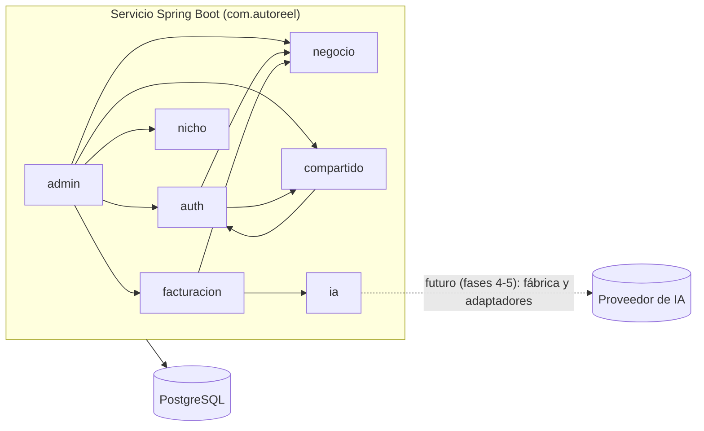

# ADR 0002 — Monolito modular en el backend

- **Estado:** Aceptada
- **Fecha:** 2026-11-03

## Contexto

El backend abarca dominios muy distintos: autenticación, administración de negocios, facturación (planes, suscripciones y pagos), modelos de IA, paquetes de nicho, catálogo, chat, generación de video, publicación en Instagram, almacenamiento y costos (especificación, sección 12.2). El proyecto lo desarrolla una sola persona (Fabio Malpartida) y el MVP debe poder desplegarse de forma simple en AWS.

Al mismo tiempo, AutoReel debe poder cambiar de proveedor externo (IA, almacenamiento, Instagram, composición de video) sin tocar el resto del sistema (principio 6 de `docs/contexto-vision.md` y regla 3 de la sección 0).

## Decisión

El backend es **un solo servicio Spring Boot**, con el paquete base `com.autoreel`, organizado **por módulos de negocio**. Dentro de cada módulo se usan las capas que hagan falta:

- **`api`:** controladores y DTO de tipo `record`.
- **`aplicacion`:** servicios y casos de uso.
- **`dominio`:** entidades, enumeraciones y reglas puras.
- **`infraestructura`:** repositorios y adaptadores externos.

Los proveedores externos se usan a través de **puertos** (interfaces del dominio) con su implementación en `infraestructura`. Una fábrica de proveedores elige la implementación según el plan efectivo del negocio.

**Módulos que existen en la fase 1.** Solo se crean los que la fase usa, sin capas ni interfaces vacías.

| Módulo | Contenido real |
|---|---|
| `compartido` | `error/` (`ErrorApi`, `ExcepcionDeNegocio`, `ManejadorGlobalDeErrores`), `seguridad/` (`ConfiguracionSeguridad`, `FiltroJwtCookie`, `FiltroCookieCsrf`, `ServicioJwt`, `CookieDeSesion`, `PropiedadesSeguridad`, `RespuestasDeSeguridad`, `UsuarioAutenticado`), `config/` (`ConfiguracionReloj`, `ConfiguracionOpenApi`, `PropiedadesAplicacion`) |
| `auth` | `api/AuthController`, `aplicacion/ServicioAutenticacion`, `dominio/` (`Usuario`, `Rol`, `ReglasDeContrasena`, `GeneradorDeContrasenaTemporal`), `infraestructura/` (`UsuarioRepositorio`, `InicializadorAdministrador`) |
| `admin` | `api/AdminNegocioController` y sus DTO, `aplicacion/ServicioGestionNegocios` |
| `negocio` | `dominio/` (`Negocio`, `EstadoNegocio`), `infraestructura/NegocioRepositorio` |
| `facturacion` | `api/PlanController` (solo lectura), `dominio/` (`Plan`, `Suscripcion`, `CalculadoraEstadoPago`, `EstadoPago`), `infraestructura/` (`PlanRepositorio`, `SuscripcionRepositorio`) |
| `ia` | `dominio/` (`ModeloIA`, `TipoModelo`, `EstadoModelo`, `UnidadCosto`), `infraestructura/ModeloIARepositorio`. En la fase 1 solo hay datos y no hay adaptadores. |
| `nicho` | `Nicho` y `RegistroDeNichos` (solo identificador y nombre, `PASTELERIA`) |

**Módulos que se agregan o crecen en la fase 2:**

| Módulo | Contenido real |
|---|---|
| `nicho` | `api/NichoController`; `dominio/` (`PaqueteNicho`, `Nicho`, `Opcion`, `Pregunta`, `Temporada`, `RegistroDeNichos`, `ValidadorDeRespuestas`); `pasteleria/PaquetePasteleria`, con `resources/nichos/pasteleria/` (ADR 0011) |
| `almacenamiento` | `api/ArchivosController`; `aplicacion/` (`ServicioDeArchivos`, `VerificadorDeImagenes`, `ImagenVerificada`); `dominio/` (puerto `AlmacenDeArchivos`, `ArchivoAlmacenado`, `PropositoArchivo`); `infraestructura/` (`S3Almacen`, `ConfiguracionAlmacenamiento`, `PropiedadesAlmacenamiento`) (ADR 0009 y 0010) |
| `catalogo` | `api/` (`ProductoController`, `ProductoVista`, `SolicitudProducto`); `aplicacion/ServicioCatalogo`; `dominio/` (`Producto`, `FotoProducto`, `TipoFoto`, `EstadoProducto`); `infraestructura/ProductoRepositorio` |
| `negocio` | Suma `api/` (`PerfilController`, `Perfil`), `aplicacion/ServicioPerfil`, `dominio/PerfilNegocio` e `infraestructura/PerfilNegocioRepositorio` |
| `compartido` | Suma `datos/DatosDeEjemplo` (negocio de ejemplo, solo perfil `dev`) |

El primer puerto hacia un proveedor externo es `AlmacenDeArchivos` → `S3Almacen` (Amazon S3 en producción, SeaweedFS en desarrollo).

Dependencias nuevas de la fase 2, según los `import`: `catalogo` → `almacenamiento`, `negocio`, `nicho`; `negocio` → `almacenamiento`, `nicho`; `nicho` → `negocio` (el controlador busca el nicho del negocio de la sesión); `admin` → `catalogo`; `almacenamiento` solo depende de `compartido`. `compartido/datos/DatosDeEjemplo` usa varios módulos para sembrar la demo.

**Módulos que se agregan o crecen en la fase 3:**

| Módulo | Contenido real |
|---|---|
| `chat` (nuevo) | `api/` (`ChatController`, `ConversacionVista`, `SolicitudMensaje`); `aplicacion/ServicioChat`; `dominio/` (`Conversacion`, `MensajeChat`, `EstadoConversacion`, `AutorMensaje`, `AgrupadorDeMensajes`, `EvaluadorDeRespuesta`); `infraestructura/ConversacionRepositorio` (ADR 0012) |
| `nicho` | Suma `dominio/GuionChat` y `PaqueteNicho.guionDelChat()`, con `resources/nichos/pasteleria/chat.json` |
| `catalogo` | Suma `ServicioCatalogo.carrusel`, `paraVideo`, `elegidoParaVideo` y `crearDesdeChat`, y `Producto.enCatalogo` |
| `negocio` | Suma `NegocioRepositorio.bloquear` |

Dependencias nuevas de la fase 3, según los `import`: `chat` → `catalogo` (solo `ServicioCatalogo` y `Producto`), `nicho`, `negocio` y `compartido`. Ningún módulo depende de `chat` todavía.

**Módulos y puertos futuros:**

- La fábrica de proveedores y el puerto `Guionista` → `GeminiGuionista` (futuro, fase 4).
- `video`, `GeneradorDeClips` → adaptador del proveedor de video y `ComponedorDeVideo` → `FfmpegComponedor` (futuro, fase 5).
- `publicacion`, con `PublicadorSocial` → `InstagramPublicador` (futuro, fase 6).
- `costos` (futuro, fase 7).

Dependencias reales entre módulos en la fase 1, según los `import` del código:

## Alternativas consideradas

- **Microservicios.** Permiten escalar y desplegar cada parte por separado, pero multiplican la infraestructura, la observabilidad, las transacciones distribuidas y el costo. Es desproporcionado para un MVP desarrollado por una sola persona.
- **Monolito por capas técnicas** (`controllers/`, `services/`, `repositories/` globales). Es más simple al principio, pero mezcla todos los dominios y hace difícil extraer uno más adelante.
- **Arquitectura hexagonal estricta en todos los módulos.** Exigiría interfaces y mapeos aunque no se usen. Contradice la regla 8 de la sección 0, "sin abstracciones que no se usen". Los puertos se reservan para los proveedores externos.

## Consecuencias

- **Positivas:**
  - Un solo artefacto que construir, probar (`./mvnw verify`) y desplegar.
  - Las transacciones son locales. Por ejemplo, `Usuario`, `Negocio` y `Suscripcion` se crean en una sola transacción (RN-41).
  - Los límites entre módulos quedan claros, y un módulo podría extraerse a un servicio si el volumen lo exigiera.
- **Negativas:**
  - Los límites entre módulos se respetan por convención: nada en el compilador impide que un módulo use clases internas de otro. Por ejemplo, `FiltroJwtCookie`, en `compartido`, usa `UsuarioRepositorio` de `auth`. Si hiciera falta, más adelante se podría agregar una verificación automática (por ejemplo, Spring Modulith o ArchUnit), que hoy no existe.
  - Todo el servicio escala junto. La composición con FFmpeg (fase 5) consumirá CPU en la misma instancia que la API.
