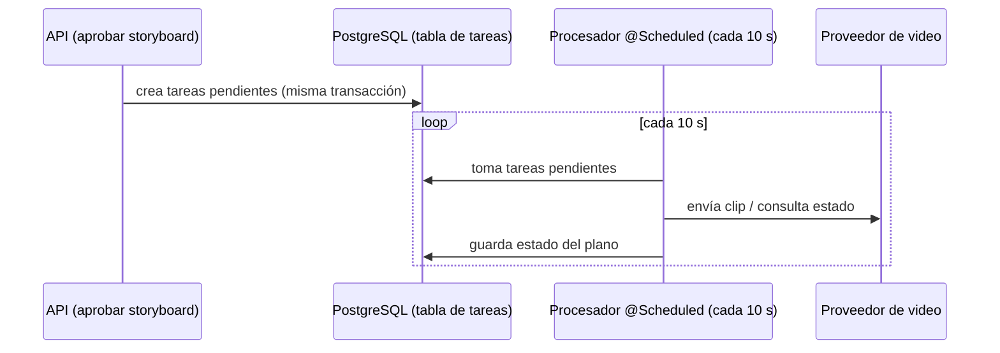

# ADR 0004 — Tareas en segundo plano en la base de datos, en lugar de colas

- **Estado:** Aceptada
- **Fecha:** 2026-11-03

## Contexto

Varios procesos de AutoReel no pueden ejecutarse dentro de una petición HTTP (especificación, sección 12.2):

- **La generación de clips es asíncrona** (sección 11.1): se crea la tarea en el proveedor, se consulta su estado y se descarga el clip. Los tres clips se envían en paralelo, y si un clip no responde en 10 minutos se usa el plan de respaldo (sección 8.5).
- **La composición con FFmpeg** tarda varios segundos.
- **Las publicaciones programadas** de Instagram se ejecutan en la fecha elegida (RN-36).
- **Una tarea diaria**, a las 00:10 hora de Lima, calcula los estados de pago y crea las notificaciones del administrador (RN-43 a RN-45).

Estos procesos deben sobrevivir a un reinicio del servidor, y el MVP corre en una sola instancia.

## Decisión

Las tareas pendientes se guardan en **una tabla de PostgreSQL**. Un **procesador programado** (`@Scheduled` de Spring) las recorre cada 10 segundos: envía los clips, consulta su estado, compone y publica los programados. La tarea diaria de pagos es otro `@Scheduled`, que usa el reloj de Lima.

El dominio no depende del mecanismo. Cuando el volumen lo exija, el procesador podrá reemplazarse por Amazon SQS sin cambiar el dominio.

**Estado en la fase 1:**

- No existe todavía la tabla de tareas ni ningún `@Scheduled`. La tabla, el procesador y su migración Flyway llegan con la generación de video (futuro, fase 5). La tarea diaria de estados de pago y las notificaciones llegan en la fase 7 (futuro, fase 7).
- La fase 1 ya deja preparadas dos piezas que esas tareas reutilizarán:
  - **`ConfiguracionReloj`:** un `Clock` único con la zona `America/Lima`, inyectable y reemplazable en las pruebas (`RelojAjustable`).
  - **`CalculadoraEstadoPago`:** una función pura (RN-43). Hoy la usa `Suscripcion.estadoPago(LocalDate)`, que `ServicioGestionNegocios` llama para calcular el estado de pago al leer la lista y el detalle de los negocios. En la fase 7 la usará también la tarea diaria.

## Alternativas consideradas

- **Amazon SQS o RabbitMQ desde el inicio.** Escalan mejor y reparten la carga entre instancias, pero suman infraestructura, configuración local y costo, y no aportan nada con una sola instancia y bajo volumen.
- **`@Async` o hilos en memoria.** Son simples, pero las tareas se pierden si el servidor se reinicia a mitad de una generación.
- **Quartz o JobRunr.** Persisten las tareas, pero agregan una dependencia y sus propias tablas para lo que se resuelve con una tabla y un `@Scheduled`.

## Consecuencias

- **Positivas:**
  - Sin infraestructura adicional: se reutiliza PostgreSQL.
  - Las tareas sobreviven a los reinicios.
  - Se pueden consultar y depurar con SQL.
  - El alta de una tarea queda en la misma transacción que el cambio de estado del video.
- **Negativas:**
  - Hay una latencia de hasta 10 segundos entre pasos.
  - Consultar la tabla periódicamente agrega carga a la base de datos.
  - Con más de una instancia del backend habrá que evitar que dos procesadores tomen la misma tarea, por ejemplo con `SELECT ... FOR UPDATE SKIP LOCKED` o con un bloqueo distribuido. Se resolverá al implementar el procesador en la fase 5.
- **Salida prevista:** cuando el volumen lo justifique, se migra a Amazon SQS y se reemplaza solo el procesador.
