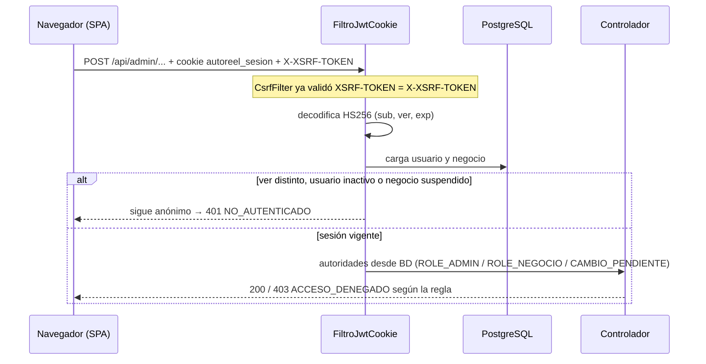

# ADR 0007 — Sesión con JWT en cookie HttpOnly, CSRF para SPA y filtro propio

- **Estado:** Aceptada
- **Fecha:** 2026-11-03

## Contexto

Las reglas de acceso de la especificación imponen varios requisitos a la sesión:

- **RN-03:** con una contraseña temporal, el usuario solo puede cambiarla.
- **RN-05:** reiniciar la contraseña invalida las sesiones abiertas.
- **RN-06:** el administrador y el negocio no pueden entrar a las rutas del otro.
- **RN-07:** un negocio suspendido no puede usar el sistema.
- **RN-08:** la sesión dura 8 horas, y después de 5 intentos fallidos la cuenta se bloquea durante 15 minutos.

Además, el frontend es una SPA que comparte origen con la API (ADR 0001), y el backend debe ser sin estado para poder escalar.

Guardar un JWT en `localStorage` lo expone a cualquier XSS. Un JWT autocontenido, con el rol dentro, no se puede revocar antes de que venza: no cumpliría RN-05 ni RN-07 de inmediato.

## Decisión

1. **El JWT viaja en la cookie `autoreel_sesion`** (`CookieDeSesion`), con estos atributos:
   - `HttpOnly`: el JavaScript no puede leerla.
   - `Secure` por defecto (`autoreel.seguridad.cookie-segura: true`). Solo `application-dev.yml` y el perfil de pruebas lo ponen en `false`.
   - `SameSite=Lax`, `Path=/` y `Max-Age` de `SESION_HORAS` (8 por defecto), sin `Domain`.
   - El logout la borra con `Max-Age=0` y los mismos atributos.
2. **El token se firma con HS256** (`ServicioJwt`), usando `NimbusJwtEncoder` y `NimbusJwtDecoder` de `spring-security-oauth2-jose`.
   - **Claims:** `iss=autoreel`, `sub` (el id del usuario), `iat`, `exp` y `ver` (la versión de sesión). **El rol no va en el token.**
   - **Clave:** `JWT_SECRET`, en base64 y de al menos 32 bytes. Se valida al arrancar (ADR 0005).
3. **El filtro es propio, `FiltroJwtCookie`** (un `OncePerRequestFilter`, ubicado antes de `AuthorizationFilter`). **No se usa `oauth2ResourceServer()`.**
   - **El motivo:** su `BearerTokenRequestMatcher` haría que Spring Security ignorara la protección CSRF en las peticiones autenticadas con token. Con la sesión en una cookie, que el navegador envía sola, eso abriría la puerta a ataques CSRF.
   - **En cada petición, el filtro:**
     1. Lee la cookie y decodifica el token.
     2. Carga el usuario y su negocio desde la base de datos (`UsuarioRepositorio.buscarConNegocio`).
     3. Acepta la sesión solo si `ver` coincide con `usuario.version_sesion`, si el usuario está activo y si su negocio no está SUSPENDIDO.
     4. Calcula los permisos **a partir de la base de datos**: `ROLE_ADMIN` o `ROLE_NEGOCIO`, o solo `CAMBIO_PENDIENTE` si `debe_cambiar_contrasena` es verdadero (RN-03).
   - Si la cookie no sirve, la petición sigue como anónima y las reglas de acceso responden 401.
4. **Revocación por versión de sesión.** Cambiar la contraseña, reiniciarla y suspender el negocio incrementan `usuario.version_sesion`, lo que invalida todas las cookies anteriores al instante (RN-05, RN-07). Al cambiar la contraseña se emite una cookie nueva.
5. **CSRF para SPA**, con `csrf(c -> c.spa())` de Spring Security 7:
   - El backend deja el token en la cookie `XSRF-TOKEN`, que JavaScript puede leer. `FiltroCookieCsrf` fuerza su generación en cada respuesta.
   - El frontend (`src/api/cliente.ts`) la envía en la cabecera `X-XSRF-TOKEN` en todo método que no sea GET, HEAD u OPTIONS. Si todavía no tiene la cookie, la obtiene con `GET /api/auth/yo`.
   - Una petición POST sin el token responde 403 con el código `CSRF_INVALIDO`.
6. **Reglas de acceso** (`ConfiguracionSeguridad`, sin estado: `STATELESS`; `httpBasic`, `formLogin`, `logout` y `requestCache` desactivados):

   | Ruta | Acceso |
   |---|---|
   | `/api/auth/login`, `/api/auth/logout`, `/actuator/health` | permitAll |
   | `/v3/api-docs/**`, `/swagger-ui/**`, `/swagger-ui.html` | permitAll; springdoc solo está activo en el perfil `dev` |
   | `/api/auth/yo`, `/api/auth/cambiar-contrasena` | authenticated (incluye `CAMBIO_PENDIENTE`) |
   | `/api/admin/**` | `hasRole("ADMIN")` |
   | `/api/**` | `hasRole("NEGOCIO")` |
   | Todo lo demás | denyAll |

7. **Errores de seguridad con la forma `ErrorApi`.** `RespuestasDeSeguridad` responde `NO_AUTENTICADO` (401), `ACCESO_DENEGADO` (403) y `CSRF_INVALIDO` (403).
8. **Inicio de sesión** (`ServicioAutenticacion`):
   - Lee el usuario con `SELECT ... FOR UPDATE` (`bloquearPorCorreo`): los intentos simultáneos contra el mismo correo se verifican y se cuentan de a uno.
   - Si la cuenta está bloqueada, responde `CUENTA_BLOQUEADA` sin verificar la contraseña real, pero compara contra un hash ficticio para tardar lo mismo.
   - Si el correo no existe, compara contra el hash ficticio y cuenta el fallo en memoria (`IntentosDeCorreosDesconocidos`). Al 5.º fallo responde `CUENTA_BLOQUEADA` durante 15 minutos, igual que una cuenta real, para no revelar qué correos existen.
   - Si la contraseña es incorrecta, `Usuario.registrarIntentoFallido` suma un intento; al llegar a 5, bloquea la cuenta durante 15 minutos (`bloqueado_hasta`).
   - `Usuario` usa `@DynamicUpdate`, para que un inicio de sesión no pise un reinicio de contraseña o una suspensión hechos al mismo tiempo.
   - Solo con la contraseña correcta informa `NEGOCIO_SUSPENDIDO` o `CONTRASENA_TEMPORAL_VENCIDA`.

## Alternativas consideradas

- **`oauth2ResourceServer().jwt()` con un `BearerTokenResolver` que lea la cookie.** Es menos código, pero su `BearerTokenRequestMatcher` desactiva CSRF en esas peticiones, que es justamente lo que no se puede permitir con una cookie. Se descartó.
- **JWT en `localStorage`, enviado en la cabecera `Authorization`.** No necesita CSRF, pero el token queda expuesto a XSS y no se puede revocar.
- **Sesión de servidor (`HttpSession`) o Spring Session con JDBC.** Permite revocar de forma natural, pero le da estado al backend o exige una tabla de sesiones adicional. La versión de sesión logra lo mismo con una columna.
- **Roles dentro del JWT, sin consultar la base de datos.** Ahorra una consulta por petición, pero un cambio de rol, una suspensión o un reinicio no tendrían efecto hasta que el token venciera.

## Consecuencias

- **Positivas:**
  - El token no es accesible desde JavaScript.
  - La revocación es inmediata (verificada en V06 y V09).
  - Los permisos siempre están al día.
  - Hay protección CSRF real.
  - El backend sigue siendo sin estado.
  - Todos los errores tienen la forma `{codigo, mensaje}`.
- **Negativas:**
  - Cada petición autenticada hace una consulta a la base de datos (usuario más negocio). Con el volumen del MVP es aceptable; si creciera, podría agregarse una caché breve.
  - Las peticiones que modifican datos necesitan la cabecera CSRF: el frontend, las pruebas (`.with(csrf())`) y Swagger UI (`springdoc.swagger-ui.csrf.enabled=true`) deben enviarla.
  - Funciona solo si el frontend y la API comparten origen, ya sea con el proxy de Vite o con CloudFront (futuro, fase 8). La cookie `Secure` exige HTTPS fuera del perfil `dev`.
  - Hay más código propio de seguridad que mantener: el filtro, la cookie y las respuestas de error.
- **Futuro:** la conexión OAuth con Instagram (futuro, fase 6) es un flujo distinto y no cambia esta decisión.
