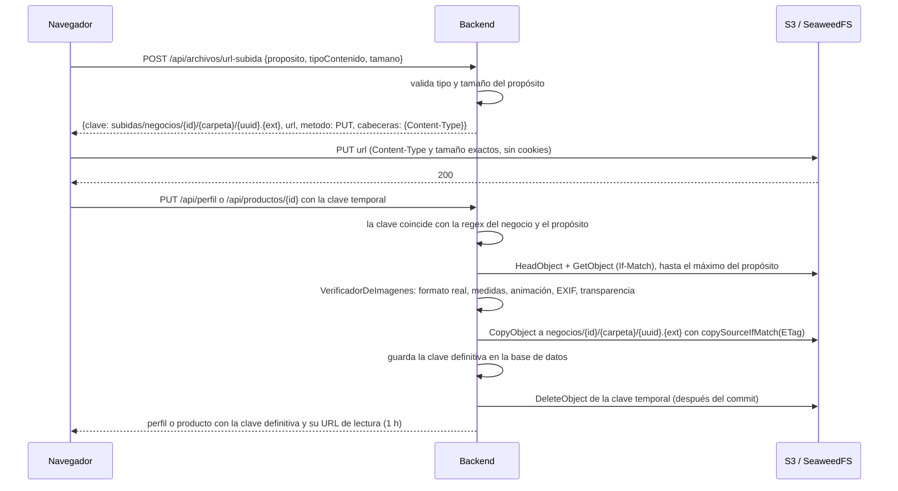

# ADR 0010 — Subida directa al almacenamiento, con verificación y copia a la clave definitiva

- **Estado:** Aceptada
- **Fecha:** 2026-11-04

## Contexto

La sección 11.4 pide que el navegador suba las fotos **directamente a S3** con enlaces prefirmados que genera el backend, para no pasar archivos de hasta 10 MB por el servidor. Pero los archivos deben cumplir reglas que solo se pueden confiar si las revisa el backend:

- **RN-10:** el logo es PNG de hasta 5 MB.
- **RN-11:** las fotos son JPG, PNG o WebP de hasta 10 MB, con el lado menor de al menos 1080 px (V12); las horizontales se aceptan con aviso.
- **RNF-05:** ningún negocio puede usar ni ver archivos de otro (V08).

El primer diseño firmaba una URL de subida para la **misma clave** que luego se guardaba, y comprobaba solo el prefijo de la clave. La revisión encontró dos problemas:

1. **Carrera entre verificar y usar (TOCTOU).** La URL de subida sigue sirviendo 10 minutos: con ella se podría reemplazar un archivo ya verificado por otro que no cumple las reglas.
2. **El prefijo no aísla.** Una clave como `negocios/1/logo/../../2/...` cumple el prefijo `negocios/1/` y apunta a otro negocio.

Además, una regla de ciclo de vida de S3 no puede reconocer "objetos sin uso": solo filtra por prefijo, etiqueta o antigüedad.

## Decisión

La subida ocurre **en dos tiempos**, en `ServicioDeArchivos` (`almacenamiento/aplicacion`), y las claves se arman y se comprueban siempre con el **negocio de la sesión**, nunca con un dato del cliente.

1. **Firma solo claves temporales.** `POST /api/archivos/url-subida` (`ArchivosController`) recibe `{proposito: LOGO | FOTO_PRODUCTO | FOTO_LOCAL, tipoContenido, tamano}`.
   - Valida el tipo y el tamaño con `PropositoArchivo` antes de firmar: `LOGO_DEBE_SER_PNG`, `TIPO_NO_PERMITIDO`, `ARCHIVO_VACIO` (`tamano <= 0`) y `ARCHIVO_DEMASIADO_GRANDE` (con el límite en MB).
   - La clave es `subidas/negocios/{negocioId}/{logo|foto_producto|foto_local}/{uuid}.{png|jpg|webp}`.
   - `S3Almacen.urlDeSubida` firma el `PUT` con `Content-Type` y `Content-Length` exactos; vence en **10 minutos** (`VIGENCIA_SUBIDA`).
   - La respuesta es `{clave, url, metodo: "PUT", cabeceras: {"Content-Type": tipo}}`, con `Cache-Control: no-store`. No incluye `host` ni `content-length`, que el navegador no permite fijar.
2. **El navegador sube sin credenciales de AutoReel.** `subirArchivo` (`frontend/src/api/archivos.ts`) usa `XMLHttpRequest` con `withCredentials = false` (no manda la cookie de sesión ni `X-XSRF-TOKEN` a S3) y `upload.onprogress` para el porcentaje. Si la subida falla (red o 403), pide una URL nueva y reintenta una vez; luego responde `SUBIDA_FALLIDA`. Antes de subir, las fotos se normalizan en el navegador (`normalizarFoto`: orientación EXIF aplicada, lado mayor ≤ 2560 px, JPEG 0,88, sin metadatos ni GPS); el backend igual verifica todo.
3. **Verificación al usar la clave.** Cuando `ServicioPerfil` (logo y foto del local) o `ServicioCatalogo` (fotos del producto) reciben una clave nueva, llaman a `ServicioDeArchivos.confirmar(negocioId, proposito, clave)`:
   - **Regex anclada**, armada con el negocio de la sesión y el propósito del campo: `^subidas/negocios/{id}/{carpeta}/{uuid}\.(png|jpg|webp)$`. Una clave con `..`, `%2e%2e` o de otro negocio responde `ARCHIVO_INVALIDO`.
   - **Lectura acotada:** `AlmacenDeArchivos.leer(clave, bytesMaximos)` hace `HeadObject` y, solo si el tamaño cabe, `GetObject` con `If-Match` del mismo ETag. Si no existe, `ARCHIVO_NO_SUBIDO`; si pesa de más, `ARCHIVO_DEMASIADO_GRANDE` sin descargarlo.
   - **Contenido real** con `VerificadorDeImagenes`: el formato del lector de ImageIO (png, jpeg o webp, con TwelveMonkeys `imageio-webp` e `imageio-jpeg`) debe coincidir con la extensión de la clave (`ARCHIVO_INVALIDO`); rechaza WebP animado y APNG (`IMAGEN_ANIMADA`); lee las medidas sin decodificar la imagen; rechaza más de 8000 px por lado o 40 MP (`IMAGEN_DEMASIADO_GRANDE`); en el logo exige entre 200 px (`LOGO_MUY_PEQUENO`) y 4000 px por lado; en las fotos, lado menor ≥ 1080 px (`FOTO_RESOLUCION_INSUFICIENTE`, con las medidas). Aplica la orientación EXIF 5–8 de los JPEG antes de decidir si la foto es horizontal. En el logo, marca `sinTransparencia` si ningún píxel tiene alfa < 255, también en los PNG de paleta (se acepta con el aviso `LOGO_SIN_TRANSPARENCIA` y queda guardado en `perfil_negocio.logo_sin_transparencia`, que la API expone como `logoSinTransparencia`).
4. **Copia condicional a la clave definitiva.** `AlmacenDeArchivos.copiarSiNoCambio(origen, destino, etiqueta)` hace `CopyObject` con `copySourceIfMatch(ETag leído)` hacia `negocios/{id}/{carpeta}/{uuid}.{ext}` (la misma clave sin `subidas/`). Si el archivo cambió entre la lectura y la copia, S3 responde 412 y el backend responde **409 `ARCHIVO_MODIFICADO`**. La temporal se borra **después de que la transacción se confirma** (`TransactionSynchronization.afterCommit`): si el guardado del perfil o del producto falla más adelante, el usuario puede reintentar con la misma clave. Si el borrado falla, solo se registra un aviso; la regla de expiración de `subidas/` la limpia después.
5. **En la base de datos solo hay claves definitivas** (`perfil_negocio.logo_clave`, `perfil_negocio.foto_local_clave`, `foto_producto.clave_s3`), y **el backend nunca firma una URL de escritura para ellas**. Una clave igual a la guardada no se vuelve a verificar; cualquier otra debe ser una subida nueva (`esSubida`) o responde `ARCHIVO_INVALIDO`.
6. **Lectura con URLs firmadas.** Las respuestas que muestran imágenes incluyen una URL `GET` firmada de **1 hora** (`VIGENCIA_LECTURA`). `ServicioDeArchivos.urlDeLectura` la guarda en memoria por clave (hasta 5000) y la reutiliza mientras le queden más de 15 minutos, para que el navegador aproveche su caché. En el frontend, la consulta del perfil en Ajustes y la lista del catálogo usan `staleTime` de 30 minutos y `refetchOnWindowFocus` (la lista del catálogo además `refetchInterval` de 45), y en las tarjetas de los catálogos (`PaginaCatalogo` y el detalle del negocio en el panel) `ImagenRemota` invalida su consulta una vez si la imagen no carga (URL vencida). Las demás imágenes se renuevan al recargar la página.
7. **Huérfanos.** Quedan sin uso las subidas que nunca se confirman y las claves definitivas reemplazadas (el código no las borra). En el MVP se toleran. **(futuro, fase 8):** una regla de ciclo de vida del bucket que **expira `subidas/` a 1 día** (ver `docs/despliegue-aws.md`); la limpieza de definitivas reemplazadas queda para revisar entonces.

## Alternativas consideradas

- **Firmar la URL de la clave definitiva** (el primer diseño). Más simple, pero abre la carrera TOCTOU: con la URL aún vigente se reemplaza un archivo ya verificado.
- **Subir a través del backend** (`multipart`). El backend vería el archivo antes de guardarlo, sin carrera, pero cargaría con todo el tráfico de fotos de hasta 10 MB, en contra de la sección 11.4.
- **Verificar al terminar la subida con un evento de S3** (Lambda o notificación). Desacopla, pero agrega infraestructura que no existe en local ni en el MVP.
- **Comprobar solo un prefijo de texto.** Insuficiente: lo cumple una clave con `..`.
- **Formularios POST prefirmados con política** (`content-length-range`). Permiten un rango de tamaño, pero igual exigen verificar el contenido en el backend, y el `PUT` con tamaño exacto es más estricto y más simple.

## Consecuencias

- **Positivas:**
  - Las fotos no pasan por el backend al subir; el backend solo las lee una vez, acotado al tamaño máximo.
  - Un archivo guardado ya no se puede reemplazar: su clave nunca tiene URL de escritura, y la copia solo ocurre si el archivo no cambió desde que se verificó.
  - El aislamiento entre negocios no depende del cliente: la clave se arma y se comprueba con el negocio de la sesión.
  - Las reglas se comprueban sobre el contenido real, no sobre la extensión ni el tipo que dice el navegador.
- **Negativas y riesgos:**
  - Cada imagen nueva cuesta varias operaciones de S3 (Head, Get, Copy y Delete) y una copia del objeto.
  - Quedan objetos huérfanos hasta la fase 8; sin la regla de expiración, `subidas/` crece con cada subida no confirmada.
  - En AWS hacen falta CORS en el bucket (`PUT` y `GET` desde `APP_URL`) y permisos IAM para `CopyObject`; ver `docs/despliegue-aws.md`.
  - Las URLs de lectura en caché viven en la memoria de una instancia: con varias instancias, cada una firma las suyas (no es un error, solo menos caché).
- **Cuándo revisar esta decisión:** si se agregan archivos que no son imágenes (los clips y videos de la fase 5 los genera el backend, no el navegador) o si el volumen de subidas justifica la verificación por eventos.
