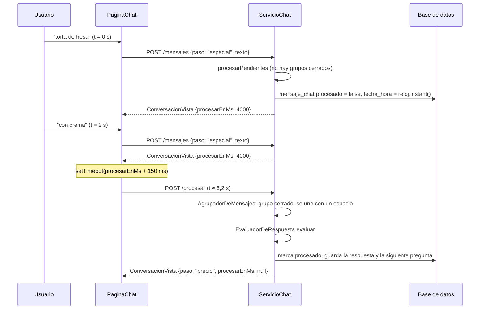

# ADR 0012 — Agrupación de mensajes en el backend, con el reloj del servidor

- **Estado:** Aceptada
- **Fecha:** 2026-11-04

## Contexto

El chat del video del día (sección 7.3, RF-19) reúne las respuestas con preguntas fijas, sin IA. Muchas personas escriben una respuesta en varios mensajes cortos seguidos ("torta de fresa" / "con crema" / "recién hecha"). Por eso:

- **RN-17:** los mensajes enviados con menos de 4 segundos de diferencia forman **una sola respuesta**. La sección 7.3 lo describe así: después de cada mensaje se esperan 4 s; si llega otro, el plazo se reinicia; al vencer, todo se une.
- La respuesta **ya agrupada** es la que se revisa: preguntas del usuario (RN-18, V16), menos de 3 caracteres en una obligatoria, más de 500 caracteres y el precio obligatorio en una Promoción (RN-20, V17).
- **V15** exige probar que tres mensajes en 3 segundos se registran como una sola respuesta.
- **RN-19:** hay un solo borrador por negocio y, al volver, se puede continuar donde se quedó. Lo escrito no puede perderse por recargar la página o cerrar la pestaña.

Hacía falta decidir **quién mide los 4 segundos** y **quién decide cuándo se cierra un grupo**: el navegador o el backend.

## Decisión

**El backend decide la agrupación con su propio reloj; el frontend solo le avisa cuándo volver a mirar.**

1. **Cada texto se guarda al instante.** `POST /api/chat/conversaciones/{id}/mensajes` con `{paso, texto}` guarda un `MensajeChat` del `USUARIO` con `procesado = false` y `fecha_hora = reloj.instant()` (el `Clock` de `America/Lima`, `ConfiguracionReloj`). La vista lo devuelve con `pendiente = true` y la burbuja se ve un poco más tenue hasta agruparse. El reloj del navegador no se usa nunca.
2. **La regla es una función pura del dominio.** `AgrupadorDeMensajes.agrupar(mensajes, fecha, ahora)` (`chat/dominio`) recorre los pendientes en orden y corta un grupo cuando entre dos mensajes consecutivos hay **4 s o más** (`ESPERA`). El último grupo se cierra solo si desde su último mensaje pasaron 4 s. Devuelve `Resultado(cerrados, abiertos, cierreEn)`, donde `cierreEn` es lo que falta para que se cierre el grupo abierto.
3. **El backend procesa los grupos cerrados** en `ServicioChat.procesarPendientes`: une los textos de cada grupo con un espacio, los marca como procesados, los revisa con `EvaluadorDeRespuesta.evaluar` y aplica el resultado:
   - `Aceptada(valor)`: guarda `respuestas[paso.id]` (o `null` si fue una respuesta negativa en una pregunta opcional) y hace la siguiente pregunta, o cierra la conversación.
   - `Rechazada(mensaje)`: dice el mensaje fijo (`pregunta`, `muyCorta`, `muyLarga` o `precioObligatorio`) y repite la misma pregunta.
   - Un grupo que se cierra cuando el paso actual ya no es de texto solo se marca como procesado.
4. **Hay dos momentos en que se procesa:**
   - `POST /api/chat/conversaciones/{id}/procesar` (`ChatController.procesar`): cierra lo que ya venció. Es idempotente: si todavía no pasaron 4 s, no cambia nada y devuelve el `procesarEnMs` actualizado. Con la conversación fuera de `EN_CURSO` (completa o abandonada) responde 409 `CONVERSACION_CERRADA`, como `POST /mensajes`, y el frontend recarga.
   - **Al llegar un texto nuevo**, `ServicioChat.escribir` llama primero a `procesarPendientes`: si el grupo anterior ya tenía 4 s, se procesa antes, y el texto nuevo empieza otra respuesta (que ya puede corresponder a la pregunta siguiente).
5. **`procesarEnMs` le dice al frontend cuándo llamar.** Las respuestas de `POST /mensajes`, `POST /procesar` y `GET /actual` devuelven la misma `ConversacionVista`, con `procesarEnMs` calculado con el reloj del servidor: `null` si no hay pendientes, `0` si ya hay un grupo vencido y, si no, los milisegundos que faltan. `GET /api/chat/conversaciones/actual` es **de solo lectura**: no procesa; si hay algo vencido, devuelve `procesarEnMs = 0` y el frontend llama a `procesar`.
6. **El frontend no agrupa.** `PaginaChat` programa `window.setTimeout(procesarEnMs + 150 ms)` cada vez que cambia `procesarEnMs` o la cantidad de mensajes (cada respuesta nueva reinicia el temporizador), y además llama a `procesar` cuando la pestaña vuelve a estar visible (`visibilitychange`), porque los navegadores frenan los temporizadores de las pestañas ocultas. Mientras procesa, muestra "escribiendo…". El contador de la caja de texto descuenta lo pendiente del grupo más lo que hay en la caja.
7. **Las respuestas que no son texto no se agrupan.** Un botón (`opcion`), un producto (`productoId` o `productoNuevo`) y "No, gracias" (`omitir`) se procesan en la misma petición. "No, gracias" descarta el texto pendiente de ese paso (`marcarProcesados`).
8. **Concurrencia.** `POST /mensajes` y `POST /procesar` cargan la conversación con `PESSIMISTIC_WRITE` (`ConversacionRepositorio.bloquearDeNegocio`), así dos pestañas o un temporizador que coincide con un envío no procesan el mismo grupo dos veces. Cada `POST /mensajes` lleva el `paso` al que responde; si ya no es el actual, responde **409 `PASO_CAMBIADO`** y el frontend recarga la conversación sin mostrar error.
9. **Límite de 500 caracteres en dos niveles.** Un solo texto de más de `maximoCaracteres` se rechaza en la petición (400 `RESPUESTA_MUY_LARGA`, con el mensaje `muyLarga`). Un grupo que suma más de 500 se rechaza al procesarse, con el mensaje `muyLarga` en el chat y la misma pregunta otra vez.

## Alternativas consideradas

- **Agrupar solo en el frontend (debounce en el navegador).** El navegador juntaría los textos en memoria y, 4 s después del último, enviaría una sola respuesta ya unida. El backend sería más simple (sin `procesado`, sin `procesar` ni `procesarEnMs`), pero:
  - lo escrito en esos 4 s se pierde si la persona recarga, cierra la pestaña o se queda sin conexión, en contra del borrador único de RN-19;
  - el backend recibiría un texto ya unido y no podría saber si la regla se cumplió: un cliente distinto (o una pestaña con el temporizador frenado) agruparía de otra forma;
  - V15 dependería del tiempo del navegador y habría que probarlo con temporizadores simulados en el frontend, que hoy no tiene pruebas (sección 18);
  - con dos pestañas abiertas, cada una llevaría su propio grupo.
- **Agrupar con la hora que manda el navegador.** Mantiene la regla en el backend, pero con un dato del cliente: un reloj desfasado o manipulado cambiaría la agrupación.
- **Una tarea programada del backend que cierre los grupos cada segundo** (`@Scheduled`). No necesita la llamada a `procesar`, pero agrega un proceso que recorre conversaciones todo el tiempo, y el frontend igual tendría que preguntar (o recibir un aviso) para ver la siguiente pregunta.
- **Aviso del servidor en tiempo real** (WebSocket o Server-Sent Events). El backend avisaría al cerrarse el grupo, sin temporizador en el navegador, pero agrega infraestructura que el MVP no tiene y que también exige el proxy y el balanceador de la fase 8.

## Consecuencias

- **Positivas:**
  - La regla vive en un solo lugar, con un reloj que controla la aplicación. Se prueba sin navegador: `AgrupadorDeMensajesTest` (tres mensajes en 3 s son un grupo, cada mensaje reinicia el plazo, uno a los 5 s abre otro) y `ChatIntegracionTest` con `RelojAjustable` (`v15MensajesSeguidosSeRegistranComoUnaSolaRespuesta`, `unTextoQueLlegaDespuesDe4SegundosEsOtraRespuesta`).
  - Ningún texto se pierde: cada mensaje queda guardado al enviarse y, al volver al chat, lo pendiente se procesa con la primera llamada a `procesar`.
  - El cliente no puede saltarse la revisión: todo texto pasa por `EvaluadorDeRespuesta` en el backend.
  - `procesar` es seguro de repetir; varios temporizadores, pestañas o reintentos dan el mismo resultado (si otro ya completó la conversación, el siguiente recibe 409 `CONVERSACION_CERRADA` y la pantalla se recarga).
- **Negativas y riesgos:**
  - Cada respuesta escrita cuesta una petición extra (`procesar`), además de una por mensaje.
  - Los 4 s se miden **entre las llegadas al servidor**, no entre los envíos: con una red lenta, un mensaje enviado a los 3,9 s puede llegar a los 4,1 s y abrir otro grupo. Se acepta: el efecto es una pregunta repetida o una respuesta partida, no un dato perdido.
  - Si la persona cierra el chat con un grupo pendiente, la respuesta no se guarda en `conversacion.respuestas` hasta que vuelva y el frontend llame a `procesar` (los mensajes sí están guardados en `mensaje_chat`).
  - La pantalla depende de que el frontend llame a `procesar`: un cliente que nunca lo haga deja la conversación esperando (no rompe nada; la siguiente visita lo resuelve).
  - `mensaje_chat` guarda cada mensaje suelto, no solo la respuesta unida.
- **Cuándo revisar esta decisión:** si se agrega un canal de avisos del servidor (WebSocket o SSE) por otra necesidad, o si el chat deja de ser de preguntas fijas.
