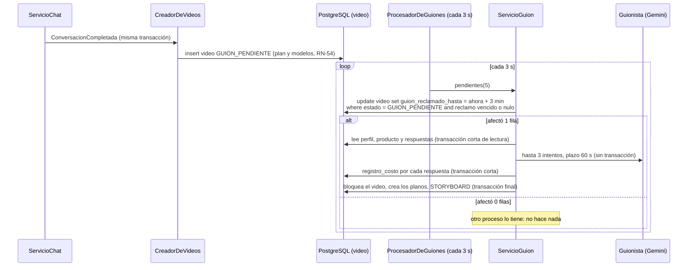

# ADR 0014 — Un solo procesador de guiones, con reclamo en la base de datos

- **Estado:** Aceptada
- **Fecha:** 2026-11-04

## Contexto

En la fase 4, al terminar el chat del video del día se crea el `Video` y la IA escribe su guion (sección 8.1). Hay varias condiciones:

- **El chat no puede esperar a la IA.** Una llamada a Gemini puede tardar hasta 30 s, y el guion admite hasta 3 intentos (RN-25). El chat debe responder al instante y el storyboard debe mostrar "Estoy preparando tu propuesta…" mientras tanto.
- **Un video nunca puede quedar atascado** en `GUION_PENDIENTE`. Si el servidor se reinicia a mitad del proceso, el negocio igual debe recibir su propuesta (RNF-09: el guion de respaldo existe para eso).
- **Un video no se puede procesar dos veces.** Cada respuesta del modelo se cobra (RN-32, `registro_costo`), y crear los planos dos veces rompe el índice único `plano (video_id, orden)`.
- **El ADR 0004** ya decidió que las tareas en segundo plano van en la base de datos con un `@Scheduled`, no en memoria. En la fase 1 no existían todavía `@EnableScheduling` ni `@EnableAsync`.

El primer diseño de la fase 4 (`docs/plan-fase-4.md`, §4) proponía dos mecanismos: un evento después del commit que lanzaba la generación con `@Async`, y una tarea programada que reintentaba los videos que llevaban más de 2 minutos en `GUION_PENDIENTE`. La revisión del diseño encontró que los dos podían tomar el mismo video a la vez: costo duplicado y planos repetidos. Además, un `@Async` en curso se pierde si el servidor se reinicia.

## Decisión

**Un solo procesador programado escribe todos los guiones. Cada video se reclama con un UPDATE condicional en la base de datos, y si un reclamo vence sin terminar, el video sale con el guion de respaldo.**



1. **El video se crea con el chat.** `ServicioChat` publica `ConversacionCompletada` justo después de completar la conversación, y `CreadorDeVideos` (un `@EventListener` síncrono) crea el `Video` en `GUION_PENDIENTE` **en la misma transacción**, con el plan y los modelos de `ResolutorDePlanEfectivo` (RN-54). La vista del chat devuelve el `videoId`. No se llama a la IA aquí.
2. **Un solo procesador.** `ProcesadorDeGuiones.procesarPendientes()` corre con `@Scheduled(fixedDelayString = "${autoreel.tareas.guiones-cada:3s}")`. Toma hasta 5 videos (`ServicioGuion.pendientes`, del más antiguo al más nuevo, con el índice parcial `video_guion_pendiente_idx`) y los procesa uno por uno. No hay `@Async` ni evento después del commit.
3. **Reclamo en la base de datos.** `ServicioGuion.procesar(videoId)` primero reclama el video con `VideoRepositorio.reclamar`:

   ```sql
   update video set guion_reclamado_hasta = :ahora + 3 minutos
   where id = :id and estado = 'GUION_PENDIENTE'
     and (guion_reclamado_hasta is null or guion_reclamado_hasta < :ahora)
   ```

   Solo sigue si afectó **1 fila**. La hora viene del `Clock` de la aplicación (`ConfiguracionReloj`), así las pruebas la controlan con `RelojAjustable`. La columna `video.guion_reclamado_hasta` llega con la migración `V5__videos_y_costos.sql`.
4. **Transacciones cortas.** `procesar` no lleva `@Transactional`:
   1. una transacción de solo lectura con el perfil, el producto, las respuestas y el modelo guardado en el video;
   2. las llamadas al modelo, **fuera de toda transacción**;
   3. el costo de cada respuesta, en su propia transacción corta (`ServicioCostos`, RN-32);
   4. una transacción final que bloquea el video (`PESSIMISTIC_WRITE`), comprueba que **sigue en `GUION_PENDIENTE`**, crea los planos y lo pasa a `STORYBOARD`.
5. **Plazos.** Hasta 3 intentos (RN-25). No se empieza un intento nuevo si ya pasaron 60 s (`PLAZO_TOTAL`): se usa el respaldo. Con lecturas de hasta 30 s, el peor caso queda por debajo de los 3 minutos del reclamo.
6. **Si el reclamo vence, respaldo.** Si al reclamar el video ya tenía un `guion_reclamado_hasta` (un proceso anterior se cortó por un reinicio o un error no previsto), no se vuelve a llamar a la IA: se arma el guion de respaldo con motivo `PROCESO_INTERRUMPIDO`. Si ni el respaldo se puede armar (por ejemplo, el producto perdió sus fotos), el video pasa a `ERROR` con su motivo. Así ningún video queda en `GUION_PENDIENTE` más de unos 3 minutos.
7. **Interruptor para las pruebas.** `ConfiguracionTareas` (`compartido/config`) lleva `@EnableScheduling` y solo se activa con `autoreel.tareas.activas=true` (el valor por defecto). El perfil `test` lo pone en `false`, y las pruebas llaman a `ServicioGuion.procesar` directamente.
8. **El frontend consulta.** `PaginaStoryboard` pide `GET /api/videos/{id}` cada 2 s mientras el video está en `GUION_PENDIENTE`, y cada 5 s cuando pasan 60 s desde su creación, con el aviso "Está tardando más de lo normal. Puedes salir: tu propuesta te esperará en Mis videos."

## Alternativas consideradas

- **`@Async` después del commit, más una tarea de reintento** (el primer diseño). El guion empieza sin esperar al siguiente ciclo, pero son dos caminos que pueden tomar el mismo video, y el trabajo en memoria se pierde con un reinicio (lo que el ADR 0004 quiso evitar). Para que no choquen, igual haría falta el reclamo en la base de datos.
- **Generar el guion dentro de la petición del chat.** Es lo más simple, pero el chat esperaría hasta 90 s, con una transacción abierta mientras dura la llamada HTTP, y un error de la IA podría revertir la última respuesta del usuario.
- **`SELECT … FOR UPDATE SKIP LOCKED` durante todo el proceso.** También evita que dos procesos tomen el mismo video, pero mantiene una transacción y una conexión abiertas mientras se espera a la IA. El reclamo con plazo libera la base de datos entre pasos y, además, deja registrado que un proceso empezó, que es lo que permite detectar uno interrumpido.
- **Volver a llamar a la IA cuando vence el reclamo.** Daría un guion mejor en algunos casos, pero no se sabe si el proceso anterior ya cobró respuestas ni por qué se cortó. Si el corte se repite, el video entraría en un ciclo de reintentos con costo. El respaldo cierra el caso de una vez, y el negocio puede editar los textos en el storyboard.
- **Una tabla de tareas aparte** (la del ADR 0004). Para el guion basta el propio video: su `estado` y `guion_reclamado_hasta` hacen de tarea. La tabla de tareas se decide con la generación de clips (futuro, fase 5).
- **Una cola externa (SQS) o Quartz/JobRunr.** Descartadas por el ADR 0004 para el MVP.

## Consecuencias

- **Positivas:**
  - Un solo lugar escribe guiones. El reclamo es atómico en PostgreSQL, así que dos ejecuciones, o dos instancias del backend, nunca procesan el mismo video. Esto resuelve, para el guion, el riesgo de varias instancias que dejaba abierto el ADR 0004.
  - Ningún video queda atascado: si el proceso se corta, el siguiente ciclo después de 3 minutos lo termina con el respaldo (`VideoIntegracionTest.unProcesoInterrumpidoTerminaConElRespaldo`).
  - El chat responde al instante y no depende de la IA. Crear el video en la misma transacción garantiza que toda conversación completa tiene su video.
  - Ninguna transacción ni conexión queda abierta mientras se espera al proveedor.
  - La transacción final comprueba el estado, así que un proceso lento que termina tarde no pisa el resultado de otro.
  - La fase 5 solo le suma estados (`GENERANDO`, `COMPONIENDO`) al mismo esquema.
- **Negativas y riesgos:**
  - Hay una espera de hasta 3 s antes de que empiece el guion.
  - El procesador consulta la tabla `video` cada 3 s, aunque no haya pendientes. El índice parcial deja esa consulta barata.
  - Los videos se procesan uno por uno, de a 5 por ciclo. Con mucho volumen, unos esperarían a otros.
  - Un video interrumpido sale con el respaldo aunque la IA estuviera disponible. Si el proceso anterior seguía vivo (más lento de lo previsto), sus respuestas ya se cobraron, pero su resultado se descarta en la transacción final.
  - Las pruebas no ejecutan el `@Scheduled`: el procesador se prueba llamando a `ServicioGuion.procesar` directamente.
- **Cuándo revisar esta decisión:** si el volumen exige procesar guiones en paralelo, al llegar la tabla de tareas o la cola de la fase 5, o si se pasa a más de una instancia con otro mecanismo de reparto.
