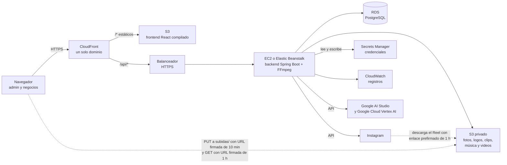

# Despliegue en AWS

Recursos de AWS, configuración de secretos, despliegue, actualización y vuelta atrás de AutoReel en producción.

> **Estado del documento:** **esqueleto de la fase 8**, actualizado al cierre de la fase 7 y de la revisión del flujo del negocio (2026-11-06). Hoy AutoReel solo se ejecuta en local: PostgreSQL y SeaweedFS (S3 local, ADR 0009) en `docker compose`, backend con `mvnw` (con FFmpeg instalado en la PC) y frontend con `npm run dev`. Todavía **no existen** el `Dockerfile` del backend, la infraestructura de AWS, un perfil propio de producción ni la implementación de los secretos con AWS Secrets Manager. Esta guía reúne lo que ya está decidido en la especificación (secciones 11.4 y 12) y lo que el código de las fases 1 a 7 ya exige en producción: el bucket de archivos (sección 5), los proveedores de IA de Google (ADR 0017), las credenciales pegadas en el panel (sección 3.4, ADR 0018) y las tareas programadas (sección 4.1). Lo que falta se marca como **(futuro, fase 8)**.

---

## 1. Arquitectura prevista



**El bucket de archivos es la excepción.** El navegador sube y lee las imágenes directamente en S3, en otro origen, con URLs firmadas que genera el backend (ADR 0010). Por eso el bucket sí necesita CORS (sección 5.2), aunque el backend no lo configure.

**Por qué el frontend y `/api/*` comparten dominio.** La sesión viaja en la cookie `autoreel_sesion` (`HttpOnly`, `Secure`, `SameSite=Lax`, `Path=/`, sin `Domain`). El token CSRF va en la cookie `XSRF-TOKEN` y en la cabecera `X-XSRF-TOKEN`. El backend no configura CORS, porque todo es del mismo origen. Si CloudFront sirve el frontend y además envía `/api/*` al backend, el navegador ve un solo origen, igual que con el proxy de Vite en desarrollo (`frontend/vite.config.ts`). Ver el ADR 0007.

---

## 2. Recursos de AWS

| Servicio | Uso | Fase | Notas |
|---|---|---|---|
| **S3** (frontend) | Archivos estáticos de `frontend/dist`, generados con `npm run build` | 8 | Bucket privado, servido solo por CloudFront. |
| **S3** (archivos) | Logos, fotos de productos y del local (fase 2); clips, música y videos finales (fase 5) | 2 (en local, SeaweedFS) y 8 | Bucket privado, con CORS, permisos IAM y regla de expiración de `subidas/` (sección 5). El navegador sube con URLs `PUT` firmadas a `subidas/` y el backend verifica y copia a la clave definitiva (ADR 0010). Instagram descargará el video con un enlace firmado de 1 hora (sección 11.3, fase 6). |
| **RDS** | PostgreSQL | 8 | Conviene la misma versión mayor que en local: PostgreSQL 17 (`postgres:17-alpine` en `docker-compose.yml`). Flyway crea y actualiza las tablas al arrancar el backend. |
| **EC2 o Elastic Beanstalk con Docker** | Backend Spring Boot (Java 21) y FFmpeg | 8 | Detrás de un balanceador con HTTPS. FFmpeg va instalado en la imagen Docker (sección 12.2). La elección entre EC2 y Beanstalk queda para la fase 8. |
| **CloudFront** | Un solo dominio: estáticos desde S3 y `/api/*` hacia el balanceador | 8 | Ver la sección 6. |
| **Secrets Manager** | Credenciales: base de datos, JWT, proveedores de IA, Meta y cifrado de tokens | 8 | ADR 0005 y ADR 0018. Los modelos de IA solo guardan el **nombre** del secreto (RN-55): hoy `autoreel/gemini` y `autoreel/google-cloud`. El backend **lee y escribe** los secretos de IA, porque el administrador los pega en el panel (sección 3.4). El ADR 0018 prevé `PutSecretValue` de Secrets Manager para esa escritura. |
| **CloudWatch** | Registros del backend | 8 | — |
| **Rekognition** | Detección de rostros en las fotos (RN-15) | 9 (opcional) | — |

*Pendiente (fase 8): región, nombres de los recursos, tamaños de las instancias, red (VPC, subredes y grupos de seguridad), certificados, dominio (P-01) y costos fijos estimados. El backend necesita salida a internet (por ejemplo, con un NAT) para llamar a Google: `generativelanguage.googleapis.com`, `aiplatform.googleapis.com` y sus variantes regionales, y `oauth2.googleapis.com`.*

---

## 3. Variables de entorno y secretos

Los nombres salen de `.env.example`. En producción, sus valores vienen de **AWS Secrets Manager**, nunca de un archivo `.env` ni del código.

### 3.1 Requeridas desde la fase 1

| Variable | Propiedad de Spring | Uso | ¿Secreto? |
|---|---|---|---|
| `DB_URL` | `spring.datasource.url` | URL JDBC del RDS, por ejemplo `jdbc:postgresql://<endpoint>:5432/autoreel` | No |
| `DB_USER` | `spring.datasource.username` | Usuario de la base de datos | Sí |
| `DB_PASSWORD` | `spring.datasource.password` | Contraseña de la base de datos | Sí |
| `JWT_SECRET` | `autoreel.seguridad.jwt-secreto` | Clave HMAC (HS256) en base64, de al menos 32 bytes. Se genera con `openssl rand -base64 32`. Se valida al arrancar. **Si cambia, se cierran todas las sesiones.** | Sí |
| `SESION_HORAS` | `autoreel.seguridad.sesion-horas` | Duración de la sesión. Por defecto 8 (RN-08); se admite de 1 a 24. | No (opcional) |
| `ADMIN_EMAIL` | `autoreel.admin.correo` | Correo del administrador inicial | No |
| `ADMIN_PASSWORD` | `autoreel.admin.contrasena` | Contraseña del administrador inicial. Mínimo 8 caracteres, con letras y números (RN-04). | Sí |
| `APP_URL` | `autoreel.url-aplicacion` | Dirección pública del frontend, la de CloudFront. Con ella se arma el enlace `APP_URL/login` que se entrega a cada cliente. También es el único origen permitido en el CORS del bucket (sección 5.2). | No |

**Sobre `ADMIN_EMAIL` y `ADMIN_PASSWORD`:**
- `InicializadorAdministrador` solo los usa si todavía no existe ningún administrador, y nunca sobrescribe uno existente.
- **Fuera del perfil `dev`, si no hay administrador y faltan estas variables, el backend no arranca.**
- Después del primer arranque se pueden retirar del entorno.

**Variables que no se usan en producción:**
- `POSTGRES_DB`, `POSTGRES_USER`, `POSTGRES_PASSWORD` y `POSTGRES_PORT` solo los lee `docker compose` para el PostgreSQL local.
- En AWS, la base de datos es RDS y se configura con `DB_URL`, `DB_USER` y `DB_PASSWORD`.

### 3.2 Requeridas desde la fase 2 (almacenamiento)

Se leen en `PropiedadesAlmacenamiento` (`autoreel.almacenamiento.*` en `application.yml`). Detalle del bucket en la sección 5.

| Variable | Propiedad de Spring | En AWS | En local (SeaweedFS) |
|---|---|---|---|
| `AWS_S3_BUCKET` | `autoreel.almacenamiento.bucket` | **Obligatoria**: nombre del bucket de archivos. Sin ella, el backend no arranca. | `autoreel-dev` |
| `AWS_REGION` | `autoreel.almacenamiento.region` | Región del bucket. Si falta, `us-east-1`. | `us-east-1` |
| `S3_ENDPOINT` | `autoreel.almacenamiento.endpoint` | **Vacía o sin definir.** Con valor, `S3Almacen` usaría ese servicio con estilo de ruta en lugar de S3. | `http://localhost:8333` |
| `S3_ENDPOINT_PUBLICO` | `autoreel.almacenamiento.endpoint-publico` | **Vacía o sin definir.** | Vacía, o `http://<IP-de-tu-PC>:8333` para probar desde el celular |
| `AWS_ACCESS_KEY_ID` y `AWS_SECRET_ACCESS_KEY` | `autoreel.almacenamiento.clave-acceso` y `clave-secreta` | **No se definen.** Con `S3_ENDPOINT` vacío, `S3Almacen` usa `DefaultCredentialsProvider`, que toma el **rol de la instancia** (sección 5.3) y conserva `AWS_SESSION_TOKEN`. | Las del `.env`, solo para SeaweedFS |

`S3_PORT`, `DEMO_NEGOCIO_EMAIL` y `DEMO_NEGOCIO_PASSWORD` solo existen en desarrollo: el primero lo lee `docker compose` y los otros dos el perfil `dev` (`DatosDeEjemplo`). En producción no se definen.

### 3.3 Requeridas desde las fases 4, 5 y 7 (IA y video)

| Variable | Propiedad de Spring | Fase | Uso | ¿Secreto? |
|---|---|---|---|---|
| `GEMINI_API_KEY` | `autoreel.secretos."[autoreel/gemini]"` | 4 y Proveedores de Google | Clave de **Google AI Studio**. Con una sola clave se usan el guion (adaptador `GEMINI`) y los clips con **Gemini Omni Flash** (`GEMINI_OMNI`), los dos modelos activos del plan Lite (ADR 0017). El proyecto de Google de la clave necesita facturación activa: Omni no tiene plan gratuito. Es el secreto `autoreel/gemini`. | Sí |
| `GOOGLE_CLOUD_CREDENCIAL_ARCHIVO` | `autoreel.secretos-en-archivo."[autoreel/google-cloud]"` | Proveedores de Google | **Ruta** al JSON de la cuenta de servicio de **Google Cloud** (rol "Usuario de Vertex AI"), para Gemini en Vertex AI (`GEMINI_CLOUD`) y Veo (`VEO`), hoy inactivos. Es el secreto `autoreel/google-cloud`. Si falta, se usa `VEO_CREDENCIAL_ARCHIVO`, el nombre anterior. | Sí (el archivo) |
| `SECRETOS_PANEL_ARCHIVO` | `autoreel.archivo-secretos-panel` | 7 | Archivo JSON donde se guardan las credenciales que el administrador pega en **Ajustes → Integraciones y claves** (ADR 0018). Por defecto `../credenciales/secretos-del-panel.json`, relativo a la carpeta desde la que arranca el backend. Tiene prioridad sobre las dos anteriores. **Solo para desarrollo**: en AWS, el disco no debe guardar claves (sección 3.4). | Sí (el archivo) |
| `FFMPEG_PATH` | `autoreel.ffmpeg.ruta` | 5 | Ruta de FFmpeg, por defecto `ffmpeg`. En la imagen Docker va instalado y en el `PATH`, así que no hace falta definirla. | No |
| `GEMINI_URL` | `autoreel.ia.gemini.url` | 4 | Base de la API de Google AI Studio. Por defecto `https://generativelanguage.googleapis.com`; solo cambia en las pruebas. **No se define en producción.** | No |

Las credenciales de IA no son obligatorias para arrancar: sin ellas, el guion usa el respaldo (RN-25) y "Crear mi video" queda desactivado, porque **no hay respaldo sin IA para los clips** (sección 8.5 de la especificación). Desde la fase 7 también se pueden pegar en el panel en lugar de definirlas como variables (sección 3.4).

### 3.4 Credenciales de IA: `AlmacenDeSecretos` con Secrets Manager (requisito antes de desplegar)

Desde la fase 7 (ADR 0018), el administrador **pega o reemplaza** las credenciales de IA en **Ajustes → Integraciones y claves**. El código las trata con dos puertos del módulo `ia`:

| Puerto | Métodos | Implementación de desarrollo |
|---|---|---|
| `ia.dominio.ProveedorDeSecretos` | `obtener(nombreSecreto)` | `ia.infraestructura.SecretosDeConfiguracion` |
| `ia.dominio.AlmacenDeSecretos` | `guardar(nombreSecreto, valor)`, `borrar(nombreSecreto)` y `origen(nombreSecreto)` (`PANEL`, `CONFIGURACION` o `NINGUNO`) | La misma `SecretosDeConfiguracion` |

`SecretosDeConfiguracion` busca el valor primero en el archivo de `SECRETOS_PANEL_ARCHIVO`, después en `autoreel.secretos` y por último en `autoreel.secretos-en-archivo`. **Escribe las claves en el disco**, algo que el ADR 0018 no permite en el servidor de AWS. Por eso, **antes de desplegar (futuro, fase 8)**:

1. **Implementar los dos puertos con Secrets Manager** en una clase nueva de `ia/infraestructura`, que reemplace a `SecretosDeConfiguracion` fuera del perfil `dev`:
   - `obtener` → `GetSecretValue` con el nombre del secreto (`autoreel/gemini`, `autoreel/google-cloud` o el que use un modelo nuevo). Para `autoreel/google-cloud`, el valor del secreto es **el contenido del JSON** de la cuenta de servicio, no una ruta.
   - `guardar` → `PutSecretValue` (la respuesta del panel ya va con `Cache-Control: no-store` y el log solo registra el nombre).
   - `borrar` y `origen`: hay que definir qué significan en AWS, donde no hay un `.env` al que volver. *Pendiente de decidir en la fase 8.*
2. **Dar al rol de la instancia el permiso IAM** sobre los secretos de IA. Secrets Manager agrega un sufijo aleatorio al ARN de cada secreto, por eso se usa un comodín:

   ```json
   {
     "Sid": "SecretosDeIA",
     "Effect": "Allow",
     "Action": ["secretsmanager:GetSecretValue", "secretsmanager:PutSecretValue"],
     "Resource": "arn:aws:secretsmanager:<region>:<cuenta>:secret:autoreel/*"
   }
   ```

   - Un modelo creado en el panel con un nombre de secreto nuevo necesita que ese secreto exista: créalo antes en Secrets Manager, o agrega `secretsmanager:CreateSecret` si la implementación lo crea al guardar.
   - Si los secretos usan una clave KMS propia, el rol necesita además `kms:Decrypt` y `kms:GenerateDataKey` sobre esa clave.
3. **No definir `SECRETOS_PANEL_ARCHIVO`** ni guardar el JSON de la cuenta de servicio en el disco del servidor. Mientras la implementación de Secrets Manager no exista, el panel guardaría las claves en un archivo dentro del contenedor, que además se pierde en cada despliegue.
4. **Con varias instancias**, la implementación debe leer el valor actualizado: `SecretosDeConfiguracion` guarda en memoria lo que se pegó en el panel, y una caché así dejaría a las otras instancias con la clave anterior.

### 3.5 Requeridas en la fase 6 (pendiente)

| Variable | Uso |
|---|---|
| `META_APP_ID`, `META_APP_SECRET` y `META_REDIRECT_URI` | App de Meta para Instagram. En producción, `META_REDIRECT_URI` apunta a `https://<dominio>/api/instagram/callback`. |
| `TOKEN_CIFRADO_CLAVE` | Clave para cifrar los tokens de Instagram en la base de datos (`openssl rand -base64 32`). |

*Pendiente (fase 8): decidir cómo llegan al proceso los secretos que no son de IA (base de datos, JWT, Meta). Las opciones son inyectarlos como variables de entorno desde Secrets Manager o leerlos desde Spring. Hay que definir también el nombre de cada secreto y la política de rotación.*

---

## 4. Perfiles de Spring

| Perfil | Archivo | Cookie de sesión | springdoc (Swagger) | `.env` | Administrador inicial sin variables |
|---|---|---|---|---|---|
| Por defecto (**producción**) | `application.yml` | **`Secure`** (`autoreel.seguridad.cookie-segura: true`) | **Desactivado** (`springdoc.api-docs.enabled: false`, `swagger-ui.enabled: false`) | No se lee | El backend **no arranca** |
| `dev` | `application-dev.yml` | Sin `Secure` (para `http://localhost`) | Activo en `/swagger-ui.html` | Importa `../.env` | Solo muestra un aviso |
| `test` | `src/test/resources/application-test.yml` | Sin `Secure` | — | No | — |

En almacenamiento: `application.yml` deja `crear-bucket: false` (en AWS el bucket se crea aparte, sección 5); `dev` lo pone en `true` para crear el bucket de SeaweedFS y carga el negocio de ejemplo; `test` usa `tipo: memoria` (`AlmacenEnMemoria`).

En tareas programadas: `application.yml` deja `autoreel.tareas.activas: true`; `test` las apaga y las pruebas llaman a cada procesador directamente (sección 4.1).

**En producción no se activa ningún perfil.** La configuración base de `application.yml` ya es la de producción:

- **Cookie `Secure`.** Exige servir todo por **HTTPS**: sin HTTPS, el navegador no guarda la cookie y nadie puede iniciar sesión.
- **springdoc desactivado.** La documentación de la API no se publica.
- **Actuator.** Solo expone `/actuator/health`, sin detalles (`show-details: never`). Sirve como comprobación de salud del balanceador.
- **Errores.** Nunca incluyen mensajes internos ni trazas (`server.error.include-*: never`).
- **Base de datos.**
  - `spring.jpa.hibernate.ddl-auto: validate`: el esquema solo lo cambia Flyway.
  - `open-in-view: false`.
  - Las fechas se guardan en UTC (`hibernate.jdbc.time_zone: UTC`).
  - El "día" de las reglas de negocio se calcula con el reloj de `America/Lima` (`ConfiguracionReloj`), sin importar la zona horaria del servidor.

*Pendiente (fase 8): decidir si hace falta un `application-prod.yml`. Por ejemplo, para el formato de los registros hacia CloudWatch o para el tamaño del pool de conexiones.*

### 4.1 Tareas programadas y varias instancias

Con `autoreel.tareas.activas: true` (por defecto), `ConfiguracionTareas` activa `@EnableScheduling` y se crea `TareaDiariaDePagos`. Las tareas corren en un pool de 3 hilos (`spring.task.scheduling.pool.size`):

| Tarea | Clase | Cuándo | Con varias instancias |
|---|---|---|---|
| Guiones | `ProcesadorDeGuiones` | Cada 3 s (`autoreel.tareas.guiones-cada`) | Segura: cada video se **reclama** en la base de datos (3 minutos) y solo lo procesa una instancia (ADR 0014). |
| Clips | `ProcesadorDeVideos.generarClips` | Cada 10 s (`clips-cada`) | Reclamo de 5 minutos por video. Ver la advertencia de abajo. |
| Composición | `ProcesadorDeVideos.componerVideos` | Cada 10 s (`composicion-cada`) | Segura: reclamo por video, que se renueva antes de llamar a FFmpeg. |
| **Pagos y notificaciones** (fase 7) | `TareaDiariaDePagos` | **A las 00:10 de Lima** (`cron = "0 10 0 * * *"`, `zone = "America/Lima"`) **y al arrancar** cada instancia | **Sin reclamo ni bloqueo: corre en todas las instancias.** |

**La tarea diaria de pagos** (RF-09, RN-44, RN-45) calcula el estado de pago de cada suscripción y crea las notificaciones de pago por vencer, que vence hoy, vencido y la sugerencia de suspender. También corre al arrancar, para no perder un día si el servidor estuvo apagado a las 00:10. Con varias instancias:

- **No duplica avisos.** Cada notificación se inserta con `on conflict do nothing` sobre la restricción única `notificacion_uk` (`unique nulls not distinct (tipo, negocio_id, modelo_ia_id, periodo)`), así que la segunda instancia no crea nada nuevo.
- **Sí repite el trabajo:** cada instancia recorre todas las suscripciones a las 00:10 y en cada arranque (por ejemplo, en cada despliegue o cuando el balanceador reemplaza una instancia).
- *Pendiente de decidir en la fase 8:* con una sola instancia no hay nada que hacer. Con varias, las opciones son dejarlo así (es idempotente), apagar las tareas en todas las instancias menos una con la variable `AUTOREEL_TAREAS_ACTIVAS=false` (apaga **todas** las tareas de esa instancia, también los guiones, los clips y la composición), o agregar un bloqueo distribuido.

**Advertencia sobre los clips con varias instancias.** Gemini Omni Flash, el modelo de video del plan Lite, trabaja en modo síncrono: cada llamada puede tardar minutos (`autoreel.ia.omni.tiempo-lectura: 5m`), y una pasada recorre los planos del video uno tras otro. Si una pasada dura más que el reclamo de 5 minutos, otra instancia podría tomar el mismo video y reenviar un plano que todavía no quedó registrado como enviado. Conviene revisarlo en la fase 8 antes de usar más de una instancia.

---

## 5. Bucket de archivos (S3)

Lo que exige el código de la fase 2 (`S3Almacen`, `ServicioDeArchivos`; ADR 0010). La creación del bucket queda para la fase 8, pero su configuración ya está definida.

### 5.1 Bucket privado

- **Nombre y región:** los de `AWS_S3_BUCKET` y `AWS_REGION`. El backend **no** crea el bucket en producción (`crear-bucket: false`).
- **Bloqueo de acceso público:** las cuatro opciones de *Block Public Access* activadas, sin política pública. Nadie lee ni escribe sin una URL firmada por el backend.
- **Propiedad de objetos:** *Bucket owner enforced* (ACL desactivadas).
- **Cifrado:** el predeterminado de S3 (SSE-S3). Si se usa una clave KMS propia, el rol del backend necesita además `kms:Decrypt` y `kms:GenerateDataKey`.
- **Versionado:** desactivado. Si se activa, la regla de la sección 5.4 debe expirar también las versiones no actuales, o `subidas/` seguirá ocupando espacio.
- **Prefijos que usa el código:**

| Prefijo | Qué guarda | Quién escribe |
|---|---|---|
| `subidas/negocios/{id}/{logo,foto_producto,foto_local}/{uuid}.{png,jpg,webp}` | Archivos recién subidos, todavía sin verificar | El navegador, con una URL `PUT` firmada que vence en 10 minutos |
| `negocios/{id}/{logo,foto_producto,foto_local}/{uuid}.{png,jpg,webp}` | Archivos verificados, los únicos que se guardan en la base de datos | Solo el backend (`CopyObject` desde `subidas/`); nunca se firma una URL de escritura para estas claves |
| `negocios/{id}/videos/{videoId}/clip-{orden}-{uuid}.mp4` | Clips de IA de cada plano (fase 5) | Solo el backend (`ServicioGeneracion`, `PutObject`) |
| `negocios/{id}/videos/{videoId}/final-{uuid}.mp4` | Video final compuesto con FFmpeg (fase 5) | Solo el backend (`ServicioComposicion`, `PutObject`) |
| `musica/{nicho}/{archivo}` | Pistas de música del paquete de nicho, por ejemplo `musica/pasteleria/casero.m4a` | Solo el backend, al arrancar (`BibliotecaMusical`, si la pista no está todavía en `pista_musical`) |

Las fotos de producto se aceptan desde **720 px** en el lado menor (RN-11, desde el 2026-11-06), y el navegador las reduce a 2560 px en el lado mayor antes de subirlas.

### 5.2 CORS

El navegador hace `PUT` (subida) y `GET` (lectura) directamente contra el bucket, desde el origen del frontend. El `PUT` lleva `Content-Type: image/…`, que no es un tipo "simple", así que el navegador envía antes una petición `OPTIONS` (*preflight*) que el bucket debe aceptar.

```json
[
  {
    "AllowedOrigins": ["https://<dominio-de-APP_URL>"],
    "AllowedMethods": ["PUT", "GET"],
    "AllowedHeaders": ["content-type"],
    "MaxAgeSeconds": 3000
  }
]
```

- **`AllowedOrigins`:** solo el origen exacto de `APP_URL` (esquema y dominio, sin barra final ni ruta). Nunca `*`.
- **`AllowedMethods`:** `PUT` lo usa `subirArchivo` (`frontend/src/api/archivos.ts`, con `XMLHttpRequest` y `withCredentials = false`). `GET` cubre la lectura con URL firmada: las etiquetas `` no lo exigen, pero sí leer una imagen guardada en un `canvas` (`crossOrigin="anonymous"`), y lo necesitarán las vistas previas de la fase 5.
- **`AllowedHeaders`:** solo `content-type`, la única cabecera que el backend pide enviar (`cabeceras: {"Content-Type": tipo}` en la respuesta de `POST /api/archivos/url-subida`). Las cabeceras `host` y `content-length` las pone el navegador.
- No hace falta `ExposeHeaders`: el frontend solo mira el código de estado de la subida.

### 5.3 Permisos IAM del backend

El backend se autentica con el **rol de la instancia** (EC2 o Elastic Beanstalk), porque `S3_ENDPOINT` y las claves `AWS_*` quedan vacías (sección 3.2). Las URLs firmadas actúan con los permisos de quien las firma, así que el rol necesita también los permisos que usa el navegador.

```json
{
  "Version": "2012-10-17",
  "Statement": [
    {
      "Sid": "ObjetosDeAutoReel",
      "Effect": "Allow",
      "Action": ["s3:PutObject", "s3:GetObject", "s3:DeleteObject"],
      "Resource": "arn:aws:s3:::<AWS_S3_BUCKET>/*"
    },
    {
      "Sid": "ListarParaDistinguirAusentes",
      "Effect": "Allow",
      "Action": "s3:ListBucket",
      "Resource": "arn:aws:s3:::<AWS_S3_BUCKET>"
    }
  ]
}
```

| Operación del código | Llamada a S3 | Permiso IAM |
|---|---|---|
| `urlDeSubida` (el navegador sube a `subidas/`) | `PutObject` firmado | `s3:PutObject` |
| `urlDeDescarga` (el navegador lee, 1 h) | `GetObject` firmado | `s3:GetObject` |
| `leer` (verificación) | `HeadObject` + `GetObject` con `If-Match` | `s3:GetObject` |
| `copiarSiNoCambio` (a la clave definitiva) | `CopyObject` con `x-amz-copy-source-if-match` | `s3:GetObject` sobre el origen y `s3:PutObject` sobre el destino (no existe una acción IAM `CopyObject` aparte) |
| `eliminar` (borra la temporal después del commit, y los clips y videos finales reemplazados o descartados) | `DeleteObject` | `s3:DeleteObject` |
| `guardar` (clips, videos finales y pistas de música; en `dev`, también `DatosDeEjemplo`) | `PutObject` | `s3:PutObject` |

- **`s3:ListBucket` es recomendable:** sin él, S3 responde **403** en lugar de 404 cuando una clave no existe. `S3Almacen` trata un 403 en `leer` y `copiarSiNoCambio` como "no existe" (el usuario ve `ARCHIVO_NO_SUBIDO` si ocurre al leer, o `ARCHIVO_MODIFICADO` si ocurre al copiar) y registra el aviso "S3 respondió 403 al leer una clave; se trata como inexistente". Con `s3:ListBucket`, ese aviso solo aparece si de verdad falta un permiso, lo que facilita detectar una política mal configurada.
- **No hacen falta** `s3:CreateBucket` ni el permiso de `HeadBucket`: solo se usan con `crear-bucket: true` (perfil `dev`).
- **Riesgo conocido:** con credenciales temporales del rol, una URL firmada deja de servir cuando vencen esas credenciales, aunque no haya pasado su hora. AWS renueva las del rol con margen. Si una imagen no carga, en las tarjetas de los catálogos `ImagenRemota` vuelve a pedir la consulta y obtiene una URL nueva; en las demás pantallas hay que recargar la página.

### 5.4 Regla de ciclo de vida: expirar `subidas/` a 1 día

Las subidas que nunca se confirman (el usuario abandona el formulario o falla la verificación) quedan en `subidas/`. Como la URL de subida vence en 10 minutos y la confirmación ocurre en el mismo formulario, un día de margen basta:

```json
{
  "Rules": [
    {
      "ID": "expirar-subidas",
      "Status": "Enabled",
      "Filter": { "Prefix": "subidas/" },
      "Expiration": { "Days": 1 },
      "AbortIncompleteMultipartUpload": { "DaysAfterInitiation": 1 }
    }
  ]
}
```

- La regla **nunca** debe cubrir `negocios/`: ahí están los archivos en uso.
- S3 aplica la expiración de forma asíncrona (puede tardar hasta un día más); no afecta a la aplicación.
- **(futuro, fase 8):** los archivos definitivos reemplazados (un logo o una foto que se cambió) no se borran hoy. Revisar si conviene borrarlos al reemplazar o con una tarea programada.

---

## 6. CloudFront (futuro, fase 8)

Lo que exige el código actual. La configuración exacta se documenta en la fase 8.

- **Origen S3 (por defecto):**
  - Sirve `index.html` y los recursos de `frontend/dist`.
  - Las rutas de la SPA (`/login`, `/crear-contrasena`, `/admin`, `/admin/negocios/{id}`, `/admin/costos`, `/admin/ajustes`, `/bienvenida`, `/catalogo`, `/catalogo/{id}`, `/videos`, `/videos/{id}` y `/ajustes`; el chat es `/`) no existen como archivos. CloudFront debe responder con `index.html` para que React Router las resuelva.
- **Comportamiento `/api/*`, con origen en el balanceador del backend:**
  - **Sin caché.**
  - Debe reenviar todos los métodos HTTP (`GET`, `POST`, `PUT`, `DELETE`).
  - Debe reenviar las **cookies** `autoreel_sesion` y `XSRF-TOKEN`.
  - Debe reenviar la cabecera **`X-XSRF-TOKEN`** y el cuerpo de la petición.
  - Debe dejar pasar las cabeceras `Set-Cookie` y `Cache-Control: no-store` de la respuesta. Por ejemplo, la contraseña temporal se entrega con `no-store`.
- **HTTPS obligatorio** en CloudFront y en el balanceador.
- **`/actuator/health`** no pasa por CloudFront: lo usa el balanceador directamente.

---

## 7. Despliegue (futuro, fase 8)

*Pendiente de redactar. Pasos previstos:*

1. **Base de datos.**
   - Crear la instancia RDS (PostgreSQL 17) y la base `autoreel`.
   - Las migraciones `V1`, `V2`, … las aplica Flyway al primer arranque del backend.
2. **Secretos.**
   - Implementar `ProveedorDeSecretos` y `AlmacenDeSecretos` con Secrets Manager (sección 3.4). Sin eso, el panel guardaría las claves de IA en el disco del servidor.
   - Cargar en Secrets Manager los valores de la sección 3, y crear `autoreel/gemini` y `autoreel/google-cloud` (este con el contenido del JSON de la cuenta de servicio, si se usa Google Cloud). Las claves de IA también se pueden pegar después en **Ajustes → Integraciones y claves**.
   - Dar al rol de la instancia el permiso `secretsmanager:GetSecretValue` y `secretsmanager:PutSecretValue` sobre `autoreel/*` (sección 3.4).
   - Generar un `JWT_SECRET` nuevo, propio de producción.
3. **Bucket de archivos.**
   - Crear el bucket privado de `AWS_S3_BUCKET` en `AWS_REGION` (sección 5.1).
   - Configurar el CORS con el origen de `APP_URL` (sección 5.2) y la regla de expiración de `subidas/` (sección 5.4).
   - Dar al rol de la instancia la política IAM de la sección 5.3.
4. **Backend.**
   - Crear el `Dockerfile`, con Java 21 y FFmpeg en el `PATH` (no existe todavía).
   - Construir y probar el jar con `./mvnw -B verify`, que también lo empaqueta en `backend/target/`. Las pruebas de composición necesitan FFmpeg; el CI lo instala con apt.
   - Publicar la imagen y desplegarla en EC2 o en Elastic Beanstalk.
   - Configurar la comprobación de salud en `/actuator/health`.
   - Decidir cuántas instancias corren las tareas programadas (sección 4.1).
5. **Frontend.**
   - En `frontend/`, ejecutar `npm ci` y `npm run build`.
   - Subir `dist/` al bucket del frontend.
   - Invalidar la caché de CloudFront.
6. **Comprobación.**
   - Iniciar sesión como administrador y crear un negocio de prueba.
   - Abrir el enlace `APP_URL/login` y crear la contraseña.
   - Completar el onboarding subiendo el logo y crear un producto con sus tres fotos desde un celular. Si la subida falla, revisar el CORS (la consola del navegador muestra el error de *preflight*) y los permisos del rol.
   - En **Ajustes → Integraciones y claves**, pegar la clave de Google AI Studio (si no se cargó antes) y pulsar **"Probar conexión"** en Gemini y Gemini Omni Flash. La prueba no tiene costo. Si falla, revisar el permiso de Secrets Manager y la salida a internet del backend.
   - Crear un video de punta a punta: chat, propuesta, "Crear mi video" y descarga. Sin el modelo de video disponible, "Crear mi video" queda desactivado (no hay respaldo sin IA).
   - Revisar que la campana del panel no tenga avisos `INTEGRACION_CON_ERROR` y que la página **Costos** registre el guion y los clips.
   - Recorrer el guion de demostración de la sección 20.

---

## 8. Actualización (futuro, fase 8)

*Pendiente de redactar.*

- **Orden.** Primero el backend, que migra la base de datos con Flyway al arrancar, y después el frontend.
- **Migraciones.** Deben ser compatibles con la versión anterior del backend mientras conviven las dos.
- **CI.** Hoy GitHub Actions (`.github/workflows/ci.yml`) solo compila y prueba: no despliega. Automatizar el despliegue queda para la fase 8.

---

## 9. Vuelta atrás (futuro, fase 8)

*Pendiente de redactar.*

- **Backend.** Volver a la imagen anterior.
- **Frontend.** Volver a subir el `dist/` anterior e invalidar la caché de CloudFront.
- **Base de datos.** Flyway solo avanza: no hay migraciones de reversa. Una vuelta atrás del esquema requiere una migración nueva que corrija el cambio, o restaurar una instantánea de RDS tomada antes del despliegue.

---

## 10. Registros y monitoreo (futuro, fase 8)

*Pendiente de redactar:*
- Grupo de registros en CloudWatch.
- Retención de los registros.
- Alarmas mínimas: salud del backend, errores 5xx y espacio de RDS.
- Tamaño del bucket de archivos y del prefijo `subidas/` (si crece sin parar, la regla de expiración no está activa).

Lo que la aplicación ya avisa por su cuenta: las fallas de un proveedor de IA quedan como log `ERROR` ("Integración con error: modelo …") y como notificación `INTEGRACION_CON_ERROR` en la campana del panel, una por modelo y por día (RN-57). Los avisos de pago los crea la tarea diaria de la sección 4.1.

Los registros nunca incluyen contraseñas, tokens ni claves de IA. Por ejemplo, `InicializadorAdministrador` solo registra el id del administrador creado, y `SecretosDeConfiguracion` y `ServicioIntegraciones` solo registran el nombre del secreto.
