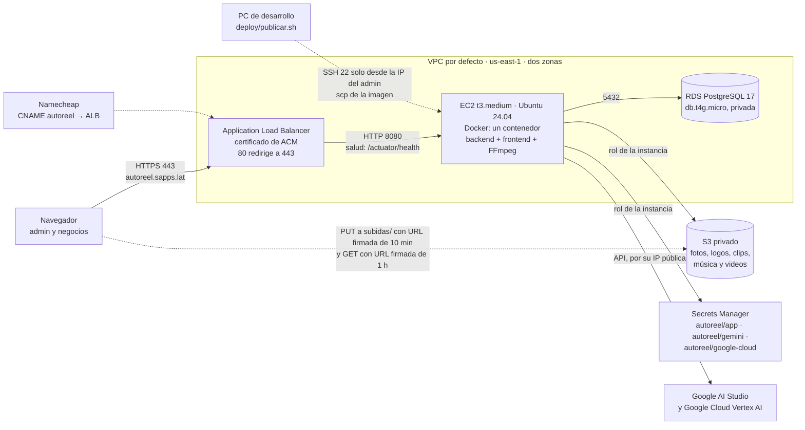

# Despliegue en AWS

Arquitectura, recursos, secretos, publicación, vuelta atrás, apagado y costos de AutoReel en AWS.

> **Estado del documento:** fase 8, rama `fase-8-despliegue` (2026-11-25). Describe el **despliegue mínimo** que decidió Fabio para la demostración en vivo del 2026-11-26 (ADR 0027): solo los servicios de AWS necesarios, encendidos un par de horas. El código (imagen Docker, perfil `aws`, `SecretosDeAws`, `SecretosDeArranque`, `ConfiguracionFrontend` y los scripts de `deploy/`) ya existe. Los recursos se crearon el 2026-11-25 con la AWS CLI: los comandos ejecutados y los ids están en la sección 7.
>
> *Cambio del 2026-11-25 (ADR 0027):* la guía anterior preveía CloudFront con el frontend en S3 (especificación, sección 11.4). Ahora el **backend sirve el frontend** y un **Application Load Balancer** termina el HTTPS. No hay CloudFront, ECR, NAT, Caddy ni CloudWatch Logs.

---

## 1. Arquitectura



**Un solo origen.** El navegador solo habla con `https://autoreel.sapps.lat`. El balanceador termina el HTTPS y envía todo (`/api/*` y el frontend) al contenedor por HTTP en el puerto 8080. El backend sirve el frontend compilado (`ConfiguracionFrontend`, sección 3.2). Así la cookie de sesión `autoreel_sesion` (`HttpOnly`, `Secure`, `SameSite=Lax`, sin `Domain`) y el CSRF (`XSRF-TOKEN` y `X-XSRF-TOKEN`) funcionan igual que con el proxy de Vite en desarrollo, sin CORS en la API (ADR 0007).

**El bucket es la excepción.** El navegador sube y lee las imágenes directamente en S3, en otro origen, con URLs firmadas que genera el backend (ADR 0010). Por eso el bucket sí necesita CORS (sección 4.2).

**Salida a internet sin NAT.** La instancia está en una subred pública de la VPC por defecto, con IP pública: llega a Google, S3 y Secrets Manager directamente. El grupo de seguridad solo deja entrar el 8080 desde el balanceador y el 22 desde la IP del administrador (sección 6).

### 1.1 Recursos

| Recurso | Configuración | Para qué |
|---|---|---|
| **Región** | `us-east-1` | Todo vive aquí, también el certificado de ACM (debe estar en la región del balanceador). |
| **EC2** | Una `t3.medium` (2 vCPU, 4 GB), Ubuntu 24.04 x86_64, Docker, 2 GB de swap, en la VPC por defecto con IP pública | El contenedor `autoreel-backend`: API, frontend compilado, tareas programadas y FFmpeg. |
| **Application Load Balancer** | Público (*internet-facing*), VPC por defecto, dos zonas de disponibilidad | HTTPS con el certificado de ACM. Escucha 80 (redirige a 443) y 443 (reenvía al grupo de destino). |
| **Grupo de destino** | HTTP, puerto 8080, tipo instancia; comprobación de salud `GET /actuator/health` | La única instancia. |
| **ACM** | Certificado público de `autoreel.sapps.lat`, validado por DNS | El HTTPS del balanceador. Es gratis. |
| **RDS** | PostgreSQL 17, `db.t4g.micro`, sin acceso público, base `autoreel` | La base de datos. Flyway crea y actualiza las tablas al arrancar el backend. |
| **S3** | Un bucket privado (sección 4) | Logos, fotos, comprobantes, clips, música y videos finales. |
| **Secrets Manager** | `autoreel/app`, `autoreel/gemini` y `autoreel/google-cloud` (sección 2) | Credenciales: nunca en el código, en la base de datos ni en el disco del servidor. |
| **IAM** | Un rol con perfil de instancia para la EC2 (sección 5) | Acceso a S3 y a Secrets Manager sin claves `AWS_*`. |
| **DNS** | En Namecheap (no en Route 53): el CNAME de validación de ACM y `autoreel` → nombre DNS del balanceador | El dominio `autoreel.sapps.lat` (sección 6.3). |

**Lo que no se usa** (ADR 0027): CloudFront y un bucket para el frontend, ECR (la imagen viaja por `scp`), NAT, Caddy u otro proxy en la instancia, Elastic Beanstalk, CloudWatch Logs (los registros quedan en Docker, sección 11), Route 53 y Rekognition (fase 9, opcional).

---

## 2. Variables y secretos

En AWS no hay `.env`. El contenedor recibe **variables no secretas** de `/opt/autoreel/autoreel.env` y lee **los secretos** de Secrets Manager con el rol de la instancia.

### 2.1 Variables no secretas: `autoreel.env`

Se crea una sola vez en el servidor a partir de `deploy/autoreel.env.example`. `deploy/autoreel.env` está en `.gitignore`: nunca se versiona con datos reales, y `publicar.sh` nunca copia un archivo de variables.

| Variable | Valor en AWS | Uso |
|---|---|---|
| `SPRING_PROFILES_ACTIVE` | `aws` | Activa `application-aws.yml` y `SecretosDeAws` (sección 3.1). |
| `DB_URL` | `jdbc:postgresql://<endpoint-de-rds>:5432/autoreel` | URL JDBC del RDS. |
| `APP_URL` | `https://autoreel.sapps.lat` | Enlace `APP_URL/login` que se entrega a cada negocio. Es también el único origen del CORS del bucket. |
| `AWS_REGION` | `us-east-1` | Región del bucket y de Secrets Manager. |
| `AWS_S3_BUCKET` | `<nombre-del-bucket>` | Bucket de archivos. Sin ella el backend no arranca. |
| `SECRETOS_DE_ARRANQUE` | `autoreel/app` | Secretos JSON que se cargan antes de arrancar (sección 2.2). |

**No se definen en AWS:**

- `S3_ENDPOINT`, `S3_ENDPOINT_PUBLICO`, `AWS_ACCESS_KEY_ID` y `AWS_SECRET_ACCESS_KEY`: sin ellas, `S3Almacen` usa S3 con `DefaultCredentialsProvider`, que toma el rol de la instancia.
- `GEMINI_API_KEY`, `GOOGLE_CLOUD_CREDENCIAL_ARCHIVO` y `SECRETOS_PANEL_ARCHIVO`: en el perfil `aws` no se carga `SecretosDeConfiguracion`, así que no se leen.
- `FFMPEG_PATH`: FFmpeg está en el `PATH` de la imagen.
- `GEMINI_URL`: solo cambia en las pruebas.
- `POSTGRES_*`, `S3_PORT` y `DEMO_*`: solo existen en desarrollo.
- `META_*` y `TOKEN_CIFRADO_CLAVE`: Instagram está fuera del MVP (ADR 0026).

### 2.2 Secreto de arranque: `autoreel/app`

Un secreto de texto con un JSON de pares clave-valor. Sus claves son nombres de variables:

```json
{
  "DB_USER": "<usuario-maestro-de-rds>",
  "DB_PASSWORD": "<contraseña-de-rds>",
  "JWT_SECRET": "<openssl rand -base64 32>",
  "ADMIN_EMAIL": "<correo-del-administrador>",
  "ADMIN_PASSWORD": "<contraseña-inicial-del-administrador>"
}
```

**Cómo llega al proceso.** `SecretosDeArranque` (`compartido.config`) es un `EnvironmentPostProcessor` registrado en `META-INF/spring.factories`. Antes de crear el contexto de Spring:

1. Lee la lista `SECRETOS_DE_ARRANQUE` (separada por comas). Si está vacía (desarrollo y pruebas), no hace nada.
2. Pide cada secreto a Secrets Manager con `GetSecretValue`, en `AWS_REGION` (por defecto `us-east-1`), con las credenciales del rol.
3. Agrega sus claves como propiedades, **después** de las variables de entorno: una variable de entorno con el mismo nombre todavía gana (útil para una prueba).
4. Así se resuelven `${DB_USER}`, `${JWT_SECRET}` y las demás de `application.yml`.

**Si algo falla, el backend no arranca**, con un mensaje claro: secreto inexistente o sin permiso ("Revisa el nombre, la región y el permiso `secretsmanager:GetSecretValue` del rol de la instancia"), secreto vacío o que no es un JSON de pares clave-valor. **Nunca registra un valor:** solo el nombre del secreto y la lista de claves cargadas.

Notas:

- `JWT_SECRET` debe ser propio de producción y tener al menos 32 bytes en base64. **Si cambia, se cierran todas las sesiones.**
- `ADMIN_EMAIL` y `ADMIN_PASSWORD` solo se usan si todavía no existe ningún administrador (`InicializadorAdministrador`). Fuera del perfil `dev`, si no hay administrador y faltan, el backend no arranca.
- `DB_USER` y `DB_PASSWORD` son el usuario maestro del RDS.

### 2.3 Secretos de IA: `SecretosDeAws`

Los modelos de IA solo guardan el **nombre** del secreto (RN-55). En AWS los lee y escribe **`SecretosDeAws`** (`ia.infraestructura`, `@Profile("aws")`), que implementa `ProveedorDeSecretos` y `AlmacenDeSecretos` en lugar de `SecretosDeConfiguracion` (`@Profile("!aws")`).

| Secreto | Contenido | Modelos |
|---|---|---|
| `autoreel/gemini` | La clave de Google AI Studio, como texto | Guion con Gemini (`GEMINI`) y clips con Gemini Omni Flash (`GEMINI_OMNI`) |
| `autoreel/google-cloud` | **El contenido** del JSON de la cuenta de servicio de Google Cloud (no una ruta) | Gemini en Vertex AI (`GEMINI_CLOUD`) y Veo (`VEO`) |

Se pueden crear con la AWS CLI (sección 7) o **pegar desde el panel** (Ajustes → Integraciones y claves, ADR 0018):

| Operación | En Secrets Manager | Detalle |
|---|---|---|
| `obtener` | `GetSecretValue` | Guarda el valor en memoria **un minuto**. Un secreto inexistente o marcado para borrarse cuenta como vacío. Si AWS falla (permisos, red), sigue usando el valor anterior y registra un aviso con el código del error. |
| `guardar` | `PutSecretValue`; si no existe, `CreateSecret` | Descripción: "Credencial de AutoReel pegada en Ajustes → Integraciones". |
| `borrar` | `DeleteSecret` con `ForceDeleteWithoutRecovery` | En AWS no hay `.env` al que volver: borrar elimina el secreto. |
| `origen` | — | `PANEL` si hay valor; si no, `NINGUNO`. En AWS no existe `CONFIGURACION`. |

**Errores para el panel** (forma `{codigo, mensaje}`):

| Código | HTTP | Cuándo |
|---|---|---|
| `CREDENCIAL_BORRANDOSE` | 409 | Se pega una clave justo después de borrarla: AWS tarda unos segundos en liberar el nombre. Se reintenta en unos segundos. |
| `SECRETOS_NO_DISPONIBLES` | 502 | No se pudo guardar o borrar por permisos, red o región. "Revisa los permisos del servidor." |

Nunca se registra un valor: solo el nombre del secreto.

---

## 3. Perfil `aws` e imagen Docker

### 3.1 Perfiles de Spring

| Perfil | Archivo | Cookie de sesión | springdoc | Secretos | Uso |
|---|---|---|---|---|---|
| Por defecto | `application.yml` | **`Secure`** | Desactivado | `SecretosDeConfiguracion` | Base de todos los entornos |
| **`aws`** | `application.yml` + **`application-aws.yml`** | `Secure` | Desactivado | **`SecretosDeAws`** y `SecretosDeArranque` | El servidor de AWS |
| `dev` | `application-dev.yml` | Sin `Secure` | Activo | `SecretosDeConfiguracion` (importa `../.env`) | La PC |
| `test` | `application-test.yml` | Sin `Secure` | — | `SecretosDeConfiguracion` | Las pruebas |

`application-aws.yml` solo agrega:

- **Pool de conexiones** (`spring.datasource.hikari`): `maximum-pool-size: 8` y `minimum-idle: 2`. Una instancia y un RDS pequeño: 3 tareas programadas más las peticiones web.
- **`server.forward-headers-strategy: native`.** El balanceador termina el HTTPS y envía `X-Forwarded-Proto` y `X-Forwarded-For`: Spring ve la petición como `https` (la cookie `XSRF-TOKEN` sale `Secure`). Tomcat solo confía en esos encabezados si vienen de una IP privada, la del balanceador dentro de la VPC (`172.31.0.0/16` en la VPC por defecto).

Lo demás ya es la configuración base de `application.yml`: cookie `Secure` (exige HTTPS), springdoc desactivado, `/actuator/health` sin detalles, errores sin trazas, `ddl-auto: validate`, fechas en UTC, el "día" de las reglas en `America/Lima` y `crear-bucket: false`.

### 3.2 El backend sirve el frontend

| Pieza | Cambio |
|---|---|
| `compartido.web.ConfiguracionFrontend` | Sirve la carpeta de `SPRING_WEB_RESOURCES_STATIC_LOCATIONS` (en la imagen, `file:/app/static/`). `/assets/**` (archivos con hash) va en caché un año (`public, immutable`). El resto, sin caché (`no-cache`), para tomar cada despliegue. Si el archivo no existe y la ruta es de React Router (`/videos/5`, `/admin/costos`...), entrega `index.html`. **Nunca** entrega `index.html` para `/api/**`, `/actuator/**` ni una ruta con extensión: siguen respondiendo 404 con el error JSON. En desarrollo no hay `index.html` en las ubicaciones y no cambia nada. |
| `ConfiguracionSeguridad` | Después de las reglas de `/api/**`, `GET /**` es público (el frontend compilado). Los demás métodos fuera de `/api` siguen denegados. |
| `FiltroJwtCookie` | `shouldNotFilter`: solo procesa `/api/**`. El frontend no consulta la base de datos por cada archivo. |
| `frontend/vite.config.ts` | Solo el comentario: producción ya no usa CloudFront. |

### 3.3 Imagen Docker

`backend/Dockerfile`, con la raíz del repositorio como contexto. `/.dockerignore` deja entrar solo `backend/` y `frontend/`, y nunca `.env`, `credenciales/`, `*.pem`, `*.key`, `docs/` ni `deploy/`.

| Etapa | Imagen base | Qué hace |
|---|---|---|
| 1. `frontend` | `node:24-trixie-slim` | `npm ci` (en una capa aparte) y `npm run build`. |
| 2. `backend` | `eclipse-temurin:21-jdk-noble` | `mvnw dependency:go-offline` y `mvnw -DskipTests package`, con el repositorio de Maven en una caché de BuildKit. Las pruebas se corren antes en la PC (`mvnw verify`). |
| 3. `ejecucion` | `debian:trixie-slim` | `openjdk-21-jre-headless`, **FFmpeg 7.1**, `fontconfig`, `fonts-dejavu-core`, `ca-certificates` y `curl`. Usuario de sistema `autoreel` (sin root). El jar en `/app/autoreel.jar` y el frontend en `/app/static`. |

- **Variables de la imagen:** `LANG=C.UTF-8`, `TZ=UTC` y `SPRING_WEB_RESOURCES_STATIC_LOCATIONS=file:/app/static/`. Los archivos `yml` no cambian.
- **FFmpeg 7.1** (Debian trixie) trae lo que usa `FfmpegComponedor`: `drawtext` con `textfile`, `expansion=none` y `y_align`, `xfade`, `zoompan`, `libx264` y AAC. En la PC se usa FFmpeg 9 (ADR 0016).
- **AWT sin pantalla** (`-Djava.awt.headless=true`): mide los textos con las fuentes del paquete de nicho.
- **Memoria:** `-XX:MaxRAMPercentage=60` (unos 2,4 GB de los 4 GB de la `t3.medium`); el resto queda para FFmpeg y el sistema. `-XX:+ExitOnOutOfMemoryError`: si se queda sin memoria, el proceso termina y Docker lo reinicia.
- **`HEALTHCHECK`:** `curl -fsS http://localhost:8080/actuator/health` cada 30 s, con 180 s de gracia al arrancar.
- Se construye para `linux/amd64`:

  ```bash
  docker build --platform linux/amd64 -f backend/Dockerfile -t autoreel-backend:latest .
  ```

### 3.4 En el servidor: `deploy/`

| Archivo | Qué hace |
|---|---|
| `deploy/preparar-servidor.sh` | Se pega como *User data* al lanzar la EC2 (o se corre una vez con `sudo`). Instala `docker.io`, `docker-compose-v2` y `curl`, agrega `ubuntu` al grupo `docker`, crea `/opt/autoreel` y 2 GB de swap. Se puede repetir. |
| `deploy/docker-compose.yml` | Un servicio, `backend`: imagen `autoreel-backend:latest`, `env_file: autoreel.env`, `restart: unless-stopped`, puerto `8080:8080`, `stop_grace_period: 30s` (deja terminar una composición de FFmpeg) y registros `json-file` de 20 MB × 5. |
| `deploy/autoreel.env.example` | Plantilla de `/opt/autoreel/autoreel.env` (sección 2.1). |
| `deploy/publicar.sh` | Construye, copia y levanta la imagen (sección 8). |

### 3.5 Tareas programadas con una sola instancia

Con `autoreel.tareas.activas: true` (por defecto) corren en el mismo contenedor, en un pool de 3 hilos:

| Tarea | Clase | Cuándo | Con una instancia |
|---|---|---|---|
| Guiones | `ProcesadorDeGuiones` | Cada 3 s | Cada video se **reclama** en la base de datos (3 minutos, ADR 0014). |
| Clips | `ProcesadorDeVideos.generarClips` | Cada 10 s | Reclamo de 5 minutos por video. |
| Composición | `ProcesadorDeVideos.componerVideos` | Cada 10 s | Reclamo por video, que se renueva antes de llamar a FFmpeg. |
| Pagos y notificaciones | `TareaDiariaDePagos` | A las 00:10 de Lima y **al arrancar** | Corre en cada despliegue; es idempotente (`on conflict do nothing` sobre `notificacion_uk`). |

**Con una instancia no hay nada que coordinar.** Si un despliegue corta un video a medio generar, el reclamo vence y el contenedor nuevo lo retoma (ADR 0014).

**Si algún día hay varias instancias** (fuera de esta demo):

- La tarea diaria correría en todas. No duplica avisos, pero repite el trabajo. Se puede apagar en todas menos una con `AUTOREEL_TAREAS_ACTIVAS=false` (apaga **todas** las tareas de esa instancia).
- Un clip síncrono de Gemini Omni Flash puede tardar más que el reclamo de 5 minutos, y otra instancia podría reenviar un plano. Revisarlo antes de escalar.

---

## 4. Bucket de archivos (S3)

Lo que exige el código de la fase 2 (`S3Almacen`, `ServicioDeArchivos`; ADR 0010).

### 4.1 Bucket privado

- **Nombre y región:** los de `AWS_S3_BUCKET` y `AWS_REGION` (`us-east-1`). El backend **no** crea el bucket (`crear-bucket: false`).
- **Block Public Access:** las cuatro opciones activadas, sin política pública. Nadie lee ni escribe sin una URL firmada por el backend.
- **Propiedad de objetos:** *Bucket owner enforced* (ACL desactivadas).
- **Cifrado:** el predeterminado de S3 (SSE-S3). Con una clave KMS propia, el rol necesitaría además `kms:Decrypt` y `kms:GenerateDataKey`.
- **Versionado:** desactivado. Si se activa, la regla de la sección 4.4 debe expirar también las versiones no actuales.
- **Prefijos que usa el código:**

| Prefijo | Qué guarda | Quién escribe |
|---|---|---|
| `subidas/negocios/{id}/{logo,foto_producto,foto_local,comprobantes}/{uuid}.{png,jpg,webp}` | Archivos recién subidos, todavía sin verificar | El navegador, con una URL `PUT` firmada que vence en 10 minutos |
| `negocios/{id}/{logo,foto_producto,foto_local}/{uuid}.{png,jpg,webp}` | Archivos verificados, los únicos que se guardan en la base de datos | Solo el backend (`CopyObject` desde `subidas/`); nunca se firma una URL de escritura para estas claves |
| `negocios/{id}/comprobantes/{uuid}.{png,jpg,webp}` | Comprobantes de pago (ADR 0026) | Solo el backend, con la misma copia desde `subidas/` |
| `negocios/{id}/videos/{videoId}/clip-{orden}-{uuid}.mp4` | Clips de IA de cada plano | Solo el backend (`ServicioGeneracion`, `PutObject`) |
| `negocios/{id}/videos/{videoId}/final-{uuid}.mp4` | Video final compuesto con FFmpeg | Solo el backend (`ServicioComposicion`, `PutObject`) |
| `musica/{nicho}/{archivo}` | Pistas del paquete de nicho, por ejemplo `musica/pasteleria/casero.m4a` | Solo el backend, al arrancar (`BibliotecaMusical`, si la pista no está en `pista_musical`) |

Las fotos de producto se aceptan desde **720 px** en el lado menor (RN-11), y el navegador las reduce a 2560 px en el lado mayor antes de subirlas.

### 4.2 CORS

El navegador hace `PUT` (subida) y `GET` (lectura) directamente contra el bucket, desde el origen de la aplicación. El `PUT` lleva `Content-Type: image/…`, que no es un tipo "simple", así que el navegador envía antes una petición `OPTIONS` (*preflight*) que el bucket debe aceptar.

```json
[
  {
    "AllowedOrigins": ["https://autoreel.sapps.lat"],
    "AllowedMethods": ["PUT", "GET"],
    "AllowedHeaders": ["content-type"],
    "MaxAgeSeconds": 3000
  }
]
```

- **`AllowedOrigins`:** solo el origen exacto de `APP_URL` (esquema y dominio, sin barra final ni ruta). Nunca `*`.
- **`AllowedMethods`:** `PUT` lo usa `subirArchivo` (`frontend/src/api/archivos.ts`, con `XMLHttpRequest` y `withCredentials = false`). `GET` cubre la lectura con URL firmada: las etiquetas `` no lo exigen, pero sí leer una imagen en un `canvas` (`crossOrigin="anonymous"`).
- **`AllowedHeaders`:** solo `content-type`, la única cabecera que el backend pide enviar (`cabeceras: {"Content-Type": tipo}` en la respuesta de `POST /api/archivos/url-subida`).
- No hace falta `ExposeHeaders`: el frontend solo mira el código de estado de la subida.

### 4.3 Operaciones y permisos

Las URLs firmadas actúan con los permisos de quien las firma (el rol de la instancia), así que el rol necesita también los permisos que usa el navegador. La política está en la sección 5.

| Operación del código | Llamada a S3 | Permiso IAM |
|---|---|---|
| `urlDeSubida` (el navegador sube a `subidas/`) | `PutObject` firmado | `s3:PutObject` |
| `urlDeDescarga` (el navegador lee, 1 h) | `GetObject` firmado | `s3:GetObject` |
| `leer` (verificación) | `HeadObject` + `GetObject` con `If-Match` | `s3:GetObject` |
| `copiarSiNoCambio` (a la clave definitiva) | `CopyObject` con `x-amz-copy-source-if-match` | `s3:GetObject` sobre el origen y `s3:PutObject` sobre el destino |
| `eliminar` (la temporal después del commit, y los clips y videos reemplazados o descartados) | `DeleteObject` | `s3:DeleteObject` |
| `guardar` (clips, videos finales y pistas de música) | `PutObject` | `s3:PutObject` |

- **`s3:ListBucket`:** sin él, S3 responde **403** en lugar de 404 cuando una clave no existe. `S3Almacen` trata ese 403 como "no existe" y registra el aviso "S3 respondió 403 al leer una clave; se trata como inexistente". Con `s3:ListBucket`, ese aviso solo aparece si de verdad falta un permiso.
- **No hacen falta** `s3:CreateBucket` ni `HeadBucket`: solo se usan con `crear-bucket: true` (perfil `dev`).
- **Riesgo conocido:** con credenciales temporales del rol, una URL firmada deja de servir cuando vencen esas credenciales, aunque no haya pasado su hora. AWS las renueva con margen. Si una imagen no carga, `ImagenRemota` pide una URL nueva en los catálogos; en las demás pantallas hay que recargar la página.

### 4.4 Regla de ciclo de vida: expirar `subidas/` a 1 día

Las subidas que nunca se confirman (el usuario abandona el formulario o falla la verificación) quedan en `subidas/`. La URL de subida vence en 10 minutos y la confirmación ocurre en el mismo formulario, así que un día de margen basta:

```json
{
  "Rules": [
    {
      "ID": "expirar-subidas",
      "Status": "Enabled",
      "Filter": { "Prefix": "subidas/" },
      "Expiration": { "Days": 1 },
      "AbortIncompleteMultipartUpload": { "DaysAfterInitiation": 1 }
    }
  ]
}
```

- La regla **nunca** debe cubrir `negocios/` ni `musica/`: ahí están los archivos en uso.
- S3 aplica la expiración de forma asíncrona (puede tardar hasta un día más); no afecta a la aplicación.
- **Pendiente (después del MVP):** los archivos definitivos reemplazados (un logo o una foto que se cambió) no se borran.

---

## 5. Permisos IAM: rol de la instancia

Un rol con **perfil de instancia** asociado a la EC2: `autoreel-backend` (los dos con el mismo nombre; sección 7, paso 7). El backend no tiene claves `AWS_*`: el AWS SDK las toma del servicio de metadatos de la instancia (IMDS).

**Política de confianza:** `ec2.amazonaws.com` puede asumir el rol.

**Política de permisos** (en línea), con el bucket `autoreel-archivos-778477255347` y la cuenta `778477255347`:

```json
{
  "Version": "2012-10-17",
  "Statement": [
    {
      "Sid": "ObjetosDeAutoReel",
      "Effect": "Allow",
      "Action": ["s3:PutObject", "s3:GetObject", "s3:DeleteObject"],
      "Resource": "arn:aws:s3:::<nombre-del-bucket>/*"
    },
    {
      "Sid": "ListarParaDistinguirAusentes",
      "Effect": "Allow",
      "Action": "s3:ListBucket",
      "Resource": "arn:aws:s3:::<nombre-del-bucket>"
    },
    {
      "Sid": "SecretoDeArranque",
      "Effect": "Allow",
      "Action": ["secretsmanager:GetSecretValue", "secretsmanager:DescribeSecret"],
      "Resource": "arn:aws:secretsmanager:us-east-1:<cuenta>:secret:autoreel/app-*"
    },
    {
      "Sid": "SecretosDeIA",
      "Effect": "Allow",
      "Action": [
        "secretsmanager:GetSecretValue",
        "secretsmanager:DescribeSecret",
        "secretsmanager:PutSecretValue",
        "secretsmanager:CreateSecret",
        "secretsmanager:DeleteSecret"
      ],
      "Resource": [
        "arn:aws:secretsmanager:us-east-1:<cuenta>:secret:autoreel/gemini*",
        "arn:aws:secretsmanager:us-east-1:<cuenta>:secret:autoreel/google-cloud*"
      ]
    }
  ]
}
```

| Permiso | Quién lo usa |
|---|---|
| `s3:PutObject`, `s3:GetObject`, `s3:DeleteObject` y `s3:ListBucket` | `S3Almacen` (sección 4.3) |
| `GetSecretValue` y `DescribeSecret` sobre `autoreel/app` | `SecretosDeArranque`, al arrancar |
| `GetSecretValue`, `DescribeSecret`, `PutSecretValue`, `CreateSecret` y `DeleteSecret` sobre `autoreel/gemini*` y `autoreel/google-cloud*` | `SecretosDeAws`: leer, pegar y borrar las claves desde el panel |

- Secrets Manager agrega un sufijo aleatorio de 6 caracteres al ARN de cada secreto: por eso `autoreel/app-*`, `autoreel/gemini*` y `autoreel/google-cloud*`.
- **El panel no puede escribir `autoreel/app`:** el rol solo puede leerlo. Un modelo de IA con otro nombre de secreto (fuera de `autoreel/gemini*` y `autoreel/google-cloud*`) no se puede pegar desde el panel en AWS (`SECRETOS_NO_DISPONIBLES`) hasta ampliar la política.
- No hace falta `kms:*`: los secretos usan la clave administrada por AWS (`aws/secretsmanager`).
- No se usa la política administrada `AmazonSSMManagedInstanceCore`: se entra por SSH (sección 6).

**IMDS desde el contenedor.** El contenedor corre en la red *bridge* de Docker, un salto más que la instancia. Con IMDSv2 hace falta `HttpPutResponseHopLimit` de **2**; con 1, el SDK no obtiene credenciales y el backend no arranca ("No se pudo leer el secreto de arranque autoreel/app"). Se configura al lanzar la instancia (sección 7) o después con `aws ec2 modify-instance-metadata-options`.

---

## 6. Red, grupos de seguridad y DNS en Namecheap

### 6.1 Red

- **VPC por defecto** de `us-east-1` (`172.31.0.0/16`), con sus subredes públicas. No se crea una VPC propia ni NAT.
- **Balanceador:** en dos subredes de dos zonas de disponibilidad distintas (lo exige el ALB).
- **EC2:** en una de esas subredes, con IP pública asignada automáticamente. **La IP pública cambia si la instancia se detiene y se vuelve a iniciar**: el balanceador no se entera (registra la instancia por su id), pero `publicar.sh` y el SSH usan la IP nueva.
- **RDS:** grupo de subredes de la VPC por defecto, **sin acceso público** (`PubliclyAccessible=false`). Solo se alcanza desde la EC2.

### 6.2 Grupos de seguridad

Los que se crearon (sección 7, paso 3):

| Grupo | Entrada | Salida |
|---|---|---|
| `autoreel-alb` | TCP 80 y 443 desde `0.0.0.0/0` | Todo (por defecto) |
| `autoreel-ec2` | TCP 8080 **solo desde `autoreel-alb`**; TCP 22 **solo desde `<ip-del-admin>/32`** | Todo: Google, S3, Secrets Manager, RDS y los paquetes de Ubuntu |
| `autoreel-rds` | TCP 5432 **solo desde `autoreel-ec2`** | Todo (por defecto) |

- El puerto 8080 no se abre a internet: aunque la instancia tiene IP pública, el contenedor solo es alcanzable desde el balanceador.
- Si la IP del administrador cambia (otra red, otro día), hay que actualizar la regla del 22 antes de publicar.

### 6.3 Certificado y DNS en Namecheap

El dominio `sapps.lat` se administra en **Namecheap** (Advanced DNS), no en Route 53.

1. **Pedir el certificado en ACM** (`us-east-1`) para `autoreel.sapps.lat`, con validación por **DNS**.
2. **Agregar el CNAME de validación** que da ACM. En Namecheap, el campo *Host* lleva solo la parte anterior a `.sapps.lat`:

   | Tipo | Host | Valor | TTL |
   |---|---|---|---|
   | CNAME | `_<token-de-acm>.autoreel` | `_<token>.acm-validations.aws.` | Automático |

3. **Esperar** a que el certificado pase a `ISSUED` (unos minutos después de que el CNAME se propague).
4. **Apuntar el dominio al balanceador**, cuando exista:

   | Tipo | Host | Valor | TTL |
   |---|---|---|---|
   | CNAME | `autoreel` | `<nombre-dns-del-alb>` (hoy, `autoreel-51029713.us-east-1.elb.amazonaws.com`) | Automático |

El CNAME de validación debe quedarse: ACM lo usa para renovar el certificado. Lo agrega Fabio en Namecheap; los demás recursos se crean con la AWS CLI (sección 7).

---

## 7. Creación de los recursos

Los recursos se crearon el **2026-11-25** con la **AWS CLI v2**, desde **Git Bash** en la PC de Fabio (Windows), con una cuenta con permisos de administrador, en `us-east-1` (cuenta `778477255347`). Los comandos de esta sección son los que se ejecutaron, en el mismo orden. **Ningún comando lleva un secreto en la línea de comandos ni lo muestra en pantalla.**

### 7.1 Recursos creados

| Recurso | Nombre o id |
|---|---|
| VPC por defecto | `vpc-04b55be8e3a44f0ea` |
| Subredes del balanceador | `subnet-0a9fef7831dabfbc5` (`us-east-1a`, también la de la EC2) y `subnet-0834191467528cf64` (`us-east-1b`) |
| Certificado de ACM | `autoreel.sapps.lat`, validado por DNS |
| Grupos de seguridad | `autoreel-alb`, `autoreel-ec2` y `autoreel-rds` |
| Bucket S3 | `autoreel-archivos-778477255347` (patrón `autoreel-archivos-<cuenta>`) |
| Secretos | `autoreel/app`, `autoreel/gemini` y `autoreel/google-cloud` |
| RDS | `autoreel`; *endpoint* `autoreel.cgzi4yuo6iib.us-east-1.rds.amazonaws.com`; grupo de subredes `autoreel` |
| Rol IAM y perfil de instancia | `autoreel-backend` |
| Par de claves SSH | `autoreel` (ed25519), en `credenciales/autoreel-ec2.pem` (ignorado por git) |
| EC2 | `i-0ff052e20f0b05269`, IP pública `44.200.118.34` |
| Grupo de destino | `autoreel` |
| Balanceador | `autoreel`, DNS `autoreel-51029713.us-east-1.elb.amazonaws.com` |

**La IP pública de la EC2 cambia si la instancia se detiene y se vuelve a iniciar** (no hay Elastic IP). Al balanceador no le importa (registra la instancia por su id), pero el SSH y `publicar.sh` deben usar la IP nueva:

```bash
aws ec2 describe-instances --instance-ids i-0ff052e20f0b05269 \
  --query 'Reservations[0].Instances[0].PublicIpAddress' --output text
```

### 7.2 Antes de empezar: Git Bash en Windows

```bash
export MSYS_NO_PATHCONV=1
export AWS_DEFAULT_REGION=us-east-1
cd "/c/PROYECTOS/Diseño de Software/autoreel"
```

| Problema | Qué pasa | Solución |
|---|---|---|
| Conversión de rutas de Git Bash | Git Bash convierte los argumentos que empiezan con `/` en rutas de Windows: el parámetro `/aws/service/canonical/...` de SSM o el dispositivo `/dev/sda1` llegan cambiados a la CLI. | `export MSYS_NO_PATHCONV=1` en cada terminal. |
| `file://` | La AWS CLI es un programa de Windows: no entiende `/c/...`. | Pasar `file://C:/...` (ruta de Windows con barras `/`). |
| Clave SSH con CRLF | `aws ec2 create-key-pair ... --output text > clave.pem` escribe fin de línea de Windows, y `ssh` responde "error in libcrypto". | `sed -i 's/\r$//' clave.pem` (paso 8). |
| Dominio suspendido | Namecheap suspendió `sapps.lat` hasta verificar el correo del titular: sus *nameservers* eran `verify-contact-details` o `failed-whois-verification`. Mientras tanto, **los registros de Advanced DNS no hacen nada**. | Verificar el correo del titular en Namecheap y comprobar con `nslookup -type=NS sapps.lat` que vuelven los *nameservers* de Namecheap. |

Los archivos JSON de los pasos 4 y 7 se escriben en una carpeta temporal fuera del repositorio (aquí, `$TMP`, con su ruta de Windows en `TMPW`):

```bash
TMPW=$(cygpath -m "$TMP")   # por ejemplo, C:/Users/<usuario>/AppData/Local/Temp
```

### 7.3 Pasos

1. **Red.** La VPC por defecto; las subredes de `us-east-1a` y `us-east-1b` para el balanceador, y las seis subredes por defecto para el grupo de subredes de RDS.

   ```bash
   VPC=$(aws ec2 describe-vpcs --filters Name=isDefault,Values=true --query 'Vpcs[0].VpcId' --output text)
   aws ec2 describe-subnets --filters Name=vpc-id,Values=$VPC \
     --query 'Subnets[].[AvailabilityZone,SubnetId]' --output table
   SUBNET_A=subnet-0a9fef7831dabfbc5   # us-east-1a: balanceador y EC2
   SUBNET_B=subnet-0834191467528cf64   # us-east-1b: balanceador
   ```

2. **Certificado de ACM.** Se pide primero porque la validación depende del DNS.

   ```bash
   CERT=$(aws acm request-certificate --domain-name autoreel.sapps.lat --validation-method DNS \
     --query CertificateArn --output text)
   aws acm describe-certificate --certificate-arn $CERT \
     --query 'Certificate.DomainValidationOptions[0].ResourceRecord'
   ```

   Fabio agrega en Namecheap (Advanced DNS) el CNAME que muestra `describe-certificate`. En *Host* va el nombre **sin** `.sapps.lat` (por ejemplo, `_xxxx.autoreel`; sección 6.3). Con el dominio suspendido, el CNAME no resolvía (tabla de la sección 7.2). Después de que resolvió, ACM tardó **unos minutos** en emitirlo:

   ```bash
   nslookup -type=CNAME _xxxx.autoreel.sapps.lat   # el nombre que dio ACM
   aws acm wait certificate-validated --certificate-arn $CERT
   ```

3. **Grupos de seguridad** (sección 6.2).

   ```bash
   SG_ALB=$(aws ec2 create-security-group --group-name autoreel-alb --description "AutoReel: balanceador" \
     --vpc-id $VPC --query GroupId --output text)
   aws ec2 authorize-security-group-ingress --group-id $SG_ALB --ip-permissions \
     'IpProtocol=tcp,FromPort=80,ToPort=80,IpRanges=[{CidrIp=0.0.0.0/0}]' \
     'IpProtocol=tcp,FromPort=443,ToPort=443,IpRanges=[{CidrIp=0.0.0.0/0}]'

   SG_EC2=$(aws ec2 create-security-group --group-name autoreel-ec2 --description "AutoReel: backend" \
     --vpc-id $VPC --query GroupId --output text)
   aws ec2 authorize-security-group-ingress --group-id $SG_EC2 --protocol tcp --port 8080 --source-group $SG_ALB
   MI_IP=$(curl -s https://checkip.amazonaws.com)
   aws ec2 authorize-security-group-ingress --group-id $SG_EC2 --ip-permissions \
     "IpProtocol=tcp,FromPort=22,ToPort=22,IpRanges=[{CidrIp=$MI_IP/32}]"

   SG_RDS=$(aws ec2 create-security-group --group-name autoreel-rds --description "AutoReel: base de datos" \
     --vpc-id $VPC --query GroupId --output text)
   aws ec2 authorize-security-group-ingress --group-id $SG_RDS --protocol tcp --port 5432 --source-group $SG_EC2
   ```

   **Si cambia la IP del administrador** (otra red, otro día), el SSH y `publicar.sh` no conectan. Agregar la IP nueva (y, si se quiere, quitar la anterior con `revoke-security-group-ingress` y los mismos parámetros):

   ```bash
   aws ec2 authorize-security-group-ingress --group-id $SG_EC2 --ip-permissions \
     'IpProtocol=tcp,FromPort=22,ToPort=22,IpRanges=[{CidrIp=<ip-nueva>/32}]'
   ```

4. **Bucket de archivos** (sección 4). En `us-east-1`, `create-bucket` no lleva `LocationConstraint`.

   ```bash
   BUCKET=autoreel-archivos-778477255347
   aws s3api create-bucket --bucket $BUCKET --object-ownership BucketOwnerEnforced
   aws s3api put-public-access-block --bucket $BUCKET --public-access-block-configuration \
     BlockPublicAcls=true,IgnorePublicAcls=true,BlockPublicPolicy=true,RestrictPublicBuckets=true
   aws s3api put-bucket-cors --bucket $BUCKET --cors-configuration "file://$TMPW/cors.json"
   aws s3api put-bucket-lifecycle-configuration --bucket $BUCKET \
     --lifecycle-configuration "file://$TMPW/ciclo-de-vida.json"
   aws s3api put-bucket-tagging --bucket $BUCKET --tagging 'TagSet=[{Key=proyecto,Value=autoreel}]'
   ```

   - `cors.json` es `{"CORSRules": [...]}` con la regla de la sección 4.2: `PUT` y `GET` desde `https://autoreel.sapps.lat`, cabecera `content-type`.
   - `ciclo-de-vida.json` es el de la sección 4.4: regla `expirar-subidas`, 1 día, y cargas multiparte incompletas abortadas a 1 día.

5. **Secretos** (sección 2). Se crearon con un script pequeño de Python que **genera o lee cada valor, lo escribe en un archivo temporal, ejecuta `create-secret` con `file://` y borra el archivo**. Los valores nunca pasan por la línea de comandos ni por la pantalla.

   ```python
   import base64, json, os, secrets, string, subprocess, tempfile

   def crear(nombre, valor):
       with tempfile.NamedTemporaryFile("w", encoding="utf-8", suffix=".txt", delete=False) as f:
           f.write(valor)
       try:
           subprocess.run(["aws", "secretsmanager", "create-secret", "--name", nombre,
                           "--secret-string", "file://" + f.name.replace("\\", "/")],
                          check=True, stdout=subprocess.DEVNULL)
       finally:
           os.remove(f.name)

   def aleatoria(n=32):
       return "".join(secrets.choice(string.ascii_letters + string.digits) for _ in range(n))

   crear("autoreel/app", json.dumps({
       "DB_USER": "autoreel",
       "DB_PASSWORD": aleatoria(),
       "JWT_SECRET": base64.b64encode(secrets.token_bytes(32)).decode(),
       "ADMIN_EMAIL": "<correo-del-administrador>",
       "ADMIN_PASSWORD": aleatoria(),
   }))
   crear("autoreel/gemini", "<clave de Google AI Studio, leída de la configuración local>")
   crear("autoreel/google-cloud", "<contenido del JSON de la cuenta de servicio, leído del archivo local>")
   ```

   - `DB_PASSWORD` y `ADMIN_PASSWORD`: 32 letras y dígitos al azar (sin símbolos, que RDS rechaza en parte: `/`, `@`, `"` y espacios).
   - `JWT_SECRET`: 32 bytes al azar en base64.
   - `autoreel/gemini` y `autoreel/google-cloud` también se pueden pegar después en **Ajustes → Integraciones y claves**.

6. **Base de datos.** El grupo de subredes con las seis subredes por defecto, y la instancia con la contraseña de `autoreel/app` (se lee a una variable, sin mostrarla).

   ```bash
   aws rds create-db-subnet-group --db-subnet-group-name autoreel --db-subnet-group-description "AutoReel" \
     --subnet-ids $(aws ec2 describe-subnets --filters Name=vpc-id,Values=$VPC --query 'Subnets[].SubnetId' --output text)

   DB_PASSWORD=$(aws secretsmanager get-secret-value --secret-id autoreel/app --query SecretString --output text \
     | python -c "import json,sys; print(json.load(sys.stdin)['DB_PASSWORD'])")
   aws rds create-db-instance --db-instance-identifier autoreel \
     --engine postgres --engine-version 17.12 --db-instance-class db.t4g.micro \
     --allocated-storage 20 --storage-type gp3 \
     --master-username autoreel --master-user-password "$DB_PASSWORD" --db-name autoreel \
     --db-subnet-group-name autoreel --vpc-security-group-ids $SG_RDS \
     --no-publicly-accessible --no-multi-az --backup-retention-period 1 --storage-encrypted
   unset DB_PASSWORD

   aws rds wait db-instance-available --db-instance-identifier autoreel
   aws rds describe-db-instances --db-instance-identifier autoreel \
     --query 'DBInstances[0].Endpoint.Address' --output text
   # autoreel.cgzi4yuo6iib.us-east-1.rds.amazonaws.com
   ```

   Tarda varios minutos; mientras tanto se siguen los pasos 7 a 9.

7. **Rol de la instancia** `autoreel-backend` (sección 5).

   ```bash
   cat > "$TMP/confianza.json" <<'EOF'
   {
     "Version": "2012-10-17",
     "Statement": [{ "Effect": "Allow", "Principal": { "Service": "ec2.amazonaws.com" }, "Action": "sts:AssumeRole" }]
   }
   EOF
   # $TMP/permisos.json: la política de la sección 5, con el bucket y la cuenta reales.

   aws iam create-role --role-name autoreel-backend --assume-role-policy-document "file://$TMPW/confianza.json"
   aws iam put-role-policy --role-name autoreel-backend --policy-name autoreel-backend \
     --policy-document "file://$TMPW/permisos.json"
   aws iam create-instance-profile --instance-profile-name autoreel-backend
   aws iam add-role-to-instance-profile --instance-profile-name autoreel-backend --role-name autoreel-backend
   ```

8. **Par de claves SSH** `autoreel`, en `credenciales/` (ignorada por git). Quitar los CRLF es obligatorio en Windows:

   ```bash
   aws ec2 create-key-pair --key-name autoreel --key-type ed25519 \
     --query KeyMaterial --output text > credenciales/autoreel-ec2.pem
   sed -i 's/\r$//' credenciales/autoreel-ec2.pem
   ```

9. **Instancia EC2.** La AMI de Ubuntu 24.04 más reciente se toma del parámetro público de Canonical en SSM (por eso `MSYS_NO_PATHCONV=1`).

   ```bash
   AMI=$(aws ssm get-parameter \
     --name /aws/service/canonical/ubuntu/server/24.04/stable/current/amd64/hvm/ebs-gp3/ami-id \
     --query Parameter.Value --output text)
   aws ec2 run-instances --image-id $AMI --instance-type t3.medium --key-name autoreel \
     --subnet-id $SUBNET_A --security-group-ids $SG_EC2 --associate-public-ip-address \
     --iam-instance-profile Name=autoreel-backend \
     --metadata-options HttpTokens=required,HttpPutResponseHopLimit=2,HttpEndpoint=enabled \
     --block-device-mappings '[{"DeviceName":"/dev/sda1","Ebs":{"VolumeSize":30,"VolumeType":"gp3","DeleteOnTermination":true}}]' \
     --user-data "file://C:/PROYECTOS/Diseño de Software/autoreel/deploy/preparar-servidor.sh" \
     --tag-specifications 'ResourceType=instance,Tags=[{Key=Name,Value=autoreel},{Key=proyecto,Value=autoreel}]' \
     --query 'Instances[0].InstanceId' --output text
   # i-0ff052e20f0b05269
   aws ec2 wait instance-running --instance-ids i-0ff052e20f0b05269
   ```

   - **`HttpPutResponseHopLimit=2`:** el contenedor está un salto más lejos que la instancia; con 1 no obtiene las credenciales del rol por IMDSv2 (sección 5).
   - Disco raíz de 30 GB gp3. `preparar-servidor.sh` corre como *User data* en el primer arranque (Docker, compose, `/opt/autoreel` y swap).

10. **Variables del servidor** `/opt/autoreel/autoreel.env` (sección 2.1), por SSH, con los valores de `deploy/autoreel.env.example` completados y permisos `600`:

    ```bash
    IP=44.200.118.34
    CLAVE=credenciales/autoreel-ec2.pem
    ssh -i $CLAVE ubuntu@$IP 'cloud-init status --wait'   # espera a que termine preparar-servidor.sh
    ssh -i $CLAVE ubuntu@$IP 'umask 077 && cat > /opt/autoreel/autoreel.env && chmod 600 /opt/autoreel/autoreel.env' <<'EOF'
    SPRING_PROFILES_ACTIVE=aws
    DB_URL=jdbc:postgresql://autoreel.cgzi4yuo6iib.us-east-1.rds.amazonaws.com:5432/autoreel
    APP_URL=https://autoreel.sapps.lat
    AWS_REGION=us-east-1
    AWS_S3_BUCKET=autoreel-archivos-778477255347
    SECRETOS_DE_ARRANQUE=autoreel/app
    EOF
    ```

11. **Migración de los datos locales** (opcional; se hizo para la demostración). **Antes del primer arranque del backend**, para que Flyway encuentre la base completa con su historial.

    ```bash
    # En la PC: volcado de la base local (contenedor postgres de docker-compose.yml; usuario y base del .env, por defecto autoreel)
    docker compose exec -T postgres pg_dump -U autoreel -d autoreel -Fc --no-owner --no-acl > "$TMP/autoreel.dump"
    scp -i $CLAVE "$TMP/autoreel.dump" ubuntu@$IP:/tmp/autoreel.dump

    # En la EC2: la contraseña se lee de autoreel/app con la imagen de la AWS CLI y el rol de la instancia
    ssh -i $CLAVE ubuntu@$IP
    export PGPASSWORD=$(docker run --rm amazon/aws-cli secretsmanager get-secret-value --region us-east-1 \
      --secret-id autoreel/app --query SecretString --output text \
      | python3 -c "import json,sys; print(json.load(sys.stdin)['DB_PASSWORD'])")
    docker run --rm -e PGPASSWORD -v /tmp/autoreel.dump:/tmp/autoreel.dump postgres:17 \
      pg_restore -h autoreel.cgzi4yuo6iib.us-east-1.rds.amazonaws.com -U autoreel -d autoreel \
      --no-owner --no-acl /tmp/autoreel.dump
    unset PGPASSWORD; rm /tmp/autoreel.dump; exit
    ```

    Los archivos, desde SeaweedFS local al bucket, sin `subidas/` (las claves de SeaweedFS son las del `.env` de desarrollo):

    ```bash
    AWS_ACCESS_KEY_ID=<clave-local-de-seaweedfs> AWS_SECRET_ACCESS_KEY=<secreto-local-de-seaweedfs> \
      aws s3 sync s3://autoreel-dev "$TMP/archivos" --endpoint-url http://localhost:8333 --exclude "subidas/*"
    aws s3 sync "$TMP/archivos" s3://autoreel-archivos-778477255347
    ```

    **Consecuencias:**

    - **El administrador es el de la base local** (mismo correo y contraseña). El `ADMIN_PASSWORD` de `autoreel/app` solo se usa si no existe ningún administrador (`InicializadorAdministrador`).
    - Se copió también el `consumo_diario` del día: los conteos diarios de la PC siguen valiendo ese día en AWS.
    - Los negocios, productos, videos y claves de archivos son los de la PC; las claves del bucket (`negocios/...`, `musica/...`) se conservan iguales.

12. **Publicar** la aplicación (sección 8.1):

    ```bash
    bash deploy/publicar.sh 44.200.118.34 credenciales/autoreel-ec2.pem
    ```

13. **Grupo de destino y balanceador.**

    ```bash
    TG=$(aws elbv2 create-target-group --name autoreel --protocol HTTP --port 8080 --vpc-id $VPC \
      --target-type instance --health-check-path /actuator/health --health-check-interval-seconds 15 \
      --healthy-threshold-count 2 --unhealthy-threshold-count 3 \
      --query 'TargetGroups[0].TargetGroupArn' --output text)
    aws elbv2 modify-target-group-attributes --target-group-arn $TG \
      --attributes Key=deregistration_delay.timeout_seconds,Value=30
    aws elbv2 register-targets --target-group-arn $TG --targets Id=i-0ff052e20f0b05269

    ALB=$(aws elbv2 create-load-balancer --name autoreel --type application --scheme internet-facing \
      --subnets $SUBNET_A $SUBNET_B --security-groups $SG_ALB \
      --query 'LoadBalancers[0].LoadBalancerArn' --output text)
    aws elbv2 modify-load-balancer-attributes --load-balancer-arn $ALB \
      --attributes Key=idle_timeout.timeout_seconds,Value=120
    aws elbv2 wait load-balancer-available --load-balancer-arns $ALB

    aws elbv2 create-listener --load-balancer-arn $ALB --protocol HTTP --port 80 \
      --default-actions 'Type=redirect,RedirectConfig={Protocol=HTTPS,Port=443,StatusCode=HTTP_301}'
    aws elbv2 create-listener --load-balancer-arn $ALB --protocol HTTPS --port 443 \
      --certificates CertificateArn=$CERT --ssl-policy ELBSecurityPolicy-TLS13-1-2-2021-06 \
      --default-actions Type=forward,TargetGroupArn=$TG

    aws elbv2 describe-load-balancers --load-balancer-arns $ALB --query 'LoadBalancers[0].DNSName' --output text
    # autoreel-51029713.us-east-1.elb.amazonaws.com
    ```

    En Namecheap: CNAME `autoreel` → `autoreel-51029713.us-east-1.elb.amazonaws.com` (sección 6.3).

14. **Comprobación** (sección 8.2). El 2026-11-25 se comprobó:

    ```bash
    aws elbv2 describe-target-health --target-group-arn $TG \
      --query 'TargetHealthDescriptions[].TargetHealth.State'      # ["healthy"]
    curl -s https://autoreel.sapps.lat/actuator/health              # {"status":"UP"}
    curl -sI http://autoreel.sapps.lat | head -n 3                  # 301, Location: https://...
    ```

    - `https://autoreel.sapps.lat/actuator/health` responde `UP` y `http://` redirige con 301 a `https://`.
    - El balanceador entrega el frontend (la SPA, también en rutas de React Router).
    - Inicio de sesión del administrador.
    - **Integraciones** con las credenciales de Secrets Manager.
    - Descarga de un video desde S3 con URL firmada.

---

## 8. Publicar y actualizar

### 8.1 `deploy/publicar.sh`

Desde Git Bash en la PC, con Docker Desktop en marcha, en cualquier carpeta:

```bash
bash deploy/publicar.sh <ip-o-dns-de-la-instancia> <ruta-de-la-clave-ssh.pem>
```

1. **Comprueba el servidor:** existen `/opt/autoreel` y `/opt/autoreel/autoreel.env`, y `docker compose` responde.
2. **Construye la imagen** `autoreel-backend:latest` para `linux/amd64` con `backend/Dockerfile` (compila el frontend y el backend dentro de Docker).
3. **La comprime** (`docker save | gzip -1`) y la copia con `scp` a `/opt/autoreel`, junto con `deploy/docker-compose.yml`. Nunca copia un archivo de variables.
4. **En el servidor:** la imagen que estaba corriendo queda como `autoreel-backend:anterior`, carga la nueva, ejecuta `docker compose up -d --pull never` y espera hasta 5 minutos a que `/actuator/health` responda. Si no responde, muestra las últimas 80 líneas del registro y termina con error.
5. **Limpia** las imágenes sin etiqueta (`docker image prune -f`); `anterior` se conserva.

`USUARIO_SSH` cambia el usuario (por defecto `ubuntu`). El script funciona con la ruta del repositorio con espacios y "ñ".

**Antes de publicar:** correr en la PC `./mvnw verify`, `npm run lint` y `npm run build` (no hay CI, ADR 0023). La imagen se construye con `-DskipTests`.

**Con una sola instancia hay un corte breve:** `docker compose up -d` detiene el contenedor anterior (hasta 30 s para terminar una composición) y arranca el nuevo, que tarda en estar sano (Flyway, música, contexto de Spring). Mientras tanto el balanceador responde 502 o 503. Para la demostración: no publicar durante la presentación.

**Migraciones:** Flyway las aplica al arrancar el contenedor nuevo. Con una instancia no conviven dos versiones del backend, pero una migración debe seguir siendo compatible hacia adelante, porque no hay reversa (sección 9).

### 8.2 Comprobación

1. `https://autoreel.sapps.lat` abre el inicio de sesión con candado válido, y `http://` redirige a `https://`.
2. En la consola de EC2, el grupo de destino `autoreel` muestra la instancia **healthy**.
3. Iniciar sesión como administrador (`ADMIN_EMAIL` de `autoreel/app`) y crear un negocio de prueba. Abrir `APP_URL/login` y crear la contraseña.
4. Completar el onboarding subiendo el logo y crear un producto con su foto **desde un celular**. Si la subida falla, revisar el CORS (la consola del navegador muestra el error de *preflight*) y los permisos del rol.
5. En **Ajustes → Integraciones y claves**, pegar la clave de Google AI Studio (si no se cargó antes) y pulsar **"Probar conexión"**. Si falla, revisar el permiso de Secrets Manager y la salida a internet.
6. Crear un video de punta a punta: chat, propuesta, "Crear mi video" y descarga.
7. Revisar que la campana no tenga avisos `INTEGRACION_CON_ERROR` y que **Costos** registre el guion y los clips.
8. Recorrer el guion de demostración de la sección 20 de la especificación.

---

## 9. Vuelta atrás

- **Backend y frontend** (van en la misma imagen): volver a la imagen anterior en el servidor.

  ```bash
  ssh -i <clave.pem> ubuntu@<ip-de-la-instancia>
  cd /opt/autoreel
  docker image tag autoreel-backend:anterior autoreel-backend:latest
  docker compose up -d --pull never
  ```

  Solo se guarda **una** versión anterior: la que estaba corriendo antes del último `publicar.sh`.
- **Base de datos:** Flyway solo avanza; no hay migraciones de reversa. Si la versión nueva trajo una migración, la imagen anterior puede no arrancar (`validate` encuentra columnas que no conoce) o fallar al usar el esquema nuevo. Antes de publicar una migración riesgosa, tomar una **instantánea de RDS**. Para volver: restaurar la instantánea en una instancia nueva y cambiar `DB_URL`, o escribir una migración nueva que corrija el cambio.
- **Secretos:** `PutSecretValue` deja la versión anterior como `AWSPREVIOUS`; se puede recuperar desde la consola o la CLI. Un secreto borrado desde el panel se borra **sin recuperación**.

---

## 10. Apagar y costos

### 10.1 Costo por hora

Precios de lista de `us-east-1` usados al decidir (2026-11-25). Son estimados: la cifra real es la de la factura.

| Recurso | Precio | Por hora |
|---|---|---|
| Application Load Balancer | US$ 0,0225/h + LCU (con el tráfico de una demo, menos de 1 LCU, unos US$ 0,008/h) | ~US$ 0,03 |
| EC2 `t3.medium` | ~US$ 0,042/h | US$ 0,042 |
| RDS `db.t4g.micro` | ~US$ 0,016/h | US$ 0,016 |
| IPv4 públicas | US$ 0,005/h cada una: la de la EC2 y las dos del balanceador (una por zona) | US$ 0,015 |
| Discos (EBS de la EC2 y almacenamiento de RDS) | Por GB al mes | Menos de US$ 0,01 |
| Secrets Manager | US$ 0,40 al mes por secreto (3), prorrateado, más US$ 0,05 cada 10 000 llamadas | Menos de US$ 0,002 |
| S3 | Por GB guardado y por petición | Despreciable en la demo |
| **Total** | | **~US$ 0,10 por hora** |

- **Un par de horas cuesta menos de US$ 1.**
- **Encendido un mes completo**, unos US$ 75 a 80.
- **Los costos de Google son aparte:** cada video con Veo 3.1 Fast cuesta unos US$ 1,61 en clips, más el guion (página **Costos** del panel).

### 10.2 Apagar después de la demostración

**Detener no deja el costo en cero:**

| Recurso | Detenido | Sigue cobrando |
|---|---|---|
| EC2 | `aws ec2 stop-instances` | El disco EBS. La IP pública se libera (y cambia al volver a iniciar). |
| RDS | `aws rds stop-db-instance` | El almacenamiento. **RDS se vuelve a iniciar solo a los 7 días.** |
| Balanceador | No se puede detener | Todo: la hora del ALB y sus dos IPv4, **hasta borrarlo**. |
| Secretos | No se pueden detener | US$ 0,40 al mes cada uno, hasta borrarlos. |

**Detener es solo una pausa:** RDS vuelve a iniciar sola a los 7 días y el balanceador no se puede detener, solo borrar. Con todo encendido son **~US$ 0,10 por hora** (sección 10.1).

**Para dejar el costo en cero, borrar en este orden** (desde Git Bash, con `MSYS_NO_PATHCONV=1` y `AWS_DEFAULT_REGION=us-east-1`, sección 7.2):

```bash
ALB=$(aws elbv2 describe-load-balancers --names autoreel --query 'LoadBalancers[0].LoadBalancerArn' --output text)
TG=$(aws elbv2 describe-target-groups --names autoreel --query 'TargetGroups[0].TargetGroupArn' --output text)
CERT=$(aws acm list-certificates \
  --query "CertificateSummaryList[?DomainName=='autoreel.sapps.lat'].CertificateArn" --output text)
sg() { aws ec2 describe-security-groups --filters Name=group-name,Values=$1 --query 'SecurityGroups[0].GroupId' --output text; }

# 1. Agentes de escucha y balanceador
for L in $(aws elbv2 describe-listeners --load-balancer-arn $ALB --query 'Listeners[].ListenerArn' --output text); do
  aws elbv2 delete-listener --listener-arn $L
done
aws elbv2 delete-load-balancer --load-balancer-arn $ALB
aws elbv2 wait load-balancers-deleted --load-balancer-arns $ALB

# 2. Grupo de destino
aws elbv2 delete-target-group --target-group-arn $TG

# 3. EC2 (su disco se borra con ella)
aws ec2 terminate-instances --instance-ids i-0ff052e20f0b05269
aws ec2 wait instance-terminated --instance-ids i-0ff052e20f0b05269

# 4. RDS: con instantánea final (cobra por GB al mes) o con --skip-final-snapshot
aws rds delete-db-instance --db-instance-identifier autoreel --final-db-snapshot-identifier autoreel-final
aws rds wait db-instance-deleted --db-instance-identifier autoreel
aws rds delete-db-subnet-group --db-subnet-group-name autoreel

# 5. Bucket: vaciarlo y borrarlo (sin versionado, basta --force)
aws s3 rb s3://autoreel-archivos-778477255347 --force

# 6. Secretos, sin ventana de recuperación
for S in autoreel/app autoreel/gemini autoreel/google-cloud; do
  aws secretsmanager delete-secret --secret-id $S --force-delete-without-recovery
done

# 7. Certificado de ACM (solo cuando ya no lo usa el balanceador)
aws acm delete-certificate --certificate-arn $CERT

# 8. Grupos de seguridad, en este orden: cada uno es el origen de una regla del anterior
for G in autoreel-rds autoreel-ec2 autoreel-alb; do aws ec2 delete-security-group --group-id $(sg $G); done

# 9. Perfil de instancia y rol
aws iam remove-role-from-instance-profile --instance-profile-name autoreel-backend --role-name autoreel-backend
aws iam delete-instance-profile --instance-profile-name autoreel-backend
aws iam delete-role-policy --role-name autoreel-backend --policy-name autoreel-backend
aws iam delete-role --role-name autoreel-backend

# 10. Par de claves (y, si se quiere, credenciales/autoreel-ec2.pem en la PC)
aws ec2 delete-key-pair --key-name autoreel
```

- Si un grupo de seguridad responde `DependencyViolation`, las interfaces de red del balanceador o de RDS todavía se están liberando: reintentar en unos minutos.
- Los grupos de seguridad, el rol, el perfil, el par de claves y el certificado no cobran; se borran para no dejar restos.
- En Namecheap, quitar el CNAME `autoreel` (y el de validación, si ya no se usará el certificado).

---

## 11. Registros

Sin CloudWatch Logs (ADR 0027). Los registros del contenedor quedan en Docker, en la instancia (`json-file`, 20 MB × 5 archivos; se pierden al terminar la instancia):

```bash
ssh -i <clave.pem> ubuntu@<ip-de-la-instancia>
cd /opt/autoreel
docker compose ps                     # estado y salud del contenedor
docker compose logs -f --tail 200 backend
```

**Qué mirar:**

| Síntoma | Dónde | Causa probable |
|---|---|---|
| El contenedor se reinicia al arrancar | `docker compose logs backend` | "No se pudo leer el secreto de arranque autoreel/app": permiso del rol, nombre o región; o IMDS con límite de saltos 1 (sección 5). Falta `AWS_S3_BUCKET` o `DB_URL`. RDS inalcanzable (grupo `autoreel-rds`). |
| 502 o 503 en el dominio | Grupo de destino (consola de EC2) | La instancia no está sana: el contenedor arranca todavía o el grupo `autoreel-ec2` no deja entrar el 8080 desde `autoreel-alb`. |
| No se puede iniciar sesión | Navegador | Sin HTTPS la cookie `Secure` no se guarda; entrar siempre por `https://autoreel.sapps.lat`. |
| La subida de una foto falla | Consola del navegador | CORS del bucket (origen distinto de `APP_URL`) o permisos de S3 del rol. |
| "Probar conexión" o pegar una clave falla | Registro y panel | `SECRETOS_NO_DISPONIBLES`: permisos de Secrets Manager. `CREDENCIAL_BORRANDOSE`: reintentar en unos segundos. |

**Métricas básicas sin costo extra:** CPU de la EC2, peticiones y errores 5xx del balanceador, y CPU, conexiones y espacio libre de RDS, en la consola de cada servicio.

Lo que la aplicación ya avisa por su cuenta: las fallas de un proveedor de IA quedan como log `ERROR` ("Integración con error: modelo …") y como notificación `INTEGRACION_CON_ERROR` en la campana, una por modelo y por día (RN-57).

Los registros nunca incluyen contraseñas, tokens ni claves de IA: `InicializadorAdministrador` solo registra el id del administrador creado, y `SecretosDeArranque`, `SecretosDeAws` y `ServicioIntegraciones` solo registran nombres de secretos y de claves.
