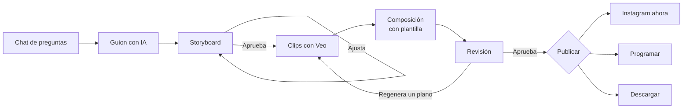
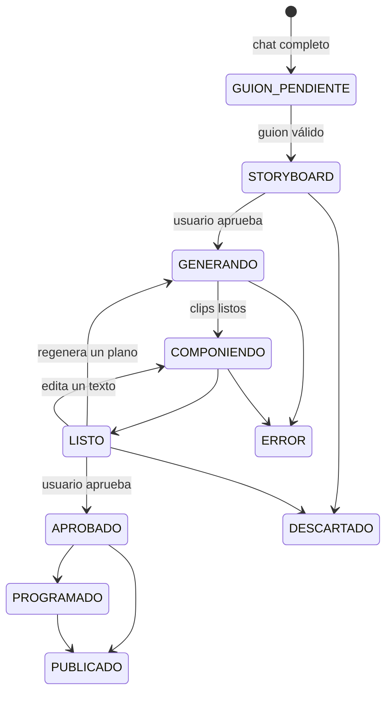

# AutoReel — Especificación completa

> **AutoReel** es el nombre de la plataforma. Antes de lanzarla comercialmente, verificar que el nombre y el dominio estén disponibles y registrar la marca ante el Indecopi.

Plataforma web que permite a negocios pequeños, sin conocimientos de marketing, crear en pocos minutos un Reel de 15 segundos de sus productos a partir de sus propias fotos, con Inteligencia Artificial, y publicarlo directamente en Instagram.

Cada rubro de negocio se atiende con un **paquete de nicho** propio. **El MVP incluye un solo nicho: pastelerías y postres.** Después se agregarán cafeterías, otros negocios de comida y, si se decide, florerías.

El MVP es parte de un curso universitario, pero la plataforma está pensada para convertirse en un negocio real con clientes. Por eso este documento prioriza una arquitectura que pueda crecer, sin sacrificar la simplicidad del primer lanzamiento.

---

## 0. Instrucciones para Claude Code

1. **Proyecto nuevo**, en un repositorio nuevo con dos carpetas: `backend/` (Java, Spring Boot) y `frontend/` (React).
2. **Sin TDD.** Desarrollo normal. Las pruebas automatizadas recomendadas de la sección 18 son pocas y se escriben después del código, solo para la lógica crítica.
3. **Respeta la arquitectura de la sección 12:** monolito modular en el backend, con los proveedores externos (IA, almacenamiento, Instagram, composición de video) detrás de interfaces, para poder cambiarlos sin tocar el resto.
4. **Los planes y los modelos de IA no se escriben en el código:** se leen de la base de datos (secciones 11 y 12). Agregar un plan o un modelo nuevo de un proveedor ya integrado no debe requerir programar.
5. **Todo lo propio del nicho** (preguntas, plantilla, movimientos, vocabulario, temporadas) vive en el **paquete de nicho Pastelería** (sección 7), nunca disperso por el código.
6. **Nunca escribas claves en el código ni en la base de datos.** Todas las credenciales (base de datos, Gemini, Meta, AWS) se leen de variables de entorno en desarrollo y de AWS Secrets Manager en producción. Los modelos de IA solo guardan el nombre del secreto que usan (RN-55). *Cambio del 2026-11-06 (ADR 0018):* el administrador puede pegar las claves de IA en Ajustes; se guardan fuera de la base de datos (archivo ignorado por git en desarrollo, Secrets Manager en producción).
7. **La base de datos se versiona con Flyway.** No uses `ddl-auto=update`.
8. **Código claro y simple:** nombres de dominio en español, sin abstracciones que no se usen.
9. **Trabaja por fases**, en el orden de la sección 19, y al terminar cada fase verifica sus casos de la sección 17.
10. Commits por funcionalidad (por ejemplo, `feat: catalogo de productos`), sin la línea de coautoría de Claude.
11. **Mantén la documentación de la sección 23** al día: cada fase termina con su documentación actualizada.
12. Si algo no está definido aquí, pregúntame antes de decidir.

---

## 1. El problema

Las pastelerías viven de lo visual y de Instagram, pero la mayoría son negocios pequeños que no tienen presupuesto para un community manager ni para producir video. Además:

- **Producir un Reel cuesta tiempo y conocimiento:** grabar, editar, escribir textos y elegir música.
- **La IA de video, usada sin control, produce resultados raros:** manos deformes, caras extrañas, letras ilegibles y productos que cambian de forma. Un negocio no puede publicar eso.
- **Las herramientas generales exigen saber qué pedir:** escribir instrucciones, elegir planos y entender de marketing.

## 2. La solución

Una plataforma **especializada en un solo nicho**, que decide casi todo por el usuario:

- **Parte de fotos reales** de los productos del negocio. La IA solo les da un movimiento suave; nunca inventa el producto.
- **Usa una plantilla fija de 4 planos y 15 segundos,** pensada para evitar los errores típicos de la IA.
- **Pide la información con un chat de preguntas fijas,** sin que el usuario tenga que saber de marketing.
- **Muestra un storyboard antes de generar,** para no gastar en videos que el usuario no quiere.
- **Publica directamente en Instagram,** con el texto y los hashtags ya escritos.

## 3. Modelo de negocio

- **Cliente:** pastelerías y negocios de postres. Después se agregan cafeterías y otros negocios de comida, y si fuera necesario, florerías, cada uno como un paquete de nicho nuevo.
- **Venta asistida en el MVP:** el administrador crea cada negocio, le asigna un plan y una fecha de pago, y le entrega sus credenciales. No hay registro público ni pagos en línea: el cobro es manual y el administrador registra cada pago.
- **Suscripción mensual por plan.** El MVP tiene un solo plan, **Lite**: un video por día con los modelos más económicos. El sistema está preparado para agregar planes superiores (por ejemplo, **Pro**) que usen modelos de IA más avanzados.
- **Costo por video** de unos 0,60 dólares con el plan Lite (sección 15).

---

## 4. Actores

- **Administrador de la plataforma** (el dueño del producto): crea y gestiona los negocios, reinicia contraseñas, asigna planes y ve el uso y los costos de cada cliente.
- **Usuario del negocio:** la persona que el negocio designa para crear los videos. Cada negocio tiene **exactamente un usuario**.
- **Actores externos:** el proveedor de video con IA (Google Veo), el proveedor del modelo de lenguaje, Instagram (Meta) y AWS.

---

## 5. Requisitos

Prioridad: **M** = imprescindible para el MVP, **S** = importante, **C** = deseable, **F** = versión futura.

### 5.1 Administración

- **RF-01 (M).** El administrador inicia sesión y entra al panel de administración.
- **RF-02 (M).** El administrador ve la lista de negocios con su nombre, correo, nicho, plan, próxima fecha de pago, estado de pago, videos generados en el mes, estado y último acceso.
- **RF-03 (M).** El administrador crea un negocio eligiendo el nicho (solo "Pastelería" por ahora, marcado por defecto), el nombre, el correo del usuario, el plan (solo "Lite" por ahora), el monto mensual acordado y la fecha del primer pago. El sistema genera una contraseña temporal y la muestra una sola vez.
- **RF-04 (M).** El administrador reinicia la contraseña de un negocio: se genera una nueva contraseña temporal que el administrador entrega manualmente.
- **RF-05 (M).** El administrador entra al detalle de un negocio: perfil, suscripción, pagos, catálogo, videos y consumo.
- **RF-06 (S).** El administrador suspende o reactiva un negocio y le cambia el plan.
- **RF-07 (S).** El administrador ve el costo estimado acumulado de IA por negocio y por mes.
- **RF-08 (M).** El administrador registra cada pago recibido; la próxima fecha de pago avanza automáticamente un mes.
- **RF-09 (M).** El administrador recibe notificaciones en el panel cuando un cliente está por llegar a su fecha de pago, cuando la fecha es hoy y cuando el pago está vencido.
- **RF-10 (M).** El administrador gestiona los planes: cada plan define cuántos videos por día permite, cuántas regeneraciones por video, qué modelo de texto y qué modelo de video usa, y qué opciones de producción habilita. En el MVP existe solo el plan Lite, pero se pueden crear más sin programar.
- **RF-11 (M).** En los ajustes del panel, el administrador ve las **integraciones de IA**: los modelos disponibles, su tipo (texto o video), su costo de referencia y su estado; puede activarlos o desactivarlos y probar la conexión. *Hoy hay cuatro (ADR 0017): Gemini y Gemini Omni Flash por Google AI Studio (activos), y Gemini y Veo 3.1 Lite por Google Cloud (inactivos). Desde el 2026-11-06 también pega ahí las claves de los proveedores (ADR 0018).*
- **RF-12 (S).** El administrador otorga a un negocio un **beneficio temporal**: usar un plan superior durante un período (por ejemplo, el plan Pro por un día), como cortesía a clientes antiguos o por un inconveniente.

### 5.2 Acceso del negocio

- **RF-13 (M).** El usuario inicia sesión con su correo y la contraseña temporal, y el sistema lo obliga a crear y confirmar una contraseña propia.
- **RF-14 (M).** El usuario del negocio entra directamente a su negocio; solo el administrador ve el panel de administración.
- **RF-15 (S).** El usuario cambia su contraseña desde Ajustes.

### 5.3 Perfil y catálogo

- **RF-16 (M).** En el primer ingreso aparece el onboarding en pantalla completa, con las preguntas del paquete de nicho y el aviso de que podrá cambiarlas en Ajustes.
- **RF-17 (M).** El usuario edita su perfil en Ajustes en cualquier momento.
- **RF-18 (M).** El usuario gestiona su catálogo: crea productos con nombre, descripción y tres fotos; los edita y los archiva. *Cambio del 2026-11-06:* la temporada no se pide en el MVP (cada producto queda como "Todo el año"; ADR 0013).

### 5.4 Creación del video

- **RF-19 (M).** La pantalla principal es un chat de preguntas fijas, sin IA, que reúne la información del video del día.
- **RF-20 (M).** En el chat, el usuario elige un producto del catálogo (primero los de temporada) o sube uno nuevo ese día, con la opción de guardarlo en el catálogo.
- **RF-21 (M).** Con las respuestas, el perfil y las fotos, el sistema genera un guion y muestra el storyboard de 4 planos.
- **RF-22 (M).** El usuario ajusta los textos o cambia la foto de un plano, y aprueba el storyboard.
- **RF-23 (M).** El sistema genera los clips con IA, compone el video con la plantilla y avisa cuando está listo.
- **RF-24 (M).** El usuario ve el video, regenera un plano específico o edita un texto, y lo aprueba.
- **RF-25 (M).** El usuario descarga el video.
- **RF-26 (M).** El usuario ve el historial de sus videos con su estado.

### 5.5 Publicación

- **RF-27 (M).** El usuario conecta su cuenta profesional de Instagram.
- **RF-28 (M).** El usuario publica el video como Reel en Instagram, con el texto y los hashtags generados, que puede editar.
- **RF-29 (S).** El usuario programa la publicación para una fecha y hora.
- **RF-30 (F).** Publicación en una página de Facebook.

### 5.6 Futuro

- **RF-31 (S).** Calendario de fechas especiales con recordatorios ("Faltan 10 días para el Día de la Madre").
- **RF-32 (F).** Opciones de producción personalizables (sección 8.6).
- **RF-33 (F).** Nuevos paquetes de nicho: cafeterías, comida, florerías.
- **RF-34 (F).** Pagos en línea y registro público.

### 5.7 Requisitos no funcionales

- **RNF-01, simplicidad.** Crear un video, desde el chat hasta la aprobación del storyboard, toma menos de 2 minutos para el usuario.
- **RNF-02, calidad.** Ningún video muestra personas, manos ni texto generados por IA.
- **RNF-03, móvil primero.** Toda la interfaz del negocio funciona cómodamente en el celular.
- **RNF-04, seguridad.** Contraseñas con BCrypt, sesión con JWT en una cookie `HttpOnly` y `Secure`, tokens de Instagram cifrados en la base de datos, y permisos verificados en el backend.
- **RNF-05, aislamiento.** Ningún negocio puede ver ni modificar datos de otro.
- **RNF-06, privacidad.** Los datos personales se tratan conforme a la Ley 29733 de Protección de Datos Personales.
- **RNF-07, intercambiabilidad.** Cambiar de proveedor de video o de modelo de lenguaje solo requiere un adaptador nuevo.
- **RNF-08, trazabilidad de costos.** Cada llamada a un proveedor de IA registra su costo estimado.
- **RNF-09, robustez.** Si la IA falla, el sistema no pierde el video del día ni cobra regeneraciones fallidas (sección 8.5). *Cambio del 2026-11-06:* ya no se entrega un video con planos sin IA.

---

## 6. Flujos principales

### 6.1 Administrador

1. Inicia sesión y entra a `/admin`. La campana de notificaciones muestra los pagos por vencer, de hoy y vencidos.
2. Ve la lista de negocios y puede buscar por nombre o correo, o filtrar por estado de pago.
3. **Crear negocio:** elige el nicho, escribe el nombre y el correo, elige el plan, escribe el monto mensual y la fecha del primer pago, y confirma. El sistema muestra la contraseña temporal **una sola vez**, con un botón para copiarla junto con el enlace de la aplicación.
4. **Registrar un pago:** desde la notificación o el detalle del negocio, indica la fecha, el monto y el medio de pago. La próxima fecha de pago avanza un mes.
5. **Reiniciar contraseña:** desde el detalle del negocio, genera una nueva contraseña temporal y se la entrega al cliente.
6. **Otorgar un beneficio temporal:** desde el detalle del negocio, elige el plan, el período y el motivo.
7. **Gestionar planes e integraciones** desde los ajustes del panel.

### 6.2 Primer ingreso del negocio

1. Abre el enlace e inicia sesión con su correo y la contraseña temporal.
2. El sistema le pide crear su contraseña y confirmarla.
3. Aparece el onboarding en pantalla completa, en tres pasos, con el aviso: "Podrás cambiar estos datos cuando quieras en Ajustes".
4. Al terminar, el sistema le sugiere registrar sus primeros productos en el catálogo, y luego llega al chat.

### 6.3 Video del día

1. El chat hace sus preguntas fijas (sección 7.3).
2. El sistema genera el guion y muestra el storyboard.
3. El usuario ajusta y aprueba.
4. El sistema genera los clips, compone el video y lo avisa.
5. El usuario revisa, regenera un plano si hace falta y aprueba.
6. Publica en Instagram, lo programa o lo descarga.



---

## 7. Paquete de nicho: Pastelería

Todo lo de esta sección se implementa como **un paquete**: una clase `PaquetePasteleria` que implementa la interfaz `PaqueteNicho`, más archivos de configuración en `resources/nichos/pasteleria/`. Un nicho nuevo es otro paquete, sin cambiar el resto del sistema.

La interfaz `PaqueteNicho` expone: el identificador y el nombre del nicho, las preguntas del onboarding, el guion del chat, la plantilla de video, los movimientos permitidos, las reglas de vocabulario, las temporadas y fechas especiales, la biblioteca de música por estilo y las instrucciones base para el modelo de lenguaje y para el modelo de video.

### 7.1 Onboarding (perfil del negocio)

**Paso 1, tu marca:**

1. **Nombre comercial**, ya escrito desde el panel de administración (obligatorio).
2. **Logo**, PNG con fondo transparente (obligatorio).
3. **Dos colores de marca**, con un selector y la opción "tomar del logo" (obligatorio).
4. **Estilo**, con botones: casero, elegante o divertido (obligatorio).

**Paso 2, tu negocio:**

5. **Especialidad**, selección múltiple: tortas personalizadas, postres individuales, dulces tradicionales, panadería dulce u opciones saludables (obligatorio).
6. **Público principal**, selección múltiple: familias, jóvenes, celebraciones y cumpleaños, empresas y eventos (obligatorio).
7. **Ciudad y distrito** (obligatorio).
8. **Cómo te piden:** número de WhatsApp, apps de delivery o solo en tienda, y el horario (obligatorio al menos uno).

**Paso 3, tu toque (opcional):**

9. **Lo que te hace distinto**, en una frase de hasta 80 caracteres.
10. **Palabras o temas que nunca quieres** en tus videos.

**Foto del local (opcional):** una foto de la vitrina o la fachada, que se usa como fondo del plano de cierre. Si no existe, el cierre usa los colores de marca.

### 7.2 Catálogo de productos

Cada producto tiene:

- **Nombre**, hasta 50 caracteres.
- **Descripción**, hasta 200 caracteres: sabor, relleno, ingredientes destacados. Es la única fuente de detalles que la IA puede usar.
- **Temporada**, una o varias etiquetas: todo el año, verano, invierno, San Valentín, Día de la Madre, Día del Padre, Fiestas Patrias, Halloween y Canción Criolla, Navidad.
- **Tres fotos obligatorias:**
  1. **Entero:** el producto completo, de frente.
  2. **Detalle:** muy cerca, mostrando crema, glaseado o fruta.
  3. **Porción:** una porción ya cortada, mostrando el relleno.
- **Estado:** activo o archivado.

Cada foto se pide con una imagen de ejemplo y tres indicaciones: luz natural, sin personas ni manos, y en vertical.

### 7.3 Guion del chat

El chat es una **conversación simulada**: las preguntas son siempre las mismas y están en el paquete. Cada pregunta tiene un tipo (botones, selector de producto, texto libre u opcional).

1. **"¡Hola! ¿Qué video quieres crear hoy?"**, con botones:
   - Producto estrella
   - Promoción
   - Fecha especial (muestra las fechas próximas)
   - Tortas por encargo
   - Recién salido del horno
2. **"¿Qué producto mostramos?"**, con dos botones:
   - **Elegir del catálogo:** un carrusel que muestra primero los productos de la temporada actual, con un mensaje como "Es verano: estos suelen funcionar mejor".
   - **Subir uno nuevo hoy:** pide nombre, descripción y las tres fotos, y al final pregunta "¿Lo guardo en tu catálogo?".
3. **"¿Qué lo hace especial hoy?"**, texto libre. Se ofrece la descripción del catálogo como sugerencia.
4. **"¿Hay precio o promoción que quieras mencionar?"** Opcional; acepta "no". Si el tipo de video es Promoción, es obligatoria.
5. **"¿Algo más que quieras que se diga?"** Opcional.
6. **"¡Listo! Estoy preparando tu propuesta…"**, y se muestra el storyboard.

**Comportamiento del chat:**

- **Agrupación de mensajes:** después de cada mensaje del usuario, el sistema espera 4 segundos. Si llega otro mensaje en ese tiempo, el plazo se reinicia. Al vencer, todos los mensajes se unen como una sola respuesta.
- **Preguntas del usuario:** si la respuesta agrupada contiene "?" o "¿", el chat responde con un mensaje fijo: "Soy un asistente para reunir información, no puedo responder preguntas. Cuéntame todo lo que se te ocurra sobre tu producto y yo me encargo del resto." Y repite la pregunta pendiente.
- **Respuestas vacías o muy cortas:** en preguntas obligatorias de texto, si la respuesta tiene menos de 3 caracteres, el chat pide un poco más de detalle.
- **Longitud máxima:** 500 caracteres por respuesta agrupada.
- **Aviso en un botón "?"** junto a la respuesta (cambio del 2026-11-06; antes era un aviso lateral fijo): "Este chat está diseñado para recibir respuestas, no para recibir preguntas."
- **Un solo borrador activo:** si el usuario sale a mitad del chat, al volver puede continuar o empezar de nuevo.

### 7.4 La plantilla de video

- **Formato:** vertical, 1080 × 1920, 30 cuadros por segundo, H.264 con audio AAC, 15 segundos exactos.
- **Cuatro planos:**

1. **Gancho** (0 a 3 s), con IA, a partir de la foto **Detalle**. Texto: una frase de antojo de hasta 6 palabras.
2. **Producto** (3 a 7 s), con IA, a partir de la foto **Entero**. Texto: el nombre del producto, hasta 5 palabras.
3. **Relleno** (7 a 11 s), con IA, a partir de la foto **Porción**. Texto: lo que lo hace especial, hasta 7 palabras.
4. **Cierre** (11 a 15 s), **sin IA**. Fondo: la foto del local con un zoom suave hecho por el sistema, o los colores de marca. Contenido: el precio o la promoción (solo si el usuario los escribió), el llamado a la acción ("Pide por WhatsApp", "Te esperamos en [distrito]"), el WhatsApp y el logo.

- **Transiciones:** corte directo entre los planos 1, 2 y 3, y un fundido corto hacia el cierre.
- **Textos:** en la mitad inferior, dentro de la zona segura de Instagram (sin tapar los botones laterales ni la descripción), con la tipografía del estilo y los colores de marca, con sombra o fondo para garantizar la lectura.
- **Música:** una pista de la biblioteca del estilo elegido, con fundido al final. El audio que genere el modelo de video se descarta.
- **Sin voz en off** en esta versión.

### 7.5 Movimientos permitidos

Cada plano usa un movimiento de esta lista cerrada. El modelo de lenguaje solo puede elegir entre ellos:

- **ACERCAMIENTO_LENTO:** la cámara se acerca muy despacio al producto.
- **ALEJAMIENTO_LENTO:** la cámara se aleja muy despacio.
- **DESPLAZAMIENTO_LATERAL:** la cámara se desplaza unos centímetros hacia un lado.
- **BRILLO_GLASEADO:** destellos sutiles de luz sobre el glaseado o el almíbar.
- **AZUCAR_CAYENDO:** azúcar impalpable cayendo suavemente sobre el producto.
- **VAPOR_SUAVE:** vapor tenue saliendo del producto (solo horneados o bebidas calientes).
- **LUZ_CALIDA:** la luz cálida cambia lentamente, como luz de ventana.

**Siempre prohibido**, y se agrega a cada instrucción enviada al modelo de video: personas, manos, caras, cuchillos o utensilios en movimiento, texto, letras o logotipos, cambios en la forma, el color o la decoración del producto, giros del producto de más de 15 grados, objetos nuevos que no estén en la foto y cortes de cámara.

### 7.6 Vocabulario

- **Tono por estilo:** casero (cálido y cercano), elegante (sobrio y refinado), divertido (alegre, con signos de exclamación).
- **Prohibido:** afirmaciones de salud o nutrición ("saludable", "sin azúcar", "sin gluten", "light", "bajo en calorías"), salvo que la descripción del producto lo declare; superlativos absolutos ("el mejor de Lima"); promesas de entrega o tiempos no declarados; y las palabras que el negocio marcó como prohibidas.

### 7.7 Temporadas y fechas especiales (Perú)

- **Verano:** del 21 de diciembre al 20 de marzo.
- **Invierno:** del 21 de junio al 22 de septiembre.
- **San Valentín:** 14 de febrero.
- **Día de la Madre:** segundo domingo de mayo.
- **Día del Padre:** tercer domingo de junio.
- **Fiestas Patrias:** 28 y 29 de julio.
- **Halloween y Día de la Canción Criolla:** 31 de octubre.
- **Navidad:** todo diciembre (temporada de panetón).

Una fecha especial se considera "próxima" durante los 15 días anteriores.

---

## 8. El proceso de generación

### 8.0 Por qué se usan dos modelos de IA

Hacen trabajos distintos, y ninguno puede hacer el del otro:

- **El modelo de video (Veo) solo anima una imagen.** Recibe una foto y una instrucción de movimiento, y devuelve un clip. No escribe los textos que aparecen en pantalla (esos los pone nuestra plantilla, para que nunca salgan deformes), ni la descripción de la publicación, ni los hashtags.
- **El modelo de texto (Gemini) convierte las respuestas del negocio en el guion.** Las respuestas del chat son datos sueltos ("fresas frescas, crema batida, la más pedida, S/ 65"). El modelo de texto las transforma en frases cortas de antojo para cada plano, elige qué movimiento conviene a cada foto, y redacta la descripción y los hashtags con el tono del negocio. Pasarle los campos tal cual al modelo de video no produciría esos textos.

**Lo que el modelo de texto no hace es escribir libremente la instrucción para el modelo de video.** Solo elige un movimiento de la lista permitida, y el sistema arma la instrucción con una plantilla fija (sección 8.2). Así se aprovecha la creatividad del modelo de texto donde suma, sin arriesgar que pida algo que genere errores.

**En la práctica es una sola integración:** Gemini y Veo se usan con la misma API de Google y la misma clave.

**Qué modelos se usan lo decide el plan efectivo del negocio** (sección 10.8): en el plan Lite, Gemini para el texto y Veo 3.1 Lite para el video. Un plan Pro podría usar Veo 3.1 Fast, Veo 3.1 estándar o Runway sin cambiar el proceso. *Desde el 2026-11-05 (ADR 0017), el plan Lite usa Gemini Omni Flash (`GEMINI_OMNI`, Google AI Studio, unos 0,07 dólares por segundo a 720p) con la misma clave que el guion; Veo 3.1 Lite (Google Cloud) queda listo e inactivo.*

### 8.1 Guion con el modelo de lenguaje

El sistema envía al modelo de texto del plan efectivo (Gemini en el plan Lite) una solicitud con: las instrucciones base del paquete, el perfil del negocio, el producto y su descripción, las respuestas del chat, el tipo de video, la plantilla, la lista de movimientos y las reglas de vocabulario. El modelo debe responder **solo con un JSON** con esta forma:

```json
{
  "planos": [
    { "orden": 1, "foto": "DETALLE", "movimiento": "ACERCAMIENTO_LENTO", "texto": "Antojo de fresa" },
    { "orden": 2, "foto": "ENTERO", "movimiento": "BRILLO_GLASEADO", "texto": "Torta Tres Leches de Fresa" },
    { "orden": 3, "foto": "PORCION", "movimiento": "LUZ_CALIDA", "texto": "Fresas frescas y crema batida" },
    { "orden": 4, "precio": "S/ 65", "llamado": "Pide por WhatsApp", "ubicacion": "Miraflores" }
  ],
  "descripcionPublicacion": "Nuestra Tres Leches de Fresa ya está en vitrina...",
  "hashtags": ["#pasteleria", "#miraflores", "#tresleches"]
}
```

**El sistema valida el JSON antes de usarlo:** cantidad de planos, fotos y movimientos dentro de las listas permitidas, longitud de cada texto, ausencia de palabras prohibidas, y que el precio o la promoción coincidan exactamente con lo que escribió el usuario. Si la validación falla, se reintenta hasta 2 veces indicando el error. Si vuelve a fallar, se usa un **guion de respaldo** armado sin IA con los textos del usuario.

### 8.2 Clips con el modelo de video

- **Modelo:** el modelo de video del plan efectivo del negocio. En el plan Lite, Google Veo 3.1 Lite, en modo imagen a video, 9:16, clips de 4 segundos. *Desde el 2026-11-05 (ADR 0017), el plan Lite usa Gemini Omni Flash (`GEMINI_OMNI`, Google AI Studio, unos 0,07 dólares por segundo a 720p) con la misma clave que el guion; Veo 3.1 Lite (Google Cloud) queda listo e inactivo.*
- **Un clip por plano con IA** (3 en total), usando la foto correspondiente como primer cuadro.
- **La instrucción de movimiento** se arma a partir de una plantilla fija por movimiento, en inglés, más la lista de prohibiciones de la sección 7.5. Si el proveedor admite una instrucción negativa separada, las prohibiciones van ahí.
- **Las tres generaciones se envían en paralelo** y el sistema consulta su estado periódicamente.
- **Cada clip se recorta** a la duración de su plano (3 o 4 segundos).

### 8.3 Composición

FFmpeg, ejecutado por el backend, une los clips, agrega el plano de cierre, los textos, el logo, la música y las transiciones, y exporta el MP4 final con las especificaciones de la sección 7.4. Todos los archivos se guardan en S3.

### 8.4 Revisión

- **Editar un texto** solo vuelve a componer el video: no tiene costo de IA.
- **Regenerar un plano** genera un clip nuevo solo para ese plano. Cada video permite la cantidad de regeneraciones que define su plan: **3 en el plan Lite**. Agotadas, el botón se desactiva.
- **Cambiar la foto de un plano** también regenera ese clip.

### 8.5 Plan de respaldo

*Cambio del 2026-11-06 (decisión del usuario):* **ya no hay respaldo sin IA para los clips**. El acercamiento de FFmpeg a la foto no sirve para el MVP.

- Si la generación de un clip falla dos veces seguidas, o el proveedor no responde en 10 minutos:
  - **En una regeneración**, el plano conserva su clip anterior, la regeneración no se descuenta y el usuario ve un aviso.
  - **En la primera generación**, el video pasa a ERROR, se devuelve el video del día (RN-27) y los clips ya pedidos se registran como costo (RN-32).
- Sin el modelo de video disponible (inactivo o sin credencial), "Crear mi video" se desactiva y no se puede cambiar una foto en la revisión. Los textos sí se pueden editar.
- El guion de respaldo (sección 8.1) se mantiene.

### 8.6 Opciones de producción (preparado para el futuro)

Cada video guarda desde el inicio sus opciones de producción, aunque en el MVP son fijas:

- **música:** activada.
- **textoEnPantalla:** completo.
- **vozEnOff:** desactivada.
- **escenas:** solo producto.
- **personas:** ninguna.

Evolución prevista:

1. **Versión 2:** activar o desactivar música, texto y subtítulos; incluir el local en las escenas.
2. **Versión 3:** voz en off generada.
3. **Versión 4:** personas reales, con un clip que el negocio sube y se inserta sin IA.
4. **Versión 5:** personas generadas por IA, con un modelo premium y la etiqueta que exige Meta.

---

## 9. Modelo de datos

### 9.1 Entidades

- **Usuario:** id, correo (único), contrasenaHash, rol (ADMIN o NEGOCIO), negocio (vacío para el administrador), debeCambiarContrasena, contrasenaTemporalVence, activo, ultimoAcceso, fechaCreacion.
- **Negocio:** id, nombre, nicho, estado (ACTIVO o SUSPENDIDO), onboardingCompleto, fechaCreacion.
- **PerfilNegocio:** id, negocio, logoUrl, colorPrimario, colorSecundario, estilo, fotoLocalUrl y las respuestas del onboarding del nicho, guardadas como JSON validado contra las preguntas del paquete.
- **Plan:** id, nombre, descripcion, videosPorDia, regeneracionesPorVideo, modeloTexto, modeloVideo, opcionesProduccionPermitidas (JSON), permitePersonas, precioReferencial, activo.
- **ModeloIA:** id, nombre visible, proveedor (GOOGLE, RUNWAY, ANTHROPIC…), tipo (TEXTO o VIDEO), adaptador (el identificador de la implementación en el código, por ejemplo `VEO` o `GEMINI`), identificadorModelo (el nombre exacto que exige la API del proveedor), parametros (JSON: resolución, duración por clip, etc.), costoReferencial, unidadCosto (POR_SEGUNDO o POR_SOLICITUD), nombreSecreto (dónde está su credencial), estado (ACTIVO o INACTIVO), ultimaPrueba.
- **Suscripcion:** id, negocio, plan, montoMensual, fechaInicio, proximaFechaPago, diasAviso (5 por defecto), diaPago (el día del primer pago, que se conserva al avanzar; RN-42).
- **Pago:** id, suscripcion, fechaPago, monto, medio (TRANSFERENCIA, YAPE, PLIN, EFECTIVO u OTRO), periodoCubierto, nota, registradoPor.
- **BeneficioTemporal:** id, negocio, plan, desde, hasta, motivo, otorgadoPor, fechaCreacion.
- **NotificacionAdmin:** id, tipo (PAGO_POR_VENCER, PAGO_HOY, PAGO_VENCIDO, SUGERENCIA_SUSPENSION, INTEGRACION_CON_ERROR), negocio, modeloIA (en las de integración), periodo, mensaje, fecha, leida.
- **ConsumoDiario:** id, negocio, fecha, videosGenerados.
- **Producto:** id, negocio, nombre, descripcion, temporadas, estado, fechaCreacion.
- **FotoProducto:** id, producto, tipo (ENTERO, DETALLE o PORCION), claveS3, ancho, alto.
- **Conversacion:** id, negocio, estado (EN_CURSO, COMPLETA o ABANDONADA), pasoActual, respuestas (JSON), video.
- **MensajeChat:** id, conversacion, autor (SISTEMA o USUARIO), texto, fechaHora.
- **Video:** id, negocio, conversacion, producto, tipoVideo, estado, planAplicado, modeloTextoUsado, modeloVideoUsado, opcionesProduccion (JSON), guion (JSON), descripcionPublicacion, hashtags, claveS3Final, regeneracionesUsadas, costoEstimado, motivoError, fechas.
- **Plano:** id, video, orden, tipoFoto, movimiento, texto, claveS3Clip, estado, intentos, usoRespaldo (solo en videos anteriores al 2026-11-06, ADR 0020), idTareaProveedor.
- **PistaMusical:** id, nicho, estilo, nombre, claveS3, duracion, licencia.
- **CuentaInstagram:** id, negocio, idUsuarioInstagram, nombreUsuario, tokenCifrado, venceToken.
- **Publicacion:** id, video, red, estado, fechaProgramada, fechaPublicada, idPublicacionExterna, enlace, motivoError.
- **RegistroCosto:** id, negocio, video, proveedor, concepto, cantidad, costoUsd, fechaHora.

### 9.2 Estados del video



---

## 10. Reglas de negocio

### 10.1 Cuentas y acceso

- **RN-01.** Solo el administrador crea negocios. Cada negocio tiene un único usuario, y el correo es único en toda la plataforma.
- **RN-02.** La contraseña temporal tiene 12 caracteres aleatorios, se muestra una sola vez y vence a las 48 horas. Solo se guarda su hash.
- **RN-03.** Con una contraseña temporal, el usuario solo puede acceder a la pantalla de cambio de contraseña.
- **RN-04.** La contraseña nueva tiene al menos 8 caracteres, con al menos una letra y un número, debe confirmarse escribiéndola dos veces y no puede ser igual a la temporal.
- **RN-05.** Reiniciar la contraseña invalida la anterior y las sesiones abiertas de ese usuario.
- **RN-06.** El administrador entra a `/admin`; el usuario del negocio, a su negocio. Ninguno puede acceder a las rutas del otro.
- **RN-07.** Un negocio suspendido no puede iniciar sesión.
- **RN-08.** La sesión dura 8 horas. Después de 5 intentos fallidos de inicio de sesión, la cuenta se bloquea durante 15 minutos.

### 10.2 Onboarding y catálogo

- **RN-09.** Mientras el onboarding no esté completo, el negocio no puede crear videos.
- **RN-10.** El logo debe ser PNG de hasta 5 MB.
- **RN-11.** Las fotos de productos deben ser JPG, PNG o WebP, de hasta 10 MB, con el lado menor de al menos 720 píxeles (lo que pide el clip de IA en 720p; antes 1080, cambio del 2026-11-06). Las horizontales se aceptan con un aviso de que se recortarán al formato vertical.
- **RN-12.** Un producto solo puede usarse en un video si tiene sus tres fotos.
- **RN-13.** Un producto archivado no aparece en el chat, pero sus videos anteriores se conservan.
- **RN-14.** Un producto subido desde el chat solo se guarda en el catálogo si el usuario lo acepta; si no, queda asociado únicamente a ese video.
- **RN-15 (S).** Las fotos con personas o caras se rechazan automáticamente, usando un servicio de detección de rostros (Amazon Rekognition).

### 10.3 Chat

- **RN-16.** Las preguntas, su orden y su tipo los define el paquete de nicho.
- **RN-17.** Los mensajes enviados con menos de 4 segundos de diferencia se agrupan en una sola respuesta.
- **RN-18.** Si la respuesta contiene "?" o "¿", se muestra el mensaje fijo de la sección 7.3 y se repite la pregunta.
- **RN-19.** Cada negocio tiene como máximo una conversación EN_CURSO.
- **RN-20.** Si el tipo de video es Promoción, la pregunta del precio o la promoción es obligatoria.

### 10.4 Guion

- **RN-21.** El guion respeta la plantilla: 4 planos, las fotos y los movimientos permitidos, y las longitudes máximas de texto.
- **RN-22.** El guion nunca contiene precios, promociones, ingredientes, sabores ni datos que el usuario no haya escrito en el chat, el perfil o la descripción del producto.
- **RN-23.** El guion no contiene palabras prohibidas por el paquete ni por el negocio.
- **RN-24.** La descripción de la publicación tiene como máximo 600 caracteres, e incluye entre 5 y 8 hashtags, con al menos uno del distrito.
- **RN-25.** Si el guion no es válido después de 2 reintentos, se usa el guion de respaldo.

### 10.5 Generación y consumo

- **RN-26.** Generar un video consume 1 video del día, en el momento en que el usuario aprueba el storyboard. El día es el calendario de Lima y los videos no usados no se acumulan. Si ya usó los videos del día, no puede aprobar y ve cuándo vuelve a tener disponible.
- **RN-27.** Si el video termina en ERROR por una falla del sistema, se devuelve el video consumido.
- **RN-28.** Cada video permite las regeneraciones de plano que define su plan (3 en Lite). Agotadas, no se puede regenerar, pero sí editar textos.
- **RN-29.** Editar un texto no consume videos ni regeneraciones.
- **RN-30.** Un plano tiene dos intentos; si los dos fallan, se aplica la sección 8.5 (sin respaldo sin IA desde el 2026-11-06, ADR 0020).
- **RN-31.** El video final dura exactamente 15 segundos y cumple las especificaciones de la sección 7.4.
- **RN-32.** Cada llamada a un proveedor de IA registra su costo estimado.

### 10.6 Publicación

- **RN-33.** Solo se publica un video APROBADO.
- **RN-34.** Para publicar se necesita una cuenta profesional de Instagram conectada y con el token vigente; si venció, se pide reconectar.
- **RN-35.** La descripción y los hashtags pueden editarse antes de publicar, respetando la RN-24.
- **RN-36.** Una publicación programada debe ser al menos 10 minutos a futuro y como máximo 30 días.
- **RN-37.** Antes de publicar se consulta el límite de publicaciones de Instagram; si está agotado, se informa y se sugiere programar.
- **RN-38.** Un video publicado no puede volver a editarse ni a publicarse en la misma cuenta.

### 10.7 Administración

- **RN-39.** El administrador ve los datos de todos los negocios, pero nunca sus contraseñas ni sus tokens de Instagram.
- **RN-40.** Al crear el negocio, el nicho elegido no puede cambiarse después.

### 10.8 Planes, suscripciones y pagos

- **RN-41.** Cada negocio tiene exactamente una suscripción, con su plan, su monto mensual, su fecha de inicio y su próxima fecha de pago. El plan, el monto y la fecha del primer pago son obligatorios al crear el negocio.
- **RN-42.** Al registrar un pago, la próxima fecha de pago avanza un mes, conservando el día. Si ese día no existe en el mes siguiente (por ejemplo, el 31), se usa el último día del mes.
- **RN-43. Estado de pago**, calculado cada día:
  - **AL_DIA:** faltan más días que los días de aviso (5 por defecto).
  - **POR_VENCER:** faltan entre 1 y los días de aviso.
  - **VENCE_HOY:** la fecha de pago es hoy.
  - **VENCIDO:** la fecha de pago ya pasó y no se registró el pago.
- **RN-44. Notificaciones del administrador.** Una tarea diaria crea una notificación al entrar en POR_VENCER, VENCE_HOY y VENCIDO, y nunca repite el mismo tipo para el mismo negocio y el mismo período.
- **RN-45.** Un pago vencido **no suspende automáticamente** al negocio en el MVP. A los 7 días de vencido, se crea una notificación que sugiere suspenderlo, y el administrador decide.
- **RN-46. Plan Lite**, el único del MVP: 1 video por día, 3 regeneraciones de plano por video, Gemini como modelo de texto, Veo 3.1 Lite como modelo de video, sin personas y con las opciones de producción fijas de la sección 8.6. *Desde el 2026-11-05 (ADR 0017), el plan Lite usa Gemini Omni Flash (`GEMINI_OMNI`, Google AI Studio, unos 0,07 dólares por segundo a 720p) con la misma clave que el guion; Veo 3.1 Lite (Google Cloud) queda listo e inactivo.*
- **RN-47.** Todo plan debe tener un modelo de texto y un modelo de video, ambos ACTIVOS y del tipo correcto.
- **RN-48.** No se puede desactivar un modelo que esté asignado a un plan activo, o a un plan inactivo que todavía tenga negocios; antes hay que asignar otro a ese plan.
- **RN-49.** Un cambio de plan aplica a los videos que se creen desde ese momento; los videos en proceso terminan con el plan con el que empezaron.

### 10.9 Beneficios temporales

- **RN-50. Plan efectivo.** Si el negocio tiene un beneficio temporal vigente, se usa el plan del beneficio; si no, el plan de su suscripción.
- **RN-51.** Un beneficio tiene fecha y hora de inicio y de fin, un motivo obligatorio y una duración máxima de 30 días. Un negocio puede tener solo un beneficio vigente a la vez.
- **RN-52.** Al terminar el beneficio, el negocio vuelve solo a su plan, sin intervención del administrador.
- **RN-53.** El beneficio cambia los modelos, las regeneraciones y los videos por día del plan, pero no el monto de la suscripción ni la fecha de pago.
- **RN-54.** Cada video guarda el plan y los modelos con los que se generó, para que el consumo y los costos queden bien registrados aunque el beneficio termine durante la generación.

### 10.10 Integraciones de IA

- **RN-55.** Las credenciales de los proveedores **nunca se guardan en la base de datos ni se vuelven a mostrar**: se guardan en AWS Secrets Manager (en desarrollo, en un archivo fuera del repositorio), y el modelo solo indica el nombre del secreto. *Cambio del 2026-11-06 (ADR 0018):* el administrador puede pegarlas o reemplazarlas en **Ajustes → Integraciones y claves**; después, el panel solo muestra una pista (los últimos 4 caracteres o el correo de la cuenta de servicio), si está configurada y de dónde viene, y permite probar la conexión.
- **RN-58 (agregada el 2026-11-06, ADR 0019).** El administrador puede **entrar como un negocio** desde su detalle y verlo tal como lo ve su usuario, con acceso completo salvo cambiar su contraseña. Un aviso fijo lo indica y permite volver al panel; cada entrada queda en el registro de la aplicación.
- **RN-56.** Un modelo solo puede usar un adaptador que exista en el código (hoy `GEMINI`, `GEMINI_CLOUD`, `GEMINI_OMNI` y `VEO`). Un modelo nuevo de un proveedor ya integrado (por ejemplo, Veo 3.1 Fast) se agrega desde el panel, sin programar; un proveedor nuevo (por ejemplo, Runway) requiere programar su adaptador.
- **RN-57.** Si una llamada a un modelo falla por un error del proveedor (credencial inválida, servicio caído), se crea una notificación INTEGRACION_CON_ERROR para el administrador.

---

## 11. Integraciones externas

### 11.1 Google: Gemini y Veo

En el MVP, una sola integración con la API de Gemini, con una sola clave, cubre los dos modelos.

**Veo (video).** 
Se usa en modo imagen a video. Veo 3.1 Lite cuesta 0,05 dólares por segundo a 720p, y Veo 3.1 Fast entre 0,10 y 0,12 dólares por segundo. La generación es asíncrona: se crea la tarea, se consulta su estado y se descarga el clip.

### 11.2 Gemini (texto)

Genera el guion en formato JSON. El costo por guion es de unos pocos centavos. Más adelante pueden agregarse otros proveedores de texto (por ejemplo, Claude) con su propio adaptador.

### 11.3 Instagram

- Se usa la **API de Instagram con inicio de sesión de Instagram**, que solo requiere una cuenta profesional (empresa o creador), sin página de Facebook.
- Permisos: `instagram_business_basic` e `instagram_business_content_publish`.
- **Publicación de un Reel en dos pasos:** se crea un contenedor con `media_type=REELS` y la dirección del video (`video_url`); cuando su estado es `FINISHED`, se publica con `media_publish`.
- **El video debe estar en una dirección pública** en el momento de la publicación: se usa un enlace prefirmado de S3 con vencimiento de una hora.
- **Formato aceptado:** MP4 con video H.264 y audio AAC.
- **Revisión de la app:** para usarse con cualquier cliente, la app debe aprobar la revisión de Meta. Mientras tanto, en modo de desarrollo, solo funciona con cuentas registradas con un rol en la app; esto alcanza para el curso.
- Los tokens de larga duración se renuevan automáticamente antes de vencer.

### 11.4 AWS

- **S3:** fotos, logos, clips, música y videos finales, en un bucket privado. El frontend sube las fotos directamente a S3 con enlaces prefirmados que genera el backend.
- **RDS:** PostgreSQL.
- **EC2** (o Elastic Beanstalk con Docker): el backend y FFmpeg, detrás de un balanceador con HTTPS.
- **S3 + CloudFront:** el frontend de React, con la ruta `/api/*` dirigida al backend, para que ambos compartan dominio y la cookie de sesión funcione.
- **Secrets Manager o Parameter Store:** las credenciales.
- **CloudWatch:** los registros.
- **Rekognition (S):** detección de rostros en las fotos.

### 11.5 Integraciones administrables

Cada modelo de IA es un registro de la tabla `ModeloIA`, que el administrador ve en **Ajustes → Integraciones**. El código tiene un **adaptador por proveedor** (`GEMINI` para texto, `VEO` para video), y cada adaptador lee de su registro el identificador exacto del modelo y sus parámetros. Por eso:

- **Pasar de Veo 3.1 Lite a Veo 3.1 Fast** es crear un registro nuevo con el mismo adaptador y otro identificador de modelo, y asignarlo a un plan.
- **Agregar Runway** es programar un adaptador `RUNWAY` y luego registrar sus modelos.

Al generar un video, una **fábrica de proveedores** obtiene el plan efectivo del negocio, lee sus modelos y entrega la implementación correspondiente. El resto del proceso no sabe qué proveedor se está usando.

---

## 12. Arquitectura

### 12.1 Decisión

**Backend API REST en Spring Boot y frontend en React**, por cuatro razones:

1. **Experiencia de usuario:** el chat, el carrusel de productos, el storyboard editable y el aviso de "tu video está listo" necesitan una interfaz interactiva que Thymeleaf no resuelve bien.
2. **Crecimiento:** la misma API servirá mañana a una aplicación móvil, sin rehacer el backend.
3. **Despliegue:** el frontend se sirve como archivos estáticos desde S3 y CloudFront, que es barato y escala solo; el backend escala por separado.
4. **Producto real:** es la arquitectura habitual de un SaaS, y facilita incorporar desarrolladores.

### 12.2 Backend: monolito modular

Un solo servicio Spring Boot, organizado **por módulos de negocio**. Cada módulo tiene sus capas internas: `api` (controladores y DTO), `aplicacion` (servicios), `dominio` (entidades, enumeraciones y reglas) e `infraestructura` (repositorios y adaptadores externos).

```text
backend/src/main/java/com/autoreel/
├── AutoReelApplication.java
├── compartido/      errores, seguridad, configuración, utilidades de JSON
├── auth/            inicio de sesión, JWT, cambio de contraseña
├── admin/           gestión de negocios
├── facturacion/     planes, suscripciones, pagos, beneficios y notificaciones del administrador
├── ia/              modelos de IA, fábrica de proveedores y adaptadores (Gemini, Veo)
├── negocio/         perfil y onboarding
├── nicho/           interfaz PaqueteNicho, registro de paquetes
│   └── pasteleria/  PaquetePasteleria
├── catalogo/        productos y fotos
├── chat/            conversación guiada y agrupación de mensajes
├── video/           guion, storyboard, generación, composición, estados
├── publicacion/     Instagram, programación
├── almacenamiento/  puerto de archivos y adaptador S3
└── costos/          registro de costos
```

**Puertos y adaptadores:** cada proveedor externo se usa a través de una interfaz del dominio, con su implementación en `infraestructura`:

- `GeneradorDeClips` → `VeoGeneradorDeClips` (después, `RunwayGeneradorDeClips`).
- `Guionista` → `GeminiGuionista` (después, otros proveedores de texto).
- `ComponedorDeVideo` → `FfmpegComponedor`.
- `AlmacenDeArchivos` → `S3Almacen`.
- `PublicadorSocial` → `InstagramPublicador`.

La implementación que se usa en cada video la elige la fábrica de proveedores según el plan efectivo del negocio (sección 11.5).

**Tareas en segundo plano:** una tabla de tareas en PostgreSQL y un procesador programado (`@Scheduled`) que cada 10 segundos avanza los videos pendientes: envía los clips, consulta su estado, compone y publica los programados. Otra tarea diaria, a las 00:10 hora de Lima, calcula los estados de pago y crea las notificaciones del administrador. Es simple, sobrevive a reinicios y, cuando el volumen lo exija, puede reemplazarse por Amazon SQS sin cambiar el dominio.

**Tecnologías del backend:** Java 21, Spring Boot 3 (versión estable actual), Spring Web, Spring Security con JWT, Spring Data JPA, PostgreSQL, Flyway, Bean Validation, AWS SDK for Java v2, `RestClient` de Spring para las APIs externas, springdoc-openapi para documentar la API, y FFmpeg instalado en la imagen Docker.

### 12.3 Frontend

React con TypeScript y Vite, React Router, TanStack Query para los datos del servidor y Tailwind CSS. Diseño móvil primero.

```text
frontend/src/
├── api/          cliente HTTP y funciones por módulo
├── auth/         inicio de sesión, cambio de contraseña, rutas protegidas
├── admin/        lista, detalle y creación de negocios
├── onboarding/   asistente de tres pasos
├── chat/         pantalla principal
├── catalogo/     productos y subida de fotos
├── videos/       storyboard, revisión e historial
├── ajustes/      perfil, contraseña y conexión de Instagram
└── componentes/  piezas reutilizables
```

---

## 13. API REST

**Autenticación**

- `POST /api/auth/login`, `POST /api/auth/logout`, `POST /api/auth/cambiar-contrasena`, `GET /api/auth/yo`.
- `POST /api/auth/volver-al-panel`: el administrador que entró como un negocio vuelve a su sesión (ADR 0019).

**Administración** (rol ADMIN)

- `GET /api/admin/negocios`, `POST /api/admin/negocios`, `GET /api/admin/negocios/{id}`.
- `POST /api/admin/negocios/{id}/reiniciar-contrasena`.
- `POST /api/admin/negocios/{id}/suspender`, `POST /api/admin/negocios/{id}/reactivar`, `PUT /api/admin/negocios/{id}/plan`.
- `GET /api/admin/nichos`, `GET /api/admin/costos?mes=`.
- `GET /api/admin/negocios/{id}/pagos`, `POST /api/admin/negocios/{id}/pagos`.
- `GET /api/admin/notificaciones`, `POST /api/admin/notificaciones/{id}/leida`, `POST /api/admin/notificaciones/leidas`.
- `GET`, `POST /api/admin/planes`, `PUT /api/admin/planes/{id}`.
- `GET /api/admin/integraciones` (modelos, credenciales y adaptadores), `POST /api/admin/modelos-ia`, `PUT /api/admin/modelos-ia/{id}`, `POST /api/admin/modelos-ia/{id}/probar`, `POST /api/admin/modelos-ia/{id}/activar`, `POST /api/admin/modelos-ia/{id}/desactivar`.
- `PUT /api/admin/credenciales` (pegar una clave) y `DELETE /api/admin/credenciales?nombre=` (ADR 0018).
- `GET`, `POST /api/admin/negocios/{id}/beneficios`, `DELETE /api/admin/negocios/{id}/beneficios/{idBeneficio}`.
- `POST /api/admin/negocios/{id}/entrar`: entrar como el negocio (ADR 0019).

**Negocio** (rol NEGOCIO)

- `GET /api/nicho/configuracion`: preguntas del onboarding, temporadas y estilos del paquete.
- `GET` y `PUT /api/perfil`, `POST /api/perfil/completar-onboarding`.
- `POST /api/archivos/url-subida`: enlace prefirmado para subir una foto o el logo.
- `GET`, `POST`, `PUT /api/productos`, `POST /api/productos/{id}/archivar`, `POST /api/productos/{id}/reactivar`.
- `POST /api/chat/conversaciones`, `GET /api/chat/conversaciones/actual`, `POST /api/chat/conversaciones/{id}/mensajes`.
- `GET /api/videos`, `GET /api/videos/{id}`.
- `PUT /api/videos/{id}/planos/{orden}`: editar texto o cambiar foto en el storyboard y en la revisión (en la revisión, una foto nueva pide un clip nuevo).
- `POST /api/videos/{id}/aprobar-storyboard`, `POST /api/videos/{id}/planos/{orden}/regenerar`, `POST /api/videos/{id}/aprobar`, `POST /api/videos/{id}/descartar`.
- `GET /api/videos/{id}/descarga`.
- `GET /api/instagram/conectar`, `GET /api/instagram/callback`, `DELETE /api/instagram`.
- `POST /api/videos/{id}/publicar` (ahora o programado).

Todas las respuestas de error tienen la forma `{"codigo": "...", "mensaje": "..."}`, con mensajes en español listos para mostrar.

---

## 14. Pantallas

**Administrador**

- **Inicio de sesión.**
- **Barra superior con campana de notificaciones**, con el número de notificaciones sin leer. Cada notificación de pago tiene el botón "Registrar pago".
- **Lista de negocios:** tabla con búsqueda, filtro por estado de pago, la próxima fecha de pago con un color según su estado (verde al día, amarillo por vencer, naranja hoy, rojo vencido) y el botón "Crear negocio".
- **Crear negocio:** nicho (Pastelería marcado), nombre, correo, plan (Lite marcado), monto mensual y fecha del primer pago. Al confirmar, una ventana muestra la contraseña temporal y el enlace, con un botón "Copiar mensaje para el cliente".
- **Detalle del negocio:** datos, suscripción con el plan que rige hoy y sus modelos de video y de texto, historial de pagos con el botón "Registrar pago", consumo del mes, costo estimado (del mes y de cada video), beneficios con el botón "Otorgar beneficio", catálogo y videos, y los botones "Entrar como el negocio", reiniciar contraseña, suspender y cambiar plan.
- **Costos:** costo estimado de IA por negocio en el mes elegido (clips y guiones).
- **Ajustes → Planes:** lista de planes con sus videos por día, regeneraciones, modelos y precio; crear y editar planes.
- **Ajustes → Integraciones y claves:** las claves de cada proveedor (pegar o cambiar; solo se ve una pista y su origen) y la lista de modelos de IA con su proveedor, tipo, identificador, costo de referencia, estado y planes que lo usan, más los botones "Probar conexión", "Activar", "Desactivar", "Editar" y "Agregar modelo".
- **Dentro de un negocio:** una franja fija "Estás viendo AutoReel como …" con el botón "Volver al panel".

**Negocio**

- **Inicio de sesión** y **creación de contraseña.**
- **Onboarding:** ventana de pantalla completa en tres pasos, con barra de progreso. Especialidad, clientes y canales tienen un chip "Otros" con texto de hasta 40 caracteres.
- **Chat (pantalla principal):** centrado, con burbujas de conversación, botones de respuesta rápida, caja de texto (también en la primera pregunta) con un ejemplo de respuesta, carrusel de productos, subida de fotos con ejemplos y el aviso en un botón "?".
- **Storyboard:** cuatro tarjetas verticales con la foto, el movimiento descrito en palabras simples y el texto editable, más el botón "Crear mi video" y el consumo del plan.
- **Generando:** pantalla de espera con mensajes amables; el usuario puede salir y recibe el aviso cuando está listo.
- **Revisión:** reproductor vertical, botones "Regenerar este plano" y "Editar texto", y "Aprobar".
- **Publicar:** descripción y hashtags editables, y las opciones "Publicar ahora", "Programar" y "Descargar".
- **Mis videos:** historial con miniatura y estado.
- **Catálogo:** productos con sus fotos (sin temporadas en el MVP).
- **Ajustes:** perfil, contraseña e Instagram.

---

## 15. Costos y planes

### 15.1 Costo por video

Con 3 clips de 4 segundos (12 segundos de IA):

- **Veo 3.1 Lite:** 12 × 0,05 = **0,60 dólares**.
- **Gemini Omni Flash a 720p (el del plan Lite desde el 2026-11-05):** 12 × 0,07 ≈ **0,84 dólares**.
- **Veo 3.1 Fast a 1080p:** 12 × 0,12 = **1,44 dólares**.
- A eso se suman el guion (centavos), la composición con FFmpeg (sin costo por video) y las regeneraciones.

### 15.2 Plan del MVP: Lite

- **Contenido:** 1 video por día, con 3 regeneraciones de plano por video.
- **Modelos:** Gemini para el texto y Gemini Omni Flash para el video (antes Veo 3.1 Lite; ADR 0017).
- **Restricciones:** sin personas, sin voz, opciones de producción fijas.
- **Costo para nosotros**, si el cliente usa todos los días: 30 videos × 0,60 = **18 dólares al mes**. Si además usa todas sus regeneraciones (3 planos más de 4 segundos cada uno), el máximo teórico sube a unos 36 dólares. En la práctica se espera entre 20 y 27 dólares, y menos si el cliente no crea un video todos los días.
- **Precio sugerido a validar:** entre 49 y 59 dólares mensuales, para mantener un margen razonable incluso con uso intensivo.

### 15.3 Planes futuros (ejemplo)

- **Pro:** el mismo video por día, con Veo 3.1 Fast a 1080p (12 × 0,12 = 1,44 dólares por video) y más regeneraciones.
- **Premium:** Veo 3.1 estándar o Runway, y opciones de producción personalizables.

Con el plan Pro creado, el administrador también podrá ofrecerlo como **beneficio temporal** a un cliente del plan Lite.

---

## 16. Datos iniciales

- Un **administrador**, con correo y contraseña definidos por variables de entorno.
- Los **modelos de IA** (migraciones V2 y V7): Gemini (texto, `GEMINI`) y Gemini Omni Flash (video, `GEMINI_OMNI`), activos con el secreto `autoreel/gemini`; Gemini en Google Cloud (`GEMINI_CLOUD`) y Veo 3.1 Lite (`VEO`), inactivos con el secreto `autoreel/google-cloud`.
- El **plan Lite** de la sección 15.2.
- Una **biblioteca de música** con al menos tres pistas libres de derechos por estilo (casero, elegante y divertido), con su licencia registrada.
- En el perfil de desarrollo, un **negocio de ejemplo** ("Pastelería Dulce Encanto", Miraflores) con su perfil completo y tres productos con fotos.

---

## 17. Casos de verificación

**Administración y acceso**

- **V01.** El administrador crea un negocio: ve la contraseña temporal una sola vez, y el negocio aparece en la lista.
- **V02.** Crear un negocio con un correo ya registrado muestra un error.
- **V03.** El usuario inicia sesión con la contraseña temporal y solo puede ir a crear su contraseña.
- **V04.** Una contraseña nueva de 7 caracteres, sin número o con confirmación distinta, se rechaza.
- **V05.** Una contraseña temporal de hace más de 48 horas se rechaza.
- **V06.** Después de reiniciar la contraseña, la anterior deja de funcionar y la sesión abierta se cierra.
- **V07.** El usuario de un negocio no puede abrir `/admin` ni llamar a `/api/admin/...`.
- **V08.** Un negocio no puede ver los productos ni los videos de otro.
- **V09.** Un negocio suspendido no puede iniciar sesión.

**Onboarding y catálogo**

- **V10.** Sin completar el onboarding, el chat no deja crear videos.
- **V11.** Un producto con solo dos fotos no aparece para elegir en el chat.
- **V12.** Una foto de 800 píxeles en su lado menor se rechaza.
- **V13.** En verano, el carrusel muestra primero los productos etiquetados como "verano".
- **V14.** Un producto subido desde el chat sin aceptar guardarlo no aparece en el catálogo.

**Chat**

- **V15.** Tres mensajes enviados en 3 segundos se registran como una sola respuesta.
- **V16.** Una respuesta con "¿" recibe el mensaje fijo y la misma pregunta otra vez.
- **V17.** En un video de tipo Promoción, responder "no" a la pregunta del precio se rechaza.

**Guion y storyboard**

- **V18.** El storyboard tiene 4 planos con las fotos y los textos dentro de sus límites.
- **V19.** Si el usuario no escribió un precio, el guion no muestra ninguno.
- **V20.** Si el modelo devuelve un guion inválido tres veces, se usa el guion de respaldo y el usuario igual ve su storyboard.
- **V21.** Editar un texto del storyboard por encima del límite muestra un error.

**Generación**

- **V22.** Aprobar el storyboard consume el video del día; un segundo video el mismo día no se puede aprobar, y al día siguiente sí.
- **V23.** El video final dura 15 segundos, es vertical de 1080 × 1920 y tiene música.
- **V24.** *Cambio del 2026-11-06:* si un clip falla dos veces, el video pasa a ERROR y se devuelve el video del día; en una regeneración, el plano conserva su clip anterior y la regeneración no se descuenta.
- **V25.** Editar un texto después de generado no consume regeneraciones.
- **V26.** Después de 3 regeneraciones, el botón de regenerar se desactiva, pero se pueden seguir editando textos.
- **V27.** Un video en ERROR por falla del sistema devuelve el video consumido.

**Publicación**

- **V28.** Sin Instagram conectado, el botón "Publicar ahora" lleva a conectar la cuenta.
- **V29.** Un video aprobado se publica como Reel y queda el enlace a la publicación.
- **V30.** Programar para dentro de 5 minutos se rechaza; para dentro de 1 hora, se publica a esa hora.
- **V31.** Un video ya publicado no puede volver a publicarse.

**Costos**

- **V32.** Cada video registra el costo estimado de sus clips y su guion, y el administrador lo ve en el detalle del negocio.

**Planes, pagos y notificaciones**

- **V33.** Crear un negocio sin plan, sin monto o sin fecha de pago muestra un error.
- **V34.** Con la fecha de pago el 15 y 5 días de aviso, el día 10 aparece la notificación "por vencer"; el día 15, "vence hoy"; el día 16, "vencido". Ninguna se repite.
- **V35.** Al registrar el pago del 15 de enero, la próxima fecha pasa al 15 de febrero; un pago con fecha el 31 de enero pasa al 28 de febrero (o al 29 en año bisiesto).
- **V36.** A los 7 días de vencido aparece la sugerencia de suspender, y el negocio sigue activo hasta que el administrador lo suspenda.

**Integraciones y beneficios**

- **V37.** En Integraciones aparecen Gemini, Gemini Omni Flash y Veo 3.1 Lite, y "Probar conexión" informa si la credencial funciona.
- **V38.** Desactivar Veo 3.1 Lite mientras el plan Lite lo usa muestra un error.
- **V39.** Un video del plan Lite registra Gemini y Veo 3.1 Lite como modelos usados.
- **V40.** Con un plan Pro de prueba que use otro modelo de video, un beneficio temporal de un día hace que los videos de ese día usen el modelo del Pro, y al día siguiente el negocio vuelve al Lite solo.
- **V41.** Un beneficio sin motivo, o de más de 30 días, se rechaza.

---

## 18. Pruebas automatizadas recomendadas (sin TDD)

Pocas y enfocadas en lo que más puede fallar:

- Validador del guion: longitudes, listas permitidas, palabras prohibidas y que el precio coincida con el escrito.
- Agrupación de mensajes del chat y detección de preguntas.
- Transiciones de estado del video.
- Cálculo de consumo diario y regeneraciones.
- Estado de pago, avance de la fecha de pago y generación de notificaciones.
- Resolución del plan efectivo con y sin beneficio temporal.
- Reglas de contraseña y de la contraseña temporal.
- Cálculo de temporadas y fechas especiales.

---

## 19. Plan por fases

1. **Base:** repositorio, backend y frontend, Docker, Flyway, autenticación, roles y panel de administración (crear negocio con plan y fecha de pago, contraseña temporal, reinicio).
2. **Negocio:** onboarding, perfil, subida de archivos a S3 y catálogo.
3. **Chat:** conversación guiada con la agrupación de mensajes y la detección de preguntas.
4. **Guion y storyboard:** modelos de IA en base de datos, fábrica de proveedores, adaptador Gemini, validador y guion de respaldo.
5. **Generación:** adaptador Veo, procesador de tareas, composición con FFmpeg, plan de respaldo y revisión.
6. **Publicación:** conexión con Instagram, publicación y programación.
7. **Facturación:** pagos, estados de pago, notificaciones del administrador, gestión de planes, pantalla de integraciones, beneficios temporales y costos.
8. **Despliegue en AWS.**
9. **Opcional:** detección de rostros con Rekognition y calendario de fechas especiales.

Las fases 1 a 5 son el corazón del MVP: con ellas, una pastelería ya puede crear y descargar su video.

---

## 20. Guion de demostración

1. **Administrador:** crea "Pastelería Dulce Encanto" con el plan Lite y su fecha de pago, y copia la contraseña temporal y el enlace.
2. **Primer ingreso:** el negocio entra, crea su contraseña y completa el onboarding.
3. **Catálogo:** registra la "Torta Tres Leches de Fresa" con sus tres fotos y la etiqueta "verano".
4. **Chat:** elige "Producto estrella" y el producto del catálogo, y escribe dos mensajes seguidos sobre lo que lo hace especial (se agrupan). Escribe una pregunta y el chat le recuerda que solo recibe respuestas.
5. **Storyboard:** ajusta una frase y aprueba.
6. **Video:** recibe el Reel de 15 segundos, regenera un plano y aprueba.
7. **Publicación:** lo publica en una cuenta de Instagram de prueba y se abre la publicación.
8. **Administrador:** ve el video consumido, los modelos usados y el costo estimado de ese cliente, revisa una notificación de pago por vencer y registra el pago.

---

## 21. Fuera del alcance del MVP

- Registro público, pagos en línea y emisión de comprobantes (el cobro es manual).
- Planes distintos de Lite (el sistema queda preparado, pero no se crean en el MVP).
- Escribir las credenciales de los proveedores desde el panel.
- Publicación en Facebook (RF-30).
- Opciones de producción personalizables, voz en off y personas (sección 8.6).
- Otros nichos.
- Métricas de rendimiento de las publicaciones.
- Aplicación móvil nativa.
- Correos automáticos de bienvenida o de recuperación de contraseña.

---

## 22. Pendientes de definir

- **P-01.** Nombre definitivo del producto y dominio.
- **P-02.** Fuente de la biblioteca de música libre de derechos.
- **P-03.** Creación y verificación de la app en Meta, con las cuentas de Instagram de prueba.
- **P-04.** Precio del plan Lite, a validar con pastelerías reales.
- **P-05.** Tipografías por estilo (deben tener licencia de uso comercial).

---

## 23. Documentación del repositorio

El repositorio mantiene esta documentación, que se crea en la fase 1 y se actualiza al terminar cada fase:

- **`README.md`:** qué es AutoReel, tecnologías, requisitos, cómo ejecutar el backend y el frontend en local con Docker Compose, cuentas de prueba y enlaces al resto de la documentación.
- **`CLAUDE.md`:** las reglas de trabajo de la sección 0, para que cada sesión de Claude Code las respete.
- **`.env.example`:** todas las variables de entorno necesarias, con valores de ejemplo y sin credenciales reales.
- **`docs/especificacion.md`:** este documento.
- **`docs/arquitectura.md`:** módulos, capas, puertos y adaptadores, fábrica de proveedores y procesador de tareas, con diagramas Mermaid.
- **`docs/modelo-de-datos.md`:** diagrama entidad-relación en Mermaid y descripción de cada tabla, actualizado con cada migración de Flyway.
- **`docs/decisiones/`:** un registro de decisiones de arquitectura (ADR) por cada decisión importante, con contexto, decisión y consecuencias. Como mínimo: API REST con React, monolito modular, dos modelos de IA con plantilla fija para el video, tareas en base de datos en lugar de colas, y credenciales en Secrets Manager.
- **`docs/api.md`:** cómo acceder a la documentación OpenAPI que genera springdoc, y cómo autenticarse para probarla.
- **`docs/guias/nuevo-nicho.md`:** paso a paso para crear un paquete de nicho nuevo.
- **`docs/guias/nuevo-proveedor-ia.md`:** paso a paso para agregar un modelo de un proveedor existente desde el panel, y para programar el adaptador de un proveedor nuevo.
- **`docs/despliegue-aws.md`:** recursos de AWS, configuración de secretos, despliegue, actualización y vuelta atrás.
- **`docs/manual-administrador.md`:** cómo crear negocios, registrar pagos, atender notificaciones, gestionar planes e integraciones y otorgar beneficios.
- **`docs/manual-negocio.md`:** guía sencilla, con capturas, para el usuario del negocio: primer ingreso, onboarding, catálogo, cómo tomar buenas fotos, crear un video y publicarlo.
- **`CHANGELOG.md`:** los cambios de cada fase.

