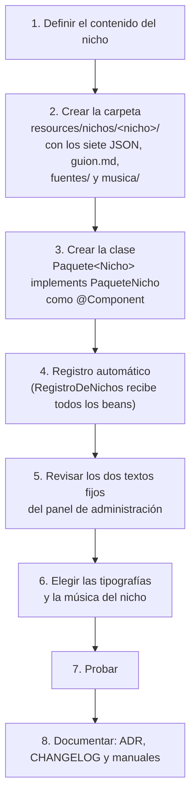

# Guía: crear un paquete de nicho nuevo

Paso a paso para agregar un rubro nuevo a AutoReel (por ejemplo, cafeterías o florerías) sin tocar el resto del sistema. El nicho del MVP es la **Pastelería**.

> **Estado del documento:** actualizado al cierre de la **fase 7** y de la **revisión del flujo del negocio** (2026-11-06). La interfaz `PaqueteNicho`, el paquete `PaquetePasteleria` y sus archivos `onboarding.json`, `temporadas.json`, `chat.json`, `plantilla.json`, `movimientos.json`, `vocabulario.json`, `musica.json` y `guion.md`, más las carpetas `fuentes/` (tipografías) y `musica/` (pistas), existen y se describen con sus nombres reales. La interfaz tiene lo que usan el onboarding, el catálogo, el chat, el guion con su storyboard, la generación de los clips y la composición del video.
>
> **Cambios de la revisión del flujo del negocio:**
> - `onboarding.json` admite **`maxOtro`** en las preguntas de selección: un chip "Otros" para escribir una opción propia (sección 4.1).
> - `chat.json` admite **`ejemplo`** en cada paso y **`opcionLibre`** en un paso `BOTONES`, para escribir en lugar de tocar un botón (sección 4.3).
> - El mensaje `aviso` del chat cambió y se muestra con un botón "?" junto a la respuesta.
> - **El catálogo ya no pide ni muestra temporadas**: un producto nuevo queda como "Todo el año". `temporadas.json` sigue existiendo y se valida, para retomarlas en el futuro (sección 4.2).
> - Las fotos del producto se aceptan desde **720 px** en el lado menor (RN-11).
> - Los clips ya no tienen respaldo sin IA (sección 8.5 de la especificación).
>
> **Cambios de la mejora de la calidad del video (2026-11-12, ADR 0021):**
> - **Sin guion de respaldo.** `plantilla.json` ya no lleva `respaldoDesde`, `textoDeRespaldo`, `ganchosDeRespaldo`, `descripcionDeRespaldo`, `descripcionFijaDeRespaldo` ni `avisoDeRespaldo`. Con `FAIL_ON_UNKNOWN_PROPERTIES`, dejarlos hace fallar el arranque.
> - `plantilla.json` suma `maximoCaracteresUbicacion`. El `maxPalabras` del cierre es ahora el de la **frase** que escribe la IA, y el `movimientoDeRespaldo` es el movimiento **sugerido** al modelo (sección 4.4).
> - `movimientos.json` suma `plantillaDeToma`, `negativos`, `minimoPlanosCamara3d` y `camara3d` por movimiento, y `prohibiciones` pasa a frases para el final del prompt. El prompt completo del modelo de video sale del paquete (sección 4.5).
> - `guion.md` pide el objeto **`cierre`** (precio, frase y ubicación) y tiene marcadores nuevos (sección 4.7).
>
> Otros nichos están **fuera del alcance del MVP** (sección 21; RF-33 es de prioridad F). La guía existe para que el diseño quede listo para crecer. Decisiones de fondo: ADR 0011 (contenido en JSON), ADR 0012 (agrupación de mensajes), ADR 0013 (el MVP no usa temporadas), ADR 0014 (procesador de guiones), ADR 0016 (composición con FFmpeg) y ADR 0017 (proveedores de Google).

---

## 1. Principio

Regla 5 de la sección 0: **todo lo propio del nicho vive en su paquete** y nunca se dispersa por el código. Eso incluye las preguntas, la plantilla, los movimientos, el vocabulario, las temporadas y la música.

Por eso, un nicho nuevo es **otro paquete**: una clase que implementa `PaqueteNicho`, más sus archivos JSON. El registro, la API y el frontend lo toman solos; el chat, el guion, la generación y la publicación no cambian (sección 7).

---

## 2. Qué existe hoy (fase 7)

| Pieza | Ubicación | Qué hace |
|---|---|---|
| `PaqueteNicho` | `backend/src/main/java/com/autoreel/nicho/dominio/PaqueteNicho.java` | Interfaz del paquete (sección 3). |
| `Nicho` | `nicho/dominio/Nicho.java` | `record Nicho(String id, String nombre)`: lo que ve el panel de administración. |
| `Opcion`, `Pregunta`, `Temporada` | `nicho/dominio/` | Records que se leen de los JSON (sección 4). `Pregunta.admiteOtro()` dice si una selección tiene el chip "Otros" (`maxOtro`). |
| `ValidadorDeRespuestas` | `nicho/dominio/ValidadorDeRespuestas.java` | `normalizar(preguntas, respuestas)` revisa el formato y limpia, incluida la opción escrita en "Otros"; `exigirCompletas(preguntas, respuestas)` exige las obligatorias, incluidas las condicionales. Común a todos los nichos. |
| `RegistroDeNichos` | `nicho/dominio/RegistroDeNichos.java` | `@Component` que recibe **todos los beans `PaqueteNicho`**. Expone `todos()` (lista de `Nicho`), `buscar(id)` (`Optional`) y `de(id)` (para un negocio existente; si falta, 500 `NICHO_DESCONOCIDO`). Define la constante `PASTELERIA`. |
| `GuionChat` | `nicho/dominio/GuionChat.java` | Record del guion del chat (sección 4.3): límites de caracteres, respuestas negativas, mensajes fijos y pasos (`PasoChat`, `TipoPaso`, `Condicion`, `Sugerencia`). `validar()` revisa su forma al arrancar; `esNegativa(texto)`, `paso(id)` y `siguiente(id)` los usa el chat. Desde la revisión del flujo, `PasoChat` tiene `ejemplo` y `opcionLibre`, con `admiteTexto()` y `claveLibre()`. Común a todos los nichos. |
| `PlantillaVideo`, `Movimientos`, `Vocabulario` | `nicho/dominio/` | Records que se leen de `plantilla.json`, `movimientos.json` y `vocabulario.json` (secciones 4.4 a 4.6). `PlantillaVideo.validar(...)` revisa la plantilla al arrancar. |
| `Texto` | `nicho/dominio/Texto.java` | Reglas de texto comunes: `normalizar` (minúsculas, sin tildes, conserva la "ñ"), `contieneFrase` (una frase prohibida como secuencia de palabras completas), `contarPalabras` (cuenta lo que tiene al menos una letra o un número: "S/ 65" son 2), `tieneCaracteresNoDibujables` y `soloDibujable`. Desde la fase 5, lo dibujable es una **lista blanca**: U+0020–007E, U+00A0–00FF (incluye á, ñ, ¿, ¡) y ‘ ’ “ ” – — … €; todo lo demás (emojis, saltos de línea, otros alfabetos) no se puede dibujar. Las usan el validador, la edición del storyboard y la composición (y, hasta el 2026-11-12, el guion de respaldo). |
| `PistaDelNicho` | `nicho/dominio/PistaDelNicho.java` | `record PistaDelNicho(estilo, nombre, archivo, duracionSegundos, licencia)`: una pista de `musica.json` (sección 4.8). |
| `PaquetePasteleria` | `nicho/pasteleria/PaquetePasteleria.java` | `@Component` que lee y valida al arrancar los ocho archivos de `nichos/pasteleria/`, las tipografías de `fuentes/` y que existan las pistas de `musica/`. |
| Archivos del paquete | `backend/src/main/resources/nichos/pasteleria/` | `onboarding.json` (estilos y preguntas), `temporadas.json`, `chat.json` (guion del chat), `plantilla.json` (planos del video y tipografías), `movimientos.json`, `vocabulario.json`, `musica.json` (pistas por estilo) y `guion.md` (instrucciones del modelo de texto); las carpetas `fuentes/` (TTF con su licencia OFL) y `musica/` (pistas `.m4a`). |
| `BibliotecaMusical` | `video/aplicacion/BibliotecaMusical.java` | Al arrancar, sube al almacenamiento las pistas de todos los paquetes (`musica/{nicho}/{archivo}`) y crea las filas que falten en `pista_musical` (migración `V6__generacion.sql`). Al aprobar el storyboard elige una pista activa del estilo del negocio y la guarda en `video.pista_musical_id`, para que recomponer use la misma. |
| Generación y composición | `video/aplicacion/`, `video/infraestructura/` | Genéricas: `ServicioGeneracion` pide a `Movimientos.promptDeToma` el prompt de cada clip (desde el 2026-11-12: la `plantillaDeToma` con la `instruccion` del movimiento y las `prohibiciones`) y le pasa los `negativos` al modelo de video (sin respaldo sin IA: un plano sin clip deja el video en `ERROR`, o conserva el clip anterior en una regeneración); `ServicioComposicion` y `FfmpegComponedor` usan los `segundos` de la plantilla, los `llamados`, la tipografía del estilo y la pista. No tienen nada de Pastelería. |
| Guion y storyboard | `video/aplicacion/`, `video/dominio/` | Genéricos: `InstruccionesDelGuion` llena `guion.md` y arma el esquema JSON de la respuesta; `ValidadorDeGuion` (RN-21 a RN-24; desde el 2026-11-12 también el cierre y la variedad de movimientos) lee la plantilla, los movimientos y el vocabulario del paquete (`GuionDeRespaldo` se borró el 2026-11-12); `ServicioVideos` aplica los mismos límites al editar el storyboard. No tienen nada de Pastelería. |
| Motor del chat | `chat/aplicacion/ServicioChat.java`, `chat/dominio/` | Genérico: recorre los pasos de `guionDelChat()` en orden, agrupa los textos (`AgrupadorDeMensajes`, ADR 0012) y los revisa con `EvaluadorDeRespuesta`. Un texto escrito en un paso `BOTONES` con `opcionLibre` lo atiende `escribirEnBotones` (sección 4.3). No tiene nada de Pastelería. |
| Conversaciones guardadas | Migración `V4__chat.sql` | `conversacion.paso_actual` (id del paso, `varchar(40)`) y `conversacion.respuestas` (`jsonb`, por id de paso, más `<id>Libre` cuando el negocio escribió en un paso de botones). |
| `NichoController` | `nicho/api/NichoController.java` | `GET /api/nicho/configuracion` (rol NEGOCIO): el paquete del negocio de la sesión. |
| Columna `negocio.nicho` | Migración `V1__usuarios_y_negocios.sql` | `varchar(40) not null`. Guarda el **código** del nicho (`PASTELERIA`). La base de datos no tiene un catálogo de nichos. |
| Validación al crear un negocio | `ServicioGestionNegocios.crear` | `nichos.buscar(...)`; si no existe, `NICHO_INVALIDO` ("El nicho elegido no existe."). |
| `GET /api/admin/nichos` | `AdminNegocioController` | Devuelve `RegistroDeNichos.todos()` para el selector **Nicho** de "Crear negocio". |
| Nombre del nicho en el detalle | `ServicioGestionNegocios.detalle` | `NegocioDetalle.nombreNicho` sale de `PaqueteNicho.nombre()`. |
| Respuestas y temporadas guardadas | Migración `V3__perfil_y_catalogo.sql` | `perfil_negocio.respuestas` (`jsonb`, por id de pregunta; una opción escrita en "Otros" va tal cual entre los valores) y `producto.temporadas` (`jsonb`, lista de ids de temporada). Desde el 2026-11-06 el catálogo no las pide: un producto sin temporadas recibe `TODO_EL_ANIO`, y uno que ya tenía conserva las suyas. |
| Nicho inmutable | (ningún endpoint) | RN-40: ninguna operación cambia el nicho de un negocio ya creado. |
| Pruebas | `backend/src/test/java/com/autoreel/nicho/pasteleria/PaquetePasteleriaTest.java` | Temporadas vigentes y próximas, validación de respuestas (incluida una opción escrita en "Otros", `aceptaUnaOpcionEscritaEnOtros`) y un guion del chat mal armado que falla (`unGuionDelChatMalArmadoFallaAlArrancar`), con los archivos reales. |
| | `backend/src/test/java/com/autoreel/chat/ChatIntegracionTest.java` | Entre otras, `enLaPrimeraPreguntaSePuedeEscribirElTipoDeVideo`: el texto escrito en `tipoVideo` se guarda en `tipoVideoLibre` y el paso queda con su `opcionLibre`. |
| | `backend/src/test/java/com/autoreel/video/dominio/` | `ValidadorDeGuionTest` (con el armador `Guiones`) usa el paquete real de Pastelería: si un cambio en `plantilla.json`, `movimientos.json` o `vocabulario.json` rompe una regla, falla. `PaquetePasteleriaTest` revisa además los 13 movimientos y el prompt de `ORBITA_FRONTAL`. |
| | `backend/src/test/java/com/autoreel/video/infraestructura/FfmpegComponedorTest.java` | Compone con FFmpeg real y la tipografía real del paquete, con textos difíciles (`%`, `\`, `:`, comillas, `¿`, `¡`, `ñ`), y verifica el formato con `ffprobe` (V23). |

**El frontend es genérico salvo dos detalles**, que hay que revisar al agregar un nicho:

- `frontend/src/admin/ModalCrearNegocio.tsx`: `NICHO_POR_DEFECTO = 'PASTELERIA'` y una opción de respaldo `{ id: 'PASTELERIA', nombre: 'Pastelería' }` mientras cargan los nichos de `GET /api/admin/nichos`.
- `frontend/src/admin/PaginaNegocios.tsx`: la columna **Nicho** traduce `PASTELERIA` → "Pastelería"; cualquier otro código se muestra tal cual. (El detalle del negocio ya usa `nombreNicho` del backend.)

El chat (`frontend/src/chat/`) es genérico: dibuja cada paso según su `tipo`, muestra la caja de texto cuando el paso la admite (`admiteTexto`: los `TEXTO` y los `BOTONES` con `opcionLibre`) y usa las preguntas, opciones, ejemplos y mensajes fijos que manda el backend. Solo tiene escritos los textos de su interfaz, que sirven para cualquier rubro: botones ("No, gracias", "Usar la descripción de mi producto", "Subir uno nuevo hoy", "Usar {nombre}", "Continuar", "Empezar de nuevo", "Crear otro video", "Reintentar"), el texto de la caja ("Escribe tu respuesta…" u "O escríbelo con tus palabras…" en un paso de botones), el botón "?" que abre el `aviso`, la hoja "Subir un producto nuevo" con "¿Lo guardo en tu catálogo?", la pregunta "¿Continuamos donde quedamos?" y la tarjeta "Tus respuestas". La excepción es el texto de ejemplo de la descripción en `chat/HojaProductoNuevo.tsx` ("Sabor, relleno, ingredientes destacados…"), el mismo de `catalogo/PaginaProducto.tsx`: está pensado para Pastelería y habría que moverlo al paquete o generalizarlo para otro rubro.

El onboarding y Ajustes dibujan cada pregunta con `componentes/CampoPregunta.tsx`. Una `SELECCION_MULTIPLE` con `maxOtro` usa `componentes/SeleccionConOtros.tsx`: los chips de las opciones más un chip "Otros" que abre un campo de hasta `maxOtro` caracteres.

**Datos fijos en el backend** que un nicho nuevo debe respetar:

- `ServicioCatalogo.TEMPORADA_POR_DEFECTO = "TODO_EL_ANIO"`: la temporada que recibe **todo producto que llega sin temporadas**. Desde el 2026-11-06 son todos los productos nuevos, porque el catálogo ya no las pide (el formulario de `PaginaProducto.tsx` solo reenvía las que ya tenía un producto existente), y también los subidos desde el chat. El `temporadas.json` del nicho **debe tener una temporada con ese id**; si no, crear un producto responde `TEMPORADA_INVALIDA`.
- `ServicioChat` guarda "No, gracias" como texto del mensaje del usuario cuando omite una pregunta.
- **Los ids que lee el guion.** Son el contrato entre los JSON del paquete y el módulo `video`:
  - Pasos del chat (`video/aplicacion/RespuestasDelChat`): `tipoVideo`, `producto`, `especial`, `precio` y `extra`. Todo nicho los pregunta con esos ids. `CreadorDeVideos` exige `producto` y `tipoVideo` al completarse la conversación. Si el paso `tipoVideo` tiene `opcionLibre` y el negocio escribió, `LectorDeDatosDelVideo` lee además `tipoVideoLibre` y el guion recibe "{texto de la opción}. Lo que pidió el negocio: {lo que escribió}".
  - Preguntas del onboarding (`video/aplicacion/CamposDelPerfil`): `especialidad`, `publico`, `ciudad`, `distrito`, `canales`, `whatsapp`, `horario`, `distintivo` y `palabrasProhibidas`, más la opción `WHATSAPP` de `canales` (el cierre muestra el número). Una pregunta que falte llega al guion como "(no lo indicó)".
  - `PaquetePasteleria.validarVideo()` busca la pregunta `canales` y el paso `tipoVideo` por esos nombres.
- **Las tres fotos del producto** son las de `catalogo/dominio/TipoFoto`: `DETALLE`, `ENTERO` y `PORCION`. Son comunes a todos los nichos, y el campo `foto` de la plantilla debe usar una de ellas.

---

## 3. La interfaz `PaqueteNicho`

Firma real (`com.autoreel.nicho.dominio.PaqueteNicho`):

```java
public interface PaqueteNicho {

    /** Una fecha especial se considera "próxima" durante los 15 días anteriores (sección 7.7). */
    int DIAS_FECHA_PROXIMA = 15;

    String id();                              // código guardado en negocio.nicho, p. ej. "PASTELERIA" (máx. 40)
    String nombre();                          // texto visible, p. ej. "Pastelería"
    List<Opcion> estilos();                   // estilos de video del paso 1
    List<Pregunta> preguntasOnboarding();     // preguntas de los pasos 2 y 3
    List<Temporada> temporadas();             // temporadas y fechas especiales
    GuionChat guionDelChat();                 // preguntas del chat del video del día
    PlantillaVideo plantillaVideo();          // planos del video, llamados y límites del cierre
    Movimientos movimientos();                // movimientos de cámara permitidos
    Vocabulario vocabulario();                // tonos, frases prohibidas y palabras de promoción
    String instruccionesGuion();              // guion.md, con marcadores {así}
    byte[] tipografia(String estilo);         // TTF de los textos del video para un estilo (P-05)
    List<PistaDelNicho> pistas();             // pistas de música de musica.json (P-02)
    byte[] leerPista(PistaDelNicho pista);    // contenido de una pista de la carpeta musica/

    default boolean admiteEstilo(String estilo) { ... }
    default boolean admiteTemporada(String id) { ... }

    /** Temporadas y fechas especiales en curso. "Todo el año" (SIEMPRE) no cuenta. */
    default List<Temporada> temporadasVigentes(LocalDate hoy) { ... }

    /** Fechas especiales (FECHA_ESPECIAL) no vigentes que empiezan en (hoy, hoy + 15 días], de la más cercana a la más lejana. */
    default List<Temporada> fechasEspecialesProximas(LocalDate hoy) { ... }
}
```

- Los métodos por defecto son comunes: un paquete nuevo solo implementa los trece abstractos.
- Quien llama a `temporadasVigentes` y `fechasEspecialesProximas` pasa `LocalDate.now(reloj)` con el `Clock` de `America/Lima` (`ConfiguracionReloj`). Hoy solo `NichoController` usa `temporadasVigentes` (las manda en `GET /api/nicho/configuracion`, aunque ninguna pantalla las muestra). **El MVP no usa temporadas** (ADR 0013): el carrusel no se ordena por temporada, no hay botón "Fecha especial" y, desde el 2026-11-06, el catálogo tampoco las pide ni las muestra. Los dos cálculos quedan listos, con sus pruebas, para cuando se retomen (V13 y RF-31; sección 10 de `docs/plan-de-desarrollo.md`).
- Quién usa cada método: `ServicioPerfil` (`admiteEstilo` → `ESTILO_INVALIDO`; `preguntasOnboarding` con `ValidadorDeRespuestas`), `ServicioCatalogo` (`admiteTemporada` → `TEMPORADA_INVALIDA`), `ServicioChat` (`guionDelChat`), `NichoController`, `ServicioGestionNegocios` y, desde la fase 4, el módulo `video`. `LectorDeDatosDelVideo` toma el paquete del negocio con `RegistroDeNichos.de(...)`; `InstruccionesDelGuion`, `ValidadorDeGuion`, `ServicioGuion` y `ServicioVideos` usan `plantillaVideo`, `movimientos`, `vocabulario` e `instruccionesGuion`.
- Desde la fase 5:
  - `ServicioGeneracion` usa `movimientos` para el modelo de video: desde el 2026-11-12, `promptDeToma(movimiento)` y `negativos()` (antes, la `instruccion` y las `prohibiciones`).
  - `ServicioComposicion` usa `plantillaVideo` (segundos y llamados) y `tipografia(estilo)`. Si el estilo del negocio no existe en el paquete, usa la del primer estilo.
  - `BibliotecaMusical` usa `pistas()` y `leerPista(...)` al arrancar (sección 4.8).
- `tipografia(estilo)` devuelve **bytes**, no una ruta: dentro del JAR no hay ruta de archivo, y FFmpeg la recibe escrita en su carpeta temporal (ADR 0016). `PaquetePasteleria` lee las tipografías una sola vez, al arrancar, y lanza `IllegalArgumentException` si se pide un estilo sin tipografía.

---

## 4. Archivos del paquete

Carpeta: `backend/src/main/resources/nichos/<nicho>/`. Se leen con el `ObjectMapper` de Jackson; los nombres de campo deben coincidir con los de los records.

### 4.1 `onboarding.json`

```json
{
  "estilos": [
    { "valor": "CASERO", "texto": "Casero" },
    { "valor": "ELEGANTE", "texto": "Elegante" },
    { "valor": "DIVERTIDO", "texto": "Divertido" }
  ],
  "preguntas": [
    {
      "id": "canales",
      "paso": 2,
      "texto": "¿Cómo te piden?",
      "ayuda": "Marca al menos una opción. Si no está la tuya, usa \"Otros\".",
      "tipo": "SELECCION_MULTIPLE",
      "obligatoria": true,
      "maxOtro": 40,
      "opciones": [
        { "valor": "WHATSAPP", "texto": "Por WhatsApp" },
        { "valor": "DELIVERY", "texto": "Por apps de delivery" },
        { "valor": "TIENDA", "texto": "En la tienda" }
      ]
    },
    {
      "id": "whatsapp",
      "paso": 2,
      "texto": "Número de WhatsApp",
      "ayuda": "Celular de 9 dígitos. Aparece en el cierre del video.",
      "tipo": "TELEFONO",
      "obligatoria": false,
      "obligatoriaSi": { "pregunta": "canales", "contiene": "WHATSAPP" }
    }
  ]
}
```

**Estilos** (`Opcion(valor, texto)`): el `valor` se guarda en `perfil_negocio.estilo` (`varchar(30)`); el `texto` se muestra en el paso 1.

**Pregunta** (`record Pregunta(String id, int paso, String texto, String ayuda, TipoPregunta tipo, boolean obligatoria, Integer maxLongitud, List<Opcion> opciones, Condicion obligatoriaSi, Integer maxOtro)`):

| Campo | Obligatorio | Significado |
|---|---|---|
| `id` | Sí | Clave de la respuesta en `perfil_negocio.respuestas`. **Es contrato:** no se renombra sin migrar los datos. |
| `paso` | Sí | `2` (datos del negocio, obligatorio en el asistente) o `3` (opcional). El paso 1 (nombre, logo, colores, estilo) es común a todos los nichos. |
| `texto` | Sí | Etiqueta visible y texto de los errores ("Falta responder: …"). |
| `ayuda` | No | Texto de ayuda bajo el campo. |
| `tipo` | Sí | `TEXTO`, `SELECCION_MULTIPLE` o `TELEFONO` (tabla siguiente). |
| `obligatoria` | Sí | Si se exige al completar el onboarding. En una `SELECCION_MULTIPLE` significa "al menos una opción". |
| `maxLongitud` | No | Máximo de caracteres en `TEXTO` (tras quitar espacios a los lados). |
| `opciones` | Solo en `SELECCION_MULTIPLE` | Lista de `{valor, texto}`; se guarda el `valor`. |
| `obligatoriaSi` | No | `{pregunta, contiene}`: pasa a ser obligatoria si la respuesta de otra pregunta de selección contiene ese valor. |
| `maxOtro` | No | Solo en `SELECCION_MULTIPLE` (desde el 2026-11-06). Agrega el chip **"Otros"**, que abre un campo para escribir **una** opción propia de hasta `maxOtro` caracteres: una característica, no una oración. Sin `maxOtro` (o con 0), la pregunta no tiene "Otros". |

| `tipo` | Se guarda como | Normalización y validación (`ValidadorDeRespuestas`) | Campo en el frontend (`CampoPregunta`) |
|---|---|---|---|
| `TEXTO` | texto | Quita espacios a los lados; vacío = sin respuesta; respeta `maxLongitud` | `Campo` con contador `n/max` |
| `SELECCION_MULTIPLE` | lista de valores | Valores de `opciones`, sin repetidos; lista vacía = sin respuesta. Con `maxOtro`, la lista admite además **un** texto libre (se le quitan los espacios repetidos y se guarda tal cual entre los valores) | `Chips` (varias a la vez); con `maxOtro`, `SeleccionConOtros` |
| `TELEFONO` | `+519XXXXXXXX` | Quita espacios y guiones; acepta `^(\+?51)?9\d{8}$`; si no, "Escribe un celular de 9 dígitos que empiece con 9." | `type="tel"` e `inputMode="tel"`, con `+51` visible |

Todos los errores de formato responden 400 `RESPUESTA_INVALIDA`; una respuesta con un id que no existe también ("No reconocemos la respuesta …"). Las obligatorias que faltan responden 400 `PERFIL_INCOMPLETO` al completar el onboarding o al editar un perfil ya completo.

**Errores de "Otros"** (400 `RESPUESTA_INVALIDA`):

- Un valor que no está en `opciones` en una pregunta **sin** `maxOtro`: "Elegiste una opción que no existe en …".
- Dos textos libres en la misma pregunta: "En … puedes escribir una sola opción en "Otros".".
- Un texto más largo que `maxOtro`: "En …, "Otros" puede tener como máximo … caracteres: escribe una característica, no una oración.".

**Qué hace el resto del sistema con "Otros":**

- **El guion** recibe el texto tal cual: `LectorDeDatosDelVideo` traduce cada valor al `texto` de su opción y, si no es una opción, lo deja como lo escribió el negocio ("Familias, Bodas en la playa").
- **El cierre** solo usa los `llamados` de las opciones de `canales` (sección 4.4). Un canal escrito en "Otros" no tiene llamado: si es el único que marcó el negocio, el cierre queda sin llamado.
- **El panel** lo muestra en el detalle del negocio. La idea de volver opciones las respuestas más repetidas está en la sección 10.1 de `docs/plan-de-desarrollo.md`.

Preguntas reales de Pastelería (sección 7.1): paso 2: `especialidad` (selección, 5 opciones y "Otros" de 40), `publico` (selección, 4 opciones y "Otros" de 40), `ciudad` (texto, 60), `distrito` (texto, 60), `canales` (selección: `WHATSAPP`, `DELIVERY`, `TIENDA` y "Otros" de 40), `whatsapp` (teléfono, obligatoria si `canales` contiene `WHATSAPP`) y `horario` (texto, 120); paso 3: `distintivo` ("¿Qué te diferencia?", texto, 80) y `palabrasProhibidas` (texto, 300, separadas por comas). Todas las del paso 2 son obligatorias salvo `whatsapp`, que es condicional.

### 4.2 `temporadas.json`

> **Estado:** el archivo **sigue siendo obligatorio** y se valida al arrancar, pero el MVP no usa las temporadas (ADR 0013). Desde el 2026-11-06 el catálogo no las pide ni las muestra: todo producto nuevo queda con `TODO_EL_ANIO`, y los que ya tenían otras las conservan. Se mantienen para retomar las fechas especiales en el chat, las temporadas en el carrusel (V13) y el calendario (RF-31), sin migrar datos (sección 10 de `docs/plan-de-desarrollo.md`). Un nicho nuevo debe traer al menos la temporada `TODO_EL_ANIO`.

```json
{
  "temporadas": [
    { "id": "TODO_EL_ANIO", "nombre": "Todo el año", "clase": "SIEMPRE", "regla": { "tipo": "SIEMPRE" } },
    { "id": "VERANO", "nombre": "Verano", "clase": "TEMPORADA", "regla": { "tipo": "RANGO", "desde": "12-21", "hasta": "03-20" } },
    { "id": "SAN_VALENTIN", "nombre": "San Valentín", "clase": "FECHA_ESPECIAL", "regla": { "tipo": "FECHAS", "fechas": ["02-14"] } },
    { "id": "DIA_DE_LA_MADRE", "nombre": "Día de la Madre", "clase": "FECHA_ESPECIAL", "regla": { "tipo": "N_ESIMO_DOMINGO", "mes": 5, "n": 2 } },
    { "id": "NAVIDAD", "nombre": "Navidad", "clase": "FECHA_ESPECIAL", "regla": { "tipo": "MES", "mes": 12 } }
  ]
}
```

**Temporada** (`record Temporada(String id, String nombre, Clase clase, Regla regla)`):

- `id`: se guarda en `producto.temporadas`. **Es contrato**, igual que el de las preguntas.
- `clase`:
  - `TEMPORADA`: un período (verano, invierno). Cuenta como vigente, nunca como "próxima".
  - `FECHA_ESPECIAL`: puede anunciarse como próxima en los 15 días anteriores a su inicio.
  - `SIEMPRE`: "todo el año". Nunca cuenta como vigente, para no empatar con la temporada actual (pensado para V13, que quedó fuera del MVP por el ADR 0013).
- `regla` (`Regla(tipo, desde, hasta, fechas, mes, n)`), con fechas `"MM-dd"`:

| `tipo` | Campos | Vigente cuando | Próximo inicio |
|---|---|---|---|
| `RANGO` | `desde`, `hasta` | Entre ambas fechas, inclusive; si `desde` > `hasta`, cruza el año (verano 12-21 a 03-20) | `desde` |
| `FECHAS` | `fechas` (uno o varios días) | Alguno de esos días | La primera fecha de la lista |
| `N_ESIMO_DOMINGO` | `mes`, `n` | El `n`-ésimo domingo de `mes` | Ese domingo |
| `MES` | `mes` | Todo el mes | El día 1 |
| `SIEMPRE` | — | Siempre | Nunca |

El próximo inicio se calcula en el año de la fecha y en el siguiente, estrictamente después de hoy.

Temporadas reales de Pastelería (sección 7.2): `TODO_EL_ANIO`, `VERANO` (12-21 a 03-20), `INVIERNO` (06-21 a 09-22), `SAN_VALENTIN` (02-14), `DIA_DE_LA_MADRE` (2.º domingo de mayo), `DIA_DEL_PADRE` (3.er domingo de junio), `FIESTAS_PATRIAS` (07-28 y 07-29), `HALLOWEEN_CANCION_CRIOLLA` (10-31) y `NAVIDAD` (diciembre).

### 4.3 `chat.json`

El guion del chat del video del día (sección 7.3, RN-16): preguntas fijas, en orden, sin IA. Se lee como un `GuionChat` y el motor del chat (`ServicioChat`) lo recorre sin saber de qué rubro es. Versión real de Pastelería, abreviada:

```json
{
  "minimoCaracteres": 3,
  "maximoCaracteres": 500,
  "respuestasNegativas": ["no", "nop", "ninguno", "ninguna", "nada", "no hay", "sin precio", "no gracias", "-"],
  "mensajes": {
    "pregunta": "Soy un asistente para reunir información, no puedo responder preguntas. …",
    "muyCorta": "Cuéntame un poco más, con unas palabras basta.",
    "muyLarga": "Es mucho texto para un video de 15 segundos. ¿Me lo resumes en menos de 500 caracteres?",
    "precioObligatorio": "Como es una promoción, necesito el precio o la promoción tal como quieres que aparezca. …",
    "productoNoDisponible": "Ese producto ya no está disponible. Elige otro o sube uno nuevo.",
    "catalogoVacio": "Todavía no tienes productos con sus tres fotos. Súbelo ahora mismo.",
    "cierre": "¡Listo! Estoy preparando tu propuesta…",
    "aviso": "Este chat está diseñado para recibir respuestas, no para recibir preguntas."
  },
  "pasos": [
    {
      "id": "tipoVideo",
      "tipo": "BOTONES",
      "texto": "¡Hola! ¿Qué video quieres crear hoy?",
      "obligatoria": true,
      "opciones": [
        { "valor": "PRODUCTO_ESTRELLA", "texto": "Producto estrella" },
        { "valor": "PROMOCION", "texto": "Promoción" }
      ],
      "ejemplo": "O escríbelo: \"Video para el Día de la Madre con nuestras tortas de fresa\".",
      "opcionLibre": "PRODUCTO_ESTRELLA"
    },
    { "id": "producto", "tipo": "PRODUCTO", "texto": "¿Qué producto mostramos?", "obligatoria": true },
    {
      "id": "especial",
      "tipo": "TEXTO",
      "texto": "¿Qué lo hace especial hoy?",
      "obligatoria": true,
      "sugerencia": "DESCRIPCION_PRODUCTO",
      "ejemplo": "Ej.: \"Bizcocho de vainilla con fresas frescas, recién hecho esta mañana\"."
    },
    {
      "id": "precio",
      "tipo": "TEXTO",
      "texto": "¿Hay precio o promoción que quieras mencionar?",
      "obligatoria": false,
      "omitible": true,
      "obligatoriaSi": { "paso": "tipoVideo", "valor": "PROMOCION" },
      "ejemplo": "Ej.: \"S/ 65\" o \"2x1 hasta el domingo\"."
    }
  ]
}
```

#### Campos de la raíz

| Campo | Significado |
|---|---|
| `minimoCaracteres` | Una respuesta de texto **obligatoria** más corta que esto se rechaza con el mensaje `muyCorta`. Debe ser mayor que 0. |
| `maximoCaracteres` | Máximo de la respuesta **agrupada** (RN-17). Un solo mensaje más largo se rechaza en la petición (400 `RESPUESTA_MUY_LARGA`); un grupo más largo, con el mensaje `muyLarga` en el chat. El frontend usa este número en el contador de la caja de texto. Debe ser mayor que `minimoCaracteres`. |
| `respuestasNegativas` | Frases que significan "no" ("no", "nada", "sin precio"…). Se comparan **sin mayúsculas, sin tildes, sin espacios y sin puntuación** (`GuionChat.esNegativa`), así "No, gracias." coincide con `"no gracias"`. Solo se conservan letras, números y el guion, por eso `"-"` también funciona. |
| `mensajes` | Los ocho mensajes fijos (tabla siguiente). Todos son obligatorios y no pueden estar vacíos. |
| `pasos` | Las preguntas, en el orden en que se hacen. |

#### Mensajes fijos

| Clave | Cuándo se muestra |
|---|---|
| `pregunta` | La respuesta agrupada contiene "?" o "¿" (RN-18, V16). Después se repite la pregunta. |
| `muyCorta` | Una respuesta obligatoria tiene menos de `minimoCaracteres`, o es una respuesta negativa (o "No, gracias") en una pregunta con `obligatoria: true`. |
| `muyLarga` | La respuesta agrupada pasa de `maximoCaracteres`. |
| `precioObligatorio` | Una pregunta que es obligatoria **solo por su `obligatoriaSi`** recibe una respuesta negativa o "No, gracias" (RN-20, V17). El nombre viene del caso de Pastelería, pero el motor lo usa para cualquier `obligatoriaSi`: redáctalo para la condición de tu nicho. |
| `productoNoDisponible` | Al terminar, el producto elegido ya no está activo o perdió una foto: el chat vuelve al paso `PRODUCTO`. |
| `catalogoVacio` | Al llegar al paso `PRODUCTO`, el negocio no tiene productos elegibles; solo queda "Subir uno nuevo hoy". |
| `cierre` | La última respuesta se aceptó y la conversación queda `COMPLETA`. |
| `aviso` | Aviso fijo del chat (sección 7.3). Desde el 2026-11-06 no se muestra siempre: se abre con un botón **"?"** junto a la caja de respuesta (o al pie, en los pasos sin caja de texto). En Pastelería: "Este chat está diseñado para recibir respuestas, no para recibir preguntas." |

Después de `pregunta`, `muyCorta`, `muyLarga` y `precioObligatorio`, el chat vuelve a hacer la misma pregunta.

#### Cada paso (`PasoChat`)

`record PasoChat(String id, TipoPaso tipo, String texto, boolean obligatoria, List<Opcion> opciones, Condicion obligatoriaSi, boolean omitible, Sugerencia sugerencia, String ejemplo, String opcionLibre)`:

| Campo | Obligatorio | Significado |
|---|---|---|
| `id` | Sí | Clave de la respuesta en `conversacion.respuestas` y valor de `conversacion.paso_actual` (hasta 40 caracteres). **Es contrato** con el guion de la fase 4. |
| `tipo` | Sí | `BOTONES`, `PRODUCTO` o `TEXTO` (tabla siguiente). |
| `texto` | Sí | La pregunta que dice el sistema. También es la etiqueta de la fila en el resumen final ("Tus respuestas"). |
| `obligatoria` | No (vale `false`) | Siempre obligatoria. |
| `opciones` | Solo en `BOTONES` | Lista de `{valor, texto}`, sin valores repetidos. Se guarda el `valor`; en el chat se ve el `texto`. |
| `obligatoriaSi` | No | `{paso, valor}`: la pregunta pasa a ser obligatoria si la respuesta del paso indicado es igual a ese valor. Debe apuntar a un paso **anterior** y a un `valor` que exista entre sus opciones (por lo tanto, a un paso `BOTONES`). Pastelería la usa para RN-20: el precio es obligatorio si `tipoVideo` es `PROMOCION`. |
| `omitible` | No (vale `false`) | Solo en `TEXTO`. Muestra el botón **"No, gracias"** mientras la pregunta no sea obligatoria en ese momento. |
| `sugerencia` | No | Solo en `TEXTO`. Hoy existe `DESCRIPCION_PRODUCTO`: el backend manda la descripción del producto elegido y el frontend muestra el botón "Usar la descripción de mi producto", que la copia en la caja de texto. |
| `ejemplo` | No | Desde el 2026-11-06. Un ejemplo corto de respuesta que se muestra bajo la caja de texto, junto al contador de caracteres. Solo se ve en los pasos con caja de texto (`TEXTO` y `BOTONES` con `opcionLibre`). |
| `opcionLibre` | No | Desde el 2026-11-06. Solo en `BOTONES`, y debe ser el `valor` de una de sus opciones. Muestra la caja de texto también en ese paso ("O escríbelo con tus palabras…"): si el negocio **escribe** en lugar de tocar un botón, se guarda esta opción como respuesta del paso y su texto aparte, en `<id>Libre`. |

Un sí/no que no se escribe (`obligatoria`, `omitible`) vale `false`. `obligatoriaSi` **no** hace que un paso aparezca o desaparezca: todos los pasos se preguntan siempre. El motor no tiene pasos condicionales (ver ADR 0013 si se necesitan).

| `tipo` | Cómo responde el usuario | Qué se guarda en `respuestas` | ¿Se agrupa? |
|---|---|---|---|
| `BOTONES` | Toca una opción (`{"opcion": "PROMOCION"}`); otra responde 400 `OPCION_INVALIDA`. Con `opcionLibre`, también puede escribir (`{"texto": "…"}`). | El `valor` de la opción. Si escribió: el `valor` de `opcionLibre` y, en `<id>Libre`, su texto | No: un texto escrito en un paso de botones es una sola respuesta |
| `PRODUCTO` | Elige del carrusel (`{"productoId": 12}`) o sube uno nuevo con sus tres fotos (`{"productoNuevo": {…, "guardarEnCatalogo": true}}`). | El id del producto | No |
| `TEXTO` | Escribe uno o varios mensajes (`{"texto": "…"}`) o toca "No, gracias" (`{"omitir": true}`). | El texto agrupado sin espacios a los lados, o `null` si respondió que no u omitió | Sí: los mensajes con menos de 4 s entre sí son una respuesta (RN-17, ADR 0012) |

Debe haber **exactamente un paso `PRODUCTO`**: el chat lo usa para el carrusel, la sugerencia, la revisión final del producto y el resumen.

**Un texto escrito en un paso de botones** (`ServicioChat.escribirEnBotones`) se revisa con las mismas reglas que una respuesta de texto (`EvaluadorDeRespuesta`, siguiente apartado): una pregunta recibe el mensaje `pregunta`, un texto demasiado largo `muyLarga`, y uno negativo o más corto que `minimoCaracteres` en un paso obligatorio, `muyCorta`. Si se acepta, se guarda en `<id>Libre`, el paso se responde con su `opcionLibre` y el chat sigue. En el resumen final ("Tus respuestas") se ve lo que escribió el negocio en lugar del texto de la opción. El guion solo lee el texto libre del paso `tipoVideo` (sección 2): en otro paso de botones se guardaría y se vería en el resumen, pero no llegaría al guion sin programarlo.

#### Cómo se revisa una respuesta de texto

`EvaluadorDeRespuesta.evaluar`, en este orden, sobre el texto agrupado:

1. Contiene "?" o "¿" → `pregunta`.
2. Pasa de `maximoCaracteres` → `muyLarga`.
3. Es una respuesta negativa → si la pregunta no es obligatoria en ese momento, se acepta y se guarda `null`; si es `obligatoria: true`, `muyCorta`; si es obligatoria por `obligatoriaSi`, `precioObligatorio`.
4. Es obligatoria y tiene menos de `minimoCaracteres` → `muyCorta`.
5. Si no, se acepta y el chat hace la pregunta siguiente. Después del último paso, se revisa que el producto siga disponible y la conversación queda `COMPLETA` con el mensaje `cierre`.

Las respuestas de Pastelería quedan así en `conversacion.respuestas` (entrada del guion de la fase 4):

```json
{ "tipoVideo": "PROMOCION", "producto": 12, "especial": "Fresas frescas y crema batida", "precio": "S/ 65", "extra": null }
```

Si el negocio escribió el tipo de video en lugar de tocar un botón:

```json
{ "tipoVideo": "PRODUCTO_ESTRELLA", "tipoVideoLibre": "Video para el Día de la Madre", "producto": 12, "...": "..." }
```

Pasos reales de Pastelería: `tipoVideo` (BOTONES: `PRODUCTO_ESTRELLA`, `PROMOCION`, `TORTAS_POR_ENCARGO`, `RECIEN_HORNEADO`; `opcionLibre` `PRODUCTO_ESTRELLA`), `producto` (PRODUCTO), `especial` (TEXTO, obligatoria, sugerencia `DESCRIPCION_PRODUCTO`), `precio` (TEXTO, omitible, obligatoria si `tipoVideo = PROMOCION`) y `extra` (TEXTO, omitible). Todos menos `producto` tienen `ejemplo`. Por decisión del usuario, no hay opción "Fecha especial" (ADR 0013); una fecha escrita a mano en `tipoVideo` solo llega al guion como contexto.

### 4.4 `plantilla.json`

La plantilla fija del video de 15 segundos (sección 7.4, ADR 0003): cuatro planos. La IA escribe los textos de los tres primeros y, desde el 2026-11-12, los del cierre; el sistema arma el cierre con ellos y el llamado. Se lee como `PlantillaVideo`. Versión real de Pastelería:

```json
{
  "planos": [
    { "orden": 1, "nombre": "Gancho", "foto": "DETALLE", "maxPalabras": 6, "segundos": 3, "conIa": true,
      "movimientoDeRespaldo": "MACRO_DETALLE" },
    { "orden": 2, "nombre": "Producto", "foto": "ENTERO", "maxPalabras": 5, "segundos": 4, "conIa": true,
      "movimientoDeRespaldo": "ORBITA_FRONTAL" },
    { "orden": 3, "nombre": "Relleno", "foto": "PORCION", "maxPalabras": 7, "segundos": 4, "conIa": true,
      "movimientoDeRespaldo": "PARALAJE_LATERAL" },
    { "orden": 4, "nombre": "Cierre", "maxPalabras": 6, "segundos": 4, "conIa": false }
  ],
  "llamados": {
    "WHATSAPP": "Pide por WhatsApp",
    "DELIVERY": "Pídelo por delivery",
    "TIENDA": "Te esperamos en {distrito}"
  },
  "hashtagsBase": ["#pasteleria", "#postres", "#reposteria", "#dulces", "#antojo"],
  "maximoCaracteresPrecio": 40,
  "maximoCaracteresUbicacion": 40,
  "tipografias": {
    "CASERO": "Nunito-ExtraBold.ttf",
    "ELEGANTE": "PlayfairDisplay-Bold.ttf",
    "DIVERTIDO": "Fredoka-SemiBold.ttf"
  }
}
```

Hasta el 2026-11-12 la plantilla traía además los textos del guion de respaldo (`respaldoDesde` y `textoDeRespaldo` por plano, `ganchosDeRespaldo`, `descripcionDeRespaldo`, `descripcionFijaDeRespaldo` y `avisoDeRespaldo`). Se quitaron con el respaldo (ADR 0021), y hoy un campo de esos hace fallar el arranque.

#### Cada plano (`PlanoPlantilla`)

| Campo | Significado |
|---|---|
| `orden` | Posición del plano (1 a 4). Es la clave de `plano.orden` y de `PUT /api/videos/{id}/planos/{orden}`. |
| `nombre` | Nombre visible en el storyboard y en las instrucciones del modelo ("Gancho"). |
| `foto` | Foto del producto que usa el plano: `DETALLE`, `ENTERO` o `PORCION` (`TipoFoto`). El cierre no lleva. |
| `maxPalabras` | Máximo de palabras del texto en pantalla (RN-21), contadas con `Texto.contarPalabras`. Lo revisan el validador y el storyboard (400 `TEXTO_MUY_LARGO`, V21); el frontend muestra el contador. **En el cierre** (desde el 2026-11-12) es el máximo de la **frase** que escribe la IA (6 en Pastelería; 400 `FRASE_MUY_LARGA` al editarla); debe ser mayor que 0. |
| `segundos` | Duración del plano. Se le dice al modelo en las instrucciones, y la composición recorta cada clip a esa duración. El video final dura la **suma** de los segundos de los cuatro planos: debe dar 15 (RN-31). |
| `conIa` | `true` en los planos con clip de IA. **Exactamente uno** es `false`: el cierre, que no tiene clip. Desde el 2026-11-12 sus textos (precio, frase y ubicación) los escribe la IA y el sistema agrega el llamado; antes usaba el precio literal del usuario y el distrito. |
| `movimientoDeRespaldo` | `id` de `movimientos.json`. Desde el 2026-11-12 es el **movimiento sugerido** del plano: el prompt del guion lo muestra como "Movimiento sugerido" si el movimiento se admite en el tipo de video, para cuando el modelo no tenga una razón clara para elegir otro. Conviene que sea de cámara 3D. El nombre se conserva del guion de respaldo, que lo usaba. |

#### Campos de la raíz

| Campo | Significado |
|---|---|
| `llamados` | Llamado a la acción del cierre por **opción de la pregunta `canales`** del onboarding. El orden del archivo es la prioridad: el cierre usa el primero que el negocio tenga, no el orden en que marcó los canales. `{distrito}` se reemplaza por el distrito del negocio. |
| `hashtagsBase` | Entre 3 y 6 hashtags del rubro, con la forma `#palabra`. Se le sugieren al modelo (`{hashtagsBase}` en `guion.md`); el validador exige entre 5 y 8 en total, con al menos uno del distrito (RN-24). |
| `maximoCaracteresPrecio` | Máximo del precio **y de la frase** del cierre (40). Lo revisa el validador en lo que escribe la IA (`{maximoCaracteresCierre}` en `guion.md`); al editarlos en el storyboard, uno más largo responde 400 `PRECIO_MUY_LARGO` o `FRASE_MUY_LARGA`. |
| `maximoCaracteresUbicacion` | Desde el 2026-11-12. Máximo de la ubicación que propone la IA para el cierre (40), un lugar más preciso que el distrito. Debe ser mayor que 0. |
| `tipografias` | Desde la fase 5. Archivo de la carpeta `fuentes/` del paquete para **cada `valor` de estilo** de `onboarding.json` (sección 4.8). Todos los textos del video de ese estilo (planos y cierre) se dibujan con ella. |

### 4.5 `movimientos.json`

La lista cerrada de movimientos de cámara (sección 7.5) y, desde el 2026-11-12 (ADR 0021), **el prompt completo del modelo de video**. Así ningún adaptador tiene texto propio del nicho. Se lee como `Movimientos`. Ejemplo abreviado de Pastelería:

```json
{
  "plantillaDeToma": "Use the photo as the exact first frame. A single continuous shot from a premium cinematic dessert commercial, 24fps film look, warm soft light. {instruccion} The product itself keeps exactly its shape, colors, frosting and decorations from the photo while the camera moves through the real 3D space around it. ...",
  "prohibiciones": "Do not add hands, people, faces, knives, utensils, text, letters, logos, props or decorations that are not in the photo; the only additions allowed are the ones the shot above describes. Do not morph, melt, redecorate or duplicate the product. No digital zoom: the camera physically moves. ...",
  "negativos": "hands, fingers, people, faces, knife, utensils, text, letters, subtitles, watermark, logo, extra props, duplicate product, ...",
  "minimoPlanosCamara3d": 2,
  "movimientos": [
    {
      "id": "ORBITA_FRONTAL",
      "descripcion": "La cámara gira alrededor del producto en un arco suave",
      "camara3d": true,
      "instruccion": "The camera performs a slow, smooth 60-degree arc shot around the front of the product at table height, keeping it centered, 85mm lens, shallow depth of field, the background shifting with natural parallax and creamy bokeh."
    },
    {
      "id": "ACERCAMIENTO_LENTO",
      "descripcion": "La cámara avanza hacia el producto y se siente la profundidad",
      "instruccion": "The camera dollies forward steadily toward the product at table height, a physical camera move and not a zoom, ..."
    },
    {
      "id": "VAPOR_SUAVE",
      "descripcion": "Vapor tenue mientras la cámara rodea el producto (solo recién horneados)",
      "camara3d": true,
      "instruccion": "Faint wisps of steam rise from the freshly baked product while the camera slowly arcs about 30 degrees around it ...",
      "soloTiposVideo": ["RECIEN_HORNEADO"]
    }
  ]
}
```

**Campos de la raíz:**

| Campo | Significado |
|---|---|
| `plantillaDeToma` | Desde el 2026-11-12. El envoltorio en inglés común a todos los clips. **Debe contener `{instruccion}`**, que se reemplaza por la `instruccion` del movimiento. Describe el estilo de la toma (en Pastelería, un comercial de postres en una sola toma continua) y ancla el producto: la foto es el primer cuadro y el producto no cambia mientras la cámara se mueve. |
| `prohibiciones` | Lo que nunca debe aparecer, **en frases**. Desde el 2026-11-12 va **al final del prompt** de cada clip (antes iba como instrucción negativa). Si un movimiento agrega algo a propósito (azúcar, vapor), dilo: en Pastelería, "the only additions allowed are the ones the shot above describes". |
| `negativos` | Desde el 2026-11-12. Lo mismo, como **lista de sustantivos** separados por comas, para el prompt negativo: `negativePrompt` en Veo, y "Avoid: …" al final del prompt en Gemini Omni Flash, que no lo admite. |
| `minimoPlanosCamara3d` | Desde el 2026-11-12. Cuántos planos de un video, como mínimo, usan un movimiento con `camara3d: true` (2 en Pastelería). Lo exige el validador y lo dice `guion.md` (`{minimoPlanosCamara3d}`). Opcional: sin el campo vale 0. |

**Cada movimiento:**

| Campo | Significado |
|---|---|
| `id` | Lo que elige el modelo y se guarda en `plano.movimiento`. **Es contrato:** los videos guardados y "Reintentar" lo usan, y `ServicioGeneracion` falla con un id que no existe. No borres ni renombres un id: reescribe su `descripcion` e `instruccion`. |
| `descripcion` | El movimiento en palabras simples. Se muestra en el storyboard y se le da al modelo junto al `id` (con "; cámara 3D" si corresponde). |
| `instruccion` | La toma de cámara en inglés. `Movimientos.promptDeToma(movimiento)` la pone en la `plantillaDeToma` y agrega las `prohibiciones`; `ServicioGeneracion` envía ese texto como `prompt` del clip, el mismo para cualquier adaptador. |
| `camara3d` | Desde el 2026-11-12. `true` si la cámara rodea, sube o cruza el producto (órbita, arco, grúa, paralaje, diagonal), y no solo se acerca, se aleja o se desliza. Opcional (`false` si falta). |
| `soloTiposVideo` | Opcional. Si tiene valores (opciones de `tipoVideo`), el movimiento solo se ofrece en esos tipos de video: queda fuera del esquema de la respuesta y el validador lo rechaza en los demás. |

Pastelería tiene **13 movimientos**:

- **De cámara 3D:** `ORBITA_FRONTAL` (arco de 60°), `ARCO_HEROICO` (toma baja, 45°), `MACRO_DETALLE` (entra hasta la textura, 20°), `GRUA_REVELADO`, `PARALAJE_LATERAL` (45°), `DIAGONAL_ENFOQUE`, y los efectos con un arco de unos 30°: `BRILLO_GLASEADO`, `AZUCAR_CAYENDO`, `VAPOR_SUAVE` (solo `RECIEN_HORNEADO`) y `LUZ_CALIDA`.
- **Simples:** `ACERCAMIENTO_LENTO`, `ALEJAMIENTO_LENTO` y `DESPLAZAMIENTO_LATERAL`, escritos como movimientos reales de la cámara (*dolly*, *slider*), no como zoom.

Al escribir los movimientos de un nicho nuevo:

- Una sola cámara por toma y arcos de **60° como máximo**: con una sola foto, una vuelta completa obliga al modelo a inventar el lado oculto y deforma el producto.
- Escribe "the product", no el nombre de un producto, para que sirva con cualquier foto del catálogo.
- Pide un movimiento visible ("clearly visible, smooth and steady"): con instrucciones tímidas, los modelos devuelven casi una foto quieta.
- Revisa el prompt completo de un movimiento con una prueba (como `PaquetePasteleriaTest`) y con 2 o 3 clips reales antes de darlo por bueno.

### 4.6 `vocabulario.json`

Las reglas de vocabulario del nicho (sección 7.6, RN-22 y RN-23). Se lee como `Vocabulario`:

```json
{
  "tonos": {
    "CASERO": "cálido y cercano, como una pastelería de barrio",
    "ELEGANTE": "sobrio y refinado, sin exclamaciones",
    "DIVERTIDO": "alegre, con signos de exclamación"
  },
  "prohibidasSalvoQueLasDeclareElProducto": ["saludable", "sin azúcar", "sin gluten", "light", "..."],
  "prohibidas": ["el mejor", "la mejor", "número 1", "insuperable", "entrega inmediata", "delivery gratis", "..."],
  "palabrasDePromocion": ["gratis", "descuento", "dscto", "oferta", "promo", "promoción", "regalo", "2x1", "..."]
}
```

| Campo | Significado |
|---|---|
| `tonos` | Tono de los textos por **`valor` de cada estilo** de `onboarding.json`. Va al marcador `{tono}`. Si falta un estilo, el código usa "cálido y cercano". |
| `prohibidasSalvoQueLasDeclareElProducto` | Afirmaciones de salud o nutrición. Solo se permiten si la frase aparece en la descripción del producto. |
| `prohibidas` | Superlativos absolutos y promesas de entrega o tiempos. Siempre prohibidas. |
| `palabrasDePromocion` | Solo pueden aparecer si están en los datos del negocio o en las respuestas del chat (RN-22). |

Cómo se comparan (`Texto`): sin mayúsculas ni tildes ("ñ" se conserva) y como **frase completa**: "el mejor" coincide con "¡El MEJOR!", pero "fit" no coincide con "confites". En los hashtags, una frase de varias palabras se busca pegada (`#sinazucar`) y una de una palabra debe ser el hashtag completo. A estas listas se suman las `palabrasProhibidas` del perfil del negocio, separadas por coma, punto y coma o salto de línea. Una frase prohibida en el storyboard responde 400 `PALABRA_PROHIBIDA` y el mensaje la nombra.

Lo que el validador revisa con reglas generales, sin listas del nicho: precios y porcentajes (`S/`, `$`, `%`, números) que no estén en los datos del negocio, cualquier precio en los planos 1 a 3, y emojis o saltos de línea en pantalla (400 `CARACTER_NO_PERMITIDO`). Los sabores e ingredientes inventados **no** se pueden detectar con un validador: los controlan las instrucciones de `guion.md`.

### 4.7 `guion.md`

Las instrucciones base para el modelo de texto (sección 8.1), en Markdown y en español. `InstruccionesDelGuion.armar` reemplaza cada marcador `{nombre}` con los datos del video; un dato vacío se escribe "(no lo indicó)". Desde el segundo intento, agrega al final una sección con los errores del intento anterior.

| Marcador | Se reemplaza por |
|---|---|
| `{palabrasProhibidas}` | Las `palabrasProhibidas` del perfil, separadas por coma, o "ninguna". |
| `{tono}` | `vocabulario.tonos` del estilo del negocio. |
| `{plantilla}` | Una línea por plano, armada con `plantilla.json`: nombre, foto, segundos, máximo de palabras y, desde el 2026-11-12, "Movimiento sugerido: …" (el `movimientoDeRespaldo`, si se admite en el tipo de video). El cierre, como "tú escribes el objeto `cierre` y el sistema le agrega el llamado a la acción" (antes: "lo arma el sistema; no lo escribas"). |
| `{movimientos}` | Los movimientos permitidos para el tipo de video, como `ID (descripción)` o, si es de cámara 3D, `ID (descripción; cámara 3D)`. |
| `{minimoPlanosCamara3d}` | Desde el 2026-11-12. `minimoPlanosCamara3d` de `movimientos.json`. |
| `{maxPalabrasFrase}` | Desde el 2026-11-12. El `maxPalabras` del cierre en `plantilla.json`. |
| `{maximoCaracteresCierre}` | Desde el 2026-11-12. `maximoCaracteresPrecio` de `plantilla.json` (precio y frase). |
| `{maximoCaracteresUbicacion}` | Desde el 2026-11-12. `maximoCaracteresUbicacion` de `plantilla.json`. |
| `{hashtagsBase}` | Desde el 2026-11-12. Los `hashtagsBase` de `plantilla.json`, separados por espacio. |
| `{distritoHashtag}` | El distrito sin tildes ni espacios, para el hashtag obligatorio. |
| `{nombreNegocio}`, `{estilo}` | El nombre del negocio y el texto de su estilo. |
| `{especialidad}`, `{publico}` | Las opciones elegidas en el onboarding, con su texto ("Familias, Jóvenes"). |
| `{ciudad}`, `{distrito}`, `{distintivo}` | Respuestas del onboarding. |
| `{tipoVideo}` | El texto de la opción elegida en el chat ("Promoción"). |
| `{producto}`, `{descripcionProducto}` | Nombre y descripción del producto del catálogo. |
| `{especial}`, `{extra}` | Respuestas del chat. |
| `{precio}` | El precio tal como lo escribió el negocio o, si no escribió, "no escribió ninguno: no menciones precios ni promociones". |

Al escribir el `guion.md` de un nicho nuevo:

- Pide los planos con IA, **el objeto `cierre`**, la descripción y los hashtags. Desde el 2026-11-12 el esquema exige `cierre` con `precio` (texto o `null`), `frase` y `ubicacion` (texto o `null`). Explica cuándo va cada uno (en Pastelería, la sección `## Cierre (objeto "cierre")` de `guion.md`):
  - el precio solo si el negocio escribió uno real con números, resumido con sus mismos números y moneda, y tomados solo de la respuesta del precio;
  - la frase siempre;
  - la ubicación solo con palabras del negocio.

  El validador rechaza lo que no cumpla, y el error vuelve al modelo en el siguiente intento.
- **Las respuestas del negocio son indicaciones, no textos para copiar.** Pídele al modelo que las reescriba como publicidad, que cumpla las instrucciones ("no menciones precio") sin mostrarlas y que use como material el mensaje que el negocio pide transmitir. Agrega ejemplos buenos y malos que no inventen productos ni sabores del nicho.
- Dile qué papel cumple cada plano (en Pastelería: enganchar, presentar y rematar el antojo) y cómo elegir el movimiento según la foto, con el mínimo de cámara 3D.
- No hace falta describir el formato JSON: el adaptador manda el esquema aparte (`InstruccionesDelGuion.esquema`).
- Repite las reglas que el validador no puede revisar: no inventar sabores, ingredientes, premios ni tiempos de entrega.
- Pide la descripción en unos 450 caracteres, para que quepa con los hashtags en los 600 de RN-24.
- Un marcador mal escrito **no** se detecta al arrancar: queda tal cual en el mensaje. Revísalo con una prueba (paso 7).

### 4.8 Tipografías y música: `fuentes/`, `musica/` y `musica.json`

Desde la fase 5, el paquete trae lo que necesita la composición del video (sección 7.4).

**Tipografías (P-05).** Van en la carpeta `fuentes/` del paquete, en formato **TTF**, junto con el texto de su licencia. `plantilla.json` dice cuál usa cada estilo (`tipografias`, sección 4.4). Pastelería usa tres de Google Fonts con licencia **OFL** (uso comercial permitido):

| Estilo | Archivo | Licencia |
|---|---|---|
| `CASERO` | `Nunito-ExtraBold.ttf` | `OFL-Nunito.txt` |
| `ELEGANTE` | `PlayfairDisplay-Bold.ttf` | `OFL-PlayfairDisplay.txt` |
| `DIVERTIDO` | `Fredoka-SemiBold.ttf` | `OFL-Fredoka.txt` |

- La tipografía elegida debe tener licencia de uso comercial y dibujar todos los caracteres de la lista blanca de `Texto` (sección 2): tildes, `ñ`, `¿`, `¡`, comillas tipográficas, `–`, `—`, `…` y `€`. Si le falta uno, ese carácter no se verá bien en el video, y nada lo detecta al arrancar.
- La composición mide los textos con la misma tipografía (`DisenoDeTextos`, con `FontMetrics`) para partirlos en líneas y elegir el tamaño (ADR 0016). Una tipografía más ancha produce letras más pequeñas, no textos cortados.

**Música (P-02).** Las pistas van en la carpeta `musica/` del paquete, en `.m4a`, y se describen en `musica.json`. Se lee como una lista de `PistaDelNicho`:

```json
{
  "pistas": [
    {
      "estilo": "CASERO",
      "nombre": "Tarde en la pastelería (relleno)",
      "archivo": "casero.m4a",
      "duracionSegundos": 20,
      "licencia": "Pista de relleno generada por AutoReel; reemplazar por una con licencia comercial (P-02)."
    }
  ]
}
```

| Campo | Significado |
|---|---|
| `estilo` | `valor` de un estilo de `onboarding.json`. El video usa una pista de su estilo. |
| `nombre` | Nombre visible de la pista. |
| `archivo` | Nombre del archivo en la carpeta `musica/`. Forma la clave en el almacenamiento: `musica/{nicho en minúsculas}/{archivo}`. |
| `duracionSegundos` | Duración de la pista; debe ser de **al menos 15 s**. La composición la recorta al largo del video con un fundido de salida de 1,5 s. |
| `licencia` | Texto de la licencia o de su origen. Se guarda en `pista_musical.licencia`. |

- **Hoy Pastelería trae 3 pistas de relleno**, una por estilo, generadas para el desarrollo. La fuente real de la música sigue pendiente (P-02), y la sección 16 pide al menos tres pistas libres de derechos por estilo.
- **Carga al arrancar.** `BibliotecaMusical` recorre todos los paquetes: por cada pista cuya clave **no** esté todavía en `pista_musical`, sube el archivo al almacenamiento (`audio/mp4`) y crea la fila con `nicho`, `estilo`, `nombre`, `clave`, `duracion_segundos`, `licencia` y `activa = true`. Las que ya existen no se vuelven a subir.
- **Elección.** Al aprobar el storyboard, `BibliotecaMusical.elegir(nicho, estilo, videoId)` toma una de las pistas activas del estilo (rota según el id del video) y la guarda en `video.pista_musical_id`. Si no hay ninguna, el video sale sin música (silencio).
- El audio que pueda traer un clip del modelo de video se descarta: solo suena la pista.

### 4.9 Qué valida el paquete al arrancar

Los siete archivos JSON se leen con `FAIL_ON_UNKNOWN_PROPERTIES`: **un campo mal escrito** (por ejemplo, `"omitibe"`) hace fallar el arranque en lugar de ignorarse. Un JSON mal formado, un campo con otro tipo o un valor de enumeración desconocido (`tipo`, `clase`, `regla.tipo`, `sugerencia`) también lo hacen fallar, porque Jackson no puede leerlo; si falta un archivo, incluido `guion.md` o una tipografía nombrada en `tipografias`, el error es "No se pudo leer nichos/…".

`PaquetePasteleria.validar()` lanza `IllegalStateException("Paquete de nicho Pastelería inválido: …")` y el backend no arranca si:

- dos preguntas comparten `id`;
- una pregunta tiene un `paso` distinto de 2 o 3;
- una `SELECCION_MULTIPLE` no tiene opciones;
- un `obligatoriaSi` apunta a una pregunta que no existe;
- dos temporadas comparten `id`;
- no hay estilos.

`GuionChat.validar()` lanza `IllegalStateException("Guion del chat inválido: …")` si:

- no hay pasos;
- `minimoCaracteres` no es mayor que 0 o `maximoCaracteres` no es mayor que `minimoCaracteres`;
- falta alguno de los ocho mensajes fijos o está vacío;
- no hay exactamente un paso `PRODUCTO`;
- un paso no tiene `id` o `texto`, o dos pasos comparten `id`;
- un paso `BOTONES` no tiene opciones, o tiene dos opciones con el mismo `valor`;
- un paso que no es `TEXTO` tiene `sugerencia` u `omitible: true`;
- un paso tiene `opcionLibre` y no es `BOTONES`, o su `opcionLibre` no es el `valor` de una de sus opciones ("la opción libre de … debe ser una de sus opciones");
- un `obligatoriaSi` no apunta a un paso anterior, o usa un `valor` que no está entre las opciones de ese paso.

`PlantillaVideo.validar(canales, estilos)` lanza `IllegalStateException("Plantilla de video inválida: …")` si (desde el 2026-11-12, sin los chequeos del guion de respaldo):

- un estilo de `onboarding.json` no tiene su tipografía en `tipografias`;
- no hay exactamente 4 planos, o no hay exactamente un plano con `conIa: false`;
- un plano con IA no tiene `foto` o tiene `maxPalabras` 0;
- el cierre tiene `maxPalabras` 0 (es el máximo de la frase);
- una opción de la pregunta `canales` del onboarding no tiene su llamado en `llamados`;
- `hashtagsBase` no tiene entre 3 y 6 hashtags;
- `maximoCaracteresPrecio` o `maximoCaracteresUbicacion` no es mayor que 0.

`PaquetePasteleria.validarVideo()` agrega, con el mismo mensaje del paquete:

- falta la pregunta `canales` en el onboarding;
- un estilo no tiene ninguna pista en `musica.json`;
- el `archivo` de una pista no existe en la carpeta `musica/`;
- una pista declara `duracionSegundos` menor que 15;
- el `movimientoDeRespaldo` (movimiento sugerido) de un plano no existe en `movimientos.json`;
- un llamado usa una frase de `prohibidas` o de `prohibidasSalvoQueLasDeclareElProducto`: los textos fijos deben cumplir el propio vocabulario del nicho;
- `guion.md` está vacío;
- desde el 2026-11-12 (`validarMovimientos`): `plantillaDeToma` falta o no contiene `{instruccion}`; `prohibiciones` o `negativos` están vacíos; no hay movimientos; dos movimientos comparten `id`; a un movimiento le falta la `descripcion` o la `instruccion`;
- `minimoPlanosCamara3d` es mayor que la cantidad de planos con IA, o es mayor que 0 y ningún movimiento con `camara3d: true` sirve para todos los tipos de video (sin `soloTiposVideo`).

**Lo que no se valida al arrancar** y conviene revisar con una prueba:

- `maxOtro`: nada revisa que esté en una `SELECCION_MULTIPLE` ni que sea razonable. En otro tipo de pregunta se ignora; con 0 o negativo, la pregunta queda sin "Otros". Un campo mal escrito (`"maxOtros"`) sí hace fallar el arranque, por `FAIL_ON_UNKNOWN_PROPERTIES`;
- `ejemplo`: puede faltar o estar vacío, y no se revisa contra el vocabulario del nicho. En un paso sin caja de texto (`PRODUCTO`, o `BOTONES` sin `opcionLibre`) no se muestra;
- que `foto` sea un `TipoFoto` existente: un valor mal escrito falla recién al crear los planos de un video, que termina en `ERROR`;
- que los marcadores de `guion.md` estén bien escritos;
- que `soloTiposVideo` use opciones reales de `tipoVideo` (desde el 2026-11-12 sí se valida que los `id` de `movimientos.json` no se repitan);
- que haya suficientes movimientos de cámara 3D distintos para cada tipo de video: con `minimoPlanosCamara3d` 2, cada tipo necesita al menos uno, y el modelo puede repetirlo en dos planos;
- la forma de `hashtagsBase` y que los `segundos` sumen 15: si no suman 15, el video sale con otra duración y no cumple RN-31;
- que cada archivo de `fuentes/` sea un TTF válido (falla recién al componer un video de ese estilo) y que dibuje todos los caracteres de la lista blanca;
- que cada pista sea un audio válido y dure de verdad lo que dice `duracionSegundos`, y que su `estilo` sea uno de `onboarding.json` (una pista con un estilo que no existe se carga, pero nunca se elige).

---

## 5. Paso a paso



### Paso 1. Definir el contenido del nicho

Escribe, para el nuevo rubro, el equivalente a la sección 7 de la especificación:

- Los estilos de video y las preguntas del onboarding (pasos 2 y 3), y en cuáles selecciones conviene un "Otros" (`maxOtro`).
- Las temporadas y fechas especiales, con su regla de fechas. Incluye una con id `TODO_EL_ANIO` (sección 2). Hoy no se usan (sección 4.2), pero el archivo es obligatorio.
- Las preguntas del chat: los tipos de video (y si el negocio puede escribirlo, con `opcionLibre`), qué se pregunta del producto, cuáles son opcionales y cuáles son obligatorias según otra respuesta, un ejemplo de respuesta por pregunta y los mensajes fijos.
- La plantilla de 4 planos: qué foto y cuántas palabras lleva cada uno, el movimiento sugerido, la frase del cierre, los llamados por canal y los hashtags base.
- Los movimientos de cámara seguros para ese tipo de producto (cuáles son de cámara 3D), la plantilla de toma y las prohibiciones del prompt del modelo de video, y los tonos, frases prohibidas y palabras de promoción.
- Las instrucciones del modelo de texto (`guion.md`).
- Una tipografía por estilo, con licencia de uso comercial, y las pistas de música por estilo con su licencia (sección 4.8, P-02 y P-05).
- Usa los ids que lee el guion (`tipoVideo`, `producto`, `especial`, `precio`, `extra`, y `canales`, `distrito` y las demás preguntas de la sección 2).

Si algo no está definido, se pregunta antes de decidir (regla 12 de la sección 0).

### Paso 2. Crear los archivos del paquete

```text
backend/src/main/resources/nichos/<nicho>/
├── onboarding.json
├── temporadas.json
├── chat.json
├── plantilla.json      (con "tipografias" por estilo)
├── movimientos.json
├── vocabulario.json
├── musica.json
├── guion.md
├── fuentes/            una TTF por estilo y el texto de su licencia
└── musica/             las pistas (.m4a) que nombra musica.json
```

Copia los de `nichos/pasteleria/` y reemplaza el contenido con el formato de la sección 4. Los archivos de texto se leen en UTF-8.

### Paso 3. Crear la clase del paquete

```text
backend/src/main/java/com/autoreel/nicho/<nicho>/Paquete<Nicho>.java
```

Sigue el modelo de `PaquetePasteleria`:

```java
@Component
public class PaqueteCafeteria implements PaqueteNicho {

    private static final String CARPETA = "nichos/cafeteria/";

    private record ArchivoOnboarding(List<Opcion> estilos, List<Pregunta> preguntas) { }
    private record ArchivoTemporadas(List<Temporada> temporadas) { }
    private record ArchivoMusica(List<PistaDelNicho> pistas) { }

    private final GuionChat guionDelChat;
    private final PlantillaVideo plantillaVideo;
    private final Movimientos movimientos;
    private final Vocabulario vocabulario;
    private final String instruccionesGuion;
    private final List<PistaDelNicho> pistas;
    private final Map<String, byte[]> tipografias = new HashMap<>();   // se leen una vez, al arrancar
    // estilos, preguntas y temporadas: se leen en el constructor con ObjectMapper y se validan (sección 4.9)

    public PaqueteCafeteria(ObjectMapper json) {
        // ... onboarding.json y temporadas.json
        this.guionDelChat = leer(json, "chat.json", GuionChat.class);   // se lee directo como GuionChat
        this.plantillaVideo = leer(json, "plantilla.json", PlantillaVideo.class);
        this.movimientos = leer(json, "movimientos.json", Movimientos.class);
        this.vocabulario = leer(json, "vocabulario.json", Vocabulario.class);
        this.instruccionesGuion = leerTexto("guion.md");
        this.pistas = List.copyOf(leer(json, "musica.json", ArchivoMusica.class).pistas());
        plantillaVideo.tipografias().forEach((estilo, archivo) ->
                tipografias.put(estilo, leerBytes("fuentes/" + archivo)));
        validar();
        guionDelChat.validar();
        validarVideo();
    }

    @Override public String id() { return "CAFETERIA"; }      // cabe en negocio.nicho (varchar(40))
    @Override public String nombre() { return "Cafetería"; }
    @Override public GuionChat guionDelChat() { return guionDelChat; }
    // estilos(), preguntasOnboarding(), temporadas(), plantillaVideo(), movimientos(), vocabulario()
    // e instruccionesGuion() devuelven lo leído
    @Override public List<PistaDelNicho> pistas() { return pistas; }
    @Override public byte[] tipografia(String estilo) { /* copia de tipografias.get(estilo), o error */ }
    @Override public byte[] leerPista(PistaDelNicho pista) { return leerBytes("musica/" + pista.archivo()); }
}
```

- El `id` debe ser único entre los paquetes y caber en `negocio.nicho` (`varchar(40)`).
- Copia los métodos `leer`, `leerTexto` y `leerBytes` de `PaquetePasteleria`. `leer` tiene `FAIL_ON_UNKNOWN_PROPERTIES` activado y `FAIL_ON_NULL_FOR_PRIMITIVES` desactivado, para que un campo mal escrito falle y un sí/no omitido valga `false`; `leerTexto` lee `guion.md` en UTF-8; `leerBytes` lee las tipografías y las pistas del classpath (no uses `getFile()`: dentro del JAR no hay archivo).
- Repite la validación de `PaquetePasteleria.validar()` y `validarVideo()`, incluidas las de la música (sección 4.9). Cuando haya dos paquetes, conviene moverlas a un lugar común en `nicho/dominio` (ADR 0011). La del chat y la de la plantilla ya son comunes: `guionDelChat.validar()` y `plantillaVideo.validar(canales, tiposDeVideo, estilos)`.

### Paso 4. Registro automático

No hay nada que agregar a mano: `RegistroDeNichos` recibe por constructor `List<PaqueteNicho>` con todos los beans, así que el nuevo `@Component` aparece solo en:

- `GET /api/admin/nichos` (selector **Nicho** de "Crear negocio");
- la validación de `ServicioGestionNegocios.crear` (`NICHO_INVALIDO`);
- `GET /api/nicho/configuracion` para los negocios de ese nicho, y con ello en el asistente de onboarding y Ajustes (las temporadas también viajan, aunque el catálogo ya no las muestra);
- el chat del video del día (`/api/chat/conversaciones`), que toma el guion con `RegistroDeNichos.de(negocio.getNicho()).guionDelChat()`;
- el guion y el storyboard (`/api/videos`), que toman la plantilla, los movimientos, el vocabulario y `guion.md` del paquete del negocio en `LectorDeDatosDelVideo`;
- la generación de los clips y la composición, que toman los movimientos, la plantilla y la tipografía del mismo paquete;
- la biblioteca de música: al arrancar, `BibliotecaMusical` sube y registra las pistas del paquete nuevo en `pista_musical`, con su `nicho`.

### Paso 5. Revisar los textos fijos del panel

En `PaginaNegocios.tsx`, la columna **Nicho** solo traduce `PASTELERIA`: el nuevo código se verá tal cual hasta que se traduzca o se tome de `GET /api/admin/nichos`. En `ModalCrearNegocio.tsx`, Pastelería sigue siendo el nicho marcado por defecto.

### Paso 6. Elegir las tipografías y la música del nicho

- **Tipografías:** una TTF por estilo, con licencia de uso comercial (P-05), en `fuentes/` junto con su licencia, y su nombre en `plantilla.json` → `tipografias` (sección 4.8). Revisa que dibuje la `ñ`, las tildes, `¿`, `¡` y el resto de la lista blanca de `Texto`.
- **Música:** al menos una pista por estilo (el arranque lo exige), de 15 s o más, en `musica/`, descrita en `musica.json` con su licencia. La sección 16 pide al menos tres pistas libres de derechos por estilo; la fuente de la música sigue pendiente (P-02).
- **No hace falta tocar la base de datos:** `BibliotecaMusical` crea las filas de `pista_musical` al arrancar.

### Paso 7. Probar

1. Escribe una prueba como `PaquetePasteleriaTest`, con los archivos reales: temporadas vigentes y próximas en fechas límite, respuestas válidas e inválidas, y un guion del chat mal armado que debe fallar. Agrega pruebas como `ValidadorDeGuionTest` con el paquete nuevo: un guion bueno pasa, y un cierre con una instrucción como precio, un precio con otros números o una ubicación inventada no pasan. Revisa que el mensaje de `InstruccionesDelGuion.armar` no deje marcadores `{…}` sin reemplazar, y que `promptDeToma` de un movimiento no deje `{instruccion}`.
2. Ejecuta `./mvnw verify`: si los JSON tienen un error, el contexto de Spring no arranca y fallan todas las pruebas de integración.
3. Crea un negocio del nuevo nicho desde el panel. El selector **Nicho** debe mostrarlo.
4. Entra como ese negocio (desde el panel, "Entrar como el negocio", ADR 0019) y completa el onboarding con las preguntas del paquete, incluido un "Otros" escrito en cada selección que lo tenga; registra productos con sus tres fotos (desde 720 px en el lado menor, RN-11).
5. Abre el chat (Inicio) y recorre todas las preguntas: los botones de tipo de video y un tipo de video escrito (si hay `opcionLibre`), el ejemplo bajo cada caja de texto, el carrusel, "Subir uno nuevo hoy", una respuesta con "?", el aviso del botón "?", una respuesta negativa en una pregunta opcional y en una obligatoria por `obligatoriaSi`, y el resumen final. `ChatIntegracionTest` muestra cómo probarlo con `RelojAjustable`.
6. Al terminar el chat, abre **"Ver mi propuesta"**: el storyboard debe mostrar los 4 planos con la foto, el movimiento en palabras simples y el texto de cada uno, y el cierre con el precio o la frase, el llamado y la ubicación. Sin una clave de Google AI Studio (la de `GEMINI_API_KEY` o una pegada en **Ajustes → Integraciones y claves**) ya no hay guion de respaldo (2026-11-12): la propuesta se reintenta 5 minutos y queda en error con "Reintentar". Edita un texto por encima del máximo (`TEXTO_MUY_LARGO`) y con una frase prohibida (`PALABRA_PROHIBIDA`). `VideoIntegracionTest` muestra cómo probarlo con el servidor de Gemini simulado.
7. Aprueba el storyboard y crea el video de punta a punta (`GeneracionIntegracionTest` muestra cómo, con Gemini Omni Flash simulado y un componedor de prueba). **Hace falta el modelo de video disponible:** sin su credencial, "Crear mi video" queda desactivado (409 `IA_NO_DISPONIBLE`), porque ya no hay respaldo sin IA para los clips. Revisa en el video final la tipografía de cada estilo, la música, los textos dentro de la zona segura y el cierre, y que los clips respeten los movimientos y las prohibiciones del paquete (con 2 o 3 clips reales: un arco de cámara puede deformar algunos productos).
8. Agrega un caso como `FfmpegComponedorTest` con la tipografía y una pista del paquete nuevo: `ffprobe` debe confirmar 15 s, 1080×1920, 30 fps, H.264 y AAC (V23). Necesita FFmpeg instalado (ADR 0016).

### Paso 8. Documentar

- Escribe un ADR en `docs/decisiones/` con el porqué del nicho.
- Agrega una entrada en el `CHANGELOG.md`.
- Ajusta `docs/manual-negocio.md` si cambian las preguntas o las fotos.

---

## 6. Lo que no se toca

Agregar un nicho **no debe** requerir cambios en el chat, el guion, la generación, la publicación, el frontend del negocio ni la base de datos: desde la fase 5, la música también llega en el paquete y se registra sola al arrancar. Si hace falta tocarlos, es señal de que algo propio del nicho quedó fuera del paquete, y hay que moverlo al paquete.

**Cambiar el contenido de un nicho existente** sí tiene cuidado: los `id` de preguntas, opciones y temporadas ya están guardados en `perfil_negocio.respuestas` y `producto.temporadas`. Agregar opciones, temporadas o preguntas opcionales es seguro. Una pregunta **obligatoria** nueva hace que los negocios con el onboarding ya completo reciban `PERFIL_INCOMPLETO` al guardar Ajustes hasta que la respondan. Renombrar o quitar un `id` exige una migración de datos con Flyway.

**Con "Otros"** (`maxOtro`), el texto que escribió cada negocio queda guardado entre los valores de su respuesta. Agregar `maxOtro` a una pregunta es seguro. Quitarlo, o bajarlo por debajo de un texto ya guardado, hace que esa respuesta responda `RESPUESTA_INVALIDA` cuando el negocio vuelva a guardar Ajustes, hasta que la cambie. Si una opción escrita en "Otros" se vuelve una opción oficial, los negocios que la escribieron siguen con su texto, no con el `valor` nuevo.

**En el chat**, los `id` de los pasos y los `valor` de sus opciones también son contrato:

- `conversacion.paso_actual` guarda el id del paso en curso. Si se quita o renombra un paso, las conversaciones `EN_CURSO` que estaban en él fallan al cargarse ("Paso desconocido"): antes de desplegar, márcalas `ABANDONADA` con una migración.
- `conversacion.respuestas` guarda las respuestas por id de paso y el `valor` de los botones, más `<id>Libre` con lo que el negocio escribió en un paso con `opcionLibre`. El guion las lee por esos nombres (`RespuestasDelChat`, y `tipoVideoLibre` en `LectorDeDatosDelVideo`), y `video.tipo_video` guarda el `valor` del paso `tipoVideo`. Renombrar el paso `tipoVideo` cambia también la clave `tipoVideoLibre`.
- Cambiar textos, mensajes y ejemplos, o agregar opciones, es seguro: el chat siempre usa la versión del archivo desplegado. Cambiar la `opcionLibre` solo afecta a las respuestas escritas desde ese momento.
- Cambiar el orden o agregar un paso solo afecta del todo a las conversaciones nuevas: las que están en curso siguen desde su paso actual con el orden nuevo, así que pueden saltarse una pregunta que quedó antes de ese paso.

**En el video**, los planos guardados dependen de la plantilla y los movimientos del archivo desplegado:

- `plano.orden` y `plano.movimiento` guardan el `orden` de la plantilla y el `id` del movimiento. Si se renombra un movimiento, los storyboards guardados lo muestran con su `id` en lugar de la descripción. Renombrarlo exige una migración de datos.
- El storyboard toma el nombre, los segundos y el máximo de palabras de cada plano de la plantilla actual. Bajar un `maxPalabras` no cambia los textos ya guardados, pero el negocio no podrá guardarlos de nuevo sin acortarlos.
- Cambiar llamados, hashtags base, tonos o `guion.md` es seguro: solo afecta a los guiones que se escriban después. Cambiar la `plantillaDeToma`, las `prohibiciones`, los `negativos` o la `instruccion` de un movimiento afecta a los clips que se pidan después, también a las regeneraciones y a "Reintentar" de videos ya creados. Una frase prohibida nueva también se aplica a las ediciones del storyboard desde ese momento.

**En la composición**, el video final se arma con el paquete desplegado en ese momento:

- Recomponer un video (por ejemplo, al editar un texto en la revisión) usa la plantilla, los llamados y la tipografía **actuales** del paquete. Cambiar una tipografía cambia también los videos que se recompongan después.
- La pista de cada video queda guardada en `video.pista_musical_id`, así que recomponer usa la misma.
- **Para cambiar una pista, usa un `archivo` con otro nombre.** `BibliotecaMusical` no vuelve a subir una pista cuya clave (`musica/{nicho}/{archivo}`) ya está en `pista_musical`: si reemplazas el archivo con el mismo nombre, el almacenamiento sigue con el anterior.
- Quitar una pista de `musica.json` no borra su fila: sigue activa y se puede elegir. Para retirarla, pon `activa = false` en `pista_musical` con una migración (el panel para administrar la música no existe).
