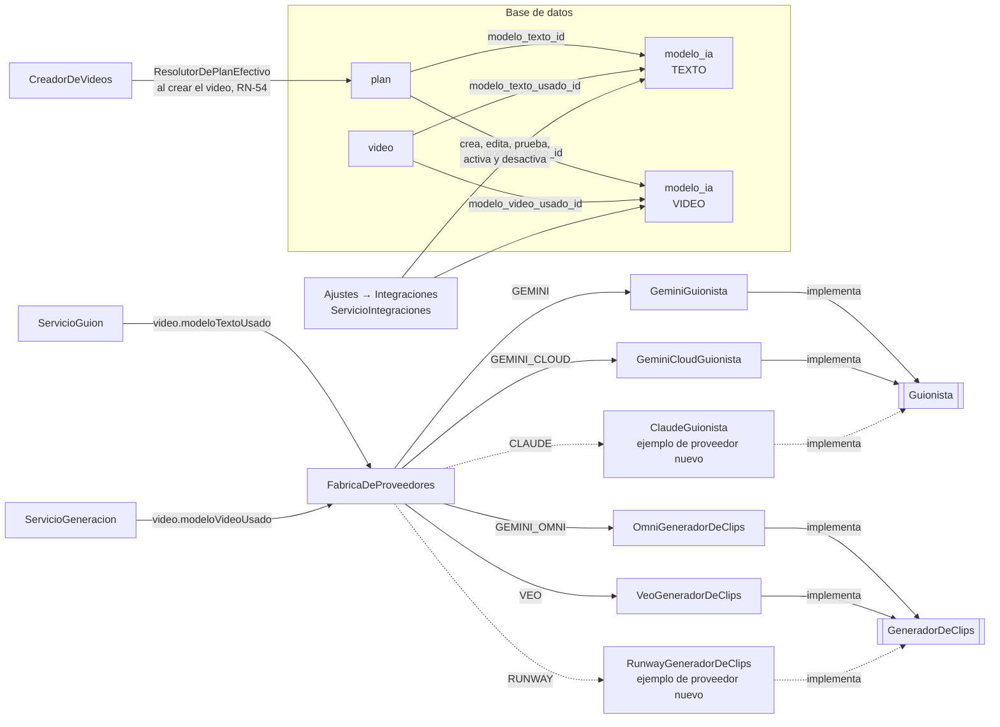

# Guía: agregar un modelo o un proveedor de IA

AutoReel usa dos modelos de IA por video: uno de **texto**, que escribe el guion, y uno de **video**, que anima las fotos. Ningún proveedor es indispensable (principio 6 de `docs/contexto-vision.md`, RNF-07). Esta guía explica los casos posibles:

- **Caso A:** agregar un **modelo nuevo de un proveedor ya integrado**, por ejemplo otra versión de Gemini o Veo 3.1 Fast. **No requiere programar** (RN-56): se hace desde **Ajustes → Integraciones y claves**.
- **Caso B:** agregar un **proveedor nuevo de texto**, por ejemplo Claude. **Requiere programar su adaptador** (`Guionista`).
- **Caso C:** agregar un **proveedor nuevo de video**, por ejemplo Runway. **Requiere programar su adaptador** (`GeneradorDeClips`).

> **Estado del documento:** actualizado al cierre de la **fase 7** y de la **revisión del flujo del negocio** (2026-11-06).
> - La tabla `modelo_ia` y sus datos iniciales existen desde la **fase 1**.
> - Desde la **fase 4** existen el puerto `Guionista`, el adaptador `GeminiGuionista`, la `FabricaDeProveedores`, los secretos (`ProveedorDeSecretos`), los errores tipados (`ErrorDeProveedor`), el aviso de RN-57 (`AvisoDeIntegracion`) y el registro de costos (`registro_costo`, RN-32).
> - Desde la **fase 5** existen el puerto `GeneradorDeClips`, el adaptador `VeoGeneradorDeClips` (ADR 0015), su token (`TokenDeGoogle`), los secretos en archivo y el costo de los clips por segundo.
> - Desde **Proveedores de Google** (2026-11-05, ADR 0017) hay **dos caminos de Google**: Google AI Studio (activo: `GEMINI` y `GEMINI_OMNI`, con una sola clave) y Google Cloud (listo e inactivo: `GEMINI_CLOUD` y `VEO`, con una cuenta de servicio).
> - Desde la **fase 7** existen la pantalla **Ajustes → Integraciones y claves** (agregar, editar, probar, activar y desactivar modelos), el método `probar` en los dos puertos, las **credenciales pegadas en el panel** (`AlmacenDeSecretos`, ADR 0018) y la notificación `INTEGRACION_CON_ERROR` (RN-57). Los planes eligen sus modelos en **Ajustes → Planes**.
> - Desde la **revisión del flujo del negocio** **ya no hay respaldo sin IA para los clips** (sección 8.5 de la especificación): si un clip no se consigue, el video ya no se arma con el acercamiento de FFmpeg (sección 2.9).
> - Desde la **mejora de la calidad del video** (2026-11-12, ADR 0021):
>   - **El guion tampoco tiene respaldo sin IA.** Si el proveedor de texto falla, `ServicioGuion` reintenta solo cada 45 s durante 5 minutos y luego deja el video en `ERROR`, con "Reintentar" (sección 2.5).
>   - `SolicitudDeClip` lleva el **prompt completo** (`prompt`), armado con el paquete de nicho, y los **`negativos`**, en lugar de `instruccion` y `prohibiciones` (sección 5).
> - AWS Secrets Manager llega en la **fase 8**.
>
> **Credenciales reales:** la clave de Google AI Studio ya se probó con "Probar conexión" para Gemini y Gemini Omni Flash. Sin `GEMINI_API_KEY` (ni una clave pegada en el panel), la propuesta no se puede escribir: desde el 2026-11-12 no hay guion de respaldo, y queda en error tras 5 minutos de reintentos. "Crear mi video" queda desactivado, porque no hay modelo de video disponible.

---

## 1. Cómo está pensado



- **Cada modelo de IA es una fila de la tabla `modelo_ia`** (sección 11.5). Desde la fase 7, el administrador las crea y edita en **Ajustes → Integraciones y claves**.
- **El código tiene un adaptador por proveedor:** `GEMINI` y `GEMINI_CLOUD` para texto, y `GEMINI_OMNI` y `VEO` para video.
- **Cada adaptador lee de su fila** el identificador exacto del modelo (`identificador_modelo`) y sus parámetros (`parametros`). Nada de eso está escrito en el código.
- **El plan se resuelve una sola vez, al crear el video.** `CreadorDeVideos` usa `ResolutorDePlanEfectivo.de(negocioId)` (el plan de la suscripción o el del beneficio temporal vigente, RN-50) y guarda en el video el plan y los modelos (`plan_aplicado_id`, `modelo_texto_usado_id`, `modelo_video_usado_id`; RN-54). Un cambio de plan posterior no afecta a un video en proceso (RN-49).
- **Al escribir el guion**, `ServicioGuion` le pasa a `FabricaDeProveedores.guionista(modelo)` el modelo guardado en el video, y la fábrica devuelve la implementación cuyo `adaptador()` coincide. El resto del proceso no sabe qué proveedor se está usando.
- **Al generar los clips**, `ServicioGeneracion` hace lo mismo con `FabricaDeProveedores.generadorDeClips(modelo)` y el modelo de video guardado en el video.
- **Al pulsar "Probar conexión"**, `ServicioIntegraciones` llama a `FabricaDeProveedores.probar(modelo, credencial)`, que usa el método `probar` del adaptador: una llamada **sin costo** que no escribe guiones ni genera clips.

---

## 2. Qué existe hoy (fase 7)

### 2.1 Tabla `modelo_ia`

La crea la migración `backend/src/main/resources/db/migration/V2__modelos_ia_planes_y_suscripciones.sql`, la completa `V8__facturacion.sql` y la mapea la entidad `com.autoreel.ia.dominio.ModeloIA`.

| Columna | Tipo | Regla |
|---|---|---|
| `id` | `bigint` identity | — |
| `nombre` | `varchar(80)` | Nombre visible, por ejemplo "Gemini Omni Flash". |
| `proveedor` | `varchar(30)` | Texto libre, por ejemplo `GOOGLE`. El panel lo guarda en mayúsculas. Se copia en cada `registro_costo`. |
| `tipo` | `varchar(10)` | `TEXTO` o `VIDEO` (check `modelo_ia_tipo_ck`; enum `TipoModelo`). Se elige al crear el modelo y **no cambia** después, porque el modelo puede estar asignado a planes. |
| `adaptador` | `varchar(30)` | Identificador de la implementación en el código: `GEMINI`, `GEMINI_CLOUD`, `GEMINI_OMNI` o `VEO`. El panel solo acepta adaptadores que existan para ese tipo (RN-56, 400 `ADAPTADOR_INEXISTENTE`). Si una fila cargada por otra vía nombra un adaptador que no existe, la fábrica no entrega ninguno: el guion usa el respaldo y no se pueden crear videos con ese modelo. |
| `identificador_modelo` | `varchar(120)` | Nombre exacto que exige la API del proveedor. Los adaptadores lo ponen en la URL o en el cuerpo de la petición. |
| `parametros` | `jsonb` | Configuración del modelo, un objeto JSON. Por defecto `{}`. Cada adaptador lee los suyos (secciones 2.4, 2.7 y 2.8). |
| `costo_referencial` | `numeric(12,6)` | Mayor o igual que 0 (check `modelo_ia_costo_ck`). Es lo que se registra por cada respuesta del guion o por cada segundo de clip (RN-32). Se edita en el panel. |
| `unidad_costo` | `varchar(20)` | `POR_SEGUNDO` o `POR_SOLICITUD` (enum `UnidadCosto`). El panel la deduce del tipo: un modelo de texto es `POR_SOLICITUD` y uno de video, `POR_SEGUNDO`. |
| `nombre_secreto` | `varchar(120)` | **Nombre** del secreto con la credencial, nunca la credencial (RN-55). En el panel, "Clave que usa"; solo admite minúsculas, números y `/ _ . -`. |
| `estado` | `varchar(10)` | `ACTIVO` o `INACTIVO` (enum `EstadoModelo`). La columna tiene `ACTIVO` por defecto, pero **un modelo creado desde el panel nace `INACTIVO`**. |
| `ultima_prueba` | `timestamptz` | Fecha de la última "Probar conexión". |
| `ultima_prueba_exitosa` | `boolean` | Resultado de esa prueba (V8). |
| `ultima_prueba_mensaje` | `varchar(300)` | Mensaje de esa prueba, por ejemplo "La conexión funciona." (V8). |

Además, el índice único `modelo_ia_adaptador_identificador_uk (adaptador, identificador_modelo)` impide registrar dos veces el mismo modelo con el mismo adaptador. El panel lo revisa antes y responde 409 `MODELO_YA_EXISTE`.

### 2.2 Datos iniciales

Después de las migraciones `V2` (sección 16), `V6` (fase 5) y `V7` (ADR 0017), la base de datos arranca con cuatro modelos, dos por camino de Google:

| `nombre` | `tipo` | `adaptador` | `identificador_modelo` | `parametros` | Costo | `nombre_secreto` | `estado` |
|---|---|---|---|---|---|---|---|
| Gemini | TEXTO | `GEMINI` | `gemini-3.8-flash` | `{"temperatura": 0.7, "formatoRespuesta": "JSON"}` | 0,01 USD `POR_SOLICITUD` | `autoreel/gemini` | `ACTIVO` |
| Gemini (Google Cloud) | TEXTO | `GEMINI_CLOUD` | `gemini-3.8-flash` | `{"ubicacion": "global", "temperatura": 0.7}` | 0,01 USD `POR_SOLICITUD` | `autoreel/google-cloud` | `INACTIVO` |
| Gemini Omni Flash | VIDEO | `GEMINI_OMNI` | `gemini-omni-1.2-flash` | `{"relacionAspecto": "9:16", "resolucion": "720p", "duracionClipSegundos": 4, "tokensPorSegundo": 5792, "segundoPlano": false}` | 0,07 USD `POR_SEGUNDO` | `autoreel/gemini` | `ACTIVO` |
| Veo 3.1 Lite | VIDEO | `VEO` | `veo-3.1-lite-generate-001` | `{"region": "us-central1", "duracionClipSegundos": 4, "relacionAspecto": "9:16", "resolucion": "720p", "generarAudio": false, "ajuste": "crop"}` | 0,05 USD `POR_SEGUNDO` | `autoreel/google-cloud` | `INACTIVO` |

Todos tienen `proveedor = GOOGLE`. El plan **Lite** usa **Gemini** para el texto y, desde `V7`, **Gemini Omni Flash** para el video. Los videos creados antes conservan el modelo con el que nacieron (RN-54).

Son los valores de las migraciones. Desde la fase 7 el administrador puede cambiarlos en el panel, así que la base de datos de un entorno puede tener otros.

> **`formatoRespuesta`** está en la semilla, pero `GeminiGuionista` no lo lee: siempre pide la respuesta en JSON con un esquema.
>
> **Por qué dos caminos** (ADR 0017): con una sola clave de **Google AI Studio** (`autoreel/gemini`) alcanza para el guion y los clips. Omni no tiene plan gratuito (unos 0,07 USD por segundo a 720p), así que el proyecto de la clave necesita facturación activa. El camino de **Google Cloud** (`autoreel/google-cloud`, una cuenta de servicio) queda listo como alternativa: Veo admite prompt negativo y no genera audio. Pasar de un camino al otro es un cambio de datos (sección 3.6).
>
> **Veo 3.1 Lite en Google Cloud** sigue en **vista previa** y su precio por segundo en Vertex AI no está confirmado: `costo_referencial` sigue con el de la sección 11.1 (0,05 USD), editable en el panel.

### 2.3 Piezas comunes y del lado del texto

| Pieza | Ubicación | Qué hace |
|---|---|---|
| `Guionista` | `ia/dominio/Guionista.java` | Puerto del modelo de texto (sección 4, paso 2): `adaptador()`, `escribir(...)` y, desde la fase 7, `probar(modelo, credencial)`. |
| `ErrorDeProveedor` | `ia/dominio/ErrorDeProveedor.java` | Falla que no se arregla reintentando, con su `Tipo` (sección 2.5). |
| `ProveedorDeSecretos` | `ia/dominio/ProveedorDeSecretos.java` | `Optional<String> obtener(nombreSecreto)`: la credencial, o vacío si no está configurada. |
| `AlmacenDeSecretos` | `ia/dominio/AlmacenDeSecretos.java` | Desde la fase 7 (ADR 0018): `guardar(nombre, valor)`, `borrar(nombre)` y `origen(nombre)` (`PANEL`, `CONFIGURACION` o `NINGUNO`). Lo usa el panel para las credenciales pegadas (sección 3.3). |
| `SecretosDeConfiguracion` | `ia/infraestructura/SecretosDeConfiguracion.java` | Implementación de desarrollo de **los dos puertos**. Lee, en este orden: el archivo de secretos del panel, el mapa `autoreel.secretos` y el mapa `autoreel.secretos-en-archivo` (sección 3.3). Filtra los valores vacíos y nunca registra un valor en el log. |
| `AvisoDeIntegracion` | `ia/dominio/AvisoDeIntegracion.java` | RN-57: avisa de una falla del proveedor. Lo implementa `facturacion/infraestructura/AvisoDeIntegracionEnPanel`: escribe un log `ERROR` y crea la notificación `INTEGRACION_CON_ERROR` en la campana del panel, **una por modelo y por día**. Si la notificación no se puede guardar, el proceso que avisó sigue igual. |
| `GeminiGuionista` | `ia/infraestructura/GeminiGuionista.java` | Adaptador `GEMINI`: Gemini en Google AI Studio (sección 2.4). |
| `GeminiCloudGuionista` | `ia/infraestructura/GeminiCloudGuionista.java` | Adaptador `GEMINI_CLOUD`: el mismo Gemini en Google Cloud (Vertex AI), con la cuenta de servicio (sección 2.4). |
| `GoogleCloud` | `ia/infraestructura/GoogleCloud.java` | Llamadas a Vertex AI con la cuenta de servicio: arma la URL, pide el token con `TokenDeGoogle` y clasifica los errores. La comparten `GEMINI_CLOUD` y `VEO`. |
| `RespuestaGemini` | `ia/infraestructura/RespuestaGemini.java` | Lectura común de la respuesta de Gemini (AI Studio y Google Cloud). |
| `FabricaDeProveedores` | `ia/aplicacion/FabricaDeProveedores.java` | Recibe todos los beans `Guionista` y `GeneradorDeClips`, y entrega el que corresponde a un modelo. `videoDisponible(modelo)` dice si el modelo de video se puede usar ahora (adaptador, estado y credencial). Desde la fase 7, `adaptadores(tipo)` lista los adaptadores del código (RN-56) y `probar(modelo, credencial)` prueba un modelo, esté activo o no. |
| `ServicioIntegraciones` | `admin/aplicacion/ServicioIntegraciones.java` | Ajustes → Integraciones (RF-11): lista, crea, edita, prueba, activa y desactiva modelos, y guarda o borra credenciales (secciones 3.1 y 3.3). |
| `AdminIntegracionesController` | `admin/api/AdminIntegracionesController.java` | `GET /api/admin/integraciones`; `POST` y `PUT /api/admin/modelos-ia`, con `/{id}/probar`, `/{id}/activar` y `/{id}/desactivar`; `PUT` y `DELETE /api/admin/credenciales`. |
| `SeccionIntegraciones` | `frontend/src/admin/SeccionIntegraciones.tsx` | La pantalla: tarjetas de las claves y de los modelos, y los formularios "Agregar modelo" y "Clave de …". |
| `ServicioPlanes` | `facturacion/aplicacion/ServicioPlanes.java` | Ajustes → Planes: asigna a cada plan sus modelos de texto y de video (RN-47). |
| `ResolutorDePlanEfectivo` | `facturacion/aplicacion/ResolutorDePlanEfectivo.java` | El plan que rige hoy para el negocio, con sus modelos ya cargados: el de su suscripción o el de un beneficio temporal vigente (RN-50). |
| `ServicioCostos` | `costos/aplicacion/ServicioCostos.java` | Guarda un `registro_costo` por llamada (RN-32): `costo_referencial × cantidad`. `registrarSolicitud` exige un modelo `POR_SOLICITUD`. |
| `ServicioGuion` | `video/aplicacion/ServicioGuion.java` | Usa todo lo anterior: hasta 3 intentos, plazo de 60 s, costo por respuesta, aviso y, si el proveedor falla, reintentos cada 45 s durante 5 minutos y luego `ERROR` (sección 2.5; hasta el 2026-11-12, el guion de respaldo). |

### 2.4 Los adaptadores de texto

**`GeminiGuionista` (`GEMINI`, Google AI Studio):**

- Llama a `POST {url}/v1beta/models/{identificador_modelo}:generateContent`, con la cabecera `x-goog-api-key`.
- Cuerpo: el mensaje como `contents[0].parts[0].text` y `generationConfig` con `responseMimeType: "application/json"`, `responseJsonSchema` (el esquema que arma `InstruccionesDelGuion.esquema`) y `temperature`.
- **`temperature`** sale de `parametros.temperatura`. Si falta o no es un número, usa 0,7.
- Lee `candidates[0].content.parts[*].text` y une solo las partes que no son de razonamiento (`thought != true`).
- **`probar`:** `GET {url}/v1beta/models/{identificador_modelo}` con la clave. Es la ficha del modelo: no cuesta y detecta una clave inválida o un identificador que no existe.

**`GeminiCloudGuionista` (`GEMINI_CLOUD`, Google Cloud):**

- Usa `GoogleCloud.llamar(...)`: `POST {base}/v1/projects/{proyecto}/locations/{ubicacion}/publishers/google/models/{identificador_modelo}:generateContent`, con `Authorization: Bearer {token}`. El cuerpo es el mismo que el de `GEMINI`.
- **La credencial** puede ser el JSON de una cuenta de servicio o, desde el 2026-11-14, una **clave de API de Google Cloud** (cualquier valor que no empiece con `{`). Con la clave, `GoogleCloud` la envía en `x-goog-api-key`, no pide token y toma el proyecto de `parametros.proyecto`; sin proyecto usa el modo exprés (`/v1/publishers/google/models/...`), que sirve para Gemini pero no para Veo.
- **El proyecto** sale del `project_id` del JSON de la cuenta de servicio (o de `parametros.proyecto` con una clave de API). **La ubicación** sale de `parametros.ubicacion`, por defecto `global` (con `global`, la base es `url-global`; con otra, `url` con `{region}` reemplazado).
- `temperatura`, igual que en `GEMINI`.
- **`probar`:** `countTokens` con el texto "AutoReel". No escribe nada y detecta una cuenta inválida, sin permisos o un modelo que no existe.

La URL y los tiempos de espera están en `application.yml`:

```yaml
# backend/src/main/resources/application.yml
autoreel:
  ia:
    gemini:                       # GEMINI y GEMINI_OMNI (Google AI Studio)
      url: ${GEMINI_URL:https://generativelanguage.googleapis.com}
      tiempo-conexion: 5s
      tiempo-lectura: 30s
    google-cloud:                 # GEMINI_CLOUD y VEO (Vertex AI), clase GoogleCloud
      url: https://{region}-aiplatform.googleapis.com
      url-global: https://aiplatform.googleapis.com
      url-token: https://oauth2.googleapis.com/token
      tiempo-conexion: 5s
      # La respuesta trae el clip en base64.
      tiempo-lectura: 60s
```

En las pruebas (`application-test.yml`), las URL apuntan a una dirección que no responde. `GeminiGuionistaTest`, `GeminiCloudGuionistaTest` y `VideoIntegracionTest` levantan servidores simulados (`ServidorGeminiSimulado`, `ServidorVeoSimulado`) y cambian la URL con `@DynamicPropertySource`.

### 2.5 Errores tipados y qué hace el guion con ellos

Los adaptadores distinguen dos clases de problema:

**1. Fallas del proveedor: lanzan `ErrorDeProveedor`.** El adaptador no las reintenta. `ServicioGuion` llama a `AvisoDeIntegracion.avisar(...)` (log y notificación en el panel) y, desde el 2026-11-12 (ADR 0021), deja el video en `GUION_PENDIENTE` para **volver a intentarlo a los 45 s**. Pasados **5 minutos** desde el inicio del guion, el video pasa a `ERROR` ("No pudimos escribir tu guion con IA. Inténtalo de nuevo en un rato.") y el negocio puede tocar "Reintentar" sin gastar su video del día. Hasta esa fecha se usaba el guion de respaldo, con el motivo en `video.motivo_respaldo`.

| Respuesta del proveedor | `ErrorDeProveedor.Tipo` | Antes del 2026-11-12: `video.motivo_respaldo` | ¿Se cobra? |
|---|---|---|---|
| 401, 403 | `CREDENCIAL_INVALIDA` | `CREDENCIAL_INVALIDA` | No |
| 400, 404 | `CONFIGURACION_INVALIDA` | `CONFIGURACION_INVALIDA` | No |
| 429, 5xx, sin conexión, tiempo de espera | `NO_DISPONIBLE` | `PROVEEDOR_NO_DISPONIBLE` | No |

En Google Cloud, un JSON de cuenta sin `private_key`, `client_email` o `project_id`, o un error del endpoint de tokens, también es `CREDENCIAL_INVALIDA`. El mensaje del error nunca incluye la clave (`GeminiGuionistaTest.clasificaLosErroresSinMostrarLaClave`). Cualquier otra excepción inesperada del adaptador se trata como `NO_DISPONIBLE`.

**2. Respuestas que no sirven: devuelven `RespuestaDelModelo.sinTexto(problema)`.** Cuentan como un intento, **se cobran** (el proveedor respondió 2xx) y el problema se le envía al modelo en el siguiente intento. Gemini lo hace con:

- una solicitud bloqueada (`promptFeedback.blockReason`);
- una respuesta sin candidatos o sin texto;
- un `finishReason` distinto de `STOP`.

Un JSON mal formado, o un guion que no pasa `ValidadorDeGuion` (RN-21 a RN-24), también cuenta como intento inválido.

**Antes de llamar**, `ServicioGuion` revisa dos cosas. Si fallan, no llama ni cobra y, desde el 2026-11-12, trata el caso como una falla del proveedor: reintento a los 45 s y `ERROR` pasados 5 minutos.

| Situación | Aviso | Antes del 2026-11-12: `video.motivo_respaldo` |
|---|---|---|
| `FabricaDeProveedores.guionista(modelo)` vuelve vacío: el modelo no es `TEXTO`, no está `ACTIVO`, no es `POR_SOLICITUD` o su adaptador no existe | `CONFIGURACION_INVALIDA` | `MODELO_INACTIVO` |
| `ProveedorDeSecretos.obtener(nombre_secreto)` vuelve vacío | `CREDENCIAL_INVALIDA` | `SIN_CREDENCIAL` |

Si los 3 intentos fallan, o ya pasaron 60 s cuando tocaba empezar otro, el video pasa a `ERROR` con "No logramos escribir un guion que cumpla las reglas. Inténtalo de nuevo." (antes, el respaldo con el motivo `GUION_INVALIDO`). La falla del proveedor llega a la campana del panel.

**Ya no hay guion de respaldo** (ADR 0021, 2026-11-12). Copiaba los textos del negocio, y el usuario prefirió esperar a la IA. Por eso un adaptador de texto nuevo debe clasificar bien sus errores: un `ErrorDeProveedor` se reintenta solo, y una `RespuestaDelModelo.sinTexto` cuenta como intento inválido.

### 2.6 Piezas del lado del video

| Pieza | Ubicación | Qué hace |
|---|---|---|
| `GeneradorDeClips` | `ia/dominio/GeneradorDeClips.java` | Puerto del modelo de video (sección 8.2): anima una foto con una instrucción de movimiento. La generación es asíncrona: `iniciar` envía la tarea y `consultar` pregunta por ella. Desde la fase 7, `probar(modelo, credencial)` verifica la conexión sin generar un clip. |
| `OmniGeneradorDeClips` | `ia/infraestructura/OmniGeneradorDeClips.java` | Adaptador `GEMINI_OMNI`: Gemini Omni Flash en Google AI Studio, con la misma clave que el guion (sección 2.7). **Es el del plan Lite.** |
| `VeoGeneradorDeClips` | `ia/infraestructura/VeoGeneradorDeClips.java` | Adaptador `VEO`: Veo en Google Cloud, Vertex AI (sección 2.8). Usa `GoogleCloud`. Inactivo en los datos iniciales. |
| `TokenDeGoogle` | `ia/infraestructura/TokenDeGoogle.java` | Lee el JSON de la cuenta de servicio, firma un JWT RS256 con su `private_key` (Nimbus) y lo cambia por un token de acceso de una hora. Guarda un token por cuenta y `private_key_id` hasta 1 minuto antes de vencer. |
| `PreparadorDeFotos` | `video/infraestructura/PreparadorDeFotos.java` | Deja la foto lista para cualquier proveedor: orientación EXIF aplicada, recorte central 9:16 y JPEG de 1080×1920 sin metadatos. Las fotos del catálogo tienen al menos **720 px** en el lado menor (RN-11, desde la revisión del flujo del negocio), lo que pide un clip de 720p. |
| `ServicioGeneracion` | `video/aplicacion/ServicioGeneracion.java` | Usa todo lo anterior por plano: envía, consulta, guarda el clip, registra el costo y, si un plano se queda sin clip, aplica la sección 2.9. |
| `ProcesadorDeVideos` | `video/aplicacion/ProcesadorDeVideos.java` | `@Scheduled` cada 10 s (`autoreel.tareas.clips-cada`) para los clips y otro para la composición (`composicion-cada`). Cada video se reclama 5 minutos en la base de datos, como el guion (ADR 0014). |
| `ServicioCostos.registrar` | `costos/aplicacion/ServicioCostos.java` | Con un modelo `POR_SEGUNDO`, la cantidad son los segundos del clip; el concepto es `CLIP`. Si el proveedor informa cuántos segundos generó (`Listo.segundosGenerados`), se usan esos; si no, `duracionClipSegundos`. |

### 2.7 El adaptador `OmniGeneradorDeClips` (`GEMINI_OMNI`)

Usa la API de interacciones de Google AI Studio (ADR 0017), con la URL y el tiempo de conexión de `autoreel.ia.gemini` y la cabecera `x-goog-api-key`.

- **Crear la tarea:** `POST {url}/v1beta/interactions` con:
  - `model`: el `identificador_modelo`.
  - `input`: la foto (`type: "image"`, `data` en base64 y `mime_type`) y el texto de la instrucción.
  - `response_format`: `type: "video"`, `aspect_ratio`, `resolution` y `duration` (los segundos del clip, por ejemplo `"4s"`).
  - `background` (según `segundoPlano`) y `store: true`.
  - **Omni no admite prompt negativo:** desde el 2026-11-12 el texto es el `prompt` de la solicitud (armado con el paquete de nicho) más, al final, "Avoid: " con los `negativos`. Antes, el adaptador escribía su propio envoltorio ("Animate this exact photo…" y "Never show: …" con las `prohibiciones`).
- **Modo síncrono (por defecto):** la respuesta de la creación ya trae el video. El adaptador la guarda en memoria (hasta 30 resultados) y la entrega en la consulta siguiente, sin volver a pedirla. Si el proceso se reinicia antes, la consulta la pide otra vez con `GET {url}/v1beta/interactions/{id}`.
- **Modo en segundo plano** (`segundoPlano: true`): la creación devuelve el `id` y se consulta con `GET {url}/v1beta/interactions/{id}`. Google no lo documenta para video; queda como opción.
- **Consultar:** `status` distinto de `completed`, `failed`, `cancelled` o `incomplete` es `EnCurso`. `completed` con un contenido `type: "video"` en `steps[*].content[*]` es `Listo`. Cualquier otro final, o un video que llega como dirección en lugar de `data`, es `Fallido` (puede ser su filtro de contenido).
- **Costo:** si la respuesta trae `usage.output_tokens_by_modality` con los tokens de video, los segundos cobrados son `tokens / tokensPorSegundo`.
- **Audio:** Omni siempre genera audio; se paga y la composición lo descarta.
- **`probar`:** `GET {url}/v1beta/models/{identificador_modelo}`, la ficha del modelo. No genera ningún clip.
- **Tiempo de lectura:** `autoreel.ia.omni.tiempo-lectura: 5m`, porque la generación síncrona tarda minutos.

| Parámetro | Va a | Por defecto |
|---|---|---|
| `relacionAspecto` | `response_format.aspect_ratio` | `9:16` |
| `resolucion` | `response_format.resolution` | `720p` |
| `duracionClipSegundos` | `response_format.duration` (Omni admite de 3 a 15 s). También es la cantidad que se cobra si la respuesta no informa los tokens. | 4 |
| `tokensPorSegundo` | Convierte los tokens de video en segundos cobrados | 5792 (720p) |
| `segundoPlano` | `background` | `false` |
| `tarea` | `generation_config.video_config.task`, solo si viene | — |

Errores: 401 y 403 son `CREDENCIAL_INVALIDA`; 400 y 404, `CONFIGURACION_INVALIDA`; 429, 5xx, sin conexión o tiempo de espera, `NO_DISPONIBLE`. `OmniGeneradorDeClipsTest` lo prueba contra `ServidorOmniSimulado`.

### 2.8 El adaptador `VeoGeneradorDeClips` (`VEO`)

- **Crear la tarea:** con `GoogleCloud.llamar(...)`, `POST {base}/v1/projects/{proyecto}/locations/{region}/publishers/google/models/{identificador_modelo}:predictLongRunning`, con `Authorization: Bearer {token}`.
  - `instances[0]`: `prompt` (desde el 2026-11-12, el prompt completo de la solicitud, el mismo que recibe Omni; antes, solo la `instruccion` del movimiento) e `image` (`bytesBase64Encoded` y `mimeType`).
  - `parameters`: `aspectRatio`, `durationSeconds`, `sampleCount: 1`, `negativePrompt` (los `negativos` de `movimientos.json`; se omite si están vacíos), `personGeneration: "dont_allow"`, `generateAudio`, `resolution` y `resizeMode`.
  - Devuelve el `name` de la operación, que se guarda en `plano.id_tarea_proveedor`.
- **Consultar:** `POST …:fetchPredictOperation` con `{"operationName": …}`.
  - Sin `done`: `EnCurso`.
  - Con `done` y el clip en `response.videos[0].bytesBase64Encoded`: `Listo`.
  - Con `error`, con `raiMediaFilteredCount` mayor que 0 (el filtro de contenido) o sin clip: `Fallido`.
- **`probar` con clave de API:** exige `parametros.proyecto` y consulta con `fetchPredictOperation` una tarea inexistente: 400/404 significa que la clave y el proyecto sirven; 401/403, que no. No gasta.
- **`probar` con cuenta de servicio:** pide un token (`GoogleCloud.verificarCredencial`). Verifica la credencial, **pero no el modelo**: un `identificador_modelo` o una `region` mal escritos recién fallan al generar (404, `CONFIGURACION_INVALIDA`).
- **El proyecto** sale del `project_id` del JSON de la cuenta. **La región** y el resto, de `parametros`:

| Parámetro | Va a | Por defecto |
|---|---|---|
| `region` | La URL (`{region}-aiplatform.googleapis.com` y `locations/{region}`) | `us-central1` |
| `duracionClipSegundos` | `durationSeconds` (Veo admite 4, 6 u 8). También es la cantidad que se cobra. | 4 |
| `relacionAspecto` | `aspectRatio` | `9:16` |
| `resolucion` | `resolution` | `720p` |
| `generarAudio` | `generateAudio` (el audio de los clips se descarta al componer) | `false` |
| `ajuste` | `resizeMode` | `crop` |

La URL y los tiempos de espera están en `autoreel.ia.google-cloud` (sección 2.4). `VeoGeneradorDeClipsTest` y `GeneracionIntegracionTest` levantan `ServidorVeoSimulado` y cambian la URL con `@DynamicPropertySource`.

### 2.9 Errores del video y qué hace la generación con ellos

Los adaptadores de video clasifican las fallas igual que los de texto (sección 2.5): 401 y 403 son `CREDENCIAL_INVALIDA` (en Google Cloud, además, el token guardado se descarta), 400 y 404 son `CONFIGURACION_INVALIDA`, y 429, 5xx, sin conexión o tiempo de espera son `NO_DISPONIBLE`. Ningún mensaje incluye la clave.

**Desde el 2026-11-06 no hay respaldo sin IA para los clips** (sección 8.5 de la especificación; `ServicioGeneracion.sinClip`). El acercamiento de FFmpeg a la foto ya no se usa. Un plano tiene dos intentos (RN-30); si no consigue su clip, el plano **se queda sin clip**, y lo que pasa depende de si era la primera generación o una regeneración:

| Cuándo | Qué pasa |
|---|---|
| **Primera generación** del video | El video pasa a `ERROR` con el motivo "No pudimos crear los clips con IA. Te devolvimos el video del día; inténtalo de nuevo en un rato.". Se devuelve el video del día (RN-27). Los clips de otros planos que ya estaban enviados se registran como costo (RN-32), y no se piden más clips para ese video. |
| **Regeneración** de un plano (o cambio de foto en la revisión) | El plano conserva su clip anterior, la regeneración **no se descuenta** y el negocio ve el aviso "No pudimos crear el clip nuevo. Dejamos el anterior y no se descontó la regeneración.". El video sigue armado. |

Situaciones que dejan un plano sin clip:

| Situación | Qué pasa | Motivo en el registro | ¿Se cobra? |
|---|---|---|---|
| `FabricaDeProveedores.generadorDeClips(modelo)` vuelve vacío (no es `VIDEO`, no está `ACTIVO`, no es `POR_SEGUNDO` o su adaptador no existe) | Sin clip y aviso | `MODELO_INACTIVO` | Solo si la tarea ya estaba enviada |
| `ProveedorDeSecretos.obtener(nombre_secreto)` vuelve vacío | Sin clip y aviso | `SIN_CREDENCIAL` | Solo si la tarea ya estaba enviada |
| `CREDENCIAL_INVALIDA` o `CONFIGURACION_INVALIDA` | Sin clip y aviso | El mismo tipo | Solo si la tarea ya estaba enviada (al consultar) |
| `NO_DISPONIBLE` al enviar | Aviso; cuenta como intento; con 2, sin clip | `PROVEEDOR_NO_DISPONIBLE` | No |
| `NO_DISPONIBLE` al consultar | Se sigue consultando hasta los 10 minutos desde `enviado_en` | `TIEMPO_AGOTADO` | Sí (la tarea ya se envió) |
| `Fallido` (filtro de contenido o error de la tarea), u otra excepción | Cuenta como intento; con 2, sin clip | `CLIP_FALLIDO` | No, salvo una excepción con la tarea ya enviada |
| `EnCurso` después de 10 minutos desde `enviado_en` | Sin clip | `TIEMPO_AGOTADO` | Sí |
| Plano pendiente, ya intentado, a los 20 minutos de su último envío | Sin clip (red de seguridad) | `TIEMPO_AGOTADO` | No |
| `Listo` | Se guarda el clip y el plano pasa a `LISTO` | — | Sí: segundos informados o `duracionClipSegundos`, por `costo_referencial` |

- **El intento se cuenta antes de enviar**, en su propia transacción: si el proceso se corta después, la tarea no se reenvía sin límite.
- **El plazo de 20 minutos cuenta desde el último envío de cada plano**, no desde la aprobación (ADR 0017): con un proveedor síncrono como Omni, un video que espera su turno no pierde sus clips.
- **El motivo del plano** queda solo en el registro ("El plano … del video … se quedó sin clip: …"). Las columnas `plano.uso_respaldo` y `plano.motivo_respaldo` siguen en el esquema, pero la generación ya no las llena: solo tienen datos de videos anteriores al cambio. Las fallas del proveedor llegan a la campana del panel (`INTEGRACION_CON_ERROR`), y el detalle del negocio muestra el `motivo_error` del video.
- **Sin el modelo de video disponible** (`FabricaDeProveedores.videoDisponible` es falso: inactivo, sin adaptador o sin credencial), "Crear mi video", "Regenerar este plano" y el cambio de foto en la revisión se desactivan (`iaDisponible` en la vista del video), y el backend responde 409 `IA_NO_DISPONIBLE`. Los textos sí se pueden editar.

### 2.10 Lo que todavía no existe

| Pieza | Fase |
|---|---|
| `ProveedorDeSecretos` y `AlmacenDeSecretos` con AWS Secrets Manager (`GetSecretValue` y `PutSecretValue`) | 8 |
| Precio confirmado de Veo 3.1 Lite en Vertex AI (hoy, el `costo_referencial` de la semilla, editable en el panel) | Pendiente |
| Prueba de punta a punta con una cuenta de servicio real de Google Cloud | Pendiente |

---

## 3. Caso A: un modelo nuevo de un proveedor ya integrado

**Ejemplo:** pasar a otra versión de Gemini para el guion. Se resuelve creando un modelo con el **mismo adaptador** (`GEMINI`) y **otro identificador de modelo**, y asignándolo a un plan (sección 11.5). `GeminiGuionista` ya sabe usarlo: toma el identificador para la URL y la temperatura de `parametros`. **No se toca el código.**

Lo mismo vale para el video: pasar a **Veo 3.1 Fast** es un modelo nuevo con el adaptador `VEO` (sección 3.5).

### 3.1 Desde el panel

1. Entra a **Ajustes → Integraciones y claves** y pulsa **"Agregar modelo"**.
2. Completa el formulario:

   | Campo | Qué poner |
   |---|---|
   | Tipo | "Video (clips, se cobra por segundo)" o "Texto (guion, se cobra por solicitud)". Define la unidad del costo y **no se puede cambiar después**. |
   | Nombre visible | Por ejemplo, "Veo 3.1 Fast". Hasta 80 caracteres. |
   | Proveedor | Por ejemplo, `GOOGLE`. Se guarda en mayúsculas. |
   | Adaptador | Solo se pueden elegir los que existen en el código para ese tipo (RN-56). |
   | Identificador del modelo | El nombre exacto que exige la API del proveedor. Cópialo de su documentación **en el momento de hacerlo**: los identificadores cambian. |
   | Costo por segundo / por guion (US$) | Lo que se registra en `registro_costo` (RN-32), con hasta 6 decimales. Ponlo al día con la tarifa del proveedor. |
   | Clave que usa | El **nombre** del secreto, por ejemplo `autoreel/gemini`. Sugiere los que ya existen. Si escribes uno nuevo, aparece su tarjeta en "Claves de los proveedores" para pegar la credencial (sección 3.3). |
   | Parámetros (JSON) | Un objeto JSON con los parámetros del adaptador (secciones 2.4, 2.7 y 2.8). Las claves que el adaptador no conoce se ignoran. |

3. Pulsa **"Agregar modelo"**. El modelo **nace inactivo** y todavía no lo usa ningún plan. El backend rechaza un adaptador que no existe (400 `ADAPTADOR_INEXISTENTE`) y un adaptador con un identificador ya registrado (409 `MODELO_YA_EXISTE`).
4. Si la clave es nueva, pégala en su tarjeta (**"Pegar clave"**, sección 3.3).
5. Pulsa **"Probar conexión"** en la tarjeta del modelo. **No tiene costo**: usa el método `probar` del adaptador (ficha del modelo en AI Studio, `countTokens` en Gemini de Google Cloud, un token en Veo). El resultado ("La conexión funciona." o el motivo de la falla) se guarda en `ultima_prueba`, `ultima_prueba_exitosa` y `ultima_prueba_mensaje`, y se ve en la tarjeta. Funciona con el modelo activo o inactivo.
6. Pulsa **"Activar"**. Hace falta que su credencial esté configurada (si no, 409 `SIN_CREDENCIAL`, "Configura la credencial … antes de activar el modelo."). Activar no exige una prueba exitosa: pruébalo antes.
7. En **Ajustes → Planes**, asígnalo a un plan, nuevo (como Pro) o existente. El plan solo acepta modelos activos y del tipo correcto (RN-47: `MODELO_INACTIVO` o `MODELO_INVALIDO`). Los videos en proceso terminan con el modelo con el que empezaron (RN-49 y RN-54).

**Editar un modelo** ("Editar" en su tarjeta) cambia el nombre, el proveedor, el adaptador (del mismo tipo), el identificador, el costo, la clave y los parámetros. El tipo no cambia, y **el estado tampoco**: un modelo activo sigue activo. Como los videos guardan el `id` del modelo y no una copia de sus datos, editar un modelo activo también cambia lo que usan los videos en proceso con ese modelo. Para cambiar de versión sin afectarlos, crea un modelo nuevo y cambia el plan.

**Desactivar un modelo** no se puede si lo usa un plan activo o un plan con negocios (RN-48, 409 `MODELO_EN_USO`): primero asígnale otro modelo a ese plan.

### 3.2 Con una migración (datos iniciales de un entorno)

El panel es el camino normal. Una **migración de Flyway nueva** solo tiene sentido para que un modelo exista desde el arranque en todos los entornos, como hicieron `V2`, `V6` y `V7`. **Nunca se edita una migración ya aplicada**: Flyway la rechazaría porque su checksum cambiaría.

```sql
-- backend/src/main/resources/db/migration/V<N>__modelo_<descripcion>.sql
insert into modelo_ia (nombre, proveedor, tipo, adaptador, identificador_modelo, parametros,
                       costo_referencial, unidad_costo, nombre_secreto, estado)
values ('Gemini <versión>', 'GOOGLE', 'TEXTO', 'GEMINI', '<identificador exacto de la API>',
        '{"temperatura": 0.7}',
        0.010000, 'POR_SOLICITUD', 'autoreel/gemini', 'INACTIVO');
```

- Una migración no pasa por las validaciones del panel: revisa que `tipo` y `unidad_costo` coincidan (`TEXTO` con `POR_SOLICITUD`, `VIDEO` con `POR_SEGUNDO`) y que `adaptador` esté escrito igual que la constante `ADAPTADOR` de su clase. Si no, la fábrica no entrega el adaptador.
- Créalo `INACTIVO` y actívalo y asígnalo desde el panel después de probarlo. Un `insert` con `ACTIVO` no revisa la credencial.

### 3.3 Credenciales: dónde se pegan y cómo se guardan

El modelo guarda solo el **nombre** del secreto (RN-55). `ServicioGuion`, `ServicioGeneracion` y el panel lo resuelven con `ProveedorDeSecretos.obtener(nombre_secreto)`. En desarrollo lo implementa `SecretosDeConfiguracion`, que busca el valor en este orden:

1. **Las credenciales pegadas en el panel** (desde la fase 7, ADR 0018). Tienen prioridad sobre las demás.
2. **`autoreel.secretos`**: el valor de una variable de entorno del `.env`.
3. **`autoreel.secretos-en-archivo`**: la ruta de un archivo con el secreto, para las credenciales que son un JSON con saltos de línea.

```yaml
# backend/src/main/resources/application.yml
autoreel:
  secretos:
    "[autoreel/gemini]": ${GEMINI_API_KEY:}
  secretos-en-archivo:
    "[autoreel/google-cloud]": ${GOOGLE_CLOUD_CREDENCIAL_ARCHIVO:${VEO_CREDENCIAL_ARCHIVO:}}
  archivo-secretos-panel: ${SECRETOS_PANEL_ARCHIVO:../credenciales/secretos-del-panel.json}
```

Las claves de los mapas van **entre comillas y corchetes**: sin comillas, YAML falla; sin corchetes, Spring borra la `/` del nombre.

**Pegarlas en el panel (lo habitual):**

- En **Ajustes → Integraciones y claves → Claves de los proveedores** hay una tarjeta por cada nombre de secreto que usa algún modelo. Muestra de dónde sale el valor que rige hoy ("Guardada desde Ajustes", "Desde el archivo .env" o "Sin configurar"), una pista para reconocerlo y los modelos que la usan.
- **"Pegar clave"** o **"Cambiar clave"** abre el formulario. Para `autoreel/gemini` es la clave de https://aistudio.google.com/apikey (empieza con "AIza"); para `autoreel/google-cloud`, el contenido completo del JSON de la cuenta de servicio.
- El valor viaja **una sola vez** (`PUT /api/admin/credenciales`, con `Cache-Control: no-store` en la respuesta) y **nunca se vuelve a mostrar**. La pista es "Termina en …abcd" para una clave o "Cuenta de servicio <correo>" para un JSON.
- Solo se aceptan nombres que use algún modelo (si no, 404). Un valor que empieza con `{` debe ser un JSON válido (400 `CREDENCIAL_INVALIDA`).
- **Dónde se guarda:** en el JSON de `SECRETOS_PANEL_ARCHIVO`, **fuera de la base de datos y del repositorio**. Por defecto es `../credenciales/secretos-del-panel.json`, relativo a la carpeta desde la que arranca el backend (`backend/`): queda en `credenciales/` en la raíz. `.gitignore` excluye `/credenciales/`, `secretos-del-panel*.json` y `*service-account*.json`. Se escribe en un archivo temporal que después se mueve, para que nunca quede a medias.
- **Rige al instante**, sin reiniciar el backend. El log registra solo el nombre del secreto.
- **"Quitar la de Ajustes"** (`DELETE /api/admin/credenciales?nombre=…`) borra la del panel y vuelve a regir la del `.env`, si existe.
- Si el archivo del panel no se puede leer al arrancar, se ignora con un aviso en el log.
- Con "Probar conexión" en los modelos de esa clave confirmas que funciona.

**Desde el `.env` (alternativa):**

- `GEMINI_API_KEY` → `autoreel/gemini`.
- `GOOGLE_CLOUD_CREDENCIAL_ARCHIVO` → `autoreel/google-cloud`: la **ruta** al JSON de la cuenta de servicio, guardado fuera del repositorio (por ejemplo, en `credenciales/`). La variable anterior, `VEO_CREDENCIAL_ARCHIVO`, sigue funcionando como respaldo. Si la ruta no existe o no se puede leer, el secreto queda vacío y el log avisa **solo con la ruta**.
- `.env.example` tiene las dos vacías. El perfil `test` deja los secretos vacíos y usa `target/secretos-del-panel-prueba.json` para el archivo del panel.

**En producción** (fase 8), `ProveedorDeSecretos` y `AlmacenDeSecretos` se implementarán con AWS Secrets Manager, con el mismo nombre de secreto: el panel escribirá con `PutSecretValue`. En el servidor de AWS el disco no debe guardar claves (`docs/despliegue-aws.md`).

Entonces:

- Si el modelo usa **la misma credencial** que otro modelo, repite su `nombre_secreto`. Hoy hay dos: `autoreel/gemini` (Google AI Studio: `GEMINI` y `GEMINI_OMNI`) y `autoreel/google-cloud` (cuenta de servicio: `GEMINI_CLOUD` y `VEO`).
- Si usa **otra credencial**, elige un nombre nuevo, por ejemplo `autoreel/gemini-pro`, ponlo en "Clave que usa" y pega el valor en su tarjeta. **No hace falta tocar `application.yml`.** Solo si quieres que también pueda venir del `.env`:
  1. Agrega `"[autoreel/gemini-pro]": ${GEMINI_PRO_API_KEY:}` bajo `autoreel.secretos` (o una ruta bajo `autoreel.secretos-en-archivo` si es un archivo).
  2. Agrega `GEMINI_PRO_API_KEY=` vacía a `.env.example` y el valor real solo a tu `.env`.
- Sin credencial, el modelo no se puede activar. Si un modelo activo se queda sin ella, el guion no se puede escribir (desde el 2026-11-12, reintentos durante 5 minutos y luego `ERROR`; antes, el respaldo `SIN_CREDENCIAL`) y no se pueden crear videos con ese modelo de video.
- **Nunca** escribas la clave en el código ni en la base de datos (regla 6 de la sección 0).

### 3.4 Comprobar que funciona

1. **"Probar conexión"** en la tarjeta del modelo debe decir "La conexión funciona.".
2. Con el modelo asignado al plan del negocio de ejemplo, completa un chat y abre **"Ver mi propuesta"** (texto), o pulsa **"Crear mi video"** (video). Con "Entrar como el negocio" (ADR 0019) lo haces sin salir del panel.
3. En la base de datos:
   - **Texto:** el video debe llegar a `STORYBOARD` con `motivo_error` nulo, y tener un `registro_costo` con `concepto = 'GUION'` por cada respuesta del modelo.
   - **Video:** los planos deben quedar `LISTO`, con un `registro_costo` con `concepto = 'CLIP'` por cada clip.
4. Si algo falla, revisa la campana del panel (`INTEGRACION_CON_ERROR`), `video.motivo_error` (o `video.motivo_respaldo` en videos anteriores al 2026-11-12), y el log (`Integración con error: modelo …`, `… se quedó sin clip: …`). La página **Costos** muestra lo registrado por negocio y por mes.

### 3.5 Ejemplo de video: Veo 3.1 Fast, solo con datos

Veo 3.1 Fast usa la misma API de Vertex AI que Veo 3.1 Lite, así que `VeoGeneradorDeClips` ya sabe usarlo: cambia el identificador, los parámetros y el costo. **No se toca el código.** La especificación lo prevé para un plan Pro a 1080p (secciones 11.1 y 15).

En **Ajustes → Integraciones y claves → Agregar modelo**:

| Campo | Valor |
|---|---|
| Tipo | Video |
| Nombre visible | Veo 3.1 Fast |
| Proveedor | `GOOGLE` |
| Adaptador | `VEO` |
| Identificador del modelo | `veo-3.1-fast-generate-001` (GA al 2026-11-04, ADR 0015; confírmalo en la documentación de Vertex AI) |
| Costo por segundo | Entre 0,10 y 0,12 USD según la sección 11.1; confírmalo con la tarifa vigente de Google Cloud |
| Clave que usa | `autoreel/google-cloud` |
| Parámetros | `{"region": "us-central1", "duracionClipSegundos": 4, "relacionAspecto": "9:16", "resolucion": "1080p", "generarAudio": false, "ajuste": "crop"}` |

- `duracionClipSegundos` debe ser una duración que Veo admita (4, 6 u 8); la composición recorta cada clip a los segundos de su plano en la plantilla. Si falta `region`, se usa `us-central1`.
- **"Probar conexión" de Veo solo verifica la cuenta de servicio** (sección 2.8). Un identificador mal escrito responde 404 recién al generar, y el video pasa a `ERROR` con el aviso `CONFIGURACION_INVALIDA`. Prueba una generación real antes de asignarlo a un plan con negocios.
- La cuenta de servicio necesita permiso para llamar a Vertex AI ("Usuario de Vertex AI") en un proyecto con Veo habilitado.

Para comprobarlo, genera un video de un negocio de ese plan y revisa que sus planos queden `LISTO` y que haya un `registro_costo` con `concepto = 'CLIP'` por cada clip.

### 3.6 Cambiar de camino: de Google AI Studio a Google Cloud

Es un cambio de datos (ADR 0017):

1. Pega el JSON de la cuenta de servicio en la tarjeta **Google Cloud (Vertex AI)** (`autoreel/google-cloud`).
2. Prueba y activa **Gemini (Google Cloud)** y **Veo 3.1 Lite**.
3. En **Ajustes → Planes**, cambia los modelos de texto y de video del plan.
4. Si quieres, desactiva **Gemini** y **Gemini Omni Flash**. Solo se puede cuando ningún plan activo o con negocios los usa (RN-48).

---

## 4. Caso B: un proveedor nuevo de texto (programar un adaptador)

**Ejemplo:** agregar Claude como proveedor de texto (secciones 11.2 y 12.2). Para un proveedor de video, mira el [caso C](#5-caso-c-un-proveedor-nuevo-de-video-programar-un-adaptador).

### Paso 1. Decidir y documentar

Escribe un ADR en `docs/decisiones/` con:
- Por qué se agrega el proveedor.
- Su costo y cómo cobra (por solicitud, por token).
- Cómo es su API: formato de entrada y salida, si admite un esquema JSON en la respuesta, límites.
- **Qué llamada sin costo** sirve para "Probar conexión" (la ficha del modelo, contar tokens, listar modelos).
- Cómo encaja en la plantilla fija del video (ADR 0003).

### Paso 2. Implementar `Guionista`

En `backend/src/main/java/com/autoreel/ia/infraestructura/`, crea la clase del adaptador como `@Component`:

```java
@Component
public class ClaudeGuionista implements Guionista {

    static final String ADAPTADOR = "CLAUDE";

    @ConfigurationProperties("autoreel.ia.claude")
    public record PropiedadesClaude(String url, Duration tiempoConexion, Duration tiempoLectura) {
    }

    private final RestClient cliente;
    private final ObjectMapper json;

    public ClaudeGuionista(PropiedadesClaude propiedades, ObjectMapper json) {
        // Igual que GeminiGuionista: JdkClientHttpRequestFactory con los dos tiempos de espera.
    }

    @Override
    public String adaptador() {
        return ADAPTADOR;
    }

    @Override
    public RespuestaDelModelo escribir(ModeloIA modelo, String credencial, String instrucciones, String esquemaJson) {
        // 1. Petición con modelo.getIdentificadorModelo(), la credencial en su cabecera, las instrucciones
        //    y el esquema JSON de la respuesta. Parámetros desde modelo.getParametros().
        // 2. Errores HTTP y de red -> throw new ErrorDeProveedor(tipo, mensaje sin la clave, causa).
        // 3. Respuesta bloqueada, cortada o sin texto -> RespuestaDelModelo.sinTexto("motivo").
        // 4. Si no -> RespuestaDelModelo.conTexto(json del guion).
    }

    @Override
    public void probar(ModeloIA modelo, String credencial) {
        // "Probar conexión" (RF-11): una llamada sin costo (o casi) que verifique la credencial y, si la API lo
        // permite, que el modelo exista. Por ejemplo, la ficha del modelo. No escribe ningún guion.
        // Si no funciona -> throw new ErrorDeProveedor(tipo, mensaje sin la clave, causa), clasificado como en escribir.
    }
}
```

El contrato del puerto:

| Entrada | Qué es |
|---|---|
| `modelo` | La fila de `modelo_ia` guardada en el video (o la que se prueba en el panel). Usa `getIdentificadorModelo()` y `getParametros()`; **nunca** valores fijos en el código. |
| `credencial` | La clave ya resuelta por `ProveedorDeSecretos` (del panel o del `.env`). El adaptador no lee variables de entorno. |
| `instrucciones` | El mensaje completo: `guion.md` del paquete de nicho con sus marcadores reemplazados y, desde el segundo intento, los errores del anterior. |
| `esquemaJson` | El esquema JSON que debe cumplir la respuesta (planos con IA, descripción y hashtags). Si la API del proveedor no admite esquemas, inclúyelo en el mensaje. |

| Método y salida | Cuándo |
|---|---|
| `escribir` → `RespuestaDelModelo.conTexto(json)` | El proveedor respondió con texto. `ServicioGuion` lo lee y lo valida. |
| `escribir` → `RespuestaDelModelo.sinTexto(problema)` | Respondió 2xx pero sin nada utilizable. Cuenta como intento y se cobra. El `problema` va en español: se le envía al modelo en el siguiente intento. |
| `probar` → termina sin error | La conexión funciona. El panel muestra "La conexión funciona.". |
| `throw new ErrorDeProveedor(Tipo, mensaje, causa)` | Falla que no se arregla reintentando. Clasifícala como en la tabla de la sección 2.5. **El mensaje nunca incluye la clave**: en "Probar conexión", el panel lo muestra tal cual después de "La credencial no funciona.", "El modelo está mal configurado." o "El proveedor no está disponible.". |

Lo que el adaptador **no** hace, porque ya lo hacen `ServicioGuion` y `ServicioIntegraciones` para todos los proveedores:

- reintentar (hasta 3 intentos y plazo total de 60 s, RN-25);
- validar el guion (`ValidadorDeGuion`);
- registrar el costo (`ServicioCostos`, una vez por cada respuesta 2xx);
- avisar al administrador (`AvisoDeIntegracion`) y programar el siguiente intento cuando el proveedor falla (desde el 2026-11-12; antes, armar el guion de respaldo);
- guardar el resultado de la prueba (`ultima_prueba`, `ultima_prueba_exitosa`, `ultima_prueba_mensaje`);
- abrir transacciones: el adaptador se llama fuera de toda transacción del guion.

**Tiempos de espera:** el video queda reclamado 3 minutos (ADR 0014). Mantén la lectura en unos 30 s para que tres intentos quepan con margen. `probar` corre mientras el administrador espera en el panel: que sea rápido.

### Paso 3. Registro automático en la fábrica y en el panel

No hay nada que registrar a mano. `FabricaDeProveedores` recibe por constructor `List<Guionista>` con todos los beans y los guarda por `adaptador()`. Si dos implementaciones devuelven el mismo `adaptador()`, el backend **no arranca** ("Hay dos adaptadores de texto llamados …").

El valor de `adaptador()` (por ejemplo, `CLAUDE`) es el que va en `modelo_ia.adaptador`, escrito igual, y cabe en `varchar(30)`. Desde ese momento aparece solo en el selector **Adaptador** de "Agregar modelo" para el tipo Texto (`FabricaDeProveedores.adaptadores`, RN-56).

### Paso 4. Configurar la URL y la credencial

- Agrega `autoreel.ia.claude` (url, tiempo-conexion, tiempo-lectura) a `application.yml`. La URL debe poder cambiarse por una variable de entorno, para las pruebas. `@ConfigurationPropertiesScan` de `AutoReelApplication` registra el record solo.
- En `application-test.yml`, pon una URL que no responda y una lectura corta, como hoy con Gemini.
- **La credencial** se pega en el panel (sección 3.3): basta con que el modelo use un nombre de secreto nuevo, por ejemplo `autoreel/claude`. Si también quieres leerla del `.env`, agrega la línea en `autoreel.secretos` y la variable vacía en `.env.example`.
- Para que el formulario del panel explique qué pegar, agrega el nombre del secreto a `CREDENCIALES_CONOCIDAS` en `frontend/src/admin/SeccionIntegraciones.tsx`, con su título y su ayuda. Si la credencial es un JSON, pon `json: true` para que el formulario muestre un área de texto en lugar de un campo de contraseña.
- En producción, el secreto irá a AWS Secrets Manager; documéntalo en `docs/despliegue-aws.md` (fase 8).

### Paso 5. Registrar sus modelos

Sigue el [caso A](#3-caso-a-un-modelo-nuevo-de-un-proveedor-ya-integrado) desde el panel: "Agregar modelo" con el nuevo adaptador, pegar la clave, "Probar conexión", "Activar" y asignarlo a un plan en **Ajustes → Planes**.

### Paso 6. Probar y documentar

- Agrega una prueba del adaptador contra un servidor HTTP simulado, como `GeminiGuionistaTest` con `ServidorGeminiSimulado`: forma de la petición (identificador del modelo, cabecera de la clave, esquema), lectura de la respuesta, respuestas bloqueadas o cortadas, **`probar` con una respuesta correcta y con una clave rechazada**, la clasificación de los errores sin mostrar la clave y el tiempo de espera (sección 18, sin TDD).
- Si quieres probar el flujo completo, sigue `VideoIntegracionTest`: apunta la URL del adaptador al servidor simulado con `@DynamicPropertySource` y cambia el modelo del plan del negocio de prueba.
- Agrega una entrada en el `CHANGELOG.md`.
- Actualiza `docs/arquitectura.md` con el nuevo adaptador.

---

## 5. Caso C: un proveedor nuevo de video (programar un adaptador)

**Ejemplo:** agregar Runway como proveedor de video (secciones 11.1 y 12.2; la sección 15 lo prevé para un plan Premium). Los pasos son los del caso B, con el puerto `GeneradorDeClips` en lugar de `Guionista`.

### Paso 1. Decidir y documentar

Escribe un ADR en `docs/decisiones/`, como el ADR 0015 de Veo o el 0017 de Omni, con:
- Por qué se agrega el proveedor y para qué plan.
- Su costo **por segundo** de clip (la generación solo acepta modelos `POR_SEGUNDO`) y si la respuesta informa lo que cobra.
- Cómo es su API: cómo se envía la foto, si admite 9:16, una instrucción negativa y la duración del clip; si es síncrona o asíncrona; cómo se consulta la tarea y cómo se entrega el clip (en la respuesta o por una URL que hay que descargar).
- **Qué llamada sin costo** sirve para "Probar conexión": nunca generar un clip.
- Cómo se autentica (clave de API, cuenta de servicio) y en qué regiones está.

### Paso 2. Implementar `GeneradorDeClips`

En `backend/src/main/java/com/autoreel/ia/infraestructura/`, crea la clase del adaptador como `@Component`:

```java
@Component
public class RunwayGeneradorDeClips implements GeneradorDeClips {

    static final String ADAPTADOR = "RUNWAY";

    @ConfigurationProperties("autoreel.ia.runway")
    public record PropiedadesRunway(String url, Duration tiempoConexion, Duration tiempoLectura) {
    }

    @Override
    public String adaptador() {
        return ADAPTADOR;
    }

    @Override
    public String iniciar(ModeloIA modelo, String credencial, SolicitudDeClip solicitud) {
        // 1. Petición con modelo.getIdentificadorModelo(), la credencial, solicitud.foto() (JPEG 9:16 ya
        //    normalizado), solicitud.prompt() tal cual, solicitud.negativos() (como prompt negativo, o
        //    al final del prompt si el proveedor no lo admite) y solicitud.segundos().
        //    Parámetros desde modelo.getParametros(), nunca valores fijos.
        // 2. Errores HTTP y de red -> throw new ErrorDeProveedor(tipo, mensaje sin la clave, causa).
        // 3. Devuelve el identificador de la tarea del proveedor (cabe en varchar(500)).
        //    Si la API es síncrona, guarda el resultado hasta la consulta, como OmniGeneradorDeClips.
    }

    @Override
    public EstadoDeClip consultar(ModeloIA modelo, String credencial, String idTarea) {
        // Todavía en proceso -> new EnCurso().
        // Terminó con el clip -> new Listo(bytes del MP4, "video/mp4", segundosCobrados o null).
        //   Si el proveedor da una URL, descárgalo aquí.
        // Terminó sin clip (filtro de contenido, error de la tarea) -> new Fallido("motivo en español").
        // Errores HTTP y de red -> throw new ErrorDeProveedor(...).
    }

    @Override
    public void probar(ModeloIA modelo, String credencial) {
        // "Probar conexión" (RF-11): verifica la credencial (y el modelo, si la API lo permite) SIN generar un
        // clip, que costaría. Por ejemplo, la ficha del modelo o pedir un token.
        // Si no funciona -> throw new ErrorDeProveedor(tipo, mensaje sin la clave, causa).
    }
}
```

El contrato del puerto:

| Entrada | Qué es |
|---|---|
| `modelo` | La fila de `modelo_ia` guardada en el video (`modelo_video_usado_id`), o la que se prueba en el panel. Usa `getIdentificadorModelo()` y `getParametros()`. |
| `credencial` | El secreto ya resuelto por `ProveedorDeSecretos`: una clave, o el contenido de un JSON (sección 3.3). |
| `SolicitudDeClip.foto` y `tipoFoto` | La foto del plano ya normalizada por `PreparadorDeFotos`: JPEG de 1080×1920 (9:16), con la orientación aplicada y sin metadatos. |
| `SolicitudDeClip.prompt` | Desde el 2026-11-12 (antes `instruccion`). El **prompt completo** en inglés, armado por `Movimientos.promptDeToma` con el paquete de nicho: la `plantillaDeToma` con la `instruccion` del movimiento y las `prohibiciones` en frases. **Envíalo tal cual**: el adaptador no agrega texto propio del nicho. |
| `SolicitudDeClip.negativos` | Desde el 2026-11-12 (antes `prohibiciones`). Los `negativos` de `movimientos.json`: lo que nunca debe aparecer, como lista de sustantivos. Si el proveedor admite un prompt negativo, van ahí (como Veo); si no, agrégalos al final del prompt (Omni: "Avoid: …"). Si vienen vacíos, no los envíes. |
| `SolicitudDeClip.segundos` | `parametros.duracionClipSegundos` del modelo (4 por defecto). Es la cantidad que se cobra si `Listo` no informa otra. |

| Método y salida | Cuándo |
|---|---|
| `iniciar` → identificador de la tarea | El proveedor aceptó la tarea. Se guarda en `plano.id_tarea_proveedor`. |
| `consultar` → `EnCurso`, `Listo` o `Fallido` | Ver la sección 2.9: `Listo` se cobra (con `segundosGenerados` si el proveedor los informa); `Fallido` cuenta como intento. |
| `probar` → termina sin error | La conexión funciona. **Nunca** genera un clip. |
| `throw new ErrorDeProveedor(Tipo, mensaje, causa)` | Clasifícalo como en la sección 2.9: `CREDENCIAL_INVALIDA` y `CONFIGURACION_INVALIDA` dejan el plano sin clip enseguida; `NO_DISPONIBLE` se reintenta. **El mensaje nunca incluye la clave.** |

Lo que el adaptador **no** hace, porque ya lo hacen `ServicioGeneracion` y `ServicioIntegraciones` para todos los proveedores:

- reintentar (2 intentos por plano, RN-30), esperar hasta 10 minutos por clip y cortar a los 20 minutos del último envío;
- preparar la foto y armar la instrucción;
- guardar el clip en el almacenamiento y registrar el costo (`ServicioCostos`, concepto `CLIP`);
- avisar al administrador (`AvisoDeIntegracion`) y decidir qué pasa con un plano sin clip (sección 2.9: error del video o clip anterior conservado);
- guardar el resultado de la prueba de conexión;
- abrir transacciones: el adaptador se llama fuera de toda transacción.

**No hay respaldo sin IA:** si el adaptador no consigue el clip, el video nuevo pasa a `ERROR` y se devuelve el video del día. Clasifica bien los errores: un `NO_DISPONIBLE` pasajero se reintenta; uno mal clasificado como `CONFIGURACION_INVALIDA` deja el plano sin clip al primer intento.

**Tiempos de espera:** el procesador consulta cada 10 s, en un solo hilo, y el video queda reclamado 5 minutos (`ServicioGeneracion.RECLAMO`). Una API asíncrona debe responder rápido en cada llamada: Veo usa 5 s de conexión y 60 s de lectura porque el clip viene en la respuesta. Una API síncrona, como Omni (`tiempo-lectura: 5m`), deja al procesador esperando dentro de `iniciar` mientras se genera el clip.

### Paso 3. Registro automático en la fábrica y en el panel

`FabricaDeProveedores` recibe por constructor `List<GeneradorDeClips>` con todos los beans y los guarda por `adaptador()`. Si dos implementaciones devuelven el mismo `adaptador()`, el backend **no arranca** ("Hay dos adaptadores de video llamados …"). El valor de `adaptador()` es el que va en `modelo_ia.adaptador`, escrito igual, y aparece solo en el selector **Adaptador** de "Agregar modelo" para el tipo Video.

### Paso 4. Configurar la URL y la credencial

- Agrega `autoreel.ia.runway` (url, tiempo-conexion, tiempo-lectura) a `application.yml`, con la URL en una variable de entorno, y una URL que no responda en `application-test.yml`.
- La credencial se pega en el panel, como en el caso B (paso 4), incluida la entrada en `CREDENCIALES_CONOCIDAS` si es un JSON. Si también debe poder venir del `.env`, agrégala en `autoreel.secretos` si es una clave, o en `autoreel.secretos-en-archivo` si es un archivo, con la variable vacía en `.env.example`.

### Paso 5. Registrar sus modelos

Sigue la [sección 3.5](#35-ejemplo-de-video-veo-31-fast-solo-con-datos) desde el panel: "Agregar modelo" con tipo Video y el nuevo adaptador, pegar la clave, "Probar conexión", "Activar" y asignarlo a un plan en **Ajustes → Planes**.

### Paso 6. Probar y documentar

- Agrega una prueba del adaptador contra un servidor HTTP simulado, como `VeoGeneradorDeClipsTest` con `ServidorVeoSimulado` u `OmniGeneradorDeClipsTest` con `ServidorOmniSimulado`: forma de la petición (identificador, foto, parámetros), las respuestas en curso, lista y fallida (incluido el filtro de contenido), **`probar` sin generar ningún clip**, la clasificación de los errores sin mostrar la clave y la credencial inválida (sección 18, sin TDD).
- Para el flujo completo, sigue `GeneracionIntegracionTest`: apunta la URL al servidor simulado con `@DynamicPropertySource`, cambia el modelo de video del plan del negocio de prueba y usa su componedor de prueba en lugar de FFmpeg.
- Agrega una entrada en el `CHANGELOG.md` y actualiza `docs/arquitectura.md` con el nuevo adaptador.
