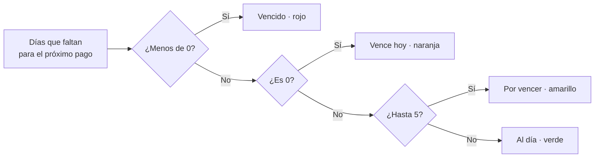
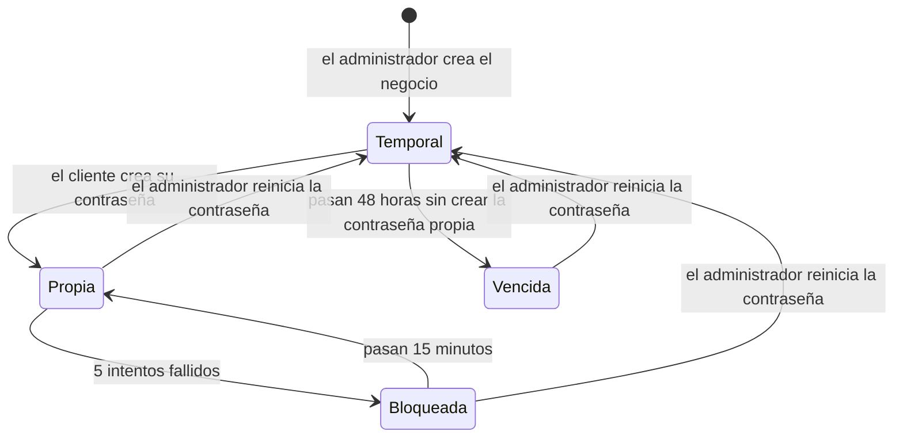
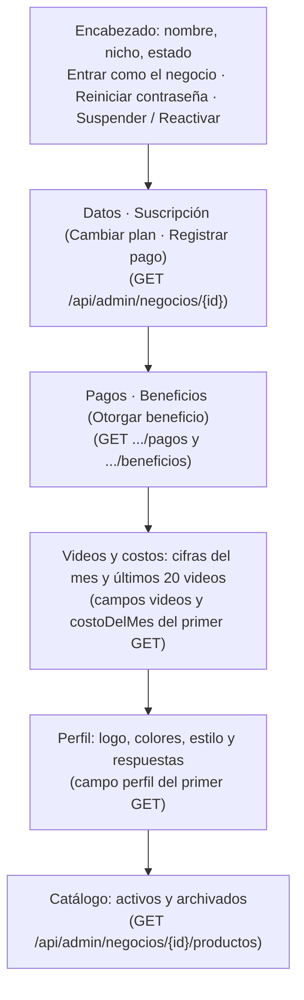
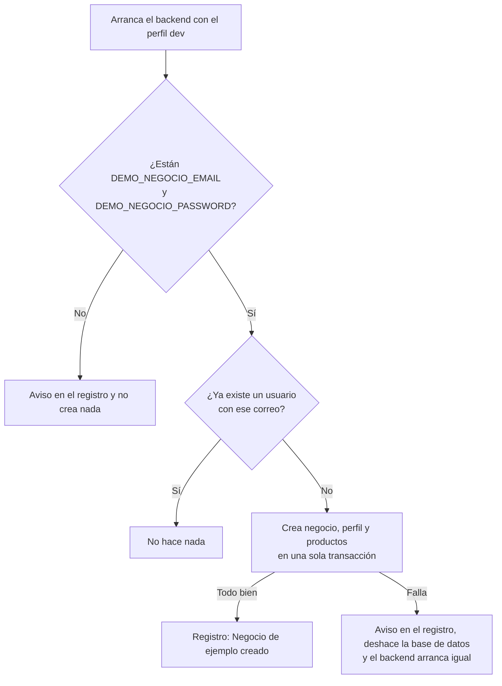

# Manual del administrador

Guía de uso del **panel de administración de AutoReel** (`/admin`). Explica cómo crear negocios, entregarles su acceso, cobrarles, configurar la IA y darles soporte.

> **Estado del documento:** al día con `main` al 2026-11-06. Cubre las fases **1** (base), **2** (perfil y catálogo), **4** (guion), **5** (generación), los **proveedores de Google** (PR #7: una sola clave de Google AI Studio para el guion y los clips), la **fase 7** (PR #8: notificaciones, pagos, planes, integraciones y claves, beneficios, costos y entrar como el negocio) y la **revisión del flujo del negocio** (PR #9: ya no hay respaldo sin IA para los clips). *Actualización del 2026-11-12:* con la **mejora de la calidad del video** (ADR 0021), **el guion tampoco tiene respaldo sin IA** (sección 18.2). La fase 3 (chat) no agregó funciones al panel. La **fase 6** (publicación en Instagram) y la **fase 8** (despliegue en AWS) están **pendientes** (sección 22). Se actualiza al terminar cada fase (sección 23 de la especificación). Las capturas de pantalla están pendientes.

---

## Índice

1. [Antes de empezar](#1-antes-de-empezar)
2. [Iniciar y cerrar sesión](#2-iniciar-y-cerrar-sesión)
3. [Bloqueo por intentos fallidos](#3-bloqueo-por-intentos-fallidos)
4. [Lista de negocios](#4-lista-de-negocios)
5. [Crear un negocio](#5-crear-un-negocio)
6. [Entregar la contraseña temporal](#6-entregar-la-contraseña-temporal)
7. [Detalle de un negocio](#7-detalle-de-un-negocio)
8. [Reiniciar la contraseña de un negocio](#8-reiniciar-la-contraseña-de-un-negocio)
9. [Suspender y reactivar un negocio](#9-suspender-y-reactivar-un-negocio)
10. [Notificaciones (la campana)](#10-notificaciones-la-campana)
11. [Registrar un pago](#11-registrar-un-pago)
12. [Cambiar el plan de un negocio](#12-cambiar-el-plan-de-un-negocio)
13. [Beneficios temporales](#13-beneficios-temporales)
14. [Costos de IA](#14-costos-de-ia)
15. [Ajustes: integraciones y claves](#15-ajustes-integraciones-y-claves)
16. [Ajustes: planes](#16-ajustes-planes)
17. [Entrar como el negocio](#17-entrar-como-el-negocio)
18. [IA del guion: Gemini, reintentos y costos](#18-ia-del-guion-gemini-reintentos-y-costos)
19. [IA del video: Gemini Omni Flash, Veo y FFmpeg](#19-ia-del-video-gemini-omni-flash-veo-y-ffmpeg)
20. [Negocio de ejemplo (perfil dev)](#20-negocio-de-ejemplo-perfil-dev)
21. [Mensajes de error frecuentes](#21-mensajes-de-error-frecuentes)
22. [Pendientes: Instagram y despliegue](#22-pendientes-instagram-y-despliegue)

---

## 1. Antes de empezar

### 1.1 Qué puede hacer hoy el administrador

| Acción | Dónde | Regla |
|---|---|---|
| Iniciar sesión y entrar a `/admin` | Sección 2 | RF-01, RN-06 |
| Ver la lista de negocios, buscar y filtrar por estado de pago; ver su plan, su modelo de video y sus videos del mes | Sección 4 | RF-02, RN-43 |
| Crear un negocio con su plan, monto mensual y fecha del primer pago | Sección 5 | RF-03, RN-41 |
| Ver el detalle de un negocio: datos, suscripción con el plan que rige hoy y sus modelos, pagos, beneficios, videos y costos, perfil y catálogo | Sección 7 | RF-05, RF-07 |
| Reiniciar la contraseña de un negocio | Sección 8 | RF-04, RN-05 |
| Suspender y reactivar un negocio | Sección 9 | RF-06, RN-07 |
| Recibir notificaciones de pago y de fallas de la IA (la campana) | Sección 10 | RF-09, RN-44, RN-45, RN-57 |
| Registrar pagos (la fecha de pago avanza un mes) | Sección 11 | RF-08, RN-42 |
| Cambiar el plan y el monto de un negocio | Sección 12 | RF-06, RN-49 |
| Otorgar y terminar beneficios temporales | Sección 13 | RF-12, RN-50 a RN-53 |
| Ver el costo estimado de IA por negocio y por mes | Secciones 14 y 7 | RF-07, RN-32 |
| Pegar las claves de los proveedores, probar la conexión, activar, desactivar, agregar y editar modelos de IA | Sección 15 | RF-11, RN-48, RN-55, RN-56 |
| Crear y editar planes | Sección 16 | RF-10, RN-47 |
| Entrar como el negocio para darle soporte | Sección 17 | RN-58 (ADR 0019) |
| Indicar dónde está FFmpeg para componer los videos | Sección 19.4, con la variable de entorno `FFMPEG_PATH` | — |
| Publicar los videos en Instagram (lo hace el negocio) | **Pendiente (fase 6)**, sección 22 | RF-27 a RF-29 |

### 1.2 La cuenta del administrador

En el MVP existe **un solo administrador**, y no hay pantalla para crear otros.

- **Cómo se crea.** Al arrancar, el backend (`InicializadorAdministrador`) crea el administrador con las variables de entorno `ADMIN_EMAIL` y `ADMIN_PASSWORD` (sección 16 de la especificación).
- **Cuándo se crea.** Solo lo crea si todavía no existe ningún usuario con rol `ADMIN`. Nunca sobrescribe uno existente.
  - Cambiar esas variables después **no cambia** la contraseña del administrador ya creado.
- **Reglas de `ADMIN_PASSWORD`.** Debe cumplir las mismas reglas que cualquier contraseña (RN-04): entre 8 y 64 caracteres, con al menos una letra y un número. Si no las cumple, el backend no arranca.
- **Si faltan las variables.**
  - En el perfil `dev`, el backend solo muestra un aviso en el registro y arranca sin administrador.
  - Fuera de `dev`, el backend no arranca.
- **En desarrollo local**, los valores están en el `.env` de la raíz (copiado de `.env.example`).
- **Cambiar la contraseña del administrador.** Todavía no hay pantalla para hacerlo. La API sí lo permite con `POST /api/auth/cambiar-contrasena`, enviando la contraseña actual, la nueva y su confirmación (ver `docs/api.md`). La página **Ajustes** del panel solo tiene **Integraciones y claves** y **Planes** (secciones 15 y 16); la página **Ajustes** de la aplicación del negocio (`/ajustes`) es para los usuarios de los negocios.

### 1.3 Dirección del panel

| Entorno | Dirección |
|---|---|
| Desarrollo local | `http://localhost:5173/login` (Vite envía `/api` al backend en `http://localhost:8080`) |
| Producción | La de CloudFront **(pendiente, fase 8)**; ver `docs/despliegue-aws.md` |

La dirección del frontend se configura con la variable `APP_URL`. Con ella se arma también el enlace que se entrega a cada cliente: `APP_URL` + `/login`.

---

## 2. Iniciar y cerrar sesión

1. Abre la dirección del panel. Si no tienes una sesión activa, aparece la pantalla **Inicia sesión**.
2. Escribe tu **correo** y tu **contraseña**, y pulsa **Entrar**.
   - El correo no distingue mayúsculas (se guarda en minúsculas). La contraseña sí las distingue.
3. El sistema te lleva a `/admin`, a la lista de **Negocios**.

**La barra superior** tiene, a la izquierda, las tres secciones del panel: **Negocios**, **Costos** y **Ajustes** (en el celular, en una fila debajo del logo). A la derecha están tu correo (en pantallas medianas y grandes), la **campana** de notificaciones (sección 10) y **Salir**.

**Duración de la sesión.** La sesión dura **8 horas** (RN-08; variable `SESION_HORAS`). Al vencer, la próxima acción muestra "Tu sesión no está activa. Inicia sesión para continuar." y debes volver a entrar.

**Cerrar sesión.** Pulsa **Salir**, en la esquina superior derecha.

**Separación de roles (RN-06).**
- Si un usuario de un negocio intenta abrir `/admin`, la aplicación lo devuelve a su propia página de inicio.
- Si llama directamente a `/api/admin/...`, el backend responde "No tienes permiso para acceder a esta sección." (`ACCESO_DENEGADO`).
- Lo mismo te pasa a ti mientras estás [dentro de un negocio](#17-entrar-como-el-negocio): hasta que pulses **Volver al panel**, solo ves la aplicación del negocio.

> **Cómo funciona por dentro:** la sesión es un JWT guardado en la cookie `autoreel_sesion`, que es `HttpOnly` y el JavaScript del navegador no puede leer. Las acciones que modifican datos van protegidas contra CSRF (cookie `XSRF-TOKEN` y cabecera `X-XSRF-TOKEN`). Los permisos se leen de la base de datos en cada petición, por eso reiniciar una contraseña o suspender un negocio cierra su sesión al instante. Detalles en `docs/arquitectura.md` y en los ADR 0007 y 0019.

---

## 3. Bloqueo por intentos fallidos

Regla RN-08: **después de 5 intentos fallidos de inicio de sesión, la cuenta se bloquea durante 15 minutos.**

- **Qué cuenta como intento fallido.** Cada inicio de sesión con un correo existente y una contraseña incorrecta.
  - Los intentos con un correo que no existe reciben la misma respuesta ("El correo o la contraseña no son correctos.") y, al quinto, el mismo bloqueo de 15 minutos (`CUENTA_BLOQUEADA`) que una cuenta real, para no revelar qué correos están registrados. Ese conteo vive en memoria (`IntentosDeCorreosDesconocidos`) y se vacía si el backend se reinicia.
- **Al quinto intento fallido** la cuenta queda bloqueada 15 minutos.
- **Durante el bloqueo** el sistema rechaza el ingreso **aunque la contraseña sea correcta**, con el mensaje: "Tu cuenta está bloqueada por varios intentos fallidos. Vuelve a intentarlo en 15 minutos." (`CUENTA_BLOQUEADA`).
- **Cuando pasan los 15 minutos** la cuenta se desbloquea sola y el contador empieza de cero.
- **Un ingreso correcto** también pone el contador en cero.

**Cómo saber si un negocio está bloqueado.** En el [detalle del negocio](#7-detalle-de-un-negocio), la tarjeta **Datos** muestra la fila **Acceso: Bloqueado 15 minutos por intentos fallidos**.

**Cómo desbloquear antes de tiempo a un negocio.** [Reinicia su contraseña](#8-reiniciar-la-contraseña-de-un-negocio). El reinicio levanta el bloqueo, pero también le genera una contraseña temporal nueva. Si el cliente recuerda su contraseña, basta con que espere 15 minutos.

**Si el bloqueado es el administrador.** El bloqueo también aplica a la cuenta del administrador, y no hay otro administrador que pueda desbloquearla: hay que esperar los 15 minutos.

---

## 4. Lista de negocios

Es la pantalla principal del panel (`/admin`, sección **Negocios**). Muestra a todos los clientes **ordenados por su próxima fecha de pago**, del más próximo al más lejano. Si dos negocios tienen la misma fecha, se ordenan por nombre.

### 4.1 Columnas

En una computadora se ve como tabla:

| Columna | Contenido |
|---|---|
| **Negocio** | Nombre (enlace al detalle) y, debajo, el correo del usuario. |
| **Nicho** | "Pastelería", el único nicho del MVP. |
| **Plan** | El plan que **rige hoy**: el de la suscripción o, si hay un [beneficio](#13-beneficios-temporales) vigente, el del beneficio, con la marca "(beneficio)" en verde. Debajo, en gris, su **modelo de video** (por ejemplo, "Gemini Omni Flash"). |
| **Próximo pago** | Fecha del próximo pago y su etiqueta de color (ver 4.3). |
| **Videos del mes** | Videos que el negocio creó en el mes en curso (calendario de Lima). Cuenta cada propuesta aprobada con "Crear mi video" y no cuenta los videos devueltos porque fallaron (RN-27). Es el mismo número de **Videos este mes** del detalle. |
| **Estado** | "Activo" en verde o "Suspendido" en rojo. |
| **Último acceso** | Fecha y hora del último inicio de sesión correcto, en hora de Lima, o "—" si nunca entró. Entrar como el negocio (sección 17) no lo cambia. |

En el celular cada negocio se muestra como una tarjeta con su nombre, correo, etiqueta de estado de pago y una línea con la fecha de pago, el plan (con "(beneficio)" si corresponde), el modelo de video y, si corresponde, la marca "Suspendido". Al tocar la tarjeta se abre el detalle.

### 4.2 Buscar y filtrar

- **Buscar por nombre o correo.** Escribe en el campo **Buscar por nombre o correo**. Encuentra coincidencias parciales y no distingue mayúsculas: "dulce" encuentra "Pastelería Dulce Encanto".
- **Filtrar por estado de pago.** Usa el selector, con las opciones: *Todos los estados de pago*, *Al día*, *Por vencer*, *Vence hoy* y *Vencido*.
- **Combinarlos.** La búsqueda y el filtro se pueden usar a la vez.
- **Si no hay resultados**, aparece "Ningún negocio coincide con la búsqueda.". Si todavía no existe ningún negocio, aparece "Todavía no hay negocios." con la invitación a crear el primero.

### 4.3 Colores del estado de pago

El estado de pago se calcula **cada vez que se abre la lista o el detalle**, con la fecha de hoy en **hora de Lima** (RN-43). Para el cálculo se usan los **días de aviso** de la suscripción, que hoy son 5 para todos los negocios.

| Etiqueta | Color | Cuándo |
|---|---|---|
| **Al día** | Verde | Faltan **más** días que los días de aviso (más de 5). |
| **Por vencer** | Amarillo | Faltan entre 1 y los días de aviso (de 1 a 5 días). |
| **Vence hoy** | Naranja | La fecha de pago es hoy. |
| **Vencido** | Rojo | La fecha de pago ya pasó. |



> **La próxima fecha de pago solo avanza cuando registras el pago** ([sección 11](#11-registrar-un-pago)). Si el cliente te pagó y no lo registras, su negocio pasa a **Vencido** al llegar la fecha.
>
> **Un pago vencido no suspende al negocio** (RN-45). A los 7 días de vencido, la campana te sugiere suspenderlo (sección 10), pero la decisión es tuya: si quieres cortarle el acceso, debes [suspenderlo](#9-suspender-y-reactivar-un-negocio) a mano.

---

## 5. Crear un negocio

Regla RF-03: solo el administrador crea negocios. Cada negocio tiene un único usuario, y el correo es único en toda la plataforma (RN-01).

1. En la lista de negocios, pulsa **Crear negocio**.
2. Completa el formulario. Todos los campos son obligatorios.

| Campo | Qué escribir | Validación |
|---|---|---|
| **Nicho** | Viene marcado **Pastelería**, el único nicho del MVP. | Debe ser un nicho registrado. **No se puede cambiar después** (RN-40). |
| **Nombre del negocio** | Nombre comercial, por ejemplo "Pastelería Dulce Encanto". | Hasta 120 caracteres. |
| **Correo del usuario** | Correo con el que el negocio iniciará sesión. | Formato de correo válido, hasta 254 caracteres y **que no exista ya** en la plataforma. Se guarda en minúsculas. |
| **Plan** | Viene marcado el primer plan activo, **Lite** en el MVP. El selector muestra el nombre, los videos por día y el modelo de video. Solo aparecen los planes **activos** (sección 16). | Debe ser un plan activo (RN-41). |
| **Monto mensual (US$)** | Monto acordado con el cliente, por ejemplo `49.00`. | Mayor que cero y con hasta dos decimales (RN-41). |
| **Fecha del primer pago** | Fecha en la que el cliente debe hacer su primer pago. | Obligatoria (RN-41). Se convierte en la **próxima fecha de pago**, y su día del mes es el que se conserva al registrar los pagos (sección 11). |

3. Pulsa **Crear negocio**.

**Qué crea el sistema, todo en una sola operación:**
- El **negocio**, en estado **ACTIVO** y con el onboarding pendiente (`onboarding_completo = false`).
- Su **perfil vacío** (fila de `perfil_negocio`, creada por `ServicioPerfil.crearVacio`), que el cliente completa en el onboarding.
- Su **suscripción**, con el plan y el monto mensual elegidos:
  - **Fecha de inicio:** el día de la creación, en hora de Lima.
  - **Próxima fecha de pago:** la fecha del primer pago.
  - **Día de pago:** el día del mes de esa fecha (columna `suscripcion.dia_pago`, RN-42).
  - **Días de aviso:** 5.
- Su **usuario**, con una **contraseña temporal** de 12 caracteres que vence a las **48 horas** (RN-02).

Si algo falla, no se guarda nada. Si todo sale bien, la ventana se cierra, el negocio aparece en la lista y se abre la ventana **Negocio creado** con la contraseña temporal (ver la sección 6).

> Si eliges una fecha del primer pago que ya pasó, el negocio aparece de inmediato como **Vencido**.

**Errores posibles:**

| Mensaje | Causa | Qué hacer |
|---|---|---|
| "Ya existe una cuenta con ese correo." | El correo ya pertenece a otro negocio o al administrador (RN-01, V02). | Usa otro correo. |
| "El plan elegido no existe o no está activo." | El plan se desactivó mientras completabas el formulario. | Recarga la página y elige otro plan. |
| "El nicho elegido no existe." | El nicho no está registrado. | Recarga la página. |
| "No pudimos cargar los planes. Recarga la página." | Falló la carga de los planes o de los nichos. | Recarga la página. |
| Mensajes de validación, por ejemplo "El monto mensual debe ser mayor que cero." | Algún campo no cumple su regla. | Corrige el campo indicado. |

---

## 6. Entregar la contraseña temporal

Al crear el negocio, se abre la ventana **Negocio creado** con estos datos:

- **Correo** del usuario.
- **Contraseña temporal**: 12 caracteres aleatorios, con letras y números. No usa caracteres que se confunden al dictarlos, como `0`/`O` o `1`/`l`/`I`.
- **Enlace** para iniciar sesión (`APP_URL/login`).
- **Vence**: fecha y hora de vencimiento, 48 horas después, en hora de Lima.

> **La contraseña temporal se muestra una sola vez (RN-02).** El sistema solo guarda su hash. Al cerrar la ventana ya no hay forma de volver a verla. Si se pierde, [reinicia la contraseña](#8-reiniciar-la-contraseña-de-un-negocio) para generar una nueva.

### 6.1 Copiar el mensaje para el cliente

1. Pulsa **Copiar mensaje para el cliente**. Se copia al portapapeles un texto listo para enviar:

   ```text
   ¡Hola! Ya puedes entrar a AutoReel.
   Enlace: <enlace>
   Correo: <correo>
   Contraseña temporal: <contraseña>
   Al entrar te pediremos crear tu propia contraseña. La contraseña temporal vence en 48 horas.
   ```

2. Aparece la confirmación "Mensaje copiado. Pégalo en WhatsApp o en un correo para el cliente."
3. Pega el mensaje en el canal que uses con el cliente. AutoReel no envía correos automáticos en el MVP (sección 21 de la especificación).
4. Pulsa **Listo** para cerrar la ventana.

**Si el navegador bloquea el portapapeles**, aparece "No pudimos copiar automáticamente. Selecciona el mensaje y cópialo." junto con un cuadro de texto que contiene el mensaje. Al hacer clic en el cuadro se selecciona todo el texto, para copiarlo con `Ctrl+C`.

**Buenas prácticas:**
- Envía el mensaje **antes** de cerrar la ventana.
- No guardes la contraseña temporal en otro lugar: el cliente la reemplaza en su primer ingreso.
- Avísale al cliente que tiene **48 horas** para entrar. Si se le vence, [reinicia su contraseña](#8-reiniciar-la-contraseña-de-un-negocio).

### 6.2 Qué ve el cliente después

El cliente abre el enlace e inicia sesión con su correo y la contraseña temporal. Luego:

1. El sistema lo obliga a crear su propia contraseña (RN-03 y RN-04). Mientras no lo haga, solo puede ver la pantalla **Crea tu contraseña**.
2. Después pasa al **onboarding** de tres pasos (`/bienvenida`, RF-16): su marca (nombre, logo, colores y estilo), su negocio (especialidad, clientes, ciudad, distrito, canales de pedido, WhatsApp y horario; en especialidad, clientes y canales puede escribir su propia opción en **"Otros"**) y su toque (opcional: "¿Qué te diferencia?", palabras prohibidas y foto del local). Mientras no lo complete, no puede usar el resto de la aplicación ni crear videos (RN-09).
3. Al terminar, se le sugiere registrar sus productos en el **catálogo**.

El detalle está en `docs/manual-negocio.md`. Puedes seguir su avance en el [detalle del negocio](#7-detalle-de-un-negocio): fila **Onboarding** y tarjetas **Perfil** y **Catálogo**. Si necesitas ver exactamente lo que ve el cliente, [entra como el negocio](#17-entrar-como-el-negocio).



---

## 7. Detalle de un negocio

> *Captura pendiente: detalle de un negocio con suscripción, pagos, beneficios, videos y costos.*

Para abrirlo, pulsa el nombre del negocio en la lista (o su tarjeta en el celular). La dirección es `/admin/negocios/{id}` (pantalla `PaginaDetalleNegocio`). Para volver, pulsa **← Negocios**.

De arriba abajo, la pantalla muestra: el encabezado, las tarjetas **Datos** y **Suscripción**, las tarjetas **Pagos** y **Beneficios**, la sección **Videos y costos**, la tarjeta **Perfil** y la sección **Catálogo**.



**Encabezado:**
- Nombre del negocio, su nicho y su estado (**Activo** o **Suspendido**).
- Botones **Entrar como el negocio** (sección 17), **Reiniciar contraseña** (sección 8) y **Suspender** (sección 9). Si el negocio está suspendido, en lugar de **Suspender** aparece **Reactivar**.

**Tarjeta "Datos":**

| Dato | Significado |
|---|---|
| **Correo del usuario** | Correo con el que el negocio inicia sesión. |
| **Creado** | Fecha y hora de creación del negocio. |
| **Último acceso** | Último inicio de sesión correcto, o "—" si nunca entró. |
| **Onboarding** | "Pendiente" mientras el cliente no termine los tres pasos del onboarding; "Completo" cuando los terminó (`POST /api/perfil/completar-onboarding`, RN-09). Un negocio con el onboarding pendiente no puede crear videos. |
| **Contraseña** | "Temporal, vence …" mientras el cliente no haya creado la suya, o "Propia" cuando ya la creó. |
| **Acceso** | Solo aparece si la cuenta está bloqueada: "Bloqueado 15 minutos por intentos fallidos". |

**Tarjeta "Suscripción":** arriba a la derecha tiene los botones **Cambiar plan** (sección 12) y **Registrar pago** (sección 11).

| Dato | Significado |
|---|---|
| **Plan** | Plan de la suscripción. Si hay un beneficio vigente, debajo dice en verde "Hoy usa *plan* por un beneficio hasta *fecha y hora*" (sección 13). |
| **Modelo de video** | El modelo de video del plan que **rige hoy** (el del beneficio, si hay uno vigente). Por ejemplo, "Gemini Omni Flash". |
| **Modelo de texto** | El modelo de texto del plan que rige hoy, el que escribe el guion. Por ejemplo, "Gemini". |
| **Límites** | Videos por día y regeneraciones por video del plan que rige hoy, por ejemplo "1 video por día · 3 regeneraciones por video". |
| **Monto mensual** | Por ejemplo, "US$ 49.00". Un beneficio no lo cambia. |
| **Inicio** | Día de la creación del negocio, en Lima. |
| **Próximo pago** | Fecha y etiqueta de color, con las mismas reglas que en la lista. |
| **Aviso de pago** | "5 días antes": días de aviso para el estado **Por vencer**. |

**Tarjeta "Pagos":** el historial de pagos registrados, del más reciente al más antiguo (sección 11.3). Si no hay ninguno: "Todavía no hay pagos registrados."

**Tarjeta "Beneficios":** los beneficios del negocio, con el botón **Otorgar beneficio** (sección 13). Si no hay ninguno: "Sin beneficios. Un beneficio da otro plan por un tiempo, como cortesía o por un inconveniente."

**Sección "Videos y costos"** (solo lectura, RF-05, RF-07):

Viene en los campos `videos` y `costoDelMes` de `GET /api/admin/negocios/{id}`. Sirve para dar soporte cuando un cliente dice que su video no salió bien, y para ver cuánto te cuesta.

- Arriba, cuatro cifras del **mes en curso** (calendario de Lima):
  - **Videos este mes:** el mismo número de la columna **Videos del mes** de la lista. Cuenta cada propuesta aprobada con "Crear mi video" y no cuenta los videos devueltos por una falla (RN-27).
  - **Costo de IA del mes:** la suma estimada de clips y guiones (sección 14).
  - **Clips** y **Guiones:** el costo separado por concepto.
- Debajo, una tabla con sus **últimos 20 videos**, del más reciente al más antiguo, incluidas las propuestas que nunca se aprobaron:

| Columna | Qué muestra |
|---|---|
| **Fecha** | Fecha y hora en que nació el video (al terminar el chat), en hora de Lima. |
| **Estado** | "Preparando propuesta", "Por revisar (propuesta)", "Generando clips", "Componiendo", "Listo", "Aprobado", "Error" o "Descartado". "Programado" y "Publicado" quedan para la fase 6 (pendiente). |
| **Modelo de video** | El modelo con el que nació ese video. Un video conserva su modelo aunque después cambies el plan o el modelo (RN-54). |
| **Costo** | El costo estimado de IA de ese video: su guion más sus clips, incluidas las regeneraciones (`video.costo_estimado`). |
| **Planos con respaldo** | Cuántos momentos usaron el acercamiento de FFmpeg en lugar del clip de IA. Solo puede ser mayor que 0 en videos **anteriores al 2026-11-06**: desde entonces no hay respaldo sin IA para los clips (sección 19.3) y los videos nuevos siempre muestran 0. |
| **Detalle** | El motivo del error, si el video falló (por ejemplo, "No pudimos crear los clips con IA. Te devolvimos el video del día; inténtalo de nuevo en un rato."); si no, "—". |

- Si el negocio no tiene videos, aparece **"Todavía no tiene videos."**
- Desde el panel no puedes abrir, ver ni descargar el video del negocio. Para verlo tal como lo ve el cliente, [entra como el negocio](#17-entrar-como-el-negocio) y ábrelo en **Mis videos**.

**Tarjeta "Perfil"** (solo lectura):

Viene en el campo `perfil` de `GET /api/admin/negocios/{id}` (`NegocioDetalle.perfil`, de tipo `ServicioPerfil.PerfilParaAdmin`). Desde aquí **no puedes editar** el perfil: solo el negocio lo cambia, desde su onboarding o desde Ajustes (o tú, [entrando como el negocio](#17-entrar-como-el-negocio)).

| Elemento | Qué muestra |
|---|---|
| **Logo** | El logo sobre un fondo gris claro, o "Sin logo" si todavía no lo subió. |
| **Colores** | Dos círculos con el color principal y el secundario. |
| **Estilo** | "Estilo casero", "Estilo elegante" o "Estilo divertido". |
| **Respuestas** | Una fila por cada pregunta respondida del onboarding, con el **texto de la pregunta** y la **respuesta legible** (el backend traduce los valores a su texto, por ejemplo `TORTAS_PERSONALIZADAS` → "Tortas personalizadas", y une las selecciones múltiples con comas). Lo que el negocio escribió en **"Otros"** aparece tal cual entre las opciones elegidas (hasta 40 caracteres). El WhatsApp se ve normalizado como `+519XXXXXXXX`. |

- Si el negocio todavía no respondió ninguna pregunta, aparece **"Todavía no completó el onboarding."**
- Un negocio puede tener el onboarding a medias: verás solo las respuestas que ya guardó, y la fila **Onboarding** de la tarjeta Datos seguirá en "Pendiente".
- **La foto del local no se muestra en la tarjeta**, aunque viene en la respuesta de la API (`perfil.perfil.fotoLocal`). Tampoco se muestra el aviso de logo sin transparencia (`logoSinTransparencia`).
- Revisar lo que los negocios escriben en "Otros" sirve para decidir qué opciones agregar más adelante (plan de desarrollo, sección 10.1).

**Sección "Catálogo"** (solo lectura):

Se carga aparte, con `GET /api/admin/negocios/{id}/productos`, e incluye **todos** los productos del negocio: activos y archivados, del más reciente al más antiguo.

- Cada producto se ve como una tarjeta con su primera foto, su nombre y una etiqueta de estado:
  - **Listo:** activo y con sus tres fotos (entero, detalle y porción). Puede usarse en videos (RN-12).
  - **Faltan fotos:** activo, pero sin alguna de sus tres fotos. No puede usarse en videos hasta que el negocio las complete.
  - **Archivado:** el negocio lo archivó. No se borra (RN-13) y no aparece al crear videos.
- Si el negocio no tiene productos, aparece **"Todavía no registró productos."**
- Desde aquí no puedes crear, editar ni archivar productos de un negocio.

> **Las imágenes del perfil y del catálogo se leen con URLs firmadas que vencen en 1 hora** (el bucket es privado). Si una foto del catálogo no carga, la pantalla vuelve a pedir el catálogo una vez; el logo de la tarjeta Perfil no se renueva solo. Si una imagen sigue sin verse, recarga la página.

El administrador nunca ve la contraseña ni el hash de un negocio (RN-39). Tampoco verá sus tokens de Instagram cuando existan (fase 6).

---

## 8. Reiniciar la contraseña de un negocio

Regla RF-04 y RN-05. **Úsalo cuando:**
- El cliente olvidó su contraseña. No existe la recuperación por correo en el MVP.
- La contraseña temporal venció antes de que el cliente entrara.
- Se perdió el mensaje con la contraseña temporal.
- La cuenta está bloqueada y el cliente no puede esperar 15 minutos.

**Pasos:**

1. Abre el detalle del negocio y pulsa **Reiniciar contraseña**.
2. Confirma el aviso: "Se generará una nueva contraseña temporal para *{negocio}*. La actual dejará de funcionar y se cerrará su sesión. ¿Continuar?"
3. Se abre la ventana **Nueva contraseña temporal**, igual a la de creación. Entrégala con **Copiar mensaje para el cliente**, siguiendo la [sección 6](#6-entregar-la-contraseña-temporal).

**Efectos del reinicio:**
- La contraseña anterior, sea temporal o propia, **deja de funcionar**.
- **Se cierran todas las sesiones abiertas** del negocio. Su próxima acción le pide iniciar sesión.
- Se levanta el bloqueo por intentos fallidos, si lo había.
- La nueva contraseña temporal vence a las **48 horas**, y el cliente deberá crear una propia otra vez.
- El reinicio **no cambia** el estado del negocio: si estaba suspendido, sigue suspendido.

Es la única forma de cambiar la contraseña de un negocio: ni siquiera [entrando como el negocio](#17-entrar-como-el-negocio) puedes cambiarla.

---

## 9. Suspender y reactivar un negocio

Reglas RF-06 y RN-07. La suspensión es **manual**: el sistema nunca suspende solo, ni siquiera con el pago vencido (RN-45). A los 7 días de vencido, la campana te lo sugiere (sección 10).

### 9.1 Suspender

1. Abre el detalle del negocio y pulsa **Suspender** (botón con borde y texto rojos).
2. Confirma el aviso: "*{negocio}* no podrá iniciar sesión hasta que lo reactives. ¿Suspender?"

**Efectos de la suspensión:**
- La sesión abierta del negocio **se cierra al instante**.
- Si el cliente intenta entrar con su contraseña correcta, ve: "Tu cuenta está suspendida. Comunícate con el administrador de AutoReel." (`NEGOCIO_SUSPENDIDO`).
- En la lista y en el detalle, el negocio aparece como **Suspendido**.
- No se borra ningún dato. La suscripción, el plan y la fecha de pago no cambian.

### 9.2 Reactivar

1. Abre el detalle del negocio suspendido y pulsa **Reactivar**. No pide confirmación.

**Efectos de la reactivación:**
- El negocio vuelve a estado **Activo**, y el cliente puede iniciar sesión otra vez **con la misma contraseña** que tenía.
- Las sesiones que se cerraron al suspender no se recuperan: el cliente debe iniciar sesión de nuevo.
- Si el cliente tenía una contraseña temporal y venció mientras estaba suspendido, [reinicia su contraseña](#8-reiniciar-la-contraseña-de-un-negocio).
- Reactivar no registra ningún pago: si el negocio estaba vencido, [registra su pago](#11-registrar-un-pago) aparte.

---

## 10. Notificaciones (la campana)

> *Captura pendiente: campana abierta con notificaciones de pago y de integración.*

Reglas RF-09, RN-44, RN-45 y RN-57. La **campana** está en la barra superior del panel, junto a **Salir**. Si tienes notificaciones sin leer, muestra un círculo rojo con el número ("99+" si pasan de 99). El panel la actualiza cada minuto.

### 10.1 Qué notificaciones hay

| Tipo | Color del punto | Mensaje (ejemplo) | Cuándo se crea |
|---|---|---|---|
| Pago por vencer (`PAGO_POR_VENCER`) | Amarillo | "El pago de Pastelería Dulce Encanto vence en 3 días." (o "vence mañana.") | El negocio entra en **Por vencer** (de 1 a 5 días antes). |
| Pago hoy (`PAGO_HOY`) | Naranja | "El pago de … vence hoy." | El día de la fecha de pago. |
| Pago vencido (`PAGO_VENCIDO`) | Rojo | "El pago de … está vencido." | Al día siguiente de la fecha de pago. |
| Sugerencia de suspensión (`SUGERENCIA_SUSPENSION`) | Rojo oscuro | "El pago de … lleva 7 días vencido. Puedes suspenderlo desde su detalle." | A los 7 días de vencido, si el negocio no está suspendido (RN-45). |
| Integración con error (`INTEGRACION_CON_ERROR`) | Violeta | "Gemini Omni Flash: la credencial no funciona. …" (o "el modelo está mal configurado.", "el proveedor no está disponible.") | Falla un proveedor de IA al escribir un guion o crear un clip (RN-57). |

**Cuándo y cuántas:**
- Las de **pago** las crea una tarea diaria (`TareaDiariaDePagos`) a las **00:10 hora de Lima** y también cada vez que arranca el backend. Revisa el estado de pago de cada negocio con la fecha de hoy.
- **Ninguna se repite** (RN-44): hay como máximo una de cada tipo por negocio y por fecha de pago. Por eso un negocio vencido no te avisa todos los días: te avisa una vez por vencido y una vez con la sugerencia de suspender.
- Las de **integración** son como máximo **una por modelo y por día**, aunque fallen muchos videos. El detalle de cada falla sigue quedando en el registro del backend (secciones 18.3 y 19.6). El mensaje **nunca incluye la clave**.

### 10.2 Usar la campana

1. Pulsa la campana. Se abre el panel **Notificaciones** con las 50 más recientes, de la más nueva a la más antigua, con su fecha y hora. Las leídas se ven más tenues. Si no hay ninguna: "No tienes notificaciones."
2. En cada notificación tienes estos enlaces:
   - **Registrar pago:** solo en las de pago (por vencer, hoy y vencido) que no has leído. Abre el detalle del negocio con la ventana **Registrar pago** ya abierta (sección 11).
   - **Ver negocio:** abre el detalle del negocio.
   - **Ver integraciones:** en las de integración, abre **Ajustes → Integraciones y claves** (sección 15).
   - **Marcar leída:** la marca sin abrir nada.
3. **Marcar todas como leídas**, arriba a la derecha del panel, marca todas de una vez.

Abrir una notificación con cualquiera de sus enlaces también la marca como leída. Para cerrar el panel, pulsa fuera de él o la tecla `Esc`.

**Registrar el pago atiende sus avisos.** Al registrar el pago de una fecha, todas las notificaciones de esa fecha del negocio (por vencer, hoy, vencido y la sugerencia) quedan como leídas.

> API: `GET /api/admin/notificaciones`, `POST /api/admin/notificaciones/{id}/leida` y la de marcar todas (ver `docs/api.md`).

---

## 11. Registrar un pago

> *Captura pendiente: ventana "Registrar pago".*

Reglas RF-08 y RN-42. AutoReel no cobra: tú recibes el pago por tu canal (transferencia, Yape, etc.) y lo **registras** en el panel. Al registrarlo, la próxima fecha de pago avanza un mes.

### 11.1 Pasos

1. Abre el detalle del negocio y pulsa **Registrar pago**, en la tarjeta **Suscripción**. También puedes llegar desde la campana (sección 10.2).
2. Se abre la ventana **Registrar pago**. Arriba dice qué fecha cubre: "Cubre el pago del *próxima fecha de pago*. La próxima fecha de pago pasará al mes siguiente, el día *N* (o el último día del mes)."
3. Completa:

| Campo | Qué poner | Regla |
|---|---|---|
| **Fecha del pago** | El día en que el cliente te pagó. Viene con la fecha de hoy (Lima). | Obligatoria. **No puede ser futura.** |
| **Monto (US$)** | Viene con el monto mensual de la suscripción; cámbialo si te pagó otro monto. | Mayor que cero, con hasta dos decimales. |
| **Medio de pago** | **Transferencia**, **Yape**, **Plin**, **Efectivo** u **Otro**. | Obligatorio. |
| **Nota (opcional)** | Por ejemplo, el número de operación. | Hasta 300 caracteres. |

4. Pulsa **Registrar pago**. La ventana se cierra, la tarjeta **Suscripción** muestra la nueva fecha y su color, y el pago aparece en la tarjeta **Pagos**. Para salir sin registrar, pulsa **Cancelar**.

### 11.2 Cómo avanza la fecha de pago

- **Cada pago cubre una sola fecha de pago:** la próxima fecha que tenía el negocio al registrarlo. Esa fecha avanza **un mes**.
- **Se conserva el día del primer pago** (el día de pago de la suscripción). Si el mes siguiente no tiene ese día, se usa el **último día del mes**, y al mes siguiente se vuelve al día original. Ejemplo con día 31: 31 de enero → 28 (o 29) de febrero → 31 de marzo.
- **Si el negocio debe varios meses**, registra un pago por cada mes: cada registro cubre la fecha pendiente más antigua y la avanza un mes.
- La fecha del pago (el día en que te pagaron) no cambia el cálculo: solo queda en el historial.
- Dos clics seguidos en **Registrar pago** no pagan dos veces la misma fecha.
- Al registrar el pago, sus notificaciones de esa fecha quedan como leídas (sección 10.2).

### 11.3 Historial de pagos

La tarjeta **Pagos** del detalle lista cada pago con:
- El monto y el medio, por ejemplo "US$ 49.00 · Yape".
- "Pagó el *fecha del pago* · cubre el *fecha de pago cubierta*".
- La nota, si la tiene.

No hay pantalla para editar ni borrar un pago. **No modifiques la tabla `pago` a mano.**

**Errores posibles:** "La fecha del pago no puede ser posterior a hoy." (`PAGO_FECHA_FUTURA`) y los de validación de los campos.

> API: `GET` y `POST /api/admin/negocios/{id}/pagos`.

---

## 12. Cambiar el plan de un negocio

Reglas RF-06 y RN-49.

1. Abre el detalle del negocio y pulsa **Cambiar plan**, en la tarjeta **Suscripción**.
2. En la ventana **Cambiar plan**:
   - **Plan:** elige el nuevo plan. El selector muestra el nombre, los videos por día y el modelo de video, solo de los planes **activos** (y el plan actual, aunque esté inactivo).
   - **Monto mensual (US$):** viene con el monto actual; cámbialo si el nuevo plan tiene otro precio.
3. Pulsa **Guardar** (o **Cancelar**).

**Efectos del cambio:**
- **Rige para los videos que el negocio cree desde ahora.** Los videos en proceso terminan con el plan con el que empezaron (RN-49), y cada video conserva el modelo con el que nació (RN-54).
- **La fecha de pago no cambia.** El nuevo monto se usa desde el próximo pago que registres.
- Si el negocio tiene un [beneficio](#13-beneficios-temporales) vigente, mientras dure sigue usando el plan del beneficio; al terminar, vuelve al plan nuevo.
- Para cambiar solo el monto, deja el mismo plan y cambia el monto.

**Error posible:** "El plan elegido no existe o no está activo." (`PLAN_INVALIDO`): el plan se desactivó mientras tenías la ventana abierta. Recarga la página.

> API: `PUT /api/admin/negocios/{id}/plan`.

---

## 13. Beneficios temporales

Reglas RF-12 y RN-50 a RN-53. Un **beneficio** le da a un negocio **otro plan durante un tiempo**, por ejemplo como cortesía o para compensar un inconveniente.

### 13.1 Otorgar un beneficio

1. Abre el detalle del negocio y pulsa **Otorgar beneficio**, en la tarjeta **Beneficios**.
2. En la ventana **Otorgar beneficio**:

| Campo | Qué poner | Regla |
|---|---|---|
| **Plan del beneficio** | Un plan **activo** distinto del plan del negocio. El selector muestra el nombre, los videos por día y el modelo de video. Si no hay otro plan activo, verás "No hay otro plan activo. Crea uno en Ajustes → Planes." | Obligatorio. |
| **Desde** y **Hasta** | Fecha y hora de inicio y de fin, en tu hora local. Vienen con "ahora" y "mañana a esta hora". | El fin debe ser después del inicio y en el futuro. **Máximo 30 días.** |
| **Motivo** | Por qué lo otorgas, por ejemplo "Cortesía por ser cliente antiguo". | Obligatorio, hasta 300 caracteres. |

3. Pulsa **Otorgar beneficio** (o **Cancelar**).

### 13.2 Qué cambia y qué no

- **Cambia** los modelos de IA, los videos por día y las regeneraciones: mientras está vigente, el negocio usa el plan del beneficio para sus videos nuevos (RN-50). En la lista y en el detalle, el plan aparece con "(beneficio)" y la tarjeta **Suscripción** dice "Hoy usa *plan* por un beneficio hasta …".
- **No cambia** el monto mensual ni la fecha de pago (RN-53).
- **Un solo beneficio a la vez** (RN-51): no se pueden cruzar las fechas de dos beneficios del mismo negocio.
- **Al terminar, el negocio vuelve solo a su plan** (RN-52). No tienes que hacer nada.
- Si la fecha **Desde** ya pasó, el beneficio empieza en el momento en que lo otorgas.

### 13.3 La lista de beneficios

La tarjeta **Beneficios** muestra los últimos 10, cada uno con su plan y su modelo de video, una etiqueta de estado, el período ("*desde* → *hasta*") y el motivo:

| Etiqueta | Significado |
|---|---|
| **Programado** | Todavía no empieza. |
| **Vigente** | Está en curso: el negocio usa ese plan. |
| **Terminado** | Ya terminó (o lo terminaste). |

**Terminar antes de tiempo:** pulsa **Terminar** junto al beneficio y confirma "¿Terminar este beneficio ahora? El negocio vuelve a su plan." Un beneficio **Vigente** termina en ese momento y queda en la lista como **Terminado**; uno **Programado** se borra.

**Errores posibles:**

| Mensaje | Qué hacer |
|---|---|
| "Un beneficio puede durar como máximo 30 días." | Acorta el período. |
| "El fin del beneficio debe ser después del inicio." / "El beneficio ya habría terminado." | Corrige las fechas. |
| "El negocio ya tiene ese plan. Elige otro plan para el beneficio." | Elige otro plan. |
| "El negocio ya tiene un beneficio en esas fechas. Termina el anterior o elige otras fechas." | Termina el beneficio anterior o cambia las fechas. |

> API: `GET` y `POST /api/admin/negocios/{id}/beneficios` y `DELETE /api/admin/negocios/{id}/beneficios/{idBeneficio}`.

---

## 14. Costos de IA

> *Captura pendiente: página "Costos de IA".*

Regla RF-07 y RN-32. Pulsa **Costos** en la barra superior (`/admin/costos`). La página **Costos de IA** muestra lo que estimamos que cobran los proveedores por los guiones y los clips de cada negocio, **por mes** (calendario de Lima).

1. Elige el **Mes** arriba a la derecha. Viene con el mes en curso y no permite meses futuros.
2. Arriba ves cuatro cifras del mes: **Total de *mes***, **Clips de video**, **Guiones** y **Videos con costo**.
3. Debajo, una tabla con una fila por negocio que tuvo costos ese mes:

| Columna | Qué muestra |
|---|---|
| **Negocio** | Nombre, con enlace a su detalle. |
| **Videos** | Cuántos de sus videos tuvieron algún costo ese mes. |
| **Clips** | Costo de los clips de video, incluidas las regeneraciones. |
| **Guiones** | Costo de los guiones. |
| **Total** | Clips más guiones. |

- Si no hubo costos ese mes: "No hubo costos de IA en *mes*."
- Al pie: "Son estimaciones con el costo de referencia de cada modelo (Ajustes → Integraciones); la factura real del proveedor puede variar un poco."

**De dónde salen los números.** Cada llamada que el proveedor cobra guarda una fila en `registro_costo` (secciones 18.4 y 19.7):
- **Guion:** cada respuesta de Gemini, aunque el guion no sirva, con el costo por guion del modelo (US$ 0.01 en la semilla).
- **Clip:** cada clip entregado, y también cada tarea enviada que se abandonó (por tiempo o porque el video pasó a error), porque el proveedor la cobra igual. Con Gemini Omni Flash, un clip de 4 s cuesta unos **US$ 0.28** (US$ 0.07 por segundo).

El costo de cada modelo se edita en **Ajustes → Integraciones y claves** (sección 15.4). Cambiarlo no recalcula los costos ya registrados.

El mismo costo del mes en curso se ve por negocio en su detalle (sección **Videos y costos**, sección 7), junto con el costo de cada video.

> API: `GET /api/admin/costos?mes=AAAA-MM`.

---

## 15. Ajustes: integraciones y claves

> *Captura pendiente: Ajustes → Integraciones y claves.*

Reglas RF-11, RN-48, RN-55 y RN-56, y ADR 0017 y 0018. Pulsa **Ajustes** en la barra superior. La página tiene dos pestañas: **Integraciones y claves** (se abre primero) y **Planes** (sección 16).

La pestaña **Integraciones y claves** tiene dos partes: **Claves de los proveedores** y **Modelos de IA**.

### 15.1 Los dos caminos de Google

AutoReel puede usar Google por dos caminos, y la elección es un dato de la base de datos, sin programar (ADR 0017):

| Camino | Clave | Texto (guion) | Video (clips) | Estado |
|---|---|---|---|---|
| **Google AI Studio** | Una clave de API (secreto `autoreel/gemini`) | **Gemini** (`gemini-3.8-flash`, adaptador `GEMINI`) | **Gemini Omni Flash** (`gemini-omni-1.2-flash`, adaptador `GEMINI_OMNI`) | **Activo**: lo usa el plan Lite |
| **Google Cloud (Vertex AI)** | Una clave de API de Google Cloud más el parámetro `proyecto`, o una cuenta de servicio en JSON (secreto `autoreel/google-cloud`) | **Gemini (Google Cloud)** (`gemini-3.8-flash`, adaptador `GEMINI_CLOUD`) | **Veo 3.1 Lite** (`veo-3.1-lite-generate-001`, adaptador `VEO`) | Listo e **inactivo** |

**Hoy basta una sola clave, la de Google AI Studio**, para el guion y los clips. Cómo pasar a Google Cloud está en la sección 19.2.

### 15.2 Claves de los proveedores

Hay una tarjeta por cada clave que usa algún modelo:

- **Google AI Studio** (`autoreel/gemini`): "La clave de API de aistudio.google.com/apikey (empieza con "AIza"). Sirve para el guion y los clips."
- **Google Cloud (Vertex AI)** (`autoreel/google-cloud`): "Una clave de API de Google Cloud (empieza con "AQ." o "AIza"), o el archivo JSON completo de una cuenta de servicio. Con la clave, agrega el ID de tu proyecto como "proyecto" en los parámetros de Veo."

Cada tarjeta muestra:

- **El origen** de la clave, en una etiqueta de color:

| Etiqueta | Qué significa |
|---|---|
| **Guardada desde Ajustes** (verde) | La pegaste en el panel. **Tiene prioridad** sobre la del `.env`. |
| **Desde el archivo .env** (azul) | No hay clave del panel, y se usa la de la variable de entorno (`GEMINI_API_KEY` o `GOOGLE_CLOUD_CREDENCIAL_ARCHIVO`). |
| **Sin configurar** (rojo) | No hay clave en ninguno de los dos lugares. Los modelos que la usan no funcionan. |

- **Una pista** para reconocerla, nunca la clave: "Termina en …abcd" para una clave de API, "Cuenta de servicio *correo*" para un JSON, o "JSON no válido" / "JSON sin cuenta de servicio" si lo que hay no sirve.
- **La usan:** los modelos que usan esa clave.
- Los botones **Pegar clave** (si está sin configurar) o **Cambiar clave**, y **Quitar la de Ajustes** (solo si la pegaste en el panel).

### 15.3 Pegar la clave de Google AI Studio

1. **Consigue la clave** en `https://aistudio.google.com/apikey`, en un proyecto de Google **con la facturación activa**: Gemini Omni Flash no tiene plan gratuito.
2. En **Ajustes → Integraciones y claves**, en la tarjeta **Google AI Studio**, pulsa **Pegar clave** (o **Cambiar clave**).
3. Se abre la ventana **Clave de Google AI Studio**. Pega la clave en **Clave** (el campo la oculta mientras escribes) y pulsa **Guardar clave**.
4. La tarjeta pasa a **Guardada desde Ajustes** con la pista "Termina en …" y los últimos 4 caracteres.
5. **Prueba la conexión** de los modelos que la usan: en **Modelos de IA**, pulsa **Probar conexión** en **Gemini** y en **Gemini Omni Flash** (sección 15.4). Los dos deben decir "La conexión funciona."

**No hace falta reiniciar el backend**: el próximo guion o clip ya usa la clave nueva.

**El JSON de Google Cloud** se pega igual, en la tarjeta **Google Cloud (Vertex AI)**: la ventana tiene un cuadro **Contenido del archivo JSON** donde pegas el archivo completo (desde `{"type": "service_account", …`). Si no es un JSON válido, verás "La credencial parece un JSON pero no es válido. Pega el archivo completo de la cuenta de servicio."

**Quitar la clave del panel.** Pulsa **Quitar la de Ajustes** y confirma "¿Quitar la clave guardada en Ajustes? Si hay una en el archivo .env, se usará esa." La tarjeta pasa a **Desde el archivo .env** o a **Sin configurar**.

**Dónde se guarda y reglas (ADR 0018):**
- **Nunca en la base de datos ni en el código.** Los modelos solo guardan el **nombre** del secreto (`autoreel/gemini`, `autoreel/google-cloud`).
- **En desarrollo** se guarda en el archivo `credenciales/secretos-del-panel.json` de la raíz del repositorio (variable `SECRETOS_PANEL_ARCHIVO`), que git ignora. Quien tenga acceso a tu PC puede leerlo, igual que el `.env`.
- **Nunca se vuelve a mostrar**: ni en el panel ni en el registro del backend, que solo anota "El administrador cambió la credencial *nombre*". Si la olvidas, crea otra en Google y pégala.
- **En producción** se guardará en AWS Secrets Manager **(pendiente, fase 8)**.
- **La otra forma, con el `.env`**, sigue funcionando: `GEMINI_API_KEY=<tu clave>` (sin comillas) para AI Studio, o `GOOGLE_CLOUD_CREDENCIAL_ARCHIVO=<ruta completa del JSON, con barras />` para Google Cloud (la variable anterior, `VEO_CREDENCIAL_ARCHIVO`, sigue sirviendo). El `.env` se lee **al arrancar**: si lo cambias, reinicia el backend. Solo se versiona `.env.example`, con esas variables vacías.
- **Nunca** escribas una clave en el código, en un commit ni en un chat. Si se filtra, bórrala en la consola de Google y crea otra.

### 15.4 Modelos de IA

Los modelos se agrupan en **Video (clips)** y **Texto (guion)**. Cada tarjeta muestra:

- El **nombre** y su estado: **Activo** (verde) o **Inactivo** (gris).
- El proveedor, el adaptador y el identificador del modelo, por ejemplo "GOOGLE · GEMINI_OMNI · gemini-omni-1.2-flash".
- El costo de referencia ("US$ 0.07 por segundo de video" o "US$ 0.01 por guion") y la clave que usa, con "(sin configurar)" en rojo si no hay clave.
- Qué planes lo usan ("Lo usa el plan Lite") o "Ningún plan lo usa".
- "El adaptador *X* no existe en el código." si el modelo apunta a un adaptador que no está programado.
- El resultado de su **última prueba de conexión**, con fecha y hora.

**Modelos actuales** (migraciones `V2`, `V6` y `V7`):

| Modelo | Tipo | Adaptador | Identificador | Costo de referencia | Clave | Estado |
|---|---|---|---|---|---|---|
| Gemini | Texto | `GEMINI` | `gemini-3.8-flash` | US$ 0.01 por guion | `autoreel/gemini` | Activo (plan Lite) |
| Gemini Omni Flash | Video | `GEMINI_OMNI` | `gemini-omni-1.2-flash` | US$ 0.07 por segundo | `autoreel/gemini` | Activo (plan Lite) |
| Gemini (Google Cloud) | Texto | `GEMINI_CLOUD` | `gemini-3.8-flash` | US$ 0.01 por guion | `autoreel/google-cloud` | Inactivo |
| Veo 3.1 Lite | Video | `VEO` | `veo-3.1-lite-generate-001` | US$ 0.05 por segundo (sin confirmar) | `autoreel/google-cloud` | Inactivo |

**Probar conexión.** Pulsa **Probar conexión** en el modelo. Funciona aunque el modelo esté inactivo y **no gasta**: no genera ningún texto ni video (ADR 0018). Con AI Studio pide la ficha del modelo; con Gemini en Google Cloud cuenta los tokens de un texto; con Veo pide un token con la cuenta de servicio. El resultado aparece en la tarjeta, en verde o en rojo, y se guarda:

| Resultado | Qué significa | Qué hacer |
|---|---|---|
| "La conexión funciona." | La clave y el modelo responden. | Nada. |
| "No hay credencial configurada para *clave*." | La clave del modelo está **Sin configurar**. | Pégala (sección 15.3). |
| "La credencial no funciona. …" | Google rechazó la clave (por ejemplo, está borrada, el proyecto no tiene la API activa o, en Google Cloud, a la cuenta de servicio le falta permiso). | Revisa la clave y pégala de nuevo. |
| "El modelo está mal configurado. …" | Google no reconoce el identificador del modelo o un parámetro. | Revisa el identificador y los parámetros (Editar). |
| "El proveedor no está disponible. …" | Google no respondió a tiempo o hubo un error de red o de límite de uso. | Vuelve a probar en unos minutos. |
| "El adaptador *X* no existe en el código." | El adaptador no está programado. | Elige un adaptador de la lista (Editar). |

**Activar y desactivar.**
- **Activar** exige que la clave del modelo esté configurada; si no, verás "Configura la credencial *clave* antes de activar el modelo." Pruébalo antes de activarlo.
- **Desactivar** no se permite si el modelo lo usa un plan activo o un plan con negocios (RN-48): "El plan *Lite* usa este modelo. Asígnale otro modelo antes de desactivarlo." Cambia primero el modelo del plan (sección 16).
- Un modelo inactivo no se puede asignar a un plan. Si un plan quedara con un modelo inactivo o sin clave, sus propuestas no se podrían escribir (quedarían en error tras 5 minutos de reintentos, sección 18.2) y sus videos no se podrían crear (sección 19.5).

**Agregar o editar un modelo** (RN-56). Sirve para usar un modelo nuevo **de un proveedor que ya tiene adaptador** (por ejemplo, Veo 3.1 Fast), sin programar. Un proveedor nuevo sí requiere programar su adaptador: ver `docs/guias/nuevo-proveedor-ia.md`.

1. Pulsa **Agregar modelo** (o **Editar** en un modelo).
2. Completa:

| Campo | Qué poner |
|---|---|
| **Tipo** | Solo al agregar: "Video (clips, se cobra por segundo)" o "Texto (guion, se cobra por solicitud)". Después no cambia. |
| **Nombre visible** | Cómo lo verás en el panel, por ejemplo "Veo 3.1 Fast". Hasta 80 caracteres. |
| **Proveedor** | Por ejemplo, `GOOGLE`. |
| **Adaptador** | Uno de los que existen en el código para ese tipo ("La implementación en el código. Un proveedor nuevo requiere programar su adaptador."). |
| **Identificador del modelo** | "El nombre exacto que exige la API del proveedor", por ejemplo `veo-3.1-fast-generate-001`. |
| **Costo por segundo (US$)** o **Costo por guion (US$)** | El costo de referencia, para estimar los costos (sección 14). |
| **Clave que usa** | El nombre del secreto, por ejemplo `autoreel/gemini` o `autoreel/google-cloud` (el campo los sugiere). |
| **Parámetros (JSON)** | Un objeto JSON con los parámetros del adaptador, por ejemplo `{"relacionAspecto": "9:16", "resolucion": "720p", "duracionClipSegundos": 4}`. |

3. Pulsa **Agregar modelo** (o **Guardar**). **Un modelo nuevo nace inactivo:** pruébalo y actívalo después.

**Errores posibles:** "Ya existe un modelo con ese adaptador e identificador.", "Los parámetros deben ser un JSON válido, …" y "El adaptador *X* no existe para …".

> **Editar el identificador o los parámetros de un modelo en uso afecta a los videos nuevos** de los planes que lo usan. Prueba la conexión después de cada cambio.

> API: `GET /api/admin/integraciones`, las acciones de cada modelo (`probar`, `activar`, `desactivar`, crear y editar) y las de las credenciales (ver `docs/api.md`).

---

## 16. Ajustes: planes

> *Captura pendiente: Ajustes → Planes.*

Reglas RF-10, RN-47 y RN-49. En **Ajustes**, abre la pestaña **Planes**. "Cada plan define cuántos videos por día y regeneraciones permite y qué modelos de IA usa. Un cambio rige para los videos nuevos."

### 16.1 La lista de planes

Cada plan se ve como una tarjeta con su nombre (y la etiqueta **Inactivo**, si lo está), su descripción y estos datos: **Videos por día**, **Regeneraciones** (por video), **Modelo de texto**, **Modelo de video**, **Precio de referencia** ("—" si no tiene) y **Negocios** (cuántos negocios tienen ese plan en su suscripción).

**Hoy existe el plan Lite** (semilla de `V2`, con el modelo de video cambiado en `V7`): 1 video por día, 3 regeneraciones por video, **Gemini** para el texto y **Gemini Omni Flash** para el video. Su precio de referencia está sin definir (P-04).

### 16.2 Crear o editar un plan

1. Pulsa **Crear plan** (o **Editar** en un plan).
2. Completa:

| Campo | Qué poner | Regla |
|---|---|---|
| **Nombre** | Por ejemplo, "Pro". | Obligatorio, hasta 40 caracteres, sin repetir el de otro plan. |
| **Descripción** | Opcional. | Hasta 300 caracteres. |
| **Videos por día** | Cuántos videos puede crear el negocio por día. | De 1 a 20. |
| **Regeneraciones por video** | Cuántas veces puede pedir otro clip en cada video. | De 0 a 20. |
| **Modelo de texto (guion)** | Un modelo de texto activo. | Obligatorio (RN-47). |
| **Modelo de video (clips)** | Un modelo de video activo; el selector muestra su costo por segundo. | Obligatorio (RN-47). |
| **Precio de referencia (US$, opcional)** | "Solo de referencia: el monto de cada negocio se acuerda al crearlo." | — |
| **Activo** | "Activo (se puede elegir al crear un negocio o en un beneficio)". | — |

3. Pulsa **Crear plan** (o **Guardar**).

- **Solo aparecen los modelos activos.** Si necesitas otro, actívalo en **Integraciones y claves** (sección 15.4). Al editar, un modelo que el plan ya tenía y ahora está inactivo aparece con "(inactivo)", pero no se puede guardar así: "El modelo *X* está inactivo. Actívalo en Integraciones antes de asignarlo."
- **Un cambio rige para los videos nuevos.** Los videos ya creados conservan su plan y su modelo (RN-49, RN-54).
- **Editar un plan afecta a todos los negocios que lo tienen:** cambian sus límites y sus modelos para los videos nuevos. Su monto mensual no cambia (se acuerda con cada negocio, sección 12).
- **Un plan inactivo** no se ofrece al crear un negocio, al cambiar el plan ni en un beneficio, pero los negocios que ya lo tienen siguen con él.

**Errores posibles:** "Ya existe un plan con ese nombre.", "El modelo de texto debe ser un modelo de texto." (o de video) y el de modelo inactivo.

> API: `GET`, `POST` y `PUT /api/admin/planes`.

---

## 17. Entrar como el negocio

> *Captura pendiente: franja amarilla "Estás viendo AutoReel como …".*

Regla RN-58 y ADR 0019. Sirve para **ver AutoReel tal como lo ve un cliente** y darle soporte, sin conocer su contraseña.

### 17.1 Entrar

1. Abre el detalle del negocio y pulsa **Entrar como el negocio** ("Ver AutoReel tal como lo ve este negocio").
2. AutoReel te lleva al inicio del negocio: su chat del video del día o, si no terminó el onboarding, su onboarding. Aunque el cliente todavía tenga su contraseña temporal, tú no pasas por **Crea tu contraseña**.
3. Arriba de la pantalla aparece una **franja amarilla fija**: "Estás viendo AutoReel como ***negocio*** · lo que hagas aquí cuenta como del negocio" (en el celular, más corta: "Como ***negocio***"), con el botón **Volver al panel**.

### 17.2 Qué puedes hacer

**Acceso completo:** ves y haces todo lo que hace el negocio: su chat, sus propuestas y videos, su catálogo y sus Ajustes.

> **Todo lo que hagas cuenta como del negocio.** Si creas un video, usa su **video del día**, gasta sus regeneraciones y registra el costo de IA a su nombre. En los datos no queda distinción entre lo que hiciste tú y lo que hizo el cliente: solo el registro del backend anota cada entrada ("El administrador *id* entró como el negocio *id* (*nombre*)").

**La única excepción: no puedes cambiar su contraseña.** En **Ajustes**, la sección **Contraseña** dice "Como administrador no puedes cambiar la contraseña del negocio. Si la olvidó, usa "Reiniciar contraseña" en el panel." Si se intenta por la API, responde 403 (`ACCION_NO_PERMITIDA_COMO_ADMINISTRADOR`). Para eso está [Reiniciar contraseña](#8-reiniciar-la-contraseña-de-un-negocio).

**Mientras estás dentro**, el panel no está disponible: si abres `/admin`, vuelves al inicio del negocio, y la API del panel responde 403.

**Lo que no cambia:** el **Último acceso** del negocio, su sesión (si el cliente está conectado, sigue conectado) y su contraseña.

### 17.3 Volver al panel

Pulsa **Volver al panel** en la franja amarilla (dice "Volviendo…" mientras tanto). Vuelves al detalle de ese negocio con tu sesión normal de administrador.

- **No uses "Cerrar sesión"** de los Ajustes del negocio para salir: cierra tu propia sesión y tendrás que volver a iniciar sesión.
- Si cambias tu contraseña de administrador, también se cierra tu sesión dentro de un negocio.

> API: `POST /api/admin/negocios/{id}/entrar` y `POST /api/auth/volver-al-panel`.

---

## 18. IA del guion: Gemini, reintentos y costos

Al terminar el chat de un negocio, AutoReel escribe la propuesta de su video (el guion y el storyboard) con el **modelo de texto** del plan que rige para ese negocio. En el plan **Lite** es **Gemini** (`gemini-3.8-flash`, adaptador `GEMINI`), en Google AI Studio.

### 18.1 La clave

Gemini usa la clave de **Google AI Studio** (secreto `autoreel/gemini`), la misma de los clips. Pégala en **Ajustes → Integraciones y claves** (sección 15.3) o escríbela en `GEMINI_API_KEY` del `.env`.

**Comprobar que funciona:** pulsa **Probar conexión** en el modelo **Gemini** (sección 15.4). En un video real, la propuesta llega a **Por revisar** en unos segundos y en la base de datos el video tiene `intentos_guion` de 1 a 3 y `motivo_error` vacío.

- No hace falta tocar `GEMINI_URL` (por defecto, `https://generativelanguage.googleapis.com`): existe para que las pruebas apunten a un servidor simulado. Los tiempos de espera son de 5 s para conectar y 30 s para la respuesta (`autoreel.ia.gemini` en `application.yml`).

### 18.2 Sin guion de respaldo: reintentos y error

*Cambio del 2026-11-12 (ADR 0021).* Hasta esa fecha, si Gemini no estaba disponible, la propuesta se armaba con un **guion de respaldo**: textos sencillos copiados de las respuestas del chat, con el aviso "Preparamos una propuesta básica…" y el motivo en `video.motivo_respaldo`. Se quitó porque copiaba al negocio. Hoy **toda propuesta la escribe la IA**. Si Gemini falla:

| Situación | Qué pasa | ¿Aviso de integración? | ¿Costo registrado? |
|---|---|---|---|
| No hay clave de AI Studio en Ajustes ni en `GEMINI_API_KEY` | El video sigue en **Preparando propuesta** y se vuelve a intentar cada **45 s**. Pasados **5 minutos**, pasa a `ERROR` con "No pudimos escribir tu guion con IA. Inténtalo de nuevo en un rato." | Sí (`CREDENCIAL_INVALIDA`) | No |
| Gemini rechaza la clave (401 o 403), responde 400 o 404, no responde a tiempo, hay un error de red, responde 429 o 5xx (por ejemplo, la facturación de AI Studio), o falla algo inesperado en el adaptador | Igual: reintentos cada 45 s durante 5 minutos y luego `ERROR` | Sí, con el tipo del error | Solo las respuestas correctas anteriores |
| El modelo de texto está inactivo, no es de texto, no cobra por solicitud o su adaptador no existe en el código (RN-56) | Igual | Sí (`CONFIGURACION_INVALIDA`) | No |
| Gemini respondió 3 veces (o hasta cumplir 60 s) y ningún guion pasó las reglas RN-21 a RN-24 | `ERROR` con "No logramos escribir un guion que cumpla las reglas. Inténtalo de nuevo." El registro muestra "Guion inválido del video …" en nivel INFO | No | Sí, una vez por respuesta |
| El backend se reinició (o falló) mientras escribía el guion | A los 3 minutos, la tarea vuelve a tomar el video y **llama a Gemini otra vez** | No | Las respuestas anteriores y las nuevas |
| El producto ya no existe o no tiene fotos | `ERROR` definitivo (`video.error_definitivo = true`): no se llama a Gemini y no se ofrece **Reintentar** | No | No |
| Falla algo nuestro (no de Gemini) | `ERROR` con "Tuvimos un problema al preparar tu guion. Inténtalo de nuevo." No se reintenta solo. En el registro: "No se pudo escribir el guion del video" | No | Solo las respuestas anteriores |

- **El video del día nunca se consume en esta etapa**: se consume al aprobar el storyboard.
- **El negocio puede tocar Reintentar** en un video con error de guion (salvo el definitivo). Vuelve a "Preparando propuesta" con un plazo nuevo de 5 minutos y **no usa su video del día**.
- La tarea que escribe los guiones (`ProcesadorDeGuiones`) revisa cada **3 segundos** los videos en `GUION_PENDIENTE` cuya espera ya pasó. Ningún video queda esperando para siempre: a los 5 minutos de reintentos termina en `ERROR`.
- **Qué hacer si ves avisos de integración del modelo Gemini:** pulsa **Probar conexión**, revisa la clave y la facturación de AI Studio, y avísale al negocio que reintente su propuesta.

> **Ojo: con AI Studio, sin clave no hay ni propuesta ni clips.** Gemini y Gemini Omni Flash usan la misma clave. Sin ella, la propuesta queda en error y el botón **Crear mi video** queda desactivado (sección 19.5).

En los videos creados antes del 2026-11-12, las columnas `video.guion_de_respaldo` y `video.motivo_respaldo` siguen guardadas (motivos `SIN_CREDENCIAL`, `CREDENCIAL_INVALIDA`, `CONFIGURACION_INVALIDA`, `PROVEEDOR_NO_DISPONIBLE`, `MODELO_INACTIVO`, `GUION_INVALIDO` o `PROCESO_INTERRUMPIDO`). Los videos nuevos siempre tienen `guion_de_respaldo = false`.

### 18.3 Avisos de integración

Una falla del proveedor se avisa de dos formas (RN-57):

- **En la campana** del panel, como notificación **Integración con error**, como máximo una por modelo y por día (sección 10). Su enlace **Ver integraciones** te lleva a probar la conexión.
- **En el registro del backend** (la consola donde corre `mvnw spring-boot:run`), en nivel **ERROR**, una línea por cada falla:

```text
ERROR ... AvisoDeIntegracionEnPanel : Integración con error: modelo Gemini (GEMINI), CREDENCIAL_INVALIDA: No hay credencial configurada para el secreto autoreel/gemini
```

- Cada línea dice el modelo, su adaptador, el tipo de falla (`CREDENCIAL_INVALIDA`, `CONFIGURACION_INVALIDA` o `NO_DISPONIBLE`) y el detalle. **Nunca incluye la clave.**
- Busca también "No se pudo escribir el guion del video", que deja la tarea programada si algo falla de forma inesperada, y "Falla inesperada del modelo de texto".

### 18.4 Costos del guion

Cada respuesta correcta de Gemini **se registra como costo aunque el guion no sirva**, porque el proveedor la cobra igual (RN-32). Se guarda una fila en la tabla `registro_costo`:

| Columna | Valor en el guion |
|---|---|
| `negocio_id`, `video_id` | El negocio y el video |
| `proveedor` | `GOOGLE` |
| `concepto` | `GUION` |
| `cantidad` | 1 (una solicitud) |
| `costo_usd` | El costo de referencia del modelo por guion: **US$ 0.01** para Gemini |
| `fecha_hora` | Momento de la llamada (UTC) |

El mismo costo se suma en `video.costo_estimado`, y `video.intentos_guion` cuenta las respuestas. El guion de un video cuesta entre US$ 0 (Gemini no respondió) y US$ 0.03 (tres intentos); cada **Reintentar** de la propuesta puede sumar hasta US$ 0.03 más. Es una **estimación** con el costo de referencia del modelo, no la factura de Google. Las llamadas que fallan (4xx, 5xx, tiempo de espera) o que no se hacen por falta de clave no se registran.

Los costos se ven en la página **Costos** (sección 14) y en el detalle del negocio (sección 7). Para revisar un caso puntual en desarrollo, puedes consultar la base de datos local:

```bash
docker compose exec postgres psql -U autoreel -d autoreel   # desde la raíz; usuario y base del .env
```

```sql
-- Últimos videos: estado, intentos del guion, costo y error
select id, negocio_id, estado, intentos_guion, guion_iniciado_en, error_definitivo, costo_estimado,
       motivo_error, guion_de_respaldo, fecha_creacion
from video order by id desc limit 20;
```

Son consultas de solo lectura. **No modifiques estas tablas a mano.**

---

## 19. IA del video: Gemini Omni Flash, Veo y FFmpeg

Cuando un negocio toca **"Crear mi video"**, AutoReel crea un clip corto para cada uno de los tres momentos con foto con el **modelo de video** de su plan, y luego **compone** el Reel final de 15 segundos con **FFmpeg** (textos, cierre con la marca y música). En el plan **Lite** el modelo es **Gemini Omni Flash** (`gemini-omni-1.2-flash`, adaptador `GEMINI_OMNI`), en Google AI Studio.

### 19.1 Camino activo: Gemini Omni Flash (Google AI Studio)

- **Usa la misma clave** que el guion: la de Google AI Studio (sección 15.3). El proyecto de la clave necesita **facturación activa**, porque Omni no tiene plan gratuito.
- **Costo:** unos **US$ 0.07 por segundo** a 720p. Cada clip pide 4 s, así que cuesta unos **US$ 0.28**, y los tres clips de un video, unos **US$ 0.84**. Si Omni informa cuántos segundos generó (sus tokens de video), el costo usa esos segundos.
- **Parámetros del modelo** (`V7`): `relacionAspecto` 9:16, `resolucion` 720p, `duracionClipSegundos` 4, `tokensPorSegundo` 5792 y `segundoPlano` false.
- **Cómo funciona:** AutoReel llama a la API de interacciones (`POST /v1beta/interactions`) en modo **síncrono**, el que documenta Google para Omni: la llamada devuelve el clip, y puede tardar minutos (tiempo de espera de 5 minutos, `autoreel.ia.omni`). Con `segundoPlano: true` en los parámetros usaría el modo en segundo plano, que Google no documenta para video.
- **Limitaciones** (ADR 0017): Omni no admite prompt negativo ni temperatura (las prohibiciones van en la instrucción) y siempre genera audio, que se paga y se descarta. Por eso Veo queda listo como alternativa.

### 19.2 Camino alternativo: Veo y Gemini en Google Cloud

Está **listo e inactivo**. Tiene más control (Veo 3.1 y Veo 3.1 Fast son estables en Google Cloud), pero la configuración es más trabajosa. Acepta dos credenciales: una **clave de API de Google Cloud** (la más simple, desde el 2026-11-14) o una **cuenta de servicio** en JSON.

**Opción A, clave de API (recomendada):**

1. En la consola, con el proyecto elegido y la API de **Vertex AI** activa, crea una clave de API (suele empezar con `AQ.`).
2. Pégala en la tarjeta **Google Cloud (Vertex AI)** de **Ajustes → Integraciones y claves**.
3. En el modelo **Veo 3.1 Lite**, edita los **Parámetros (JSON)** y agrega el ID de tu proyecto: `"proyecto": "tu-proyecto-123"` (lo ves arriba a la izquierda, en el selector de proyecto de la consola). No es secreto. Sin él, Veo responde que el proyecto no es válido; Gemini (Google Cloud) funciona aun sin él.
4. Pulsa **Probar conexión**: consulta una tarea inexistente, así que no gasta. Si Google rechaza la clave o el proyecto, lo dice.

**Opción B, cuenta de servicio:**

**En la consola de Google Cloud:**

1. Elige o crea un **proyecto** con la facturación activa.
2. Activa la API de **Vertex AI** en ese proyecto.
3. Crea una **cuenta de servicio** y dale permiso para usar Vertex AI (por ejemplo, el rol "Usuario de Vertex AI"). Revisa en la consola el rol exacto que pide Veo.
4. En la cuenta de servicio, crea una **clave en formato JSON** y descárgala. El archivo trae `project_id`, `client_email` y `private_key`: AutoReel saca el proyecto del propio JSON.

**En AutoReel:**

1. Pega el JSON en la tarjeta **Google Cloud (Vertex AI)** de **Ajustes → Integraciones y claves** (sección 15.3). O guárdalo fuera de git (por ejemplo, en la carpeta `credenciales/` de la raíz) y escribe su ruta completa, con barras `/`, en `GOOGLE_CLOUD_CREDENCIAL_ARCHIVO` del `.env`; luego reinicia el backend.
2. Pulsa **Probar conexión** en **Veo 3.1 Lite** y en **Gemini (Google Cloud)**, y actívalos.
3. En **Ajustes → Planes**, edita el plan (por ejemplo, Lite) y elige esos modelos (sección 16.2).
4. Si quieres, desactiva **Gemini** y **Gemini Omni Flash** cuando ningún plan los use.

Es un cambio de datos, sin programar. Los videos ya creados conservan su modelo (RN-54).

**Sobre Veo** (al 4 de noviembre de 2026): Veo 3.1 (`veo-3.1-generate-001`) y Veo 3.1 Fast (`veo-3.1-fast-generate-001`) son de disponibilidad general; **Veo 3.1 Lite** (`veo-3.1-lite-generate-001`) está en vista previa. Veo funciona solo en la región `us-central1`. Sus parámetros (`V6`) son: `region` `us-central1`, clips de 4 s, 9:16, 720p, sin audio y `ajuste` `crop`. Su precio por segundo (US$ 0.05 en la semilla) **no está confirmado** en la página oficial: ajústalo en **Editar** cuando lo confirmes.

**Cómo funciona por dentro:** `TokenDeGoogle` firma un JWT con la `private_key` de la cuenta de servicio y lo cambia por un token de acceso en `oauth2.googleapis.com/token`. Veo envía cada foto con `predictLongRunning` y consulta el resultado con `fetchPredictOperation`. Gemini en Google Cloud usa el endpoint `global`.

### 19.3 Cómo se procesa un video

La tarea `ProcesadorDeVideos` revisa cada **10 segundos** los videos en `GENERANDO` (clips) y en `COMPONIENDO` (composición), hasta 5 por vez, y toma cada video por 5 minutos para que dos ejecuciones no lo procesen a la vez.

1. **Clips.** Por cada momento con foto, envía la foto (enderezada según su orientación EXIF, recortada a 9:16 y en JPEG) y la instrucción de movimiento del paquete de nicho, y espera el clip. Cada clip listo se guarda en el almacenamiento y registra su costo.
2. **Dos intentos por clip (RN-30).** Si un momento no consigue su clip en dos intentos (o pasan 10 minutos desde el envío sin el clip, o 20 minutos desde su último envío), **se queda sin clip**.
3. **Sin respaldo sin IA** (decisión del 2026-11-06, CHANGELOG "Revisión del flujo del negocio"). Ya no se usa el acercamiento de FFmpeg en lugar del clip:
   - **En un video nuevo**, un momento sin clip deja el video en **Error** con el motivo "No pudimos crear los clips con IA. Te devolvimos el video del día; inténtalo de nuevo en un rato." Se **devuelve al negocio su video del día** (RN-27) y no se piden más clips. Los clips ya pedidos se cobran igual (RN-32).
   - **En una regeneración** (o un cambio de foto en la revisión), se **conserva el clip anterior**, la regeneración **no se descuenta** y el negocio ve "No pudimos crear el clip nuevo. Dejamos el anterior y no se descontó la regeneración."
4. **Composición.** Con los tres clips listos, FFmpeg arma el MP4 (1080×1920, 30 fps, H.264 y AAC, 15 s exactos) y el video queda **Listo** para que el negocio lo revise.
5. **Si la composición falla dos veces** en un video nuevo, el video pasa a **Error** con el motivo "No pudimos armar el video. Te devolvimos el video del día." y se le devuelve el video del día, en el día de Lima del error (RN-27). Si falla al recomponer un cambio de la revisión, el video vuelve a **Listo** con su versión anterior.

En la revisión, el negocio puede pedir otro clip para un momento (**3 regeneraciones por video** en Lite, RN-28). Cambiar un texto o el precio solo recompone y no gasta nada (RN-29).

### 19.4 FFmpeg (`FFMPEG_PATH`)

La composición ejecuta **FFmpeg** como programa externo. Sin FFmpeg no se puede entregar ningún video.

- **En tu PC:** instala FFmpeg (en Windows, `winget install Gyan.FFmpeg`; en Ubuntu, `sudo apt-get install ffmpeg`) y comprueba en una terminal nueva que `ffmpeg -version` responde.
- **`FFMPEG_PATH`** (en el `.env`): déjala en `ffmpeg` si FFmpeg está en el `PATH`; si no, pon la ruta completa al ejecutable, con barras `/` (en Windows, el `ffmpeg.exe` de la carpeta `bin` de la instalación de winget).
- **Al arrancar**, el backend registra la versión: "FFmpeg disponible: ffmpeg version …". Si no lo encuentra, registra "No se encontró FFmpeg en '…'; los videos no se podrán componer". Arranca igual, pero cada video nuevo terminará en **Error** (con el video del día devuelto) hasta que lo corrijas y reinicies.
- Cada composición tiene un tope de **2 minutos** y trabaja en una carpeta temporal que se borra al terminar (`autoreel.ffmpeg` en `application.yml`).
- **En el CI**, el job del backend corre en `ubuntu-24.04` e instala FFmpeg con `apt`. **En producción** irá en la imagen Docker del backend **(pendiente, fase 8)**.

**Música y tipografías.** La música sale de la tabla `pista_musical`, que el paquete de nicho llena al arrancar desde `nichos/pasteleria/musica.json` (el registro muestra "Pista de música registrada: …"). Hoy hay **tres pistas de relleno**, una por estilo (casero, elegante, divertido); la música real con licencia comercial está pendiente (P-02). Las tipografías son de Google Fonts con licencia OFL, una por estilo: Nunito, Playfair Display y Fredoka (P-05). Cada video guarda su pista para que una recomposición use la misma.

### 19.5 Sin modelo de video disponible

El modelo de video está **disponible** cuando está activo, su adaptador existe en el código y su clave está configurada (en Ajustes o en el `.env`). Si no lo está (por ejemplo, sin la clave de AI Studio):

- En la propuesta, el botón **Crear mi video** queda **desactivado**, con el texto "Por ahora no podemos crear clips con IA. Inténtalo en un rato: tu propuesta queda guardada." No se usa el video del día.
- En la revisión de un video ya creado, no aparecen **Regenerar este plano** ni **Cambiar foto**. El negocio puede editar los textos y el precio, aprobar y descargar.
- Si se intenta por la API, responde `IA_NO_DISPONIBLE`: "Por ahora no podemos crear clips con IA. Inténtalo en un rato; mientras tanto puedes editar los textos."

"Disponible" no comprueba que la clave **funcione**. Con una clave configurada pero inválida, el video se intenta, falla, pasa a **Error** y devuelve el video del día. Usa **Probar conexión** (sección 15.4) para descartarlo.

**Por qué un momento se quedó sin clip.** El negocio no ve el motivo. El registro del backend lo anota en nivel INFO: "El plano *N* del video *M* se quedó sin clip: *MOTIVO*".

| Motivo | Cuándo ocurre | ¿Aviso de integración? | ¿Costo registrado? |
|---|---|---|---|
| `SIN_CREDENCIAL` | La clave del modelo no está configurada (por ejemplo, la quitaste mientras el video se generaba). | Sí (`CONFIGURACION_INVALIDA`, "No hay credencial configurada para …"), uno por video | No |
| `MODELO_INACTIVO` | El modelo de video está inactivo, no es de video, no cobra por segundo o su adaptador no existe en el código (RN-56). | Sí (`CONFIGURACION_INVALIDA`) | No |
| `CREDENCIAL_INVALIDA` | Google rechaza la clave (401 o 403); con Google Cloud, también si al JSON le falta `private_key`, `client_email` o `project_id`, o Google no entrega el token. | Sí | Solo si la tarea ya se había enviado |
| `CONFIGURACION_INVALIDA` | Google responde 400 o 404 (por ejemplo, el identificador del modelo o un parámetro no existe). | Sí | Solo si la tarea ya se había enviado |
| `PROVEEDOR_NO_DISPONIBLE` | Dos envíos fallidos porque el proveedor no respondió a tiempo, hubo un error de red, o respondió 429 (límite de uso) o 5xx. | Sí (`NO_DISPONIBLE`) | No |
| `CLIP_FALLIDO` | El proveedor terminó dos veces sin clip (por ejemplo, su filtro de contenido lo descartó) o falló algo inesperado dos veces. | No: el registro muestra "El clip del plano … falló" en nivel INFO | No |
| `TIEMPO_AGOTADO` | Pasaron **10 minutos** desde el envío sin el clip, o **20 minutos** desde el último envío del momento. | No | Sí, si la tarea ya se había enviado (Google la cobra igual) |

- Si el proveedor no está disponible al **consultar** una tarea ya enviada, se sigue consultando hasta los 10 minutos.
- Un clip que llega listo se usa y se cobra aunque hayan pasado los 10 minutos.

### 19.6 Avisos de integración

Igual que en el guion (sección 18.3), las fallas del modelo de video llegan a la **campana** (una por modelo y por día) y al **registro del backend**, en nivel **ERROR**, sin la clave:

```text
ERROR ... AvisoDeIntegracionEnPanel : Integración con error: modelo Gemini Omni Flash (GEMINI_OMNI), CONFIGURACION_INVALIDA: No hay credencial configurada para autoreel/gemini
```

Busca también "No se pudo avanzar la generación del video", "No se pudo componer el video" y "Falla al generar el plano", que deja la tarea programada si algo falla de forma inesperada.

### 19.7 Costos de los clips

Cada clip que el proveedor entrega **se registra como costo** (RN-32), y también el de una tarea enviada que se abandonó (por tiempo o porque el video pasó a error), porque el proveedor la cobra igual. Se guarda una fila en `registro_costo`:

| Columna | Valor en un clip |
|---|---|
| `negocio_id`, `video_id` | El negocio y el video |
| `proveedor` | `GOOGLE` |
| `concepto` | `CLIP` |
| `cantidad` | Los segundos generados: los que informa el proveedor, si los informa, o los pedidos (**4**, `duracionClipSegundos`) |
| `costo_usd` | `cantidad` × costo de referencia del modelo por segundo: con Gemini Omni Flash (**US$ 0.07**), unos **US$ 0.28 por clip** |
| `fecha_hora` | Momento en que se registró (UTC) |

El mismo costo se suma en `video.costo_estimado`. Los tres clips de un video cuestan unos **US$ 0.84** y cada regeneración que entrega clip, unos US$ 0.28 más. Las tareas que fallan sin enviarse y las que el proveedor termina sin clip no se registran.

Se ven en la página **Costos** (sección 14) y en el detalle del negocio (sección 7). Para revisar un caso puntual en desarrollo:

```sql
-- Planos de los últimos videos: estado del clip, intentos y regeneraciones
select v.id as video, v.estado, v.regeneraciones_usadas, v.costo_estimado, v.motivo_error, p.orden,
       p.estado as clip, p.intentos
from video v join plano p on p.video_id = v.id
where p.estado is not null
order by v.id desc, p.orden limit 30;
```

Son consultas de solo lectura. **No modifiques estas tablas a mano.**

---

## 20. Negocio de ejemplo (perfil dev)

Solo en **desarrollo local** (perfil `dev`, sección 16 de la especificación), el backend crea al arrancar un negocio de ejemplo ya listo para usar: con su perfil completo y tres productos. Sirve para probar el panel y la aplicación del negocio sin tener que hacer el onboarding ni subir fotos. Para entrar a él sin su contraseña, usa [Entrar como el negocio](#17-entrar-como-el-negocio).

### 20.1 Cómo se activa

Lo crea la clase `DatosDeEjemplo` (`com.autoreel.compartido.datos`, `@Profile("dev")`, `@Order(10)`) con estas variables del `.env` de la raíz (copiadas de `.env.example`):

| Variable | Propiedad | Uso |
|---|---|---|
| `DEMO_NEGOCIO_EMAIL` | `autoreel.demo.correo` | Correo del usuario del negocio de ejemplo. En `.env.example`: `dulce.encanto@autoreel.local`. |
| `DEMO_NEGOCIO_PASSWORD` | `autoreel.demo.contrasena` | Su contraseña **propia** (no temporal). Debe cumplir RN-04: entre 8 y 64 caracteres, con al menos una letra y un número. |

Requisitos: Postgres y **SeaweedFS** levantados con `docker compose up -d`, porque el logo y las fotos se suben al almacenamiento como cualquier otra imagen. Para que cree videos, además, la clave de Google AI Studio (sección 15.3) y FFmpeg (sección 19.4).

### 20.2 Qué crea

Usa los mismos servicios de la aplicación (`ServicioGestionNegocios`, `ServicioPerfil`, `ServicioCatalogo`, `ServicioDeArchivos`), así que sus datos pasan por las mismas validaciones:

- **Negocio:** "Pastelería Dulce Encanto", nicho **Pastelería**, estado **Activo**.
- **Suscripción:** plan **Lite**, **US$ 49.00** al mes, próximo pago a **30 días** del arranque en que se creó (aparece **Al día**).
- **Usuario:** con el correo `DEMO_NEGOCIO_EMAIL` y la contraseña `DEMO_NEGOCIO_PASSWORD`, sin cambio obligatorio: en el detalle, **Contraseña: Propia**.
- **Perfil completo**, con **Onboarding: Completo**:
  - Logo PNG transparente de 512 × 512 px, generado en Java (círculo rosa con las letras "DE").
  - Colores `#be123c` y `#fde68a`, estilo **Casero**.
  - Especialidad: Tortas personalizadas, Postres individuales. Clientes: Familias, Celebraciones y cumpleaños. Lima, Miraflores. Pedidos por WhatsApp (`+51987654321`) y en la tienda. Horario: "Lunes a sábado de 9 a. m. a 8 p. m.". Qué lo diferencia: "Recetas caseras con fruta de temporada".
- **Catálogo:** tres productos activos y **Listos**, cada uno con sus tres fotos (**9 imágenes de relleno** JPEG de 1080 × 1920 px, generadas en Java con un degradado, el nombre del producto, el tipo de foto y el texto "Imagen de ejemplo"): **Torta Tres Leches de Fresa**, **Cheesecake de Maracuyá** y **Alfajores de Maicena**.

En el panel aparece en la lista de negocios como cualquier otro, y su detalle muestra el perfil y el catálogo.

### 20.3 Cuándo se crea y cuándo no



- **Es idempotente por correo:** si el correo ya existe, no toca nada, aunque hayas cambiado el perfil o los productos del negocio de ejemplo.
- **Si faltan las variables**, el registro muestra "Sin DEMO_NEGOCIO_EMAIL y DEMO_NEGOCIO_PASSWORD no se crea el negocio de ejemplo." y el backend arranca normalmente.
- **Si algo falla** (por ejemplo, SeaweedFS apagado o una contraseña que no cumple las reglas), el registro muestra "No se pudo crear el negocio de ejemplo: …", los datos de la base no se guardan y el backend arranca igual. Al siguiente arranque lo vuelve a intentar. Las imágenes que alcanzó a subir pueden quedar sueltas en el almacenamiento local.
- **Fuera del perfil `dev`** (pruebas o producción) nunca se crea.

### 20.4 Volver a crearlo desde cero

No hay pantalla para borrar negocios. Para regenerarlo:

- **Opción simple:** cambia `DEMO_NEGOCIO_EMAIL` por otro correo y reinicia el backend. Se crea un negocio de ejemplo nuevo; el anterior queda en la lista.
- **Opción completa:** borra los volúmenes locales con `docker compose down -v` (borra **toda** la base de datos local y los archivos de SeaweedFS), vuelve a levantarlos con `docker compose up -d` y arranca el backend con el perfil `dev`. Flyway recrea las tablas y se vuelven a crear el administrador y el negocio de ejemplo. Las claves pegadas en Ajustes no se borran: viven en `credenciales/secretos-del-panel.json`.

> **Para la demo en vivo** de la sección 20 de la especificación, crea un negocio con **otro correo** desde el panel: el de ejemplo ya tiene la Torta Tres Leches registrada y el onboarding completo.

---

## 21. Mensajes de error frecuentes

Todas las respuestas de error de la API tienen la forma `{"codigo": "...", "mensaje": "..."}`, y el panel muestra el `mensaje`.

| Código | Mensaje | Dónde aparece | Qué hacer |
|---|---|---|---|
| `CREDENCIALES_INVALIDAS` | El correo o la contraseña no son correctos. | Inicio de sesión | Revisa los datos. Al quinto intento fallido, la cuenta se bloquea. |
| `CUENTA_BLOQUEADA` | Tu cuenta está bloqueada por varios intentos fallidos. Vuelve a intentarlo en 15 minutos. | Inicio de sesión | Espera 15 minutos. Si es un negocio, también puedes reiniciar su contraseña. |
| `NEGOCIO_SUSPENDIDO` | Tu cuenta está suspendida. Comunícate con el administrador de AutoReel. | Inicio de sesión de un negocio | Reactívalo, si corresponde. |
| `CONTRASENA_TEMPORAL_VENCIDA` | Tu contraseña temporal venció. Pide una nueva al administrador de AutoReel. | Inicio de sesión de un negocio | Reinicia su contraseña. |
| `CORREO_YA_REGISTRADO` | Ya existe una cuenta con ese correo. | Crear negocio | Usa otro correo. |
| `PLAN_INVALIDO` | El plan elegido no existe o no está activo. | Crear negocio, cambiar plan, otorgar beneficio | Recarga la página y elige otro plan. |
| `NICHO_INVALIDO` | El nicho elegido no existe. | Crear negocio | Recarga la página. |
| `PAGO_FECHA_FUTURA` | La fecha del pago no puede ser posterior a hoy. | Registrar pago | Corrige la fecha. |
| `BENEFICIO_MUY_LARGO`, `BENEFICIO_FECHAS_INVALIDAS`, `BENEFICIO_MISMO_PLAN`, `BENEFICIO_CRUZADO` | Ver la sección 13.3. | Otorgar beneficio | Corrige el plan o las fechas. |
| `PLAN_YA_EXISTE` | Ya existe un plan con ese nombre. | Crear o editar plan | Usa otro nombre. |
| `MODELO_INVALIDO`, `MODELO_INACTIVO` | El modelo de texto debe ser un modelo de texto. / El modelo *X* está inactivo. Actívalo en Integraciones antes de asignarlo. | Crear o editar plan | Elige otro modelo o actívalo. |
| `SIN_CREDENCIAL` | Configura la credencial *clave* antes de activar el modelo. | Activar un modelo | Pega la clave (sección 15.3). |
| `MODELO_EN_USO` | El plan *X* usa este modelo. Asígnale otro modelo antes de desactivarlo. | Desactivar un modelo | Cambia primero el modelo del plan. |
| `MODELO_YA_EXISTE` | Ya existe un modelo con ese adaptador e identificador. | Agregar o editar modelo | Edita el modelo que ya existe. |
| `ADAPTADOR_INEXISTENTE` | El adaptador *X* no existe para … | Agregar o editar modelo | Elige un adaptador de la lista. |
| `CREDENCIAL_INVALIDA` | La credencial parece un JSON pero no es válido. Pega el archivo completo de la cuenta de servicio. | Pegar una clave | Pega el JSON completo. |
| `ACCION_NO_PERMITIDA_COMO_ADMINISTRADOR` | Mientras ves el negocio como administrador no puedes cambiar su contraseña. Usa "Reiniciar contraseña" en el panel. | Dentro de un negocio | Vuelve al panel y reinicia su contraseña. |
| `NO_AUTENTICADO` | Tu sesión no está activa. Inicia sesión para continuar. | Cualquier pantalla | La sesión venció (8 horas) o se cerró: vuelve a entrar. |
| `ACCESO_DENEGADO` | No tienes permiso para acceder a esta sección. | API | Un usuario intentó entrar a una sección que no le corresponde (o estás dentro de un negocio). |
| `CSRF_INVALIDO` | Tu sesión de seguridad expiró. Recarga la página e inténtalo de nuevo. | Acciones que modifican datos | Recarga la página. |
| `DATOS_INVALIDOS` | El mensaje del campo que falla, por ejemplo "El monto mensual debe ser mayor que cero." | Formularios | Corrige el campo indicado. |
| `NO_ENCONTRADO` | No encontramos ese negocio. (o ese plan, ese modelo, esa notificación) | Detalle y acciones | El dato no existe: vuelve a la lista. |
| `ERROR_INTERNO` | Ocurrió un error inesperado. Inténtalo de nuevo en unos minutos. | Cualquier pantalla | Reintenta. Si persiste, revisa el registro del backend. |

Los errores que ven los negocios al completar su perfil, subir imágenes o guardar productos (`PERFIL_INCOMPLETO`, `RESPUESTA_INVALIDA`, `FOTO_RESOLUCION_INSUFICIENTE`, `LOGO_DEBE_SER_PNG`, `PRODUCTO_NOMBRE_INVALIDO`, etc.) están explicados para el cliente en la sección 10 de `docs/manual-negocio.md`, y con su código en `docs/api.md`. Los de la propuesta del video (`TEXTO_MUY_LARGO`, `PALABRA_PROHIBIDA`, `PRECIO_MUY_LARGO`, `VIDEO_NO_EDITABLE`, `VIDEOS_DEL_DIA_AGOTADOS`, `IA_NO_DISPONIBLE`, etc.) están en la sección 12.10 del mismo manual, y los de la revisión del video (`SIN_REGENERACIONES`, `IA_NO_DISPONIBLE`, `VIDEO_NO_DISPONIBLE`), en la sección 13.10. Sirven para orientar a un cliente que pide ayuda.

---

## 22. Pendientes: Instagram y despliegue

Lo que sigue **todavía no existe en el código** (plan de desarrollo, sección 9).

### 22.1 Publicación en Instagram (pendiente, fase 6)

- El negocio conectará su cuenta profesional de Instagram desde Ajustes y podrá **publicar ahora** o **programar** su video aprobado (RF-27 a RF-29).
- Los tokens de Instagram se guardarán cifrados y el administrador nunca los verá (RN-39).
- En el detalle del negocio aparecerán los estados **Programado** y **Publicado**.
- Hoy el negocio **descarga** su video y lo sube a Instagram a mano.

### 22.2 Despliegue en AWS (pendiente, fase 8)

- La dirección de producción será la de CloudFront.
- Las claves que pegues en Ajustes se guardarán en **AWS Secrets Manager** en lugar del archivo `credenciales/secretos-del-panel.json`.
- FFmpeg irá en la imagen Docker del backend.

### 22.3 Otros pendientes

- **P-04:** precio de referencia del plan Lite (hoy "—").
- **P-02:** música con licencia comercial (hoy, tres pistas de relleno).
- Confirmar el precio por segundo de Veo 3.1 Lite en la página oficial de Google Cloud.
- Pantalla para que el administrador cambie su propia contraseña (hoy solo por la API, sección 1.2).
