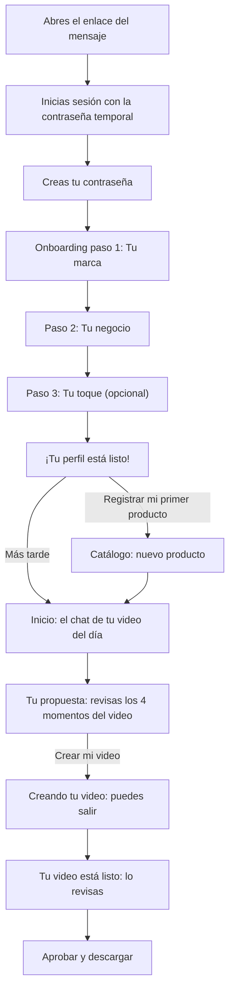
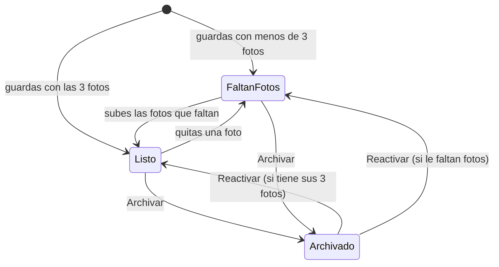
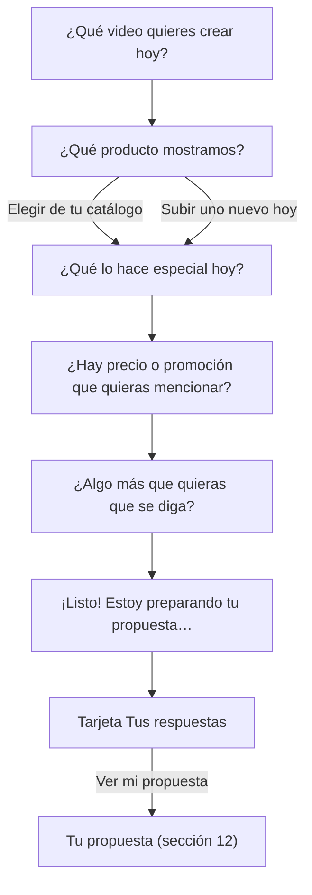
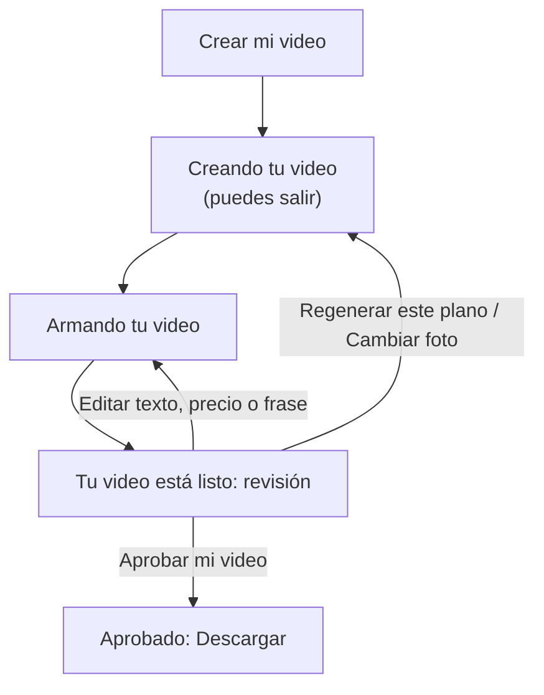

# Manual del negocio

Guía sencilla para la persona que usa **AutoReel** en el negocio. AutoReel convierte las fotos de tus productos en un Reel de 15 segundos y lo publica en tu Instagram.

> **Estado del documento:** al día al 2026-11-12, incluida la **mejora de la calidad del video**:
> - el cierre lo escribe la IA (sección 12.6);
> - la propuesta se reintenta si la IA no responde y no hay propuesta básica (secciones 12.2 y 12.7);
> - el botón **Reintentar** (sección 13.10);
> - los movimientos de cámara 3D (sección 12.3);
> - los fundidos entre momentos.
>
> Cubre, además, la revisión del flujo del negocio (2026-11-06) y todo el recorrido: primer ingreso, perfil del negocio (onboarding, con la opción "Otros"), catálogo de productos, guía de fotos, Ajustes (perfil y contraseña), el chat para crear el video del día, la propuesta del video (storyboard), la creación del video, su revisión, la aprobación, la descarga y Mis videos. La publicación en Instagram todavía no existe y está marcada como **pendiente (fase 6)**. Las capturas de pantalla se agregan cuando cada pantalla esté terminada (sección 23 de la especificación); por ahora están marcadas como *Captura pendiente*.

---

## Índice

1. [Lo que necesitas](#1-lo-que-necesitas)
2. [Primer ingreso](#2-primer-ingreso)
3. [Iniciar sesión las siguientes veces](#3-iniciar-sesión-las-siguientes-veces)
4. [Si algo sale mal al entrar](#4-si-algo-sale-mal-al-entrar)
5. [Completa el perfil de tu negocio (onboarding)](#5-completa-el-perfil-de-tu-negocio-onboarding)
6. [Cómo moverte por AutoReel](#6-cómo-moverte-por-autoreel)
7. [Tu catálogo de productos](#7-tu-catálogo-de-productos)
8. [Cómo tomar buenas fotos](#8-cómo-tomar-buenas-fotos)
9. [Ajustes](#9-ajustes)
10. [Mensajes al subir imágenes y guardar datos](#10-mensajes-al-subir-imágenes-y-guardar-datos)
11. [Crea tu video del día](#11-crea-tu-video-del-día)
12. [Revisa tu propuesta (storyboard)](#12-revisa-tu-propuesta-storyboard)
13. [Tu video: espera, revisión y descarga](#13-tu-video-espera-revisión-y-descarga)
14. [Mis videos](#14-mis-videos)
15. [Publica en Instagram](#15-publica-en-instagram)

---

## 1. Lo que necesitas

- **El mensaje de bienvenida de AutoReel.** Te lo envía el administrador, por WhatsApp o por correo, y trae tu enlace, tu correo y una contraseña temporal.
- **Un celular o una computadora con internet.** AutoReel está pensado para usarse cómodamente desde el celular.
- **Tu logo en PNG**, idealmente con fondo transparente. Lo pide el primer paso del onboarding.
- **Fotos de tus productos:** tres por producto (entero, detalle y porción). Mira [cómo tomarlas](#8-cómo-tomar-buenas-fotos).
- **Para publicar:** una cuenta **profesional** de Instagram, de empresa o de creador. *Pendiente (fase 6): por ahora descargas tu video y lo subes a Instagram a mano.*

### El recorrido completo de tu primer día



---

## 2. Primer ingreso

> *Captura pendiente: pantalla "Inicia sesión".*

### Paso 1. Abre el enlace

El mensaje del administrador se ve así:

```text
¡Hola! Ya puedes entrar a AutoReel.
Enlace: ...
Correo: ...
Contraseña temporal: ...
Al entrar te pediremos crear tu propia contraseña. La contraseña temporal vence en 48 horas.
```

Toca el **enlace**. Se abre la pantalla **Inicia sesión**.

> **Tienes 48 horas** desde que el administrador generó tu contraseña temporal para crear la tuya. Pasado ese plazo, la contraseña temporal deja de servir y tendrás que pedir una nueva.

### Paso 2. Inicia sesión con la contraseña temporal

1. En **Correo**, escribe el correo del mensaje.
2. En **Contraseña**, escribe la contraseña temporal **tal como está**. Respeta las mayúsculas y las minúsculas. Lo más seguro es copiarla y pegarla.
3. Toca **Entrar**.

### Paso 3. Crea tu contraseña

> *Captura pendiente: pantalla "Crea tu contraseña".*

Aparece la pantalla **Crea tu contraseña**. Mientras no la completes, no puedes ir a ninguna otra parte de AutoReel.

1. En **Contraseña nueva**, escribe la contraseña que usarás de ahora en adelante.
2. En **Repite la contraseña**, escríbela otra vez.
3. Mira la lista de requisitos que está debajo: cada uno se marca con **✓** cuando lo cumples.
4. Toca **Guardar contraseña**.

**Requisitos de tu contraseña:**

| Requisito | Ejemplo que **no** sirve |
|---|---|
| Al menos **8 caracteres** (y como máximo 64) | `dulce12` (tiene 7) |
| Al menos **una letra** | `12345678` |
| Al menos **un número** | `tortadefresa` |
| Las dos contraseñas **coinciden** | Escribir `torta2026` y luego `Torta2026` |
| Debe ser **distinta de la contraseña temporal** | Volver a escribir la temporal |

> **Consejo:** usa una frase fácil de recordar con un número, por ejemplo el nombre de tu postre favorito y un año. No uses la misma contraseña de tu correo ni la de tu banco.

Al guardar, AutoReel te lleva directamente al **onboarding** (sección 5): tres pasos cortos para conocer tu negocio.

Si quieres salir sin crear la contraseña, toca **Salir**. La próxima vez que entres con la temporal, el sistema te volverá a pedir que la crees.

---

## 3. Iniciar sesión las siguientes veces

1. Abre el mismo enlace.
2. Escribe tu correo y **tu contraseña**, la que creaste. La temporal ya no sirve.
3. Toca **Entrar**.

- **Si todavía no terminaste el onboarding**, vuelves a él, en el primer paso que tenga algo pendiente.
- **Si ya lo terminaste**, entras a **Inicio**, donde está el chat para crear tu video del día (sección 11).
- **Duración de la sesión:** **8 horas**. Después, AutoReel te pedirá volver a iniciar sesión.
- **Para salir:** ve a **Ajustes** y toca **Cerrar sesión**, al final de la página.

---

## 4. Si algo sale mal al entrar

| Mensaje que ves | Qué significa | Qué hacer |
|---|---|---|
| "El correo o la contraseña no son correctos." | El correo o la contraseña tienen un error. | Revísalos con calma. Respeta las mayúsculas de la contraseña. |
| "Tu cuenta está bloqueada por varios intentos fallidos. Vuelve a intentarlo en 15 minutos." | Escribiste mal la contraseña **5 veces**. Por seguridad, la cuenta se bloquea **15 minutos**. | Espera 15 minutos y vuelve a intentarlo. Si no recuerdas tu contraseña, pide una nueva al administrador. |
| "Tu contraseña temporal venció. Pide una nueva al administrador de AutoReel." | Pasaron más de 48 horas desde que el administrador generó tu contraseña temporal (al crear tu cuenta o al reiniciarla). | Pide al administrador una contraseña temporal nueva. |
| "Tu cuenta está suspendida. Comunícate con el administrador de AutoReel." | El administrador suspendió tu cuenta. | Comunícate con el administrador. |
| "Tu sesión no está activa. Inicia sesión para continuar." | Pasaron las 8 horas de tu sesión, el administrador te dio una contraseña nueva o cambiaste tu contraseña en otro dispositivo. | Vuelve a iniciar sesión. |
| "Tu sesión de seguridad expiró. Recarga la página e inténtalo de nuevo." | La página estuvo abierta mucho tiempo. | Recarga la página. |

**¿Olvidaste tu contraseña?** En esta versión no hay recuperación por correo. Pídele al administrador de AutoReel una contraseña nueva: te enviará otra temporal y, al entrar con ella, crearás tu contraseña otra vez, como en el [primer ingreso](#2-primer-ingreso).

---

## 5. Completa el perfil de tu negocio (onboarding)

La primera vez que entras, después de crear tu contraseña, aparece una pantalla completa con **tres pasos**. Arriba ves **"Paso 1 de 3"** y una barra de progreso. Abajo de cada paso está el aviso **"Podrás cambiar estos datos cuando quieras en Ajustes."**

- **Mientras no termines el onboarding**, AutoReel siempre te trae de vuelta aquí: no puedes ver el catálogo, Ajustes ni Inicio. Tampoco podrás crear videos (regla RN-09).
- **Cada paso se guarda al tocar Siguiente.** Si cierras la página a mitad, la próxima vez retomas en el primer paso que tenga algo pendiente.
- **Para volver a un paso anterior**, toca **Atrás**.
- **Si falta algo obligatorio**, al tocar **Siguiente** aparece abajo un aviso que dice qué falta (por ejemplo, "Sube tu logo." o "Falta responder: Ciudad").
- **Mientras se sube una imagen**, el botón dice **"Subiendo imagen…"** y no se puede tocar. Espera a que termine.

### Paso 1. Tu marca

> *Captura pendiente: onboarding, paso 1 "Tu marca".*

Debajo del título dice: "Así se verán tus videos."

| Campo | Qué poner | ¿Obligatorio? |
|---|---|---|
| **Nombre comercial** | Ya viene escrito, tal como lo registró el administrador. Puedes corregirlo. Hasta 120 caracteres. | Sí |
| **Logo** | Toca el recuadro o **Subir** y elige tu logo. Debe ser **PNG** de hasta **5 MB** y medir al menos **200 px** en su lado más corto. La vista previa se muestra sobre un fondo a cuadros para que veas si es transparente. Para reemplazarlo, toca **Cambiar**. | Sí |
| **Tus dos colores de marca** | Un color **Principal** y uno **Secundario**. Toca cada círculo para elegirlo; debajo ves su código (por ejemplo `#BE123C`). Vienen con dos colores sugeridos que puedes cambiar. | Sí |
| **Tomar del logo** | Aparece al lado de los colores después de subir el logo. Toca y AutoReel toma los dos colores más fuertes de tu logo. Si tu logo es casi todo blanco o negro, verás "No encontramos colores claros en tu logo. Elígelos a mano." | — |
| **Estilo de tus videos** | Elige uno: **Casero**, **Elegante** o **Divertido**. Define el tono de los textos, la tipografía y la música. | Sí |

> **Logo sin fondo transparente.** Se acepta igual, pero al terminar el onboarding verás: "Tu logo no tiene fondo transparente. Funciona, pero se verá mejor si subes una versión transparente en Ajustes."

Toca **Siguiente**.

### Paso 2. Tu negocio

> *Captura pendiente: onboarding, paso 2 "Tu negocio".*

Debajo del título dice: "Con esto escribimos los textos y el cierre de cada video." Todas las preguntas son obligatorias, salvo el WhatsApp cuando no lo eliges como canal.

| Pregunta | Cómo se responde | Opciones o ejemplo |
|---|---|---|
| **¿Cuál es tu especialidad?** | Toca una o varias opciones. Si no está la tuya, usa **Otros**. | Tortas personalizadas · Postres individuales · Dulces tradicionales · Panadería dulce · Opciones saludables · **Otros** |
| **¿Quiénes son tus clientes principales?** | Toca una o varias opciones. Si no está el tuyo, usa **Otros**. | Familias · Jóvenes · Celebraciones y cumpleaños · Empresas y eventos · **Otros** |
| **Ciudad** | Texto, hasta 60 caracteres. | Lima |
| **Distrito** | Texto, hasta 60 caracteres. Se usa en el cierre del video: "Te esperamos en Miraflores". | Miraflores |
| **¿Cómo te piden?** | Marca **al menos una** opción; puedes combinarlas. Si no está la tuya, usa **Otros**. | Por WhatsApp · Por apps de delivery · En la tienda · **Otros** |
| **Número de WhatsApp** | Celular de **9 dígitos que empiece con 9**. El **+51** ya está puesto. Puedes escribirlo con espacios o guiones. Aparece en el cierre del video. | 987 654 321 |
| **Horario de atención** | Texto, hasta 120 caracteres. | Lunes a sábado de 9 a. m. a 8 p. m. |

- **El WhatsApp es obligatorio solo si marcas "Por WhatsApp"**. Si no lo marcas, la pregunta aparece como "(opcional)".
- Debajo de los campos de texto ves un contador, por ejemplo `12/60`, con los caracteres usados.

**La opción "Otros".** En especialidad, clientes y "¿Cómo te piden?", el último botón es **Otros**. Sirve cuando tu respuesta no está entre las opciones:

1. Toca **Otros**. Se marca y debajo aparece un campo que dice "Escríbelo en pocas palabras".
2. Escribe tu opción, **hasta 40 caracteres**: una característica, no una oración. Por ejemplo, "Tortas veganas" o "Por Instagram". El contador (por ejemplo `14/40`) te dice cuántos llevas.
3. Puedes combinarla con las demás opciones. Se escribe **una sola** opción en "Otros" por pregunta.
4. Para quitarla, vuelve a tocar **Otros**: el campo se cierra y lo escrito se borra.

Lo que escribes en "Otros" cuenta como una opción más (por ejemplo, para "Marca al menos una" en "¿Cómo te piden?"), se usa al escribir los textos de tus videos y lo ve el administrador de AutoReel en tu perfil.

Toca **Siguiente**.

### Paso 3. Tu toque (opcional)

> *Captura pendiente: onboarding, paso 3 "Tu toque".*

Debajo del título dice: "Opcional: ayúdanos a que tus videos suenen a ti." Puedes dejar todo en blanco y tocar **Terminar**.

| Pregunta | Cómo se responde | Ejemplo |
|---|---|---|
| **¿Qué te diferencia?** (opcional) | Una frase, hasta 80 caracteres. Lo que te distingue de otras pastelerías. | "Recetas de la abuela con fruta de temporada" |
| **Palabras o temas que nunca quieres en tus videos** (opcional) | Sepáralos con comas, hasta 300 caracteres. | "barato, oferta, dieta" |
| **Foto del local** (opcional) | Tu vitrina o tu fachada, en vertical. La usamos de fondo al final del video. Si no la subes, usaremos tus colores. Sigue las mismas reglas que las [fotos de productos](#8-cómo-tomar-buenas-fotos), salvo el tamaño: basta con **480 px** en el lado más corto. Para quitarla, toca **Quitar**. | — |

Toca **Terminar**.

### Al terminar: "¡Tu perfil está listo!"

> *Captura pendiente: pantalla "¡Tu perfil está listo!".*

AutoReel te sugiere registrar tus productos: "Ahora registra tus productos con tres fotos cada uno. Solo lo haces una vez y luego eliges cuál mostrar en cada video."

- **Registrar mi primer producto:** abre el formulario de un producto nuevo (sección 7).
- **Más tarde:** te lleva a **Inicio**.

Desde ahora puedes cambiar cualquiera de estos datos en [Ajustes](#9-ajustes).

---

## 6. Cómo moverte por AutoReel

> *Captura pendiente: barra de navegación del negocio.*

Con el onboarding terminado, tienes cuatro secciones. En el celular están en una **barra fija abajo**; en una computadora, arriba a la derecha.

| Sección | Qué hay |
|---|---|
| **Inicio** | El **chat para crear tu video del día** (sección 11). Ocupa toda la pantalla. |
| **Mis videos** | Tus propuestas y videos, los más recientes primero (sección 14). |
| **Catálogo** | Tus productos (sección 7). |
| **Ajustes** | Tu perfil, tu contraseña, Instagram y **Cerrar sesión** (sección 9). |

---

## 7. Tu catálogo de productos

Registras cada producto **una sola vez**, con sus tres fotos, y luego lo eliges al crear cada video.

### 7.1 La lista

> *Captura pendiente: catálogo con productos.*

Toca **Catálogo**. Arriba hay dos pestañas:

- **Activos:** los productos que podrás usar en tus videos. Es la que se abre primero.
- **Archivados:** los productos que guardaste aparte (ver 7.4).

Cada producto se muestra como una tarjeta con:

- La **foto del producto entero** (o la primera que tenga).
- El **nombre**.
- La etiqueta amarilla **"Faltan fotos"** si no tiene las tres fotos. Un producto así se guarda, pero **no se podrá usar en un video** hasta que las completes (regla RN-12).

Los productos más recientes aparecen primero. Si no tienes ninguno, verás "Todavía no tienes productos. Registra tu producto estrella con tres fotos."

Los productos que subes desde el chat (sección 11.3) aparecen aquí **solo si elegiste guardarlos en tu catálogo**. Puedes editarlos como cualquier otro.

### 7.2 Crear un producto

> *Captura pendiente: formulario "Nuevo producto".*

1. En el catálogo, toca **Nuevo**.
2. Completa el formulario:

| Campo | Qué poner | Reglas |
|---|---|---|
| **Nombre** | El nombre con que lo vendes, por ejemplo "Torta Tres Leches de Fresa". | Obligatorio, hasta **50** caracteres. El contador muestra cuántos llevas. |
| **Descripción** | Sabor, relleno e ingredientes destacados. | Obligatoria, hasta **200** caracteres. **Es lo único que usaremos para hablar de tu producto: no inventamos sabores ni ingredientes.** Escribe aquí todo lo que quieras que se diga. |
| **Fotos** | **Producto entero**, **Detalle** y **Porción**. Cada una tiene un dibujo de ejemplo y sus indicaciones. Toca el recuadro o **Subir** para elegir la foto. | Las tres son necesarias para usar el producto en un video. El texto te dice cuántas faltan ("Te faltan 2."). |

3. Espera a que cada foto termine de subir: el recuadro muestra el porcentaje y el botón dice **"Subiendo fotos…"**.
4. Toca **Guardar**. Vuelves al catálogo y el producto ya aparece.

> **¿No tienes las tres fotos ahora?** Puedes guardar el producto con una o dos. Aparecerá con **"Faltan fotos"** y lo completas después.

### 7.3 Editar un producto

1. En el catálogo, toca el producto. Se abre **Editar producto** con sus datos.
2. Cambia lo que necesites:
   - **Reemplazar una foto:** toca **Cambiar** debajo de esa foto y elige otra.
   - **Quitar una foto:** toca **Quitar**. El producto quedará con "Faltan fotos" hasta que subas otra.
3. Toca **Guardar**.

Para volver sin guardar, toca **← Catálogo**.

### 7.4 Archivar y reactivar

Archiva un producto que ya no vendes, o que no quieres mostrar por un tiempo.

- **Para archivarlo:** abre el producto y toca **Archivar**. Se mueve a la pestaña **Archivados**.
- **Un producto archivado no se borra** (regla RN-13): sigue en la pestaña Archivados, no aparecerá al crear videos y sus videos anteriores se conservan.
- **Para reactivarlo:** en la pestaña **Archivados**, abre el producto (verás "Archivado: no aparece al crear videos.") y toca **Reactivar**. Vuelve a la pestaña Activos.

En esta versión no se pueden borrar productos.



---

## 8. Cómo tomar buenas fotos

> *Captura pendiente: fotos de ejemplo de un producto entero, un detalle y una porción.*

Las fotos son la materia prima de tu video. Con fotos buenas, el video sale bien a la primera.

### 8.1 Las tres fotos de cada producto

| Foto | Qué mostrar | Ejemplo |
|---|---|---|
| **Producto entero** | El producto completo, de frente. | La torta entera sobre la mesa o la vitrina. |
| **Detalle** | Muy cerca: la crema, el glaseado o la fruta. | Las fresas y la crema de la superficie, llenando la foto. |
| **Porción** | Una porción ya cortada, mostrando el relleno. | Una tajada en un plato, de lado, para que se vean las capas. |

### 8.2 Tres reglas para cada foto

1. **Con luz natural.** Junto a una ventana, de día. Evita el flash y la luz amarilla de los focos.
2. **Sin personas ni manos.** Solo el producto. Las fotos con personas no se pueden usar en el plan Lite.
3. **Con el celular en vertical.** El Reel es vertical. Una foto horizontal se acepta, pero la recortaremos y verás el aviso "La foto es horizontal: la recortaremos al formato vertical del Reel."

**Consejos extra:**
- Limpia el lente del celular antes de tomar la foto.
- Usa un fondo sencillo, sin objetos que distraigan.
- No uses filtros ni zoom digital: acércate al producto.

### 8.3 Requisitos del archivo

| Requisito | Fotos de productos y del local | Logo |
|---|---|---|
| Formato | **JPG, PNG o WebP** | Solo **PNG** (idealmente con fondo transparente) |
| Peso máximo | **10 MB** | **5 MB** |
| Tamaño mínimo | El **lado más corto** debe medir al menos **720 px** | El lado más corto debe medir al menos **200 px** |
| Tamaño máximo | Hasta 8000 px por lado | Hasta 4000 px por lado |
| Animadas | No se admiten | No se admiten |

- **Una foto tomada con la cámara de cualquier celular actual cumple de sobra el mínimo de 720 px**, que es la calidad con la que la IA crea los clips de tu video. Si recibes el aviso de tamaño, probablemente la foto fue recortada mucho o la descargaste de WhatsApp o de internet: usa la original de la cámara.
- **Antes de subir la foto, AutoReel la prepara en tu celular:** la endereza según cómo tomaste la foto, la achica si es muy grande (el lado mayor queda en 2560 px como máximo, sin que el lado más corto baje de 720 px) y la guarda como JPG. Así se sube más rápido. En ese proceso **se borran los datos ocultos de la foto, incluida la ubicación GPS**.
- El logo se sube tal cual, sin cambios, para conservar su transparencia.

### 8.4 Fotos HEIC del iPhone

Los iPhone guardan las fotos en formato **HEIC**, que AutoReel todavía no acepta. Normalmente el iPhone las convierte a JPG solo al elegirlas desde el navegador, pero si ves el mensaje **"Las fotos HEIC del iPhone no se pueden usar todavía…"**, haz una de estas dos cosas:

- **Cambiar el formato de la cámara** (para las fotos que tomes desde ahora): en el iPhone, ve a **Ajustes > Cámara > Formatos** y elige **"Más compatible"**.
- **Compartir la foto como JPG:** desde la app Fotos, compártela o guárdala en Archivos como JPG y súbela desde ahí.

---

## 9. Ajustes

Toca **Ajustes**. La página tiene, de arriba abajo: tu perfil, tu contraseña, Instagram y **Cerrar sesión**.

### 9.1 Perfil del negocio

> *Captura pendiente: Ajustes, perfil.*

Son los mismos datos del onboarding, en tres bloques:

- **Tu marca:** nombre comercial, logo, dos colores, **Tomar del logo** (si acabas de subir un logo nuevo) y estilo. Si tu logo no es transparente, verás el aviso "Tu logo no tiene fondo transparente. Se verá mejor si subes una versión transparente."
- **Tu negocio:** especialidad, clientes principales, ciudad, distrito, cómo te piden, WhatsApp y horario. En especialidad, clientes y "¿Cómo te piden?" también tienes la opción **Otros** (ver el [paso 2 del onboarding](#paso-2-tu-negocio)).
- **Tu toque:** "¿Qué te diferencia?", palabras prohibidas y foto del local.

Cambia lo que necesites y toca **Guardar perfil**. Si todo está bien, aparece "Guardamos tu perfil."

- **El perfil no puede quedar incompleto.** Si borras algo obligatorio (por ejemplo, el horario o el distrito), al guardar verás qué falta y no se guarda nada.
- El nombre comercial que guardes es el que ve el administrador.

### 9.2 Contraseña

> *Captura pendiente: Ajustes, contraseña.*

1. En **Contraseña actual**, escribe la que usas hoy.
2. En **Contraseña nueva**, escribe la nueva: al menos 8 caracteres, con letras y números (las mismas reglas del [primer ingreso](#paso-3-crea-tu-contraseña)).
3. En **Repite la contraseña nueva**, escríbela otra vez.
4. Toca **Cambiar contraseña**. Si todo está bien, aparece "Cambiamos tu contraseña."

- **Sigues con la sesión abierta en este dispositivo**, pero **se cierran las sesiones de tus otros dispositivos**: allí tendrás que entrar con la contraseña nueva.

| Mensaje | Qué hacer |
|---|---|
| "La contraseña actual no es correcta." | Revisa la contraseña actual. |
| "La contraseña nueva debe ser distinta de la actual." | Elige otra contraseña. |
| "Las contraseñas no coinciden." | Escribe igual la contraseña nueva en los dos campos. |
| "La contraseña debe tener al menos una letra." / "…al menos un número." | Ajusta la contraseña nueva. |

### 9.3 Instagram

*Pendiente (fase 6).* Por ahora dice "Podrás conectar tu cuenta profesional de Instagram muy pronto."

### 9.4 Cerrar sesión

Toca **Cerrar sesión**, al final de Ajustes.

---

## 10. Mensajes al subir imágenes y guardar datos

| Mensaje que ves | Qué significa | Qué hacer |
|---|---|---|
| "Tu foto mide 640 × 480 px. Necesitamos al menos 720 px en el lado más corto. Tómala con la cámara del celular, sin recortarla." | La foto es muy pequeña. | Usa la foto original de la cámara (ver 8.3). |
| "Las fotos HEIC del iPhone no se pueden usar todavía…" | La foto está en formato HEIC. | Ver 8.4. |
| "Ese archivo no es una foto. Sube una imagen JPG, PNG o WebP." | Elegiste otro tipo de archivo (un PDF, un video…). | Elige una foto. |
| "No pudimos abrir la imagen. Prueba con otra foto en JPG o PNG." | El archivo está dañado o tu navegador no lo puede leer. | Prueba con otra foto. |
| "El logo debe ser una imagen PNG, idealmente con fondo transparente." | El logo no es PNG. | Exporta tu logo como PNG. |
| "El logo pesa más de 5 MB." | El logo es muy pesado. | Expórtalo más pequeño. |
| "Tu logo es muy pequeño: necesitamos al menos 200 px en el lado más corto." | El logo tiene muy poca resolución. | Usa una versión más grande. |
| "La imagen mide … px y es demasiado grande…" | La imagen pasa de 8000 px por lado (4000 px en el logo). | Usa una versión más pequeña. |
| "Las imágenes animadas no se admiten. Sube una foto fija." | Subiste un PNG o WebP animado. | Usa una imagen fija. |
| "No pudimos subir el archivo. Revisa tu conexión e inténtalo de nuevo." | Se cortó la conexión durante la subida (AutoReel ya reintentó una vez). | Revisa tu internet y vuelve a elegir la foto. |
| "No encontramos el archivo subido. Vuelve a subirlo." / "El archivo cambió mientras lo revisábamos. Vuelve a subirlo." | La subida no se completó, o pasó mucho tiempo entre subir la foto y guardar. | Vuelve a elegir la foto y guarda. |
| "Escribe un celular de 9 dígitos que empiece con 9." | El número de WhatsApp no es un celular peruano válido. | Escribe los 9 dígitos, sin el +51. |
| "Falta responder: …" / "Falta tu logo." / "Falta elegir el estilo de tus videos." | Falta un dato obligatorio del perfil. | Complétalo y vuelve a guardar. |
| "En "…", "Otros" puede tener como máximo 40 caracteres: escribe una característica, no una oración." | Lo que escribiste en **Otros** es muy largo. | Escríbelo en pocas palabras. |
| "El nombre del producto debe tener entre 1 y 50 caracteres." | El nombre está vacío o es muy largo. | Corrige el nombre. |
| "Describe el sabor, el relleno o los ingredientes en hasta 200 caracteres…" | La descripción está vacía o es muy larga. | Escribe una descripción más corta. |

> **Si una foto no se ve** (aparece el recuadro vacío): los enlaces de las imágenes vencen cada hora por seguridad. En la lista del catálogo AutoReel pide un enlace nuevo automáticamente una vez; en las demás pantallas (Ajustes, el formulario del producto) o si la foto sigue sin verse, recarga la página.

---

## 11. Crea tu video del día

Crear un video tiene cuatro momentos:

1. **Chat.** Respondes unas pocas preguntas sobre el video de hoy (secciones 11.1 a 11.7).
2. **Propuesta (storyboard).** Revisas los 4 momentos propuestos, ajustas los textos, las fotos y el precio si quieres, y tocas **"Crear mi video"** (sección 12).
3. **Video.** AutoReel crea el video. Tarda unos minutos y puedes salir: te avisará cuando esté listo (secciones 13.1 y 13.2).
4. **Revisión.** Miras el video. Si hace falta, tocas **"Regenerar este plano"** o **"Editar texto"**, y luego **"Aprobar mi video"** y **"Descargar"** (secciones 13.3 a 13.8).

**Tu video del día.** Tu plan define cuántos videos puedes crear por día y cuántas regeneraciones tiene cada video. El plan Lite permite **1 video por día** con **3 regeneraciones**.

- El video del día se usa al tocar **"Crear mi video"**. El chat y la propuesta se pueden hacer las veces que quieras.
- El día es el de Lima: a la medianoche tienes un video nuevo. Los videos que no usas **no se acumulan** para el día siguiente.
- Si AutoReel no logra crear o armar tu video, **te devuelve el video del día** (sección 13.10). Si tú descartas un video ya creado, no se devuelve.

### 11.1 Cómo funciona el chat

> *Captura pendiente: chat del video del día.*

Toca **Inicio**. El chat ocupa toda la pantalla y va **centrado**: las preguntas de AutoReel aparecen a la izquierda y tus respuestas a la derecha. Abajo está la zona para responder: los botones, el carrusel o la caja de texto, según la pregunta.

- **El chat recibe respuestas, no preguntas.** Las preguntas son siempre las mismas y solo reúnen la información de tu video. A la izquierda de la caja de texto (en la pregunta del producto, debajo del carrusel) hay un botón **?**: tócalo para ver el aviso "Este chat está diseñado para recibir respuestas, no para recibir preguntas." Vuelve a tocarlo para cerrarlo.
- **Cada pregunta trae un ejemplo** corto de respuesta, debajo de la caja de texto (sección 11.2).
- **Necesitas el perfil completo.** Si no terminaste el onboarding, AutoReel te lleva primero allí (regla RN-09).
- **Todo se guarda al momento.** Si cierras la página, al volver retomas donde quedaste (sección 11.6).



### 11.2 Las preguntas

| Pregunta | Cómo se responde | Ejemplo que ves | ¿Obligatoria? |
|---|---|---|---|
| **¡Hola! ¿Qué video quieres crear hoy?** | Toca un botón: **Producto estrella**, **Promoción**, **Tortas por encargo** o **Recién salido del horno**. O escríbelo con tus palabras en la caja de texto (ver abajo). | O escríbelo: "Quiero mostrar la torta de fresa que más nos piden". | Sí |
| **¿Qué producto mostramos?** | Elige uno de tu catálogo o sube uno nuevo (sección 11.3). | — | Sí |
| **¿Qué lo hace especial hoy?** | Escribe con tus palabras. Si tocas **Usar la descripción de mi producto**, se copia la descripción del catálogo en la caja de texto para que la ajustes antes de enviarla. | Ej.: "Bizcocho de vainilla con fresas frescas, recién hecho esta mañana". | Sí |
| **¿Hay precio o promoción que quieras mencionar?** | Escribe el precio o la promoción con sus números. AutoReel lo resume para el cierre con tus mismos números y moneda. También puedes pedir otra cosa: "no pongas precio, solo que están recién salidas del horno" (sección 12.6). | Ej.: "S/ 65" o "2x1 hasta el domingo". | Solo si elegiste **Promoción** |
| **¿Algo más que quieras que se diga?** | Escribe lo que quieras agregar. | Ej.: "Atendemos pedidos hasta las 8 p. m.". | No |

**Escribir en la primera pregunta.** Debajo de los cuatro botones está la caja de texto, que dice "O escríbelo con tus palabras…". Si ninguno de los botones describe el video que quieres, escríbelo ahí y toca **Enviar**:

- Tu texto se toma **como una sola respuesta** (en esta pregunta los mensajes no se unen) y AutoReel lo usa como idea para los textos de tu video.
- El video sigue como un **Producto estrella**: el precio es opcional.
- Se revisa igual que cualquier respuesta escrita (sección 11.5): si es una pregunta o es muy corta, el chat te pide que respondas de nuevo.

En la pregunta del producto, que se responde con el carrusel, no hay caja de texto. En las preguntas que se escriben, la caja está abajo, con el ejemplo debajo.

### 11.3 Elegir el producto

> *Captura pendiente: carrusel de productos y "Subir un producto nuevo".*

**Desde tu catálogo:**

1. Desliza el carrusel. Solo aparecen los productos **activos y con sus tres fotos**, del más reciente al más antiguo.
2. Toca el producto: queda marcado.
3. Toca **Usar *nombre del producto***.

Si algún producto no aparece porque le faltan fotos, el chat lo dice (por ejemplo, "1 producto no aparece porque le faltan fotos.") con el enlace **Completar**, que te lleva al catálogo. Los productos archivados tampoco aparecen.

Si todavía no tienes ningún producto listo, el chat te dice "Todavía no tienes productos con sus tres fotos. Súbelo ahora mismo." y solo verás **Subir uno nuevo hoy**.

**Subir uno nuevo hoy:**

1. Toca **Subir uno nuevo hoy**. Se abre **Subir un producto nuevo**.
2. Escribe el **Nombre** (hasta 50 caracteres) y la **Descripción** (sabor, relleno, ingredientes destacados; hasta 200).
3. Sube las **tres fotos**: Producto entero, Detalle y Porción. Aquí las tres son necesarias. Sigue la [guía de fotos](#8-cómo-tomar-buenas-fotos).
4. Responde **"¿Lo guardo en tu catálogo?"** con uno de los dos botones:
   - **Sí, usarlo y guardarlo en mi catálogo:** se usa hoy y queda en tu catálogo, para elegirlo en otros videos.
   - **No, usarlo solo para este video:** se usa hoy y **no aparece en tu catálogo** ni en el carrusel de los próximos videos (regla RN-14).
5. Para volver sin subir nada, toca **Cancelar**.

Si falta algo, la ventana te lo dice: "Escribe el nombre y la descripción del producto." o "Sube las tres fotos: entero, detalle y porción."

### 11.4 Escribe con calma: tus mensajes seguidos se unen

En las preguntas que se escriben (desde "¿Qué lo hace especial hoy?"), puedes responder en **un solo mensaje o en varios seguidos**. Toca **Enviar** o la tecla Enter (con Mayús + Enter haces un salto de línea). En la primera pregunta, lo que escribes se toma de inmediato como una sola respuesta (sección 11.2).

- **Los mensajes que envías con menos de 4 segundos entre uno y otro se unen en una sola respuesta.** Por ejemplo, "Torta de fresa", "con crema" y "recién hecha" se toman como "Torta de fresa con crema recién hecha".
- **Cuando pasan 4 segundos sin que envíes otro mensaje, AutoReel toma tu respuesta** y hace la siguiente pregunta. En ese momento ves "escribiendo…" bajo la conversación.
- Tus mensajes se ven un poco más tenues mientras todavía pueden unirse con el siguiente.
- **Si quieres agregar algo, escríbelo enseguida.** Un mensaje enviado después de esos 4 segundos cuenta como respuesta a la pregunta siguiente.
- **Hasta 500 caracteres por respuesta**, sumando los mensajes que se unen. Debajo de la caja ves cuántos te quedan; si te pasas, dice "Es demasiado largo: resúmelo un poco" y no te deja enviar.

### 11.5 Qué responde el chat

| Si… | El chat… |
|---|---|
| Tu respuesta tiene **una pregunta** ("?" o "¿") | Responde: "Soy un asistente para reunir información, no puedo responder preguntas. Cuéntame todo lo que se te ocurra sobre tu producto y yo me encargo del resto." y repite la pregunta. **No hagas preguntas: cuéntale lo que quieres que se diga.** |
| Una respuesta obligatoria es **muy corta** (menos de 3 letras) o es un "no" | Responde: "Cuéntame un poco más, con unas palabras basta." y repite la pregunta. |
| La respuesta pasa de **500 caracteres** | Responde: "Es mucho texto para un video de 15 segundos. ¿Me lo resumes en menos de 500 caracteres?" y repite la pregunta. |
| Elegiste **Promoción** y respondes "no" al precio | Responde: "Como es una promoción, necesito el precio o la promoción tal como quieres que aparezca. Por ejemplo: "S/ 65" o "2x1 hasta el domingo"." y repite la pregunta. |
| El producto elegido se archivó o perdió una foto antes de terminar | Responde: "Ese producto ya no está disponible. Elige otro o sube uno nuevo." y vuelve a la pregunta del producto. |

**"No, gracias".** Las preguntas opcionales (el precio, cuando el video no es una Promoción, y "¿Algo más…?") tienen el botón **No, gracias** sobre la caja de texto. Tócalo para pasar a la siguiente sin escribir. También puedes escribir "no", "nada" o "sin precio": se entiende igual. Si elegiste **Promoción**, el precio no tiene ese botón.

### 11.6 Continuar o empezar de nuevo

Tienes **un solo chat en curso**. Si sales a mitad (cierras la página, cambias de sección o se corta internet) después de haber respondido al menos una pregunta y vuelves a **Inicio**, verás:

> **¿Continuamos donde quedamos?**

- **Continuar:** sigues en la pregunta donde quedaste, con tus respuestas guardadas.
- **Empezar de nuevo:** el chat anterior se descarta y empiezas desde la primera pregunta.

Si tienes el chat abierto en dos pestañas o dispositivos y respondes en uno, el otro queda atrás: cuando intentes responder allí, la pantalla se actualiza sola con la pregunta en la que vas.

### 11.7 Al terminar: tus respuestas

> *Captura pendiente: tarjeta "Tus respuestas".*

Después de la última pregunta, el chat dice **"¡Listo! Estoy preparando tu propuesta…"** y muestra la tarjeta **Tus respuestas**, con cada pregunta y lo que respondiste (las que saltaste aparecen con "—"). Debajo dice: "Guardamos todo. Estoy preparando la propuesta de tu video."

- Toca **Ver mi propuesta** para abrir la propuesta de tu video (sección 12). También la encuentras en **Mis videos**.
- Si vuelves a **Inicio** el mismo día, ves esta tarjeta. Al día siguiente empieza un chat nuevo.
- **Crear otro video** empieza un chat nuevo desde la primera pregunta. La propuesta anterior no se pierde: sigue en **Mis videos**.

### 11.8 Mensajes del chat

| Mensaje que ves | Qué significa | Qué hacer |
|---|---|---|
| "Ese producto no está disponible: necesita estar activo y tener sus tres fotos." | El producto se archivó o perdió una foto mientras elegías. | Elige otro o completa sus fotos en el catálogo. |
| "Para usar el producto en tu video necesitamos sus tres fotos: entero, detalle y porción." | Al subir un producto nuevo falta alguna foto. | Sube las tres. |
| "Esta conversación ya terminó." | El chat se completó en otra pestaña o dispositivo. | La pantalla se actualiza sola. |
| "Completa el perfil de tu negocio para crear tu primer video." | El onboarding no está completo. | Termínalo (sección 5). |
| Un aviso de error con el botón **Reintentar** en lugar del chat | No se pudo abrir el chat (por ejemplo, se cortó internet). | Toca **Reintentar**. |

Los mensajes del nombre, la descripción y las fotos de un producto nuevo son los mismos del catálogo (sección 10).

---

## 12. Revisa tu propuesta (storyboard)

Al terminar el chat, AutoReel arma la **propuesta** de tu video: los cuatro momentos del Reel de 15 segundos, con su foto, su movimiento y su texto, más el texto de la publicación. Antes de crear el video la revisas y la ajustas a tu gusto.

### 12.1 Cómo llegar

- Desde el chat: toca **Ver mi propuesta** en la tarjeta **Tus respuestas** (sección 11.7).
- Desde **Mis videos**: toca la propuesta que dice **Por revisar** (sección 14).

### 12.2 Mientras se prepara

> *Captura pendiente: "Estoy preparando tu propuesta…".*

Al abrirla recién terminado el chat, verás **"Estoy preparando tu propuesta…"**. Suele tardar unos segundos y la pantalla se actualiza sola cuando está lista: no tienes que recargarla.

- Si tarda más de un minuto, aparece: "Está tardando más de lo normal. Puedes salir: tu propuesta te esperará en Mis videos." Puedes cerrar la página sin perder nada.
- **Si el servicio de IA no responde,** AutoReel vuelve a intentarlo solo, durante unos 5 minutos. Mientras tanto sigues viendo "Estoy preparando tu propuesta…". Si no lo logra, verás un aviso con el botón **Reintentar** (sección 12.7).
- Si se corta internet, verás un aviso con el botón **Reintentar**.

### 12.3 Los cuatro momentos de tu video

> *Captura pendiente: propuesta con sus cuatro tarjetas.*

Arriba ves el tipo de video (por ejemplo, "Promoción") y el nombre del producto. Debajo, una tarjeta por momento, en el orden en que se verán:

| Momento | Duración | Foto que usa | Texto en pantalla |
|---|---|---|---|
| **1. Gancho** | 3 s | Detalle | Hasta **6** palabras, para atrapar la mirada. |
| **2. Producto** | 4 s | Producto entero | Hasta **5** palabras. |
| **3. Relleno** | 4 s | Porción | Hasta **7** palabras. |
| **4. Cierre** | 4 s | Foto del local o, si no la subiste, el final del momento 3 desenfocado | Tu logo, el precio o una frase, y cómo pedir. |

Entre un momento y otro, la imagen pasa con un fundido suave. Los textos aparecen en la parte de abajo, sin tapar el producto.

En cada uno de los tres primeros ves:

- **La foto** que se animará.
- **Movimiento:** cómo se moverá la cámara, en palabras simples. Por ejemplo, "La cámara gira alrededor del producto en un arco suave", "La cámara entra hasta un primer plano de la textura y la decoración" o "La cámara sube desde la base y revela la decoración de arriba". La cámara se mueve alrededor de tu producto, como en un comercial: al menos dos momentos la rodean, la suben o la cruzan, y tu producto no cambia de forma ni de decoración.
- **El texto** que aparecerá en pantalla. AutoReel lo escribe como publicidad a partir de tus respuestas: no copia tus frases tal cual y corrige las tildes.

Al final está el **Texto de la publicación**: la descripción y los hashtags que acompañarán al Reel en Instagram. Por ahora solo se puede leer (puedes copiarlo al subir tu video a mano); editarlo antes de publicar está *pendiente (fase 6)*.

> **AutoReel no inventa datos.** Los textos salen de tus respuestas del chat, de la descripción del producto y de tu perfil. No menciona precios ni promociones que no escribiste, y nunca usa las palabras que marcaste como prohibidas en tu perfil.

### 12.4 Cambiar un texto

1. Toca **Editar texto** debajo del texto del momento.
2. Escribe el nuevo texto. Debajo ves cuántas palabras llevas, por ejemplo **"4 de 6 palabras"**. Si te pasas, el contador se pone en rojo y no puedes guardar.
3. Toca **Guardar**. Para dejarlo como estaba, toca **Cancelar**.

**Cómo se cuentan las palabras:** cuenta todo lo separado por espacios que tenga al menos una letra o un número. "S/ 65" son 2 palabras; un guion suelto ("—") no cuenta.

**Reglas de los textos:**

- No pueden quedar vacíos.
- Sin emojis ni saltos de línea: no se pueden dibujar en el video.
- Sin las palabras prohibidas de AutoReel (por ejemplo, promesas de salud o superlativos como "el mejor") ni las que marcaste en tu perfil.

### 12.5 Cambiar una foto

1. Toca **Cambiar foto** debajo de la foto del momento. Se abre **Foto del momento N**.
2. Elige una de las fotos de tu producto (**Entero**, **Detalle** o **Porción**). La que está en uso aparece marcada.
3. O toca **Subir otra foto** y elige una nueva. Sigue la [guía de fotos](#8-cómo-tomar-buenas-fotos): vertical, con buena luz y de al menos 720 px en su lado más corto.

Al elegirla, la ventana se cierra y la tarjeta muestra la foto nueva.

> **Una foto subida aquí se usa solo en este video.** No cambia las fotos de tu producto ni tu catálogo. Si quieres usarla siempre, cámbiala en el [catálogo](#73-editar-un-producto).

### 12.6 El cierre: precio o frase

> *Captura pendiente: tarjeta del cierre.*

El último momento muestra tu logo, un texto grande y cómo pedirte. **El texto grande lo propone AutoReel** a partir de lo que respondiste en el chat:

- **Si escribiste un precio o una promoción,** AutoReel lo resume con **tus mismos números y moneda**. Por ejemplo, de "la torta entera a 65 soles, la porción a 8" puede salir "65 soles la torta entera". Nunca cambia un número ni inventa una promoción.
- **Si no escribiste precio, o pediste no ponerlo,** el cierre no tiene precio y muestra una **frase** corta. Por ejemplo, si escribiste "no menciones precio, solo que están recién salidas del horno", el cierre dice "Recién salidas del horno". **Lo que le pides a AutoReel nunca aparece en el video**: solo el mensaje que quieres dar.

La tarjeta del cierre muestra:

- **El texto grande:** el precio o, si no hay, la frase.
- **Precio:** el precio que va en el video, o "Sin precio". Si hay precio y también frase, debajo dice "Si quitas el precio, se mostrará la frase: …".
- **Llamado:** cómo pedir, según lo que marcaste en "¿Cómo te piden?" de tu perfil. Si tienes varias opciones, se usa la primera de esta lista: "Pide por WhatsApp", "Pídelo por delivery", "Te esperamos en *tu distrito*".
- **Ubicación:** tu distrito o, si en el chat dijiste dónde estás (por ejemplo, "nuestro local está en Plaza Lima Sur, Chorrillos"), ese lugar: "Plaza Lima Sur, Chorrillos". No se repite si el llamado ya lo dice.
- **WhatsApp:** tu número, si vendes por WhatsApp.

Al lado ves una vista pequeña del cierre: tu logo, el texto grande y el llamado sobre la foto de tu local o sobre tus dos colores. En el video, si no subiste la foto del local, el fondo es el final del momento 3, desenfocado y más oscuro, y el llamado va en el color de tu marca.

**Para cambiar el precio o la frase:**

1. Toca **Editar precio y frase**.
2. En **Precio o promoción**, escríbelo tal como quieres que aparezca, por ejemplo "S/ 65". Admite hasta **40 caracteres**. Déjalo vacío para mostrar la frase.
3. En **Frase**, escribe la frase que va cuando no hay precio. Admite hasta **6 palabras** (y 40 caracteres); debajo ves cuántas llevas.
4. Toca **Guardar**.

### 12.7 Si AutoReel no puede escribir tu propuesta

Tu propuesta siempre la escribe la IA: ya no hay "propuesta básica" con textos sencillos.

- **Si el servicio de IA no responde,** AutoReel lo vuelve a intentar solo durante unos 5 minutos. Si no lo logra, verás: "No pudimos escribir tu guion con IA. Inténtalo de nuevo en un rato. Puedes reintentarlo abajo."
- **Si la IA no logra textos que cumplan las reglas** (por ejemplo, sin inventar precios ni usar tus palabras prohibidas), verás: "No logramos escribir un guion que cumpla las reglas. Inténtalo de nuevo. Puedes reintentarlo abajo."

En los dos casos, toca **Reintentar**. Debajo del botón dice "Volveremos a escribir tu propuesta. **No usa tu video de hoy.**" La pantalla vuelve a "Estoy preparando tu propuesta…".

En Mis videos, mientras tanto, la propuesta aparece como **Con problemas**. Si sigue fallando, avísale al administrador de AutoReel.

### 12.8 Crear mi video

> *Captura pendiente: botón "Crear mi video".*

Cuando la propuesta te guste, toca **Crear mi video**, debajo de la propuesta. Debajo del botón ves "Usarás tu video de hoy." (si tu plan tiene más de un video por día: "Usarás 1 de tus *N* videos de hoy.").

- Al tocarlo, **se usa tu video del día** y AutoReel empieza a crear el video (sección 13.1). Desde ese momento la propuesta ya no se puede cambiar; podrás ajustar los textos, las fotos y el precio en la revisión (sección 13.6).
- **Si ya usaste tu video de hoy**, el botón se ve desactivado con el texto "Ya usaste tu video de hoy. Mañana tienes uno nuevo." Tu propuesta queda guardada en **Mis videos**: al día siguiente la abres y tocas **Crear mi video**.
- **Si por ahora no se pueden crear clips con IA**, el botón también se ve desactivado, con el texto "Por ahora no podemos crear clips con IA. Inténtalo en un rato: tu propuesta queda guardada." No se usa tu video del día. Vuelve más tarde desde **Mis videos** y toca **Crear mi video**. Si sigue así, avísale al administrador de AutoReel.

No hace falta que la propuesta sea perfecta: en la revisión puedes cambiar los textos sin gastar nada.

### 12.9 Descartar la propuesta

Si no te convence, toca **Descartar propuesta**, al final de la página.

1. Aparece "¿Descartar esta propuesta?" con el aviso "Quedará en Mis videos como descartado y no se podrá editar."
2. Toca **Descartar** para confirmar, o **Volver** para dejarla como está.

Al descartarla, vas a **Mis videos**, donde aparece como **Descartado**. Ya no se puede editar. Para hacer otra propuesta, crea un video nuevo desde **Inicio**. Descartar una propuesta no usa tu video del día.

### 12.10 Mensajes de la propuesta

| Mensaje que ves | Qué significa | Qué hacer |
|---|---|---|
| "Este plano admite hasta 6 palabras, para que se lea en el video." | El texto es muy largo para leerse en pantalla. | Acórtalo. |
| "Escribe el texto de este plano." | Dejaste el texto vacío. | Escribe algo o toca **Cancelar**. |
| "Quita los emojis, los saltos de línea y los símbolos especiales: no se pueden mostrar en el video." | El texto o el precio tiene emojis, varias líneas o símbolos que las letras del video no tienen. Las tildes, la ñ, ¿, ¡ y el símbolo € sí se pueden usar. | Escríbelo en una sola línea, sin emojis ni símbolos raros. |
| "No podemos usar "…" en tus videos. Escríbelo de otra forma." | El texto o el precio tiene una palabra prohibida (de AutoReel o de tu perfil). | Usa otras palabras. |
| "El precio admite hasta 40 caracteres." | El precio es muy largo. | Acórtalo. |
| "La frase admite hasta 6 palabras y 40 caracteres, para que se lea en el video." | La frase del cierre es muy larga. | Acórtala. |
| "No pudimos escribir tu guion con IA. Inténtalo de nuevo en un rato. Puedes reintentarlo abajo." | El servicio de IA no respondió durante unos minutos (sección 12.7). | Toca **Reintentar**. No usa tu video de hoy. |
| "No logramos escribir un guion que cumpla las reglas. Inténtalo de nuevo. Puedes reintentarlo abajo." | La IA no logró textos que cumplan las reglas (sección 12.7). | Toca **Reintentar**. No usa tu video de hoy. |
| "El producto ya no tiene esa foto. Elige otra o sube una nueva." | Quitaste esa foto del producto en el catálogo. | Elige otra o sube una nueva. |
| "Este video ya no se puede cambiar." | La propuesta se descartó o ya se está creando el video (por ejemplo, desde otra pestaña). | Recarga la página. |
| "Ya usaste tu video de hoy. Mañana tienes uno nuevo." | Ya creaste el video de hoy (sección 11). | Guarda la propuesta: mañana la abres desde **Mis videos** y tocas **Crear mi video**. |
| "Por ahora no podemos crear clips con IA. Inténtalo en un rato: tu propuesta queda guardada." | En este momento AutoReel no puede crear los clips de tu video (sección 12.8). | Vuelve más tarde. Si sigue así, avísale al administrador. |
| "Descartaste esta propuesta." | La propuesta está descartada. | Crea otro video desde **Inicio**. |
| Un aviso rojo que termina en "Crea otro desde el inicio." (por ejemplo, "El producto de este video ya no existe o no tiene fotos. Crea otro video desde el inicio.") | No se pudo armar la propuesta, y reintentar no lo arreglaría. | Toca **Crear otro video**. |

Los mensajes al subir una foto nueva son los mismos del catálogo (sección 10).

---

## 13. Tu video: espera, revisión y descarga

Después de tocar **Crear mi video**, AutoReel da vida a tus fotos: cada uno de los tres primeros momentos se convierte en un clip corto con el movimiento de la propuesta, y luego arma el Reel de **15 segundos**, vertical, con tus textos, el cierre con tu marca y música según tu estilo.



### 13.1 Mientras se crea

> *Captura pendiente: pantalla "Creando tu video".*

Verás **"Creando tu video"** con mensajes que van cambiando (por ejemplo, "Estamos dando vida a tus fotos…") y la lista de los cuatro momentos con su avance:

| Lo que ves junto al momento | Qué significa |
|---|---|
| **En espera** | Todavía no empieza. |
| **Creando el clip…** | AutoReel está creando el clip de ese momento. |
| **Listo** | El clip de ese momento ya está. |

Cuando los tres clips están, la pantalla cambia a **"Armando tu video"**: "Le estamos poniendo los textos, tu logo y la música…".

- **Suele tardar unos minutos.** La pantalla se actualiza sola; no tienes que recargarla.
- **Puedes salir.** Cierra la página o usa otra sección: tu video te esperará en **Mis videos** (sección 14).

### 13.2 El aviso "Tu video está listo"

Si sigues usando AutoReel mientras se crea el video (en el catálogo, en Ajustes o en Mis videos), cuando termine aparece arriba de la pantalla el aviso **"Tu video de *producto* está listo."** con el enlace **Verlo**. Para cerrarlo, toca **×**. Al abrir el video, el aviso desaparece.

- Si algo salió mal, el aviso dice "No pudimos terminar tu video de *producto*." con el enlace **Ver detalle** (sección 13.10).
- El aviso solo aparece en la pestaña del navegador donde tenías AutoReel abierto. **AutoReel no envía correos ni mensajes al celular.** Si cerraste la página, entra a **Mis videos**: tu video aparece como **Listo**.

### 13.3 Revisa tu video

> *Captura pendiente: revisión del video con el reproductor.*

Al abrir tu video listo verás "Tu video está listo. Míralo y, si quieres, cambia un texto o pide otra versión de un momento." y el **reproductor** vertical. Toca ▶ para verlo.

Debajo están las tarjetas de los cuatro momentos, igual que en la propuesta, con estas opciones:

| Opción | Qué hace | ¿Gasta algo? |
|---|---|---|
| **Editar texto** (momentos 1 a 3) | Cambia el texto en pantalla (sección 13.6). | No |
| **Editar precio y frase** (cierre) | Cambia el precio o la frase del cierre (sección 13.6). | No |
| **Cambiar foto** (momentos 1 a 3) | Usa otra foto en ese momento y crea su clip de nuevo (sección 13.6). Solo aparece si te quedan regeneraciones y se pueden crear clips (sección 13.5). | 1 regeneración |
| **Regenerar este plano (te quedan *N*)** | Pide otra versión del clip de ese momento (sección 13.4). Solo aparece si se pueden crear clips (sección 13.5). | 1 regeneración |
| **Aprobar mi video** | Das el video por terminado (sección 13.7). | No |
| **Descargar** | Guarda el video en tu celular o computadora (sección 13.8). | No |
| **Descartar video** | Lo deja como descartado (sección 13.9). | No se devuelve el video del día |

Si el video no se reproduce, verás "Tu navegador no puede reproducir el video. Descárgalo para verlo." Si dejaste la página abierta mucho tiempo, AutoReel pide un enlace nuevo del video por su cuenta; si sigue sin verse, recarga la página.

### 13.4 Regenerar un momento

Si un clip no te convence (por ejemplo, el movimiento se ve raro), toca **Regenerar este plano** debajo de ese momento.

1. El video vuelve a **"Creando tu video"**, solo para ese momento. Los demás conservan su clip.
2. Al terminar, el video se arma de nuevo y vuelve a la revisión.

**Cuántas veces:** cada video tiene **3 regeneraciones** en el plan Lite, en total (no por momento). El botón dice cuántas te quedan; cuando se acaban dice "(ya no quedan)" y se desactiva. Todavía puedes editar los textos y el precio.

**Una regeneración que falla no se cuenta:** si AutoReel no logra crear el clip nuevo, el momento **conserva el clip que tenía**, te devuelve la regeneración y arriba del video ves el aviso "No pudimos crear el clip nuevo. Dejamos el anterior y no se descontó la regeneración." Puedes volver a intentarlo.

### 13.5 Si por ahora no se pueden crear clips

Cada momento de tu video es un clip creado con IA. Si en este momento AutoReel no puede crear clips nuevos (por ejemplo, porque el servicio de IA no está disponible):

- Los botones **Regenerar este plano** y **Cambiar foto** no aparecen en la revisión.
- **Tu video ya creado está completo:** puedes verlo, editar los textos y el precio, aprobarlo y descargarlo.
- Para pedir otra versión de un momento, vuelve más tarde: los botones aparecen solos cuando se puedan crear clips otra vez.

Si intentas regenerar justo cuando deja de estar disponible, verás "Por ahora no podemos crear clips con IA. Inténtalo en un rato; mientras tanto puedes editar los textos."

### 13.6 Cambiar un texto, una foto, el precio o la frase

Se hace igual que en la propuesta (secciones 12.4 a 12.6), con las mismas reglas.

- **Texto, precio o frase:** al guardar, el video se arma de nuevo con el cambio (verás **"Armando tu video"** un momento). **No gasta regeneraciones.**
- **Foto:** la ventana **Foto del momento *N*** te avisa: "Cambiar la foto crea un clip nuevo y usa 1 de tus regeneraciones (te quedan *N*)." El video vuelve a **"Creando tu video"** solo para ese momento. Si el clip nuevo no se logra, el momento conserva su clip anterior y la regeneración no se cuenta (sección 13.4). Si ya no te quedan regeneraciones, o si por ahora no se pueden crear clips, el botón **Cambiar foto** no aparece.

Si el cambio no se pudo aplicar, verás: "No pudimos aplicar tu último cambio; tu video anterior sigue disponible. Inténtalo de nuevo." Tu video anterior no se pierde.

### 13.7 Aprobar

Cuando el video te guste, toca **Aprobar mi video**.

- La pantalla dice "Aprobaste tu video. Ya puedes descargarlo." y muestra el reproductor y el botón **Descargar**.
- **Un video aprobado ya no se puede cambiar.** Revisa bien antes de aprobar.
- En Mis videos aparece como **Aprobado**.
- *Pendiente (fase 6):* publicarlo en Instagram desde aquí. Por ahora la pantalla dice "Muy pronto podrás publicarlo en Instagram desde aquí."; mientras tanto, [descárgalo](#138-descargar) y súbelo a mano.

### 13.8 Descargar

Toca **Descargar** en la revisión o en un video aprobado. Se descarga el archivo **MP4** del Reel, con un nombre como `autoreel-torta-tres-leches-de-fresa-15.mp4`.

- En el celular, el archivo queda en la carpeta de descargas (o en **Archivos**, en el iPhone). Desde allí lo puedes subir a Instagram a mano o compartir por WhatsApp.
- Cada toque de **Descargar** genera un enlace nuevo, que dura 15 minutos. Si la descarga se corta, vuelve a tocar el botón.

### 13.9 Descartar el video

En la revisión, al final de la página, toca **Descartar video**. Aparece "¿Descartar este video?" con el aviso "Quedará en Mis videos como descartado y no se podrá editar. El video del día que usaste no se devuelve." Toca **Descartar** para confirmar o **Volver** para dejarlo como está.

### 13.10 Si algo falla

- **AutoReel no logró crear los clips de un video nuevo:** cada momento tiene dos intentos; si alguno no consigue su clip, el video no se puede armar. Verás "No pudimos crear los clips con IA. Te devolvimos el video del día; inténtalo de nuevo en un rato. Puedes reintentarlo abajo." En Mis videos aparece como **Con problemas**. Tu video del día se devolvió.
- **AutoReel no logró armar el video:** verás "No pudimos armar el video. Te devolvimos el video del día. Puedes reintentarlo abajo." También aparece como **Con problemas** y tu video del día se devolvió.
- **Reintentar un video que no se pudo crear:** toca **Reintentar**, debajo del aviso. AutoReel pide solo los clips que faltaban; los que ya estaban se conservan. **Este reintento vuelve a usar tu video del día**, porque se te devolvió: debajo del botón ves "Usarás tu video de hoy.".
  - Si ya usaste tu video de hoy, el botón se desactiva con "Ya usaste tu video de hoy. Mañana tienes uno nuevo.".
  - Si por ahora no se pueden crear clips, se desactiva con "Por ahora no podemos crear clips con IA. Inténtalo en un rato.".
  - También puedes crear otro video desde **Inicio**.
- **Reintentar una propuesta que no se pudo escribir:** es la sección 12.7. Ese reintento no usa tu video del día.
- **Una regeneración o un cambio de foto no se logró:** el momento conserva su clip anterior y no se cuenta la regeneración (sección 13.4).
- **Un cambio de texto o de precio no se pudo aplicar:** tu video anterior sigue disponible (sección 13.6).

Si el video quedó **Con problemas** mientras usabas otra sección, el aviso de arriba dice "No pudimos terminar tu video de *producto*." con el enlace **Ver detalle** (sección 13.2).

| Mensaje que ves | Qué significa | Qué hacer |
|---|---|---|
| "Ya usaste las 3 regeneraciones de este video. Todavía puedes editar los textos." | Se acabaron las regeneraciones del video. | Edita los textos o el precio, o aprueba el video. |
| "No pudimos crear el clip nuevo. Dejamos el anterior y no se descontó la regeneración." | La regeneración no se logró. | Vuelve a intentarlo, o sigue con el clip que tenías. |
| "Por ahora no podemos crear clips con IA. Inténtalo en un rato; mientras tanto puedes editar los textos." | En este momento no se pueden crear clips con IA (sección 13.5). | Edita los textos, aprueba o descarga tu video. |
| "Tu video todavía no está listo para descargar." | El video se está creando o armando. | Espera a que esté listo. |
| "No pudimos aplicar tu último cambio; tu video anterior sigue disponible. Inténtalo de nuevo." | No se pudo armar el video con tu último cambio. | Vuelve a hacer el cambio. |
| "Este video ya no se puede cambiar." | El video se está creando, ya se aprobó o se descartó (por ejemplo, desde otra pestaña). | Recarga la página. |

---

## 14. Mis videos

> *Captura pendiente: Mis videos.*

Toca **Mis videos** en la barra de navegación. Ves tus propuestas y videos, **los más recientes primero** (hasta los últimos 50). Cada uno muestra la foto del producto entero, el nombre del producto, el tipo de video, la fecha y hora en que lo creaste y una etiqueta con su estado:

| Etiqueta | Qué significa |
|---|---|
| **Preparando propuesta** | AutoReel está armando la propuesta. Vuelve en unos segundos. |
| **Por revisar** | La propuesta está lista para que la revises, la ajustes y toques **Crear mi video** (sección 12). |
| **Creando video** | AutoReel está creando o armando el video (sección 13.1). |
| **Listo** | El video está listo para revisarlo, aprobarlo o descargarlo (sección 13.3). |
| **Aprobado** | Aprobaste el video. Puedes verlo y descargarlo. |
| **Descartado** | Descartaste la propuesta o el video. Se puede ver, pero no editar. |
| **Con problemas** | No se pudo preparar la propuesta o armar el video. Ábrelo: si ves **Reintentar**, puedes volver a intentarlo (secciones 12.7 y 13.10); si no, crea otro video desde **Inicio**. |

Toca un video para abrirlo. Si todavía no tienes ninguno, verás "Todavía no tienes videos." con el enlace **Crear mi primer video**. Mientras algún video se está preparando o creando, la lista se actualiza sola.

*Pendiente (fase 6):* las etiquetas **Programado** y **Publicado**.

---

## 15. Publica en Instagram

**Pendiente (fase 6): todavía no se puede publicar desde AutoReel.** Por ahora, [descarga tu video](#138-descargar) y súbelo a Instagram a mano. *Esta sección se redactará, con capturas, cuando la función exista.*

Lo previsto (secciones 6.3 y 11.3 de la especificación):

- **Primero, conecta tu cuenta** profesional de Instagram desde Ajustes.
- **Antes de publicar**, edita la descripción y los hashtags si quieres.
- **Elige una opción:**
  - **"Publicar ahora".**
  - **"Programar":** entre 10 minutos y 30 días a futuro.
  - **"Descargar":** ya disponible, en la revisión y en el video aprobado (sección 13.8).
