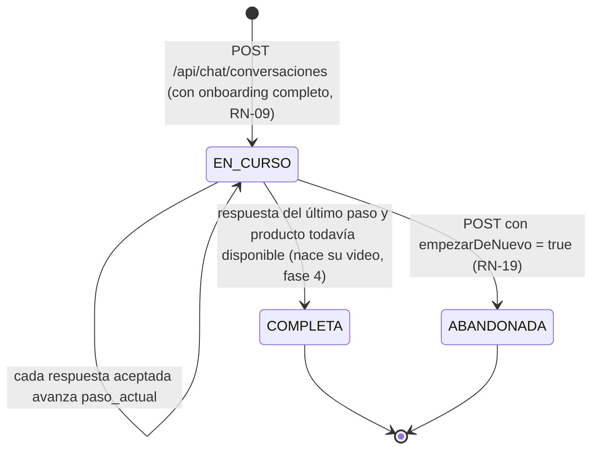
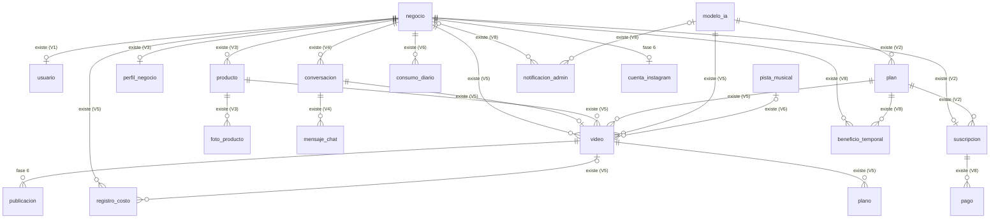

# AutoReel — Modelo de datos

> Estado: **fases 1 a 5 y 7** en `main`, más los proveedores de Google y la revisión del flujo del negocio (2026-11-06). Este documento describe las tablas que **existen hoy** en la base de datos, creadas por las migraciones Flyway `V1` a `V9`. *Actualización del 2026-11-12:* `V9` (mejora de la calidad del video, ADR 0021) agrega `plano.frase`, `video.guion_iniciado_en` y `video.error_definitivo`. Lo que todavía no existe (Instagram, fase 6, en pausa) aparece marcado como **(futuro, fase N)**.
>
> Fuentes: `backend/src/main/resources/db/migration/`, las entidades JPA del paquete `com.autoreel` y la sección 9 de `docs/especificacion.md`. Se actualiza con cada migración nueva (sección 23 de la especificación).

## 1. Resumen

| Tabla | Entidad JPA | Módulo | Migración | Para qué sirve |
|---|---|---|---|---|
| `negocio` | `com.autoreel.negocio.dominio.Negocio` | `negocio` | V1 | Cada pastelería cliente de la plataforma. |
| `usuario` | `com.autoreel.auth.dominio.Usuario` | `auth` | V1 | Cuentas de acceso: el administrador y el usuario único de cada negocio. |
| `modelo_ia` | `com.autoreel.ia.dominio.ModeloIA` | `ia` | V2 (V6 cambia el secreto y los parámetros de Veo; V7 agrega dos modelos y deja Veo inactivo; V8 agrega el resultado de la última prueba) | Modelos de IA administrables (texto y video), sin credenciales. |
| `plan` | `com.autoreel.facturacion.dominio.Plan` | `facturacion` | V2 (V7 cambia el modelo de video del plan Lite) | Planes de suscripción: límites, modelos y opciones de producción. Desde la fase 7 se crean y editan desde el panel. |
| `suscripcion` | `com.autoreel.facturacion.dominio.Suscripcion` | `facturacion` | V2 (V8 agrega `dia_pago`) | La suscripción única de cada negocio: plan, monto y fechas de pago. |
| `pago` | `com.autoreel.facturacion.dominio.Pago` | `facturacion` | V8 | Pagos registrados por el administrador; cada uno salda una fecha de pago (RF-08, RN-42). |
| `beneficio_temporal` | `com.autoreel.facturacion.dominio.BeneficioTemporal` | `facturacion` | V8 | Otro plan para un negocio durante un período de hasta 30 días (RF-12, RN-50 a RN-53). |
| `notificacion_admin` | `com.autoreel.facturacion.dominio.NotificacionAdmin` | `facturacion` | V8 | Avisos del panel del administrador: estados de pago y fallas de integración (RF-09, RN-44, RN-45, RN-57). |
| `perfil_negocio` | `com.autoreel.negocio.dominio.PerfilNegocio` | `negocio` | V3 | Marca del negocio (logo, colores, estilo, foto del local) y respuestas del onboarding. |
| `producto` | `com.autoreel.catalogo.dominio.Producto` | `catalogo` | V3 (V4 agrega `en_catalogo`) | Productos de cada negocio, con sus temporadas: los del catálogo y los subidos desde el chat solo para un video. |
| `foto_producto` | `com.autoreel.catalogo.dominio.FotoProducto` | `catalogo` | V3 | Las tres fotos de cada producto (entero, detalle y porción). |
| `conversacion` | `com.autoreel.chat.dominio.Conversacion` | `chat` | V4 | Chat guiado del video del día: estado, paso actual y respuestas reunidas (la entrada del guion de la fase 4). |
| `mensaje_chat` | `com.autoreel.chat.dominio.MensajeChat` | `chat` | V4 | Cada burbuja del chat, del sistema o del usuario, con la marca de agrupación pendiente. |
| `video` | `com.autoreel.video.dominio.Video` | `video` | V5 (V6 agrega la generación; V9, el plazo del guion y el error definitivo) | El video que nace de cada conversación completa: estado, plan y modelos con que se creó (RN-54), guion, publicación y datos del guion de respaldo (solo en videos anteriores al 2026-11-12); desde la fase 5, consumo del día, regeneraciones, composición, MP4 final y pista. |
| `plano` | `com.autoreel.video.dominio.Plano` | `video` | V5 (V6 agrega el clip; V9, la frase del cierre) | Los 4 planos del storyboard: 1 a 3 con foto, movimiento y texto; el 4 (cierre) con precio, frase, llamado y ubicación. Desde la fase 5, los planos 1 a 3 guardan el estado de su clip. |
| `registro_costo` | `com.autoreel.costos.dominio.RegistroCosto` | `costos` | V5 | El costo de cada llamada a un proveedor de IA (RN-32): guiones desde la fase 4 y clips desde la fase 5. Desde la fase 7 alimenta la página Costos (RF-07). |
| `consumo_diario` | `com.autoreel.video.dominio.ConsumoDiario` | `video` | V6 | Videos aprobados por cada negocio en cada día de Lima (RN-26). |
| `pista_musical` | `com.autoreel.video.dominio.PistaMusical` | `video` | V6 | Biblioteca de música para la composición, por nicho y estilo. |

Base de datos: **PostgreSQL 17** (`postgres:17-alpine` en `docker-compose.yml`, y la misma imagen en las pruebas con Testcontainers).

Los archivos (logos, fotos y, desde la fase 5, clips, videos finales y música) **no** están en la base de datos: viven en el almacén S3 (SeaweedFS en local, Amazon S3 en producción) y las tablas solo guardan su **clave**. Ver la sección 5.1.

## 2. Diagrama entidad-relación (V1 a V9)

Los tipos son los de PostgreSQL tal como están en las migraciones. La precisión de los `numeric` va en el comentario de cada columna.

```mermaid
erDiagram
    negocio {
        bigint id PK "identity"
        varchar(120) nombre "not null"
        varchar(40) nicho "not null, p. ej. PASTELERIA"
        varchar(20) estado "not null, default ACTIVO, check ACTIVO|SUSPENDIDO"
        boolean onboarding_completo "not null, default false"
        timestamptz fecha_creacion "not null, default now()"
    }

    usuario {
        bigint id PK "identity"
        varchar(254) correo UK "not null, único por lower(correo)"
        varchar(100) contrasena_hash "not null, BCrypt"
        varchar(20) rol "not null, check ADMIN|NEGOCIO"
        bigint negocio_id FK "null para ADMIN, único"
        boolean debe_cambiar_contrasena "not null, default false"
        timestamptz contrasena_temporal_vence "null"
        boolean activo "not null, default true"
        timestamptz ultimo_acceso "null"
        timestamptz fecha_creacion "not null, default now()"
        integer version_sesion "not null, default 0"
        integer intentos_fallidos "not null, default 0"
        timestamptz bloqueado_hasta "null"
    }

    modelo_ia {
        bigint id PK "identity"
        varchar(80) nombre "not null"
        varchar(30) proveedor "not null, p. ej. GOOGLE"
        varchar(10) tipo "not null, check TEXTO|VIDEO"
        varchar(30) adaptador UK "not null, único con identificador_modelo"
        varchar(120) identificador_modelo UK "not null"
        jsonb parametros "not null, default objeto vacío"
        numeric costo_referencial "numeric(12,6), not null, >= 0"
        varchar(20) unidad_costo "not null, check POR_SEGUNDO|POR_SOLICITUD"
        varchar(120) nombre_secreto "not null, nunca la credencial"
        varchar(10) estado "not null, default ACTIVO, check ACTIVO|INACTIVO"
        timestamptz ultima_prueba "null"
        boolean ultima_prueba_exitosa "null, V8"
        varchar(300) ultima_prueba_mensaje "null, V8"
    }

    plan {
        bigint id PK "identity"
        varchar(40) nombre UK "not null"
        varchar(300) descripcion "null"
        integer videos_por_dia "not null, > 0"
        integer regeneraciones_por_video "not null, >= 0"
        bigint modelo_texto_id FK "not null"
        bigint modelo_video_id FK "not null"
        jsonb opciones_produccion_permitidas "not null"
        boolean permite_personas "not null, default false"
        numeric precio_referencial "numeric(10,2), null hasta P-04"
        boolean activo "not null, default true"
    }

    suscripcion {
        bigint id PK "identity"
        bigint negocio_id FK, UK "not null, único"
        bigint plan_id FK "not null"
        numeric monto_mensual "numeric(10,2), not null, > 0"
        date fecha_inicio "not null, día de Lima"
        date proxima_fecha_pago "not null"
        integer dias_aviso "not null, default 5, entre 0 y 30"
        integer dia_pago "not null, V8, entre 1 y 31"
    }

    pago {
        bigint id PK "identity"
        bigint suscripcion_id FK, UK "not null, único con periodo_cubierto"
        date fecha_pago "not null"
        numeric monto "numeric(10,2), not null, > 0"
        varchar(20) medio "not null, check de los 5 medios"
        date periodo_cubierto UK "not null, fecha de pago que salda"
        varchar(300) nota "null"
        bigint registrado_por FK "not null, usuario ADMIN"
        timestamptz fecha_registro "not null"
    }

    beneficio_temporal {
        bigint id PK "identity"
        bigint negocio_id FK "not null"
        bigint plan_id FK "not null"
        timestamptz desde "not null"
        timestamptz hasta "not null, > desde, <= desde + 30 días"
        varchar(300) motivo "not null"
        bigint otorgado_por FK "not null, usuario ADMIN"
        timestamptz fecha_creacion "not null"
    }

    notificacion_admin {
        bigint id PK "identity"
        varchar(30) tipo UK "not null, check de los 5 tipos"
        bigint negocio_id FK, UK "null en las de integración"
        bigint modelo_ia_id FK, UK "null en las de pago"
        date periodo UK "not null"
        varchar(300) mensaje "not null"
        timestamptz fecha "not null"
        boolean leida "not null, default false"
    }

    perfil_negocio {
        bigint id PK "identity"
        bigint negocio_id FK, UK "not null, único"
        varchar(300) logo_clave "null, clave del almacén"
        boolean logo_sin_transparencia "not null, default false"
        varchar(7) color_primario "null, check ^#[0-9a-f]{6}$"
        varchar(7) color_secundario "null, check ^#[0-9a-f]{6}$"
        varchar(30) estilo "null, valor del paquete de nicho"
        varchar(300) foto_local_clave "null, clave del almacén"
        jsonb respuestas "not null, default objeto vacío"
        timestamptz fecha_actualizacion "not null, default now()"
    }

    producto {
        bigint id PK "identity"
        bigint negocio_id FK "not null"
        varchar(50) nombre "not null"
        varchar(200) descripcion "not null"
        jsonb temporadas "not null, lista de ids"
        varchar(20) estado "not null, default ACTIVO, check ACTIVO|ARCHIVADO"
        boolean en_catalogo "not null, default true (V4, RN-14)"
        timestamptz fecha_creacion "not null, default now()"
    }

    foto_producto {
        bigint id PK "identity"
        bigint producto_id FK, UK "not null, on delete cascade, único con tipo"
        varchar(20) tipo UK "not null, check ENTERO|DETALLE|PORCION"
        varchar(300) clave_s3 "not null, clave del almacén"
        integer ancho "not null, px ya orientados"
        integer alto "not null, px ya orientados"
    }

    conversacion {
        bigint id PK "identity"
        bigint negocio_id FK "not null, única EN_CURSO por negocio (RN-19)"
        varchar(20) estado "not null, default EN_CURSO, check EN_CURSO|COMPLETA|ABANDONADA"
        varchar(40) paso_actual "null al completar, id de paso del guion"
        jsonb respuestas "not null, default objeto vacío"
        timestamptz fecha_inicio "not null, default now()"
        timestamptz fecha_actualizacion "not null, default now()"
    }

    mensaje_chat {
        bigint id PK "identity"
        bigint conversacion_id FK "not null, on delete cascade"
        varchar(10) autor "not null, check SISTEMA|USUARIO"
        text texto "not null"
        timestamptz fecha_hora "not null, reloj del servidor"
        boolean procesado "not null, default true"
    }

    video {
        bigint id PK "identity"
        bigint negocio_id FK "not null"
        bigint conversacion_id FK, UK "not null, único"
        bigint producto_id FK "not null"
        varchar(40) tipo_video "not null, valor del paquete de nicho"
        varchar(20) estado "not null, default GUION_PENDIENTE, check de los 10 estados"
        bigint plan_aplicado_id FK "not null (RN-54)"
        bigint modelo_texto_usado_id FK "not null (RN-54)"
        bigint modelo_video_usado_id FK "not null (RN-54)"
        jsonb opciones_produccion "not null, default objeto vacío"
        jsonb guion "null, solo auditoría"
        text descripcion_publicacion "null"
        jsonb hashtags "not null, default lista vacía"
        boolean guion_de_respaldo "not null, default false, sin mapear desde V9"
        varchar(30) motivo_respaldo "null, check de los 7 motivos, sin mapear desde V9"
        integer intentos_guion "not null, default 0"
        numeric costo_estimado "numeric(12,6), not null, default 0, >= 0"
        timestamptz guion_reclamado_hasta "null, reclamo del procesador"
        varchar(300) motivo_error "null"
        integer version "not null, default 0"
        timestamptz fecha_creacion "not null"
        timestamptz fecha_actualizacion "not null"
        date consumo_fecha "null, V6, día de Lima consumido"
        boolean consumo_devuelto "not null, default false, V6"
        integer regeneraciones_usadas "not null, default 0, >= 0, V6"
        integer intentos_composicion "not null, default 0, >= 0, V6"
        timestamptz trabajo_reclamado_hasta "null, V6, reclamo de clips y composición"
        timestamptz generacion_iniciada_en "null, V6"
        varchar(300) clave_final "null, V6, MP4 final"
        varchar(300) aviso_revision "null, V6"
        bigint pista_musical_id FK "null, V6"
        timestamptz guion_iniciado_en "null, V9, inicio del plazo de reintentos"
        boolean error_definitivo "not null, default false, V9"
    }

    plano {
        bigint id PK "identity"
        bigint video_id FK, UK "not null, on delete cascade, único con orden"
        integer orden UK "not null, entre 1 y 4"
        varchar(10) tipo_foto "null, check ENTERO|DETALLE|PORCION"
        varchar(300) clave_foto "null solo en el orden 4"
        varchar(40) movimiento "null, id del paquete de nicho"
        varchar(200) texto "null, planos 1 a 3"
        varchar(40) precio "null, cierre"
        varchar(60) frase "null, V9, cierre"
        varchar(120) llamado "null, cierre"
        varchar(120) ubicacion "null, cierre"
        varchar(12) estado "null, V6, check PENDIENTE|GENERANDO|LISTO|RESPALDO"
        integer intentos "not null, default 0, >= 0, V6"
        boolean uso_respaldo "not null, default false, V6"
        varchar(30) motivo_respaldo "null, V6, check de los 7 motivos"
        varchar(500) id_tarea_proveedor "null, V6"
        timestamptz enviado_en "null, V6"
        varchar(300) clave_clip "null, V6"
        boolean regeneracion_en_curso "not null, default false, V6"
    }

    consumo_diario {
        bigint id PK "identity"
        bigint negocio_id FK, UK "not null, único con fecha"
        date fecha UK "not null, día de Lima"
        integer videos_generados "not null, default 0, >= 0"
    }

    pista_musical {
        bigint id PK "identity"
        varchar(40) nicho "not null"
        varchar(40) estilo "not null"
        varchar(120) nombre "not null"
        varchar(300) clave UK "not null, clave del almacén"
        integer duracion_segundos "not null, > 0"
        varchar(300) licencia "not null"
        boolean activa "not null, default true"
    }

    registro_costo {
        bigint id PK "identity"
        bigint negocio_id FK "not null"
        bigint video_id FK "null"
        varchar(30) proveedor "not null"
        varchar(20) concepto "not null, check GUION|CLIP|PRUEBA"
        numeric cantidad "numeric(12,3), not null"
        numeric costo_usd "numeric(12,6), not null, >= 0"
        timestamptz fecha_hora "not null"
    }

    negocio ||--o| usuario : "tiene un único usuario"
    negocio ||--o| suscripcion : "tiene una suscripción (RN-41)"
    plan ||--o{ suscripcion : "se aplica en"
    modelo_ia ||--o{ plan : "modelo de texto"
    modelo_ia ||--o{ plan : "modelo de video"
    negocio ||--o| perfil_negocio : "tiene un perfil"
    negocio ||--o{ producto : "tiene en su catálogo"
    producto ||--o{ foto_producto : "tiene hasta tres fotos"
    negocio ||--o{ conversacion : "conversa (una EN_CURSO como máximo)"
    conversacion ||--o{ mensaje_chat : "tiene sus mensajes"
    negocio ||--o{ video : "crea videos"
    conversacion ||--o| video : "da origen a un video (video.conversacion_id único)"
    producto ||--o{ video : "aparece en"
    plan ||--o{ video : "plan aplicado (RN-54)"
    modelo_ia ||--o{ video : "modelo de texto usado"
    modelo_ia ||--o{ video : "modelo de video usado"
    video ||--o{ plano : "tiene sus 4 planos"
    negocio ||--o{ registro_costo : "acumula costos"
    video |o--o{ registro_costo : "costos del video"
    negocio ||--o{ consumo_diario : "consume videos por día (V6)"
    pista_musical |o--o{ video : "música del video (V6)"
    suscripcion ||--o{ pago : "recibe pagos (V8)"
    usuario ||--o{ pago : "los registra (V8)"
    negocio ||--o{ beneficio_temporal : "recibe beneficios (V8)"
    plan ||--o{ beneficio_temporal : "plan del beneficio (V8)"
    usuario ||--o{ beneficio_temporal : "los otorga (V8)"
    negocio |o--o{ notificacion_admin : "avisos de pago (V8)"
    modelo_ia |o--o{ notificacion_admin : "avisos de integración (V8)"
```



`conversacion.respuestas.producto` guarda el id de un `producto` del mismo negocio, pero **no es una clave foránea**: vive dentro del JSON (ver 3.9). Por eso el diagrama no dibuja la relación `conversacion` – `producto`. La relación del video con su producto sí es una clave foránea (`video.producto_id`).

Notas sobre la cardinalidad:

- **`negocio` – `usuario`:** la base de datos permite cero o un usuario por negocio (índice único `usuario_negocio_uk`). En la práctica todo negocio tiene exactamente uno, porque `ServicioGestionNegocios.crear` crea `Negocio`, `PerfilNegocio`, `Suscripcion` y `Usuario` en una sola transacción. El administrador es un `usuario` sin negocio.
- **`negocio` – `suscripcion`:** la base de datos garantiza como máximo una (`suscripcion_negocio_uk`); la regla de "exactamente una" (RN-41) se cumple al crear el negocio en esa misma transacción. El plan que **rige hoy** puede ser otro: el de un beneficio vigente (RN-50, ver 3.17).
- **`negocio` – `perfil_negocio`:** como máximo uno (`perfil_negocio_negocio_uk`). En la práctica exactamente uno: `ServicioGestionNegocios.crear` llama a `ServicioPerfil.crearVacio(negocio)`, y la migración V3 creó un perfil vacío para cada negocio que ya existía.
- **`producto` – `foto_producto`:** de cero a tres fotos, una por tipo (`foto_producto_producto_tipo_uk`). Un producto con menos de tres está **incompleto** (RN-12, V11): existe y se lista, pero no se puede usar en un video (`Producto.estaCompleto()`).
- **`negocio` – `conversacion`:** de cero a muchas, pero **como máximo una `EN_CURSO`** por negocio (RN-19), garantizado por el índice único parcial `conversacion_en_curso_uk`. Las `COMPLETA` y `ABANDONADA` se conservan.
- **`conversacion` – `mensaje_chat`:** de uno a muchos. Toda conversación nace con al menos un mensaje del sistema (la primera pregunta del guion).
- **`conversacion` – `video`:** de cero a uno. La sección 9.1 de la especificación pone la referencia en la conversación (`Conversacion.video`); **el modelo real la guarda en el video**: `video.conversacion_id` con la restricción única `video_conversacion_uk`. Una conversación `EN_CURSO` o `ABANDONADA` no tiene video; toda conversación que pasó a `COMPLETA` desde la fase 4 tiene exactamente uno, porque `CreadorDeVideos` lo crea en la misma transacción en la que el chat se completa. Las conversaciones completadas antes de aplicar V5 no tienen video.
- **`video` – `plano`:** de cero a cuatro, uno por `orden` (`plano_video_orden_uk`). Mientras el video está en `GUION_PENDIENTE` no tiene planos; al pasar a `STORYBOARD` tiene los cuatro (1 a 3 con foto y el cierre). Un video que pasa a `ERROR` mientras espera su guion queda sin planos. La generación de la fase 5 no crea ni borra planos: actualiza las columnas del clip de los planos 1 a 3.
- **`video` – `registro_costo`:** de cero a muchos: un registro por cada respuesta del modelo de texto (hasta 3 por guion) y, desde la fase 5, uno por cada clip que el proveedor cobra (los tres de la primera generación y los de cada regeneración, también los que se enviaron y se abandonaron a los 10 minutos, o al pasar el video a `ERROR`). `registro_costo.video_id` admite `null` para llamadas que no son de un video; hoy no hay ninguna, porque la prueba de conexión de la fase 7 no registra costo (ver 3.13).
- **`plan` – `modelo_ia`:** son dos relaciones independientes (`modelo_texto_id` y `modelo_video_id`). Desde la fase 7, que el modelo de texto sea de tipo `TEXTO`, el de video de tipo `VIDEO` y ambos estén `ACTIVO` (RN-47) lo controla `ServicioPlanes` al crear o editar un plan (`MODELO_INVALIDO`, `MODELO_INACTIVO`), no una restricción de la base de datos; y `ServicioIntegraciones` no deja desactivar un modelo que use un plan activo o un plan con negocios (RN-48, `MODELO_EN_USO`). Desde la fase 4, al escribir el guion, `FabricaDeProveedores` solo usa el modelo de texto del video si es `TEXTO`, `ACTIVO` y `POR_SOLICITUD`; si no, hasta el 2026-11-12 el video usaba el guion de respaldo (`motivo_respaldo = MODELO_INACTIVO`) y, desde entonces (ADR 0021), el guion se reintenta durante 5 minutos y el video pasa a `ERROR`. Desde la fase 5, igual con el modelo de video: solo se usa si es `VIDEO`, `ACTIVO`, `POR_SEGUNDO`, su adaptador existe y tiene credencial. Desde la revisión del 2026-11-06 ya no hay acercamiento de FFmpeg como respaldo (ADR 0020): sin ese modelo, "Crear mi video" y el cambio de foto en la revisión responden 409 `IA_NO_DISPONIBLE`, y un video que ya se estaba generando pasa a `ERROR` y devuelve el video del día (ver 3.12).
- **`suscripcion` – `pago`** (V8): de cero a muchos, **como máximo uno por fecha de pago** (`pago_periodo_uk` sobre `suscripcion_id` y `periodo_cubierto`). `registrado_por` es el `usuario` administrador que lo registró.
- **`negocio` – `beneficio_temporal`** (V8): de cero a muchos, pero sin dos que se crucen en el tiempo (RN-51). Eso **no** lo garantiza la base de datos: lo comprueba `ServicioSuscripciones` (`BeneficioRepositorio.existeCruce`) con la suscripción bloqueada. `plan_id` es el plan que rige mientras el beneficio está vigente; `otorgado_por`, el administrador.
- **`notificacion_admin`** (V8): las de pago tienen `negocio_id` y no `modelo_ia_id`; las de integración, al revés. Ninguna restricción `check` lo exige: lo hace `ServicioNotificaciones`. La restricción única `notificacion_uk` (con `nulls not distinct`) evita repetir el mismo tipo para el mismo negocio (o modelo) y período.
- **`negocio` – `consumo_diario`** (V6): de cero a muchas filas, **como máximo una por día de Lima** (`consumo_diario_negocio_fecha_uk`). La fila del día se crea al aprobar el primer storyboard de ese día; un día sin aprobaciones no tiene fila (cuenta como 0).
- **`pista_musical` – `video`** (V6): una pista puede estar en muchos videos; un video tiene cero o una (`video.pista_musical_id`, que se elige al aprobar el storyboard y es `null` en los videos anteriores a la fase 5, en los que no pasaron de `STORYBOARD` o si no hay pistas activas del estilo). `pista_musical` se asocia al nicho y al estilo por texto (`nicho`, `estilo`), no por clave foránea.

## 3. Tablas

### 3.1 `negocio` (V1)

Cada pastelería registrada por el administrador. Entidad `Negocio` (`com.autoreel.negocio.dominio`), repositorio `NegocioRepositorio`.

| Columna | Tipo | Nulo | Por defecto | Java | Descripción |
|---|---|---|---|---|---|
| `id` | `bigint` identity | no | generado | `Long` | Clave primaria. |
| `nombre` | `varchar(120)` | no | | `String` | Nombre comercial del negocio. Lo escribe el administrador al crearlo y el negocio puede corregirlo desde su perfil (`Negocio.cambiarNombre`, campo `nombre` de `PUT /api/perfil`, máximo 120 caracteres). |
| `nicho` | `varchar(40)` | no | | `String` | Código del paquete de nicho. Hoy solo existe `PASTELERIA` (`PaquetePasteleria`). Se valida contra `RegistroDeNichos` al crear el negocio y se mapea con `updatable = false`: no cambia nunca (RN-40). |
| `estado` | `varchar(20)` | no | `'ACTIVO'` | `EstadoNegocio` | `ACTIVO` o `SUSPENDIDO` (RN-07). Lo cambian `suspender()` y `reactivar()`. |
| `onboarding_completo` | `boolean` | no | `false` | `boolean` | Si el negocio terminó su onboarding (RF-16, RN-09). Pasa a `true` solo con `POST /api/perfil/completar-onboarding` (`Negocio.completarOnboarding`), cuando el perfil tiene todo lo obligatorio. Nunca vuelve a `false`. La sesión lo expone (`Sesion.onboardingCompleto`) y el frontend (`RutaOnboarding`) manda a `/bienvenida` mientras sea `false`. El chat lo exige: `ServicioChat.iniciar` responde 409 `ONBOARDING_INCOMPLETO` si es `false` (RN-09, V10). |
| `fecha_creacion` | `timestamptz` | no | `now()` | `Instant` | Momento de creación. La aplicación la asigna con el `Clock` inyectado; no se actualiza. |

Restricciones:

- `negocio_estado_ck`: `estado in ('ACTIVO', 'SUSPENDIDO')`.

### 3.2 `usuario` (V1)

Cuentas de acceso. Entidad `Usuario` (`com.autoreel.auth.dominio`), repositorio `UsuarioRepositorio`.

| Columna | Tipo | Nulo | Por defecto | Java | Descripción |
|---|---|---|---|---|---|
| `id` | `bigint` identity | no | generado | `Long` | Clave primaria. Es el `sub` del JWT. |
| `correo` | `varchar(254)` | no | | `String` | Correo de acceso. La aplicación lo guarda recortado y en minúsculas (`Usuario.normalizarCorreo`). |
| `contrasena_hash` | `varchar(100)` | no | | `String` | Hash BCrypt de la contraseña (o de la temporal). Nunca se expone en un DTO (RN-39). |
| `rol` | `varchar(20)` | no | | `Rol` | `ADMIN` o `NEGOCIO`. No se actualiza. |
| `negocio_id` | `bigint` | sí | | `Negocio` (`@OneToOne`, lazy) | Negocio del usuario. `null` para el administrador. No se actualiza. |
| `debe_cambiar_contrasena` | `boolean` | no | `false` | `boolean` | `true` mientras la contraseña sea temporal. Con este valor la sesión solo tiene la autoridad `CAMBIO_PENDIENTE` (RN-03). |
| `contrasena_temporal_vence` | `timestamptz` | sí | | `Instant` | Vencimiento de la contraseña temporal: 48 horas después de asignarla (`Usuario.VIGENCIA_CONTRASENA_TEMPORAL`, RN-02). Se borra al crear la contraseña propia. |
| `activo` | `boolean` | no | `true` | `boolean` | Un usuario inactivo no puede usar su sesión. Todavía no hay ninguna operación que lo desactive. |
| `ultimo_acceso` | `timestamptz` | sí | | `Instant` | Último inicio de sesión exitoso. Se muestra en la lista de negocios del administrador. |
| `fecha_creacion` | `timestamptz` | no | `now()` | `Instant` | Momento de creación. No se actualiza. |
| `version_sesion` | `integer` | no | `0` | `int` | Se compara con el claim `ver` del JWT en cada petición (`FiltroJwtCookie`). Al incrementarlo se invalidan todas las sesiones abiertas: lo hacen el cambio de contraseña, el reinicio y la suspensión (RN-05). |
| `intentos_fallidos` | `integer` | no | `0` | `int` | Intentos de inicio de sesión fallidos seguidos. Lo suma `Usuario.registrarIntentoFallido`, mientras el inicio de sesión tiene la fila bloqueada (`UsuarioRepositorio.bloquearPorCorreo`, `SELECT ... FOR UPDATE`); al llegar a 5 vuelve a 0 y se bloquea la cuenta (RN-08). La entidad usa `@DynamicUpdate`: cada operación escribe solo las columnas que cambió. |
| `bloqueado_hasta` | `timestamptz` | sí | | `Instant` | Fin del bloqueo de 15 minutos (RN-08). El reinicio de contraseña lo levanta. |

Las columnas `version_sesion`, `intentos_fallidos` y `bloqueado_hasta` no aparecen en la sección 9.1 de la especificación: se agregaron para cumplir RN-05 y RN-08.

Restricciones e índices:

- `usuario_rol_ck`: `rol in ('ADMIN', 'NEGOCIO')`.
- `usuario_rol_negocio_ck`: un usuario `NEGOCIO` siempre tiene `negocio_id`, y un `ADMIN` nunca lo tiene.
- `usuario_correo_uk`: índice único sobre `lower(correo)`. El correo es único en toda la plataforma sin importar mayúsculas (RN-01). Si ya existe, la API responde `CORREO_YA_REGISTRADO` (V02).
- `usuario_negocio_uk`: índice único sobre `negocio_id`. Cada negocio tiene un solo usuario (RN-01). Como PostgreSQL permite varios `null` en un índice único, puede haber más de un administrador.
- Clave foránea `negocio_id` → `negocio(id)`.

### 3.3 `modelo_ia` (V2)

Modelos de IA administrables (secciones 11.5 y 10.10). Entidad `ModeloIA` (`com.autoreel.ia.dominio`), repositorio `ModeloIARepositorio`. Los usa `FabricaDeProveedores`, con el modelo de texto (`video.modelo_texto_usado_id`) y el de video (`video.modelo_video_usado_id`) guardados en cada video. Adaptadores que existen en el código: `GEMINI` (`GeminiGuionista`, fase 4) y, desde V7, `GEMINI_CLOUD` (`GeminiCloudGuionista`) para el texto; `VEO` (`VeoGeneradorDeClips`, fase 5) y, desde V7, `GEMINI_OMNI` (`OmniGeneradorDeClips`) para el video. Hay dos caminos de Google (ADR 0017): **Google AI Studio**, con una clave de API (Gemini y Gemini Omni Flash, activos), y **Google Cloud / Vertex AI**, con una cuenta de servicio (Gemini en Google Cloud y Veo, listos e inactivos). Desde la fase 7 se administran en **Ajustes → Integraciones** (`ServicioIntegraciones`, `/api/admin/integraciones` y `/api/admin/modelos-ia`): crear y editar modelos de adaptadores existentes (nacen `INACTIVO`), probar la conexión, activarlos y desactivarlos.

| Columna | Tipo | Nulo | Por defecto | Java | Descripción |
|---|---|---|---|---|---|
| `id` | `bigint` identity | no | generado | `Long` | Clave primaria. |
| `nombre` | `varchar(80)` | no | | `String` | Nombre visible (por ejemplo, "Gemini Omni Flash"). |
| `proveedor` | `varchar(30)` | no | | `String` | Empresa que ofrece el modelo (`GOOGLE`, y a futuro `RUNWAY`, `ANTHROPIC`...). Texto libre, sin enum; el panel lo guarda en mayúsculas. |
| `tipo` | `varchar(10)` | no | | `TipoModelo` | `TEXTO` o `VIDEO`. Se elige al crear el modelo y no cambia después (puede estar asignado a planes). |
| `adaptador` | `varchar(30)` | no | | `String` | Identificador de la implementación en el código. Solo puede ser uno que exista en el código para su tipo (RN-56): `GEMINI` y `GEMINI_CLOUD` (texto), `VEO` y `GEMINI_OMNI` (video). El panel lo exige al crear, editar y activar (`ADAPTADOR_INEXISTENTE`). Si el modelo de texto de un video tiene un adaptador que no existe, su guion no se puede escribir: se reintenta durante 5 minutos y el video pasa a `ERROR` (antes del 2026-11-12 usaba el guion de respaldo); si es el de video, no hay IA disponible para sus clips. |
| `identificador_modelo` | `varchar(120)` | no | | `String` | Nombre exacto que exige la API del proveedor. Es un dato editable: cambiarlo no requiere programar. |
| `parametros` | `jsonb` | no | `'{}'` | `Map<String, Object>` | Parámetros propios del modelo. `GeminiGuionista` y `GeminiCloudGuionista` leen `temperatura` (0,7 si falta); `GeminiCloudGuionista`, además, `ubicacion` (`global`). `VeoGeneradorDeClips` lee `region` (`us-central1`), `relacionAspecto` (`9:16`), `resolucion` (`720p`), `generarAudio` (`false`) y `ajuste` (`crop`, el `resizeMode` de Veo). `OmniGeneradorDeClips` lee `relacionAspecto` (`9:16`), `resolucion` (`720p`), `segundoPlano` (`false`: generación síncrona) y `tokensPorSegundo` (5792 en 720p), con el que convierte los tokens de video que informa el proveedor en segundos cobrados. `ServicioGeneracion` lee `duracionClipSegundos` (4): los segundos que se piden y, si el proveedor no informa otros, los que se cobran por clip. Los valores entre paréntesis son los que se usan si falta el parámetro. |
| `costo_referencial` | `numeric(12,6)` | no | | `BigDecimal` | Costo de referencia en dólares, por la unidad indicada. Desde la fase 4 es la base de `registro_costo.costo_usd` (`ServicioCostos`). |
| `unidad_costo` | `varchar(20)` | no | | `UnidadCosto` | `POR_SEGUNDO` o `POR_SOLICITUD`. El modelo de texto debe ser `POR_SOLICITUD` y, desde la fase 5, el de video `POR_SEGUNDO`: si no, `FabricaDeProveedores` no lo usa. Un modelo creado desde el panel la toma de su tipo (`TEXTO` → `POR_SOLICITUD`, `VIDEO` → `POR_SEGUNDO`). |
| `nombre_secreto` | `varchar(120)` | no | | `String` | Nombre del secreto que guarda la credencial (solo minúsculas, números, `/`, `_`, `.` y `-`, validado en el panel). `ProveedorDeSecretos` lo resuelve en desarrollo con `SecretosDeConfiguracion`, en este orden: primero el valor pegado en **Ajustes → Integraciones** (fase 7, ADR 0018), guardado en `credenciales/secretos-del-panel.json` (`autoreel.archivo-secretos-panel`, ignorado por git); si no, `autoreel.secretos` (`autoreel/gemini` = `GEMINI_API_KEY`) y `autoreel.secretos-en-archivo` (`autoreel/google-cloud` = el archivo de `GOOGLE_CLOUD_CREDENCIAL_ARCHIVO`, o el de `VEO_CREDENCIAL_ARCHIVO` como respaldo: el JSON de la cuenta de servicio de Google Cloud). En producción, Secrets Manager **(futuro, fase 8)**. **La credencial nunca se guarda en la base de datos ni se vuelve a mostrar** (RN-55). |
| `estado` | `varchar(10)` | no | `'ACTIVO'` | `EstadoModelo` | `ACTIVO` o `INACTIVO`. Un modelo creado desde el panel nace `INACTIVO`. Para activarlo se exige su adaptador y su credencial (`SIN_CREDENCIAL`); no se desactiva un modelo que use un plan activo o un plan con negocios (RN-48, `MODELO_EN_USO`). |
| `ultima_prueba` | `timestamptz` | sí | | `Instant` | Momento de la última "Probar conexión" (fase 7, `POST /api/admin/modelos-ia/{id}/probar`). |
| `ultima_prueba_exitosa` | `boolean` | sí | | `Boolean` | **V8.** Si la última prueba funcionó. `null` si nunca se probó. |
| `ultima_prueba_mensaje` | `varchar(300)` | sí | | `String` | **V8.** Mensaje de la última prueba ("La conexión funciona.", "No hay credencial configurada para …", "La credencial no funciona. …"), recortado a 300 caracteres. Nunca incluye la credencial. |

La prueba de conexión consulta el modelo en el proveedor sin generar contenido (en Gemini, `GET /v1beta/models/{identificador}`) y no registra costo.

Restricciones e índices:

- `modelo_ia_tipo_ck`: `tipo in ('TEXTO', 'VIDEO')`.
- `modelo_ia_unidad_costo_ck`: `unidad_costo in ('POR_SEGUNDO', 'POR_SOLICITUD')`.
- `modelo_ia_estado_ck`: `estado in ('ACTIVO', 'INACTIVO')`.
- `modelo_ia_costo_ck`: `costo_referencial >= 0`.
- `modelo_ia_adaptador_identificador_uk`: índice único sobre (`adaptador`, `identificador_modelo`). No puede haber dos registros del mismo modelo para el mismo adaptador.

### 3.4 `plan` (V2)

Planes de suscripción (secciones 10.8 y 15). Entidad `Plan` (`com.autoreel.facturacion.dominio`), repositorio `PlanRepositorio`. Desde la fase 7 el administrador los crea y edita en **Ajustes → Planes** sin programar (RF-10, `PlanController` y `ServicioPlanes`, `/api/admin/planes`); `GET /api/admin/planes` también sirve para elegir el plan al crear un negocio, cambiarlo u otorgar un beneficio. Al crear cada video, `ResolutorDePlanEfectivo` resuelve el **plan efectivo** con sus dos modelos: el de un beneficio vigente (`BeneficioRepositorio.vigente`, desde la fase 7) o, si no hay, el de la suscripción (`SuscripcionRepositorio.buscarConPlanYModelos`); el video guarda el plan, los modelos y una copia de `opciones_produccion_permitidas` (RN-50, RN-54, ver 3.11). Por eso editar un plan rige solo para los videos nuevos.

| Columna | Tipo | Nulo | Por defecto | Java | Descripción |
|---|---|---|---|---|---|
| `id` | `bigint` identity | no | generado | `Long` | Clave primaria. |
| `nombre` | `varchar(40)` | no | | `String` | Nombre del plan (por ejemplo, "Lite"). Único; además, `ServicioPlanes` no admite dos que solo difieran en mayúsculas (`PLAN_YA_EXISTE`). |
| `descripcion` | `varchar(300)` | sí | | `String` | Descripción para el administrador. |
| `videos_por_dia` | `integer` | no | | `int` | Videos que el negocio puede aprobar por día de Lima (RN-26). Desde la fase 5 se controla con `consumo_diario` al aprobar el storyboard, con el plan aplicado al video (ver 3.14). |
| `regeneraciones_por_video` | `integer` | no | | `int` | Regeneraciones de plano permitidas por video (RN-28). Desde la fase 5 se comparan con `video.regeneraciones_usadas`. |
| `modelo_texto_id` | `bigint` | no | | `ModeloIA` (`@ManyToOne`, lazy) | Modelo de lenguaje que escribe el guion. Desde la fase 7, al guardar el plan debe ser `TEXTO` y `ACTIVO` (RN-47). |
| `modelo_video_id` | `bigint` | no | | `ModeloIA` (`@ManyToOne`, lazy) | Modelo que genera los clips. Desde la fase 7, al guardar el plan debe ser `VIDEO` y `ACTIVO` (RN-47). En el plan Lite, Gemini Omni Flash desde V7. |
| `opciones_produccion_permitidas` | `jsonb` | no | | `Map<String, Object>` | Opciones de producción de la sección 8.6 (música, texto en pantalla, voz en off, escenas, personas). No se editan desde el panel: un plan creado en la fase 7 toma las fijas del MVP (`Plan.OPCIONES_DEL_MVP`). |
| `permite_personas` | `boolean` | no | `false` | `boolean` | Si el plan admite personas en los videos. Un plan creado desde el panel queda en `false`. |
| `precio_referencial` | `numeric(10,2)` | sí | | `BigDecimal` | Precio sugerido. En el plan Lite sembrado queda en `null` hasta que se defina el pendiente P-04; desde la fase 7 se edita en el panel. El monto real de cada cliente vive en `suscripcion.monto_mensual`. |
| `activo` | `boolean` | no | `true` | `boolean` | Solo un plan activo puede asignarse al crear un negocio, al cambiar su plan o en un beneficio (si no, `PLAN_INVALIDO`). |

Restricciones:

- `plan_nombre_uk`: `unique (nombre)`.
- `plan_videos_por_dia_ck`: `videos_por_dia > 0`.
- `plan_regeneraciones_ck`: `regeneraciones_por_video >= 0`.
- Claves foráneas `modelo_texto_id` → `modelo_ia(id)` y `modelo_video_id` → `modelo_ia(id)`.

### 3.5 `suscripcion` (V2)

La suscripción de cada negocio (RN-41). Entidad `Suscripcion` (`com.autoreel.facturacion.dominio`), repositorio `SuscripcionRepositorio`. Desde la fase 7 la cambian `ServicioSuscripciones` (pagos y cambio de plan, con la fila bloqueada por `bloquearPorNegocio`) y la lee la tarea diaria de notificaciones.

| Columna | Tipo | Nulo | Por defecto | Java | Descripción |
|---|---|---|---|---|---|
| `id` | `bigint` identity | no | generado | `Long` | Clave primaria. |
| `negocio_id` | `bigint` | no | | `Negocio` (`@OneToOne`, lazy) | Negocio suscrito. Único y no se actualiza. |
| `plan_id` | `bigint` | no | | `Plan` (`@ManyToOne`, lazy) | Plan contratado. Desde la fase 7 lo cambia `PUT /api/admin/negocios/{id}/plan` (`Suscripcion.cambiarPlan`), junto con el monto; rige para los videos que se creen desde ese momento (RN-49). Un beneficio vigente no lo cambia: da otro plan efectivo (ver 3.17). |
| `monto_mensual` | `numeric(10,2)` | no | | `BigDecimal` | Monto que paga este cliente. Obligatorio y mayor que 0 (V33). Cambia con el plan (fase 7); un beneficio no lo cambia (RN-53). |
| `fecha_inicio` | `date` | no | | `LocalDate` | Fecha de creación del negocio, según el día de Lima: `LocalDate.now(reloj)` con el `Clock` de `ConfiguracionReloj` (zona `America/Lima`). |
| `proxima_fecha_pago` | `date` | no | | `LocalDate` | Al crear el negocio, es la fecha del primer pago que escribe el administrador. Desde la fase 7, cada pago registrado la salda (queda como `pago.periodo_cubierto`) y la avanza un mes con `CalculadoraFechaPago.siguiente(fecha, dia_pago)` (RF-08, RN-42). |
| `dias_aviso` | `integer` | no | `5` | `int` | Días de anticipación para el estado `POR_VENCER` (`Suscripcion.DIAS_AVISO_POR_DEFECTO`). |
| `dia_pago` | `integer` | no | | `int` | **V8.** Día del mes en que paga el negocio: el de la fecha del primer pago (`Suscripcion` lo toma de `fechaPrimerPago`; la migración lo llenó con el día de `proxima_fecha_pago` de cada suscripción existente). Se conserva al avanzar la fecha: si el mes siguiente no tiene ese día (por ejemplo, el 31 en febrero), se usa el último día del mes, y el mes que sigue vuelve al día original (RN-42). No se actualiza al cambiar de plan. |

El **estado de pago no se guarda**: se calcula al leer con `CalculadoraEstadoPago.calcular(proximaFechaPago, diasAviso, hoy)` (RN-43), donde `hoy` es el día de Lima. Devuelve `AL_DIA`, `POR_VENCER`, `VENCE_HOY` o `VENCIDO` (`EstadoPago`). Desde la fase 7, la tarea diaria lo calcula para cada suscripción y crea las notificaciones de pago (ver 3.18).

Restricciones:

- `suscripcion_negocio_uk`: `unique (negocio_id)`. Una sola suscripción por negocio.
- `suscripcion_monto_ck`: `monto_mensual > 0`.
- `suscripcion_dias_aviso_ck`: `dias_aviso between 0 and 30`.
- `suscripcion_dia_pago_ck` (V8): `dia_pago between 1 and 31`.
- Claves foráneas `negocio_id` → `negocio(id)` y `plan_id` → `plan(id)`.

### 3.6 `perfil_negocio` (V3)

Perfil del negocio (secciones 7.1 y 9.1): la marca, común a todos los nichos, más las respuestas del onboarding, que define el paquete de nicho. Entidad `PerfilNegocio` (`com.autoreel.negocio.dominio`), repositorio `PerfilNegocioRepositorio` (`buscarPorNegocio(negocioId)`, con `join fetch` del negocio). Lo administra `ServicioPerfil` (`GET`/`PUT /api/perfil`, `POST /api/perfil/completar-onboarding`).

| Columna | Tipo | Nulo | Por defecto | Java | Descripción |
|---|---|---|---|---|---|
| `id` | `bigint` identity | no | generado | `Long` | Clave primaria. |
| `negocio_id` | `bigint` | no | | `Negocio` (`@OneToOne`, lazy, `optional = false`) | Negocio dueño del perfil. Único y no se actualiza. |
| `logo_clave` | `varchar(300)` | sí | | `String` | Clave **definitiva** del logo en el almacén: `negocios/{negocioId}/logo/{uuid}.png`. Solo PNG de hasta 5 MB, lado menor ≥ 200 px y lado mayor ≤ 4000 px (RN-10). `null` hasta que el negocio lo sube. Obligatorio para completar el onboarding. |
| `logo_sin_transparencia` | `boolean` | no | `false` | `boolean` | `true` si el logo es un PNG sin ningún píxel transparente. Se acepta igual (decisión del usuario), pero la API devuelve el aviso `LOGO_SIN_TRANSPARENCIA` y el frontend lo muestra. Lo calcula `VerificadorDeImagenes`; al borrar el logo vuelve a `false` (`PerfilNegocio.cambiarLogo`). |
| `color_primario` | `varchar(7)` | sí | | `String` | Color principal de la marca, `#rrggbb`. `ServicioPerfil` lo pasa a minúsculas antes de guardar; un formato distinto responde `COLOR_INVALIDO`. Obligatorio para completar el onboarding. |
| `color_secundario` | `varchar(7)` | sí | | `String` | Color secundario, con las mismas reglas. |
| `estilo` | `varchar(30)` | sí | | `String` | Estilo de los videos. Debe ser uno de `PaqueteNicho.estilos()`; en Pastelería, `CASERO`, `ELEGANTE` o `DIVERTIDO` (si no, `ESTILO_INVALIDO`). Sin `check` en la base de datos, a propósito: los estilos son del paquete de nicho (regla 5). Obligatorio para completar el onboarding. |
| `foto_local_clave` | `varchar(300)` | sí | | `String` | Clave definitiva de la foto opcional del local: `negocios/{negocioId}/foto_local/{uuid}.{jpg,png,webp}`. Mismas reglas que las fotos de productos (RN-11); si es horizontal se acepta con el aviso `FOTO_LOCAL_HORIZONTAL`. Desde la fase 5 es el fondo del plano de cierre (recortada a vertical y oscurecida); sin ella, el cierre usa un degradado de los dos colores de marca. |
| `respuestas` | `jsonb` | no | `'{}'` | `Map<String, Object>` | Respuestas del onboarding, por id de pregunta del paquete de nicho. Ver abajo. |
| `fecha_actualizacion` | `timestamptz` | no | `now()` | `Instant` | Última modificación del perfil (`PerfilNegocio.marcarActualizado`, con el `Clock` inyectado). |

**`respuestas` (jsonb).** Un objeto cuyas claves son los `id` de `PaqueteNicho.preguntasOnboarding()` (en Pastelería: `especialidad`, `publico`, `ciudad`, `distrito`, `canales`, `whatsapp`, `horario`, `distintivo`, `palabrasProhibidas`, definidas en `resources/nichos/pasteleria/onboarding.json`). Los valores son texto para las preguntas `TEXTO` y `TELEFONO`, y una lista de valores de opción para `SELECCION_MULTIPLE`. Ejemplo:

```json
{
  "especialidad": ["TORTAS_PERSONALIZADAS", "POSTRES_INDIVIDUALES"],
  "publico": ["FAMILIAS", "CELEBRACIONES"],
  "ciudad": "Lima",
  "distrito": "Miraflores",
  "canales": ["WHATSAPP", "TIENDA"],
  "whatsapp": "+51987654321",
  "horario": "Lunes a sábado de 9 a. m. a 8 p. m."
}
```

**Texto de "Otros"** (revisión del 2026-11-06). Las preguntas de selección con `maxOtro` en `onboarding.json` (en Pastelería, `especialidad`, `publico` y `canales`, con 40) admiten, además de los valores de sus opciones, **un** texto escrito por el negocio. Se guarda en la misma lista, entre los valores, tal como lo escribió (sin espacios al borde y con los espacios repetidos reducidos a uno):

```json
{ "especialidad": ["TORTAS_PERSONALIZADAS", "Postres veganos"],
  "canales": ["WHATSAPP", "Ferias del barrio"] }
```

Un elemento que no es el `valor` de ninguna opción es el texto de "Otros": no hay otra marca en el JSON (un texto idéntico al valor de una opción, como `WHATSAPP`, se toma como esa opción). El texto llega tal cual al guion y al panel del administrador, que muestra la etiqueta de cada opción y el texto de "Otros" sin cambios. Un `canales` que solo tiene un texto de "Otros" cuenta como respondido; `whatsapp` solo es obligatoria si la lista contiene `WHATSAPP`.

La base de datos no valida este JSON. Lo hace `ValidadorDeRespuestas` (`com.autoreel.nicho.dominio`) contra las preguntas del paquete:

- `normalizar`: rechaza preguntas desconocidas, tipos incorrectos, opciones que no existen (salvo un texto de "Otros" en una pregunta con `maxOtro`), más de un texto de "Otros" o uno más largo que `maxOtro`, y textos más largos que `maxLongitud` (`RESPUESTA_INVALIDA`); quita respuestas vacías y repetidas; guarda el celular como `+519XXXXXXXX`.
- `exigirCompletas`: exige las obligatorias (`PERFIL_INCOMPLETO`), incluida la condicional `whatsapp`, obligatoria solo si `canales` contiene `WHATSAPP` (`obligatoriaSi`). `canales` (al menos uno) y `horario` son siempre obligatorias.
- `PUT /api/perfil` fusiona las respuestas por id de pregunta: una pregunta que no viene no cambia y una que viene en `null` se borra.

**Perfil completo.** `ServicioPerfil` considera completo un perfil con `logo_clave`, `color_primario`, `color_secundario`, `estilo` y todas las respuestas obligatorias. Mientras `negocio.onboarding_completo` es `false`, `PUT /api/perfil` guarda borradores parciales; después, cada `PUT` vuelve a exigir el perfil completo y responde 400 `PERFIL_INCOMPLETO` si quedaría algo sin llenar (RF-17).

Restricciones:

- `perfil_negocio_negocio_uk`: `unique (negocio_id)`. Un solo perfil por negocio.
- `perfil_negocio_color_primario_ck`: `color_primario ~ '^#[0-9a-f]{6}$'` (minúsculas; un `null` cumple la restricción).
- `perfil_negocio_color_secundario_ck`: igual, sobre `color_secundario`.
- Clave foránea `negocio_id` → `negocio(id)`.

Datos de la migración: `insert into perfil_negocio (negocio_id) select id from negocio`, para que los negocios creados en la fase 1 tengan su perfil vacío.

### 3.7 `producto` (V3, ampliada en V4)

Productos de cada negocio (secciones 7.2 y 9.1, RF-18, RF-20). Entidad `Producto` (`com.autoreel.catalogo.dominio`), repositorio `ProductoRepositorio`. Lo administra `ServicioCatalogo` (`/api/productos` y, desde la fase 3, `crearDesdeChat`, `carrusel` y `paraVideo` para el chat).

| Columna | Tipo | Nulo | Por defecto | Java | Descripción |
|---|---|---|---|---|---|
| `id` | `bigint` identity | no | generado | `Long` | Clave primaria. |
| `negocio_id` | `bigint` | no | | `Negocio` (`@ManyToOne`, lazy, `optional = false`) | Negocio dueño. No se actualiza. Siempre sale de la sesión, nunca del cliente. |
| `nombre` | `varchar(50)` | no | | `String` | Nombre del producto, de 1 a 50 caracteres después de recortar espacios (si no, `PRODUCTO_NOMBRE_INVALIDO`). |
| `descripcion` | `varchar(200)` | no | | `String` | Sabor, relleno o ingredientes, de 1 a 200 caracteres (si no, `PRODUCTO_DESCRIPCION_INVALIDA`). En el chat es la sugerencia del paso `especial` ("Usar la descripción de mi producto"). Es **la única fuente de detalles del producto que puede usar la IA** al escribir el guion (fase 4), y, hasta el 2026-11-12, una de las fuentes del guion de respaldo. |
| `temporadas` | `jsonb` | no | | `List<String>` | Lista de ids de temporada del paquete de nicho, sin repetidos, por ejemplo `["VERANO"]` o `["TODO_EL_ANIO"]`; todas deben existir en `PaqueteNicho.temporadas()` (si no, `TEMPORADA_INVALIDA`). Desde la revisión del 2026-11-06 el catálogo no las pide (ADR 0013): si la solicitud no trae ninguna, se guarda `["TODO_EL_ANIO"]` (`TEMPORADA_POR_DEFECTO`), así que la columna nunca queda vacía. El dato se conserva para retomar las temporadas más adelante. |
| `estado` | `varchar(20)` | no | `'ACTIVO'` | `EstadoProducto` | `ACTIVO` o `ARCHIVADO`. Archivar no borra (RN-13): `POST /api/productos/{id}/archivar` y `/reactivar`. |
| `en_catalogo` | `boolean` | no | `true` | `boolean` (`enCatalogo`) | **V4, RN-14.** `true` para todo producto creado desde el catálogo (y para los que ya existían al aplicar V4, por el `default`). `false` para un producto subido desde el chat cuando el usuario elige "No, usarlo solo para este video" (`guardarEnCatalogo = false`, `Producto.dejarFueraDelCatalogo`): existe y se usa en su video, pero no aparece en el catálogo, ni en el carrusel, ni en el panel del administrador (V14). Hoy ninguna operación lo vuelve a poner en `true`. |
| `fecha_creacion` | `timestamptz` | no | `now()` | `Instant` | Momento de creación, con el `Clock` inyectado. No se actualiza. Ordena el catálogo y el carrusel del chat (más recientes primero). |

**Producto subido desde el chat** (`ServicioCatalogo.crearDesdeChat`, RF-20): reutiliza las validaciones de nombre, descripción y fotos del catálogo, exige las tres fotos (si no, 400 `PRODUCTO_INCOMPLETO`) y guarda la temporada `["TODO_EL_ANIO"]` (`TEMPORADA_POR_DEFECTO`), igual que un producto del catálogo. Los productos con `en_catalogo = false` de conversaciones abandonadas **se conservan** en el MVP: no hay limpieza.

Los ids de temporada de Pastelería (`resources/nichos/pasteleria/temporadas.json`) son `TODO_EL_ANIO`, `VERANO`, `INVIERNO`, `SAN_VALENTIN`, `DIA_DE_LA_MADRE`, `DIA_DEL_PADRE`, `FIESTAS_PATRIAS`, `HALLOWEEN_CANCION_CRIOLLA` y `NAVIDAD`. Las reglas de fechas de cada una viven en ese archivo, no en la base de datos. Como los productos guardan el id, **un id de temporada publicado no debe renombrarse** sin migrar los datos. Por decisión del usuario, **el chat de la fase 3 no usa las temporadas** (el carrusel no se ordena por temporada y no hay saludo de temporada, V13 queda fuera del MVP), y desde la revisión del 2026-11-06 el catálogo tampoco las pide ni las muestra: hoy solo se guardan (por defecto `TODO_EL_ANIO`), y la API todavía acepta una lista explícita.

**Producto completo (RN-12).** No es una columna: lo calcula `Producto.estaCompleto()` (tiene las tres fotos `ENTERO`, `DETALLE` y `PORCION`) y la API lo devuelve como `completo` en `ProductoVista`. Un producto incompleto se guarda y se lista con el aviso "Incompleto: faltan fotos" (V11), pero no aparece en el carrusel del chat ni puede elegirse para un video (400 `PRODUCTO_NO_DISPONIBLE`). `Producto.disponibleParaVideo()` = `ACTIVO` y completo (RN-12, RN-13).

Restricciones e índices:

- `producto_estado_ck`: `estado in ('ACTIVO', 'ARCHIVADO')`.
- `producto_negocio_idx`: índice sobre (`negocio_id`, `estado`), para la lista del catálogo filtrada por estado.
- Clave foránea `negocio_id` → `negocio(id)`.

Consultas de `ProductoRepositorio`. Todas llevan el negocio (aislamiento entre negocios, RNF-05, V08): un producto de otro negocio se trata como inexistente, 404 `NO_ENCONTRADO`.

| Consulta | Filtro | Quién la usa |
|---|---|---|
| `listarDeNegocio(negocioId, estado)` | `en_catalogo = true`; con `estado = null` lista activos y archivados | Catálogo (`GET /api/productos`) y panel del administrador. |
| `buscarDeNegocio(id, negocioId)` | `en_catalogo = true` | Ver, editar, archivar y reactivar desde el catálogo. Un producto fuera del catálogo responde 404 (V14). |
| `listarParaCarrusel(negocioId)` | `en_catalogo = true` y `estado = ACTIVO`, más recientes primero | `ServicioCatalogo.carrusel`, que además deja solo los completos y cuenta los que no tienen sus tres fotos (`Carrusel.incompletos`, mostrado como `productosIncompletos`). |
| `buscarParaVideo(id, negocioId)` | **sin** filtro de catálogo | `ServicioCatalogo.paraVideo` (luego exige `disponibleParaVideo()`): elegir un producto y revalidarlo al cerrar el chat; al elegir un producto del carrusel por id, `ServicioChat` exige además `en_catalogo = true`. `ServicioCatalogo.elegidoParaVideo` (sin más filtros): la sugerencia y el resumen, que muestran el producto ya elegido aunque después se haya archivado. |

### 3.8 `foto_producto` (V3)

Las fotos de cada producto (secciones 7.2 y 9.1). Entidad `FotoProducto` (`com.autoreel.catalogo.dominio`). No tiene repositorio propio: se guarda en cascada desde `Producto.fotos` (`@OneToMany(mappedBy = "producto", cascade = ALL, orphanRemoval = true)`).

| Columna | Tipo | Nulo | Por defecto | Java | Descripción |
|---|---|---|---|---|---|
| `id` | `bigint` identity | no | generado | `Long` | Clave primaria. |
| `producto_id` | `bigint` | no | | `Producto` (`@ManyToOne`, lazy, `optional = false`) | Producto dueño. No se actualiza. |
| `tipo` | `varchar(20)` | no | | `TipoFoto` | `ENTERO` (el producto completo, de frente), `DETALLE` (muy cerca: crema, glaseado, fruta) o `PORCION` (una porción cortada, con el relleno). Cada una alimentará un plano del video. No se actualiza. |
| `clave_s3` | `varchar(300)` | no | | `String` (`claveS3`) | Clave **definitiva** de la foto: `negocios/{negocioId}/foto_producto/{uuid}.{jpg,png,webp}`. |
| `ancho` | `integer` | no | | `int` | Ancho en píxeles **tal como se ve la foto**, con la orientación de la cámara ya aplicada. |
| `alto` | `integer` | no | | `int` | Alto en píxeles, igual. |

Reglas de las fotos (RN-11, las verifica `VerificadorDeImagenes` sobre el contenido real, no la extensión):

- JPG, PNG o WebP de hasta 10 MB, ni animada (`IMAGEN_ANIMADA`) ni de un tipo distinto del declarado (`ARCHIVO_INVALIDO`).
- Lado menor ≥ **720 px** (si no, `FOTO_RESOLUCION_INSUFICIENTE`, V12; era 1080 px hasta la revisión del 2026-11-06, y se bajó a lo que pide el clip de IA en 720p) y como máximo 8000 px por lado y 40 megapíxeles (`IMAGEN_DEMASIADO_GRANDE`). Las fotos ya guardadas no cambian.
- Una foto horizontal (`ancho > alto`, `FotoProducto.esHorizontal()`) se acepta con el aviso `FOTO_HORIZONTAL`: se recortará al formato vertical. `horizontal` no es columna: se calcula al leer.

Sobre la orientación: el frontend normaliza las fotos antes de subirlas (aplica la rotación EXIF, reduce el lado mayor a 2560 px, JPEG con calidad 0,88 y sin metadatos). Si igual llega un JPEG con orientación EXIF de 90° o 270° (valores 5 a 8), `VerificadorDeImagenes` intercambia ancho y alto antes de validar el lado menor y de guardarlos. No hay columna `orientacion`: las medidas guardadas ya están orientadas. Desde la fase 5, antes de enviar una foto al modelo de video, `PreparadorDeFotos` aplica la orientación EXIF al leer el archivo, la recorta al centro en 9:16 y la guarda en memoria como JPEG de 1080×1920 sin metadatos; el archivo del almacén no cambia.

Restricciones:

- `foto_producto_tipo_ck`: `tipo in ('ENTERO', 'DETALLE', 'PORCION')`.
- `foto_producto_producto_tipo_uk`: `unique (producto_id, tipo)`. Una foto por tipo y producto.
- Clave foránea `producto_id` → `producto(id)` **con `on delete cascade`**: es la única clave foránea con borrado en cascada, porque una foto no tiene sentido sin su producto. Hoy ningún flujo borra productos (RN-13 archiva), así que en la práctica no se dispara.

Reemplazo de una foto: `Producto.ponerFoto(tipo, clave, ancho, alto)` actualiza **la misma fila** (`FotoProducto.reemplazar`) en lugar de borrar e insertar, porque Hibernate ejecuta el `INSERT` antes del `DELETE` y chocaría con `foto_producto_producto_tipo_uk`. Quitar una foto (`Producto.quitarFoto`) la borra por `orphanRemoval`. En `PUT /api/productos/{id}` el mapa `fotos` reemplaza al guardado: un tipo ausente o `null` borra su fila y una clave igual a la guardada no se vuelve a verificar.

### 3.9 `conversacion` (V4)

Chat guiado del video del día (secciones 7.3 y 9.1, RF-19, RF-20). Entidad `Conversacion` (`com.autoreel.chat.dominio`), repositorio `ConversacionRepositorio`. La administra `ServicioChat` (`ChatController`, `/api/chat/conversaciones`). Las preguntas no están en la base de datos: son el `GuionChat` del paquete de nicho (`resources/nichos/pasteleria/chat.json`, RN-16).

| Columna | Tipo | Nulo | Por defecto | Java | Descripción |
|---|---|---|---|---|---|
| `id` | `bigint` identity | no | generado | `Long` | Clave primaria. |
| `negocio_id` | `bigint` | no | | `Negocio` (`@ManyToOne`, lazy, `optional = false`) | Negocio dueño. No se actualiza. Siempre sale de la sesión. |
| `estado` | `varchar(20)` | no | `'EN_CURSO'` | `EstadoConversacion` | `EN_CURSO`, `COMPLETA` (reunió todas las respuestas: es la entrada del guion de la fase 4) o `ABANDONADA` (el usuario eligió "Empezar de nuevo"). Ver el diagrama de estados. |
| `paso_actual` | `varchar(40)` | sí | | `String` | Id del paso de `GuionChat` que espera respuesta: `tipoVideo`, `producto`, `especial`, `precio` o `extra`. `null` cuando la conversación queda `COMPLETA` (`Conversacion.completar`). Una `ABANDONADA` conserva el paso en que se quedó. Sin `check`: los ids son del paquete de nicho (regla 5). |
| `respuestas` | `jsonb` | no | `'{}'` | `Map<String, Object>` | Respuestas reunidas, por id de paso. Ver el contrato abajo. |
| `fecha_inicio` | `timestamptz` | no | `now()` | `Instant` | Momento de creación, con el `Clock` inyectado. No se actualiza. |
| `fecha_actualizacion` | `timestamptz` | no | `now()` | `Instant` | Cambia con cada mensaje, al completar y al abandonar. Con ella `GET /api/chat/conversaciones/actual` encuentra la última `COMPLETA` **del día de Lima** cuando no hay una `EN_CURSO`. |

Los mensajes se cargan con `Conversacion.mensajes` (`@OneToMany(mappedBy = "conversacion", cascade = ALL)`, `@OrderBy("fechaHora, id")`) y se agregan con `decirSistema`, `decirUsuario` (respuesta inmediata) y `escribirUsuario` (texto pendiente de agrupar).

**No hay columna `video_id`.** La sección 9.1 de la especificación incluye `Conversacion.video`; en el modelo real la relación se guarda **en el video**: `video.conversacion_id`, única (V5, ver 3.11). `ServicioChat` obtiene el video con `VideoRepositorio.idDeConversacion` y lo devuelve como `ConversacionVista.videoId`.



Si al cerrar el último paso el producto elegido ya no está disponible (se archivó o perdió una foto, RN-12 y RN-13), la conversación **no** se completa: vuelve al paso `producto` con el mensaje fijo `productoNoDisponible`, y la respuesta `producto` se reemplaza al elegir otro.

#### Contrato de `respuestas` (entrada de la fase 4)

Una conversación `COMPLETA` tiene siempre las cinco claves, una por paso del guion de Pastelería, y, desde la revisión del 2026-11-06, una sexta opcional, `tipoVideoLibre`:

```json
{
  "tipoVideo": "PROMOCION",
  "producto": 12,
  "especial": "Fresas frescas de Huaral, recién llegadas",
  "precio": "S/ 65",
  "extra": null
}
```

Si el negocio escribió en el primer paso en lugar de tocar un botón:

```json
{
  "tipoVideo": "PRODUCTO_ESTRELLA",
  "tipoVideoLibre": "Quiero mostrar la torta de fresa que más nos piden",
  "producto": 12,
  "especial": "Bizcocho de vainilla con fresas frescas",
  "precio": null,
  "extra": null
}
```

| Clave (id del paso) | Tipo de paso | Valor | Reglas |
|---|---|---|---|
| `tipoVideo` | `BOTONES` | texto: el **valor** de la opción, no su etiqueta | `PRODUCTO_ESTRELLA`, `PROMOCION`, `TORTAS_POR_ENCARGO` o `RECIEN_HORNEADO`. No existe la opción "Fecha especial" (decisión del usuario). Si el negocio escribió en lugar de tocar un botón, es la `opcionLibre` del paso en `chat.json`: `PRODUCTO_ESTRELLA`. |
| `tipoVideoLibre` | `BOTONES` (texto escrito en ese paso) | texto, **o la clave no existe** | Revisión del 2026-11-06. Solo existe si el negocio escribió en el paso `tipoVideo` (`<id del paso>Libre`, `PasoChat.claveLibre`). El texto pasó las mismas reglas que una respuesta de texto (sin `?` ni `¿`, de 3 a 500 caracteres, no negativo), no se agrupa y no puede ser `null`. Llega al guion como el tipo de video que pidió el negocio (`LectorDeDatosDelVideo`, `DatosDelGuion.tipoVideoTexto`) y se muestra en el `resumen`; los movimientos, el gancho del guion de respaldo y `video.tipo_video` siguen saliendo de `tipoVideo` (`PRODUCTO_ESTRELLA`). |
| `producto` | `PRODUCTO` | número: id de un `producto` del mismo negocio | Del carrusel (`productoId`, en el catálogo) o subido en el chat (`productoNuevo`, con `en_catalogo` `true` o `false`). Al completar, el producto estaba `ACTIVO` y completo. Desde la fase 4 se copia a `video.producto_id`, y el video lo lee con `ServicioCatalogo.elegidoParaVideo` (sin filtro de catálogo ni de estado): si el producto perdió la foto que pide un plano se usa otra de las suyas, y si ya no tiene ninguna el video pasa a `ERROR`. |
| `especial` | `TEXTO`, obligatoria | texto | Los mensajes de una respuesta agrupada unidos con un espacio, en orden, sin espacios al borde; entre 3 y 500 caracteres, sin `?` ni `¿`. |
| `precio` | `TEXTO`, omitible | texto o `null` | `null` si el usuario tocó "No, gracias" o escribió una respuesta negativa de `respuestasNegativas` ("no", "nada", "sin precio"…). **Nunca `null` si `tipoVideo = PROMOCION`** (RN-20, V17: `obligatoriaSi`). |
| `extra` | `TEXTO`, omitible | texto o `null` | Igual que `precio`, sin condición. |

Reglas del contrato:

- Una respuesta negativa u omitida se guarda como `null` (la clave existe), **nunca** como el texto "no".
- Mientras la conversación está `EN_CURSO`, `respuestas` solo tiene las claves de los pasos ya respondidos.
- `tipoVideoLibre` es la única clave que no es el `id` de un paso: es `id + "Libre"` de un paso `BOTONES` con `opcionLibre` (hoy solo `tipoVideo`). Un paquete de nicho nuevo que agregue `opcionLibre` a otro paso de botones produce su propia clave `<id>Libre`, sin migración.
- La base de datos no valida este JSON: su forma la garantizan `ServicioChat`, `EvaluadorDeRespuesta` y `GuionChat`. Las claves son los `id` de los pasos de `chat.json`. Desde la fase 4, el módulo `video` usa estas cinco claves (`RespuestasDelChat`) como contrato entre `chat.json` y `guion.md`: todo paquete de nicho debe tener esos pasos. `tipoVideo` se copia a `video.tipo_video`; las demás (y `tipoVideoLibre`, si existe) se leen de la conversación al escribir el guion.
- La API devuelve `respuestas` tal cual en `ConversacionVista.respuestas`, y además un `resumen` legible (pregunta y respuesta, con la etiqueta del botón o el texto de `tipoVideoLibre`, y el nombre del producto, aunque después se haya archivado) cuando la conversación está `COMPLETA`.

Restricciones e índices:

- `conversacion_estado_ck`: `estado in ('EN_CURSO', 'COMPLETA', 'ABANDONADA')`.
- `conversacion_en_curso_uk`: **índice único parcial** sobre (`negocio_id`) `where estado = 'EN_CURSO'`. Cada negocio tiene como máximo una conversación en curso (RN-19); las completas y abandonadas no cuentan.
- `conversacion_negocio_idx`: índice sobre (`negocio_id`, `estado`, `fecha_actualizacion desc`), para `buscarEnCurso` y `findFirstByNegocioIdAndEstadoOrderByFechaActualizacionDesc`.
- Clave foránea `negocio_id` → `negocio(id)`.

Concurrencia y el índice parcial:

- **"Empezar de nuevo" abandona antes de insertar.** `ConversacionRepositorio.abandonarEnCurso(negocioId, ahora)` es un `UPDATE` masivo (`@Modifying(flushAutomatically = true, clearAutomatically = true)`) que se ejecuta **antes** de guardar la nueva. Hacerlo con la entidad no sirve: Hibernate ejecuta los `INSERT` antes que los `UPDATE` al hacer flush, y la nueva chocaría con `conversacion_en_curso_uk` mientras la anterior sigue `EN_CURSO`.
- `ServicioChat.iniciar` bloquea primero la fila del negocio (`NegocioRepositorio.bloquear`, `PESSIMISTIC_WRITE`): dos `POST /api/chat/conversaciones` simultáneos del mismo negocio se atienden de a uno. Sin `empezarDeNuevo`, el `POST` es idempotente: devuelve la `EN_CURSO` si existe.
- Responder y procesar cargan la conversación con `ConversacionRepositorio.bloquearDeNegocio` (`PESSIMISTIC_WRITE`, `SELECT ... FOR UPDATE`): dos respuestas o dos procesamientos a la vez no duplican mensajes ni saltan pasos.

Aislamiento: todas las consultas llevan el negocio de la sesión; la conversación de otro negocio responde 404 `NO_ENCONTRADO`.

### 3.10 `mensaje_chat` (V4)

Cada burbuja del chat (secciones 7.3 y 9.1). Entidad `MensajeChat` (`com.autoreel.chat.dominio`). No tiene repositorio propio: se guarda en cascada desde `Conversacion.mensajes`.

| Columna | Tipo | Nulo | Por defecto | Java | Descripción |
|---|---|---|---|---|---|
| `id` | `bigint` identity | no | generado | `Long` | Clave primaria. Desempata el orden de mensajes con la misma `fecha_hora`. |
| `conversacion_id` | `bigint` | no | | `Conversacion` (`@ManyToOne`, lazy, `optional = false`) | Conversación dueña. No se actualiza. |
| `autor` | `varchar(10)` | no | | `AutorMensaje` | `SISTEMA` (preguntas del guion y mensajes fijos) o `USUARIO`. No se actualiza. |
| `texto` | `text` | no | | `String` | Lo que se ve en la burbuja. Para el usuario: el texto escrito (cada envío es un mensaje, de hasta 500 caracteres en un paso `TEXTO`; uno más largo se rechaza con 400 `RESPUESTA_MUY_LARGA` sin guardarse), o la **etiqueta visible** de su elección (el texto del botón, el nombre del producto o "No, gracias"). No se actualiza. |
| `fecha_hora` | `timestamptz` | no | | `Instant` | Momento del mensaje, con el `Clock` del servidor (nunca el del navegador). Es la base de la agrupación (RN-17). No se actualiza. |
| `procesado` | `boolean` | no | `true` | `boolean` | `false` solo para los textos libres del usuario en un paso `TEXTO` que todavía no se agruparon (`Conversacion.escribirUsuario`). Pasa a `true` al agruparse en una respuesta o al descartarse (por ejemplo, con "No, gracias"). Los mensajes del sistema, las respuestas por botón o producto y, desde la revisión del 2026-11-06, el texto escrito en el paso `tipoVideo` (que no se agrupa) nacen en `true`. La API lo devuelve invertido, como `pendiente`. |

**Agrupación (RN-17, V15).** `AgrupadorDeMensajes` (`ESPERA` = 4 s) corta los mensajes pendientes donde hay 4 s o más entre dos consecutivos; el último grupo se cierra cuando pasan 4 s sin mensajes nuevos. Cada grupo cerrado se une con un espacio, se marca `procesado` y lo revisa `EvaluadorDeRespuesta` (pregunta del usuario, RN-18 y V16; muy corta; muy larga; precio obligatorio en una promoción, RN-20 y V17). La respuesta agrupada **no** se guarda como mensaje: los mensajes quedan como se enviaron y el resultado va a `conversacion.respuestas`. `ConversacionVista.procesarEnMs` dice cuánto falta para cerrar el grupo abierto, calculado con el reloj del servidor.

Restricciones e índices:

- `mensaje_chat_autor_ck`: `autor in ('SISTEMA', 'USUARIO')`.
- `mensaje_chat_conversacion_idx`: índice sobre (`conversacion_id`, `fecha_hora`, `id`), el mismo orden de `@OrderBy("fechaHora, id")`.
- Clave foránea `conversacion_id` → `conversacion(id)` **con `on delete cascade`**: un mensaje no tiene sentido sin su conversación. Hoy ningún flujo borra conversaciones, así que no se dispara.

### 3.11 `video` (V5, ampliada en V6 y V9)

El video del día (secciones 8 y 9.1, RF-21 a RF-26). Entidad `Video` (`com.autoreel.video.dominio`), repositorio `VideoRepositorio`. Lo crea `CreadorDeVideos` al completarse una conversación, en la misma transacción del chat; le escribe el guion `ServicioGuion` (llamado por `ProcesadorDeGuiones`), y lo muestra y edita `ServicioVideos` (`/api/videos`). Desde la fase 5, `ServicioVideos` también aprueba el storyboard, regenera, aprueba y descarga, y `ServicioGeneracion` y `ServicioComposicion` (llamados por `ProcesadorDeVideos`) generan los clips y componen el MP4. `negocio_id`, `conversacion_id`, `producto_id` y `pista_musical_id` se mapean como identificadores (`Long`), no como relaciones JPA.

| Columna | Tipo | Nulo | Por defecto | Java | Descripción |
|---|---|---|---|---|---|
| `id` | `bigint` identity | no | generado | `Long` | Clave primaria. Es el `videoId` que devuelve el chat. |
| `negocio_id` | `bigint` | no | | `Long` (`negocioId`) | Negocio dueño. No se actualiza. Todas las consultas de la API filtran por él (RNF-05). |
| `conversacion_id` | `bigint` | no | | `Long` (`conversacionId`) | Conversación `COMPLETA` de la que nació. **Única**: un video por conversación. Es la relación conversación-video de la sección 9.1, guardada del lado del video. No se actualiza. |
| `producto_id` | `bigint` | no | | `Long` (`productoId`) | Copia de `conversacion.respuestas.producto`. No se actualiza. |
| `tipo_video` | `varchar(40)` | no | | `String` | Copia de `conversacion.respuestas.tipoVideo` (en Pastelería: `PRODUCTO_ESTRELLA`, `PROMOCION`, `TORTAS_POR_ENCARGO` o `RECIEN_HORNEADO`). Sin `check`: los valores son del paquete de nicho (regla 5). No se actualiza. |
| `estado` | `varchar(20)` | no | `'GUION_PENDIENTE'` | `EstadoVideo` | Los 10 estados de la sección 9.2. En la fase 4 se usan `GUION_PENDIENTE` (al nacer), `STORYBOARD` (guion listo), `ERROR` (el producto ya no tiene fotos, o no se pudo armar ni el guion de respaldo; desde el 2026-11-12, también si el modelo de texto no responde en 5 minutos o si sus 3 respuestas no pasan el validador) y `DESCARTADO` (`POST /api/videos/{id}/descartar`). Desde la fase 5: `GENERANDO` (al aprobar el storyboard o al regenerar un plano), `COMPONIENDO` (clips terminados, o un cambio de texto o precio en la revisión), `LISTO` (MP4 compuesto, en revisión), `APROBADO` (`POST /api/videos/{id}/aprobar`), `ERROR` también cuando la primera composición falla dos veces y, desde la revisión del 2026-11-06, cuando un plano de la primera generación no consigue su clip, y `DESCARTADO` también desde `LISTO`. `PROGRAMADO` y `PUBLICADO` se usan desde la **(futuro, fase 6)**. El diagrama de estados está en `docs/arquitectura.md`, sección 5.5. |
| `plan_aplicado_id` | `bigint` | no | | `Plan` (`@ManyToOne`, lazy, `optional = false`) | Plan efectivo del negocio al crear el video (`ResolutorDePlanEfectivo`; RN-54): desde la fase 7, el de un beneficio vigente (RN-50) o, si no hay, el de la suscripción. No se actualiza: un cambio de plan, la edición del plan o el fin del beneficio no afectan a un video en proceso (RN-49). |
| `modelo_texto_usado_id` | `bigint` | no | | `ModeloIA` (`@ManyToOne`, lazy) | `plan.modelo_texto_id` al crear el video. Es el modelo con el que se escribe el guion. No se actualiza. |
| `modelo_video_usado_id` | `bigint` | no | | `ModeloIA` (`@ManyToOne`, lazy) | `plan.modelo_video_id` al crear el video. Desde la fase 5 es el modelo con el que se generan sus clips (también los de una regeneración) y el que decide si hay IA disponible (`FabricaDeProveedores.videoDisponible`) para "Crear mi video", regenerar y cambiar una foto en la revisión. Desde V7, en el plan Lite, Gemini Omni Flash; los videos creados antes conservan Veo 3.1 Lite. El panel lo muestra en el detalle del negocio (fase 7). No se actualiza. |
| `opciones_produccion` | `jsonb` | no | `'{}'` | `Map<String, Object>` | Copia de `plan.opciones_produccion_permitidas` al crear el video (sección 8.6). No se actualiza. |
| `guion` | `jsonb` | sí | | `Map<String, Object>` | Última respuesta del modelo que se pudo leer como JSON, **solo para auditoría**. `null` si no hubo ninguna (por ejemplo, sin credencial). **La fuente de verdad del guion son las filas de `plano`** (y `descripcion_publicacion` y `hashtags`), que es lo que leen la generación y la composición de la fase 5. |
| `descripcion_publicacion` | `text` | sí | | `String` | Texto de la publicación de Instagram. Con los hashtags, hasta 600 caracteres (RN-24). Se llena al pasar a `STORYBOARD`. |
| `hashtags` | `jsonb` | no | `'[]'` | `List<String>` | Entre 5 y 8 hashtags `#palabra`, sin repetir y con al menos uno del distrito (RN-24). |
| `guion_de_respaldo` | `boolean` | no | `false` | — | `true` si el storyboard usó el guion sin IA (RN-25 anterior, V20). **Desde V9 (2026-11-12, ADR 0021) la entidad ya no la mapea:** no hay guion de respaldo, los videos nuevos quedan con `false` por el `default`, y la vista ya no trae `avisoDeRespaldo`. Queda solo para auditar los videos anteriores. |
| `motivo_respaldo` | `varchar(30)` | sí | | — | Por qué se usó el respaldo (solo para el administrador): `SIN_CREDENCIAL`, `CREDENCIAL_INVALIDA`, `CONFIGURACION_INVALIDA`, `PROVEEDOR_NO_DISPONIBLE`, `GUION_INVALIDO`, `MODELO_INACTIVO` o `PROCESO_INTERRUMPIDO`. `null` si el guion lo escribió la IA. **Desde V9 la entidad ya no la mapea** y se borró el enum `MotivoRespaldo`: queda solo en los videos anteriores al 2026-11-12. |
| `intentos_guion` | `integer` | no | `0` | `int` | Respuestas recibidas del modelo de texto (hasta 3, RN-25). Suma 1 por cada respuesta, aunque no sirva (`Video.registrarIntentoDeGuion`). Desde V9, "Reintentar" en la etapa del guion la vuelve a 0 (`Video.reintentarGuion`). |
| `costo_estimado` | `numeric(12,6)` | no | `0` | `BigDecimal` | Suma de los `registro_costo.costo_usd` del video (RN-32): guion y, desde la fase 5, clips (`Video.sumarCosto`). Se actualiza en la misma transacción en que se registra cada costo. |
| `guion_reclamado_hasta` | `timestamptz` | sí | | `Instant` | Reclamo del procesador de guiones: mientras esté en el futuro, ningún otro proceso toma el video. Lo pone `VideoRepositorio.reclamar` (3 minutos) y vuelve a `null` al pasar a `STORYBOARD` o a `ERROR`. Hasta el 2026-11-12, si vencía sin terminar, el siguiente proceso usaba el guion de respaldo (`PROCESO_INTERRUMPIDO`); desde entonces (ADR 0021) vuelve a llamar a la IA. Además, cuando el proveedor de texto falla, `Video.esperarSiguienteIntentoDeGuion` la pone en el momento del siguiente intento automático (45 s después), así `pendientesDeGuion` no lo toma antes. |
| `motivo_error` | `varchar(300)` | sí | | `String` | Por qué el video pasó a `ERROR`, recortado a 300 caracteres. Desde la fase 5, si falla la primera composición, un texto simple para el usuario ("No pudimos armar el video. Te devolvimos el video del día."); el detalle técnico de FFmpeg queda solo en el log. Desde la revisión del 2026-11-06, si un plano de la primera generación no consigue su clip: "No pudimos crear los clips con IA. Te devolvimos el video del día; inténtalo de nuevo en un rato.". Desde el 2026-11-12, los del guion: "No pudimos escribir tu guion con IA. Inténtalo de nuevo en un rato.", "No logramos escribir un guion que cumpla las reglas. Inténtalo de nuevo.", "Tuvimos un problema al preparar tu guion. Inténtalo de nuevo." y, definitivo, "El producto de este video ya no existe o no tiene fotos. Crea otro video desde el inicio.". Vuelve a `null` al reintentar. Lo ven el usuario y el panel del administrador. |
| `version` | `integer` | no | `0` | `int` (`@Version`) | Control de concurrencia optimista de Hibernate. |
| `fecha_creacion` | `timestamptz` | no | | `Instant` | Momento de creación, con el `Clock` inyectado. Ordena "Mis videos" (más recientes primero). No se actualiza. |
| `fecha_actualizacion` | `timestamptz` | no | | `Instant` | Cambia con cada intento del guion, el paso a `STORYBOARD`, cada edición, el descarte y el error; desde la fase 5 también con cada cambio de un plano en la generación y cada cambio de estado. Ordena la cola del procesador de videos (`enProceso`). |
| `consumo_fecha` | `date` | sí | | `LocalDate` | **V6.** Día de Lima en que se aprobó el storyboard y se consumió el video del día (RN-26). `null` mientras el video no se aprobó. Marca que el video consumió uno; la devolución de RN-27 se aplica en el día del error, no necesariamente en este. |
| `consumo_devuelto` | `boolean` | no | `false` | `boolean` | **V6.** `true` cuando ya se devolvió el video del día por un error del sistema (RN-27). Evita devolverlo dos veces (`Video.devolverConsumo`). |
| `regeneraciones_usadas` | `integer` | no | `0` | `int` | **V6.** Regeneraciones de plano usadas en este video (RN-28), contra `plan.regeneraciones_por_video` del plan aplicado. Suma al pedir una regeneración (botón o foto nueva en la revisión, `Video.regenerarPlano`) y resta si esa regeneración no consigue el clip nuevo (`Video.regeneracionFallida`, decisión del usuario): el plano conserva su clip anterior. Editar un texto o el precio no la cambia (RN-29). |
| `intentos_composicion` | `integer` | no | `0` | `int` | **V6.** Intentos de la composición en curso. Vuelve a 0 al pasar a `COMPONIENDO` y suma 1 al reclamar el video, **antes** de llamar a FFmpeg (un corte a mitad también cuenta). Con 2 intentos fallidos, la composición se da por fallida. |
| `trabajo_reclamado_hasta` | `timestamptz` | sí | | `Instant` | **V6.** Reclamo del procesador de videos, para la generación de clips (`GENERANDO`) y la composición (`COMPONIENDO`): mientras esté en el futuro, ningún otro proceso toma el video. Lo pone `VideoRepositorio.reclamarTrabajo` (5 minutos) y vuelve a `null` al terminar cada pasada, al pasar a `LISTO` o a `ERROR`. Es distinto de `guion_reclamado_hasta`. |
| `generacion_iniciada_en` | `timestamptz` | sí | | `Instant` | **V6.** Inicio de la generación en curso: al aprobar el storyboard y al regenerar un plano. Desde los proveedores de Google (V7), el plazo total de 20 minutos ya no se cuenta desde aquí sino desde el último envío de cada plano (`plano.enviado_en`), para que un video que espera su turno con un proveedor síncrono no pierda sus clips: hoy la columna se escribe pero ningún proceso la lee. |
| `clave_final` | `varchar(300)` | sí | | `String` | **V6.** Clave del MP4 final en el almacén: `negocios/{negocioId}/videos/{videoId}/final-{uuid}.mp4`. Cada composición usa una clave nueva; al confirmar, la anterior se borra del almacén después del commit. `null` hasta la primera composición. Es lo que se reproduce y se descarga. |
| `aviso_revision` | `varchar(300)` | sí | | `String` | **V6.** Aviso para el usuario en la revisión: cuando una recomposición falló y el video volvió a `LISTO` con su MP4 anterior o, desde la revisión del 2026-11-06, cuando una regeneración no consiguió el clip nuevo ("No pudimos crear el clip nuevo. Dejamos el anterior y no se descontó la regeneración."). Se borra al pedir otro cambio. |
| `pista_musical_id` | `bigint` | sí | | `Long` (`pistaMusicalId`) | **V6.** Pista de `pista_musical` elegida al aprobar el storyboard (`BibliotecaMusical.elegir`, por nicho y estilo del negocio). Se guarda para que cada recomposición use la misma. `null` si no había pistas del estilo: el video sale con audio en silencio. |
| `guion_iniciado_en` | `timestamptz` | sí | | `Instant` | **V9.** Inicio de la escritura del guion en curso: al crear el video y en cada "Reintentar" de la etapa del guion (`Video.reintentarGuion`). Desde aquí se cuentan los **5 minutos** de reintentos automáticos cuando el proveedor de texto falla (`ServicioGuion.PLAZO_DE_REINTENTOS`). La vista lo expone como `inicioDelGuion`, para el aviso "Está tardando más de lo normal". `null` en los videos creados antes de V9: `Video.inicioDelGuion()` usa entonces `fecha_creacion`. |
| `error_definitivo` | `boolean` | no | `false` | `boolean` | **V9.** `true` si el video está en `ERROR` por algo que no se arregla reintentando (hoy, que el producto ya no existe o no tiene fotos: `Video.marcarErrorDefinitivo`). Entonces la vista trae `puedeReintentar: false` y `POST /reintentar` responde 409 `VIDEO_NO_REINTENTABLE`, para no volver a pagar el guion sin resultado. `marcarError` lo vuelve a `false`. |

Los planos se cargan con `Video.planos` (`@OneToMany(mappedBy = "video", cascade = ALL, orphanRemoval = true)`, `@OrderBy("orden")`) y se agregan con `agregarPlano` (1 a 3) y `agregarCierre` (4).

Las columnas de V6 son compatibles con los videos que ya existían: los contadores nacen en 0 y las banderas en `false` por su `default`, y las demás quedan en `null`. Las de V9 también: `guion_iniciado_en` queda en `null` (se usa `fecha_creacion`) y `error_definitivo` en `false`.

**"Reintentar" (`POST /api/videos/{id}/reintentar`).** Desde el PR #12, un video en `ERROR` que falló **al generarse** (`consumo_fecha` con valor, con planos y sin `error_definitivo`) vuelve a `GENERANDO`: pone `consumo_fecha` de nuevo, `consumo_devuelto = false` y pide solo los clips que faltan. Desde V9 también sirve un video que falló **al escribir su guion** (`Video.falloEnElGuion`: sin `consumo_fecha`, sin planos y sin `error_definitivo`): vuelve a `GUION_PENDIENTE` con `motivo_error`, `intentos_guion` y `guion_reclamado_hasta` limpios y `guion_iniciado_en` = ahora, **sin consumir** el video del día.

Diferencias con la sección 9.1 de la especificación: `claveS3Final` se llama `clave_final` (como las demás claves del almacén) y `regeneracionesUsadas` es `regeneraciones_usadas`. `consumo_fecha`, `consumo_devuelto`, `intentos_composicion`, `trabajo_reclamado_hasta`, `generacion_iniciada_en`, `aviso_revision` y `pista_musical_id` no están en la especificación: se agregaron para cumplir RN-27, el plan de respaldo de la composición, el procesador sin tareas atascadas y la recomposición con la misma música. `guion_iniciado_en` y `error_definitivo` (V9) tampoco: son el plazo de los reintentos automáticos del guion y la marca de un error que no se ofrece reintentar (ADR 0021).

Restricciones e índices:

- `video_conversacion_uk`: `unique (conversacion_id)`. Un video por conversación.
- `video_estado_ck`: `estado in ('GUION_PENDIENTE', 'STORYBOARD', 'GENERANDO', 'COMPONIENDO', 'LISTO', 'APROBADO', 'PROGRAMADO', 'PUBLICADO', 'ERROR', 'DESCARTADO')`.
- `video_motivo_respaldo_ck`: `motivo_respaldo` es `null` o uno de los 7 motivos.
- `video_costo_ck`: `costo_estimado >= 0`.
- `video_regeneraciones_ck` (V6): `regeneraciones_usadas >= 0`.
- `video_intentos_composicion_ck` (V6): `intentos_composicion >= 0`.
- `video_negocio_idx`: índice sobre (`negocio_id`, `fecha_creacion desc`), para "Mis videos" (`listarDeNegocio`).
- `video_guion_pendiente_idx`: **índice parcial** sobre (`fecha_creacion`) `where estado = 'GUION_PENDIENTE'`, para la consulta del procesador (`pendientesDeGuion`).
- `video_en_proceso_idx` (V6): **índice parcial** sobre (`fecha_actualizacion`) `where estado in ('GENERANDO', 'COMPONIENDO')`, para la consulta del procesador de videos (`enProceso`).
- Claves foráneas `negocio_id` → `negocio(id)`, `conversacion_id` → `conversacion(id)`, `producto_id` → `producto(id)`, `plan_aplicado_id` → `plan(id)`, `modelo_texto_usado_id` y `modelo_video_usado_id` → `modelo_ia(id)` y, desde V6, `pista_musical_id` → `pista_musical(id)`. Ninguna con borrado en cascada.

Concurrencia:

- **Reclamo del procesador de guiones:** `VideoRepositorio.reclamar(id, ahora, hasta)` es un `UPDATE` condicional (`@Modifying`) que solo afecta la fila si el video sigue en `GUION_PENDIENTE` y su reclamo está vacío o vencido; el proceso sigue solo si afectó 1 fila. Así dos ejecuciones nunca escriben el mismo guion ni duplican los planos.
- **Reclamo del procesador de videos (V6):** `VideoRepositorio.reclamarTrabajo(id, estado, ahora, hasta)` hace lo mismo sobre `trabajo_reclamado_hasta`, exigiendo además el estado esperado (`GENERANDO` para los clips, `COMPONIENDO` para la composición).
- **Bloqueo de la fila:** `bloquear(id)` (procesadores) y `bloquearDeNegocio(id, negocioId)` (edición, descarte y, desde la fase 5, aprobar el storyboard, regenerar y aprobar) usan `PESSIMISTIC_WRITE` (`SELECT ... FOR UPDATE`). El paso a `STORYBOARD` solo ocurre si el video sigue en `GUION_PENDIENTE`; cada cambio de un plano en la generación, solo si el video sigue en `GENERANDO`; y el paso a `LISTO`, solo si sigue en `COMPONIENDO`.

### 3.12 `plano` (V5, ampliada en V6 y V9)

Los planos del storyboard y, desde la fase 5, el clip de cada uno (secciones 7.4, 8.2, 8.5 y 9.1). Entidad `Plano` (`com.autoreel.video.dominio`). No tiene repositorio propio: se guarda en cascada desde `Video.planos`. La plantilla (`resources/nichos/pasteleria/plantilla.json`) define el nombre, la foto, el máximo de palabras y los segundos de cada orden; esos datos no se copian a la tabla.

| Columna | Tipo | Nulo | Por defecto | Java | Descripción |
|---|---|---|---|---|---|
| `id` | `bigint` identity | no | generado | `Long` | Clave primaria. |
| `video_id` | `bigint` | no | | `Video` (`@ManyToOne`, lazy, `optional = false`) | Video dueño. No se actualiza. |
| `orden` | `integer` | no | | `int` | 1 (Gancho, foto `DETALLE`), 2 (Producto, `ENTERO`), 3 (Relleno, `PORCION`) o 4 (Cierre, sin IA). No se actualiza. |
| `tipo_foto` | `varchar(10)` | sí | | `TipoFoto` | Foto del producto que usa el plano. `null` en el cierre y cuando el usuario subió en el storyboard una foto que no es del producto. |
| `clave_foto` | `varchar(300)` | sí | | `String` | Clave **definitiva** de la foto en el almacén: la `foto_producto.clave_s3` que tenía el producto al crear el plano (o al elegirla en el storyboard), o la de una foto nueva subida en el storyboard (`negocios/{negocioId}/foto_producto/{uuid}.{ext}`, confirmada con `ServicioDeArchivos.confirmar`; no se agrega al producto). Obligatoria en los planos 1 a 3. |
| `movimiento` | `varchar(40)` | sí | | `String` | Id de un movimiento de `movimientos.json` (por ejemplo `ACERCAMIENTO_LENTO`). Sin `check`: los valores son del paquete de nicho. Desde la fase 5, su `instruccion` en inglés es el `prompt` que recibe el modelo de video (con Gemini Omni, junto con lo prohibido, porque Omni no admite un prompt negativo). `null` en el cierre. |
| `texto` | `varchar(200)` | sí | | `String` | Texto en pantalla de los planos 1 a 3, dentro del máximo de palabras de la plantilla (6, 5 y 7 en Pastelería), sin emojis ni saltos de línea. Editable en el storyboard (V21) y, desde la fase 5, en la revisión (solo recompone, V25). `null` en el cierre. |
| `precio` | `varchar(40)` | sí | | `String` | Solo en el cierre. Hasta el 2026-11-12, el precio tal como lo escribió el usuario en el chat, recortado en el límite de una palabra si pasaba de 40 caracteres. Desde entonces (ADR 0021, V19), el **precio que propone la IA**: solo si el negocio escribió un precio o una promoción real, resumido con sus mismos números y moneda ("S/ 65 la torta entera"), hasta 40 caracteres (`maximoCaracteresPrecio`). `null` si no hay precio, también cuando el negocio escribió una instrucción ("no menciones precio"). Editable en el storyboard y en la revisión. |
| `frase` | `varchar(60)` | sí | | `String` | **V9.** Solo en el cierre. Frase gancho que escribe la IA ("Recién salidas del horno"), hasta `maxPalabras` del cierre en la plantilla (6) y 40 caracteres (el código limita a 40; la columna admite 60). Se muestra en grande **cuando no hay precio** (`Plano.textoPrincipalDelCierre()`). Editable en el storyboard y en la revisión (`FRASE_MUY_LARGA`). `null` en los cierres anteriores a V9. |
| `llamado` | `varchar(120)` | sí | | `String` | Solo en el cierre. Llamado a la acción del canal de mayor prioridad que tiene el negocio (`plantilla.json`: WhatsApp, delivery, tienda), con el distrito ya puesto. |
| `ubicacion` | `varchar(120)` | sí | | `String` | Solo en el cierre. El distrito del negocio. Desde el 2026-11-12, un lugar más preciso si la IA lo tomó de lo que dijo el negocio ("Plaza Lima Sur, Chorrillos", hasta `maximoCaracteresUbicacion` = 40, con palabras del negocio); si no, el distrito. |
| `estado` | `varchar(12)` | sí | | `EstadoPlano` | **V6.** Estado del clip: `PENDIENTE` (por enviar al proveedor), `GENERANDO` (enviado; se consulta), `LISTO` (el clip está guardado) o `RESPALDO` (usa el acercamiento de FFmpeg sobre la foto). `null` en el storyboard y **siempre en el cierre**, que no pasa por la IA. Pasa a `PENDIENTE` al aprobar el storyboard o al regenerar. Desde la revisión del 2026-11-06 ningún plano nuevo pasa a `RESPALDO` (sección 8.5 de la especificación, ADR 0020): el valor queda solo en los datos anteriores, y la composición todavía sabe animarlos. El diagrama de estados está en `docs/arquitectura.md`, sección 5.5. |
| `intentos` | `integer` | no | `0` | `int` | **V6.** Envíos al proveedor del clip actual. Suma 1 **antes** de llamar al proveedor (`Plano.prepararEnvio`), así un corte nunca provoca reenvíos sin límite; también suma cualquier falla inesperada. Con 2 intentos fallidos el plano se queda sin clip (RN-30): en una regeneración conserva el anterior; en la primera generación el video pasa a `ERROR`. Vuelve a 0 al aprobar el storyboard y al regenerar. |
| `uso_respaldo` | `boolean` | no | `false` | `boolean` | **V6.** `true` si el plano usa el acercamiento de FFmpeg en lugar del clip de IA. Desde la revisión del 2026-11-06 solo puede ser `true` en datos anteriores: el código ya no lo pone en `true`, solo lo vuelve a `false` cuando llega un clip. La vista del video lo expone como `usoRespaldo`; el panel del administrador ya no lo muestra (se quitó `planosConRespaldo`, ADR 0020). |
| `motivo_respaldo` | `varchar(30)` | sí | | `MotivoRespaldoPlano` | **V6.** Por qué el plano usó el respaldo (solo para soporte): `SIN_CREDENCIAL`, `CREDENCIAL_INVALIDA`, `CONFIGURACION_INVALIDA`, `PROVEEDOR_NO_DISPONIBLE`, `CLIP_FALLIDO` (el proveedor terminó sin clip dos veces, por ejemplo por su filtro de contenido), `TIEMPO_AGOTADO` (10 minutos sin el clip, o el plazo total de 20 minutos) o `MODELO_INACTIVO`. Igual que `uso_respaldo`, desde la revisión del 2026-11-06 solo se conserva en datos anteriores: el motivo de un plano sin clip va al log. `null` si el plano tiene su clip. |
| `id_tarea_proveedor` | `varchar(500)` | sí | | `String` | **V6.** Identificador de la tarea en el proveedor (en Veo, el nombre de la operación de `predictLongRunning`, que es largo; con Gemini Omni en modo síncrono, la respuesta ya trae el clip). Se guarda en su propia transacción justo después de enviar, y vuelve a `null` al terminar el clip o al reintentar. |
| `enviado_en` | `timestamptz` | sí | | `Instant` | **V6.** Momento del último envío al proveedor. A los 10 minutos sin clip, el intento se da por perdido; un plano que quedó `PENDIENTE` después de un envío tiene además un plazo total de 20 minutos desde aquí (sección 8.5). |
| `clave_clip` | `varchar(300)` | sí | | `String` | **V6.** Clave del clip de IA en el almacén: `negocios/{negocioId}/videos/{videoId}/clip-{orden}-{uuid}.mp4`. Al llegar un clip nuevo (regeneración), el anterior se borra del almacén después del commit. Si la foto del plano cambia en la revisión, se borra la referencia: el clip ya no corresponde. |
| `regeneracion_en_curso` | `boolean` | no | `false` | `boolean` | **V6.** `true` mientras una regeneración pedida no termina. Si no consigue el clip nuevo y había un clip anterior (`Plano.conservarClipAnterior`), el plano vuelve a `LISTO` con ese clip, la regeneración se devuelve (`video.regeneraciones_usadas - 1`) y el video recibe el `aviso_revision`. |

El cierre (orden 4) **no tiene clip de IA**. Hasta el 2026-11-12 lo armaba `ServicioGuion` solo con los datos del usuario; desde entonces (ADR 0021) toma de la respuesta del modelo el precio, la frase y la ubicación (`GuionPropuesto.CierrePropuesto`), y el sistema pone el llamado. El logo, los colores, la foto del local y el WhatsApp del cierre no se copian: la vista y, desde la fase 5, la composición los leen del perfil.

Las columnas de V6 son compatibles con los planos que ya existían: `estado` queda en `null`, los contadores en 0 y las banderas en `false`.

Diferencias con la sección 9.1 de la especificación: `claveS3Clip` se llama `clave_clip`. `motivo_respaldo`, `enviado_en` y `regeneracion_en_curso` no están en la especificación: se agregaron para el soporte del administrador, la espera de 10 minutos por clip y la regla de que una regeneración que falla no se cobra. La especificación todavía lista `usoRespaldo` en `Plano`; la columna se conserva para los datos anteriores al cambio del 2026-11-06.

Restricciones:

- `plano_video_orden_uk`: `unique (video_id, orden)`. Un plano por orden en cada video.
- `plano_orden_ck`: `orden between 1 and 4`.
- `plano_foto_ck`: `orden = 4 or clave_foto is not null`. Los planos 1 a 3 siempre tienen foto.
- `plano_tipo_foto_ck`: `tipo_foto` es `null` o `ENTERO`, `DETALLE` o `PORCION`.
- `plano_estado_ck` (V6): `estado` es `null` o `PENDIENTE`, `GENERANDO`, `LISTO` o `RESPALDO`.
- `plano_intentos_ck` (V6): `intentos >= 0`.
- `plano_motivo_respaldo_ck` (V6): `motivo_respaldo` es `null` o uno de los 7 motivos de arriba.
- Clave foránea `video_id` → `video(id)` **con `on delete cascade`**: un plano no tiene sentido sin su video. Hoy ningún flujo borra videos (descartar solo cambia el estado), así que no se dispara.

### 3.13 `registro_costo` (V5)

Costo de cada llamada a un proveedor de IA (RN-32, V32). Entidad `RegistroCosto` (`com.autoreel.costos.dominio`), repositorio `RegistroCostoRepositorio` (`findByVideoIdOrderById`). Lo escribe `ServicioCostos` (`registrar`, `registrarSolicitud`), siempre dentro de una transacción ya abierta (`Propagation.MANDATORY`). Guarda identificadores y no relaciones JPA, para no depender del ciclo de vida del video. Todas las columnas son inmutables.

| Columna | Tipo | Nulo | Por defecto | Java | Descripción |
|---|---|---|---|---|---|
| `id` | `bigint` identity | no | generado | `Long` | Clave primaria. |
| `negocio_id` | `bigint` | no | | `Long` (`negocioId`) | Negocio al que se le atribuye el costo. |
| `video_id` | `bigint` | sí | | `Long` (`videoId`) | Video de la llamada. Admite `null` para llamadas que no son de un video, pero hoy todas lo son: la prueba de conexión de la fase 7 no registra costo. |
| `proveedor` | `varchar(30)` | no | | `String` | Copia de `modelo_ia.proveedor` (hoy `GOOGLE`). |
| `concepto` | `varchar(20)` | no | | `ConceptoCosto` | `GUION` (fase 4) o `CLIP` (fase 5). `PRUEBA` existe en el `check` y en el `enum`, pero ningún código lo registra (ver la sección 7). |
| `cantidad` | `numeric(12,3)` | no | | `BigDecimal` | Solicitudes o segundos, según `modelo_ia.unidad_costo`. En el guion, siempre 1. En un clip, los segundos que informa el proveedor si vienen (Gemini Omni Flash los da en tokens de video, convertidos con `parametros.tokensPorSegundo`; desde V7) o, si no, los segundos pedidos (`modelo_ia.parametros.duracionClipSegundos`, 4). |
| `costo_usd` | `numeric(12,6)` | no | | `BigDecimal` | `modelo_ia.costo_referencial × cantidad`. Un clip de 4 s de Veo 3.1 Lite: 4 × 0,05 = 0,20 USD (V39); de Gemini Omni Flash: 4 × 0,07 = 0,28 USD. |
| `fecha_hora` | `timestamptz` | no | | `Instant` | Momento del registro, con el `Clock` inyectado. |

**Cuándo se registra el guion (fase 4):** una fila por cada respuesta del modelo de texto, aunque el guion no sirva (el proveedor la cobra), en la misma transacción corta que suma el costo a `video.costo_estimado` y a `video.intentos_guion`. No se registra cuando falta la credencial ni cuando el proveedor responde con error (401, 403, 400, 404, 429, 5xx) o no responde a tiempo.

**Cuándo se registra un clip (fase 5):** una fila `CLIP` cuando el proveedor entrega el clip, y también cuando una tarea ya enviada se abandona (a los 10 minutos sin clip, por un error de credencial o configuración al consultarla o, desde la revisión del 2026-11-06, porque otro plano dejó el video en `ERROR`), porque el proveedor la cobra igual. Va en la misma transacción corta que cambia el plano y suma `video.costo_estimado`. No se registra sin credencial, con el modelo inactivo, cuando el envío falla ni cuando el proveedor termina sin clip.

**Lectura (fase 7, RF-07, V32):** `ServicioCostos.delMes` suma los registros del mes de Lima por negocio y por concepto (`RegistroCostoRepositorio.sumar`) para la página Costos (`GET /api/admin/costos?mes=`), y `deNegocio` hace lo mismo para un negocio (`NegocioDetalle.costoDelMes`). El costo de cada video del detalle es `video.costo_estimado`.

Restricciones e índices:

- `registro_costo_concepto_ck`: `concepto in ('GUION', 'CLIP', 'PRUEBA')`.
- `registro_costo_costo_ck`: `costo_usd >= 0`.
- `registro_costo_negocio_idx`: índice sobre (`negocio_id`, `fecha_hora`), para el costo por negocio y período (fase 7).
- `registro_costo_video_idx`: índice sobre (`video_id`), para los costos de un video.
- Claves foráneas `negocio_id` → `negocio(id)` y `video_id` → `video(id)`, sin borrado en cascada.

### 3.14 `consumo_diario` (V6)

Videos aprobados por un negocio en un día de Lima (sección 9.1, RN-26, RN-27, V22, V27). Entidad `ConsumoDiario` (`com.autoreel.video.dominio`), repositorio `ConsumoDiarioRepositorio`. La administra `ServicioConsumo`. `negocio_id` se mapea como identificador (`Long`), no como relación JPA.

| Columna | Tipo | Nulo | Por defecto | Java | Descripción |
|---|---|---|---|---|---|
| `id` | `bigint` identity | no | generado | `Long` | Clave primaria. |
| `negocio_id` | `bigint` | no | | `Long` (`negocioId`) | Negocio. No se actualiza. |
| `fecha` | `date` | no | | `LocalDate` | Día de Lima (`LocalDate.now(reloj)` con el `Clock` en `America/Lima`). No se actualiza. |
| `videos_generados` | `integer` | no | `0` | `int` | Storyboards aprobados ese día. `ConsumoDiario.sumar` al aprobar; `restar` al devolver por RN-27, sin bajar de 0. |

Cómo se usa:

- **Consumir** (`ServicioConsumo.consumir`, dentro de la transacción de "Crear mi video"): `crearSiFalta` inserta la fila del día con `insert ... on conflict (negocio_id, fecha) do nothing` (dos aprobaciones a la vez no chocan), `bloquear` la lee con `PESSIMISTIC_WRITE` y, si `videos_generados` ya llegó a `plan.videos_por_dia` del plan aplicado al video, responde 409 `VIDEOS_DEL_DIA_AGOTADOS`; si no, suma 1. El bloqueo hace que dos aprobaciones simultáneas del mismo negocio nunca pasen el límite.
- **Devolver** (RN-27, `ServicioConsumo.devolver`): si la primera composición del video falla o, desde la revisión del 2026-11-06, si un plano de la primera generación no consigue su clip, se resta 1 a la fila **del día en que ocurre el error** (decisión del usuario; la crea si no existe), una sola vez por video (`video.consumo_devuelto`).
- **Leer:** `deHoy` (los usados hoy para la vista, `findByNegocioIdAndFecha`; sin fila, 0) y `delMes` (la suma del mes de Lima en curso, `sumar(negocioId, desde, hasta)`), que muestra el panel del administrador como "videos del mes" (RF-02 y RF-05).
- Los videos no usados de un día **no se acumulan**: cada día es una fila nueva.

Restricciones:

- `consumo_diario_negocio_fecha_uk`: `unique (negocio_id, fecha)`. Una fila por negocio y día.
- `consumo_diario_videos_ck`: `videos_generados >= 0`.
- Clave foránea `negocio_id` → `negocio(id)`, sin borrado en cascada.

### 3.15 `pista_musical` (V6)

Biblioteca de música para la composición (secciones 7.4 y 9.1). Entidad `PistaMusical` (`com.autoreel.video.dominio`), repositorio `PistaMusicalRepositorio`. La llena `BibliotecaMusical` al arrancar, desde los paquetes de nicho (ver 4.4).

| Columna | Tipo | Nulo | Por defecto | Java | Descripción |
|---|---|---|---|---|---|
| `id` | `bigint` identity | no | generado | `Long` | Clave primaria. |
| `nicho` | `varchar(40)` | no | | `String` | Código del paquete de nicho (`PASTELERIA`). No se actualiza. |
| `estilo` | `varchar(40)` | no | | `String` | Estilo del paquete (`CASERO`, `ELEGANTE`, `DIVERTIDO`). Sin `check`: los estilos son del paquete de nicho (regla 5). |
| `nombre` | `varchar(120)` | no | | `String` | Nombre visible de la pista. |
| `clave` | `varchar(300)` | no | | `String` | Clave del archivo en el almacén: `musica/{nicho en minúsculas}/{archivo}` (por ejemplo `musica/pasteleria/casero.m4a`). Única. No se actualiza. |
| `duracion_segundos` | `integer` | no | | `int` | Duración de la pista. El paquete exige 15 s o más; la composición la recorta a la duración del video con un fundido de salida. |
| `licencia` | `varchar(300)` | no | | `String` | Licencia o procedencia de la pista. Las pistas actuales son de relleno, generadas por AutoReel, y lo dicen aquí (pendiente P-02). |
| `activa` | `boolean` | no | `true` | `boolean` | Solo las activas se eligen para un video nuevo. Hoy ninguna operación la desactiva. |

Diferencias con la sección 9.1 de la especificación: `claveS3` se llama `clave`, `duracion` es `duracion_segundos`, y `activa` no está en la especificación.

**Elección** (`BibliotecaMusical.elegir`, al aprobar el storyboard): entre las pistas activas del nicho y el estilo del negocio, ordenadas por `id`, la de posición `videoId % cantidad`. El video guarda la elegida (`video.pista_musical_id`) para que cada recomposición use la misma.

Restricciones e índices:

- `pista_musical_clave_uk`: `unique (clave)`. `BibliotecaMusical` la usa para no registrar dos veces la misma pista (`existsByClave`).
- `pista_musical_duracion_ck`: `duracion_segundos > 0`.
- `pista_musical_estilo_idx`: **índice parcial** sobre (`nicho`, `estilo`) `where activa`, para la elección.
- No tiene claves foráneas: se asocia al nicho y al estilo por texto.

### 3.16 `pago` (V8)

Pagos que el administrador registra a mano (secciones 9.1 y 10.8, RF-08, RN-42, V35): el cobro del MVP es manual. Entidad `Pago` (`com.autoreel.facturacion.dominio`), repositorio `PagoRepositorio` (`listarDeNegocio`, del período más reciente al más antiguo). Lo crea `ServicioSuscripciones.registrarPago` (`POST /api/admin/negocios/{id}/pagos`). Todas las columnas son inmutables: un pago no se edita ni se borra.

| Columna | Tipo | Nulo | Por defecto | Java | Descripción |
|---|---|---|---|---|---|
| `id` | `bigint` identity | no | generado | `Long` | Clave primaria. |
| `suscripcion_id` | `bigint` | no | | `Suscripcion` (`@ManyToOne`, lazy, `optional = false`) | Suscripción que se paga. |
| `fecha_pago` | `date` | no | | `LocalDate` | Día en que el negocio pagó. No puede ser posterior al día de Lima (`PAGO_FECHA_FUTURA`). |
| `monto` | `numeric(10,2)` | no | | `BigDecimal` | Monto recibido, mayor que 0. Puede ser distinto de `suscripcion.monto_mensual`. |
| `medio` | `varchar(20)` | no | | `MedioPago` | `TRANSFERENCIA`, `YAPE`, `PLIN`, `EFECTIVO` u `OTRO`. |
| `periodo_cubierto` | `date` | no | | `LocalDate` | La fecha de pago que salda: la `suscripcion.proxima_fecha_pago` que había al registrarlo. Al registrar el pago, esa fecha avanza un mes (ver 3.5). |
| `nota` | `varchar(300)` | sí | | `String` | Nota opcional del administrador; vacía se guarda como `null`. |
| `registrado_por` | `bigint` | no | | `Long` (`registradoPor`) | `usuario.id` del administrador que lo registró. |
| `fecha_registro` | `timestamptz` | no | | `Instant` | Momento del registro, con el `Clock` inyectado. |

**Registrar un pago** bloquea la suscripción (`SuscripcionRepositorio.bloquearPorNegocio`, `PESSIMISTIC_WRITE`), guarda el pago con `periodo_cubierto = proxima_fecha_pago`, avanza la fecha (`Suscripcion.avanzarFechaPago`) y marca como leídas las notificaciones de pago pendientes del negocio con `periodo` igual o anterior (`NotificacionRepositorio.marcarLeidasDePago`). Todo en una transacción.

Restricciones:

- `pago_monto_ck`: `monto > 0`.
- `pago_medio_ck`: `medio in ('TRANSFERENCIA', 'YAPE', 'PLIN', 'EFECTIVO', 'OTRO')`.
- `pago_periodo_uk`: `unique (suscripcion_id, periodo_cubierto)`. Una suscripción no paga dos veces la misma fecha. Como el registro bloquea la suscripción, un segundo clic salda la fecha siguiente; la restricción es el último resguardo (409 `CONFLICTO`).
- Claves foráneas `suscripcion_id` → `suscripcion(id)` y `registrado_por` → `usuario(id)`, sin borrado en cascada.

Diferencias con la sección 9.1 de la especificación: ninguna en los atributos; se agregó `fecha_registro`.

### 3.17 `beneficio_temporal` (V8)

Otro plan para un negocio durante un período (secciones 9.1 y 10.9, RF-12, RN-50 a RN-53, V40, V41), como cortesía o por un inconveniente. Entidad `BeneficioTemporal` (`com.autoreel.facturacion.dominio`), repositorio `BeneficioRepositorio`. Lo administra `ServicioSuscripciones` (`/api/admin/negocios/{id}/beneficios`) y lo lee `ResolutorDePlanEfectivo`. `negocio_id` y `otorgado_por` se mapean como identificadores (`Long`).

| Columna | Tipo | Nulo | Por defecto | Java | Descripción |
|---|---|---|---|---|---|
| `id` | `bigint` identity | no | generado | `Long` | Clave primaria. |
| `negocio_id` | `bigint` | no | | `Long` (`negocioId`) | Negocio que recibe el beneficio. No se actualiza. |
| `plan_id` | `bigint` | no | | `Plan` (`@ManyToOne`, lazy, `optional = false`) | Plan que rige mientras el beneficio está vigente: sus videos por día, regeneraciones y modelos (RN-53). Debe estar activo y ser distinto del plan de la suscripción (`BENEFICIO_MISMO_PLAN`). No se actualiza. |
| `desde` | `timestamptz` | no | | `Instant` | Inicio. Si el administrador elige un instante ya pasado, se guarda el momento del registro. No se actualiza. |
| `hasta` | `timestamptz` | no | | `Instant` | Fin (exclusivo). Es la única columna que cambia: al terminar antes un beneficio vigente, pasa a "ahora" (`BeneficioTemporal.terminar`). |
| `motivo` | `varchar(300)` | no | | `String` | Motivo obligatorio (RN-51), sin espacios al borde. No se actualiza. |
| `otorgado_por` | `bigint` | no | | `Long` (`otorgadoPor`) | `usuario.id` del administrador que lo otorgó. No se actualiza. |
| `fecha_creacion` | `timestamptz` | no | | `Instant` | Momento del registro. No se actualiza. |

**Vigencia.** No es una columna: un beneficio está vigente si `desde <= ahora < hasta` (`BeneficioTemporal.vigente`), programado si `ahora < desde` y terminado si `hasta <= ahora`. La API lo devuelve como `estado` (`PROGRAMADO`, `VIGENTE` o `TERMINADO`). Al vencer, el negocio vuelve solo a su plan, sin ninguna tarea (RN-52): `ResolutorDePlanEfectivo` simplemente deja de encontrarlo. Un beneficio programado que se retira se borra; uno vigente termina ahora y queda en el historial.

**Sin cruces (RN-51).** Un negocio no puede tener dos beneficios que se crucen en el tiempo (`BeneficioRepositorio.existeCruce`: `desde < hasta_nuevo` y `hasta > desde_nuevo`). Lo comprueba la aplicación con la suscripción bloqueada, no la base de datos (`BENEFICIO_CRUZADO`).

Restricciones e índices:

- `beneficio_rango_ck`: `hasta > desde`.
- `beneficio_maximo_ck`: `hasta <= desde + interval '30 days'` (RN-51; la aplicación responde antes `BENEFICIO_MUY_LARGO`).
- `beneficio_negocio_idx`: índice sobre (`negocio_id`, `hasta desc`), para el beneficio vigente y el historial del negocio.
- Claves foráneas `negocio_id` → `negocio(id)`, `plan_id` → `plan(id)` y `otorgado_por` → `usuario(id)`, sin borrado en cascada.

### 3.18 `notificacion_admin` (V8)

Avisos de la campana del panel del administrador (secciones 9.1 y 10.10, RF-09, RN-44, RN-45, RN-57, V34, V36). Entidad `NotificacionAdmin` (`com.autoreel.facturacion.dominio`), repositorio `NotificacionRepositorio`. Las crea `ServicioNotificaciones` y se leen con `/api/admin/notificaciones`. `negocio_id` y `modelo_ia_id` se mapean como identificadores (`Long`).

| Columna | Tipo | Nulo | Por defecto | Java | Descripción |
|---|---|---|---|---|---|
| `id` | `bigint` identity | no | generado | `Long` | Clave primaria. |
| `tipo` | `varchar(30)` | no | | `TipoNotificacion` | `PAGO_POR_VENCER`, `PAGO_HOY`, `PAGO_VENCIDO`, `SUGERENCIA_SUSPENSION` (a los 7 días de vencido, RN-45) o `INTEGRACION_CON_ERROR` (RN-57). |
| `negocio_id` | `bigint` | sí | | `Long` (`negocioId`) | Negocio del aviso de pago. `null` en las de integración. |
| `modelo_ia_id` | `bigint` | sí | | `Long` (`modeloIaId`) | Modelo de IA que falló. `null` en las de pago. No se expone en la API. |
| `periodo` | `date` | no | | `LocalDate` | En las de pago, la fecha de pago (`suscripcion.proxima_fecha_pago`) a la que se refiere; en las de integración, el día de Lima de la falla. Con el tipo y el negocio (o modelo), es lo que no se repite. |
| `mensaje` | `varchar(300)` | no | | `String` | Texto listo para mostrar ("El pago de … vence en 3 días.", "Gemini Omni Flash: el proveedor no está disponible. …"), recortado a 300 caracteres. |
| `fecha` | `timestamptz` | no | | `Instant` | Momento de creación. |
| `leida` | `boolean` | no | `false` | `boolean` | Lo marca el administrador (`POST .../{id}/leida` o `POST .../leidas`) o un pago registrado, que atiende los avisos de pago de su negocio con `periodo` igual o anterior. Es la única columna que cambia. |

**Cómo se crean.** Siempre con un `INSERT ... ON CONFLICT DO NOTHING` nativo (`NotificacionRepositorio.crearSiNoExiste`), así una tarea que corre dos veces el mismo día no duplica nada:

- **De pago:** `TareaDiariaDePagos` (`@Scheduled`, 00:10 de Lima, y también al arrancar la aplicación) llama a `ServicioNotificaciones.generarDePagos`, que calcula el estado de pago de cada suscripción con el día de Lima y crea la del estado (`POR_VENCER`, `VENCE_HOY` o `VENCIDO`), más `SUGERENCIA_SUSPENSION` si lleva 7 días o más vencido y el negocio no está suspendido. Nunca suspende al negocio (RN-45).
- **De integración:** `AvisoDeIntegracionEnPanel` (la implementación del puerto `AvisoDeIntegracion`) cuando el guion o un clip fallan por el proveedor (credencial inválida, configuración inválida o proveedor no disponible), o porque falta la credencial o el modelo. Va en su propia transacción (`REQUIRES_NEW`): si falla, no deshace el proceso del video. Una por modelo y por día.

Restricciones e índices:

- `notificacion_tipo_ck`: `tipo in ('PAGO_POR_VENCER', 'PAGO_HOY', 'PAGO_VENCIDO', 'SUGERENCIA_SUSPENSION', 'INTEGRACION_CON_ERROR')`.
- `notificacion_uk`: `unique nulls not distinct (tipo, negocio_id, modelo_ia_id, periodo)`. Con `nulls not distinct` (PostgreSQL 15 o superior), los `null` de `negocio_id` o `modelo_ia_id` cuentan como iguales: sin eso, dos avisos de integración del mismo modelo y día (con `negocio_id` en `null`) no chocarían. Es la regla de RN-44: el mismo tipo nunca se repite para el mismo negocio (o modelo) y el mismo período.
- `notificacion_fecha_idx`: índice sobre (`fecha desc`), para la bandeja.
- Claves foráneas `negocio_id` → `negocio(id)` y `modelo_ia_id` → `modelo_ia(id)`, sin borrado en cascada.

Diferencias con la sección 9.1 de la especificación: se agregó `modelo_ia_id`, para que los avisos de integración no se repitan por modelo y día y no necesiten un negocio.

## 4. Datos iniciales

### 4.1 Sembrados por la migración V2

Dos modelos de IA (sección 16). Ambos quedan `ACTIVO` y apuntan al mismo secreto:

| `nombre` | `proveedor` | `tipo` | `adaptador` | `identificador_modelo` | `parametros` | `costo_referencial` | `unidad_costo` | `nombre_secreto` |
|---|---|---|---|---|---|---|---|---|
| Gemini | `GOOGLE` | `TEXTO` | `GEMINI` | `gemini-3.8-flash` | `{"temperatura": 0.7, "formatoRespuesta": "JSON"}` | 0.010000 | `POR_SOLICITUD` | `autoreel/gemini` |
| Veo 3.1 Lite | `GOOGLE` | `VIDEO` | `VEO` | `veo-3.1-lite-generate-001` | `{"resolucion": "720p", "duracionClipSegundos": 4, "relacionAspecto": "9:16"}` | 0.050000 | `POR_SEGUNDO` | `autoreel/gemini` |

Sobre el modelo de video: la migración V6 (fase 5) le cambia el secreto y los parámetros, y la V7 lo deja `INACTIVO` con el secreto `autoreel/google-cloud` (ver 4.3). Google cerró los Veo 3.1 *preview* de la API de Gemini el 22/10/2026; desde la fase 5 el adaptador `VEO` usa Veo en **Google Cloud (Vertex AI)**, donde `veo-3.1-lite-generate-001` está en vista previa (Veo 3.1 y Veo 3.1 Fast son GA). Desde V7 el plan Lite usa **Gemini Omni Flash** (Google AI Studio) para el video, por decisión del usuario (ADR 0017); el identificador de cada modelo es un dato editable. El estado de todos los modelos después de V8 está en 4.3.

Un plan (sección 15.2, RN-46):

| Columna | Valor |
|---|---|
| `nombre` | `Lite` |
| `descripcion` | "Un video por día con los modelos más económicos." |
| `videos_por_dia` | 1 |
| `regeneraciones_por_video` | 3 |
| `modelo_texto_id` | Gemini (buscado por `adaptador = 'GEMINI'` e `identificador_modelo = 'gemini-3.8-flash'`) |
| `modelo_video_id` | Veo 3.1 Lite (buscado por `adaptador = 'VEO'` e `identificador_modelo = 'veo-3.1-lite-generate-001'`). Desde V7, Gemini Omni Flash |
| `opciones_produccion_permitidas` | `{"musica": true, "textoEnPantalla": "COMPLETO", "vozEnOff": false, "escenas": "SOLO_PRODUCTO", "personas": "NINGUNA"}` |
| `permite_personas` | `false` |
| `precio_referencial` | `null` (pendiente P-04) |
| `activo` | `true` |

La prueba de integración `GestionNegociosIntegracionTest.lasSemillasDePlanesYModelosSeLeenConSuJson` comprueba que estas semillas se leen, incluido el JSON.

### 4.2 Creados por la migración V3

- Un `perfil_negocio` vacío por cada `negocio` existente (ver 3.6). No siembra productos.

### 4.3 Migraciones V4 a V9

- V4 no siembra datos. Los productos que ya existían quedan con `en_catalogo = true` por el `default` de la columna nueva.
- V5 no siembra datos ni crea videos para las conversaciones que ya estaban `COMPLETA`: solo las que se completan desde la fase 4 tienen video. El negocio de ejemplo tampoco crea videos.
- V6 no siembra filas nuevas (las pistas las registra la aplicación al arrancar, ver 4.4). Los videos y planos que ya existían quedan con los contadores en 0, las banderas en `false` y lo demás en `null`. Además **actualiza el modelo Veo** (`where adaptador = 'VEO' and identificador_modelo = 'veo-3.1-lite-generate-001'`):

| Columna | Antes (V2) | Después (V6) |
|---|---|---|
| `nombre_secreto` | `autoreel/gemini` | `autoreel/veo` (credencial propia: el JSON de una cuenta de servicio de Google Cloud; Vertex AI no acepta una clave de API para Veo) |
| `parametros` | `{"resolucion": "720p", "duracionClipSegundos": 4, "relacionAspecto": "9:16"}` | `{"region": "us-central1", "duracionClipSegundos": 4, "relacionAspecto": "9:16", "resolucion": "720p", "generarAudio": false, "ajuste": "crop"}` |

El identificador, el costo (0,05 USD `POR_SEGUNDO`) y el estado no cambian. Una instalación que ya hubiera editado ese registro con otro identificador no se toca.

- **V7** (proveedores de Google, ADR 0017) abre dos caminos de Google elegibles desde la base de datos (RN-56). Por decisión del usuario (2026-11-05), quedan activos los de **Google AI Studio** (una clave de API) y listos e inactivos los de **Google Cloud / Vertex AI** (una cuenta de servicio):
  - Actualiza **Veo** (`where adaptador = 'VEO'`, sin filtrar el identificador): `nombre_secreto` pasa de `autoreel/veo` a `autoreel/google-cloud` (la cuenta de servicio que comparte con Gemini en Google Cloud) y `estado` a `INACTIVO`.
  - Inserta dos modelos:

| `nombre` | `proveedor` | `tipo` | `adaptador` | `identificador_modelo` | `parametros` | `costo_referencial` | `unidad_costo` | `nombre_secreto` | `estado` |
|---|---|---|---|---|---|---|---|---|---|
| Gemini (Google Cloud) | `GOOGLE` | `TEXTO` | `GEMINI_CLOUD` | `gemini-3.8-flash` | `{"ubicacion": "global", "temperatura": 0.7}` | 0.010000 | `POR_SOLICITUD` | `autoreel/google-cloud` | `INACTIVO` |
| Gemini Omni Flash | `GOOGLE` | `VIDEO` | `GEMINI_OMNI` | `gemini-omni-1.2-flash` | `{"relacionAspecto": "9:16", "resolucion": "720p", "duracionClipSegundos": 4, "tokensPorSegundo": 5792, "segundoPlano": false}` | 0.070000 | `POR_SEGUNDO` | `autoreel/gemini` | `ACTIVO` |

  - Cambia el `modelo_video_id` del plan **Lite** (`where nombre = 'Lite'`) a Gemini Omni Flash. El modelo de texto sigue siendo Gemini (AI Studio). Los videos ya creados conservan Veo 3.1 Lite (RN-54). El costo de Omni (0,07 USD por segundo en 720p) sale de 5792 tokens por segundo a 12 USD por millón; Omni no tiene plan gratuito.
- **V8** (fase 7) crea `pago`, `beneficio_temporal` y `notificacion_admin` vacías, y agrega `suscripcion.dia_pago` (llenada con el día de `proxima_fecha_pago` de cada suscripción existente antes de volverla `not null`) y `modelo_ia.ultima_prueba_exitosa` y `ultima_prueba_mensaje` (en `null`). No siembra planes, beneficios ni notificaciones: la tarea diaria crea las notificaciones de pago al arrancar la aplicación.

- **V9** (mejora de la calidad del video, ADR 0021) no siembra datos. Agrega `plano.frase` (en `null`), `video.guion_iniciado_en` (en `null`: los videos anteriores usan su `fecha_creacion`) y `video.error_definitivo` (en `false`). No toca `video.guion_de_respaldo` ni `video.motivo_respaldo`, que quedan para los videos anteriores.

Así quedan los modelos después de V8 (V9 no los cambia), en una base de datos que no los editó desde el panel:

| `nombre` | `tipo` | `adaptador` | Camino | `nombre_secreto` | `estado` | Plan Lite |
|---|---|---|---|---|---|---|
| Gemini | `TEXTO` | `GEMINI` | Google AI Studio | `autoreel/gemini` | `ACTIVO` | Modelo de texto |
| Gemini Omni Flash | `VIDEO` | `GEMINI_OMNI` | Google AI Studio | `autoreel/gemini` | `ACTIVO` | Modelo de video |
| Gemini (Google Cloud) | `TEXTO` | `GEMINI_CLOUD` | Google Cloud | `autoreel/google-cloud` | `INACTIVO` | — |
| Veo 3.1 Lite | `VIDEO` | `VEO` | Google Cloud | `autoreel/google-cloud` | `INACTIVO` | — (lo fue hasta V7) |

Pasar el plan Lite a Google Cloud no requiere programar: activar los dos modelos en Ajustes → Integraciones (con la credencial `autoreel/google-cloud` configurada) y asignarlos al plan en Ajustes → Planes.

### 4.4 Sembrados por la aplicación al arrancar

- **Administrador:** `InicializadorAdministrador` (un `ApplicationRunner`) crea un `usuario` con rol `ADMIN` desde las variables `ADMIN_EMAIL` y `ADMIN_PASSWORD`, **solo si no existe ningún ADMIN**. Nunca lo sobrescribe y valida la contraseña con RN-04. Si faltan las variables, en el perfil `dev` solo avisa; fuera de `dev`, falla. No va en una migración porque la contraseña no puede estar en el código.
- **Negocio de ejemplo** (sección 16), **solo en el perfil `dev`**: `DatosDeEjemplo` (`com.autoreel.compartido.datos`, `@Profile("dev")`, `@Order(10)`). Usa los mismos servicios que la aplicación, así que sus datos pasan por las mismas validaciones:
  - Si no existe un usuario con el correo `DEMO_NEGOCIO_EMAIL`, crea con `ServicioGestionNegocios.crear` el negocio "Pastelería Dulce Encanto" (nicho `PASTELERIA`) con el plan Lite, un monto mensual de 49.00 y el primer pago a 30 días. Con eso se crean también su `usuario`, su `suscripcion` y su `perfil_negocio`.
  - Le asigna la contraseña de `DEMO_NEGOCIO_PASSWORD` (validada con `ReglasDeContrasena`) con `debe_cambiar_contrasena = false`.
  - Completa el perfil con `ServicioPerfil.actualizar` (logo PNG de 512 × 512 con transparencia, colores `#be123c` y `#fde68a`, estilo `CASERO`, respuestas de Lima, Miraflores, con WhatsApp y tienda) y marca `onboarding_completo = true` con `ServicioPerfil.completarOnboarding`.
  - Crea tres productos con sus tres fotos (nueve filas de `foto_producto`): "Torta Tres Leches de Fresa" (`["VERANO"]`), "Cheesecake de Maracuyá" (`["TODO_EL_ANIO"]`) y "Alfajores de Maicena" (`["TODO_EL_ANIO"]`). Las imágenes son de relleno (degradado de color con texto, 1080 × 1920) generadas en Java y subidas al almacén.
  - Es idempotente por correo. Si faltan las variables `DEMO_*` o el almacén falla, registra un aviso y sigue arrancando.

El negocio de ejemplo no crea conversaciones: el chat se prueba a mano con sus tres productos.

- **Biblioteca de música** (fase 5), en todos los perfiles: `BibliotecaMusical` (un `ApplicationRunner`) recorre los paquetes de nicho y, por cada pista de su `musica.json` cuya clave (`musica/{nicho}/{archivo}`) no esté en `pista_musical`, sube el archivo al almacén (`audio/mp4`) y crea la fila. Es idempotente por clave. Pastelería trae tres pistas de relleno de 20 s, una por estilo: "Tarde en la pastelería (relleno)" (`CASERO`, `casero.m4a`), "Vitrina de noche (relleno)" (`ELEGANTE`, `elegante.m4a`) y "Fiesta de colores (relleno)" (`DIVERTIDO`, `divertido.m4a`).

### 4.5 Aún no sembrado

- **Música definitiva** con licencia comercial (la sección 16 de la especificación pide al menos tres pistas libres de derechos por estilo): depende del pendiente P-02. Hoy hay una pista de relleno por estilo; reemplazarlas o agregar otras es cambiar `musica.json` y la carpeta `musica/` del paquete (o, más adelante, cargarlas desde el panel), sin migración.

## 5. Convenciones

| Tema | En la base de datos | En Java (JPA / Hibernate) |
|---|---|---|
| Claves primarias | `bigint generated always as identity primary key` | `Long` con `@GeneratedValue(strategy = GenerationType.IDENTITY)` |
| Instantes (fechas con hora) | `timestamptz` | `java.time.Instant`. Hibernate usa `hibernate.jdbc.time_zone: UTC`, y el contenedor de Postgres corre con `TZ: UTC`. |
| Fechas de negocio (días) | `date` | `java.time.LocalDate`, obtenida con `LocalDate.now(reloj)`. El `Clock` de `ConfiguracionReloj` está en `America/Lima`: el "día" de las reglas es el de Lima (RN-26, RN-43). |
| JSON | `jsonb` | `Map<String, Object>` o `List<String>` con `@JdbcTypeCode(SqlTypes.JSON)` (serializado con Jackson 3). |
| Enumeraciones | `varchar` con una restricción `check` que lista los valores | `@Enumerated(EnumType.STRING)` sobre un `enum` Java (`EstadoNegocio`, `Rol`, `TipoModelo`, `UnidadCosto`, `EstadoModelo`, `EstadoProducto`, `TipoFoto`, `EstadoConversacion`, `AutorMensaje`, desde la fase 4 `EstadoVideo`, `MotivoRespaldo` y `ConceptoCosto`, desde la fase 5 `EstadoPlano` y `MotivoRespaldoPlano`, y desde la fase 7 `MedioPago` y `TipoNotificacion`). `proveedor` (también en `registro_costo`), `adaptador`, `nicho` (también en `pista_musical`), `perfil_negocio.estilo`, `pista_musical.estilo`, `conversacion.paso_actual`, `video.tipo_video` y `plano.movimiento` son texto libre a propósito: crecen sin migración. Los valores del nicho (estilos, ids de pregunta, ids de temporada, ids de paso del chat y valores de sus opciones, tipos de video, ids de movimiento) los valida el paquete de nicho, no la base de datos. |
| Dinero | `numeric(10,2)`; costos de IA `numeric(12,6)` (`modelo_ia.costo_referencial`, `video.costo_estimado`, `registro_costo.costo_usd`) | `BigDecimal` |
| Archivos | `varchar(300)` con la **clave** del almacén (`*_clave`, `clave_s3`, `plano.clave_foto` y, desde la fase 5, `plano.clave_clip`, `video.clave_final` y `pista_musical.clave`) | `String`. Ver 5.1. |
| Nombres | tablas y columnas en español, en singular y `snake_case` | atributos en `camelCase` (`fechaCreacion` ↔ `fecha_creacion`, por la estrategia de nombres de Spring Boot) |
| Restricciones | `<tabla>_<campo>_ck` para `check`, `<tabla>_<campo>_uk` para únicos (también el índice único parcial `conversacion_en_curso_uk` y, desde V8, `notificacion_uk` con `unique nulls not distinct`), `<tabla>_<campo>_idx` para índices (también los índices parciales `video_guion_pendiente_idx` y, desde V6, `video_en_proceso_idx` y `pista_musical_estilo_idx`). Las de V8 usan el nombre corto de la tabla (`beneficio_*`, `notificacion_*`) | — |
| Columnas inmutables | — | `@Column(updatable = false)` / `@JoinColumn(updatable = false)`: `negocio.nicho`, `negocio.fecha_creacion`, `usuario.rol`, `usuario.negocio_id`, `usuario.fecha_creacion`, `suscripcion.negocio_id`, `perfil_negocio.negocio_id`, `producto.negocio_id`, `producto.fecha_creacion`, `foto_producto.producto_id`, `foto_producto.tipo`, `conversacion.negocio_id`, `conversacion.fecha_inicio`, `mensaje_chat.conversacion_id`, `mensaje_chat.autor`, `mensaje_chat.texto`, `mensaje_chat.fecha_hora` y, desde la fase 4, `video.negocio_id`, `video.conversacion_id`, `video.producto_id`, `video.tipo_video`, `video.plan_aplicado_id`, `video.modelo_texto_usado_id`, `video.modelo_video_usado_id`, `video.opciones_produccion`, `video.fecha_creacion`, `plano.video_id`, `plano.orden` y todas las columnas de `registro_costo`; desde la fase 5, `consumo_diario.negocio_id`, `consumo_diario.fecha`, `pista_musical.nicho` y `pista_musical.clave`; desde la fase 7, todas las columnas de `pago`, todas las de `beneficio_temporal` salvo `hasta`, y todas las de `notificacion_admin` salvo `leida` |
| Relaciones | claves foráneas sin `on delete` (no se borra en cascada), salvo `foto_producto.producto_id`, `mensaje_chat.conversacion_id` y `plano.video_id` (`on delete cascade`). `video`, `registro_costo`, `consumo_diario` y, desde la fase 7, `pago`, `beneficio_temporal` y `notificacion_admin` guardan `negocio_id`, `conversacion_id`, `producto_id`, `video_id`, `pista_musical_id`, `registrado_por`, `otorgado_por` y `modelo_ia_id` como identificadores (`Long`), no como relaciones JPA (las relaciones JPA de la fase 7 son `pago.suscripcion_id` y `beneficio_temporal.plan_id`) | `FetchType.LAZY`; los repositorios usan `join fetch` cuando necesitan la relación (`open-in-view: false`) |
| Bloqueos | `SELECT ... FOR UPDATE` | `@Lock(LockModeType.PESSIMISTIC_WRITE)` en consultas propias: `UsuarioRepositorio.bloquearPorCorreo`, `NegocioRepositorio.bloquear`, `ConversacionRepositorio.bloquearDeNegocio`, desde la fase 4 `VideoRepositorio.bloquear` y `bloquearDeNegocio`, desde la fase 5 `ConsumoDiarioRepositorio.bloquear` y desde la fase 7 `SuscripcionRepositorio.bloquearPorNegocio` (pagos, cambio de plan y beneficios, ver 3.16 y 3.17). Los procesadores además reclaman cada video con un `UPDATE` condicional (`VideoRepositorio.reclamar` y, desde la fase 5, `reclamarTrabajo`; ver 3.11). La fila del consumo del día se crea sin carreras con `insert ... on conflict do nothing` (`crearSiFalta`, ver 3.14), y desde la fase 7 también las notificaciones (`crearSiNoExiste`, ver 3.18) |
| Concurrencia optimista | `integer not null default 0` | `@Version` en `video.version` (fase 4) |
| Esquema | lo crea y versiona **solo Flyway** | `spring.jpa.hibernate.ddl-auto: validate`: Hibernate comprueba que las entidades coincidan con las tablas y no las modifica |

Credenciales: ninguna tabla guarda claves ni tokens de proveedores. `modelo_ia.nombre_secreto` solo dice dónde está la credencial (RN-55); `ProveedorDeSecretos` la lee al momento de llamar, sin guardarla en ninguna tabla: primero la pegada en Ajustes → Integraciones (fase 7, ADR 0018, en `credenciales/secretos-del-panel.json`, fuera de la base de datos e ignorado por git) y, si no hay, la de la configuración (`GEMINI_API_KEY` para `autoreel/gemini` y el archivo de `GOOGLE_CLOUD_CREDENCIAL_ARCHIVO`, o `VEO_CREDENCIAL_ARCHIVO`, para `autoreel/google-cloud`). El panel nunca vuelve a mostrar el valor, solo una pista; los mensajes de `ErrorDeProveedor` y `modelo_ia.ultima_prueba_mensaje` nunca la incluyen. El token de acceso de Google que se obtiene con la cuenta de servicio vive solo en memoria (`TokenDeGoogle`), nunca en la base de datos. Las contraseñas solo se guardan como hash BCrypt. Las credenciales del almacén (`AWS_ACCESS_KEY_ID`, `AWS_SECRET_ACCESS_KEY`) solo existen como variables de entorno en desarrollo; en producción se usa el rol de la instancia.

### 5.1 Claves de archivo, no URLs

La sección 9.1 de la especificación nombra los campos del perfil como `logoUrl` y `fotoLocalUrl`. **El modelo real guarda claves del almacén, no URLs** (`logo_clave`, `foto_local_clave`, `foto_producto.clave_s3`), por tres motivos:

- El bucket es **privado**: no hay URL pública que guardar. Para mostrar una imagen, la API firma al leer una URL temporal de lectura de 1 hora (`ServicioDeArchivos.urlDeLectura`), que reutiliza en memoria mientras le queden más de 15 minutos. Las respuestas traen la clave y la URL (`Perfil.Imagen`, `ProductoVista.Foto`).
- Cambiar de almacén (SeaweedFS en local, S3 en producción, otro endpoint o bucket) no exige migrar datos.
- La clave lleva el negocio y el propósito, y así se puede comprobar a quién pertenece un archivo (RNF-05).

Formato de las claves (`ServicioDeArchivos`, `PropositoArchivo`):

| Clave | Quién la usa | Se guarda en la base de datos |
|---|---|---|
| `subidas/negocios/{negocioId}/{logo,foto_producto,foto_local}/{uuid}.{png,jpg,webp}` | Temporal: la única para la que se firma una URL de escritura (`POST /api/archivos/url-subida`, 10 minutos). | **Nunca.** |
| `negocios/{negocioId}/{logo,foto_producto,foto_local}/{uuid}.{png,jpg,webp}` | Definitiva: el backend copia aquí el archivo después de verificarlo (`ServicioDeArchivos.confirmar`, copia condicionada al ETag leído) y borra la temporal cuando la transacción se confirma (si la petición falla, la temporal se conserva para reintentar). Nadie puede sobrescribirla. | **Sí**, en `logo_clave`, `foto_local_clave`, `clave_s3` y, desde la fase 4, `plano.clave_foto` (la clave de la foto del producto o la de una foto nueva subida en el storyboard con el propósito `FOTO_PRODUCTO`). |
| `negocios/{negocioId}/videos/{videoId}/clip-{orden}-{uuid}.mp4` | **Fase 5.** Clip de IA de un plano. Lo escribe solo el backend (`ServicioGeneracion`) con lo que devuelve el proveedor; nunca recibe una URL de escritura. | **Sí**, en `plano.clave_clip`. |
| `negocios/{negocioId}/videos/{videoId}/final-{uuid}.mp4` | **Fase 5.** MP4 final compuesto con FFmpeg. Lo escribe solo el backend (`ServicioComposicion`), con una clave nueva en cada composición. Se reproduce con una URL de lectura firmada y se descarga con una URL firmada de 15 minutos con `Content-Disposition: attachment` (RF-25). | **Sí**, en `video.clave_final`. |
| `musica/{nicho}/{archivo}` | **Fase 5.** Pista de la biblioteca de música, subida por `BibliotecaMusical` desde el paquete de nicho. | **Sí**, en `pista_musical.clave`. |

Cuando `PUT /api/perfil` o `/api/productos` reciben una clave distinta de la guardada, debe ser una clave temporal que encaje con la expresión regular anclada armada con el negocio de la sesión y el propósito del campo; si no (otro negocio, otro propósito, `..`, `%2e%2e`, una clave definitiva ajena), la API responde 400 `ARCHIVO_INVALIDO`. Si el archivo cambió entre la verificación y la copia, responde 409 `ARCHIVO_MODIFICADO`.

Los archivos subidos y nunca usados quedan en `subidas/`; su limpieza es una regla de expiración de 1 día sobre ese prefijo en el bucket de producción **(futuro, fase 8)**. Al reemplazar o quitar un logo o una foto, la clave definitiva anterior no se borra del almacén: hoy no hay limpieza de archivos definitivos sin uso. En cambio, desde la fase 5, un clip reemplazado por otro (regeneración) y un MP4 final reemplazado por otro (recomposición) sí se borran del almacén después del commit; si el borrado falla, solo queda un aviso en el log.

## 6. Migraciones Flyway

Ubicación: `backend/src/main/resources/db/migration/`. Cada fase agrega migraciones nuevas; una migración ya aplicada nunca se edita.

| Versión | Archivo | Fase | Contenido |
|---|---|---|---|
| V1 | `V1__usuarios_y_negocios.sql` | 1 (Base) | Tablas `negocio` y `usuario`, con sus restricciones y los índices únicos `usuario_correo_uk` y `usuario_negocio_uk`. |
| V2 | `V2__modelos_ia_planes_y_suscripciones.sql` | 1 (Base) | Tablas `modelo_ia`, `plan` y `suscripcion`, con sus restricciones e índices. Semillas: modelos Gemini y Veo 3.1 Lite, y plan Lite. |
| V3 | `V3__perfil_y_catalogo.sql` | 2 (Negocio) | Tablas `perfil_negocio`, `producto` y `foto_producto`, con sus restricciones y el índice `producto_negocio_idx`. Perfil vacío para cada negocio existente. |
| V4 | `V4__chat.sql` | 3 (Chat) | Tablas `conversacion` (con el índice único parcial `conversacion_en_curso_uk`, RN-19, y `conversacion_negocio_idx`) y `mensaje_chat` (con `mensaje_chat_conversacion_idx` y borrado en cascada). Columna `producto.en_catalogo` (RN-14). Sin datos. |
| V5 | `V5__videos_y_costos.sql` | 4 (Guion) | Tablas `video` (con `video_conversacion_uk`, `video_negocio_idx` y el índice parcial `video_guion_pendiente_idx`), `plano` (con `plano_video_orden_uk` y borrado en cascada) y `registro_costo` (con `registro_costo_negocio_idx` y `registro_costo_video_idx`). Sin datos. |
| V6 | `V6__generacion.sql` | 5 (Generación) | Tablas `pista_musical` (con `pista_musical_clave_uk` y el índice parcial `pista_musical_estilo_idx`) y `consumo_diario` (con `consumo_diario_negocio_fecha_uk`, RN-26). Columnas nuevas de `video` (`consumo_fecha`, `consumo_devuelto`, `regeneraciones_usadas`, `intentos_composicion`, `trabajo_reclamado_hasta`, `generacion_iniciada_en`, `clave_final`, `aviso_revision`, `pista_musical_id`) con el índice parcial `video_en_proceso_idx`, y de `plano` (`estado`, `intentos`, `uso_respaldo`, `motivo_respaldo`, `id_tarea_proveedor`, `enviado_en`, `clave_clip`, `regeneracion_en_curso`), con sus `check`. Actualiza el secreto y los parámetros del modelo Veo (ver 4.3). |
| V7 | `V7__proveedores_google.sql` | Proveedores de Google (entre las fases 5 y 7) | Dos caminos de Google (ADR 0017): Veo pasa a `INACTIVO` con el secreto `autoreel/google-cloud`; inserta Gemini (Google Cloud), inactivo, y Gemini Omni Flash, activo; el plan Lite usa Gemini Omni Flash para el video (ver 4.3). Sin tablas nuevas. |
| V8 | `V8__facturacion.sql` | 7 (Facturación) | Tablas `pago` (con `pago_periodo_uk`), `beneficio_temporal` (con `beneficio_rango_ck`, `beneficio_maximo_ck` y `beneficio_negocio_idx`) y `notificacion_admin` (con `notificacion_uk`, `unique nulls not distinct`, y `notificacion_fecha_idx`). Columnas `suscripcion.dia_pago` (llenada desde `proxima_fecha_pago`, con `suscripcion_dia_pago_ck`), `modelo_ia.ultima_prueba_exitosa` y `modelo_ia.ultima_prueba_mensaje`. Sin datos. |
| V9 | `V9__frase_del_cierre.sql` | Calidad del video (2026-11-12, ADR 0021) | Columnas `plano.frase` (`varchar(60)`), `video.guion_iniciado_en` (`timestamptz`) y `video.error_definitivo` (`boolean not null default false`). Sin datos. |
| V10 en adelante | — | 6, 8 y 9 | **(futuro)** Una o más migraciones por fase, según la sección 7 de este documento. La fase 6 (Instagram) quedó en pausa y la fase 7 se adelantó, así que V8 es de la fase 7 y V9, de la mejora de la calidad del video. |

## 7. Entidades futuras

Entidades de la sección 9.1 de la especificación que todavía no tienen tabla. La fase es la de la hoja de ruta de `docs/plan-de-desarrollo.md`. `Conversacion` y `MensajeChat` ya existen desde la fase 3 (3.9 y 3.10); `Video`, `Plano` y `RegistroCosto`, desde la fase 4 (3.11 a 3.13); `ConsumoDiario` y `PistaMusical`, desde la fase 5 (3.14 y 3.15); `Pago`, `BeneficioTemporal` y `NotificacionAdmin`, desde la fase 7 (3.16 a 3.18).

| Entidad (sec. 9.1) | Atributos previstos | Llega en | Motivo |
|---|---|---|---|
| **CuentaInstagram** | negocio, idUsuarioInstagram, nombreUsuario, tokenCifrado, venceToken | **(futuro, fase 6)** | OAuth de Instagram. El token se guarda cifrado. |
| **Publicacion** | video, red, estado, fechaProgramada, fechaPublicada, idPublicacionExterna, enlace, motivoError | **(futuro, fase 6)** | Publicar ahora y programar. |

Cambios previstos en tablas que ya existen:

- **`video`** **(futuro, fase 6)**: los estados `PROGRAMADO` y `PUBLICADO` ya están en su `check`; la publicación guardará sus datos en `publicacion`.
- **`registro_costo`**: el concepto `PRUEBA` está en su `check` desde V5, pero la fase 7 decidió que "Probar conexión" no genera contenido ni costo, así que ningún código lo registra. Se conserva por si un proveedor futuro cobra la prueba.
- **`plano.uso_respaldo`, `plano.motivo_respaldo` y el estado `RESPALDO`**: desde la revisión del 2026-11-06 (ADR 0020) solo describen videos anteriores. No se prevé quitarlos: borrarlos exigiría migrar esos datos.
- **`video.guion_de_respaldo` y `video.motivo_respaldo`** (con `video_motivo_respaldo_ck`): desde V9 (ADR 0021) la entidad no los mapea y solo describen videos anteriores. Se pueden quitar con una migración cuando ya no haga falta auditarlos.
- **Credenciales en producción** **(futuro, fase 8)**: las que hoy se pegan en el panel van a un archivo local; en AWS irán a Secrets Manager (ADR 0018). No cambia ninguna tabla.
- **`conversacion.video_id`** (la referencia `Conversacion.video` de la sección 9.1): **no se agregará**. La relación ya existe del lado del video (`video.conversacion_id`, único, V5).

Fuera del MVP, por decisión del usuario (fase 3): **fechas especiales y temporadas en el flujo del video** (opción "Fecha especial" en el chat, carrusel ordenado por temporada, saludo de temporada, caso V13) y el **calendario de fechas especiales** (RF-31). Lo que ya existe y sirve de base: las reglas de fechas en `temporadas.json`, `producto.temporadas` y los cálculos `PaqueteNicho.temporadasVigentes(hoy)` y `fechasEspecialesProximas(hoy)`. Volver a agregar la opción "Fecha especial" al chat necesita código (un tipo de paso en `GuionChat` con las fechas próximas como botones) y su paso en `chat.json`, pero no una migración: la fecha elegida sería una clave más en `conversacion.respuestas`; los recordatorios de RF-31 podrían necesitar su propia tabla, a definir entonces. Ver la sección de trabajo futuro en `docs/plan-de-desarrollo.md`.

Además de la sección 9.1, la hoja de ruta prevé una **tabla de tareas** para el procesador con `@Scheduled` (tareas en base de datos en lugar de colas). Ni el procesador de guiones de la fase 4 ni el de videos de la fase 5 la necesitaron: la tarea es el propio video en su estado (`GUION_PENDIENTE`, `GENERANDO` o `COMPONIENDO`), el reclamo vive en `video.guion_reclamado_hasta` y `video.trabajo_reclamado_hasta`, y el avance de cada clip en las columnas de `plano`. Si la publicación programada de la **(futuro, fase 6)** necesita una tabla propia, se definirá entonces.

Así quedará el modelo cuando estén todas (vista de relaciones, sin columnas):



Los nombres de tabla de la fase 6 siguen la convención de la sección 5 y son orientativos: se fijarán en su migración. `pista_musical` (V6) se asocia al nicho y al estilo por texto; su única clave foránea entrante es `video.pista_musical_id`, que no está en la sección 9.1 de la especificación y se agregó para que una recomposición use la misma pista.
