# AutoReel — Plan de desarrollo

> Estado: **fases 1 a 5 integradas a `main`** (pull requests #1 a #5, 2026-11-04): el corazón del MVP está completo y una pastelería ya puede crear, revisar y descargar su video. **El desarrollo está en pausa por decisión del usuario** (2026-11-04): la fase 6 (Instagram) y las siguientes quedan pendientes, documentadas en la sección 9. Este documento es la hoja de ruta del MVP por fases, tomada del plan aprobado y de la sección 19 de `docs/especificacion.md`. Se actualiza al cerrar cada fase.

## 1. Cómo se trabaja

- **Una rama por fase:** `fase-1-base`, `fase-2-negocio`, `fase-3-chat`, `fase-4-guion`, `fase-5-generacion`, `fase-6-publicacion`, `fase-7-facturacion`, `fase-8-despliegue` y `fase-9-opcional`. Cada una se integra a `main` con un pull request; nunca se hace push directo a `main`.
- **Commits por funcionalidad** (`feat: ...`, `test: ...`, `ci: ...`, `docs: ...`), sin líneas de atribución a Claude.
- **Sin TDD:** las pruebas se escriben después del código y cubren solo la lógica crítica (sección 18 de la especificación).
- **Diseño antes de programar:** cada fase empieza con su documento de diseño en `docs/` (por ejemplo, `docs/plan-fase-2.md`), revisado y con las decisiones del usuario anotadas antes de escribir código.
- **Cierre de cada fase:**
  1. Casos de verificación de la fase (sección 17) revisados.
  2. `CHANGELOG.md` y la documentación de `docs/` actualizados.
  3. Pull request abierto con el CI en verde (`.github/workflows/ci.yml`: `./mvnw -B verify` en el backend; `npm ci`, `npm run lint` y `npm run build` en el frontend).
- **Proyecto individual** (Fabio Malpartida). Por eso `docs/` y `.claude/` son locales y están en `.gitignore`.

## 2. Hoja de ruta del MVP

| Fase | Rama | Contenido | Casos de verificación |
|---|---|---|---|
| 1 Base | `fase-1-base` | Repositorio, monorepo, Docker, Flyway, autenticación JWT, roles; panel de admin: crear negocio (plan, monto, fecha), contraseña temporal, reinicio, suspender y reactivar | V01–V07, V09, V33 |
| 2 Negocio | `fase-2-negocio` | `PaqueteNicho` y `PaquetePasteleria`, onboarding, perfil, `AlmacenDeArchivos` con S3 (SeaweedFS en compose), catálogo, negocio de ejemplo (sec. 16) | V08, V11 (parcial), V12 |
| 3 Chat | `fase-3-chat` | Conversación guiada, agrupación de 4 s, detección de preguntas, borrador único, bloqueo sin onboarding (RN-09), producto subido desde el chat (RN-14). Sin fechas especiales ni temporadas (decisión del usuario) | V10, V11 (resto), V14–V17 (V13 fuera del MVP) |
| 4 Guion | `fase-4-guion` | Fábrica de proveedores, `GeminiGuionista`, validador, guion de respaldo, storyboard, registro de costos, "Mis videos" | V18–V21 |
| 5 Generación | `fase-5-generacion` | Adaptador de video (Veo en Google Cloud), tabla de tareas y `@Scheduled`, `FfmpegComponedor`, respaldo, revisión, consumo diario, biblioteca de música | V22–V27 |
| 6 Publicación | `fase-6-publicacion` | OAuth de Instagram, `InstagramPublicador`, publicar ahora y programar | V28–V31 |
| 7 Facturación | `fase-7-facturacion` | Pagos, tarea diaria de estados, notificaciones, gestión de planes, cambio de plan, integraciones (con claves pegadas en el panel), beneficios, costos y entrar como el negocio. **Completa (PR #8), adelantada a la 6** | V32, V34–V41 |
| 8 Despliegue | `fase-8-despliegue` | AWS: S3, RDS, EC2 o Beanstalk con FFmpeg, CloudFront, Secrets Manager | Guion de demostración (sec. 20) |
| 9 Opcional | `fase-9-opcional` | Rekognition (RN-15) | — |

Las fases 1 a 5 son el corazón del MVP: con ellas, una pastelería ya puede crear y descargar su video (sección 19).

El calendario de fechas especiales (RF-31), que la sección 19 ubica en la fase 9, pasa a **trabajo futuro fuera del MVP** junto con las fechas especiales y temporadas del chat (V13), por decisión del usuario en la fase 3. Ver la sección 10.

```mermaid
flowchart LR
    F1["1 Base<br/>(completa)"]:::hecha --> F2["2 Negocio<br/>(completa)"]:::hecha
    F2 --> F3["3 Chat<br/>(completa)"]:::hecha
    F3 --> F4["4 Guion<br/>(completa)"]:::hecha
    F4 --> F5["5 Generación<br/>(completa)"]:::hecha
    F5 --> F6["6 Publicación<br/>(en pausa)"]:::siguiente
    F6 --> F7["7 Facturación<br/>(completa)"]:::hecha
    F7 --> F8["8 Despliegue AWS"]
    F8 --> F9["9 Opcional"]
    FUT["Trabajo futuro<br/>fechas especiales, temporadas, RF-31"]:::futuro
    F9 -.-> FUT

    subgraph nucleo["Corazón del MVP: crear y descargar el video"]
        F1
        F2
        F3
        F4
        F5
    end

    classDef hecha fill:#d1fae5,stroke:#059669,color:#064e3b
    classDef siguiente fill:#fef3c7,stroke:#d97706,color:#78350f
    classDef futuro fill:#f5f5f4,stroke:#a8a29e,color:#44403c,stroke-dasharray:4 3
```

### Diferencias con la sección 19 de la especificación

El plan aprobado adelanta a la fase 1 dos cosas que la sección 19 ubica más tarde, porque la fase 1 ya las necesita:

- **Modelos de IA y planes en la base de datos** (la sección 19 los pone en la fase 4): crear un negocio exige elegir un plan, y un plan exige sus dos modelos (RN-41, RN-47). En la fase 1 los modelos solo son datos; la fábrica de proveedores y el adaptador Gemini siguen en la fase 4.
- **Suspender y reactivar un negocio** (RF-06, que la sección 19 no menciona en la fase 1): lo exige el caso V09. El cambio de plan, la otra mitad de RF-06, queda para la fase 7.

Y reparte los casos de la fase 2 según lo que de verdad se puede comprobar en ella:

- **V10** ("sin completar el onboarding, el chat no deja crear videos"), **V13** (carrusel ordenado por temporada) y **V14** (producto subido desde el chat sin guardarlo) **pasan a la fase 3**: los tres necesitan el chat. La fase 2 deja guardada la regla (`negocio.onboarding_completo`) y escrito y probado el cálculo de temporadas. V10 y V14 se cerraron en la fase 3; **V13 quedó fuera del MVP** por decisión del usuario (ver 5.4 y 10).
- **V11** ("un producto con solo dos fotos no aparece para elegir en el chat") se cierra **en parte** en la fase 2 (el producto queda con `completo = false`) y **del todo en la fase 3** (no aparece en el carrusel ni puede elegirse).
- **V08** cubre productos en la fase 2; la parte de "ni los videos de otro" se comprobó en la fase 4 para el storyboard (`VideoIntegracionTest.descartarYAislamientoEntreNegocios`) y en la fase 5 con el video final (`GeneracionIntegracionTest.v08OtroNegocioNoPuedeTocarElVideo`).

## 3. Fase 1 Base (completa)

Integrada a `main` con el pull request #1 ("Fase 1: base del proyecto, autenticación y panel de administración").

### 3.1 Qué se entregó

Commits de la rama `fase-1-base`, en orden:

1. `chore: commit inicial del proyecto` (en `main`)
2. `chore: docker compose con postgres y variables de entorno`
3. `feat: backend base con flyway, planes y modelos de ia`
4. `feat: autenticacion con jwt en cookie, csrf y roles`
5. `feat: gestion de negocios del administrador`
6. `test: pruebas de la fase 1 del backend`
7. `feat: frontend base y panel de administracion`
8. `ci: github actions para backend y frontend`
9. `docs: readme y changelog de la fase 1`

Tecnologías fijadas en esta fase:

- **Backend:** Spring Boot **4.1.2** (no la 3: la rama 3.x salió del soporte libre y ya no está en Spring Initializr), Java 21, Maven wrapper, Spring Security 7.1, Jackson 3, Flyway 12, Testcontainers 2.
- **Frontend:** React 19, TypeScript, Vite 8, Tailwind CSS 4, TanStack Query y React Router; lint con oxlint.
- **Base de datos:** PostgreSQL 17 en `docker-compose.yml`, con el puerto configurable por `POSTGRES_PORT`.

Backend (`backend/src/main/java/com/autoreel/`), un monolito modular:

| Módulo | Qué contiene en la fase 1 |
|---|---|
| `compartido` | `ErrorApi` / `ExcepcionDeNegocio` / `ManejadorGlobalDeErrores` (errores `{codigo, mensaje}` en español); seguridad (`ConfiguracionSeguridad`, `FiltroJwtCookie`, `FiltroCookieCsrf`, `ServicioJwt`, `CookieDeSesion`, `RespuestasDeSeguridad`, `PropiedadesSeguridad`, `UsuarioAutenticado`); `ConfiguracionReloj` (`Clock` de `America/Lima`), `ConfiguracionOpenApi`, `PropiedadesAplicacion`. |
| `auth` | `AuthController` (`POST /api/auth/login`, `/logout`, `/cambiar-contrasena`; `GET /api/auth/yo`), `ServicioAutenticacion`, `Usuario`, `Rol`, `ReglasDeContrasena`, `GeneradorDeContrasenaTemporal`, `UsuarioRepositorio`, `InicializadorAdministrador`. |
| `admin` | `AdminNegocioController` (`GET`/`POST /api/admin/negocios`, `GET /api/admin/negocios/{id}`, `POST .../{id}/reiniciar-contrasena`, `/suspender`, `/reactivar`; `GET /api/admin/nichos`) y `ServicioGestionNegocios`. |
| `negocio` | `Negocio`, `EstadoNegocio`, `NegocioRepositorio`. |
| `facturacion` | `Plan`, `Suscripcion`, `CalculadoraEstadoPago`, `EstadoPago`, sus repositorios y `PlanController` (`GET /api/admin/planes`, solo lectura). |
| `ia` | `ModeloIA`, `TipoModelo`, `EstadoModelo`, `UnidadCosto`, `ModeloIARepositorio` (solo datos). |
| `nicho` | `RegistroDeNichos` y `Nicho` (solo identificador y nombre: `PASTELERIA`). En la fase 2 pasaron a `nicho.dominio`. |

Seguridad: JWT HS256 en la cookie `HttpOnly` `autoreel_sesion`, leída por el filtro propio `FiltroJwtCookie` (no se usa `oauth2ResourceServer()`, porque su `BearerTokenRequestMatcher` desactivaría CSRF). CSRF de tipo SPA: cookie `XSRF-TOKEN` y cabecera `X-XSRF-TOKEN`. Los permisos y `versionSesion` se leen de la base de datos en cada petición, así que reiniciar la contraseña o suspender un negocio corta la sesión al instante.

Frontend (`frontend/src/`): `api/` (`cliente.ts`, `auth.ts`, `admin.ts`), `auth/` (`PaginaLogin`, `PaginaCrearContrasena`, `RutaProtegida`, `useSesion`), `admin/` (`LayoutAdmin`, `PaginaNegocios`, `ModalCrearNegocio`, `ModalContrasenaTemporal`, `PaginaDetalleNegocio`), `negocio/PaginaInicioNegocio` y `componentes/`. Rutas: `/login`, `/crear-contrasena`, `/admin`, `/admin/negocios/:id` y `/`.

Base de datos: migraciones `V1__usuarios_y_negocios.sql` y `V2__modelos_ia_planes_y_suscripciones.sql` (detalle en `docs/modelo-de-datos.md`).

### 3.2 Casos de verificación de la fase 1

| Caso | Qué comprueba | Prueba automatizada |
|---|---|---|
| V01 | Crear un negocio muestra la contraseña temporal una vez y el negocio aparece en la lista | `GestionNegociosIntegracionTest.v01CrearNegocioMuestraLaContrasenaUnaVezYApareceEnLaLista` |
| V02 | Un correo ya registrado da error | `GestionNegociosIntegracionTest.v02CorreoYaRegistradoMuestraUnError` |
| V03 | Con la contraseña temporal solo se puede crear la contraseña | `AutenticacionIntegracionTest.v03ConContrasenaTemporalSoloPuedeCrearSuContrasena` |
| V04 | Contraseña nueva inválida (7 caracteres, sin número, confirmación distinta) | `AutenticacionIntegracionTest.v04ContrasenaNuevaInvalidaSeRechaza` y `ReglasDeContrasenaTest` |
| V05 | Contraseña temporal de más de 48 h rechazada | `AutenticacionIntegracionTest.v05ContrasenaTemporalDeMasDe48HorasSeRechaza` (reloj ajustable `RelojAjustable`) |
| V06 | Tras reiniciar, la contraseña anterior no funciona y la sesión se cierra | `GestionNegociosIntegracionTest.v06ReiniciarContrasenaInvalidaLaAnteriorYCierraLaSesion` |
| V07 | El negocio no puede usar `/admin` ni `/api/admin/...` | `GestionNegociosIntegracionTest.v07ElNegocioNoPuedeUsarLaApiDelAdministrador` (y `RutaProtegida` en el frontend) |
| V09 | Un negocio suspendido no puede iniciar sesión | `GestionNegociosIntegracionTest.v09NegocioSuspendidoNoPuedeIniciarSesionYSuSesionSeCierra` |
| V33 | Crear un negocio sin plan, monto o fecha de pago da error | `GestionNegociosIntegracionTest.v33CrearNegocioSinPlanSinMontoOSinFechaMuestraUnError` |

Pruebas adicionales: bloqueo tras 5 intentos fallidos, `POST` sin cabecera CSRF rechazado, credenciales incorrectas sin revelar si el correo existe, cookie `HttpOnly`, cierre de sesión, nicho desconocido, filtros de la lista y lectura de las semillas con su JSON. Pruebas unitarias: `ReglasDeContrasenaTest`, `GeneradorDeContrasenaTemporalTest`, `UsuarioTest` y `CalculadoraEstadoPagoTest`.

### 3.3 Requisitos parciales de la fase 1

- **RF-02 (lista de negocios):** la columna "videos del mes" mostraba "—"; desde la fase 5 usa `consumo_diario`.
- **RF-05 (detalle del negocio):** en la fase 2 ya muestra el perfil y el catálogo, y en la fase 5 el consumo del mes y los últimos videos; pagos y costos siguen marcados para la fase 7.
- **RF-06:** suspender y reactivar están hechos; el cambio de plan llega en la fase 7.
- **Precio del plan Lite:** `plan.precio_referencial` queda en `null` hasta definir el pendiente P-04.
- **Modelo de video:** la semilla "Veo 3.1 Lite" (`veo-3.1-lite-generate-001`) es un dato editable. Google cerró el identificador *preview* de Veo en la API de Gemini el 22/10/2026; en la fase 5 se decidió usar Veo en Google Cloud (Vertex AI), con `veo-3.1-lite-generate-001` en vista previa (ver 7.4).

## 4. Fase 2 Negocio (completa)

Rama `fase-2-negocio`. Alcance de la sección 19: onboarding, perfil, subida de archivos a S3 y catálogo. Diseño completo, revisión y decisiones del usuario en `docs/plan-fase-2.md`.

### 4.1 Commits

Commits de la rama `fase-2-negocio`, en orden:

1. `chore: seaweedfs como s3 local y variables de la fase 2`
2. `feat: paquete de nicho pasteleria con onboarding y temporadas`
3. `feat: almacenamiento s3 con subida directa y verificacion de imagenes`
4. `feat: perfil y onboarding del negocio`
5. `feat: catalogo de productos`
6. `feat: negocio de ejemplo en el perfil dev`
7. `test: pruebas de la fase 2 del backend`
8. `feat: onboarding, catalogo y ajustes en el frontend`
9. `docs: readme y changelog de la fase 2`

Dependencias nuevas del backend: AWS SDK v2 (`software.amazon.awssdk:s3`, BOM 2.46.7) y TwelveMonkeys ImageIO 3.12.0 (`imageio-webp` e `imageio-jpeg`, para leer WebP y la orientación EXIF).

### 4.2 Qué se entregó

Backend, módulos nuevos y ampliados:

| Módulo | Qué contiene |
|---|---|
| `nicho` | Ahora con capas: `nicho.dominio` (`PaqueteNicho`, `Pregunta`, `Opcion`, `Temporada`, `ValidadorDeRespuestas`, `RegistroDeNichos`, `Nicho`), `nicho.pasteleria.PaquetePasteleria` (lee y valida al arrancar `resources/nichos/pasteleria/onboarding.json` y `temporadas.json`) y `nicho.api.NichoController` (`GET /api/nicho/configuracion`: estilos, preguntas, temporadas y `temporadasVigentes` de hoy). `RegistroDeNichos` recibe la lista de beans `PaqueteNicho`. |
| `almacenamiento` (nuevo) | Puerto `AlmacenDeArchivos` (`urlDeSubida`, `urlDeDescarga`, `leer`, `copiarSiNoCambio`, `guardar`, `eliminar`) y adaptador `S3Almacen` (S3 o SeaweedFS, `ConfiguracionAlmacenamiento` con `autoreel.almacenamiento.tipo = s3`, `PropiedadesAlmacenamiento`); `ServicioDeArchivos` (firma de subidas, `confirmar`: verificación y copia a la clave definitiva, URLs de lectura reutilizadas); `VerificadorDeImagenes` (formato real, medidas, EXIF, animadas, transparencia del logo); `PropositoArchivo` (`LOGO`, `FOTO_PRODUCTO`, `FOTO_LOCAL`); `ArchivosController` (`POST /api/archivos/url-subida`). |
| `negocio` | `PerfilNegocio`, `PerfilNegocioRepositorio`, `ServicioPerfil` y `PerfilController` (`GET`/`PUT /api/perfil`, `POST /api/perfil/completar-onboarding`). `Negocio` suma `cambiarNombre` y `completarOnboarding`. |
| `catalogo` (nuevo) | `Producto`, `FotoProducto`, `TipoFoto`, `EstadoProducto`, `ProductoRepositorio`, `ServicioCatalogo` y `ProductoController` (`GET`/`POST /api/productos`, `GET`/`PUT /api/productos/{id}`, `POST .../{id}/archivar` y `/reactivar`). |
| `admin` | `GET /api/admin/negocios/{id}/productos` (incluye archivados) y `NegocioDetalle.perfil` (`ServicioPerfil.PerfilParaAdmin`, con el texto de cada pregunta y opción). `ServicioGestionNegocios.crear` crea también el perfil vacío. |
| `auth` | `Sesion.onboardingCompleto` en `GET /api/auth/yo`. |
| `compartido` | `compartido.datos.DatosDeEjemplo`: negocio de ejemplo "Pastelería Dulce Encanto" en el perfil `dev`. |

Errores nuevos (todos `{codigo, mensaje}` en español): `TIPO_NO_PERMITIDO`, `LOGO_DEBE_SER_PNG`, `ARCHIVO_VACIO`, `ARCHIVO_DEMASIADO_GRANDE`, `IMAGEN_DEMASIADO_GRANDE`, `IMAGEN_ANIMADA`, `LOGO_MUY_PEQUENO`, `FOTO_RESOLUCION_INSUFICIENTE`, `ARCHIVO_NO_SUBIDO`, `ARCHIVO_INVALIDO`, `ARCHIVO_MODIFICADO` (409), `PERFIL_INCOMPLETO`, `RESPUESTA_INVALIDA`, `COLOR_INVALIDO`, `ESTILO_INVALIDO`, `PRODUCTO_NOMBRE_INVALIDO`, `PRODUCTO_DESCRIPCION_INVALIDA`, `PRODUCTO_SIN_TEMPORADA`, `TEMPORADA_INVALIDA`. Un producto de otro negocio responde 404 `NO_ENCONTRADO`. Avisos (no errores): `LOGO_SIN_TRANSPARENCIA`, `FOTO_LOCAL_HORIZONTAL`, `FOTO_HORIZONTAL`.

Frontend (`frontend/src/`):

- **Rutas del negocio:** `RutaProtegida` (contraseña) → `/bienvenida` (`onboarding/AsistenteOnboarding`) → `RutaOnboarding` (manda a `/bienvenida` si `onboardingCompleto` es `false`) → `negocio/LayoutNegocio` con barra inferior: `/` (Inicio, `PaginaInicioNegocio`, marcador hasta el chat), `/catalogo`, `/catalogo/nuevo` y `/catalogo/:id`, `/ajustes`.
- **Onboarding:** `AsistenteOnboarding` (tres pasos, retoma en el primero con obligatorias faltantes), `SeccionesPerfil` y `formularioPerfil.ts` (compartidos con Ajustes), `componentes/CampoPregunta` y `Chips` (preguntas del paquete por tipo).
- **Catálogo:** `PaginaCatalogo` (activos/archivados, aviso de incompleto), `PaginaProducto` (crear y editar) y `GuiaDeFoto` (ejemplo e indicaciones de cada tipo de foto).
- **Ajustes:** `ajustes/PaginaAjustes` (perfil y contraseña; Instagram como marcador de la fase 6).
- **Subida:** `componentes/SubidorDeImagen`, `componentes/imagenes.ts` (normalización de fotos en el navegador y "Tomar del logo"), `componentes/ImagenRemota` (vuelve a pedir la URL firmada si venció) y `api/archivos.ts` (PUT directo con `XMLHttpRequest`, `withCredentials = false`, un reintento).
- **API:** `api/negocio.ts`, `api/catalogo.ts`, `api/archivos.ts`; `api/admin.ts` y `admin/PaginaDetalleNegocio` muestran perfil y catálogo.

Desarrollo local: servicio `seaweedfs` (`chrislusf/seaweedfs:4.48`) en `docker-compose.yml`; variables nuevas en `.env.example`: `AWS_REGION`, `AWS_S3_BUCKET`, `S3_ENDPOINT`, `S3_PORT`, `S3_ENDPOINT_PUBLICO` (opcional, para probar desde el celular), `AWS_ACCESS_KEY_ID`, `AWS_SECRET_ACCESS_KEY` (solo SeaweedFS local), `DEMO_NEGOCIO_EMAIL`, `DEMO_NEGOCIO_PASSWORD`. El perfil `test` usa `AlmacenEnMemoria` (`autoreel.almacenamiento.tipo: memoria`).

Base de datos: migración `V3__perfil_y_catalogo.sql` con `perfil_negocio`, `producto` y `foto_producto` (detalle en `docs/modelo-de-datos.md`).

### 4.3 Casos de verificación de la fase 2

| Caso | Qué comprueba | Prueba automatizada |
|---|---|---|
| V08 | Un negocio no puede ver los productos de otro: `GET`, `PUT` y archivar un producto ajeno responden 404 `NO_ENCONTRADO`, y su lista no lo incluye | `CatalogoYPerfilIntegracionTest.v08UnNegocioNoPuedeVerNiModificarLosProductosDeOtro` |
| V11 (parcial) | Un producto con solo dos fotos se guarda con `completo = false` (RN-12). Que no aparezca para elegir en el chat se comprueba en la fase 3 | `CatalogoYPerfilIntegracionTest.v11UnProductoConDosFotosQuedaIncompleto` |
| V12 | Una foto de 800 px en su lado menor se rechaza con 400 `FOTO_RESOLUCION_INSUFICIENTE` | `CatalogoYPerfilIntegracionTest.v12UnaFotoDe800PixelesSeRechaza` y `VerificadorDeImagenesTest.v12RechazaUnaFotoDe800PixelesEnSuLadoMenor` |

Pruebas adicionales:

- **Integración** (`CatalogoYPerfilIntegracionTest`): reemplazar una foto (se verifica y queda en su clave definitiva), archivo de otro negocio rechazado (incluidas claves con `..` y `%2e%2e` y la clave definitiva ajena), archivar y reactivar, validación de nombre, descripción y temporadas, onboarding que solo se completa con todo lo obligatorio, reintento con la misma subida después de un guardado fallido (la temporal se borra solo tras el commit), configuración del nicho, validación de tipo y tamaño en `url-subida`, y el administrador viendo perfil y catálogo.
- **Adaptador S3 contra SeaweedFS real** (`S3AlmacenTest`, Testcontainers): subida con la URL firmada y lectura, URL que no sirve con otro tipo ni otro tamaño, lectura que no descarga un archivo demasiado grande, copia condicionada al ETag.
- **Unitarias:** `VerificadorDeImagenesTest` (vertical de 1080, 800 px rechazada, horizontal con aviso, orientación EXIF, tipo real distinto del declarado, imagen demasiado grande, logo PNG, logo sin transparencia, logo PNG de paleta con transparencia, PNG animado aunque un bloque de texto diga "IDAT", logo muy pequeño) y `PaquetePasteleriaTest` (temporadas vigentes, fechas especiales de los próximos 15 días, Día de la Madre, normalización y validación de respuestas, WhatsApp obligatorio solo si se eligió).

Prueba manual en celular (RNF-03): el README explica cómo probar desde la red local (`npm run dev -- --host` y `S3_ENDPOINT_PUBLICO`).

### 4.4 Decisiones tomadas en la fase

Del diseño revisado y del usuario (detalle en `docs/plan-fase-2.md`):

- **S3 local con SeaweedFS 4.48** en docker compose, con firma SigV4 verificada; Amazon S3 en producción sin cambiar el código.
- **Subida en dos tiempos:** URL firmada solo para una clave temporal `subidas/...`; el backend verifica el contenido real y copia a la clave definitiva `negocios/...` con la condición del ETag. En la base de datos se guardan **claves, no URLs** (la sección 9.1 decía `logoUrl` y `fotoLocalUrl`).
- **Logo:** se exige PNG; uno sin transparencia se acepta con el aviso `LOGO_SIN_TRANSPARENCIA`.
- **Fotos normalizadas en el navegador** antes de subirlas (rotación EXIF aplicada, lado mayor ≤ 2560 px, JPEG con calidad 0,88, sin metadatos ni GPS). El backend igual verifica todo.
- **"Cómo te piden":** canales combinables (WhatsApp, delivery, tienda), al menos uno; el WhatsApp es obligatorio solo si se elige; el horario siempre es obligatorio.
- **Contenido del nicho en JSON** (`resources/nichos/pasteleria/`), validado al arrancar. Las temporadas tienen `clase` (`TEMPORADA`, `FECHA_ESPECIAL`, `SIEMPRE`) y una regla (`RANGO`, `FECHAS`, `N_ESIMO_DOMINGO`, `MES`, `SIEMPRE`).
- **Negocio de ejemplo con imágenes de relleno** generadas en Java, solo en el perfil `dev`.

### 4.5 Pendientes y requisitos parciales de la fase 2

- **V10, V14** y el resto de **V11**: cerrados en la fase 3, con el chat. **V13**: fuera del MVP (decisión del usuario en la fase 3).
- **RN-14** (producto subido desde el chat sin guardarlo): resuelto en la fase 3 con `producto.en_catalogo` (migración `V4`).
- **RN-15** (detección de rostros con Rekognition): fase 9.
- **Limpieza de subidas abandonadas** en `subidas/`: regla de expiración de 1 día en el bucket de producción, fase 8. Las claves definitivas reemplazadas tampoco se borran por ahora.
- **CORS e IAM del bucket de producción** (PUT/GET solo desde `APP_URL`): fase 8.
- **Inicio del negocio:** el marcador `PaginaInicioNegocio` se reemplazó por el chat en la fase 3 (y se borró).

## 5. Fase 3 Chat (completa)

Rama `fase-3-chat`. Alcance de la sección 19: **conversación guiada con la agrupación de mensajes y la detección de preguntas**. Requisitos RF-19 y RF-20; reglas RN-09, RN-12 a RN-14 y RN-16 a RN-20; sección 7.3. Diseño, revisión y decisiones del usuario en `docs/plan-fase-3.md` (sección "Diseño final").

### 5.1 Commits

Commits de la rama `fase-3-chat`, en orden:

1. `feat: guion del chat en el paquete de nicho`
2. `feat: productos subidos desde el chat fuera del catalogo`
3. `feat: chat del video del dia con agrupacion de mensajes`
4. `test: pruebas del chat`
5. `feat: pantalla de chat del video del dia`
6. `docs: readme y changelog de la fase 3`

Sin dependencias nuevas en el backend ni en el frontend.

### 5.2 Qué se entregó

Backend, módulos nuevos y ampliados:

| Módulo | Qué contiene |
|---|---|
| `nicho` | `nicho.dominio.GuionChat` (record con `minimoCaracteres`, `maximoCaracteres`, `respuestasNegativas`, `Mensajes` fijos y `PasoChat`; tipos de paso `BOTONES`, `PRODUCTO` y `TEXTO`; `Condicion` para `obligatoriaSi`; `Sugerencia.DESCRIPCION_PRODUCTO`; `paso`, `siguiente`, `esNegativa` y `validar`). `PaqueteNicho.guionDelChat()`. `PaquetePasteleria` lee `resources/nichos/pasteleria/chat.json` con `FAIL_ON_UNKNOWN_PROPERTIES` (un campo mal escrito falla al arrancar) y valida el guion: ids únicos, textos no vacíos, opciones en `BOTONES`, un solo paso `PRODUCTO`, condiciones que apuntan a pasos anteriores y a valores existentes, `sugerencia` y `omitible` solo en `TEXTO`, todos los mensajes fijos presentes. |
| `chat` (nuevo) | `chat.api`: `ChatController` (`POST /api/chat/conversaciones`, `GET /api/chat/conversaciones/actual`, `POST /api/chat/conversaciones/{id}/mensajes`, `POST /api/chat/conversaciones/{id}/procesar`), `ConversacionVista` (todo lo que la pantalla necesita en una respuesta: `paso`, `mensajes`, `procesarEnMs`, `respuestas`, `aviso`, `maximoCaracteres`, `productos`, `productosIncompletos`, `resumen`) y `SolicitudMensaje` (`paso` más exactamente uno de `texto`, `opcion`, `productoId`, `productoNuevo` u `omitir`). `chat.aplicacion.ServicioChat`. `chat.dominio`: `Conversacion`, `MensajeChat`, `EstadoConversacion`, `AutorMensaje`, `AgrupadorDeMensajes` (RN-17) y `EvaluadorDeRespuesta` (RN-18, RN-20, longitudes, respuestas negativas). `chat.infraestructura.ConversacionRepositorio`. |
| `catalogo` | `producto.en_catalogo` y `Producto.dejarFueraDelCatalogo` / `disponibleParaVideo`. `ServicioCatalogo.carrusel` (`Carrusel`: completos e `incompletos`), `paraVideo`, `elegidoParaVideo` (el producto ya elegido, aunque después se archive, para el resumen), `urlDeFoto` y `crearDesdeChat` (exige tres fotos, temporada `TODO_EL_ANIO`). `ProductoRepositorio`: `listarDeNegocio` y `buscarDeNegocio` filtran `en_catalogo = true`; nuevas `listarParaCarrusel` y `buscarParaVideo`. |
| `negocio` | `NegocioRepositorio.bloquear` (`PESSIMISTIC_WRITE`), para que dos inicios de chat del mismo negocio no se crucen. |

Reglas del chat tal como quedaron:

- **Pasos de Pastelería** (`chat.json`): `tipoVideo` (botones: Producto estrella, Promoción, Tortas por encargo, Recién salido del horno) → `producto` (carrusel o "Subir uno nuevo hoy") → `especial` (obligatoria, con la descripción del producto como sugerencia) → `precio` (omitible; obligatoria si `tipoVideo = PROMOCION`) → `extra` (omitible) → cierre "¡Listo! Estoy preparando tu propuesta…". El chat no usa IA.
- **Agrupación (RN-17):** el backend lleva el reloj. Cada texto se guarda al instante como pendiente; un grupo se cierra con 4 s sin mensajes nuevos. La API devuelve `procesarEnMs` y el frontend llama `procesar` cuando llega a cero. Si llega un texto y el grupo anterior ya tenía 4 s, primero se procesa ese.
- **Revisión de la respuesta agrupada:** con `?` o `¿` responde el mensaje fijo `pregunta` y repite la pregunta (RN-18); menos de 3 caracteres en una obligatoria pide más detalle; más de 500 pide resumir; una respuesta negativa ("no", "nada", "sin precio"…) se guarda como `null` en una pregunta opcional y se rechaza con `precioObligatorio` en el precio de una promoción (RN-20).
- **Borrador único (RN-19):** índice único parcial; `POST /api/chat/conversaciones` devuelve la `EN_CURSO` si existe, y con `{"empezarDeNuevo": true}` la abandona antes de crear otra.
- **Paso desactualizado:** cada mensaje lleva `paso`; si no coincide con el actual, 409 `PASO_CAMBIADO` y el frontend recarga sin mostrar error. Responder o `procesar` una conversación que ya no está `EN_CURSO` responde 409 `CONVERSACION_CERRADA` y también recarga.
- **Revalidación al cerrar:** si el producto elegido se archivó o perdió una foto, vuelve al paso `producto` con `productoNoDisponible`.

Errores nuevos (todos `{codigo, mensaje}` en español): `ONBOARDING_INCOMPLETO` (409), `CONVERSACION_CERRADA` (409), `PASO_CAMBIADO` (409), `PASO_NO_ADMITE_RESPUESTA` (409), `SOLICITUD_INVALIDA`, `OPCION_INVALIDA`, `PRODUCTO_NO_DISPONIBLE`, `PRODUCTO_INCOMPLETO` y `RESPUESTA_MUY_LARGA` (400). Una conversación de otro negocio responde 404 `NO_ENCONTRADO`.

Frontend (`frontend/src/`):

- **La pantalla principal del negocio (`/`) es el chat** (`chat/PaginaChat`, RF-19); se borró `negocio/PaginaInicioNegocio`. Chat a pantalla completa, lista con `role="log"` y una región `aria-live` aparte que anuncia cada pregunta nueva, burbujas del sistema y del usuario, indicador "escribiendo…", caja de texto con contador de caracteres y `enterKeyHint="send"`, aviso fijo del paquete. Los botones de respuesta no están en las burbujas: la zona de respuesta solo muestra los de la pregunta actual. Si el chat no se puede abrir, un aviso con "Reintentar".
- **Temporizador:** usa `procesarEnMs` y, al volver a la pestaña (`visibilitychange`), procesa lo pendiente.
- **Producto:** `chat/SelectorDeProducto` (carrusel con foto y aviso de cuántos productos faltan por fotos) y `chat/HojaProductoNuevo` (modal con los tres `SubidorDeImagen`, "¿Lo guardo en tu catálogo?" con "Sí, usarlo y guardarlo en mi catálogo" y "No, usarlo solo para este video").
- **Pasos opcionales:** "No, gracias"; en `especial`, el chip "Usar la descripción de mi producto".
- **Borrador:** "¿Continuamos donde quedamos?" con "Continuar" y "Empezar de nuevo".
- **Cierre:** tarjeta "Tus respuestas" con el resumen, "Guardamos todo. Muy pronto verás aquí la propuesta de tu video." y "Crear otro video".
- **API:** `api/chat.ts`. `negocio/LayoutNegocio`: en el celular la barra de navegación queda al pie (antes aparecía arriba por el desenfoque de la cabecera).

Base de datos: migración `V4__chat.sql` con `conversacion`, `mensaje_chat` y `producto.en_catalogo` (detalle y contrato de `respuestas` en `docs/modelo-de-datos.md`, secciones 3.7, 3.9 y 3.10).

### 5.3 Casos de verificación de la fase 3

| Caso | Qué comprueba | Prueba automatizada |
|---|---|---|
| V10 | Sin el onboarding completo, `POST /api/chat/conversaciones` responde 409 `ONBOARDING_INCOMPLETO` | `ChatIntegracionTest.v10SinOnboardingNoSePuedeCrearUnVideo` |
| V11 (resto) | Un producto con dos fotos no aparece en el carrusel (`productosIncompletos = 1`) y elegirlo por id responde 400 `PRODUCTO_NO_DISPONIBLE` | `ChatIntegracionTest.v11UnProductoConDosFotosNoApareceParaElegir` |
| V14 | Un producto subido desde el chat sin guardarlo se usa en la conversación, pero no está en `GET /api/productos` y `GET /api/productos/{id}` responde 404; guardado, sí aparece, con temporada `TODO_EL_ANIO` | `ChatIntegracionTest.v14UnProductoSubidoDesdeElChatSinGuardarloNoApareceEnElCatalogo` |
| V15 | Tres mensajes enviados en 3 segundos se registran como una sola respuesta | `ChatIntegracionTest.v15MensajesSeguidosSeRegistranComoUnaSolaRespuesta` y `AgrupadorDeMensajesTest.v15TresMensajesEn3SegundosSonUnaSolaRespuesta` |
| V16 | Una respuesta con "¿" recibe el mensaje fijo y la misma pregunta otra vez | `ChatIntegracionTest.v16UnaPreguntaRecibeElMensajeFijoYLaMismaPregunta` y `EvaluadorDeRespuestaTest.v16UnaPreguntaRecibeElMensajeFijo` |
| V17 | En una Promoción, responder "no" (o "No, gracias") al precio se rechaza | `ChatIntegracionTest.v17EnUnaPromocionResponderNoAlPrecioSeRechaza` y `EvaluadorDeRespuestaTest.v17EnUnaPromocionElPrecioEsObligatorio` |
| ~~V13~~ | **Fuera del MVP** por decisión del usuario: el carrusel no se ordena por temporada | — (ver la sección 10) |

Pruebas adicionales:

- **Integración** (`ChatIntegracionTest`, con reloj ajustable): conversación completa que reúne las respuestas para el guion (`respuestas` y `resumen`, que sigue mostrando el producto aunque después se archive), los mensajes nuevos llegan con su `id`, `procesar` de una conversación abandonada responde 409 `CONVERSACION_CERRADA`, un texto que llega después de 4 s es otra respuesta, producto nuevo sin sus tres fotos rechazado, RN-19 (una sola en curso y "Empezar de nuevo"), responder a un paso que ya pasó (`PASO_CAMBIADO`), producto archivado antes de terminar (hay que elegir otro), aislamiento entre negocios. Los ayudantes `fotosCompletas`, `subir` y `pedirSubida` pasaron de `CatalogoYPerfilIntegracionTest` a `PruebaDeIntegracion`, que además suma `sesionNegocioConOnboarding`.
- **Unitarias:** `AgrupadorDeMensajesTest` (cada mensaje reinicia el plazo, uno a los 5 s abre otra respuesta, sin mensajes no hay espera), `EvaluadorDeRespuestaTest` (muy corta, más de 500 caracteres, "no" en una opcional se guarda vacío, omitir una opcional) y `PaquetePasteleriaTest.unGuionDelChatMalArmadoFallaAlArrancar`.

### 5.4 Decisiones tomadas en la fase

Del diseño revisado y del usuario (detalle en `docs/plan-fase-3.md`):

- **Sin fechas especiales ni temporadas en el flujo del chat.** No es prioridad para el MVP: no hay botón "Fecha especial" ni paso de fecha, el carrusel se ordena solo por fecha de creación y no hay saludo de temporada. **V13 queda fuera del MVP** y pasa a trabajo futuro junto con el calendario de fechas especiales (RF-31). Las etiquetas de temporada del catálogo (fase 2) se conservan, pero el chat no las usa.
- **Producto subido desde el chat:** temporada "Todo el año" (`TODO_EL_ANIO`), editable después en el catálogo si se guardó.
- **El backend lleva el reloj de la agrupación** (`Clock` del servidor), así RN-17 se prueba sin navegador. `POST /api/chat/conversaciones/{id}/procesar` y el campo `paso` de cada mensaje son agregados a la especificación.
- **Respuesta negativa u omitida = `null`** en `respuestas`, nunca el texto "no" (lo necesita V19 en la fase 4).
- **`POST /api/chat/conversaciones` idempotente** y "Empezar de nuevo" con `UPDATE` masivo antes del `INSERT` (por el índice único parcial y el orden de flush de Hibernate).
- **Productos `en_catalogo = false` de conversaciones abandonadas se conservan** en el MVP (no hay limpieza).

### 5.5 Pendientes y requisitos parciales de la fase 3

- **Paso 6 de la sección 7.3** ("…y se muestra el storyboard"): resuelto en la fase 4 (la tarjeta final lleva a "Ver mi propuesta").
- **`conversacion.video_id`** (`Conversacion.video` de la sección 9.1): resuelto en la fase 4 al revés, con `video.conversacion_id` único (ver 6.4).
- **RN-26** (video del día): se aplica al aprobar el storyboard (fase 5), no al empezar el chat; hoy se pueden completar varias conversaciones al día.
- **Fechas especiales, temporadas en el chat y V13; RF-31:** trabajo futuro fuera del MVP (sección 10).

## 6. Fase 4 Guion (completa)

Rama `fase-4-guion`. Alcance de la sección 19: **fábrica de proveedores, adaptador Gemini, validador y guion de respaldo**, más el storyboard (RF-21, RF-22). Reglas RN-21 a RN-25, RN-32, RN-54 y RN-55. Diseño, revisión (anexo) y decisiones del usuario en `docs/plan-fase-4.md`; lo que cambió al programar está en su sección "Estado".

### 6.1 Commits

Integrada a `main` con el pull request #4 ("Fase 4: guion con IA y propuesta del video"). Sin dependencias nuevas en el backend ni en el frontend: `RestClient` viene de spring-web y se construye a mano con `JdkClientHttpRequestFactory`.

### 6.2 Qué se entregó

Backend, módulos nuevos y ampliados:

| Módulo | Qué contiene |
|---|---|
| `ia` | Puerto `Guionista` (`adaptador()`, `escribir(modelo, credencial, instrucciones, esquemaJson)` → `RespuestaDelModelo` con texto o problema). `GeminiGuionista` (adaptador `GEMINI`): `POST {url}/v1beta/models/{identificador}:generateContent` con `x-goog-api-key`, `responseMimeType: application/json` y `responseJsonSchema`; temperatura de `ModeloIA.parametros` (0,7 si falta); une solo las partes que no son de pensamiento; URL y tiempos en `autoreel.ia.gemini` (`PropiedadesGemini`). `ErrorDeProveedor` con tipo `CREDENCIAL_INVALIDA` (401, 403), `CONFIGURACION_INVALIDA` (400, 404) o `NO_DISPONIBLE` (429, 5xx, red, tiempo de espera); una respuesta bloqueada, sin candidatos o cortada no es excepción: cuenta como intento. Puerto `ProveedorDeSecretos` y `SecretosDeConfiguracion` (`autoreel.secretos."[autoreel/gemini]"` = `GEMINI_API_KEY`, vacío = sin clave). `FabricaDeProveedores.guionista(modelo)`: solo si el modelo es `TEXTO`, `ACTIVO`, `POR_SOLICITUD` y su adaptador existe; falla al arrancar si dos adaptadores tienen el mismo nombre. Puerto `AvisoDeIntegracion` (RN-57) con `AvisoDeIntegracionEnRegistro`, que por ahora solo escribe un log ERROR. |
| `facturacion` | `facturacion.aplicacion.ResolutorDePlanEfectivo.de(negocioId)`: el plan de la suscripción con sus modelos cargados (`SuscripcionRepositorio.buscarConPlanYModelos`). Se usa solo al crear el video. Sin suscripción: 409 `SIN_SUSCRIPCION`. |
| `costos` (nuevo) | `RegistroCosto`, `ConceptoCosto` (`GUION`, `CLIP`, `PRUEBA`), `RegistroCostoRepositorio` y `ServicioCostos` (RN-32): un registro por cada respuesta 2xx del modelo, aunque el guion no sirva, sumado a `video.costo_estimado`. |
| `video` (nuevo) | `Video` (estados de 9.2 en `EstadoVideo`, plan y modelos con los que nació, `motivoRespaldo`), `Plano`, `MotivoRespaldo`, `VideoRepositorio` (reclamo con `UPDATE` condicional). `CreadorDeVideos`: `@EventListener` de `ConversacionCompletada` que crea el video en `GUION_PENDIENTE` en la misma transacción del chat (RN-54). `ServicioGuion`: hasta 3 intentos con los errores del anterior, plazo total de 60 s, transacciones cortas (lectura, costo de cada respuesta, cierre con bloqueo), reclamo de 3 minutos; si el reclamo anterior venció, respaldo directo (`PROCESO_INTERRUMPIDO`). `ProcesadorDeGuiones` (`@Scheduled` cada 3 s, lotes de 5). `InstruccionesDelGuion` (arma `guion.md` y el esquema JSON: solo planos 1 a 3, descripción y hashtags), `LectorDeDatosDelVideo`, `CamposDelPerfil`, `RespuestasDelChat`. `ValidadorDeGuion` (RN-21 a RN-24) y `GuionDeRespaldo` (RN-25). `ServicioVideos` y `VideoController`. |
| `nicho` | `PlantillaVideo`, `Movimientos`, `Vocabulario` y `Texto` (normalización sin tildes que conserva la "ñ", frases como secuencia de palabras, conteo de palabras, caracteres que no se pueden dibujar). `PaqueteNicho` suma `plantillaVideo()`, `movimientos()`, `vocabulario()` e `instruccionesGuion()`; `PaquetePasteleria` los lee de `plantilla.json`, `movimientos.json`, `vocabulario.json` y `guion.md` y los valida al arrancar. |
| `chat` | `ServicioChat` publica `ConversacionCompletada` al completar la conversación; `ConversacionVista` suma `videoId`. |
| `compartido` | `ConfiguracionTareas` (`@EnableScheduling`, activa con `autoreel.tareas.activas`, apagada en el perfil `test`). |

Paquete de nicho Pastelería, archivos nuevos en `resources/nichos/pasteleria/`:

- `plantilla.json`: los 4 planos de 7.4 (Gancho/DETALLE 6 palabras, Producto/ENTERO 5, Relleno/PORCION 7, Cierre sin IA), llamados por canal (WhatsApp, delivery, tienda con `{distrito}`), ganchos de respaldo por tipo de video, textos y movimientos de respaldo por plano, `respaldoDesde` (de dónde sale cada texto del respaldo), descripciones de respaldo, hashtags base, precio máximo del cierre (40) y el aviso de respaldo para el usuario.
- `movimientos.json`: los 7 movimientos de 7.5 con descripción en palabras simples e instrucción en inglés (la usa la fase 5); `VAPOR_SUAVE` solo en "Recién salido del horno".
- `vocabulario.json`: tono por estilo, frases prohibidas y palabras de promoción.
- `guion.md`: instrucciones base del modelo de texto.

API nueva: `GET /api/videos` ("Mis videos", recientes primero), `GET /api/videos/{id}` (storyboard: planos 1 a 3 con foto, movimiento en palabras simples, texto y máximo de palabras; `cierre` con precio, llamado, ubicación, WhatsApp, logo, colores y foto del local; descripción, hashtags, plan con sus videos por día, aviso de respaldo y fotos del producto), `PUT /api/videos/{id}/planos/{orden}` (texto o foto en los planos 1 a 3; solo el precio en el cierre) y `POST /api/videos/{id}/descartar`.

Errores nuevos (todos `{codigo, mensaje}` en español): `TEXTO_MUY_LARGO`, `TEXTO_VACIO`, `PALABRA_PROHIBIDA` (nombra el término), `CARACTER_NO_PERMITIDO`, `PRECIO_MUY_LARGO`, `SOLICITUD_INVALIDA`, `FOTO_NO_DISPONIBLE` (400); `VIDEO_NO_EDITABLE` y `SIN_SUSCRIPCION` (409). Un video de otro negocio responde 404 `NO_ENCONTRADO`.

Frontend (`frontend/src/`):

- **`videos/PaginaStoryboard`** (`/videos/:id`): mientras el guion está pendiente, "Estoy preparando tu propuesta…" con consulta cada 2 s, y cada 5 s con el aviso "Está tardando más de lo normal" después de 60 s; "Reintentar" si la consulta falla. Luego, tarjetas de los planos con la foto, el movimiento en palabras simples y el texto editable con contador de palabras; "Cambiar foto" (otra de las tres del producto o "Subir otra foto", solo para ese video); el cierre con precio editable (40 caracteres), llamado, distrito y logo sobre la foto del local o los colores; aviso si se usó el guion de respaldo; "Crear mi video" visible pero desactivado hasta la fase 5, con los videos por día del plan; "Descartar" con confirmación.
- **`videos/PaginaMisVideos`** (`/videos`) y la pestaña "Mis videos" en `LayoutNegocio`.
- **Chat:** la tarjeta final lleva a "Ver mi propuesta".
- **API:** `api/videos.ts`; `api/chat.ts` suma `videoId`.

Configuración: `GEMINI_API_KEY` en `.env.example` (vacía: el storyboard usa el guion de respaldo). `application.yml` suma `autoreel.secretos`, `autoreel.ia.gemini` (URL, conexión 5 s, lectura 30 s) y `autoreel.tareas` (`activas`, `guiones-cada: 3s`). El perfil `test` deja la clave vacía, apunta Gemini a una dirección sin servidor con tiempos de 500 ms y apaga las tareas.

Base de datos: migración `V5__videos_y_costos.sql` con `video`, `plano` y `registro_costo` (detalle en `docs/modelo-de-datos.md`).

### 6.3 Casos de verificación de la fase 4

| Caso | Qué comprueba | Prueba automatizada |
|---|---|---|
| V18 | Un guion válido deja el video en `STORYBOARD` con los planos 1 a 3 (DETALLE, ENTERO, PORCION), sus textos dentro del máximo de palabras y el cierre; un texto con más palabras que su máximo no pasa el validador | `VideoIntegracionTest.v18UnGuionValidoPasaAlStoryboard` y `ValidadorDeGuionTest.v18UnTextoConMasPalabrasQueSuMaximoSeRechaza` |
| V19 | Sin precio del usuario, el cierre no lleva precio; con precio, el cierre lleva el del usuario y un precio inventado por el modelo se rechaza y se corrige en el siguiente intento | `VideoIntegracionTest.v18UnGuionValidoPasaAlStoryboard`, `VideoIntegracionTest.v19ElCierreLlevaElPrecioDelUsuarioYUnPrecioInventadoSeCorrige` y `ValidadorDeGuionTest.v19UnPrecioQueElUsuarioNoEscribioSeRechaza` |
| V20 | Tres guiones inválidos: se usa el guion de respaldo, el usuario ve su storyboard con el aviso y se registran los tres costos | `VideoIntegracionTest.v20TresGuionesInvalidosUsanElRespaldo` y `GuionDeRespaldoTest` |
| V21 | Editar un texto por encima del límite responde 400 `TEXTO_MUY_LARGO` (también `PALABRA_PROHIBIDA`, `CARACTER_NO_PERMITIDO`, `TEXTO_VACIO`, `PRECIO_MUY_LARGO` y cambiar la foto) | `VideoIntegracionTest.v21EdicionDelStoryboard` |

Pruebas adicionales (193 en total en el backend):

- **Integración** (`VideoIntegracionTest`, 9 pruebas, con el `GeminiGuionista` real apuntado a `ServidorGeminiSimulado`): además de V18 a V21, sin credencial usa el respaldo sin llamar ni cobrar, un proveedor caído (503) usa el respaldo sin cobrar, un proceso interrumpido termina con el respaldo, descartar y aislamiento entre negocios, y "Mis videos" con los más recientes primero.
- **Unitarias:** `ValidadorDeGuionTest` (planos que faltan o sobran, movimientos y `VAPOR_SUAVE`, precios en pantalla, promociones inventadas, números de los datos del negocio, salud declarada en la descripción, hashtags, 600 caracteres, emojis), `GuionDeRespaldoTest` (textos recortados, superlativos, salud no declarada, texto fijo cuando nada sirve) y `GeminiGuionistaTest` (forma de la petición, partes de pensamiento, respuesta bloqueada o cortada, errores por código, tiempo de espera).

### 6.4 Decisiones tomadas en la fase

Del diseño revisado y del usuario (detalle en `docs/plan-fase-4.md`):

- **Sin clave de Gemini todavía:** el adaptador se prueba contra un servidor simulado; sin `GEMINI_API_KEY`, el storyboard usa el guion de respaldo, sin llamar ni cobrar.
- **Un solo procesador programado** con reclamo en la base de datos, en lugar de `@Async`; las llamadas a la IA van fuera de toda transacción.
- **El video guarda el plan y los modelos** con los que nació (RN-54); el guion usa ese modelo, no el plan actual.
- **El cierre lo arma el sistema:** el modelo solo escribe los planos 1 a 3, la descripción y los hashtags. El precio es el del usuario, editable hasta 40 caracteres; si pasa de 40, se propone recortado en el límite de una palabra.
- **Relación con la conversación:** `video.conversacion_id` único, en lugar de `conversacion.video_id` de 9.1.
- **Las filas de `plano` son la fuente de verdad;** `video.guion` guarda la última respuesta del modelo solo para auditoría.
- **Cambiar la foto de un plano:** otra de las tres del producto o una nueva, solo para ese video (no toca el catálogo).
- **"Mis videos" desde ya**, base del historial (RF-26) de la fase 5.
- **Sin temporadas ni fechas especiales** (decisión de la fase 3).

### 6.5 Pendientes y requisitos parciales de la fase 4

- **"Crear mi video"** (aprobar el storyboard, consumir el video del día con RN-26, V22) y la generación de los clips: resuelto en la fase 5.
- **Editar la descripción y los hashtags:** se muestran en el storyboard, pero no se editan (tampoco en la fase 5).
- **Notificación `INTEGRACION_CON_ERROR`** (RN-57) y prueba de conexión de un modelo: fase 7. Hoy `AvisoDeIntegracion` solo escribe en el registro.
- **Beneficios temporales en el plan efectivo:** fase 7, dentro de `ResolutorDePlanEfectivo`.
- **Credenciales desde AWS Secrets Manager:** fase 8 (otra implementación de `ProveedorDeSecretos`).
- **Prueba con la API real de Gemini:** cuando haya una clave.

## 7. Fase 5 Generación (completa)

Rama `fase-5-generacion`. Alcance de la sección 19: **adaptador de video, procesador de tareas, composición con FFmpeg, plan de respaldo y revisión**, más la descarga (RF-25) y el historial (RF-26). Requisitos RF-22 a RF-26; reglas RN-26 a RN-32 y RN-54 a RN-57. Diseño, revisión (anexo) y decisiones del usuario en `docs/plan-fase-5.md`; lo que cambió al programar está en su sección "Estado".

### 7.1 Commits

Los commits por funcionalidad de la rama `fase-5-generacion` se hacen al cerrar la fase, antes de abrir el pull request. Sin dependencias nuevas en el backend ni en el frontend: el JWT de la cuenta de servicio se firma con Nimbus, que ya estaba en el proyecto. FFmpeg es un programa externo que el backend ejecuta (`ProcessBuilder`): en la PC se instaló FFmpeg 9 con winget y en el CI se instala con apt.

### 7.2 Qué se entregó

Backend, módulos nuevos y ampliados:

| Módulo | Qué contiene |
|---|---|
| `ia` | Puerto `GeneradorDeClips` (`adaptador()`, `iniciar(modelo, credencial, SolicitudDeClip)` → id de la tarea, `consultar(...)` → `EnCurso`, `Listo` o `Fallido`). `VeoGeneradorDeClips` (adaptador `VEO`, Vertex AI): `POST .../publishers/google/models/{identificador}:predictLongRunning` con la foto en base64 y `parameters` (`aspectRatio`, `durationSeconds`, `sampleCount 1`, `negativePrompt`, `personGeneration "dont_allow"`, `generateAudio`, `resolution`, `resizeMode`, tomados de `ModeloIA.parametros`), y `:fetchPredictOperation` para consultar; un clip filtrado o sin datos es `Fallido`. `TokenDeGoogle`: firma un JWT RS256 con la `private_key` de la cuenta de servicio (Nimbus), lo cambia por un token de acceso y lo guarda hasta poco antes de vencer. `FabricaDeProveedores.generadorDeClips(modelo)` (tipo `VIDEO`, `ACTIVO`, `POR_SEGUNDO`) y `videoDisponible(modelo)` (además, con credencial). `SecretosDeConfiguracion` lee también secretos en archivo (`autoreel.secretos-en-archivo`). |
| `video` | `ServicioConsumo` y `ConsumoDiario` (RN-26 con la fila del día de Lima bloqueada; RN-27 devuelve en el día del error). `ServicioGeneracion`: envía, consulta y aplica el respaldo por plano (intento contado antes de enviar, 2 fallas o 10 minutos sin clip → respaldo, plazo total de 20 minutos, reclamo de 5 minutos, costo por segundo con RN-32; una regeneración que termina en respaldo no se cobra y conserva el clip anterior). `ServicioComposicion`: arma la composición, guarda el MP4 en una clave nueva y borra la anterior al confirmar; 2 fallas en la primera composición → `ERROR` con devolución; en una recomposición → vuelve a `LISTO` con el video anterior y un aviso. `ProcesadorDeVideos` (dos tareas `@Scheduled` cada 10 s: clips y composición). `BibliotecaMusical` (carga las pistas del paquete al arrancar y elige la del estilo). Puerto `ComponedorDeVideo` → `FfmpegComponedor` (1080×1920, 30 fps, H.264 + AAC, 15 s exactos; `drawtext` con `textfile` y `expansion=none` dentro de la zona segura; fundido hacia el cierre; música con fundido de salida; carpeta temporal propia, log de FFmpeg y tope de 2 minutos), `DisenoDeTextos` (líneas y tamaño medidos con `FontMetrics` del mismo TTF) y `PreparadorDeFotos` (orientación EXIF, recorte central 9:16 y degradado del cierre, en Java). `Video` y `Plano` con los estados de la generación (`EstadoPlano`, `MotivoRespaldoPlano`). |
| `nicho` | `PaqueteNicho` suma `tipografia(estilo)`, `pistas()` y `leerPista(...)`; `PlantillaVideo.tipografias` por estilo (validado al arrancar). `Texto.tieneCaracteresNoDibujables` pasa a una lista blanca y se agrega `soloDibujable`, para los datos del perfil o del catálogo que se dibujan en el cierre. |
| `almacenamiento` | `AlmacenDeArchivos.urlDeDescargaComoAdjunto` (URL firmada con `Content-Disposition: attachment` y nombre de archivo). |
| `admin` | `NegocioResumen` con los videos del mes (RF-02) y `NegocioDetalle.videos`: consumo del mes y los últimos 20 videos con estado, planos con respaldo y `motivo_error` (RF-05). |

Paquete de nicho Pastelería, archivos nuevos en `resources/nichos/pasteleria/`:

- `musica.json` y `musica/` (`casero.m4a`, `elegante.m4a`, `divertido.m4a`): tres pistas de relleno, una por estilo, marcadas para reemplazar (P-02).
- `fuentes/`: Nunito ExtraBold (casero), Playfair Display Bold (elegante) y Fredoka SemiBold (divertido), cada una con su licencia OFL (P-05). `plantilla.json` suma `tipografias`.

API nueva: `POST /api/videos/{id}/aprobar-storyboard` (RF-22, consume el video del día), `POST /api/videos/{id}/planos/{orden}/regenerar` (RF-24, planos 1 a 3), `POST /api/videos/{id}/aprobar` (`LISTO` → `APROBADO`) y `GET /api/videos/{id}/descarga` (`{url}` firmada con el nombre `autoreel-{producto}-{id}.mp4`, RF-25). `PUT /api/videos/{id}/planos/{orden}` y `POST /api/videos/{id}/descartar` también funcionan en `LISTO`: un texto o un precio solo recomponen (V25); una foto nueva regenera ese clip y usa una regeneración (o, sin IA disponible, usa el acercamiento y solo recompone). `GET /api/videos/{id}` suma `generacion` (videos de hoy, URL del video, regeneraciones usadas, `iaDisponible`, aviso de revisión y motivo del error), el estado de cada plano con `usoRespaldo` y `plan.regeneracionesPorVideo`.

Errores nuevos (todos `{codigo, mensaje}` en español, 409): `VIDEOS_DEL_DIA_AGOTADOS`, `SIN_REGENERACIONES`, `IA_NO_DISPONIBLE` y `VIDEO_NO_DISPONIBLE` (descarga sin MP4 final). Un video de otro negocio responde 404 `NO_ENCONTRADO`.

Frontend (`frontend/src/`):

- **`videos/PaginaStoryboard`:** "Crear mi video" activo, con "Usarás tu video de hoy" o, agotado, desactivado con "Ya usaste tu video de hoy. Mañana tienes uno nuevo.". Consulta cada 5 s mientras el video está en `GENERANDO` o `COMPONIENDO`.
- **`videos/Generacion`:** `PantallaGenerando` ("Creando tu video" o "Armando tu video", mensajes que rotan y el avance de cada plano) y `Reproductor` (vertical; si la URL firmada venció, vuelve a pedir la vista).
- **Revisión (`LISTO`):** por plano, "Regenerar este plano" con las restantes (desactivado al agotarse), "Reintentar con IA" en los planos de respaldo (los dos se ocultan sin `iaDisponible`) y "Editar texto"; precio editable en el cierre; "Aprobar mi video", "Descargar" y "Descartar video". **Aprobado:** "Descargar" y "Muy pronto podrás publicarlo en Instagram desde aquí".
- **Aviso "Tu video está listo"** (`videos/AvisoVideoListo` y `videos/avisos.ts`) en `LayoutNegocio`: consulta `GET /api/videos` cada 15 s mientras hay videos en proceso; también avisa si un video no se pudo terminar.
- **`videos/PaginaMisVideos`:** consulta mientras hay videos en proceso (`EN_PROCESO`).
- **Panel del administrador:** la columna "videos del mes" de la lista y la sección "Videos" del detalle (consumo del mes y últimos videos).

Configuración: `.env.example` suma `VEO_CREDENCIAL_ARCHIVO` (vacía: todos los planos usan el acercamiento de FFmpeg) y `FFMPEG_PATH`; `.gitignore` ignora `/credenciales/` y `*service-account*.json`. `application.yml` suma `autoreel.secretos-en-archivo."[autoreel/veo]"`, `autoreel.ia.veo` (URL con `{region}`, URL del token y tiempos), `autoreel.ffmpeg` (`ruta`, `tiempo-maximo: 2m`, `hilos: 2`), `autoreel.tareas.clips-cada` y `composicion-cada` (10 s) y un pool de 3 hilos para las tareas programadas. Al arrancar se registra la versión de FFmpeg. El perfil `test` deja la credencial vacía y apunta Veo a una dirección sin servidor. CI: el job del backend pasa a `ubuntu-24.04` e instala FFmpeg con apt.

Base de datos: migración `V6__generacion.sql` con `pista_musical`, `consumo_diario`, columnas nuevas de `video` (consumo, regeneraciones, intentos de composición, reclamo, inicio de la generación, MP4 final, aviso de revisión, pista) y de `plano` (estado, intentos, respaldo y su motivo, tarea del proveedor, envío, clip, regeneración en curso), y los datos del modelo Veo (`nombre_secreto = 'autoreel/veo'` y `parametros`: región `us-central1`, clips de 4 s, 9:16, 720p, sin audio, `ajuste: crop`). Detalle en `docs/modelo-de-datos.md`.

### 7.3 Casos de verificación de la fase 5

| Caso | Qué comprueba | Prueba automatizada |
|---|---|---|
| V22 | Aprobar el storyboard consume el video del día; un segundo video el mismo día responde 409 `VIDEOS_DEL_DIA_AGOTADOS`, y al día siguiente sí se puede (reloj ajustable) | `GeneracionIntegracionTest.v22AprobarConsumeElVideoDelDiaYAlDiaSiguienteSePuedeOtro` |
| V23 | El video final dura 15 s, es 1080×1920 a 30 fps, H.264 y con audio AAC, revisado con `ffprobe` sobre FFmpeg real: con clips, respaldo, logo y música; y todo con respaldo, sin música ni logo y con el degradado | `FfmpegComponedorTest.v23ConClipsRespaldoLogoYMusica` y `FfmpegComponedorTest.todoConRespaldoSinMusicaSinLogoYConDegradado` |
| V24 | Un clip que falla dos veces usa el acercamiento de FFmpeg y el video se entrega | `GeneracionIntegracionTest.v24UnClipQueFallaDosVecesUsaElAcercamientoYElVideoSeEntrega` |
| V25 | Editar un texto después de generado solo recompone y no gasta regeneraciones | `GeneracionIntegracionTest.v25YV26EditarNoGastaRegeneracionesYTresRegeneracionesAgotanElBoton` |
| V26 | Después de 3 regeneraciones, regenerar responde 409 `SIN_REGENERACIONES`, pero se pueden seguir editando textos | `GeneracionIntegracionTest.v25YV26EditarNoGastaRegeneracionesYTresRegeneracionesAgotanElBoton` |
| V27 | Un video en `ERROR` por falla del sistema devuelve el video del día | `GeneracionIntegracionTest.v27UnVideoEnErrorDevuelveElVideoDelDia` |
| V39 | Un video del plan Lite registra Gemini y Veo 3.1 Lite como modelos usados (y tres clips de 4 s a 0,05 dólares por segundo) | `GeneracionIntegracionTest.generaLosTresClipsComponeYSePuedeDescargar` |
| V08 (video final) | Otro negocio no puede aprobar el storyboard, regenerar, aprobar ni descargar el video (404) | `GeneracionIntegracionTest.v08OtroNegocioNoPuedeTocarElVideo` |

Pruebas adicionales (217 en total en el backend):

- **Integración** (`GeneracionIntegracionTest`, 10 pruebas, con el `VeoGeneradorDeClips` real apuntado a `ServidorVeoSimulado` y un componedor de prueba): además de los casos de arriba, los tres clips se generan, se compone y se descarga; una regeneración que falla no se cobra y conserva el clip anterior; si falla una recomposición se conserva el video anterior; sin credencial todos los planos usan el acercamiento y no se ofrece regenerar; sin clip a los 10 minutos el plano usa el acercamiento y se registra su costo.
- **Adaptador de Veo** (`VeoGeneradorDeClipsTest`, contra un servidor simulado): forma de la tarea con la foto y los parámetros del modelo, token pedido una vez y reutilizado, consulta en curso, lista y fallida, clasificación de errores por código y una credencial que no es una cuenta de servicio.
- **Composición** (`FfmpegComponedorTest`, FFmpeg real): además de V23, un FFmpeg inexistente es un `ErrorDeComposicion` y una foto girada por la cámara queda derecha. Los textos de prueba usan `%`, `\`, `:`, comillas, `¿`, `¡` y `ñ`.

### 7.4 Decisiones tomadas en la fase

Del diseño revisado y del usuario (detalle en `docs/plan-fase-5.md`):

- **Veo 3.1 en Google Cloud (Vertex AI)**, no en la API de Gemini: Google cerró los Veo 3.1 *preview* de la API de Gemini el 22/10/2026. Vertex no acepta clave de API para Veo: usa una **cuenta de servicio** (JSON) leída del archivo de `VEO_CREDENCIAL_ARCHIVO`. Veo 3.1 y Veo 3.1 Fast son GA; el plan Lite sigue con **Veo 3.1 Lite** (`veo-3.1-lite-generate-001`, en vista previa en Google Cloud), que es un dato editable.
- **Sin credencial todavía:** el adaptador se prueba contra un servidor simulado; sin `VEO_CREDENCIAL_ARCHIVO`, todos los planos usan el acercamiento de FFmpeg y el video se entrega igual, sin llamar ni cobrar.
- **El video del día se consume al aprobar el storyboard** (no al empezar el chat) y se devuelve en el día del error (día de Lima), una sola vez.
- **Una regeneración que falla no se cobra** y conserva el clip anterior. Sin IA disponible, regenerar y "Reintentar con IA" se ocultan y el backend responde 409 `IA_NO_DISPONIBLE`.
- **Recomponer no destruye:** cada composición usa una clave nueva y la anterior se borra solo al confirmar.
- **Fotos preparadas en Java** (orientación EXIF y recorte 9:16) antes de ir a Veo y al respaldo, para no depender de cómo cada versión de FFmpeg trata el EXIF.
- **Música de relleno (P-02) y tipografías OFL (P-05) dentro del paquete de nicho**, como el resto del contenido del nicho.
- **FFmpeg:** con winget en la PC y con apt en el CI; en producción, en el servidor (fase 8).
- **Sin temporadas ni fechas especiales** (decisión de la fase 3).

### 7.5 Pendientes y requisitos parciales de la fase 5

- **Publicar en Instagram** el video aprobado (`APROBADO` → `PROGRAMADO` o `PUBLICADO`): fase 6. Hoy el video aprobado solo se descarga.
- **Editar la descripción y los hashtags:** siguen sin editarse (los usará la publicación de la fase 6).
- **Notificación `INTEGRACION_CON_ERROR`** (RN-57): fase 7. Hoy `AvisoDeIntegracion` solo escribe en el registro, también para Veo.
- **Beneficios temporales** en los videos por día: fase 7, dentro de `ResolutorDePlanEfectivo`.
- **Precio por segundo de Veo:** sin confirmar en la página oficial; `costo_referencial` es un dato editable que se ajusta en la fase 7, con el panel de costos (V32). En el detalle del negocio, "Pagos" y "Costos" siguen marcados para la fase 7.
- **FFmpeg en producción y la credencial de Veo desde AWS Secrets Manager:** fase 8.
- **Música definitiva (P-02):** las tres pistas son de relleno. Cargar pistas desde el panel del administrador queda como trabajo futuro (hoy solo vienen del paquete de nicho).
- **Prueba con Veo real:** cuando haya una cuenta de servicio de Google Cloud.
- **Limpieza de archivos:** los clips y el MP4 de los videos descartados no se borran.

## 8. Cómo cada fase prepara las siguientes

Las fases dejan listas las bases que las siguientes necesitan, sin crear abstracciones que todavía nadie usa.

### 8.1 Lo que dejó la fase 1

| Lo que deja la fase 1 | Para qué sirve después |
|---|---|
| **Monolito modular** con las capas `api`, `aplicacion`, `dominio` e `infraestructura` en cada módulo. Solo existen los módulos que se usan hoy. | Cada fase agrega su módulo con la misma estructura, sin tocar los existentes (la fase 2 agregó `almacenamiento` y `catalogo`; la fase 3, `chat`; la fase 4, `video` y `costos`; la fase 5 amplió `video` e `ia`). |
| **`Plan` y `ModeloIA` en la base de datos** desde el inicio, con `adaptador`, `identificador_modelo`, `parametros` (jsonb) y `nombre_secreto`. | Usado en la fase 4: el video copia el plan y sus modelos al nacer (RN-54) y la fábrica de proveedores elige el adaptador (`GEMINI`) del modelo de texto guardado en el video; la temperatura sale de `parametros` y la clave, del secreto que nombra `nombre_secreto`. Usado en la fase 5: el adaptador `VEO` del modelo de video, con región, duración, relación de aspecto, resolución y audio en `parametros` y la cuenta de servicio en el secreto `autoreel/veo`. Fase 7: gestión de planes e integraciones sin programar (RN-46, RN-47, RN-55, RN-56). |
| **`Negocio.nicho` como código** (`PASTELERIA`) validado contra `RegistroDeNichos`, inmutable (RN-40). | Usado en la fase 2: `RegistroDeNichos` entrega el `PaqueteNicho` completo (`PaquetePasteleria`). |
| **`negocio.onboarding_completo`** ya existía (en `false`). | Usado en la fase 2: lo activa `POST /api/perfil/completar-onboarding`. Usado en la fase 3: `ServicioChat.iniciar` lo exige antes de crear videos (RN-09, V10). |
| **`CalculadoraEstadoPago`** como función pura, con el día de Lima. | Fase 7: la reutiliza la tarea diaria que crea las notificaciones de pago (RN-43, RN-44). |
| **`Clock` inyectable en `America/Lima`** (`ConfiguracionReloj`) y reloj ajustable en las pruebas. | Usado en la fase 3: la agrupación de 4 s la mide el reloj del servidor y "la conversación completa de hoy" usa el día de Lima. Usado en la fase 5: el "día de Lima" del consumo diario (RN-26, RN-27). Fase 6: la hora de las publicaciones programadas. Fase 7: vencimientos y beneficios temporales. |
| **Errores con una sola forma, `{codigo, mensaje}`**, incluidos los de seguridad. | Todas las fases devuelven errores iguales y el frontend los muestra con un solo parser (`api/cliente.ts`). |
| **Sesión con `versionSesion` y permisos leídos de la base de datos** en cada petición. | Cualquier cambio de estado futuro (por ejemplo, suspensión tras un pago vencido decidida por el administrador, RN-45) corta la sesión al instante. |
| **Configuración solo por variables de entorno** (`.env` en local, `.env.example` con las variables futuras comentadas por fase). | La fase 2 agregó S3 sin cambiar el mecanismo; la fase 4 agregó `GEMINI_API_KEY` (opcional), la fase 5 `VEO_CREDENCIAL_ARCHIVO` (opcional, la ruta del JSON) y `FFMPEG_PATH`, y la fase 6 agrega Meta igual. Fase 8: los valores salen de AWS Secrets Manager. |
| **Migraciones Flyway incrementales** y `ddl-auto=validate`. | Cada fase agrega su migración sin tocar las anteriores (la fase 2 agregó `V3`; la fase 3, `V4`; la fase 4, `V5`; la fase 5, `V6`). Las entidades futuras están listadas en `docs/modelo-de-datos.md`. |
| **CI en GitHub Actions** con Testcontainers. | Cada pull request de fase se valida igual, con la base de datos real (y desde la fase 2, SeaweedFS real en `S3AlmacenTest`; desde la fase 5, FFmpeg real en `FfmpegComponedorTest`). |

### 8.2 Lo que dejó la fase 2 para la fase 3 (y siguientes)

| Lo que deja la fase 2 | Para qué sirve después |
|---|---|
| **`PaqueteNicho.temporadasVigentes(hoy)`**: temporadas y fechas especiales en curso, sin contar `TODO_EL_ANIO` (para que no empate con la temporada actual). Probado en `PaquetePasteleriaTest`. | **No se usó en la fase 3** (decisión del usuario: el carrusel no se ordena por temporada, V13 fuera del MVP). Queda listo para el trabajo futuro (sección 10). Llamarlo siempre con `LocalDate.now(reloj)` (día de Lima). `GET /api/nicho/configuracion` ya devuelve `temporadasVigentes`. |
| **`PaqueteNicho.fechasEspecialesProximas(hoy)`**: fechas especiales que empiezan en los próximos 15 días (`DIAS_FECHA_PROXIMA`), de la más cercana a la más lejana. | **No se usó en la fase 3** (sin botón "Fecha especial"). Queda para el trabajo futuro: la opción "Fecha especial" del chat y el calendario de RF-31 (sección 10). |
| **`negocio.onboarding_completo`** activado solo con el perfil completo, y expuesto en `Sesion.onboardingCompleto`. | Usado en la fase 3: el chat no deja crear videos si es `false` (RN-09, V10). |
| **`Producto.estaCompleto()`** (las tres fotos, RN-12) y `ProductoVista.completo`. | Usado en la fase 3: el carrusel solo ofrece productos `ACTIVO` y completos (`Producto.disponibleParaVideo`, resto de V11). Fase 4: cada `TipoFoto` alimenta un plano del storyboard. |
| **`producto.descripcion`**, única fuente de detalles del producto. | Usado en la fase 3 como sugerencia del paso `especial`. Fase 4: es lo único que el guionista puede decir del producto. |
| **`ProductoRepositorio.listarDeNegocio(negocioId, estado)`**, siempre filtrado por negocio (RNF-05). | En la fase 3 el carrusel usa una consulta propia, `listarParaCarrusel`, con el mismo aislamiento; `listarDeNegocio` pasó a filtrar `en_catalogo = true`. |
| **Perfil con marca y respuestas** (`perfil_negocio`: logo, colores, estilo, foto del local, respuestas como `distintivo`, `palabrasProhibidas`, `canales`, `whatsapp`, `horario`). | Fase 4: el guion usa estilo, distintivo y palabras prohibidas; fase 5: la plantilla usa logo, colores y foto del local en el cierre, y el llamado a la acción usa canales, WhatsApp y horario. |
| **`AlmacenDeArchivos` + `ServicioDeArchivos`** (subida directa, verificación, copia a la clave definitiva, URLs de lectura). | Usado en la fase 3: "Subir uno nuevo hoy" usa el mismo flujo (`SubidorDeImagen`, clave temporal y `ServicioCatalogo.crearDesdeChat`). Fase 5: guardar clips y el video final y leer las fotos para componer. Fase 8: bucket de S3 con la regla de expiración de `subidas/`. |
| **`PaqueteNicho` mínimo** (`estilos`, `preguntasOnboarding`, `temporadas`) con el contenido en JSON. | Cada fase le agrega lo suyo: guion del chat (fase 3, `chat.json` y `guionDelChat()`), plantilla, movimientos y vocabulario (fases 4 y 5), música (fase 5). Guía en `docs/guias/nuevo-nicho.md`. |
| **Negocio de ejemplo** con tres productos completos, uno de verano. | Fase 3: probar a mano el chat y su carrusel sin cargar datos (la demo en vivo de la sección 20 usa otro correo). |

### 8.3 Lo que dejó la fase 3 para la fase 4 (y siguientes)

| Lo que deja la fase 3 | Para qué sirve después |
|---|---|
| **Conversación `COMPLETA` con su `respuestas`** (contrato `{tipoVideo, producto, especial, precio \| null, extra \| null}`, detallado en `docs/modelo-de-datos.md` 3.9). | Fase 4: es la entrada del guionista, junto con el perfil y la descripción del producto: el tipo de video, el producto (sus fotos y su descripción) y lo que el usuario escribió en `especial`, `precio` y `extra` (lo único que el guion puede decir además del perfil y la descripción, RN-22). |
| **`precio` en `null` cuando no hay precio**, nunca "no". | Fase 4: V19 ("si el usuario no escribió un precio, el guion no muestra ninguno") y RN-22 (el guion no inventa precios ni promociones) se comprueban mirando si es `null`. |
| **`ServicioCatalogo.paraVideo(negocioId, productoId)`**: producto del negocio, `ACTIVO` y completo, esté o no en el catálogo. | Fase 4: leer el producto elegido (también los subidos solo para ese video) y sus tres `foto_producto`; fase 5: leer las fotos para generar los clips. |
| **`ConversacionVista` con `estado` y `resumen`**, y la tarjeta "Tus respuestas" en `PaginaChat`. | Fase 4: reemplazar la tarjeta final por el storyboard (paso 6 de la sección 7.3, "y se muestra el storyboard"). |
| **Sin columna `video_id`** en `conversacion`. | Resuelto en la fase 4 al revés: `video.conversacion_id` único en `V5` (ver 6.4). |
| **`GuionChat` genérico** (tipos de paso, `obligatoriaSi`, `omitible`, `sugerencia`, mensajes fijos, validación al arrancar). | Un nicho nuevo escribe su `chat.json` sin programar; el trabajo futuro de fechas especiales agrega un tipo de paso. |
| **RN-26 todavía no se aplica**: se pueden completar varias conversaciones por día. | Fase 5: el consumo del video del día se descuenta al aprobar el storyboard, no al empezar el chat. |

### 8.4 Lo que dejó la fase 4 para la fase 5 (y siguientes)

Todo lo de esta tabla se usó en la fase 5 (ver 7.2), salvo lo que se indica para la fase 7: beneficios temporales, panel de costos, notificación `INTEGRACION_CON_ERROR` y prueba de conexión.

| Lo que deja la fase 4 | Para qué sirve después |
|---|---|
| **`Video` con su máquina de estados** (todos los de 9.2 en el CHECK de `V5`; hoy se usan `GUION_PENDIENTE`, `STORYBOARD`, `DESCARTADO` y `ERROR`) y el plan y los modelos con los que nació (RN-54), más `opciones_produccion` copiadas del plan. | Fase 5: aprobar el storyboard (`STORYBOARD` → `GENERANDO`), consumir el video del día (RN-26, V22) y seguir con `COMPONIENDO` y `LISTO`, usando `modeloVideoUsado` y las opciones guardadas. |
| **Filas de `plano` como fuente de verdad** (foto, movimiento, texto; cierre con precio, llamado y ubicación). | Fase 5: cada plano con foto se convierte en un clip con su movimiento; las columnas de clips llegan con su migración. FFmpeg dibuja los textos (sin emojis ni saltos de línea, ya validados) y arma el cierre. |
| **`movimientos.json` con `instruccion` en inglés** y las prohibiciones fijas. | Fase 5: la instrucción que recibe el modelo de video para cada plano. |
| **`ProcesadorDeGuiones` y `ConfiguracionTareas`** (`@Scheduled`, reclamo con `UPDATE` condicional, transacciones cortas, apagado en pruebas). | Fase 5: el mismo patrón para la tabla de tareas de los clips y la composición (sección 12.2). |
| **`FabricaDeProveedores`, `ProveedorDeSecretos` y `AvisoDeIntegracion`.** | Fase 5: el adaptador de video se agrega igual que `GeminiGuionista`. Fase 7: notificación `INTEGRACION_CON_ERROR` y prueba de conexión. Fase 8: secretos desde AWS Secrets Manager. |
| **`ServicioCostos` y `registro_costo`** (conceptos `GUION`, `CLIP`, `PRUEBA`). | Fase 5: costo de cada clip por segundo. Fase 7: panel de costos (V32). |
| **`ResolutorDePlanEfectivo`.** | Fase 7: suma los beneficios temporales sin tocar a quien lo usa. |
| **"Mis videos"** (`GET /api/videos` y `PaginaMisVideos`). | Fase 5: historial de videos (RF-26) con el video final. |
| **Guion de respaldo** que siempre pasa el validador. | Fase 5: el mismo criterio de "el usuario siempre recibe su video" para los clips que fallan (V24). |

### 8.5 Lo que deja la fase 5 para la fase 6 (y siguientes)

| Lo que deja la fase 5 | Para qué sirve después |
|---|---|
| **Video `APROBADO` con su MP4 final** (`video.clave_final`) y su descarga (`urlDeDescargaComoAdjunto`). | Fase 6: es lo que se publica en Instagram, ahora o programado (`PROGRAMADO`, `PUBLICADO`); la descarga ya admite esos estados. |
| **`video.descripcion_publicacion` y `hashtags`** del guion, que todavía no se editan. | Fase 6: el texto de la publicación; editarlos antes de publicar queda por definir en su diseño. |
| **Patrón de tareas programadas con reclamo** (`ProcesadorDeGuiones` y `ProcesadorDeVideos`: reclamo con `UPDATE` condicional, transacciones cortas, llamadas al proveedor fuera de la transacción, intentos contados antes de llamar). | Fase 6: publicar a la hora programada. Fase 7: la tarea diaria de estados y notificaciones. |
| **Puertos con su adaptador** (`GeneradorDeClips` → `VeoGeneradorDeClips`, `ComponedorDeVideo` → `FfmpegComponedor`) y la fábrica que elige por `ModeloIA`. | Fase 6: `InstagramPublicador` detrás de su propia interfaz. Fase 7: prueba de conexión de un modelo y gestión de integraciones sin programar. |
| **Secretos en archivo** (`autoreel.secretos-en-archivo`) en `SecretosDeConfiguracion`. | Fase 8: el JSON de la cuenta de servicio sale de AWS Secrets Manager con otra implementación de `ProveedorDeSecretos`. |
| **`consumo_diario` y `ServicioConsumo`.** | Fase 7: beneficios temporales (más videos por día) a través de `ResolutorDePlanEfectivo`; panel del administrador. |
| **Costos de clips por segundo** en `registro_costo` (concepto `CLIP`), con el `costo_referencial` del modelo. | Fase 7: panel de costos (V32) y ajuste del precio de Veo cuando se confirme. |
| **`AvisoDeIntegracion`** también para Veo (sin credencial, credencial inválida, configuración inválida). | Fase 7: notificación `INTEGRACION_CON_ERROR` (RN-57). |
| **FFmpeg como requisito** (`FFMPEG_PATH`, versión registrada al arrancar, apt en el CI). | Fase 8: FFmpeg instalado en el servidor de AWS (EC2 o Beanstalk). |
| **Música y tipografías en el paquete de nicho** (`musica.json`, `fuentes/`, `tipografias`). | Un nicho nuevo trae las suyas en su paquete; P-02 reemplaza las pistas de relleno. |

## 9. En pausa: lo que falta (decisión del usuario, 2026-11-04)

> **Actualización del 2026-11-06.** Después de la pausa se hicieron, en este orden, los cambios de cada PR:
>
> - **PR #7, proveedores de Google** (ADR 0017).
> - **PR #8, fase 7 completa** (sección 9.2), tras la revisión del panel de administración.
> - **PR #9, ajustes del flujo del negocio**, tras la revisión del usuario:
>   - "Otros" en el onboarding.
>   - Chat centrado con "?", texto libre y ejemplos.
>   - Sin respaldo sin IA para los clips.
>   - Fotos desde 720 px.
>   - Catálogo sin temporadas.
>
> Sigue en pausa la fase 6 (Instagram), y faltan la 8 y la 9.

Al terminar la fase 5, el usuario decidió **parar antes de crear la conexión con Meta**: con las fases 1 a 5 el MVP ya cumple su objetivo (crear, revisar y descargar el video), y la publicación en Instagram y el resto quedan para después. La rama `fase-6-publicacion` se creó y se borró sin cambios; `main` tiene todo lo terminado.

### 9.1 Fase 6 Publicación (pendiente)

Rama `fase-6-publicacion`. Casos a verificar: **V28, V29, V30 y V31**. Requisitos RF-27 a RF-29 y reglas RN-33 a RN-38 (secciones 5.5, 10.6 y 11.3 de la especificación).

**Antes de empezar (bloqueantes):**
- **P-03: app en Meta.** Crear la app (tipo empresa) con el producto "API de Instagram con inicio de sesión de Instagram", obtener su App ID y App Secret, registrar la dirección de retorno (`META_REDIRECT_URI`, con HTTPS) y agregar una cuenta profesional de Instagram de prueba con rol en la app (modo de desarrollo; la revisión de Meta solo hace falta para clientes reales).
- **Dirección pública del video.** Instagram descarga el MP4 desde `video_url`. En local el video está en SeaweedFS (`localhost`), que Meta no alcanza: la publicación real se prueba en AWS (fase 8) o con un túnel HTTPS (por ejemplo, cloudflared) para el video y el callback.

**Lo que ya se investigó** (documentación oficial de Meta, 2026-11-04; API v27.0):
- **Inicio de sesión:** `https://www.instagram.com/oauth/authorize` con `client_id`, `redirect_uri`, `response_type=code`, `state` y los permisos `instagram_business_basic,instagram_business_content_publish`. El código vale 1 hora, se usa una vez y llega con un `#_` final que hay que quitar.
- **Tokens:** `POST https://api.instagram.com/oauth/access_token` (respuesta dentro de `data[]`: `access_token`, `user_id`, `permissions`); token largo con `GET https://graph.instagram.com/access_token?grant_type=ig_exchange_token` (unos 60 días); renovación con `GET https://graph.instagram.com/refresh_access_token?grant_type=ig_refresh_token` (con al menos 24 h de antigüedad y antes de vencer). Se guardan cifrados (`TOKEN_CIFRADO_CLAVE`, RNF-04) y el administrador nunca los ve (RN-39).
- **Cuenta:** `GET https://graph.instagram.com/v27.0/me?fields=user_id,username,account_type`; `user_id` es la cuenta profesional para publicar.
- **Reel en dos pasos:** `POST /{user_id}/media` con `media_type=REELS`, `video_url` (enlace prefirmado de una hora), `caption` y `share_to_feed`; consultar `GET /{contenedor}?fields=status_code` (`IN_PROGRESS`, `FINISHED`, `ERROR`, `EXPIRED`, `PUBLISHED`; Meta sugiere una vez por minuto, hasta 5 minutos; el contenedor vive 24 h); publicar con `POST /{user_id}/media_publish` (`creation_id`) y leer el enlace con `GET /{media}?fields=permalink`.
- **Formato:** MP4 H.264 + AAC (hasta 48 kHz), 23–60 fps, ancho máximo 1920, de 3 s a 15 min, hasta 300 MB: el MP4 de la fase 5 (1080×1920, 30 fps, 15 s, AAC 44,1 kHz) lo cumple.
- **Límite (RN-37):** 100 publicaciones por API cada 24 h, consultable en `GET /{user_id}/content_publishing_limit` (leer el total en tiempo de ejecución).
- **Errores:** sin confirmar en la página oficial; de memoria, el código 190 indica token inválido o vencido.

**Lo que se construiría** (resumen para su documento de diseño):
- Módulo `publicacion` con el puerto `PublicadorSocial` y el adaptador `InstagramPublicador`, probado contra un servidor simulado como Gemini y Veo.
- `CuentaInstagram` y `Publicacion` (sección 9.1) en una migración V7; tareas programadas con reclamo, como en la fase 5, para consultar el contenedor y publicar a la hora programada.
- Ajustes → "Conectar Instagram"; en el video aprobado: editar descripción y hashtags (RN-35, respetando RN-24), "Publicar ahora" y "Programar" (de 10 minutos a 30 días, RN-36), y el enlace a la publicación. Un video publicado no se vuelve a publicar (RN-38).
- Sin credenciales de Meta, "Conectar Instagram" avisa que todavía no está configurado y la descarga sigue disponible.

### 9.2 Fase 7 Facturación (completa, adelantada el 2026-11-06)

Al revisar el panel de administración en local, el usuario pidió terminar pagos y costos, un lugar en Ajustes para sus claves, ver el modelo de IA de cada negocio y poder entrar como un negocio. Se hizo la **fase 7 completa** antes de la 6, en la rama `fase-7-facturacion`.

**Qué se entregó:**

| Pieza | Dónde |
|---|---|
| Pagos y fecha de pago | `Pago`, `MedioPago`, `CalculadoraFechaPago` (RN-42, con `suscripcion.dia_pago`), `ServicioSuscripciones`, `SuscripcionController` |
| Notificaciones | `NotificacionAdmin` (INSERT `on conflict do nothing` con `unique nulls not distinct`), `ServicioNotificaciones`, `TareaDiariaDePagos` (00:10 de Lima y al arrancar), `AvisoDeIntegracionEnPanel` (RN-57) |
| Planes y cambio de plan | `ServicioPlanes`, `PlanController` (GET, POST, PUT) y `PUT /negocios/{id}/plan` |
| Integraciones y claves | `ServicioIntegraciones` y `AdminIntegracionesController`. `probar` en los puertos `Guionista` y `GeneradorDeClips`. `AlmacenDeSecretos`, implementado por `SecretosDeConfiguracion` con `credenciales/secretos-del-panel.json` (ADR 0018) |
| Beneficios | `BeneficioTemporal`, `ResolutorDePlanEfectivo.resolver` (RN-50), validaciones de RN-51 |
| Costos | `ServicioCostos.delMes` y `deNegocio`, `CostoController` (`GET /api/admin/costos?mes=`) |
| Entrar como el negocio | Claim `neg` en el JWT, `FiltroJwtCookie`, `POST /negocios/{id}/entrar` y `POST /api/auth/volver-al-panel` (ADR 0019) |
| Frontend | `CampanaNotificaciones`, `PaginaDetalleNegocio` (suscripción con modelos, pagos, beneficios, costos), `ModalesSuscripcion`, `PaginaCostos`, `PaginaAjustesAdmin` (`SeccionIntegraciones`, `SeccionPlanes`), `BarraComoAdministrador` |

**Casos de verificación:**
- **Pruebas automatizadas:** V32 a V38, V40 y V41 en `FacturacionIntegracionTest`, `CalculadoraFechaPagoTest` y `CalculadoraEstadoPagoTest`.
- **En el navegador:** campana, registrar pago (formulario), Ajustes con "Probar conexión" real de Gemini y Gemini Omni Flash (ambos funcionan con la clave de AI Studio), planes, costos, y entrar y volver como el negocio de ejemplo.
- **V39:** ya lo cubría `GeneracionIntegracionTest`.

**Pendientes:**
- En AWS, `AlmacenDeSecretos` debe escribir en Secrets Manager (fase 8).
- El precio de referencia de los planes sigue vacío (P-04).

### 9.3 Fases 8 y 9 (pendientes)

| Fase | Qué falta | Notas de lo ya hecho |
|---|---|---|
| **8 Despliegue** | AWS: S3 (con la regla de expiración de `subidas/`), RDS, EC2 o Beanstalk con FFmpeg en la imagen Docker, CloudFront con `/api/*` al backend, Secrets Manager en lugar de `SecretosDeConfiguracion` (lectura y escritura, ADR 0018), y el guion de demostración (sección 20). | Todo se configura con variables de entorno; el almacenamiento y los secretos están detrás de puertos. |
| **9 Opcional** | Detección de rostros con Rekognition (RN-15). | — |

### 9.4 Pendientes que no son de una fase

- **Credenciales de IA reales:** desde el 2026-11-05 (ADR 0017, rama `proveedores-google`) basta **una clave de Google AI Studio** (`GEMINI_API_KEY`) para el guion (Gemini) y los clips (Gemini Omni Flash), en un proyecto con facturación activa. La alternativa de Google Cloud (Gemini y Veo con la cuenta de servicio, `GOOGLE_CLOUD_CREDENCIAL_ARCHIVO`) queda lista e inactiva. Sin credenciales, la propuesta usa el guion de respaldo, pero no se pueden crear videos: desde el 2026-11-06 no hay clips sin IA (ADR 0020). Las claves también se pueden pegar en el panel (ADR 0018).
- **Revisar después (encontrado al documentar, 2026-11-06):**
  - Editar un modelo activo cambia también lo que usan los videos en proceso, porque guardan su id: conviene crear un modelo nuevo en lugar de editar uno en uso.
  - "Probar conexión" de Veo solo verifica la cuenta de servicio, no el identificador ni la región del modelo.
  - Si un negocio marca solo "Otros" en "¿Cómo te piden?", el cierre del video queda sin llamado.
  - La ruta por defecto del archivo de claves es relativa (`../credenciales/...`): solo coincide con la raíz si el backend arranca desde `backend/`.
  - En AWS con varias instancias: la tarea diaria corre en todas, y un clip síncrono de Omni puede tardar más que el reclamo de 5 minutos. Además, falta decidir qué hacen `borrar` y `origen` de `AlmacenDeSecretos` con Secrets Manager. Ver `despliegue-aws.md`.
  - `plano.uso_respaldo`, `motivo_respaldo` y `EstadoPlano.RESPALDO` quedan solo para videos viejos (ADR 0020).
- **P-02:** fuente de la música con licencia comercial (hoy, tres pistas de relleno).
- **P-04:** precio del plan Lite. **P-01:** nombre y dominio definitivos.
- **Confirmar el precio por segundo de Veo 3.1 Lite** en la página oficial de Google Cloud (hoy 0,05 USD, como dato editable).

## 10. Trabajo futuro (fuera del MVP)

Por decisión del usuario en la fase 3 (2026-11-04), lo siguiente **no es prioridad para el MVP** y queda documentado para retomarlo después:

| Tema | Qué falta | Base que ya existe |
|---|---|---|
| **Fechas especiales en el flujo del video** | Opción "Fecha especial" en `tipoVideo` y un paso que muestre como botones las fechas próximas (sección 7.3). Necesita un tipo de paso nuevo en `GuionChat` (las opciones se calculan con la fecha de hoy) y una clave más en `conversacion.respuestas`; la fase de guion tendría que usarla. | `PaqueteNicho.fechasEspecialesProximas(hoy)` (15 días, `DIAS_FECHA_PROXIMA`) y las reglas de `temporadas.json`. |
| **Temporadas en el carrusel (V13)** | Ordenar el carrusel poniendo primero los productos con alguna temporada vigente y mostrar el saludo "Es {temporada}: estos suelen funcionar mejor" (secciones 7.3 y 7.7). | `PaqueteNicho.temporadasVigentes(hoy)`, `producto.temporadas` y `ServicioCatalogo.carrusel` (hoy ordenado solo por fecha de creación). |
| **Calendario de fechas especiales (RF-31)** | Recordatorios como "Faltan 10 días para el Día de la Madre". La sección 19 lo ubicaba en la fase 9. | Las mismas reglas de fechas del paquete de nicho. |

Las etiquetas de temporada se siguen guardando, así que retomar estos temas no exige migrar datos de productos. Desde el 2026-11-06 el catálogo ya no las pide ni las muestra: un producto nuevo queda como "Todo el año".

### 10.1 Ideas de la revisión del flujo del negocio (2026-11-06)

| Tema | Qué falta | Base que ya existe |
|---|---|---|
| **Más estilos de video** | Hoy son 3 (Casero, Elegante, Divertido). Cada estilo nuevo necesita su tipografía (`plantilla.json`), su pista de música (`musica.json`) y su tono en `vocabulario.json` (`tonos`), por eso no se agregan solos. Candidatos: Moderno o minimalista, Rústico o artesanal, Infantil o festivo, Premium. | `estilos` en `onboarding.json` y la validación de `PlantillaVideo` al arrancar. |
| **Palabras prohibidas como chips** | En lugar de separarlas con comas, cada palabra se escribe y con Enter queda como un chip, igual que las opciones. Es solo estético: el backend ya las separa en una lista. | `DatosDelGuion.separarPalabrasProhibidas`. |
| **Aprender de "Otros"** | Revisar lo que los negocios escriben en "Otros" (especialidad, clientes y "¿Cómo te piden?") y volver opciones las más repetidas. Por ahora se lee en el detalle del negocio del panel. | El texto se guarda tal cual entre los valores elegidos. |
